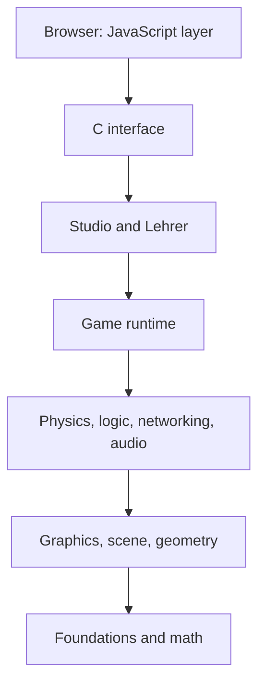

# 1 Welcome to Kern!

> **In short:** Kern is a 3D engine that runs entirely in the browser: it draws worlds, computes
> physics, plays sounds, runs games and even teaches a little robot to walk. Here you get to know
> Kern, its rules, how it is built – and how to read this book.

Great to have you here! Picture a workshop with a canvas, a workbench, a mixing desk and a stage –
and in the corner, a robot duck is learning to walk. This workshop is called **Kern**, and its doors
are open at https://kernengine.de/ – with **Kern Studio**, the editor where you build worlds and
play them right away, with **the Lehrer**, which teaches robot brains to walk, with playable levels
like **Orb Run** and **Physics Lab**, and with the C++ example games `hello` and `orbrun`.

## 1.1 What Kern Is

An **engine** is the motor under the hood of a game: it draws, computes collisions, plays sounds and
reads input. All the game has to say is: "There's a car here, and when you press W, it drives."

Kern is written in **C++20** and compiled to **WebAssembly**, a kind of machine language for
browsers. It draws with **WebGL2**, the browser's graphics interface. Kern grew out of the game
**SpawnCity** and brings its version history along from there. But the engine knows nothing about
SpawnCity: games talk only to the engine, never the other way around.

The same module contains:

- **Foundations and math:** number types, error messages, JSON, vectors and matrices – in meters,
  right-handed, Z up ([Chapter 3](03-foundations.md)).
- a **renderer** (light, shadows, sky, glow, particles) and the **scene**, which sorts out what
  can't be seen and figures out what you clicked on;
- **geometry** for buildings, roads and terrain, and an **app runtime** for games written purely in
  C++;
- the **physics** engine Box3D with bodies, joints and raycasts, and Kern's own **audio** mixer
  with 3D sound and a synthesizer;
- the **game runtime** with levels, actors and multiplayer, **logic** graphs (game rules as boxes
  and arrows; Kern runs them, compiles them to WebAssembly in a flash or outputs them as C++) and
  **networking**;
- **Kern Studio**, an editor modeled on the big game engines, written entirely in C++ and testable
  without a browser, and **the Lehrer**, which trains networks with learning methods like PPO,
  saves them in the ONNX format and matches the simulation against the real robot (calibration);
- a flat **C interface** for JavaScript and a thin JavaScript layer that connects to the browser.

And then there's the **Micro Duck**: a two-legged robot by Pollen Robotics. In Kern, it walks with
its real, trained neural networks (Kern is not affiliated with Pollen Robotics).

## 1.2 The Rules Kern Is Built By

### Everything Homemade

Kern uses neither the graphics library three.js nor the compiler toolchain Emscripten. The renderer
is Kern's own C++ code, which calls WebGL2 directly; it is compiled with **wasi-sdk**, a lean
toolbox built around the clang compiler. The module is a **reactor**: instead of having a main
program, it lets the browser call a start function once and after that whatever it needs at the
moment. Because Kern uses only the oldest WebAssembly features, it runs in every WebGL2 browser,
even Safari from version 15 onward.

### No Engine Logic in JavaScript

Some things in the browser can only be done from JavaScript: the graphics card, mouse and keyboard,
sound, files. Exactly that – and **only** that – is what the platform layer in `kern/web/` takes
care of. The Studio sticks to this too: even the logic editor doesn't keep a graph of its own;
every change is a command sent to the engine.

> **Imagine …** The JavaScript layer is a waiter. It takes your order and brings the food to your
> table. But all the cooking happens in the kitchen – in C++.

The payoff: whatever a game does lives in one place, can be tested without a browser and behaves
in the exported game just as it does in the editor.

### The Same Result Everywhere

**Determinism** means: same input, same result – **bit for bit**, whether on a Linux PC, a Mac with
an ARM chip or in the browser. But computers round some calculations ever so slightly differently.
Kern prevents that: the compiler may not merge multiplication and addition into a single step,
Box3D computes without special processor instructions, Kern brings its own trigonometric functions,
and during training the order of all sums is fixed – no matter how many helpers are computing
along.

This is proven with a **fingerprint** (`kern_lehrer --fingerprint 400`): the duck walks for 400
ticks, after each one its state is turned into a checksum – and the list has to match a reference
file. CI – the automatic test run on every change – compares this on three platforms: GCC on x86,
Apple clang on ARM, and WebAssembly ([Chapter 2](02-building-and-testing.md),
[Chapter 3](03-foundations.md)).

> **Did you know?** Thanks to determinism, a bug in the simulation is a fixed, repeatable bug
> instead of noise. If the simulated duck walks differently from the real one, it really is down to
> the model ([Chapter 16](16-calibration.md)).

### A Few More House Rules

- **No exceptions, no runtime type information (RTTI).** A function reports "that didn't work" and
  leaves a readable message behind; JavaScript reads it with `kern_last_error()`
  ([Chapter 3](03-foundations.md)).
- **Input is checked** before anything changes; broken data doesn't destroy anything. The JSON
  reader rejects nesting that is too deep and dangerous keys like `__proto__`.
- **No new memory per frame** on the JavaScript side: the JavaScript class `KernRenderer` copies
  data into an area that is reused over and over.
- **No cheating on the physics.** Box3D is compiled in unmodified. The Micro Duck stays upright
  only through its motors and feet – no invisible hand ([Chapter 6](06-physics.md),
  [Chapter 13](13-micro-duck.md)).
- **One implementation for every place.** The editor, the game and the Lehrer share the game world
  and the physics.
- **Robust:** if the graphics context is lost, Kern pauses and then rebuilds everything
  ([Chapter 4](04-graphics.md)).

## 1.3 A House with Many Floors

Kern is built in layers. Each one uses the ones below it, never the ones above:

Not every program needs everything. Graphics, audio, logic, networking and foundations are always
included; five **switches** at build time add more ([Chapter 2](02-building-and-testing.md)):
`--app` for games written purely in C++, `--physics` for Box3D, `--game` for the game runtime
(including physics), `--studio` and `--lehrer` (both including game and physics).

C++ and JavaScript exchange data only through the module's **memory**, one big shared block of
numbers. JavaScript reserves space there, writes data at fixed positions (which have to be defined
the same way in C++ and in `kern.mjs`) and tells the engine where it is. Text goes in as a pair of
start position and length; answers from the Studio come back as JSON text, valid until the next
call. In the other direction, the engine calls functions of the browser: WebGL2, the clock, the
console, random numbers and a few more; unknown system calls are answered by a tiny stand-in with
"not supported."

> **Imagine …** Two neighbors without a common language share a mailbox. One puts notes in, the
> other takes them out. That's all the contact there is.

[Chapter 17](17-reference.md) lists all the functions at this boundary.

## 1.4 Four Ways to Use Kern

**A game entirely in C++.** You write a class that inherits from `kern::App`. In `start()` you set
up the world – in the smallest example, `hello`, for instance a gray-green ground that you hand to
the renderer with `upsert` ("insert or replace"); in `configure()` you choose renderer options such
as shadows. After that, the browser calls `kern_app_frame` every frame; that calls `update()`, and
Kern draws ([Chapter 12](12-your-own-games.md)). Its big sibling `orbrun` is a whole game with a
city, vehicle physics, traffic, day and night and its own add-on for the shader, the graphics
card's drawing program.

**Just the renderer, from JavaScript** – this is how SpawnCity uses Kern: `loadKern()` loads the
module, `new KernRenderer(…)` creates the renderer, and `upsert`, `updateInstances`, `setCamera`,
`render` and `pick` do the rest ([Chapter 4](04-graphics.md)).

**Kern Studio and exported games.** `tools/build_studio.sh` packs engine, physics, game runtime and
Studio into **one** HTML file that runs offline, even by double-click. You build a level out of
actors (things in the world) and play it with **Play** or **Simulate** right in the window.
**File → Package Game** turns it into a standalone game, once again a single HTML file: engine
module, two JavaScript files and the level. It starts the same module in player mode, with the same
C++ classes as in the editor ([Chapter 8](08-game-runtime.md), [Chapter 11](11-studio.md)).

> **Try it!** Open Kern Studio at https://kernengine.de/. On first launch, Orb Run is loaded
> (otherwise: **File → Example Levels → Orb Run**). Press **Play** (Alt+P), take off in the
> hovercar and collect a few orbs. Then **Stop** – congratulations, you just played C++ in the
> browser.

> **Watch out!** Kern Studio follows your system language: on a German system, its menus are in
> German. This book uses the English names. To switch, click **DE | EN** at the bottom right of
> the status bar – Studio remembers your choice. Or add `?lang=en` to the end of the address.

**The Lehrer.** It trains networks for the Micro Duck – on your computer as the program
`kern_lehrer` (even without a screen, on a server) or in the browser on the `/lehrer/` page, where
several Web Workers (background helpers), each with its own module, gather experience and one of
them learns from it. Both use the same training recipes and the same game world. Same seed, same
number of ducks: **the same network**, here as there. Networks are saved in the ONNX format, like
Pollen's networks ([Chapter 14](14-lehrer.md)).

In the duck, everything meshes together: a model by Pollen Robotics, limbs as physics bodies with
joints, servos (motors) with a device model, networks that Kern computes itself, a voice from the
mixer, logic nodes in the *Robots* category – and in the Studio, it's simply an actor.

> **Try it!** Choose **File → New Level** and pick one of the six templates there – for example
> **Micro Duck**. Press Play and watch the duck set off, driven by its network.

## 1.5 Where Everything Lives

The source code is openly available at https://github.com/ChristianHohlfeld/kernengine.de. The
engine lives in `kern/`: headers in `include`, implementation in `src`, the JavaScript layer in
`web`, tests in `tests`, the example games in `examples`, Kern's own networks in `policies`, Box3D,
musl and the Micro Duck in `third_party`, and this book in `docs`. Next to it are `tools` (Studio
build, a relay for multiplayer across machines, the Micro Duck import, mesh simplification), `site`
(start page and app files of the installable editor), `generated` (build outputs) and CI in
`.github/workflows/ci.yml`. The complete directory map is in the blue book.

Kern is licensed under the **Apache License 2.0**; `kern/LICENSES.md` lists the third-party
components with their licenses. The individual documents in `kern/docs/` are the sources of this
book; for physics and the Micro Duck, `physics.md` and `walker.md` are authoritative.

> **Watch out!** `kern/README.md` mentions a few SpawnCity files. You'll look for them here in
> vain – they live in the SpawnCity repository.

## 1.6 How to Read This Book

You are reading the **green book**. Its big brother, the **blue book**, has the same content
chapter by chapter, but technical down to every last option. If a topic grabs you, look it up
there.

Along the way, you'll keep running into the same boxes: **In short** (what it's about),
**Imagine …** (an everyday comparison), **Try it!** (a task in Kern Studio), **Did you know?** (an
amazing fact) and **Watch out!** (a typical mistake). At the end of each chapter come **What you
take away** and the **Brain teasers**, with the solutions right below. No peeking! (Okay, maybe a
little.)

The book is built from the bottom up, just like Kern itself: first building and foundations, then
graphics, physics, sound, game, logic and networking, then Studio, Micro Duck and Lehrer, and
finally the [reference](17-reference.md). Appendices explain neural networks
([A](A-neural-networks.md)), real-time graphics ([B](B-rendering.md)) and physics
([C](C-physics.md)).

Where should you start? If you want to change Kern: Chapters 2 and 3 (before physics or the robot,
also 6 and 13). If you're building a game: 11 or 12, plus 8 and 9. If you love the duck: 13, 14,
16. If you're embedding Kern in a web page: 4 and 17.

Code examples come from the real source code. Paths are relative to `kern/` unless they begin with
`tools/`, `site/` or `generated/` – those are in the root of the repository.

## What you take away

- Kern is a 3D engine in C++20 that runs in the browser as WebAssembly and draws with WebGL2.
- Physics, sound, game, logic, networking, editor and Lehrer all live in the same module.
- JavaScript is just the waiter: no engine logic.
- Kern computes the same bit for bit everywhere – a fingerprint proves it.
- C++ games, the renderer, the Studio and the Lehrer all come from the same code.
- The green book explains things simply; the blue one goes into depth.

## Brain teasers

1. Why is it handy that there is no engine logic in JavaScript?
2. A network was trained in the browser. Why does it run exactly the same in the Studio?
3. You build with `--studio`. What comes along automatically?

### Solutions

1. Everything a game does lives in one place in C++: testable without a browser and the same in
   the exported game as in the editor.
2. The Lehrer and the Studio share the game world, servos and physics, and Kern computes the same
   everywhere.
3. The game runtime and the physics; the basic parts are always included.

---

© 2026 Christian Heinrich Hohlfeld · All rights reserved · [Imprint and Rights](00-imprint.md)
