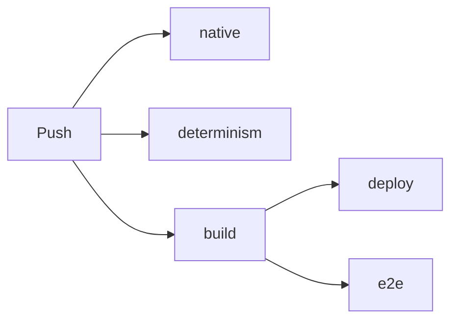

# 2 Building and Testing: The Workshop Behind Kern

> **In short:** Before Kern can run in the browser, the C++ code has to be compiled – and before a
> change goes online, it has to pass hundreds of checks. Here you get to know the build tools, the
> tests, the fingerprint for determinism and the automatic testing line.

## 2.1 The Overview

| Tool | Turns it into |
|---|---|
| `kern/build.sh` | a WebAssembly module |
| `tools/build_studio.sh` | Kern Studio as a single HTML file |
| `kern/tools/lehrer.sh` | the Lehrer for your computer |
| `kern/tests/run.sh` | all unit tests |
| logic and Lehrer tests | checks inside the WebAssembly module |
| `kern/tests/e2e/studio_e2e.mjs` | a real browser test |

The shortest path to the Studio and green tests:

```sh
export WASI_SDK=/opt/wasi-sdk-25.0-x86_64-linux
tools/build_studio.sh
CXX=g++ CC=gcc kern/tests/run.sh
```

Line 1 says where the compiler lives, line 2 builds `generated/studio.html`, line 3 builds and runs
all tests with GCC. You build the example games and the browser Lehrer like this:

```sh
kern/build.sh --app kern/examples/hello/hello.wasm \
  kern/examples/hello/hello.cpp
kern/build.sh --lehrer generated/kern_lehrer.wasm
```

(`orbrun` works just like `hello`.) The finished `studio.html` runs with a double-click, without an
internet connection. For development, you serve the repository root from a web server and open
`kern/web/studio/index.html`; it loads `generated/kern_studio.wasm`. `play.html?level=orbRun` in
the same folder plays a level without the editor (so do `physicsLab`, `shootingRange`, `microDuck`
and `basic`).

## 2.2 The Compiler: wasi-sdk 25

Kern needs **wasi-sdk 25**: the clang compiler, a linker (which glues the pieces together) and the
standard libraries for C and C++, all for the WebAssembly target. Kern doesn't need Emscripten. The
variable `WASI_SDK` points to the folder (otherwise `/opt/wasi-sdk` is used). For tests and the
Lehrer on your computer, a normal compiler is enough (GCC or clang, Apple clang on a Mac); on top
of that come Python 3, Node (CI uses version 22) and, for the browser test, Playwright with
Chromium.

## 2.3 `kern/build.sh`: The Cook

```
kern/build.sh [--app] [--physics] [--game] [--studio] [--lehrer]
              <out.wasm> [options / game sources ...]
```

Without switches, the script compiles the basic stock – graphics, audio, foundations, geometry,
logic, networking, scene and Kern's own math from musl. You know the switches from
[Chapter 1](01-introduction.md). Further arguments ending in `.cpp` or `.cc` are compiled in as
game sources; everything else is passed to the compiler as an option.

Four environment variables control the build: `WASI_SDK` (where), `KERN_BUILD` (`release`: fully
optimized, `-O3` with ThinLTO; `debug`: less optimized, `-O1 -g` without ThinLTO), `KERN_JOBS`
(how many compilers run in parallel, default: all cores) and `KERN_OBJ_CACHE` (where intermediate
results are kept). One small catch: even in debug mode, no debug information ends up in the
module, because the last step always strips it out.

### The Most Important Options

- **`-ffp-contract=off`** everywhere, including for Box3D and musl. Otherwise the compiler would be
  allowed to merge `a*b+c` into a single computing step – which rounds differently depending on the
  processor ([Chapter 3](03-foundations.md)).
- **Box3D on the "scalar path":** without the special instructions that compute several numbers at
  once – just like in WebAssembly.
- **No exceptions, no runtime type information** (`-fno-exceptions -fno-rtti`).
- **Only what is marked is visible from outside,** and every function gets its own compartment, so
  the linker can throw away anything unused.

Linking produces a **reactor** with a 1 MiB stack and a memory that starts at 32 MiB and may grow
up to 2 GiB. The function table can grow – that's where the logic JIT
([Chapter 9](09-logic.md)) puts graphs that it compiles to WebAssembly while the game is running.
At the very end, the script proudly reports `built <out> (<n> bytes)`.

### The Pantry

Each source is compiled separately and in parallel, and ThinLTO, an optimizer, ties them together.
So that a rebuild doesn't cook everything from scratch, there is an **object cache**, which the
Studio and the example games share and which CI keeps from one run to the next. Every piece of C++
carries a label made from the contents of its source, its path and the contents of **all** headers.
Box3D and musl have compartments of their own; there, whatever is missing or older than its source
or the newest header gets recompiled. ThinLTO has its own compartment too.

> **Watch out!** You change a single comma in a header file – and **everything** gets recompiled?
> That's on purpose! Because all headers go into the label, no item in the pantry matches anymore.
> Simple and safe: an outdated piece is never left behind.

## 2.4 Kern Studio as a Single File

`tools/build_studio.sh` builds the module with `--studio` and packs everything into **one** HTML
file: the stylesheet goes right in, the module as base64 text (binary data disguised as letters),
and the JavaScript files strung together into one script, without their `import` and `export`
lines. That way the page runs even under strict security rules. Two scripts are also included as
plain text – the Studio uses them to write exported games. A startup block fires up the engine; if
that goes wrong, a message appears. With `--skip-wasm`, the existing module is reused.

> **Did you know?** If a JavaScript source contains the character sequence `</script`, the build
> stops. The browser would take it for the end of the embedded script and show the rest as
> gibberish.

## 2.5 The Lehrer for Your Computer

`kern/tools/lehrer.sh` builds `kern_lehrer` for Linux and macOS, on x86 and ARM, fully optimized
and using all cores. Almost the whole engine is inside; only the Studio and the app runtime are
missing. Instead of WebGL, there's a stand-in, because the Lehrer doesn't draw. The result lands in
`kern/build/` (or a folder of your choice). With `KERN_NATIVE=1` (the default), the script allows
the best instructions your processor has – that doesn't change any results, because
`-ffp-contract=off` applies. How to use it: [Chapter 14](14-lehrer.md) and
[Chapter 17](17-reference.md).

## 2.6 The Unit Tests

```sh
CXX=g++ CC=gcc kern/tests/run.sh     # all tests
kern/tests/run.sh micro_duck          # only tests with "micro_duck"
```

A **unit test** checks a small piece of code. For this, Kern's code is compiled with two
**sanitizers**, built-in sniffer dogs: the *AddressSanitizer* barks when code reaches into memory
that isn't its own, the *UndefinedBehaviorSanitizer* when it does something C++ forbids. Both stop
immediately. Box3D and musl, third-party code, run without sniffer dogs. On top of that, `-Werror`
applies: **every** warning becomes an error – the build script is more forgiving, the tests are
not.

Kern has a tiny test framework of its own: `TEST(name)` registers a test, `CHECK(condition)`
checks, `CHECK_NEAR(a, b, eps)` compares numbers with a tolerance. For each test, `ok` or `FAIL`
appears (with file, line, expression and `last_error()`), and at the end
`<n> checks, <m> failures`; if anything fails, the program exits with 1. The tests cover the whole
engine: matrices and camera, geometry, renderer, physics, JSON, game, logic, audio, networking,
Studio (does it start with Orb Run? is undo exact?), Micro Duck (does Kern compute its network like
the reference? does it stand, walk and turn?), Lehrer and determinism. Without a filter, the logic
export test follows at the very end.

There is no WebGL on your computer. That's why a **stand-in** (`gl_stub.cpp`) replaces the graphics
interface: it doesn't draw anything, but it writes down what the renderer asked of it.

> **Imagine …** A pilot practices in a flight simulator. No plane takes off, but every button press
> is logged. Afterward, you can see exactly: did the landing gear come up in time?

That way, the tests check without a graphics card whether the renderer validates its input, reuses
shadows or survives a context loss.

## 2.7 Logic: Three Paths, One Result

A logic graph ([Chapter 9](09-logic.md)) runs in the **interpreter** (node by node), as a **JIT**
(compiled to WebAssembly at runtime) or as **exported C++**. All three have to deliver the same
result, bit for bit. Shared test cases like `math_loops` check this: a unit test checks the
interpreter, a second step of `run.sh` checks the exported C++ (`kern_tests --emit-logic` writes
the source code, which is then compiled and compared), and a module of its own under Node checks
the JIT – exactly as in the browser. Each graph really has to run in its tier, for example
`compiled (WebAssembly)`.

> **Did you know?** At the end of the JIT test, there's a race: a million loop iterations,
> interpreted and compiled. The output shows how much faster the JIT is.

## 2.8 The Browser Test

```sh
python3 -m http.server 8771 &
node kern/tests/e2e/studio_e2e.mjs   # default: port 8771
```

Line 1 serves the repository root (`generated/` must be built), line 2 starts the **e2e** test
("end to end"): a real Chromium, remote-controlled with Playwright, that operates the Studio like a
human. It doesn't get a graphics card, but the software emulation SwiftShader instead – which
manages the city at about **one frame per second**. That's why every check waits for its effect
instead of waiting a fixed time. Whether anything was drawn at all is given away by the number of
different colors in the image.

Almost everything gets tested: menus, Fly Mode, selecting and moving, undo, Play, Simulate, four
viewports, templates, the logic editor, the Micro Duck with its head camera, multiplayer across two
tabs, packaging and playing a game, restoring after a reload, settings, narrow windows, phones,
the Android file picker, plus the version of the Studio built from individual files. At the end
comes `<n> checks, <m> failures`; if there are failures, the test exits with 1, and on GitHub
also as an error annotation. Screenshots are taken only when `KERN_E2E_SHOTS` names a folder – many
of the pictures in this book come from there.

> **Try it!** Do what the test robot does: **File → New Level → Physics Lab**. Hold down the right
> mouse button and fly forward with W. Then **Simulate** (Alt+S) – and watch the joints at work.

## 2.9 The Fingerprint

How do you prove that Kern computes **exactly** the same everywhere? The Micro Duck walks with
Pollen's network `velstand` in the Studio physics: 150 ticks forward (command 0.15), then turning
on the spot (0.8). After **every** tick, its entire state – position, rotation, velocities, joint
angles – is turned into a 16-digit checksum with the **FNV-1a** method:

```
0 7588b1a57dfadf95
1 46e1d239a7ed5cfe
```

> **Imagine …** You photograph the duck 400 times and compare each photo with a reference album. If
> a single feather slips by a hair, you even know which photo it's in.

The reference for 400 ticks lives in `kern/tests/determinism_fingerprint.txt`. It is checked with
GCC on x86 (the test names the first tick that differs), in WebAssembly under Node and with Apple
clang on ARM. By hand:

```sh
kern/tools/lehrer.sh
kern/build/kern_lehrer --fingerprint 400 \
  | diff - kern/tests/determinism_fingerprint.txt
```

The Lehrer gets built, prints 400 checksums, and `diff` compares them. No output means: everything
matches. A difference means: either the simulation was changed on purpose (then regenerate the
reference and justify it), or somewhere code is computing in a platform-dependent way.

> **Watch out!** The classic is a `std::sin` instead of `kern::dm::sin` in code that feeds the
> simulation. On your computer, everything runs fine; on the Mac, a tick suddenly differs. Other
> suspects: a missing `-ffp-contract=off` option or a sum whose order depends on the number of
> threads ([Chapter 3](03-foundations.md)).

Another test learns with 1, 2 and 4 workers (always 8 ducks) – the networks have to be identical
byte for byte.

## 2.10 The Automatic Testing Line

**CI** (*continuous integration*) means: on every change, a server checks everything. Kern's
pipeline on GitHub runs on every push to `main`, on pull requests and at the push of a button:



- **native**: unit tests with sniffer dogs, then the logic export.
- **determinism**: builds the Lehrer on a Mac with ARM and compares the fingerprint.
- **build**: fetches wasi-sdk and the pantry from the last run, builds the Studio, example games and
  Lehrer, checks the syntax of all JavaScript files, tests the Lehrer (two ducks collect, one
  learns the `jump` – a small piece of each learning method from [Chapter 14](14-lehrer.md):
  imitation, DAgger, PPO – plus ONNX export and fingerprint) and the JIT, and assembles the
  website: start page, editor, Lehrer page, the duck's networks, example games, licenses. GitHub
  keeps the result for 7 days as a package (artifact) called `site`.
- **deploy**: only for `main`; creates a fresh Git repository and force-pushes it (`-f`) to the
  `gh-pages` branch, and the site appears at https://kernengine.de/. (The `README.md` still
  mentions a separate `pages.yml` – but the repository only has `ci.yml`.)
- **e2e**: the browser test with Playwright 1.56.0, using exactly the files that get published. It
  uploads a screenshot folder but doesn't set `KERN_E2E_SHOTS`.

Tests don't hold up publishing. On `main`, every push runs to the end, so that every green state
goes online – about 17 minutes per run. On pull requests, a new run replaces the old one.

> **Did you know?** The installable editor notices on its own when there's a new version: CI puts a
> file `build.json` with the version ID next to it, and the editor compares.

## 2.11 At Home Like CI

You can reproduce everything locally, in the same order: unit tests, fingerprint, modules, then
these two module tests, and finally the browser test:

```sh
node kern/tests/lehrer_wasm_test.mjs generated/kern_lehrer.wasm
kern/build.sh /tmp/logic_test.wasm \
  kern/tests/logic_wasm_test.cpp -Ikern/tests
node kern/tests/logic_wasm_test.mjs /tmp/logic_test.wasm
```

The pages load their files with relative paths; the duck's networks, for example, come from a
different folder depending on the version (development, single file, published). The Lehrer page
is tailored to the layout of the published site and only runs locally once you assemble it the way
CI does.

## 2.12 When Things Get Stuck

| Symptom | What to do? |
|---|---|
| `wasi-sdk clang++ not found` | set `WASI_SDK` correctly |
| `missing …/kern_studio.wasm` | build without `--skip-wasm` |
| `source contains '</script'` | split up the character sequence |
| test build stops on a warning | fix the warning (`-Werror`) |
| `runtime error`, `AddressSanitizer` | read file and line; run the test alone |
| fingerprint differs | section 2.9 |
| logic runs in `interpreter` | check the JIT output |
| browser test hangs (waits up to 90 s) | start the server, build the Studio |
| Playwright is missing | install it, set `NODE_PATH` |

If the JIT fails, Kern keeps computing in the interpreter (`logic JIT failed …`) – slower, but
nothing breaks.

> **Try it!** In the Studio, the running version is shown at the very bottom of the status bar.
> Type `stat` into the console (**Cmd**) – then frames per second and counter values show up in the
> log.

## What you take away

- `kern/build.sh` compiles to WebAssembly with wasi-sdk 25; switches pick the parts.
- `-ffp-contract=off` everywhere is the cornerstone of identical results.
- The object cache saves time; header changes deliberately rebuild everything.
- Unit tests run with sanitizers and `-Werror`; a stand-in replaces WebGL.
- Logic has to compute the same in the interpreter, as a JIT and as C++.
- The fingerprint compares 400 ticks of the duck on three platforms.
- CI checks every change and publishes to kernengine.de.

## Brain teasers

1. Why do Box3D and musl run without sanitizers, but Kern's code with them?
2. You change a comment in a header. What happens on the next build?
3. Why does the browser test count colors instead of comparing photos?
4. The fingerprint matches up to tick 211 and differs from 212 onward. What does that tell you?

### Solutions

1. They are third-party code, taken over unmodified; the point is to check Kern's own code.
2. Everything gets recompiled, because the contents of all headers are in every label.
3. Software graphics are slow; the number of colors reveals simply and robustly whether anything
   was drawn at all.
4. At tick 212, a different bit comes out for the first time – that's where the bug hunt starts,
   for example at a `std::sin` instead of `kern::dm::sin`.

---

© 2026 Christian Heinrich Hohlfeld · All rights reserved · [Imprint and rights](00-imprint.md)
