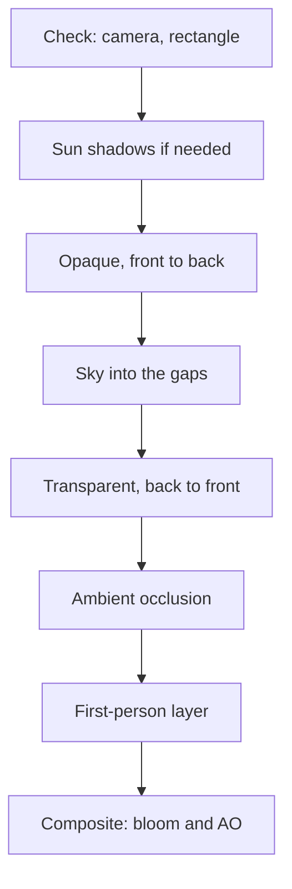

# 4 Graphics – How Kern Paints Pictures

> **In short:** Here you look over the shoulder of Kern's painter: how the C++ code in the browser
> reaches the graphics card, what meshes and materials are made of, what the one big standard shader
> computes in every pixel and in what order a picture comes together – with sun shadows, sky, glow
> and soft shadows in corners. At the end, we make the windows of a city at night light up.

The general foundations – how triangles become pixels, what matrices do, how light and color
work – are in [Appendix B](B-rendering.md). If a term here sounds like Greek to you, feel free to
flip over there. This chapter is about what **Kern** makes of all that.

## 4.1 Overview

Kern's **renderer** – the part that produces pictures – is surprisingly small: a bridge to WebGL2,
a shader construction kit, meshes and materials, the renderer itself, four extra painting passes
(shadows, sky, bloom, ambient occlusion), plus particles and lights. Three principles shape
everything:

1. **One program for everything.** Every object is painted with the same **standard shader** (a
   shader is a small program on the graphics card). Games that want to look different plug small
   **extensions** into this one shader instead of writing their own.
2. **Upload once, then only movement.** A shape travels to the graphics card once; after that, only
   *where* it stands changes. The work per frame follows what moves, not the size of the world.
3. **The copy in main memory is the truth.** Kern also keeps every shape in working memory. From it,
   Kern works out what is visible and what you click on – and uses it to rebuild everything when
   the browser takes the graphics card away (4.11).

> **Imagine …** … a theater. The sets are carried onto the stage once; in every performance only
> the actors move. And for every set there is a blueprint in the drawer – if the stage burns down,
> everything stands there again tomorrow exactly as before.

## 4.2 The WebGL2 Binding

Kern is compiled with wasi-sdk to **WebAssembly**, a compact format that the browser runs almost as
fast as machine code – without Emscripten and without automatically generated JavaScript "glue."
The graphics commands are plain **imports**: When it loads, the module says "I need
`drawElementsInstanced` from the package `kern_gl`," and the web page hands the function in. The
list in `gl.h` is, according to its comment, "exactly what the engine uses"; a new command gets
added there and in `web/kern.mjs`.

**Only numbers** cross the border between WebAssembly and JavaScript:

- **Graphics objects are numbers.** JavaScript puts the real object into a table and gives Kern the
  slot number; `0` means "nothing." It's like a coat check: You get a ticket, not the coat.
- **Data is "address plus length."** JavaScript looks through a window directly into Kern's memory
  and passes the bytes on to WebGL **without copying**. When Kern's memory grows, `refresh()`
  renews these windows.

Outside the browser, in the native tests, the imports stay empty; there a stand-in
(`tests/gl_stub.cpp`) is attached that merely records the GL calls.

According to its header comment, `web/kern.mjs` does exactly three things and contains **no engine
logic**: load the module with its imports (plus a tiny WASI for the console, random numbers and the
clock – the engine never touches files), manage the number tables and the context loss, and offer
`KernRenderer`, a convenient facade for JavaScript. A second import package, `kern_env`, supplies
the engine with, among other things, the time, the page's terrain height, pointer lock, status
messages and the route by which logic graphs compiled to WebAssembly get into the module
([Chapter 9](09-logic.md)).

The web page creates the access to WebGL2 (the **context**). On the engine side, the page does without the
built-in antialiasing, because Kern paints into its own intermediate pictures anyway (4.7); Kern
Studio and exported games create their context themselves and switch it on.

You can use the renderer in two ways: **C++ games** write a `kern::App`, in which every frame first
runs the game (`update`) and then the painting (`render`) – that's how the "hello" example and Orb
Run work ([Chapter 12](12-your-own-games.md)). **JavaScript programs** such as SpawnCity use
`KernRenderer`, exactly one per module. Kern Studio has a third interface of its own
([Chapter 11](11-studio.md)); inside, the same renderer is at work.

## 4.3 Programs and the Uniform Cache

A **program** consists of a vertex shader (computes every corner) and a fragment shader (computes
every pixel). Kern compiles both and reports errors with a name tag in front, such as "standard
fragment shader: …". If it asks for a setting that the compiler optimized away, it gets the number
`0` – and every set command ignores `0`. An unused value costs nothing. When cleaning up, Kern
distinguishes two cases: If the graphics card is still alive, it deletes the program; after a
context loss, the program is already dead, and Kern just forgets the number.

**Uniforms** are values that stay the same for an entire draw call: color, roughness, sun
direction. The graphics card remembers them. The **uniform cache** takes advantage of that and
only sends what has really changed:

```cpp
void UniformCache::set_float(u32 location, f32 v) {
  if (!location) return;
  Entry& e = entry(location);
  if (e.kind == 2 && e.count == 1 && e.f[0] == v) return;
  e.kind = 2; e.count = 1; e.f[0] = v;
  gl::uniform1f(location, v);
}
```

Line by line: Number 0? Return right away. Fetch the note for this number. If exactly this value is
already written there, return. Otherwise update the note and only then actually send. Large values
such as matrices are compared by the cache using a **fingerprint** (hash) instead of number by
number. Only the bones of animated characters go through uncached – they change every frame anyway.

> **Imagine …** … every sentence to the graphics card costs postage. If you say "The color is blue"
> ten times, you pay ten times. The cache is the colleague who says: "You already said that, it's
> still there."

This pays off because every command travels from WebAssembly through JavaScript into WebGL, which
checks it once more.

## 4.4 Mesh, Material and MeshInput

### Corners and Instances

A **mesh** is a shape made of triangles. Every corner (**vertex**) carries a position, a **normal**
(where the surface points), a color and a **texture coordinate** (which image point sticks here);
characters with a skeleton also carry four bone numbers and weights each. Two slots are free for
extensions.

Other data applies **per instance**. An instance is a copy of the mesh in another place – like a
hundred trees from one template. Per instance there is the model matrix (position, rotation,
size), a color shade (**tint**) and the normal matrix (so that normals are still right after
stretching, Appendix B). The clever part: **Every mesh is instanced**, even with only one instance,
and is painted with exactly one draw call. Kern computes the normal matrix per instance on the CPU.
Kern rejects broken matrices (for example, squashed to size zero).

Limits you should know: **32 bones**, **6 point lights**, **2 extra streams** and **8 number
parameters** for extensions.

### The Material

| Field | What it does |
|---|---|
| `color` | base color with opacity |
| `alpha` | opaque, cut out (threshold 0.5) or translucent |
| `roughness`, `metalness` | rough or smooth, metal or not |
| `emissive` | self-illumination, may be above 1 |

On top of that come switches such as `unlit` (color only, no light), `double_sided`, `cast_shadow`
and `frustum_culled` (may be left out when out of view). Some deserve a second look:

- **Colors are sRGB**, the usual color space of images and color pickers. Kern multiplies vertex
  color, tint, material color and texture pixel and converts the result into linear light (why:
  Appendix B). With `linear_colors` that step is skipped; `emissive` is already linear.
- **Only opaque things cast shadows.**
- **`viewmodel`** is the first-person layer: These meshes come at the very end, after the depth is
  cleared. A wall in front of you doesn't cut off the weapon in your hand. Studio paints its gizmos
  there.
- **`lines`** turns the mesh into lines – automatically unlit, without shadows, not clickable.

The graphics card normally throws away the back sides of triangles. Kern keeps them for
double-sided materials, lines and instances that are mirrored in a mixed way; if *all* instances
are mirrored, it throws away the front sides instead.

> **Did you know?** To the graphics card, a mirrored object is "turned inside out," because the
> winding order of its corners flips. That's why mirrored and normal copies can't be handled
> correctly in a single draw call – so Kern simply shows both sides.

### Creating with `upsert`

You hand over new meshes as a **MeshInput**. Only the positions are required; if normals are
missing, Kern computes flat ones for loose triangles (otherwise they point up); if colors are
missing, everything is white; if instances are missing, there is one. `upsert` (from *update* and
*insert*) creates a mesh or replaces it – **atomically**: first check everything (finite numbers,
valid indices, matching lengths, bone weights that add up to 1, no broken matrices), then swap.
If the check fails, **the old mesh stays visible**. For an editor that is worth its weight in gold:
A half-finished intermediate state deletes nothing. The renderer hands out the mesh numbers itself,
so that two owners never share one slot.

When uploading, Kern creates fixed buffers for the vertex data, three changeable ones for the
instances and one for the vertex numbers. With **at most 65,536 vertices**, it stores these numbers
with 16 instead of 32 bits – half the space in the most common case. Static world objects with 36
triangles or more (exactly one instance, not moved, rotated or stretched, without a skeleton, not
lines) also get a **BVH**, a table of contents for fast mouse clicks
([Chapter 5](05-scene-and-geometry.md)). `remove` releases a mesh and its number again.

### Moving with `update_instances`

Everything that moves goes through `update_instances`, frugal to the bone: New tints alone upload
only the tint buffer. Byte-identical data does **nothing at all**. If there isn't enough room, the
buffer is at least doubled, so that fluctuating instance counts don't keep needing new memory. If
matching tints are missing (not exactly four numbers per instance), all instances are white. More
adjustment knobs: setting new bones (same number of bones as when the mesh was created), visibility,
material (lines don't turn into triangles this way, and vice versa) and layers. Anything that
affects a shadow caster is noted by Kern for the shadow map (4.8.1).

Every mesh also has a **layer mask** whose bits work like light switches. For each frame, the mask
decides what is painted and what casts shadows; when clicking, it filters the same way. This is how
Studio separates, for example, the grid, icons, gizmos per viewport, the collider display and the
worlds of several network players.

Kern creates **textures** (pictures stuck onto surfaces) itself – with options for mipmaps (shrunken
versions for distant views), repeating and a pixelated look – and keeps a copy of their pixels. Or
the web page registers a texture of its own and leaves instructions for how it gets refilled after
a context loss. Every mesh has at most one color texture (unit 0; the shadow map sits on unit 1).

> **Try it!** Open https://kernengine.de/, create the template **Basic** with **File › New Level…**
> and drag a **Cube** into it from the Content Drawer (group *Shapes*). In **Details**, under
> *Material*, play with **Roughness**, **Metallic** and **Emissive**. Then switch on **Unlit** – and
> the cube is suddenly a flat blob of color without light and shadow.

## 4.5 The Standard Shader

At startup, Kern assembles its one shader from fixed building blocks and inserts the extensions'
snippets at agreed-upon places. The result is exactly **one** program.

The **vertex shader** builds the model matrix for each corner from the instance data, applies the
skeleton for characters and computes the world position, normal and screen position. The
**skinning** (skin follows bones) is the classic "linear blend skinning": Every corner follows up to
four bones according to their weights.

> **Imagine …** … a corner at your elbow hangs 60% on your upper arm and 40% on your forearm. When
> you bend your arm, it ends up in between – the skin doesn't kink, it bends smoothly.

The **fragment shader** computes per pixel and writes **three pictures at the same time**:
`outColor`, the finished picture as you see it; `outHdr`, the real amount of light before tone
mapping (for the glow); and `outAo`, a record for the ambient occlusion. In between: read the
texture, compute the opacity (instance opacity times material times texel), throw away everything
below the threshold for cut-out materials, linearize the color, light it, tone-map it, add fog.

### Light and Material

The model is based on the standard material of three.js – a simplified **PBR** (physically based
rendering, Appendix B). The light of a pixel has several ingredients:

| Ingredient | Everyday picture |
|---|---|
| Sun, with shadows | a flashlight very, very far away |
| Hemisphere light | blue sky above, brown field below |
| Sky irradiance | light from a colorful dome |
| up to 6 point lights | light bulbs with a range |
| Shine and reflection | a highlight on an apple |
| Self-illumination | a neon tube |

**Sun:** The more directly it shines on a surface, the brighter (Lambert, Appendix B), times the
shadow factor (1 = lit, 0 = shadow). **Hemisphere light:** Surfaces pointing up get the sky color,
surfaces pointing down get the ground color (Z is up). **Point lights** fade **smoothly to zero** up
to their range.

Kern carries sky and ground light along in a variable of its own, `indirect`. Why? Later, the
ambient occlusion should darken **only this** light; the sun and lamps have their own shadows. By
the way, metals have no diffuse light – their color is entirely in their shine.

**Shine** only exists for metal or roughness below 0.95: a reflection of the sky and a sun
highlight. It includes **Fresnel** after Schlick (at a grazing angle everything reflects more
strongly – think of a lake) and the **GGX distribution** (size and sharpness of the highlight).
Non-metals reflect only 4% when viewed head-on, metals reflect in their base color.

> **Did you know?** Very smooth surfaces can produce absurdly bright highlights in the math –
> single pixels that flash up as flickering stars in the bloom. That's why Kern caps the GGX value
> at 40.

**Glass:** If an extension declares a surface to be glass (`surfaceGlass`), it reflects the sky,
more strongly at a grazing angle. That way, panes look bright instead of black.
**Self-illumination** (`emissive`) is added last, linear and **without an upper limit** – values
above 1 later turn into glow.

### From Light to Pixel – and Fog

Kern's light values are often above 1 (the sun around 2.8), but a screen can only show 0 to 1. So:
save the real light in `outHdr`, then squeeze it gently into 0 to 1 with the **ACES film curve**
(the three.js version, including exposure) – like photographic film that rounds off bright areas
softly. Kern's **color grading** optionally follows: saturation ×1.14, a gentle S-curve, warmer
highlights, cooler shadows (can be switched off in the renderer and bloom settings). Then sRGB.

As in three.js, the **fog** comes **after** the sRGB conversion, as "FogExp2." With the default
density of 0.00085, it is barely there after 100 m (0.7%), and after 1000 m it is already a good
half (51%). Three extras bring it to life: **height falloff** (haze on the ground, clear above the
rooftops), **sun scattering** (toward the sun it glows in the sun's color) and **horizon fog**
(4.8.2). If all of them are off, it looks just like in three.js.

Finally, the **AO record** contains, per pixel, what share of the light is indirect (per color
channel, already reduced by the fog) and the brightness of the base color. Transparent things and
the first-person layer count as unoccluded.

## 4.6 Shader Extensions

Your game needs glowing windows or a force-field dome? Then you write a **ShaderExtension**: GLSL
snippets (GLSL is the shader language) for fixed insertion points. The engine stays unchanged.

> **Imagine …** … a finished paint-by-numbers picture with six fields marked "You may add something
> here." Your extension fills in exactly these fields – it can make the picture prettier, but it
> can't break the rest.

| Point | What you may do there |
|---|---|
| `vertex_declarations` | declare your own values in the vertex shader |
| `vertex` | change the color, opacity, UV of a corner |
| `fragment_declarations` | declare your own values and functions |
| `fragment_discard` | throw pixels away early |
| `fragment_input` | treat colors as linear |
| `fragment_surface` | change base color, glass, glow before lighting |

The game hands in its extensions when the renderer starts (in an `App` via `App::extensions()`).
Every snippet gets a comment line with the extension's name, so that compiler errors point to the
culprit right away. An extension can also:

- bring along **its own vertex data**: at most two streams in total (slots 14 and 15), 1–4 numbers
  each. C++ supplies them in the `MeshInput`, JavaScript as a named field in
  `KernRenderer.upsert`. If the stream is missing, the shader reads (0, 0, 0, 1);
- name **integer material parameters** (at most 8) and set its own uniforms from them per draw
  call;
- set **its own uniforms** once per frame – ideally through the uniform cache, so it saves along
  with everything else. It looks up their numbers each time the program is built, including after
  a context loss.

An example follows in 4.13.

## 4.7 The Sequence of a Frame

A **frame** is one picture – one page in a flip book. At 60 frames per second, Kern has a little
over 16 milliseconds for it:



First, Kern **checks** the camera and the picture rectangle before it touches the graphics card. If
the browser supports it, a **stopwatch** measures the GPU time; the result only arrives a few frames
later (until then the statistics report −1). The **shadow map** is only repainted when needed.

Then Kern chooses the **target**: normally a scene target of its own, as long as bloom is on and
supported by the device; otherwise it goes directly to the screen. If it paints into only part of
the window, for example one of four viewports, it goes directly to the screen – and then **without
bloom and without ambient occlusion**.

During **sorting**, anything invisible gets thrown out, as does everything outside the view
pyramid – except characters with a skeleton, whose pose can stick out of their resting hull. Opaque
things are painted **front to back**: Near surfaces fill the depth buffer, and everything behind
them fails the depth test before the expensive shader runs. Transparent things are painted **back
to front**, like transparencies on an overhead projector. Kern sets the camera and light once per
frame; there is one draw call per mesh, and textures or back-face settings are only switched when
they change.

After that come the sky, transparent things, ambient occlusion (before the first-person layer,
because its depth clear would wipe out the world depth), the first-person layer, the **composite**
and a **statistics** report with draw calls, triangles, instances and times.

The scene target has three color layers: the finished picture (4 bytes per pixel), real light as
16-bit floating-point numbers (8 bytes) and the AO record (4 bytes). Together that's **16 bytes** –
according to a code comment, exactly the budget that tile-based phone graphics chips keep per pixel
in their fast memory. That's why the AO record deliberately uses only 8 bits per channel.

> **Watch out!** WebGL requires every draw call to write into **all** attached color layers. That's
> why even the sky delivers an empty AO record. If you build your own painting passes and forget
> this, you get errors.


So if you set up four viewports in Kern Studio via **Window › Viewport Layout**, the lights stop
glowing and corners look flatter. With one viewport, the glow and the soft corner shadows are back.

## 4.8 The Passes in Detail

A **pass** is a separate painting run with its own shader. Kern has four.

### 4.8.1 Sun Shadows

Kern paints the scene once **from the sun's point of view** and, for each map point, remembers only
the distance to the nearest object – the **shadow map** (basic principle in
[Appendix B](B-rendering.md)). Default: 512 × 512 points over ±120 m, a small safety margin (bias
0.0012) and a filter with 1, 4 or 9 samples. Allowed are 128 to 4096 points (powers of two), ±10
to ±2000 m and a bias below 0.04. Studio uses 4 samples on phones and 9 on desktops; `?shadowFilter=1`,
`4` or `9` in the address overrides that.

**Shadow distance.** 512 points over 240 m – almost half a meter per point! Far too coarse for a
duck. With the **shadow distance**, the map only covers what you see up to that distance. In
levels: **World Settings › Shadow distance** (default 80 m, 10 m in the Micro Duck level). More
precisely, the map encloses a **sphere** around the camera's visible cone (after Valient, 2008). A
sphere stays the same size however you turn – and so do the map points. Without a shadow distance
(the renderer's default is 0) or with an orthographic camera, the fixed square around the camera
target applies.

**Snapping.** If the map moves along by fractions of a point, shadow edges land on the grid
differently each time and flicker. Kern rounds its position to **whole map points**.

> **Imagine …** … you draw a slanted line on tiles. If you shift the tile pattern a little, the
> staircase edge looks different every time. If you only shift by whole tiles, the little stairs
> stay the same – and hardly stand out.

**Reuse.** From the map position, sun direction, extent, a counter for shadow casters (it goes up
when one appears, disappears, moves or changes its material) and the active layers, Kern forms a
key. Only when it changes is the map repainted. Over a static city with a camera that stands still,
the shadow costs **not a single draw call**.

**Painting and sampling.** Only depth is painted – only shadow casters on the active layers that
lie within the sun's view pyramid – with a lean shader and a small polygon offset against **shadow
acne** (stripes where a surface shadows itself). When looking things up, the graphics card can
compare depths directly and blend four neighbors – level 1. Levels 4 and 9 combine this into a
larger, soft filter (after Castaño, 2013, from the game "The Witness"): Every sample sits so
cleverly **between** the points that the built-in blending delivers exactly the right weights. On
top of that comes the **normal offset** (after Holbert, 2011): Kern looks up the shadow a tiny bit
away from the surface, along the normal, more so with grazing light. That prevents acne without a
large bias detaching the shadow from the object.

Outside the map, everything counts as lit; surfaces that point away from the sun don't even look.
With a shadow distance, the shadow fades out gently over the last tenth.

**Rule of thumb:** Extent and resolution together determine the point size. Orb Run uses 2048
points over ±110 m, so 220 m / 2048 ≈ **a little over 10 cm per point**; "hello" uses 1024 points
over ±40 m. Studio creates the map with 2048 points and uses the shadow distance in levels.

> **Try it!** Load **File › Example Levels › Micro Duck** and set the **Shadow distance** in
> **World Settings** from 10 to 200 m: The shadows of the duck and the ball get mushy. Back to 10 –
> razor sharp. Smaller means sharper, but doesn't reach as far.

### 4.8.2 Sky

The sky is a single screen-filling triangle **all the way at the back**. Kern paints it *after* the
opaque things, with the depth test on – only pixels where nothing lies yet pass. So the elaborate
sky shader only runs where sky is actually visible.

Per pixel it mixes: a **gradient** from horizon color to zenith color (dark blue at night), the
**golden hour** (the lower the sun, the more orange the horizon and the more violet the zenith), a
**sun** with a soft halo and a sharp disk, at night **the moon and twinkling stars**, **clouds**
made of five layered noise patterns (pushed along by the wind, pushed away by explosions as if by a
shock wave) and, if you like, **horizon fog**, in which the horizon dissolves into the scene's fog
color – the thinner the scene's fog, the thinner this haze as well. When the sun sinks a little
below the horizon, the disk and halo disappear; below the horizon, the sky blends into the horizon
color. Orthographic cameras have no sky; there the clear color remains, the base color every
picture starts with.

### 4.8.3 Bloom and Composite

**Bloom** is the glow around very bright spots. It needs intermediate pictures with floating-point
numbers; if the device can't do that, Kern reports "unsupported" and paints directly. The steps:
**cut out the bright parts** (at a quarter of the size, with a soft transition starting at about
0.88), **blur** – horizontally, then vertically, nine weights with only five reads (trick in
Appendix B) –, **once more** at an eighth of the size for the wide glow, then **composite**.

The composite is smarter than it looks: It takes the finished picture and adds only the
**difference** between "light with glow and AO, through the film curve" and "light without them,
through the same curve." Why so complicated? The finished picture already contains the fog, which
is missing from the copy of the light. Developing it anew would mean: fog gone. Pixels without glow
and occlusion are simply copied.

> **Imagine …** … a photo that's already framed. Instead of developing it again, you lay a thin
> sheet of film with the glow over it. The frame – the fog – stays as it is.

**The guard.** If the averaged frame time stays above 27 milliseconds for longer than 3.5 seconds
(so below about 37 frames per second), the glow switches itself off for the session, unless it is
forced. The composite keeps running, because it also brings the AO into the picture. When the page
is hidden, Kern resets the guard – otherwise throttled background frames would switch off the glow.

### 4.8.4 Ambient Occlusion (GTAO)

**Ambient occlusion** (AO) means the soft shadows in corners, cracks and under things, where less
skylight gets in. Kern uses **GTAO** (after Jimenez and colleagues, 2016) in the form of Intel's
XeGTAO; Appendix B explains the method. What's special about Kern: **no extra painting pass** for
the geometry.

1. During normal painting, the shader also writes down the indirect share of the light (4.5).
2. GTAO computes from the finished depth how strongly each point is occluded.
3. The composite darkens **exactly the indirect share**. Sun and lamps stay untouched.

That way, the AO sits in the physically right place. Kern also skips a pre-pass because Apple and
Mali graphics chips throw away hidden pixels in hardware anyway.

Simplified, the main pass does this: It reconstructs the position from the depth value, also gets
the normal from the depth (per direction, the neighbor with the smaller depth jump counts),
converts the **radius** (default 1.6 m) into pixels and searches in a few directions, left and
right, for the **highest horizon**. The directions rotate according to a 4×4 pattern, which an
edge-aware filter averages away again. When the result is applied, **multi-bounce** helps: Bright
surfaces get back light that bounces back and forth between the walls – a white corner of a room
gets less dark than a black one.

**Quality** (directions × steps per side): low 1 × 2, medium 2 × 2, high 3 × 3, ultra 9 × 3.
The default is medium at half resolution; on slow devices a guard first lowers the quality and then
switches to half resolution. Studio and exported games use medium/half on phones, otherwise
high/full; `?ao=off|low|medium|high|ultra` and `?aoRes=half|full` override that. A strength
(`power`, default 2.2) makes the occlusion stronger. The radius belongs to the scene, not the
device: Levels set it in the World Settings, and 0 switches AO off for that scene. AO only runs with
a scene target (not in partial viewports, not without bloom support) and a perspective camera.

> **Try it!** In **World Settings**, set the **Ambient occlusion radius** to 0: Corners and joints
> look flat, objects float. Then 1.6 (the default) and, as a test, 4 – do you see how things
> "grow into" the ground?

## 4.9 Particles and Point Lights

Sparks, smoke, muzzle flashes: Kern's **particles** are small squares that turn toward the camera –
all together **one** instanced, transparent mesh, purely visual, without physics. Each one has a
color, a lifetime (16 to 10,000 ms, default 350), a size (default 35 cm) and, if you like, gravity,
growth and faster fading. A system holds 1 to 4096 particles; when it's full, a new one is rejected
and counted. Every frame, Kern moves them (starting point plus velocity times time, minus falling),
sorts them **back to front** and fades them out over their lifetime. The particle mesh is unlit,
double-sided, casts no shadow, is never culled and is invisible as long as no particle is alive. The
game runtime uses 512 particles; JavaScript reaches the same class through `kern_fx_*`.

> **Watch out!** The particle clock never runs backward. That's on purpose: Otherwise sparks that
> faded long ago would reappear after a pause like ghosts.

The shader only knows six point lights. If a game has twenty lamps, the **LightPool** picks the six
most important ones every frame: brightness divided by (1 + distance / range), where the range
counts as at least 4 m; in a tie, whoever asked first wins. It caps brightness above 100 and range
above 1000 m. Example: Lamp A, brightness 10, range 10 m, 30 m away: 10 / (1 + 3) = 2.5. Lamp B,
brightness 4, same range, 5 m away: 4 / 1.5 ≈ 2.7 – the weaker but closer one wins. That's how Orb
Run registers a headlight in front of the car and one light per orb.

## 4.10 Settings

The complete lists are in the blue book and in [Chapter 17](17-reference.md); here are the most
important points. The basic settings are the picture size (default 960 × 540), sun shadows (default
off), bloom, AO and color grading (on). Shadows, shadow distance, filter, AO, AO radius and point
lights can be changed at runtime; `invalidate` forces a repaint, including the shadow map if you
want.

With every frame you pass **RenderParams**: the clear color (dark blue, visible where there is no
sky), optionally a partial rectangle (then without bloom and AO), whether the page is hidden
(suspends the guards), the layer mask and whether the sky is painted.

All light colors are stored in the renderer as linear values already multiplied by their strength;
in the code, the defaults are called "production day": sun at a slant from above from the direction
(−0.45, −0.52, 0.72), sun color (2.8, 2.47, 2.11), fog density 0.00085, exposure 1, environment
strength 0.9. The sky is controlled by the sun and moon direction, night (0 to 1), clouds, wind and
explosions. In levels you don't have to set any of this by hand: The game runtime computes
everything from the **time of day**, with sun to skylight at about 5 : 1, the hemisphere light only
as a night-time brightener, a ground color of the environment dome taken from the light a road
reflects, and height fog, sun scattering and horizon fog switched on
([Chapter 8](08-game-runtime.md)).

The **camera** has an eye point, a target, an up direction (Z), a 60° opening angle, a near plane
at 0.05 m and a far plane at 1800 m, and can optionally be orthographic. The world is **Z-up, in
meters**.

## 4.11 Context Loss

A browser may take the graphics card away from you at any time – when memory runs low, when the
driver restarts or on a phone in the background. Many websites then show nothing but black. Not
Kern:

1. **Loss:** The page tells the browser "I want that back!" (otherwise there would be no
   restoration). Kern forgets all graphics numbers; `render()` politely declines with "GL context
   lost; waiting for restoration". Meshes and textures remain as copies, and `upsert` keeps working.
2. **Restoration:** First the page refills its own textures, then Kern rebuilds programs, passes and
   extensions and uploads everything from the copies.
3. **Failed?** Kern cleans up and can cleanly try again later.

The same mechanism allows **headless mode** without any graphics card at all, for example in the
Lehrer ([Chapter 14](14-lehrer.md)).

> **Did you know?** This is exactly why Kern keeps the copy in main memory (principle 3). What
> looks like wasted memory is really an insurance policy.

## 4.12 Performance Notes

- **Instance instead of copying:** The runtime's city paints all tree trunks as one mesh and all
  treetops as a second one.
- **Combine static things:** The building and road builders pack many small parts into a few large
  meshes – fewer draw calls, less sorting work.
- **Only upload what changes;** identical data costs nothing, pure color changes cost little.
- **Go easy on shadows:** Every movement of a shadow caster repaints the whole map. Anything that
  doesn't need a visible shadow gets `cast_shadow = false` – Orb Run does that for roads and the
  ground. With a shadow distance, the map is also repainted as soon as the camera moves by one map
  point.
- **16-bit indices** come automatically; `weld` ([Chapter 5](05-scene-and-geometry.md)) turns loose
  triangles into lean indexed meshes.
- **Leave frustum culling on:** Switch it off (`frustum_culled = false`) only for things whose hull
  isn't right, such as particles.
- **Measure instead of guessing:** The statistics show draw calls, shadow reuse, triangles and
  times; in JavaScript, `KernRenderer.render()` returns them as an object. AO and bloom adapt
  themselves anyway.

## 4.13 Example: Windows That Light Up at Night (Orb Run)

In Orb Run, the city's windows light up at night – but the buildings **have no windows at all**.
They're smooth boxes! The windows are only painted by the shader, with an extension called
`NightWindows`.

The building builder ([Chapter 5](05-scene-and-geometry.md)) gives every corner a **wall record**
with four numbers: wall length (−1 for the roof, −2 for the cornice), wall height, a random seed per
building and the story height. The texture coordinates are meters along the wall (u) and above the
ground (v). Over every wall, the shader lays an invisible grid of 3 m wide columns and story rows.
An excerpt from `fragment_surface`:

```glsl
float column = floor(u / 3.0), floorIndex = floor(z / story);
vec2 cell = vec2(fract(u / 3.0), fract(z / story));
base = mix(base, vec3(0.05, 0.06, 0.08), win * 0.85);
surfaceGlass = max(surfaceGlass, win * (1.0 - lit * uNight) * 0.7);
```

- Line 1: Which column, which story am I in? (`floor` rounds down.)
- Line 2: Where in the cell am I, from 0 to 1? (`fract` takes the part after the decimal point.) If
  the point lies in the middle part, there's a window here (`win`).
- Line 3: Window areas become almost black.
- Line 4: Unlit windows become glass and reflect the sky – all of them during the day, only the
  dark ones at night.

The rest in words: The snippet only acts on roughly vertical walls, from one story above the ground up
to 1 m below the roof edge. Whether a window is lit is decided by a **hash** of column, story and seed –
about **58%** are on. Lit windows get a warm `emissive` times `uNight` and glow thanks to bloom. In
the distance, the grid would become finer than a pixel and flicker wildly (**aliasing**); `fwidth`
measures that, and Kern then replaces the windows with an average glow of the facade. The vertex
shader passes the wall record on **`flat`**, that is, without interpolation: It is constant per
wall, and tiny rounding errors would scramble the hash – windows would flicker on and off. The
extension sets the uniform `uNight` once per frame through the cache, from the day-night cycle.

> **Imagine …** … a die that **always rolls the same number** for the same window. That's exactly
> what the hash is: Window 7 on the 12th floor is lit every night, and nobody had to remember it.

The extension is plugged in via `App::extensions()`. Building chunks get the wall stream in slot 0,
roads and ground tiles get none – there the shader reads a wall length of 0, and the snippet does
nothing. The game runtime has a class `kern::game::NightWindows` with identical shader code, which
Studio and exported games always register; whether a **Procedural City** supplies the stream is
decided by its switch **Lit windows at night**.

> **Try it!** Load **File › Example Levels › Orb Run** and type into the console at the bottom
> (**Cmd**) first `tod 0.75` – the golden hour colors the sky – and then `tod 0.95` for night. Dark
> glass windows, warmly glowing windows, a soft shimmer in the distance. Select the city and switch
> off **Lit windows at night** in **Details** – then its buildings no longer get glowing windows.

## What you take away

- Kern paints **everything with one standard shader**; games extend it through six insertion
  points.
- Shapes are **uploaded once**; after that only instances change, and identical data costs nothing.
- The uniform cache saves every call that says nothing new.
- Every pixel ends up in **three pictures**: the finished picture, the real light, the AO record.
- The shadow map covers a **sphere** around the view, snaps to the grid and is only repainted when
  needed.
- AO darkens **only indirect light** and needs no second geometry pass.
- Kern survives a **context loss** thanks to the copies in memory.
- Partial viewports have neither bloom nor AO.

## Brain teasers

1. Why does Kern sort opaque things front to back, but transparent things the other way around?
2. A game moves a small ball that casts a shadow every frame. What does that cost, and how can you
   save?
3. Why is the shadow map with a shadow distance a sphere and not a box that fits exactly?
4. Nothing glows in the four-viewport view. Is your device too slow?
5. Why is the night windows' wall record passed on `flat`?

### Solutions

1. That way, hidden things fail the depth test early and save shader time. With transparent things,
   the order of the layers matters – so the back comes first.
2. Every movement repaints the whole shadow map. If the ball doesn't need a visible shadow:
   `cast_shadow = false`.
3. A sphere stays the same size when you turn, and so do the map points – the edges don't flicker.
4. No: Partial viewports paint with a rectangle directly onto the screen, without bloom and AO.
5. It is constant per wall; interpolation would only bring rounding noise that scrambles the window
   hash.

---

© 2026 Christian Heinrich Hohlfeld · All rights reserved · [Imprint and rights](00-imprint.md)
