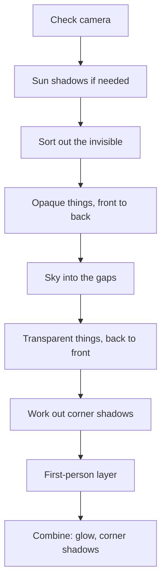

# 4 Graphics – How Kern Paints Pictures

> **In short:** Here you look over the shoulder of Kern's painter: how Kern reaches the graphics
> card, what shapes and materials are made of, what the one big paint program calculates for
> every pixel, and in what order a picture comes together – with sun shadows, sky, glow and soft
> corner shadows. At the end, we make the windows of a city at night light up.

> **Key terms:**
> - **Graphics card** (also GPU) – the special chip that colors in millions of pixels at the same
>   time.
> - **Mesh** – the wire frame of triangles that a 3D thing is made of.
> - **Shader** – a small paint program that runs on the graphics card.
> - **Normal** – an imaginary arrow pointing straight out of a surface: where the surface
>   "looks".
> - **Depth buffer** – an invisible second picture that remembers, for every pixel, how far away
>   whatever was painted there is.
> - **Draw call** – a single "Paint this!" to the graphics card. Each one costs time before any
>   painting even happens; so better a few big ones than lots of small ones.

Other words – such as how Kern calculates with light and color – we explain where they're needed.
If you want to get to know the craft behind it at your leisure – how triangles become pixels, how
light and color work – it's best to read **[Appendix B](B-rendering.md) first**; but you don't
have to. Here it's about what **Kern** makes of it. The exact names and values are in the blue
book, Chapter 4.

## 4.1 Overview

Kern's **renderer** is the part that produces pictures. It paints the things in the world and, in
separate painting passes, adds sun shadows, sky, **bloom** (the glow around bright spots) and
**ambient occlusion** (the soft corner shadows). Important for everything that follows: the
graphics card has its **own memory**, separate from the computer's main memory. Whatever is in
there, the browser can delete at any time. Three principles shape everything:

1. **One paint program for everything.** Every thing is painted with the same **standard
   shader**. Games that want to look different plug small **extensions** into this one program
   instead of writing their own.
2. **Upload once, then only movement.** A shape travels into the graphics card's memory once;
   after that, only *where* it is changes. The work per frame follows what moves, not the size of
   the world.
3. **The copy in main memory is the truth.** Because the graphics card's memory can be lost, Kern
   also keeps every shape in the computer's main memory. From it, Kern works out what is visible
   and what you click on – and it uses it to rebuild everything when the browser clears the
   graphics card's memory (4.11).

> **Imagine …** … a theater. The sets are carried onto the stage once; in every performance only
> the actors move. And for every set there's a blueprint in the drawer – if the stage burns
> down, everything stands exactly as before by tomorrow.

## 4.2 The bridge to the graphics card

Kern isn't the web page itself but a separate, fast program that runs **inside** the web page – in
a format called **WebAssembly**, which browsers run almost as fast as a normal program
([Appendix B](B-rendering.md), B.12). A program like that may only exchange numbers and use only
what the web page hands it. In the browser, only the web page itself may talk to the graphics
card, through **WebGL2**, the browser's painting interface. So Kern passes every painting command
across a narrow bridge to the web page, and the page hands it on to the graphics card.

> **Imagine …** … Kern lives in the web page as a subtenant. Only the main tenant, the page, has
> the key to the basement where the graphics card is. Kern writes its wishes on notes and passes
> them through the door – and the notes contain only numbers.

**Only numbers** go across this bridge:

- **Graphics things are numbers.** The web page keeps the real thing and gives Kern a slot
  number. Like at a coat check: you get a ticket, not the coat.
- **Data is "address plus length".** Kern's memory is like a long shelf with numbered
  compartments; each compartment holds a small number (a **byte**). Instead of copying a big
  mountain of data, Kern just says: "From compartment 5000, the next 300 compartments." The web
  page looks directly into this shelf and passes the data on – without a copy.

The bridge is deliberately thin: the web page loads Kern, manages the numbers and the case where
the graphics card is lost – nothing more. Everything that makes up the picture is in Kern. Whether
a finished game, a web page or Kern Studio has it paint: inside, it's always the same renderer at
work.

## 4.3 Paint programs and the memo pad

A **paint program** has two parts: the **vertex shader** works out each corner of a shape – where
it lands on the screen. The **fragment shader** then works out each pixel – what color it gets.
Two parts, because these are two very different amounts: a few thousand corners, but millions of
pixels.

Many details are the same for a whole draw call: the color of a material, the direction of the
sun. The graphics card remembers such **settings** until you tell it something new. For this,
Kern keeps a **memo pad**: before sending a value, it checks whether exactly this value is already
there. If so, it sends nothing.

> **Imagine …** … every sentence to the graphics card costs postage. If you say "The color is
> blue" ten times, you pay ten times. The memo pad is the colleague who says: "You already said
> that, it's still there."

That's worth it, because every command travels across the bridge from 4.2, and the browser checks
it once more on the way. With hundreds of shapes with the same material, most of the mail falls
away like this.

> **For the curious:** The memo pad doesn't compare long values such as whole matrices number by
> number but via a fingerprint. Only the bones of animated characters bypass the memo pad – they
> change every frame anyway. And if a paint program doesn't use a setting at all, Kern quietly
> ignores it: it costs nothing and doesn't cause an error.

## 4.4 Shape, material and copies

### Corners and instances

Every shape consists of triangles, and every corner carries a small **profile**: its position,
its normal, its color and its **texture coordinate** (which point of a stuck-on picture lies
here). For characters with a skeleton, it also says which bones the corner hangs on.

Other details apply **per instance**. An instance is a copy of the shape in another place – like
a hundred trees from one template. Per instance, Kern remembers position, rotation and size as
well as a color tint. Kern paints all the copies of a shape with **a single draw call** – so a
hundred trees don't cost a hundred "Paint this!", but one. And **every shape is painted as such
an instance package**, even if there's only one copy. Why? That way there's just a single way to
paint, with no special cases for "one thing" and "many things" – less that can go wrong.

> **Imagine …** … a rubber stamp. The shape is the stamp, the instances are the prints on the
> paper. A hundred prints don't need a hundred stamps.

### The material

The **material** says what a surface looks like:

| Property | What it does | Example |
|---|---|---|
| Color | base color and opacity | red car |
| Transparency | opaque, cut out, semi-transparent | wall, fence, glass |
| Roughness and metal | matte or shiny, metal or not | rubber, chrome |
| Self-glow | shines by itself, even brighter than white | neon tube |

On top of that come switches: **unlit** (only color, no light), **two-sided** (visible from behind
too) and **casts shadows**. A few points deserve a second look:

- **Colors come in the screen's language**, the way color pickers and image files deliver them.
  Before calculating, Kern translates them into the language of real light (why is in 4.5).
- **Only completely opaque things cast shadows** – glass and cut-out fences don't. The shadow map
  (4.8.1) remembers only a distance per point, no color and no holes; a pane of glass would cast a
  pitch-black shadow there. Kern would rather simplify.
- **The first-person layer** is for things in your hand: they come at the very end, after Kern
  has cleared the depth buffer – so Kern forgets beforehand what was how far away. That's why
  nothing can be in front of them any more, and a wall right in front of you doesn't cut off the
  weapon in your hand. Studio also paints its handles for moving and rotating there.
- **Lines** instead of triangles exist for helper displays. They're always unlit, cast no shadow
  and can't be clicked.

> **For the curious:** The graphics card normally leaves out the back sides of triangles – with
> closed things you never see them anyway, and that saves half the work. But mirroring swaps front
> and back, like a glove turned inside out. If **all** copies of a package are mirrored, Kern
> therefore leaves out the front sides instead of the back sides. If only some are mirrored, no
> rule fits all of them; then Kern simply shows both sides.

### Creating: check first, then swap

You hand a new shape to Kern as a package. Only the positions of the corners are required; if
anything else is missing, Kern uses simple defaults.

The most important thing: Kern creates a shape **all or nothing**. First it checks everything –
are all the numbers valid, do the lengths match? Only then does it swap the old shape for the new
one. If the check fails, **the old shape stays visible**.

> **Imagine …** … wallpapering. The new strip is first cut to size completely and checked, then
> swapped in – never half torn off.

For an editor that's worth its weight in gold: a half-finished in-between state doesn't delete
anything. Larger shapes in the world that don't move also get a table of contents when uploaded,
which makes mouse clicks fast ([Chapter 5](05-scene-and-geometry.md)).

### Moving: only what's needed

Everything that moves changes only the details of the instances, and sparingly: if only the color
tint changes, only the color tint is uploaded. If the new data is exactly the same as the old,
**nothing happens at all**. Bones, visibility and material can be changed separately in the same
way.

If there are more copies than space has been reserved for, Kern generously gets new space – at
least twice as much as before. That way, if the number of copies fluctuates from frame to frame,
it doesn't have to request new space with every fluctuation. Like moving into an apartment with a
spare room: better to go bigger once than to move every year.

Every shape also has a **layer mask**, which works like a row of light switches. For every frame
you say which switches are on; only those shapes are painted, cast shadows and can be clicked.
Studio uses this, for example, to separate the floor grid and helper symbols from the actual game
world.

### Textures

A **texture** is a picture that is stuck onto a shape, like a sticker. Every shape has at most one
color texture. Kern creates textures itself and keeps their pixels as a copy; if you want, with
**mipmaps**, shrunken versions for the distance – like postage-stamp versions of a poster. Why?
In the distance, the pattern is finer than a pixel. Without a small version, each pixel randomly
hits sometimes a bright, sometimes a dark spot of the pattern, and at the slightest movement it
flickers (the same trap as with the windows in 4.13). The postage stamp has already averaged the
pattern neatly beforehand.

> **Try it!** Open https://kernengine.de/ and use **File › New Level...** to create the
> **Basic** template. Open the **Content Drawer** at the bottom of the status bar, the
> building-block bar, and drag a **Cube** in from the **Shapes** group. On the right in
> **Details**, under *Material*, play with **Roughness**, **Metallic** and **Emissive strength**,
> the self-glow. Then switch on **Unlit** – and the cube is already a flat blob of color without
> light or shadow. That way you see that every row of the material table above has a visible
> effect.

## 4.5 The standard shader

At startup, Kern assembles its one paint program from fixed building blocks and inserts the
extensions' snippets at agreed spots. The result is exactly **one** program.

The **vertex shader** takes each corner, puts it at the place of its instance and calculates where
it lands on the screen. For characters, it first bends the skin according to the skeleton: each
corner follows up to four bones, each with a share.

> **Imagine …** … a corner at your elbow hangs 60% on the upper arm and 40% on the forearm. When
> you bend your arm, it ends up in between – the skin doesn't kink, it bends smoothly.

The **fragment shader** then works out every pixel, in this order:

1. Look up the stuck-on picture, determine the opacity.
2. For cut-out materials (such as a fence), leave out transparent spots completely.
3. Translate the color from the screen's language into the language of light.
4. Light it: sun, sky, lamps, shine, self-glow.
5. **Tone mapping:** gently squeeze light that's too bright into what the screen can show.
6. Mix in fog.

Step 3 needs explaining. Screens and image files store brightness the way our eye **perceives**
it (technical term **sRGB**): the value "half brightness" looks like middle gray to us, but
contains much less than half as much light as white – the eye perceives brightness differently
from the way light adds up. Light, on the other hand, **adds up** honestly: two identical lamps
give twice as much light. If you calculate with the eye numbers, everything goes wrong – transitions
that are too dark, wrong highlights. So Kern first translates the colors into real amounts of
light (technical term **linear**), calculates with those and only translates back at the very end.
(More, with the picture of shoe sizes, in Appendix B.)

While doing this, the shader writes **three pictures at the same time**, each with its own
purpose:

| Picture | What for |
|---|---|
| **finished photo** | for looking at |
| **light-meter picture** (real amount of light before tone mapping) | for the glow (4.8.3) |
| **memo** (how much ambient light there is here) | for the corner shadows (4.8.4) |

Why at the same time? Otherwise Kern would have to paint the whole world two or three times. This
way everything comes out in one go.

### Light and material

Kern's lighting model is **physically based**, but simplified: it imitates how real light behaves.
The light of a pixel has several ingredients:

| Ingredient | Everyday picture |
|---|---|
| Sun, with shadows | flashlight very far away |
| Ambient light from sky and ground | blue sky above, brown field below |
| Lamps | light bulbs with a range |
| Shine and reflection | highlight on an apple |
| Self-glow | neon tube |

**Sun:** the more directly it shines on a surface, the brighter – like a flashlight whose spot of
light gets bigger and paler when held at an angle (Appendix B) – and not at all where the shadow
falls. **Ambient light** is what we call all light that doesn't come directly from the sun or a
lamp but from all around: surfaces whose normal points up get sky color, those pointing down get
ground color. **Lamps** get weaker with distance and go **smoothly to zero** at their range.

Kern carries the ambient light along separately. Why? Later it darkens **only this** light in
corners and cracks (the corner shadows, 4.8.4); after all, the sun and lamps have their own
shadows.

Metal doesn't throw back matte light, that is, no even light in all directions. You only see its
color in the shine – think of a cooking pot that mostly reflects the kitchen.

**Shine** exists on metal and on everything that isn't completely rough: a reflection of the sky
and a highlight from the sun. Smooth surfaces have a small, sharp highlight, rough ones a broad
sheen. And at a shallow viewing angle, everything reflects more strongly – think of a lake that
shows the sky when you look at it at a slant.

> **Did you know?** Very smooth surfaces can mathematically produce absurdly bright highlights –
> single pixels that flash up in the glow as flickering stars. That's why Kern caps the shine.

**Self-glow** is added last, **with no upper limit** – everything above white later becomes glow.

> **For the curious:** Kern's lighting model is deliberately modeled on the standard material of
> the widely used graphics library three.js – right down to the fog, which, as there, is only
> added after translating back into screen colors. That way scenes look the way you know them from
> there. The technical names for the shine calculation are "GGX" (how many tiny little mirrors
> point into the eye) and "Fresnel after Schlick" (how much is reflected at which viewing angle);
> Appendix B explains both with pictures.

### From light to pixel – and fog

Real light can be much brighter than a screen can show: in the calculation, Kern's sun is several
times as bright as the brightest screen white. So Kern first saves the real amount of light in the
light-meter picture and then gently squeezes it into the screen range with a **film curve** – like
photo film, which rounds off bright areas softly instead of cutting them off hard (sketch in
Appendix B). After that, **color grading** can follow, like in a movie: stronger colors, warmer
lights, cooler shadows. Finally, Kern converts the color back into sRGB, the screen's language.

The **fog** comes after that, with distance: at 100 m it's barely visible, at one kilometer
already a good half. So what's close stays clear for a long time, then the haze closes in quickly.
A few extras bring it to life – such as ground fog, which lies close to the ground and leaves the
roofs clear.

## 4.6 Shader extensions

A game needs glowing windows or a shimmering force-field dome? Then it writes a **shader
extension**: small snippets in the shader language that Kern inserts into its paint program at
firmly agreed spots. The engine itself stays unchanged.

> **Imagine …** … a finished paint-by-numbers picture with six fields marked "You may add things
> here". Your extension fills exactly these fields – it can make the picture prettier, but it
> can't break the rest.

Above all, an extension decides what color, what shine and what glow a spot gets. For example, it
can declare a spot to be **glass**: then the spot reflects the sky, more strongly at a shallow
angle, and a pane looks bright instead of black. For this, the extension may give every shape its
own details; if a shape lacks such a detail, the extension simply does nothing there. The game
hands in its extensions at startup. What it all looks like is shown by the example in 4.13. The
exact list of insertion points is in the blue book, Chapter 4.

## 4.7 How a frame comes together

A frame is one page in the flip book. At 60 frames per second, Kern has just over 16 thousandths
of a second for it, and the order of the painting passes is chosen carefully:

First, Kern **checks** the camera and the image section before it touches the graphics card at
all. The **shadow map** is only repainted if something has changed (4.8.1). Then Kern **sorts
out**: invisible things are thrown out, as is everything outside the **view pyramid** – the area
the camera can see at all, like the beam of a flashlight, only angular
([Appendix B](B-rendering.md), B.10). What gets checked isn't every triangle but an imaginary
**sphere** that encloses the whole shape, like a soap bubble around a toy. Only characters with a
skeleton aren't checked this way: when they stretch out their arms and legs, these stick out of
their sphere.

Kern paints **opaque** things **from front to back**. Why? Nearby surfaces enter themselves in the
depth buffer first. If something comes along afterwards that lies behind, the graphics card
notices right away and saves itself the expensive coloring in. **Transparent** things come **from
back to front**, like transparencies on an overhead projector – otherwise the mix isn't right. In
between, Kern paints the **sky** into the gaps. There's one draw call per shape; settings that
stay the same, Kern doesn't send again.

After that, Kern works out the **corner shadows**, and does so *before* the first-person layer:
that one clears the depth buffer, after all, and the corner-shadow calculation still needs it.
Finally, Kern **combines** everything (glow and corner shadows into the finished photo) and keeps
**statistics** on how many draw calls and triangles the frame cost.

Glow and corner shadows need the three pictures from 4.5 as their own in-between pictures. These
are always as big as the whole window: one sheet for the whole picture, which is combined as a
whole at the end. For a **partial view**, which paints only a piece of the window, there's no
matching sheet. So Kern paints it directly onto the screen, only into its rectangle – **without
glow and without corner shadows**.

> **Try it!** You see the glow best at night. Load **File › Example Levels › Orb Run**. Click the
> **Cmd** field at the bottom of the status bar, type `tod 0.95` and press Enter: `tod` (time of
> day) sets the time of day, 0.95 is late night. The windows and lamps glow. Now use **Window ›
> Viewport Layout** to set up four viewports. Each is only part of the window – that's why the
> lights don't glow any more, and corners look flatter. Back to one viewport: glow and soft corner
> shadows are back. So your device wasn't too slow – it's down to how it's built.

## 4.8 The extra painting passes in detail

A **pass** is a separate painting pass with its own shader that contributes something special.
Kern has four: sun shadows, sky, glow and corner shadows.

### 4.8.1 Sun shadows

A point is in shadow if something is between it and the sun. So Kern paints the world once **from
the sun's point of view** and remembers, for each point of this map, only how far away the first
thing hit is – the **shadow map**. During normal painting, every spot then asks: "Am I farther
from the sun than what's on the map? Then something is in front – shadow." (Sketch in
[Appendix B](B-rendering.md).)

**The map has only a limited number of points.** An example: if you stretch 512 map points over a
240 m wide area, each point is almost half a meter wide. Far too coarse for a duck that's barely
that big itself – its shadow would be a blob. That's why there's the **shadow distance**: the map
only covers what you see up to this distance. Less area, same number of points – sharper shadows.
In levels you set it in the **World Settings**; the Micro Duck level uses only 10 m.

More precisely, Kern puts a **sphere** around the area the camera sees up to the shadow distance,
and covers this sphere. Why a sphere and not a box that fits exactly? The map is fixed in line with
the sun. When the camera turns, its view cone turns under the map – and a box that encloses it
exactly gets sometimes narrow, sometimes wide. The sphere fits the same in every direction:

With the box, the map points would grow and shrink with every turn of the head, and the shadow
edges would tremble. With the sphere, the map points stay the same size.

**Snapping.** If the map moves along with the camera by fractions of a point, shadow edges fall
onto the grid differently each time and flicker. That's why Kern moves the map only by **whole
map points**.

> **Imagine …** … you paint a slanted line on tiles. If you shift the tile pattern a little, the
> staircase edge looks different every time. If you shift only by whole tiles, the little stairs
> stay the same – and are hardly noticeable.

**Reuse.** Kern repaints the map only if something important has changed: the sun, the position
of the map or a thing that casts shadows. Over a motionless city with the camera standing still,
the shadow costs **not a single draw call**.

**Avoiding shadow acne.** Because a map point covers a small piece of area, a surface can shade
itself: fine stripes appear, the **shadow acne** – similar to the stripes on a photo of a screen.
That's why every spot, before it looks at the map, moves a tiny bit in the direction its surface
faces – like stepping away from the wall before you measure. That way the surface no longer
measures against itself.

**Soft edges.** Instead of asking just one map point, Kern mixes several neighbors. That gives the
shadow edge a soft transition instead of hard little stairs.

At the edge of the shadow distance, the shadow fades out gently instead of breaking off.

> **For the curious:** When mixing the neighbors, Kern uses a trick from the game "The Witness":
> it cleverly asks *between* the map points, so that the graphics card mixes the neighbors with
> the right shares for free. That way nine lookups work like a soft filter over 25 map points.

> **Try it!** Load **File › Example Levels › Micro Duck**, open the **World Settings** tab on the
> right and set the shadow distance, the field **Shadow distance (smaller: sharper)**, from 10 to
> 200 m: the shadows of the duck and the ball go mushy, because the same map points are now spread
> over much more area. Back to 10 – razor sharp. Smaller means sharper, but doesn't reach as far.

### 4.8.2 Sky

The sky is a single huge triangle that covers the whole screen and lies **at the very back**. How
can a triangle cover a rectangle? It's so big that it sticks out over the edge; whatever sticks
out, the graphics card simply cuts off. (The numbers in the picture are the graphics card's
language: for it, the screen runs from −1 to 1 from left to right and from bottom to top.)

Kern paints it *after* the opaque things. Thanks to the depth buffer, it only comes through where
nothing has been painted yet. So the elaborate sky shader only runs where sky really can be seen.

For every pixel it mixes: a **gradient** from the horizon to the sky above you (dark blue at
night), the **golden hour** (the lower the sun, the more orange the horizon and the more violet
the sky above it), a **sun** with a soft halo and a sharp disk, at night **moon and twinkling
stars**, **clouds** and, if you want, **horizon fog**, in which the horizon blends into the
scene's fog color – the thinner the scene's fog, the thinner this haze too.

The clouds are made from **noise patterns**: random patterns that still always look the same, like
the veins in marble. Several of them, fine and coarse laid on top of each other, give clouds; the
wind shifts them, and an explosion pushes them away like a shock wave. When the sun sinks below
the horizon, the disk and halo disappear.

### 4.8.3 Glow (bloom) and combining

**Bloom** is the glow around very bright spots, like backlight in your eye. Kern does it in three
steps: from the light-meter picture it **cuts out** everything very bright, **blurs** it on
shrunken pictures (that's cheaper and gives a broader glow) and **lays** it over the finished
photo. If a device can't handle the in-between pictures this needs, Kern paints without glow.

When combining, Kern doesn't develop the photo anew. It only works out **by how much** glow and
corner shadows change the picture and lays exactly this difference on top. Why so complicated?
Remember the order inside the pixel (4.5): the light-meter picture is split off **before** the
fog, the finished photo is **with** fog. If Kern developed the photo anew from the light-meter
picture, the fog would be gone. Pixels without glow and without corner shadows Kern simply takes
over unchanged.

> **Imagine …** … a finished photo of a foggy evening. If you developed it again, the fog would be
> gone. So you lay just a thin transparent sheet with the glow over it – the fog in the photo
> stays as it is.

**The watchdog.** If a device stutters over several seconds, a watchdog switches the glow off for
the rest of the session. Combining keeps running, because it also brings the corner shadows into
the picture. If the page is hidden at the moment, for example in a background tab, Kern resets the
watchdog – the browser deliberately slows such pages down, and that shouldn't switch off the glow.

### 4.8.4 Corner shadows (ambient occlusion)

**Ambient occlusion** – "surround blocking", here corner shadows for short – are the soft dark spots
in corners, cracks and under things. Less ambient light gets there, because the surroundings block
part of the sky.

> **Imagine …** … you're lying in a hollow in the grass, looking up. The deeper the hollow, the
> smaller your piece of sky – and the darker it is where you are, even without sun shadows.

For this, Kern uses a proven technique that Appendix B explains. Kern's special feature: it needs
**no extra painting pass** over all shapes.

1. During normal painting, the shader writes the memo from 4.5 on the side: how much of each
   pixel's light is ambient light and how bright its base color is.
2. From the finished depth buffer, Kern calculates how strongly each spot is blocked by its
   surroundings: it looks in a few directions and searches for how high the surroundings block the
   sky.
3. When combining, it darkens **exactly the ambient light**. Sun and lamps stay untouched.

That way the corner shadows sit in the physically right place. On top of that comes a correction
for light that bounces back and forth between bright walls – that's what the base color on the
memo is for: a white corner of a room gets less dark than a black one. Transparent things and the
first-person layer get no corner shadows.

**The direction of surfaces from depth.** For the calculation, Kern has to know where each surface
faces – but it doesn't paint a separate picture with normals. It reads the direction off the depth
picture: how the distance to the neighboring point on the left, right, above and below changes
reveals the slope. Just as you can tell from the heights of the steps how steep a staircase is.

**Calculate little, then smooth cleverly.** Per pixel, Kern looks in only a few directions, and
each neighboring pixel looks in slightly rotated directions – a fixed pattern in which every small
group of pixels together covers all directions. Afterwards Kern smooths over exactly these groups.
In doing so, it only mixes neighbors at a similar distance: a pixel on a nearby crate and one on
the distant wall behind it stay separate. Like a painter who tapes off the edge – that way the
shadow doesn't bleed across edges.

> **For the curious:** A common approach would be to paint a separate pass just for depth
> beforehand. Kern saves itself that for good reason: the graphics chips of Apple devices and some
> Android phones throw away hidden surfaces by themselves anyway before coloring them in. The
> extra pass would hardly help there and would cost a whole painting pass.

The calculation isn't cheap. That's why Kern sets the quality according to the device – coarser
on the phone, finer on the computer – and a watchdog turns it down when things stutter. The
**radius**, that is, how far Kern searches for things that block, is set by the scene, though: it's
in the **World Settings**, and 0 switches off the corner shadows for this scene. Corner shadows
only exist when Kern paints the whole window with perspective (4.7).

> **Try it!** In **World Settings**, set the field **Ambient occlusion radius (0 = off)** to 0:
> corners and joints look flat, things seem to float. Then 1.6 (the default) and, as a test, 4 –
> do you see how things "grow into" the ground?

## 4.9 Sparks and lamps

Sparks, smoke, muzzle flashes: Kern's **particles** are small squares that always turn toward the
camera. All of them together are **one** shape with many copies (4.4), purely visual, with no
physics – they don't bounce off anything. Every particle has a color, a lifetime and a size, and
if you want, gravity, growing and faster fading. Every frame, Kern moves them on, sorts them from
back to front (they're transparent, after all) and lets them fade over their lifetime. For
particles, Kern keeps a fixed number of places ready, like chairs in a hall. If all are taken, a
new particle is turned away until an old one goes out.

The shader knows only **six lamps** at once. If a game has twenty, Kern picks the six most
important in every frame. Important means: bright and close. The rule in words: Kern counts **how
many ranges** the lamp is away from the camera and divides its brightness by **1 plus that
number**.

**Example:** lamp A has brightness 10, a range of 10 m and is 30 m away – three times its range.
Kern divides by 1 + 3 = 4 and gets 2.5. Lamp B has brightness 4, the same range and is only 5 m
away – half a range. Kern divides by 1.5 and gets just under 2.7 (exactly 2.67). The weaker but
closer lamp wins. Orb Run registers a headlight in front of the car this way, and one light per
orb.

## 4.10 Settings

Almost everything in this chapter can be adjusted: picture size, shadows, glow, corner shadows,
color grading, light colors, fog, sky and camera – the complete list is in the blue book, Chapter
4, and in [Chapter 17](17-reference.md). In levels you don't have to set any of this by hand: Kern
works out sun, ambient light, fog and sky from the **time of day**
([Chapter 8](08-game-runtime.md)). It makes sure the amounts of light fit together as they do
outdoors: the sun delivers about five times as much light as the whole sky put together, and Kern
derives the light from the ground from how much of this light a gray street throws back.

## 4.11 When the browser takes the graphics card away

A browser may take the graphics card away from a page at any time – when memory runs low, when the
graphics driver restarts, or on a phone when the page is in the background. This is called
**context loss**. Many web pages then show nothing but black. Not Kern:

1. **Loss:** the page tells the browser "I want that back!" (otherwise there'd be no restoring).
   Kern forgets all its coat-check tickets for the graphics card and stops painting for now.
   Shapes and textures are kept as copies, and you can even keep creating new ones.
2. **Restoring:** first the page refills its own textures, then Kern rebuilds paint programs,
   extra painting passes and extensions and uploads everything again from its copies.
3. **Failed?** Kern cleans up and can try again cleanly later.

Because Kern can keep working entirely without a graphics card this way, the same mechanism also
allows working completely **without a screen** ("headless"), for example in the Lehrer, which
trains robots and doesn't have to paint anything while doing so ([Chapter 14](14-lehrer.md)).

> **Did you know?** This is exactly why Kern keeps the copy in main memory (principle 3 from 4.1).
> What looks like wasted memory is an insurance policy.

## 4.12 How a game stays smooth

Every draw call costs time, no matter how small it is. A game stays smooth if it gives Kern few,
big jobs and doesn't send anything again unnecessarily.

> **Imagine …** … you go shopping. Running to the store a hundred times for one ingredient each
> takes much longer than going once with a full basket – even though the same things end up in
> the fridge.

- **Copies instead of duplicates:** many identical things are one shape with many instances. The
  game runtime's city paints all tree trunks as one shape, all treetops as a second.
- **Combine small things:** the building and street builders pack many small parts into a few big
  shapes – fewer jobs, less sorting work.
- **Only upload what changes:** identical data costs nothing, pure color changes little.
- **Go easy on shadows:** every movement of a thing that casts shadows repaints the whole shadow
  map. Whatever doesn't need a visible shadow doesn't get one – Orb Run switches it off for streets
  and ground.
- **Measure instead of guessing:** the statistics show draw calls, reused shadows, triangles and
  times. Glow and corner shadows adapt by themselves anyway.

## 4.13 Example: windows that light up at night (Orb Run)

In Orb Run, the city's windows light up at night – but the buildings **don't have any windows at
all**. They're smooth boxes! The windows are only painted by the shader, with an extension called
"NightWindows".

The building builder ([Chapter 5](05-scene-and-geometry.md)) gives every corner of a wall a small
**wall record**: how long and high the wall is, how high a story is, and a random number per
building. In addition, every point of the wall knows how many meters it is from the start of the
wall and from the ground. With that, the shader lays an **invisible grid** over the wall: columns
3 m wide and one row per story.

For every pixel of a wall, the shader asks:

1. Which column and which story am I in?
2. Am I in the middle part of my cell? Then I'm a window. (Not on the first floor, at ground level, and not right
   under the roof.)
3. Is this window on? That's decided by a "die" rolled from column, story and the building's
   random number – a good half of the windows are on.
4. Every window surface gets a dark glass color and reflects the sky – all windows during the day,
   only the switched-off ones at night. At night, switched-on windows instead get a warm self-glow
   and glow thanks to bloom.

> **Imagine …** … a die that **always rolls the same number** for the same window. That's exactly
> what the die here is (technical term: hash): window 7 on the 13th floor is lit every night, and
> nobody had to remember it.

**Against flickering:** in the distance, the grid would get finer than a pixel; the windows would
jump wildly on and off (**aliasing**). The shader notices how fast the grid changes from pixel to
pixel and replaces the windows in the distance with an even, medium glow of the facade.

That way the city needs not a single extra corner and no memory for thousands of windows, and
every building gets windows, no matter how big it is.

> **For the curious:** Normally the graphics card blends the values of the corners across the
> triangle, like a color gradient (technical term **interpolation**). The wall record, on the
> other hand, Kern passes unchanged to every pixel – it's the same for the whole wall, after all.
> Even tiny rounding errors while blending could make the die roll a different result, and windows
> would flicker on and off.

How dark it is, the shader learns from a single setting for the night, which the extension sets
once per frame from the day-night cycle – via the memo pad. Streets and ground tiles get no wall
record; there the shader reads zero, and the extension does nothing. Kern Studio and exported
games always have the same extension on board; whether a **Procedural City**, that is, an
automatically generated city, equips its buildings with it is decided by its switch **Lit windows
at night**.

> **Try it!** Load **File › Example Levels › Orb Run**. Click into the field next to **Cmd** at the
> bottom of the status bar: the console, an input field for commands. Type `tod 0.75` and Enter –
> `tod` stands for *time of day* and sets the time of day from 0 to 1 (0.25 sunrise, 0.5 noon, 0.75
> sunset). The golden hour colors the sky. Then `tod 0.95` for late night: dark glass windows,
> warmly glowing windows, a soft shimmer in the distance. Now select the city: at the top right in
> the **Outliner**, click the entry whose **Type** is **Procedural City**. Then, on the right in
> **Details**, switch off **Lit windows at night** – and its buildings no longer get glowing
> windows. You see: the windows exist only in the paint program.

## What you take away

- Kern paints **everything with one paint program**; games add to it at agreed spots.
- Shapes are **uploaded once**; after that only their copies change; identical data costs nothing.
- A **memo pad** saves every command to the graphics card that says nothing new.
- Every pixel ends up in **three pictures**: finished photo, real light for the glow, notes for the
  corner shadows.
- The shadow map covers a **sphere** around the view, snaps to whole points and is only repainted
  when needed.
- Corner shadows darken **only the ambient light** and need no second painting pass.
- Kern survives **losing the graphics card** thanks to its copies in main memory.
- Partial views have neither glow nor corner shadows.

## Brain teasers

1. Why does Kern paint opaque things from front to back, but transparent things the other way
   around?
2. A game moves a small ball that casts a shadow in every frame. What does that cost, and how do
   you save?
3. Why is the shadow map with shadow distance a sphere and not a box that fits exactly?
4. Nothing glows in the four-viewport view. Is your device too slow?
5. The windows in Orb Run don't exist as a shape at all. Why is it still smart to let them appear
   only in the paint program?

### Solutions

1. Front first: hidden things fail the depth buffer test right away and cost no coloring in. With
   transparent things, the order of the layers matters as with transparencies – so back first.
2. Every movement repaints the whole shadow map. If the ball doesn't need a visible shadow, you
   switch it off for the ball.
3. The map is fixed in line with the sun. A box that fits the view cone exactly gets sometimes
   narrow, sometimes wide as it turns, and the map points with it. A sphere fits the same in every
   direction – the map points stay the same size, the edges don't tremble.
4. No: partial views paint directly onto the screen, without the in-between pictures for glow and
   corner shadows.
5. It needs no extra triangles and no memory for thousands of windows; every building gets
   windows, no matter how big it is; a single value switches between day and night; and because
   the die always rolls the same, nobody has to remember which window is on.

---

© 2026 Christian Heinrich Hohlfeld · All rights reserved · [Imprint and rights](00-imprint.md)
