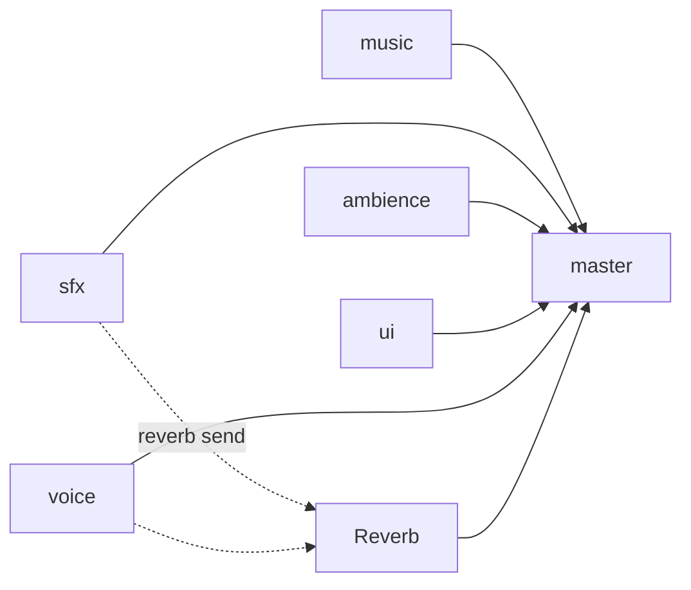

# 7 Audio – How Kern Makes Sound

> **In short:** Kern has its own recording studio built in. A mixing desk written in C++ computes
> every sound itself, places it in 3D space, adds reverb on top and makes sure nothing clips. All
> the built-in sounds – from the coin "ping" to the music – are made from pure math, without any
> sound files at all. In the end, the browser is just the loudspeaker.

Imagine a game without sound: a car races past in silence, a crate crashes onto the floor without a
noise. A silent movie! Sound is half the battle – and this chapter shows how Kern makes it.

## 7.1 Sound, samples and a mixer of its own

Sound is vibrating air. We hear fast vibrations as a high tone and slow ones as a low tone. A
computer measures this wave at tiny intervals and writes down a number each time. That's called
**sampling**, every number is a **sample**, and how often it measures is the **sample rate**. At
48,000 Hz, that's 48,000 numbers per second per ear. A row of numbers like this is called **PCM**.

> **Imagine …** a flip book for your ears. Every page is a sample. If you flip through 48,000 pages
> per second, you no longer hear any jerkiness, just a smooth tone.

Browsers have their own sound machine, Web Audio. Kern only uses it as the loudspeaker output and to
unpack imported files. The mixing happens in Kern's own sound engine, which runs in the same
WebAssembly program as the graphics and the physics. That brings three advantages:

- **Always the same (deterministic):** The same events give exactly the same samples on every
  device.
- **One code base for everything:** Studio, exported games and tests all use the same C++ code.
- **Full control:** no crackle when stopping, no clipping – the output always stays between −1 and
  +1.

## 7.2 The mixer – Kern's mixing desk

> **Imagine …** a mixing desk in a recording studio. Every track has its own fader, everything runs
> together into groups and finally into one master fader that goes to the speakers. Kern's mixer is
> exactly that, just in software.

At startup, the mixer gets the loudspeaker's sample rate and a fixed supply of **voices** – sounds
that are currently playing. Studio takes 64; the maximum is 128. The output is stereo.

**Clips** are the sound recordings, mono or stereo. If a clip has a different sample rate, the mixer
converts it carefully **once** when loading (with a high-quality *windowed-sinc filter* that doesn't
create any false mirror tones). That's expensive, but afterwards a cheap in-between calculation is
enough during playback.

Whoever plays a clip passes settings along: volume, pitch, stereo position (*pan*), loop, fade-in,
bus, priority and, for 3D sounds, position, velocity, distances and Doppler. Nonsensical values are
pushed into the allowed range instead of being rejected. What comes back is a voice number with a
built-in "generation": if the slot was reused long ago, the old number no longer fits, and a late
command doesn't accidentally change someone else's sound. With this number you can control a
playing sound later: stop it, change its volume, pitch, pan or position, pause it – or pause all of
them at once when the game stops.

**When all the slots are full**, the mixer throws out the least important voice – first the one
with the lowest priority, then the quietest, then the oldest. That's called *voice stealing*.
Voices that are more important than the newcomer are never stolen.

> **Watch out!** A sound that is cut off hard makes an ugly "click". That's why Kern always fades
> out when stopping, for at least 5 milliseconds, and volume changes glide too (normally over
> 30 ms).

### How the mixing works

The mixer works in bites of 128 frames. For every bite, it computes for each voice how loud it
should be on the left and on the right, and lets the volume **glide** within the bite. When a car
drives past, the level doesn't jump in steps but flows – without a scratchy "zipper" noise. Then it
reads the clip sample by sample. If the read position lies between two samples, it estimates the
value from four neighbors with a smooth curve (Hermite interpolation), dampens the highs according
to distance and adds everything into the bus. Then the read position moves on by pitch × Doppler.
Loops jump back to the start at the end, and mono clips sound on both sides.

**Virtual voices:** If a 3D sound is so far away that you practically can't hear it, it isn't mixed
– that saves time. But its position keeps running secretly. When you come back to the humming
machine, it keeps humming at the right spot instead of starting over.

## 7.3 3D sound – sound with a place

The mixer knows one **listener**; in the game, it sits at the camera. For every 3D voice, Kern
computes four things.

**Distance.** Up to the minimum distance, a sound is at full volume; after that it falls off –
following the curve *inverse* (the default), *linear* or *exponential*. Example: *inverse* with a
1 m minimum distance: at 2 m half as loud, at 4 m a quarter. Because curves like these never quite
reach zero, Kern also fades out over the last 20 % before the maximum distance. Beyond that, there
really is silence.

**Left or right.** Kern spreads the sound according to how far to the side the source is. Very close
and "wide" sources are spread less, so that a bee near your head doesn't jump hard from ear to ear.
And Kern uses **equal-power panning**: the total energy stays the same no matter where the sound
is. A simple crossfade would create a "hole" in the middle.

**Front or back.** High tones fade away in the air faster than low ones – that's why distant
thunder sounds muffled. Kern takes away highs with distance, and even more behind you: directly
behind, 40 % of the cutoff frequency remains. That's how your ear recognizes "front" and "back".

**Doppler.**

> **Did you know?** An ambulance sounds higher as it approaches and lower after it has passed,
> because its sound waves are squeezed together in front and stretched out behind. Kern computes
> this **Doppler effect** with the real speed of sound, 343 m/s.

So that nothing goes haywire, the pitch changes at most to half or to double, and smoothly at that.
Every voice can also switch Doppler off.

## 7.4 Buses, reverb and the guard at the end

Every voice plays on a **bus**, a group on the mixing desk: `music`, `sfx` (effects), `ambience`
(background), `ui` (interface) or `voice` (voices). They all flow into `master`.



Every bus has a volume, a mute switch, an optional low-pass filter and a **reverb send**. Here, too,
everything glides, so that even muting doesn't click. Out of the box, music is set to 0.7 and
ambience to 0.8; only `sfx` (0.12) and `voice` (0.08) get reverb – until a level sets it
differently (7.9).

> **Imagine …** you clap your hands in an empty stairwell. The bang bounces back off the walls a
> hundred times, quieter and quieter, until only a hiss remains. That's **reverb**.

Kern's reverb is **Freeverb**, a well-known method by Jezar at Dreampoint. Eight **comb filters** per
channel act like balls bouncing between two walls: one echo after another, each one quieter, and
the highs die away faster – like in a room with carpet. The eight have slightly different lengths
and together make a dense cloud of echoes. Four **all-pass filters** blur the rest, and the right
channel has slightly longer lines so that the reverb sounds wide. Three knobs control it: room size
(longer reverberation), damping (how fast the highs disappear) and wet amount (how much reverb is
added).

At the very end, the **limiter** keeps watch. If a peak were to go over the threshold of 0.92, it
turns the volume down immediately and then slowly lets go (about 120 ms). A gentle "rounding off"
(soft clip) catches any rest, even invalid numbers. Along the way, the mixer measures levels and
voices; from these, the status bar in Studio draws its level meter, whose peak falls slowly like a
real needle.

## 7.5 The synthesizer – the noise factory

> **Did you know?** Kern doesn't ship **a single sound file**. Every built-in sound – jump,
> explosion, wind, even two pieces of music – is computed from a few numbers when loading, with
> fixed seeds and therefore the same everywhere.

The synthesizer follows in the tradition of *sfxr*, a popular tool for retro game sounds, extended
with filters, noise colors, FM and layering. A sound is a **patch**, a kind of recipe: waveform
(square, saw, sine, triangle, pulse, white or pink noise), envelope (swell, hold, fade out, plus a
"punch" at the start), pitch with slide, vibrato and jump, filters, and effects such as tremolo,
repeat and "bitcrush". Slow changes like vibrato are recomputed by Kern only every 16 samples – that
saves a lot of time and you can't hear it. As in sfxr, noise is re-rolled in time with the pitch,
which is why low noise sounds darker. The *repeat* option restarts the pitch again and again
(power-up effect); the jump makes the coin "ping" below. Little helpers layer several sounds with a
time offset, turn a buffer into a seamless loop (the end is blended smoothly over the start) and
even out the volume.

The recipe for the pickup sound, straight from the code:

```cpp
} else if (name == "pickup") {
  SynthPatch a = patch(Wave::pulse, 988, 0.002f, 0.05f, 0.28f, 0.42f);
  a.duty = 0.35f;
  a.arp_ratio = 1.5f;          // after 65 ms a fifth higher
  a.arp_time = 0.065f;
  out = synthesize(a, rate);
  add(out, bell(rate, 100, 0.35f), 0.35f);
```

Line by line: Take a pulse wave at 988 Hz with a short envelope. Make the pulse a bit narrower. After
65 ms, jump up by a factor of 1.5 – a fifth, the typical "ping-PING". Compute it and lay a quiet bell
tone on top. And there's your coin sound.

For impacts of small, solid things there's **modal synthesis**: a few decaying sine tones (the
body's natural tones) plus a tiny burst of noise for the contact. The code explains the reasoning
nicely: a solid plastic part sounds neither low nor long, otherwise it comes across like a hollow
box. That's why the tones of `plastic` sit at 760, 1650 and 3100 Hz and die away within
milliseconds.

The two **pieces of music** are real scores: `music_drive` (120 beats per minute, Am–F–C–G, driving
bass drum) and `music_calm` (80 beats per minute, pads and a bell melody). Both loop seamlessly.
Because computing them takes a few hundred milliseconds, Kern spreads the work over small time
slices – so a level doesn't stutter while loading.

Sounds are addressed with `builtin:<name>`. There are 38 in eight groups: Gameplay (`pickup`,
`jump`, `goal` …), Combat (`gunshot`, `reload` …), Physics (`explosion`, `impact`, `plastic` …),
Vehicle (`engine`, `hover`, `boost`), Ambience (`wind`, `city`, `hum`), Robot (`servo`, `quack`,
`beep`), UI (`click`, `confirm`, `error`) and Music. The loops are `engine`, `hover`, `wind`, `city`,
`hum`, `servo` and the two pieces of music; the rest are one-shot sounds. The complete list is in the
blue book.

> **Try it!** Open Kern Studio at https://kernengine.de/ and click anywhere once – until then, the
> browser stays silent. In the Content Drawer at the bottom, the **Sounds** tab plays any sound when
> you click it. Listen to `pickup`, `explosion` and `music_calm`. Hard to believe that's just math!

## 7.6 The voice of the Micro Duck

The Micro Duck – the little walking robot from [Chapter 13](13-micro-duck.md) – quacks, chirps and
coos, also without recordings. For this, Kern has its own small synthesizer, a port of the Rust
package `sounds` from the Microduck project by Pollen Robotics, who built the real robot.

A single number, the **seed**, sets a duck's personality: pitch, brightness, nasality, vibrato,
breath, "quackiness", trills, tempo. Two seeds sound like two different animals; the same seed
always sounds the same. The real robot forms its seed from its serial number, Kern from the duck's
name and number in the level – with the same calculation (a SHA-256 fingerprint).

> **Imagine …** a die that has been "loaded" by your name: every time, the same row of numbers comes
> out for you. That's how every duck gets its own voice that always stays the same.

A sound consists of seven overtones, a pitch curve with vibrato and jitter, a fast wobble in volume
(the quack) and a little breath noise. There are seven kinds of sound – `alarm`, `greet`,
`inquire`, `peck`, `chirp`, `coo`, `wheee` – each with 6 to 12 variants. A random one is played, so
the duck doesn't sound like a broken record. `wheee` has a start, a loop and an end, and can last as
long as a slide. Every duck sound is a perfectly normal sound name following the pattern
`builtin:duck_<sound>_<seed>_<variant>`.

> **Did you know?** Kern's duck voice is **identical sample for sample** to the Rust original: a
> comparison of all 328 sounds shows a difference of exactly zero. For that, the random number
> generator, the order of the random draws and the number types match exactly, and even a processor
> shortcut that rounds very slightly differently is switched off.

After that, Kern makes the sound "worse" on purpose: 16 bits like on the robot, and everything below
300 Hz filtered out, because the tiny real loudspeaker can hardly reproduce low tones. The sounds
play on the `voice` bus at the duck's **head**, where its loudspeaker sits. A new sound cuts off the
old one, just like with a single loudspeaker; during `wheee`, other sounds are dropped. Because
computing them takes noticeable time on phones, Kern prepares each duck's sounds in advance, one per
frame. When the duck calls which sound is explained in [Chapter 13](13-micro-duck.md).

## 7.7 Sound in the game: SoundBank and GameAudio

Wherever a level names a sound, there's a short text: `builtin:<name>` for a built-in sound, the ID
of an imported sound (a WAV, MP3, OGG, M4A or FLAC file, stored directly in the level), `""` or
`none` for silence, and `auto` for the matching default.

The **SoundBank** is the record collection: it turns references like these into clips. It computes
built-in sounds in time slices and has the browser unpack imported ones. Before the start, it
requests everything the level might need – music, engine, impacts, weapons, pickups, jingles. Play
then begins with everything in its place. As long as a clip isn't ready yet, the bank reports "not
there yet" and orders it. If the browser can't unpack a file, that is reported, and cues with that
sound are dropped instead of waiting forever. If you delete or replace an imported sound, the bank
throws away the old clip.

**GameAudio** is the sound engineer. It transfers the level's sound settings to the mixing desk and
takes care of the following every frame:

1. Apply **pause**.
2. Put the **listener** at the camera. If the camera jumps faster than 200 m/s (a cut), its
   velocity counts as zero – otherwise there would be an absurd Doppler howl.
3. Start **music and ambience** as soon as they're ready – as 2D loops with the highest priority
   (100), gently faded in.
4. Drive the **player's engine**: volume and pitch rise with speed and throttle. Without Doppler,
   because the camera moves along with it. For the Micro Duck, the servos whir instead.
5. Carry **Audio Sources** along with their actors (their speed counts for Doppler). Loops start
   with priority 40, one-shot sounds with 20, each after its delay. If the actor disappears, its
   sound is faded out in 0.15 s.
6. Play the simulation's **cues**. If a clip isn't ready yet, the cue waits at most 0.25 s and is
   then dropped – a sound that comes too late is worse than none. More than 64 waiting cues are cut
   off. Cue sounds are at full volume up to 3 m and silent from 80 m.

Priorities keep things in order: music and engine are important, short effects aren't. So an
explosion never pushes out the music. When the game ends, GameAudio fades out everything from the
game. The editor's mute switch mutes the master and stays that way across Play rounds.

With `auto`, Kern picks the engine sound according to the kind of movement: `hover` for Hover Car and
Flyer, `engine` for the Vehicle, `servo` for the Micro Duck; ball, figure and soldier have none.
Other parts have their own sound fields with defaults too: jump (`jump`) and boost (`boost`) on the
controller, shot (`smg`) and reload (`reload`) on weapons, hit (`hit`) and knockout (`down`) for
health, `pickup` for pickups, and `auto` for triggers, matching their action.

## 7.8 Cues and impact sounds

> **Imagine …** a play at the theater. The actors don't shout "Thunder!" themselves; instead they
> give the sound engineer backstage a signal – a cue.

In the same way, the simulation itself never plays a sound. During the physics steps it writes
little notes, **cues** ("play `builtin:jump` here, this loud, on this bus"), and GameAudio collects
them every frame. Because cues are created in fixed steps, they're deterministic. If nobody is
listening, only the newest 64 are kept (for example in the Lehrer). In a network game, sounds are
sent without a delivery guarantee – if one goes missing, it doesn't matter. Important events like a
collected pickup, on the other hand, are sure to arrive ([Chapter 10](10-networking.md)).

Every Rigid Body has an impact sound (default `builtin:impact`) and a **threshold** of 2.5 m/s.
Every Collider can carry its own sound – the duck's sole sounds like `plastic_step`, its housing
like `plastic`. Plus a few rules:

- Only parts that have an impact sound, or that the player or logic needs, report hits. At most
  **6 impact sounds per physics step**; below the threshold, it stays quiet.
- **Debouncing:** A sole rolls off and bounces a tiny bit while doing so. That's why a step sounds
  at most every 0.5 s per actor, a knock every 0.09 s.
- Harder impacts are **louder**; very light ones play the softer `impact_light`.
- **Heavy things sound lower**, light ones only slightly higher – otherwise it would sound like
  glass.

The Micro Duck sets its threshold to 0.12 m/s, so that you can hear even gentle touches. Breaking
joints play `builtin:break`.

> **Try it!** Open the **Physics Lab** via File › Example Levels and start **Simulate** (Alt+S).
> Throw crates around with the mouse. Do hard throws bang louder than gentle nudges?

## 7.9 Setting up sound in the level

In the **World Settings** there's an *Audio* section: master volume, music track and background
sound, each with its own volume, reverb (default 0.25) and Doppler strength. The more reverb, the
more of it effects, voices and background get; music and interface stay dry.

The **Audio Source** component turns any actor into a sound source. It has a sound (default
`builtin:hum`), volume, pitch, loop, start when the game begins with an optional delay, 3D on/off
(off: the same volume everywhere on the bus), inner and falloff radius (2 m and 40 m), falloff
curve, bus, Doppler and **Pitch by speed** – the pitch rises with the actor's speed. The catalog
has ready-made variants: Audio Source (machine hum), Ambient Wind (audible everywhere), City Ambience
(with falloff) and Radio (plays `music_calm` in 3D). How to use them in the editor is explained in
[Chapter 11](11-studio.md).

> **Try it!** In Studio, drag a **Radio** from the catalog into the scene and start Play (Alt+P).
> Drive up close, far away and once all the way around it. Can you hear how the music gets quieter,
> moves from left to right and sounds more muffled behind you?

## 7.10 The bridge to the browser

The mixer computes, the browser plays; the connection is called `KernAudio`. Browsers only allow
sound **after a user gesture** – the first click, tap or key press wakes it up. On iOS, Kern also
makes sure that the phone's mute switch doesn't silence the game. Every 20 ms, a timer tops up the
sound and keeps computing built-in sounds on the side (5 ms per round). That way the sound keeps
flowing even with slow frames or in a background tab. The mixer gets the device's sample rate right
away, so that the browser doesn't have to convert anything anymore.

Kern's favorite is an **AudioWorklet**, a browser helper in a thread of its own. The main program
sends it finished pieces of sound, and the worklet plays them.

> **Imagine …** a conveyor belt at the checkout. If there are always a few items on it, the cashier
> never has to wait. Kern keeps the belt filled about 70 ms ahead.

If the belt runs empty, Kern adds 30 ms of reserve, up to at most 200 ms; after 15 quiet seconds it
shrinks again. If there's a gap, the sound glides to zero in about 2 ms instead of crackling and is
then faded back in. Without an AudioWorklet, Kern takes an older route, the `ScriptProcessor`.

The browser unpacks **imported sounds** with its own decoder (`decodeAudioData`) and passes the
samples on to the engine. Files with more than two channels are first mixed down to stereo.

## 7.11 Tips for your own games

- **Built-in sounds first** – they don't cost a download. Your own files are worth it for music and
  special noises.
- **Use buses correctly**, then faders and reverb work as expected.
- **Set the maximum distance honestly** – whatever lies beyond it becomes virtual and costs nothing.
- **Hand out priorities:** continuous sounds high, short effects low.
- **Don't set impact thresholds too low**, otherwise resting bodies knock all the time.

> **Watch out!** "My game has no sound!" – Have you clicked or pressed a key yet? Until then, every
> browser stays silent. That's its rule, not a bug in Kern.

If you want sound in an app of your own ([Chapter 12](12-your-own-games.md)), you can use the mixer
and the synthesizer directly, but then you have to build the connection to the browser yourself.

## What you take away

- Sound is a row of numbers: at 48 kHz, 48,000 samples per second per channel.
- Kern mixes everything itself in C++, deterministically; the browser is just the loudspeaker.
- 3D sound: quieter with distance, spread left/right, more muffled behind you, Doppler when passing.
- Buses are groups on the mixing desk; Freeverb makes reverb, the limiter prevents clipping.
- All built-in sounds and the music are computed from recipes.
- The duck voice is a bit-exact copy of the original; its personality lives in the seed.
- The simulation only writes cues; GameAudio plays them.

## Brain teasers

1. Why doesn't a source get quieter in the middle with equal-power panning?
2. You walk far away from a humming machine and come back. Why doesn't it start humming from the
   beginning?
3. In a big explosion, 70 sounds want to play at the same time. Why doesn't the music go silent?
4. Why is the player's engine sound without Doppler?

### Solutions

1. The total energy of both channels stays the same at every position; a simple crossfade would
   leave a hole in the middle.
2. Its voice was virtual: not mixed, but its position kept running.
3. Music has a high priority; effects may only steal voices with at most the same priority.
4. The camera follows the player, so listener and source move together – Doppler would be wrong.

---

© 2026 Christian Heinrich Hohlfeld · All rights reserved · [Imprint and rights](00-imprint.md)
