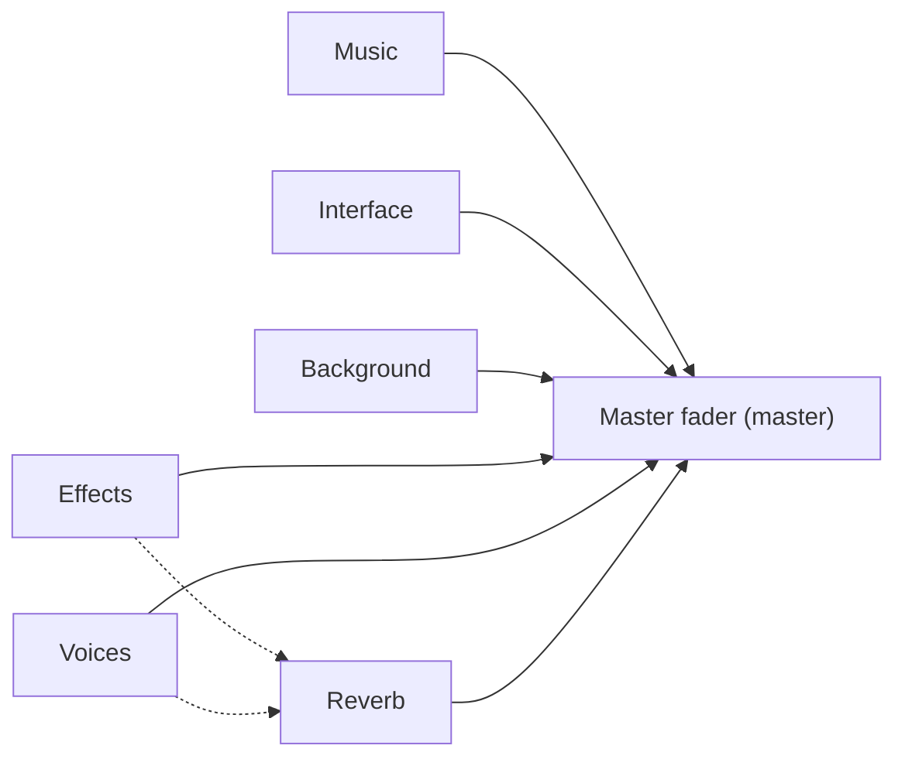

# 7 Audio – How Kern Makes Sound

> **In short:** Kern has its own sound studio built in. A mixing desk calculates every sound
> itself, places it in 3D space, adds reverb and makes sure nothing distorts. All the built-in
> sounds – from the coin "ping" to the music – are made by pure calculation, without any sound
> files at all. In the end, the browser is just the loudspeaker.

> **Key terms:**
> - **Hertz (Hz)** – "how many times per second". 440 Hz means: 440 vibrations every second.
> - **Millisecond (ms)** – a thousandth of a second. A blink of an eye takes about 100 ms.
> - **Level** – a fully built game world, like a game board with all the pieces on it.
> - **Actor** – a thing in the level: a crate, a car, a radio, the player character.
> - **Component** – a plug-in building block that gives an actor an ability, such as "can make
>   sound".
> - **Rigid Body** and **Collider** – a thing's body and shape for the physics
>   ([Chapter 6](06-physics.md)).
> - **Frame** – a single drawn picture on the screen; a game usually shows 60 of them per second,
>   like a flip book.
> - **Deterministic** – "always the same": the same inputs give exactly the same result on every
>   device.

Imagine a game without sound: a car races past silently, a crate crashes onto the floor without a
sound. A silent movie! Sound is half the battle – and this chapter shows how Kern makes it.

## 7.1 Sound, samples and a mixer of its own

For a computer, sound is a long row of numbers. Kern calculates these numbers itself and mixes them
itself, instead of leaving it to the browser – so that it sounds the same everywhere and never
clicks.

Sound is trembling air. We hear fast trembling as a high tone, slow trembling as a low one. A
computer measures this wave at tiny intervals and writes down a number each time. This is called
**sampling**, each number is a **sample**, and how often it measures is the **sample rate**. At
48,000 Hz, that's 48,000 numbers per second and ear.

> **Imagine …** a flip book for the ears. Every page is a sample. If you flip through 48,000 pages
> a second, you no longer hear any jerks, just a smooth tone.

Browsers have their own sound machine. Kern only uses it as a loudspeaker output and to unpack
imported files. Mixing happens in Kern's own sound engine, in the same program as graphics and
physics. That brings three advantages:

- **Always the same:** the same events give exactly the same samples on every device.
- **One program for everything:** Studio, exported games and tests sound the same, because they
  use the same mixing desk.
- **Full control:** no click when stopping, no distortion. Every number that goes to the
  loudspeaker stays between −1 and +1. That's the furthest the loudspeaker's cone can swing;
  anything beyond that would make it "hit the stops", and it rattles.

## 7.2 The mixer – Kern's mixing desk

The **mixer** takes all the sounds that are playing right now and adds them up into a single stereo
sound. It has only a fixed number of places; if it gets too full, the least important sound has
to give up its place. Intended stops and volume changes, on the other hand, always glide gently, so
that nothing clicks.

> **Imagine …** a mixing desk in a recording studio. Every track has its own fader, everything
> comes together in groups and at the end in a master fader to the speakers. Kern's mixer is
> exactly that, only in software.

Every sound currently playing takes up a **voice** – a place at the mixing desk. Studio has 64 such
places. The sound recordings themselves are called **clips**. If a clip was recorded at a different
sample rate – that is, at a different measuring pace – than the loudspeaker needs, the mixer
converts it carefully **once, when loading**. That's a lot of work, but afterwards playing it back
costs hardly anything.

Carefully means above all: if Kern has to **lower** the measuring pace, it first filters out the
highest tones – the ones that can no longer be captured with fewer measurements per second. If it
left them in, they would show up again as false, lower **mirror tones**. You know this from the
movies: a wagon wheel turns faster than the camera takes pictures and suddenly seems to turn slowly
backward.

Whoever starts a sound says how it should sound: how loud, how high, whether left or right, whether
it repeats, how important it is and – for 3D sounds – where it is in space. The mixer moves nonsense
values into the allowed range instead of rejecting the sound. What you get back is a number with
which you can later stop the sound, turn it down or move it.

> **For the curious:** The number works like a coat-check ticket with a date. If the place has long
> since been given to a new sound, the old ticket no longer fits, and a late command doesn't
> accidentally change somebody else's sound.

**When all places are full**, the mixer throws out the least important voice – first the one with
the lowest importance (*priority*), then the quietest, then the oldest. This is called *voice
stealing*. Voices that are more important than the newcomer are never stolen. Because among the
least important ones it hits the quietest first, the change is hardly noticeable.

> **Watch out!** A sound that's cut off hard makes an ugly "click", because the cone would have to
> stop dead in the middle of its movement. That's why Kern always fades out briefly when stopping,
> and volume changes glide too, instead of jumping.

### This is how mixing works

The mixer doesn't work number by number on demand, but in small bites of a few thousandths of a
second.

Per bite, the mixer works out for each voice how loud it should be on the left and right, and lets
the volume **glide** within the bite. When a car drives past, the level doesn't jump in steps but
flows – without the scratchy "zipper" noise that a jerky fader would make.

Then it reads the clip. If a sound plays a bit higher than it was recorded, the mixer reads faster
and often lands **between** two stored samples. Then it estimates the in-between value with a soft
curve through the neighboring points – just as you draw a smooth line through a few points with a
pencil instead of connecting them with corners.

**Virtual voices:** if a 3D sound is so far away that it's practically inaudible, it isn't mixed –
that saves time. But its position keeps running secretly. When you come back to the humming
machine, it keeps humming at the right spot instead of starting over.

## 7.3 3D sound – sound with a place

A 3D sound has a place in the game world, and Kern makes it sound the way it would reach you from
there: quieter with distance, from the left or right, muffled from behind, and when driving past,
first higher, then lower.

For this, the mixer knows a **listener** – that's your ears in the game world; in the game they sit
at the camera. For every 3D voice, Kern works out four things.

**Distance.** Up to a minimum distance, a sound is at full volume; after that it drops off. With
the usual curve that means: twice the distance, half the volume. With a minimum distance of 1 m, a
sound is half as loud at 2 m and a quarter as loud at 4 m. Because such a curve never quite reaches
zero, Kern also fades out shortly before the maximum distance. Beyond that, there really is silence
– and the sound becomes virtual (7.2).

**Left or right.** Kern spreads the sound across both loudspeakers, depending on how far to the
side the source is. Very close and "wide" sources are spread less strongly, so that a bee by your
head doesn't jump hard from ear to ear.

There's a catch here. The fader decides how far the loudspeaker's cone swings. But our ear hears the
**power** of the sound, and that grows with swing **times** swing: half the swing brings only a
quarter of the power (half times half).

> **Imagine …** a swing. If you want to swing twice as far, you don't need twice as much push but
> four times as much. The other way around: swinging half as far means only a quarter of the push.
> It's just the same with a loudspeaker's cone.

So if you simply set both sides to "half" for a source in the middle, only half the power arrives
in total – a hole would appear in the middle. That's why Kern uses **equal-power panning**: if a
source is in the middle, each side doesn't get half of what it would get at the far edge, but about
seven tenths. Seven tenths times seven tenths is roughly half the power, and two halves make the
full power again. That way a car driving from left to right doesn't get quieter in the middle.

**Front or back.** High tones fade away in the air faster than low ones – that's why distant
thunder sounds muffled. Kern takes away the highs with distance, and even more behind you. That's
how your ear tells "front" from "back".

**Doppler.**

> **Did you know?** An ambulance sounds higher as it approaches and lower after it has passed,
> because its sound waves are squashed in front and stretched behind. Kern calculates this
> **Doppler effect** with the real speed of sound of 343 m/s.

So that nothing goes haywire, the pitch changes to at most half or double, and smoothly. Every
voice can also switch Doppler off.

> **For the curious:** Kern knows three fall-off curves (inverse, linear, steep) and a limit for how
> muffled it gets directly behind you. The formulas are in the blue book, Chapter 7.

## 7.4 Buses, reverb and the guard at the end

Sounds come together in groups – music, effects, background, interface, voices – and every group
has its own fader. Some of the sounds get reverb, so that they sound as if in a room. At the very
end, a guard makes sure it never gets too loud.

Such a group is called a **bus** – like a bus that takes many passengers to the same destination.
Kern has five: music, effects, background (*ambience*), interface (clicks in the menu) and voices.
They all drive to the master fader (*master*).

The dashed lines are the reverb shares.

Every bus has a volume, a mute switch, a **reverb share** and, if you want, a **low-pass** – a
filter that lets only the low tones through, as if you were hearing music through a wall. Here too
everything glides, so that even muting doesn't click. Out of the box, the music is a bit quieter
than the effects, and out of the box only effects and voices get reverb. A level can additionally
put reverb on the background (7.9); music and interface always stay dry.

> **Imagine …** you clap in an empty stairwell. The bang bounces back from the walls a hundred
> times, quieter and quieter, until only a hiss remains. That's **reverb**.

Kern's reverb is called **Freeverb**, a well-known, freely available technique. It does exactly
what happens in the stairwell: it creates lots of echoes from paths of **different lengths**, each
quieter than the last, and the high tones die away faster – as in a room with carpet. Because the
paths are different lengths, the echoes never coincide in step but give a dense cloud. Three knobs
control it: room size (longer ringing), damping (how quickly the highs disappear) and wet share (how
much reverb is added).

At the very end, the **limiter** stands guard. If a peak gets too close to the maximum value, it
turns down immediately and then slowly lets go again – like a sound engineer with a quick hand. A
soft "rounding off" catches any rest, even nonsense values that a calculation error somewhere might
have produced – only allowed values reach the loudspeaker anyway. Along the way, the mixer measures
the levels; from these the status bar in Studio draws its level meter, whose peak falls slowly like
a real needle.

> **For the curious:** Freeverb comes from Jezar at Dreampoint and consists of eight "comb
> filters" (echo loops with slightly different lengths) and four "all-passes" (smearers) per side.
> The lengths, and the limiter's threshold and release time, are in the blue book, Chapter 7.

## 7.5 The synthesizer – the noise factory

Kern doesn't bring along a single sound recording. Every built-in sound is calculated according to
a **recipe** made of a few numbers: which basic wave, how quickly it swells and dies away, how high
it is and which effects are added.

> **Did you know?** Every built-in sound – jump, explosion, wind, even two pieces of music – is
> calculated when loading from a few numbers, with fixed starting values and therefore the same
> everywhere.

The synthesizer stands in the tradition of *sfxr*, a popular tool for retro game sounds. A recipe
is called a **patch** and has four ingredients:

1. **The basic wave** – smooth and soft (like a flute), square and buzzing (like old game
   consoles), or **noise**, a random hiss like a waterfall.
2. **The envelope** – how quickly the sound swells, how long it holds and how it dies away. A piano
   note is there immediately and dies away slowly; a gust of wind swells slowly.
3. **The pitch** – fixed, sliding (a falling "pew" laser) or with a jump.
4. **Effects** – trembling, filters, repetition or deliberate "breaking" for a retro sound.

A saving trick lies in the calculating itself: everything that changes **slowly** – the trembling,
the sliding of the pitch, a filter that opens – Kern doesn't recalculate for every single number,
but only every few numbers. The steps in between are so tiny that no ear hears them. Like driving a
car: you don't look at the speedometer every second, and you still drive evenly.

An example as a recipe card – this is how the coin sound is made:

> **Recipe "Pickup":** Take a high, buzzing tone and a very short envelope. After 65 ms, jump up by
> a factor of 1.5 – that's a fifth, the typical "ping-PING". Finally, add a quiet bell tone on top.
> Done.

For impacts of small, solid things there's a second way, **modal synthesis**. Every object has a
few natural tones, like a wine glass that always sings the same when you tap it. Kern plays a few
such tones, lets them die away and puts a tiny burst of noise in front for the moment of contact.
The developers give a nice reason: a solid plastic part sounds neither low nor long, otherwise it
seems like a hollow box. That's why the plastic sound is high and over after milliseconds.

The two **pieces of music** are real, calculated scores: a driving piece for racing around and a
calm one with pads and a bell melody. If the same note occurs several times, Kern calculates it
only once and inserts it again – like a stamp instead of drawing it anew every time. Both pieces
loop seamlessly: notes that ring on past the end keep ringing at the beginning. For wind and city
noise, Kern lays the last moments over the beginning with a gentle crossfade. That way the end and
the beginning flow into each other, and you hear no seam. Because calculating the music takes a few
hundred milliseconds, Kern spreads the work into small time slices – so a level doesn't stutter
while loading.

> **For the curious:** Like its model sfxr, Kern re-rolls the noise in time with the pitch. That's
> why noise on a low note sounds darker and on a high one brighter – handy for explosions and hisses
> from the same recipe.

All in all there are 38 built-in sounds in eight groups: gameplay (coin, jump, goal), combat,
physics (explosion, impact), vehicles (engine, hover), background (wind, city), robots, interface
and music. Some run as a loop (engine, wind), most play once. The exact names and recipes are in
the blue book, Chapter 7.

> **Try it!** Open Kern Studio at https://kernengine.de/ and click anywhere once – before that,
> the browser stays silent. At the bottom, open the **Content Drawer** with Ctrl+Space and there the
> **Sounds** tab: every click on a sound plays it. Listen to **Pickup**, **Explosion** and **Calm
> (music)**. Hard to believe that it's just calculation!

## 7.6 The Micro Duck's voice

The Micro Duck gets its own, always identical voice from a single number. After that, the sound is
deliberately made worse, so that it sounds as if it came from the real robot's tiny loudspeaker.

The Micro Duck – the little walking robot from [Chapter 13](13-micro-duck.md) – quacks, chirps and
coos, also without recordings. For this, Kern has its own small synthesizer, modeled on the
original from the Microduck project by Pollen Robotics, who built the real robot.

A single number, the **seed**, sets a duck's personality: pitch, brightness, nasality, trembling,
breath, "quackiness", trills, tempo. Two seeds sound like two different animals, the same seed
always the same. The real robot forms its seed from its serial number, Kern from the duck's name
and number in the level – with the same calculation.

> **Imagine …** a die that's "loaded" by your name: every time, the same sequence of numbers comes
> out for you. That's how every duck gets its own, always identical voice.

A sound consists of a fundamental tone with overtones, a pitch curve with trembling, a fast wobble
in volume (that's the quacking) and a bit of breath noise. There are seven kinds of sound – alarm,
greeting, question, pecking, chirping, cooing and a long "wheee" – each with several variants. A
random one is played, so that the duck doesn't sound like a stuck record. The "wheee" has a
beginning, middle and end and can last as long as a slide down a chute.

> **Did you know?** Kern's duck voice is **identical sample for sample** with the original: a
> comparison of all 328 sounds gives a deviation of exactly zero. For that, even the randomness has
> to be rolled in exactly the same order as in the original. Why the effort? That way a duck in
> the game sounds exactly like its real counterpart with the same seed – if you hear both side by
> side, you hear no difference.

After that, Kern deliberately makes the sound "worse": every sound is stored as coarsely as on the
robot, that is, with fewer steps per measured value – like a photo with fewer colors. And all low
tones are filtered out, because the tiny real loudspeaker hardly reproduces them. The sounds come
from the duck's **head**, where its loudspeaker sits. A new sound cuts off the old one, as with a
single loudspeaker; only during the long "wheee" do other sounds stay silent. Because calculating
takes noticeably long on phones, Kern prepares each duck's sounds in advance, one sound per frame.
When the duck calls which sound is explained in [Chapter 13](13-micro-duck.md).

> **For the curious:** The original is written in the programming language Rust; the seed is made
> with a SHA-256 fingerprint (a calculation that turns any text into a fixed, seemingly random
> number). The naming scheme of the duck sounds is in the blue book, Chapter 7.

## 7.7 Sound in the game: record collection and sound engineer

In the running game, two helpers work together: a **record collection** that keeps all sounds
ready, and a **sound engineer** who plays them at the right time. Their most important principle: a
sound that comes too late is worse than none at all.

Wherever a level names a sound, there's a short reference: to a built-in sound, to your own
imported file (it's saved directly in the level), to silence, or to "pick automatically".

The **record collection** (in the program, *SoundBank*): it calculates built-in sounds in time
slices and lets the browser unpack imported ones. Before the start, it orders everything the level
might need – music, engine, impacts, weapons, coins. That way the game starts with everything in
its place. If a file can't be unpacked, the record collection reports it, and sounds using that
file are dropped instead of waiting forever.

The **sound engineer** (in the program, *GameAudio*) transfers the level's sound settings to the
mixing desk and, every frame, takes care of four things:

1. **The ears follow the camera.** If the camera jumps to a completely different place at a cut,
   that doesn't count as movement – otherwise there'd be an absurd Doppler howl.
2. **Music and background first.** They start with a gentle fade-in and are the most important, so
   that an explosion never pushes them out.
3. **Sounds travel with their things.** The player's engine gets louder and higher with speed and
   throttle; sound sources in the level move with their actor. If the actor disappears, its sound
   is faded out. With the Micro Duck, the servos whir instead of an engine.
4. **Late sounds are dropped.** The simulation reports noises (7.8). If the sound hasn't been
   calculated yet, the sound engineer waits a moment – and then would rather leave it out
   altogether.

By the way, the player's engine sounds without Doppler: the camera travels along, after all, so the
ears and the engine move together. When quitting, the sound engineer fades everything out, and the
editor's mute switch is kept over several rounds of play.

> **For the curious:** Music has the highest priority, continuous sounds in the level a medium one,
> short effects the lowest. Which vehicles get which engine sound, which default sounds jump, shot
> or coin have, and all the waiting times are in the blue book, Chapter 7.

## 7.8 Cues and impact sounds

The simulation never plays a sound itself. It only writes notes ("Jump here!"), and the sound
engineer works through them. How an impact sounds depends on how hard and how heavy something is.

> **Imagine …** a play. The actors don't shout "Thunder!" themselves but give the sound engineer
> behind the stage a signal – a cue.

In the same way, during its physics steps the simulation writes small notes, **cues** ("play the
jump sound here, this loud"), and the sound engineer collects them every frame. Because the physics
calculates in fixed steps, the notes come out the same on every device. If nobody is listening
(for example during training in the Lehrer), only the newest ones are kept. In a network game, sound
notes may also get lost on the way – if a click is missing, it doesn't matter. Important events
such as a collected coin, on the other hand, arrive safely ([Chapter 10](10-networking.md)).

Every **Rigid Body** has an impact sound and a **threshold**: only above a certain speed does a
bump make a sound. By the way, the physics only reports collisions for shapes that have a sound at
all (or that players and logic need) – every report costs computing time, and for a silent crate it
would be wasted. Every **Collider** can carry its own sound – the duck's sole sounds like a step,
its body like plastic. A few rules on top:

- Below the threshold it stays silent, and only a few impacts per physics step make a sound – the
  mixing desk would throw out any more anyway.
- **Debouncing:** a sole rolls off and makes tiny hops as it does. Without a brake, a step would
  sound like a drum roll. That's why a step may sound only every half second.
- Harder impacts are **louder**; very light ones play a softer sound.
- **Heavy things sound lower**, light ones only slightly higher – otherwise it would sound like
  glass.

The Micro Duck sets its threshold very low, so that you hear even gentle touches. Breaking joints
play a cracking sound. The exact thresholds are in the blue book, Chapter 7.

> **Try it!** Use **File › Example Levels** to open the level **Physics Lab** and start
> **Simulate** with Alt+S. Throw crates around with the mouse. Do hard throws bang louder than gentle
> nudges? Does a heavy crate sound lower than a light plank of the rope bridge?

## 7.9 Setting up sound in the level

Every level has its own sound settings, and every thing in the level can become a sound source –
with volume, range and, if you want, 3D sound.

In the **World Settings**, the settings for the whole level, there's an *Audio* section: overall
volume, music piece and background sound with their own volumes, reverb and Doppler strength. The
more reverb, the more effects, voices and background get; music and interface stay dry.

The **Audio Source** component turns any actor into a sound source. The easiest way is to take a
ready-made variant from the catalog:

- **Audio Source** – a machine hum at one place,
- **Ambient Wind** – wind that's equally loud everywhere,
- **City Ambience** – city noises that get quieter with distance,
- **Radio** – plays the calm music as a 3D sound.

Essentially, you then set three things: **which sound** (and whether it repeats), **how far it
reaches** (full volume inside, silent outside) and **whether it's 3D** – otherwise it sounds the
same everywhere. A nice extra setting makes the pitch rise with the actor's speed. All the fields
are in the blue book, Chapter 7; how to use them in the editor is in [Chapter 11](11-studio.md).

> **Try it!** Studio starts with **Orb Run**, a level in which you steer a hovercar. Open the
> **Content Drawer** with Ctrl+Space, tab **Place Actors**, group **Audio**, and click **Radio** –
> it appears where the camera is looking. In the **World Settings**, under *Audio*, turn down the
> **Music volume** so that you can hear the radio well. Start **Play** with Alt+P and drive up to
> it, far away and once around it. Do you hear how the music gets quieter, moves from left to right
> and sounds more muffled behind you? Those are three of the four 3D effects from 7.3. The fourth,
> the Doppler effect, you hear when you drive past the radio fast: the music sounds a bit higher as
> you approach and lower afterward.

## 7.10 The bridge to the browser

The browser only allows sound after the first click. And because the mixing desk and the
loudspeaker don't work in the same beat, Kern always keeps a small supply of finished sound ready,
so that nothing stalls.

Any **user gesture** can wake the sound: the first click, tap or key press. On iPhones, Kern also
makes sure that the phone's mute switch doesn't silence the game. A timer tops up the sound
regularly – even when frames are coming slowly at the moment or the tab is in the background. The
mixer calculates right away at the device's measuring pace, so that the browser doesn't have to
convert anything any more.

Playback preferably goes through a small browser helper that runs **alongside**, independently of
the rest of the page. Even if the main program is busy for a moment, the helper keeps playing what
it has already received.

> **Imagine …** a conveyor belt at the checkout. If there are always a few items on it, the cashier
> never has to wait. Kern keeps the belt filled about 70 ms ahead.

If the belt does run empty once, Kern puts a bit more supply on it next time; if it stays calm for
longer, the supply gets smaller again. At a gap, the sound glides to zero very briefly instead of
clicking, and is faded in again afterward. **Imported sounds** are unpacked by the browser with its
own tool, which passes the samples on to Kern's mixing desk.

> **For the curious:** The helper is called *AudioWorklet* and runs in its own "thread", that is,
> like a second worker working in parallel. Where it doesn't exist, Kern uses an older route. All
> times and buffer sizes are in the blue book, Chapter 7.

## 7.11 Tips for your own games

- **Built-in sounds first** – they cost no download. Your own files are worth it for music and
  special noises.
- **Use buses properly**, then faders and reverb work as expected.
- **Set the range honestly** – whatever lies beyond it becomes virtual and costs nothing.
- **Spread out importance:** continuous sounds high, short effects low.
- **Impact thresholds not too low**, otherwise resting bodies knock constantly.

> **Watch out!** "My game has no sound!" – Have you clicked or pressed a key yet? Before that,
> every browser stays silent. That's its rule, not a bug in Kern.

## What you take away

- Sound is a row of numbers: 48,000 samples per second and ear.
- Kern mixes everything itself and always the same way; the browser is just the loudspeaker.
- 3D sound: quieter with distance, spread left/right, more muffled behind you, Doppler when driving
  past.
- Buses are groups at the mixing desk; reverb comes from lots of echoes of different lengths, and
  the limiter prevents distortion.
- All built-in sounds and the music are calculated from recipes.
- Every duck has its own voice from its seed, exactly as in the original.
- The simulation only writes cues, the sound engineer plays them – better not at all than too late.

## Brain teasers

1. Why doesn't a car driving from left to right get quieter in the middle?
2. You walk far away from a humming machine and come back. Why doesn't it start humming from the
   beginning?
3. In a big explosion, 70 sounds want to play at the same time. Why doesn't the music fall silent?
4. Why is the player's engine sound without Doppler?

### Solutions

1. The ear hears the power, and that grows with swing times swing (the swing). Twice "half" would
   give only half the power. That's why in the middle each side gets about seven tenths: seven
   tenths times seven tenths is roughly half the power, both sides together the full power – no
   hole.
2. Its voice was virtual: not mixed, but its position kept running.
3. Music is the most important; effects may only steal voices that are at most as important as
   they are.
4. The camera follows the player, so the ears and the engine move together – Doppler would be wrong.

---

© 2026 Christian Heinrich Hohlfeld · All rights reserved · [Imprint and rights](00-imprint.md)
