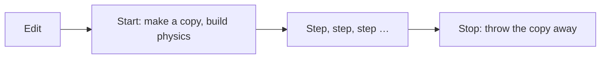
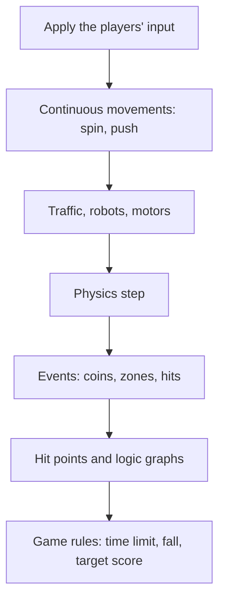

# 8 The Game Runtime – How a Level Becomes a Game

> **In short:** A level is a blueprint made of actors, and every actor is fitted with components
> like a plug-in building block. The **game world** (in the program, *GameWorld*) brings this
> blueprint to life: it builds a physics world from it, runs it in fixed steps, steers the player,
> checks the game rules and sends out picture and sound. Studio and exported games use exactly the
> same code.

> **Key terms:**
> - **Box3D** – the physics engine in Kern that works out falling, bumping and rolling
>   ([Chapter 6](06-physics.md)).
> - **Rigid Body** and **Collider** – a thing's body (mass, speed) and its invisible shape that the
>   physics calculates with.
> - **static, kinematic, dynamic** – never budges, like a wall / moves according to plan, like an
>   elevator, but can't be pushed / falls, rolls and bounces freely.
> - **Sensor** – a shape that doesn't push anything away but notices when something enters it,
>   like a light barrier.
> - **HUD** – the display over the game picture: points, time, speed, like a car's dashboard.
> - **Server** – in a network game, the one computer that's in charge; the others show copies.
> - **Lag** – the delay in the network: what you see is already a few hundredths of a second old.
> - **Network (neural network)** – a program that came about through practice instead of
>   programming; one of these steers the Micro Duck ([Chapter 13](13-micro-duck.md)).

So far you've got to know the tools: graphics, physics, sound. Now comes the conductor who makes
them all play together. This part turns Kern into a real game engine.

## 8.1 The life of a game world

A game world has a simple life story: it's displayed, started, runs step by step and is stopped
again. Play always happens on a **copy** of the level, which is why everything is back as it was
after stopping.

> **Imagine …** a rehearsal in a theater. The set is in place. During the rehearsal things get
> moved around, knocked over, shifted – and afterwards the stagehands put everything back in its
> place.



- **Edit:** the game world displays the level in the editor. If something changes, it reloads only
  what changed.
- **Start:** it makes a copy of the level, builds the physics world and starts **Simulate** or
  **Play**.
- **Every frame:** the world moves one step on, the camera follows, and everything is drawn.
- **Stop:** everything is torn down, and you see the level again as it was before.

> **Watch out!** Whatever happens during a simulation – crates that have fallen over, balls that
> have moved – does **not** end up in the level. After **Stop**, everything is back in its place.
> If you want to keep a simulated pose, use **Play › Keep Simulation Changes** in Studio, or the K
> key.

## 8.2 The rules of the numbers

So that all parts of Kern speak the same language, there are fixed agreements about measurements,
directions and who hangs on whom.

- Measurements are in **meters, seconds and kilograms**.
- **Z points up** (not Y, as in some other programs).
- Rotations are given as **angles in degrees**: roll, pitch, yaw – just as in the editor. The words
  come from flying: **roll** means the wings tip to the side; **pitch** means the nose goes up or
  down; **yaw** means the nose swings left or right.
- Colors are values from 0 (off) to 1 (full) for red, green and blue.
- An actor's position is always **relative to its parent actor**. If you hang a wheel on a car,
  the wheel goes along with it.
- Child actors without their own body are "welded" into the body of their nearest ancestor when
  simulating. That way a car's cabin becomes part of the car.

> **For the curious:** The three rotations are carried out in a fixed order, because two rotations
> one after another give a different position depending on the order – try it with a book
> ([Chapter 3](03-foundations.md)). Think of a pilot: first he yaws, then he pitches and finally he
> rolls. The exact rule is in the blue book, Chapter 8.

## 8.3 Level and actor

A level is a list of things, the actors, plus a few settings for the whole world. Every actor has
a name, a position and tags, and gets its abilities from building blocks plugged onto it.

A **level** is the document that Kern Studio edits and saves as a file. It contains:

- a name and the **World Settings**, see 8.5,
- the list of **actors**,
- imported **textures** (pictures for surfaces) and **sounds**, saved directly in the file,
- a **level graph** for game rules ([Chapter 9](09-logic.md)).

Which actor you steer during **Play** is set in the **World Settings**. If none is entered there,
Kern takes the first actor that can be steered.

An **actor** is a thing in the world: a cube, a lamp, a car, a duck.

> **Imagine …** a plug-in building brick with studs. A bare actor is just the base brick: it has a
> position, nothing else. Plug a **mesh** onto it, and you can see it. Plug a **Rigid Body** onto
> it, and it falls down. Plug a **Player Controller** onto it, and you can drive it. That way you
> build all sorts of things from just a few parts.

The base brick itself carries only a little: a name, its parent actor, a **Transform**, that is,
position, rotation and size, and free **tags** – keywords by which game rules can find it again.
Everything else is in the building blocks. How to arrange, hide or lock actors in Studio is shown
in [Chapter 11](11-studio.md).

Of most components, an actor may have at most one (one mesh, one light, one rigid body …).
**Colliders** and **constraints** can be as many as you like. On top of that, every actor can carry
its own game rules as logic graphs.

## 8.4 The components – the plug-in building set

Every component gives an actor **exactly one ability**. What a thing can do follows solely from
which building blocks are plugged onto it. A coin is nothing special: it's an actor with
"visible", "spins" and "can be collected".

| Building block | gives the thing … | Example |
|---|---|---|
| Static Mesh | a visible shape and surface | a red crate |
| Point Light | a light with color and range | a streetlight |
| Rigid Body | a body for the physics | the crate falls and tips over |
| Collider | an invisible shape for bumping | the crate bumps into the wall |
| Constraint (joint) | a joint to another thing | a door on its hinge |
| Player Controller | controls for the player | the hovercar |
| Weapon | a weapon | the soldier's rifle |
| Health | hit points | a target dummy that falls over |
| Pickup | "can be collected" | a coin |
| Trigger | a zone that sets something off | the finish line |
| Audio Source | a sound | a radio ([Chapter 7](07-audio.md)) |
| Rotator, Mover | a continuous movement | a spinning coin, an elevator |
| Procedural City | a whole city | the city in Orb Run |

A few building blocks deserve a second look, because they show a principle:

**The physics is in the look.** A thing's friction and bounciness are on the mesh, under **Static
Mesh › Physics**, not on the body. Because whether something is smooth like ice or grippy like
rubber belongs to the material – just like the color. If you switch on collision on the mesh, it
automatically gets a matching collider.

**Body and shape are separate.** The rigid body says *how* a thing moves: static, kinematic or
dynamic. The collider says *which shape* counts – a box, a sphere, a **capsule** (like a pill: a
cylinder with rounded ends) or a shape that hugs the mesh.

If you don't give a mass, Kern calculates it from the size and **density** of the colliders. Out of
the box, the density is that of water (1000 kg per cubic meter): so a crate of 1 m × 1 m × 1 m
weighs a metric ton. How the center of mass and rotational inertia come into it, and what imported
robots bring with them, is explained in [Chapter 6](06-physics.md).

A collider can also be a **sensor** – perfect for finish lines and coins – and you can set who may
collide with whom, for example so that a robot's parts don't get in each other's way.

**Constraints connect things.** There are nine kinds, from the hinge through the slider and the
rope to the wheel. Constraints can have limits, motors and springs and can **break** under too much
force – that's how you get a rope bridge that snaps under load. A hinge can also be a **servo**: a
small motor that steers toward a target angle. The farther the joint is from the target, the harder
it pushes back, like a rubber band ([Chapter 6](06-physics.md)). A constraint always sits on the
actor that's supposed to move and points to its **target** – the other thing or the world. The
target is the fixed reference: that way, when setting it up, you always know who turns – the door,
not the door frame.

**Player characters are just building blocks too.** The Player Controller makes a thing
steerable – as a hovercar, rolling ball, soldier, Micro Duck and more (8.10); weapon and hit points
are separate building blocks (8.13).

**Movement without physics.** The Rotator turns a thing continuously, the Mover pushes it back and
forth – smoothly like a pendulum or evenly. And the Procedural City builds a whole city with
streets, trees, traffic and windows that light up at night from a single number (a *seed*) – the
same one every time.

All fields, defaults and the values of the individual weapons are in the blue book, Chapter 8.

> **Try it!** Open the **Content Drawer** with Ctrl+Space and, under **Place Actors**, click
> **Cube**. Lift the cube a little with the arrows (the *gizmo*) and start **Simulate** with Alt+S:
> it stays hanging in the air. Press **Stop**, add a **Rigid Body** to it in the **Details** panel
> with the **Add** button, and start again. Now it falls! One more building block – and gravity
> applies.

## 8.5 World Settings – the settings for the whole level

Some things don't apply to a single thing but to the whole world: gravity, the time of day, the
game rules, the music. That's what the **World Settings** are for, sorted into four groups.

- **Physics (Box3D)**: gravity, ground friction and how precisely the physics calculates – it
  calculates in small, fixed steps, you see, and how many of them per second you set here (more on
  that in 8.9).
- **Sky and light**: time of day (0.25 sunrise, 0.5 noon, 0.75 sunset), how fast time passes
  (0 = frozen), sun direction, fog, brightness, shadows, clouds and an endless ground.
- **Game**: title, player, win condition, time limit, target score, the field **Kill Z (respawn
  below)** – whoever falls lower than −50 m is reset – and the observer camera, a free spectator
  camera that play can start with. Its field is called **Observer camera (Play: fly, watch, drag
  bodies)**.
- **Audio:** volumes, music, background, reverb, Doppler ([Chapter 7](07-audio.md)).

## 8.6 The level file

A level is saved as readable text. The file is written in the **JSON** format – plain text with
brackets, names and values, which you can even read with a text editor. An actor looks something
like this (shortened):

```json
{
  "id": 12, "name": "Door", "parent": 3,
  "transform": {"position": [5.2, -12, 1.5],
                "rotation": [0, 0, 0], "scale": [1, 1, 1]},
  "tags": ["door"],
  "components": { "mesh": {...}, "body": {...} }
}
```

Line by line: a door with number 12 that hangs on actor 3. It stands at a certain position, isn't
rotated or enlarged, carries the tag "door" and has two building blocks: a mesh (its look) and a
body (its rigid body).

### Lenient and strict at the same time

When reading, Kern follows a clever motto: **lenient with what's missing, strict with what's
wrong.**

- Unknown entries are ignored, missing ones get defaults. That way old files load in new versions
  too.
- Wrong types are errors with a clear message, such as "friction must be a number". The message
  names the actor concerned.
- Numbers outside their range are pushed into it, impossible values are repaired.
- Missing or duplicate numbers are reassigned, and if actors hang on each other in a circle, the
  circle is broken.
- A file from a **newer** Kern version is rejected.

### The check before starting

Before **Play**, Kern checks the level. **Errors** prevent the start – for example a constraint
that connects a thing to itself, or a player character without a body. **Warnings** only end up in
the **Output Log**, the log at the bottom of Studio – for example a sound that doesn't exist (it
then stays silent), or two player characters in one level. The complete list is in the blue book,
Chapter 8.

## 8.7 From blueprint to physics

Before the physics can get going, Kern makes a **plan** from the level: which bodies there are and
which shapes belong to which body. Studio draws the colliders in the editor from exactly this plan.
So what you see is exactly what gets simulated.

The rules in short:

1. Every actor with a **Rigid Body** becomes a body.
2. A thing that should bump into things or notice something but has no rigid body gets an
   **invisible body of its own**: static, or kinematic if it moves.
3. Children without their own rigid body hand their shapes over to their parent actor's body – they
   are welded in (8.2).
4. A whole city becomes a single static body with one box per building part and per ground tile.
5. The **endless ground** is really a huge slab.

An example: a glowing **energy orb** in Orb Run is a pickup, spins and moves, but has no rigid body.
By rule 2, it gets an invisible body. Because it moves, the body is kinematic: it follows the orb's
movement but can't be pushed away. And because it's a pickup, its shape is a sensor – you drive
through it, and Kern notices.

If a thing lacks a shape of its own, Kern fits one to the mesh: a crate becomes a box, a sphere a
sphere, and anything curved gets wrapped in a kind of tightly stretched skin. How these shapes are
built exactly is explained in [Chapter 6](06-physics.md); all the rules are in the blue book,
Chapter 8.

> **Did you know?** The "endless" ground isn't endless at all – it's only 20 kilometers wide.
> That's enough for any game, without anybody noticing.

## 8.8 Starting the world

When starting, Kern builds everything up in a fixed order – from checking to the game rules. The
order matters: a constraint can only be created once both bodies exist, and the game rules only
once there's something to rule.

1. **Check** the level – an error aborts.
2. Make a **copy** of the level, remember the original.
3. Build the **physics world** with gravity.
4. First create the **bodies**, then the **constraints** between them.
5. Take over the **player** (only during **Play**).
6. Points and time to zero, then start the **game rules from Chapter 9**.

You notice two fine points when playing: **players never sleep** – otherwise a resting body may
"fall asleep" to save computing time, but your character should react immediately. And vehicles,
characters and flyers **don't tip over**: Kern keeps them upright; only the rolling ball and the
walker – the Micro Duck, 8.14 – may turn freely (a robot must be allowed to fall,
[Chapter 6](06-physics.md)). If a shape can't be built, it's skipped and reported in the log.

While building up, Kern saves straight away too: messages like "something has entered the zone" are
only switched on where someone reads them (why is in [Chapter 6](06-physics.md), 6.9).

> **For the curious:** Springs in constraints mustn't swing harder than the physics can calculate:
> at most half as many times per second as it takes steps (including sub-steps). A spring that would
> already have to swing back and forth several times between two calculation steps would rock the
> simulation. That's why Kern limits it by itself.

### Four modes

A game world can be in four states:

| Mode | What happens |
|---|---|
| none | editor, no simulation |
| Simulate | physics and logic run, nobody is steered; bodies can be grabbed |
| Play | like Simulate, plus player, rules and HUD |
| Network copy (replica) | the copy of a game that another computer runs ([Chapter 10](10-networking.md)) |

With **F8** you switch between **Simulate** and **Play** in the middle of a run, without the player
losing their state: in the menu that's **Play › Eject from Player** and **Play › Possess Player**.
Pausing works too, and while paused, the **.** (period) key takes exactly one step. A restart via
**Play › Restart Game** loads the original level fresh.

> **Try it!** Open the level **Physics Lab** via **File › Example Levels**, start **Play** with
> Alt+P, press **F8** after a few seconds and look at the scene from outside. Pause with the
> **Pause** button in the toolbar (or via the menu **Play › Pause**; after that the entry is called
> **Resume**) and then tap **.** again and again – you step through the physics step by step, as
> through a flip book.

## 8.9 A frame – the heart of the game loop

A game calculates the same thing over and over: read input, calculate the world on, draw the
picture. One pass is called a **frame** – here in the sense of "one picture".

> **Imagine …** a flip book. Every page shows the world a tiny moment later. If you flip quickly,
> it looks like movement. A game is a flip book that draws itself: for every page it works out
> where everything has to be now.

### Fixed steps, no matter how fast the screen is

Screens show different numbers of frames per second: 60, 120, sometimes it stutters. If the physics
simply calculated "as much time as since the last frame", something different would come out on
every device. That's why Kern always calculates in **fixed steps**, normally 1/60 of a second – with
the piggy bank and the in-between frames from [Chapter 6](06-physics.md), 6.12. In addition: per
frame, Kern catches up at most a tenth of a second of game time. If the computer hung for a few
seconds, Kern doesn't catch up in fast motion – the game simply runs on calmly afterwards.

In Studio, the frame itself has a fixed order too: first collect the input, then calculate the world
on, then the camera follows, then the sound, and finally the painting. That way every frame shows
exactly the state the world has just reached, and the sound matches it.

### What happens in a fixed step

Every step runs in **the same order** – so that it turns out the same on every device. If the coin
were collected first one time and the time limit checked first another time, the same game could be
won once and lost once.



The logic graphs in the second-to-last box are the rules you click together yourself
([Chapter 9](09-logic.md)). The last box is the fixed rules from the World Settings (8.5): is time
up? Has the target score been reached? And "fall": whoever falls lower than the Kill Z height is
reset.

Roughly speaking: first everything that wants to move by itself is **moved** – players, elevators,
cars, robots. Then the **physics** calculates. Then Kern evaluates what **happened**, and finally
the **rules** check whether someone has won or lost.

After that, the time of day moves on, the camera follows, and the world hands everything over for
drawing. Hidden things, collected coins and used zones stay invisible. Finally, the world tells the
renderer how "night-ish" it is – that decides how brightly the city windows glow.

## 8.10 Controllers – driving, rolling, walking, flying

All player characters get the same kind of input: forward, back, left, right, jump, boost. What
becomes of it is decided by the controller – the same key makes a car accelerate and a ball roll.

> **Imagine …** you give a rider, a cyclist and a swimmer the same command: "Forward!" Each carries
> it out in their own way.

Every frame, the player actor gets an **input**: movement, up and down, jump, boost, camera rotation
and zoom. The soldier also gets shoot, aim, reload and crouch, the Micro Duck its special moves such
as sitting, kicking or chirping.

Two examples show how different this can look:

**Hover car, the floating car.** The throttle pushes the car forward, and an invisible **hover
spring** keeps it above the ground – like a cushion of air that pushes harder the lower the car
sinks. So that it doesn't slide in curves as if on ice, a force pushes against it sideways. When
standing still it barely steers; with speed the steering gets stronger. The bobbing and leaning you
see is only for show.

**Character, the walking figure.** A figure that moves on the ground as in classic first-person
shooters. It isn't pushed around by the physics but guided by a **walking aid** – like an invisible
game master who places the figure step by step wherever it's allowed to go: along walls, up small
steps by itself, never through anything. Jumps are snappy.

The others follow the same pattern: the **Vehicle** drives like the hover car, but on the ground;
the **Rolling ball** is pushed along and bounces; the **Flyer** flies in all directions without
gravity; the **Soldier** is a first-person-shooter figure (8.13); and with the **Walker**, the
input goes to the Micro Duck's network, which steers its motors (8.14).

> **For the curious:** The hover car's sideways grip is an even force, not a series of small kicks.
> Kicks would work against the part of the physics that resolves contacts in every step.

For the ball, the character and the flyer, "forward" is always **where the camera is looking**. What
they all have in common: the boost is a supply that empties while boosting and slowly refills
afterward. Whoever lands hard hears a landing sound.

### Pawns – the playing pieces

> **Imagine …** a board game. The board is the level, and every player has their **playing piece**.
> In Kern, the playing piece is called a **pawn**, like the smallest piece in chess.

A pawn remembers everything that belongs to a player: which actor it steers, its last input, its
viewing direction, its starting point and boost. If another player joins a network game, Kern
copies the player character with everything attached to it and puts the copy on a ring around the
original start – each new figure a bit farther along, so that nobody lands on anybody. If a player
leaves, their copy disappears again.

## 8.11 The camera

The camera follows the player's smoothed position – from behind, through their eyes or from above.
It takes care not to get stuck in walls, and it makes high speed feel faster.

- **Chase**: for vehicles behind the direction of travel, a bit farther away at high speed,
  smoothly damped. Otherwise it circles the player with the mouse or stick. An invisible ray checks
  whether a wall is in the way and then brings the camera closer.
- **First person**: the player's eyes; vehicles look in the direction of travel.
- **Top down**: from above.

At high speed the picture widens a little – that way speed feels faster. Hard hits make the camera
shake. Soldiers have their own camera.

## 8.12 Rules, HUD and triggers

A game needs a goal and a display. The **win condition** decides when you win, the HUD shows the
state, and trigger zones set things off: goal, danger, jump ramp, teleporter.

The **HUD** shows the status (playing, won, lost), title, messages, points, collected coins, time,
speed, boost and best time – for the soldier also health and ammunition.

You set the win condition in the **World Settings**, in the field **Win condition**:

| Choice in Studio | Won when … |
|---|---|
| None (sandbox) | never – a sandbox to play around in |
| Collect all pickups | everything has been collected (and then the goal reached, if there is one) |
| Reach a goal trigger | a goal zone is reached |
| Survive the time limit | the time limit has been survived |
| Reach a target score | the target score is reached |

With a time limit, you lose at zero – except when surviving. A danger zone always loses. At the end,
Kern plays a little melody, remembers the best time and tells the game rules "game over".

**Triggers** can do a lot: goal (wins), danger (loses), checkpoint (sets a new starting point),
message (shows a text), jump ramp (flings the player up and forward), teleporter (beams them to
another thing, with a short lock against beaming straight back), damage (takes away hit points) or
just a signal to the game rules. Every trigger has a matching sound. A one-time trigger is used up
afterward – except goal and danger.

**Pickups** are collected on touch: points, sound, sparks, healing or ammunition. A pure health pack
stays where it is, by the way, as long as you have full health – clever, right? With a waiting time,
a pickup comes back later.

## 8.13 Soldiers

With the soldier, lots of small, invisible rules make up the feel of the game: you may still jump
just after the edge, movement makes you less accurate, and in the network it checks where your
opponent *was* when you fired. Everything that's only for show doesn't change the simulation.

The **soldier** comes from SpawnCity, the game Kern grew out of. Everything is calculated in the
fixed steps. A few fine points:

- **Crouching** makes the figure smaller; standing up only works if there's room above your head.
  **Sprinting** only works forward, not while aiming or crouching.
- **Jump buffer and coyote time:** if you press jump shortly *before* landing, it still counts. And
  shortly *after* you've run over an edge, you may still jump – like the coyote in the cartoon who
  hangs in the air for a moment.
- **Fall damage** only comes with a hard impact; a very deep fall is fatal.
- **Spread:** shots get less accurate when you move, jump or fire quickly one after another, and
  more accurate when you crouch. The spread looks random but is calculated **deterministically**,
  that is, by fixed rules – the bullet flies the same on every computer.
- **Shots** are invisible rays from the eye. Bodies that are hit get a kick.
- **Lag compensation:** because of lag, you see your opponent where they were a moment ago. So when
  checking, the server turns back time a little: it looks up where the others were standing *when
  you fired*. That way the hit you saw counts.
- **Damage:** armor absorbs part of it; freshly revived players are protected for a short while.
  Whoever goes down comes back at the start after a waiting time. An exploding thing pushes
  everything away, hurts less with distance, flashes, bangs and shakes the camera.

The figures, the weapons in their hands, muzzle flashes, tracers and shell casings are purely for
show – they don't change the simulation. That's why the server, fellow players and the editor show
the same thing. All the numbers are in the blue book, Chapter 8.

## 8.14 Walkers

A **Walker** is a robot with joints that is steered by a learned program through its own motors –
with a small delay, just as in real life.

What's meant is the Micro Duck with the network from Pollen Robotics. The game world drives every
walker in every step: read sensors, choose a behavior, regularly ask the network which angles the
joints should have now, and then move the servos with a short delay – just as the real robot
experiences it too. The delay is on purpose: in the game, the network should experience exactly the
world it finds on the real robot. Only then will what it can do in the simulation, or has learned
there, later work in reality too. That's a topic in its own right, to be read about in
[Chapter 13](13-micro-duck.md) and [Chapter 14](14-lehrer.md).

## 8.15 The sound

The simulation doesn't play any sound itself. It leaves **sound cues** – little notes like "jump
here" – for jumps, landings, steps, coins, zones, victory and defeat, hits, shots, explosions,
breaking joints and impacts. **GameAudio** picks them up every frame and plays them, together with
music, background and the player's engine sound. Exactly how that sounds is in
[Chapter 7](07-audio.md).

## 8.16 Touch, mouse and gamepad

Kern recognizes by itself whether you're playing with your finger, with mouse and keyboard, or with
a gamepad. On the phone you get two virtual joysticks and matching buttons.

A **referee** decides which device you're using right now. The one used last wins, with a few clever
rules: a finger on the screen switches to touch, any real key to keyboard – even on a phone. But
plugging in a mouse doesn't turn a phone into a computer.

The **touch controls** put two virtual joysticks (*sticks*) in the lower corners – left for moving,
right for looking. On top of that come buttons that suit the figure: the soldier gets, for example,
jump, reload and aim, the Micro Duck quack, sit and kick, the ball jump and boost.

Every finger belongs to exactly one thing: buttons come before sticks, sticks before the free
screen. A finger on the free screen fires for the soldier; otherwise it looks around. A few tricks:
pushing the left stick all the way forward means sprinting. Quick swipes on the right stick turn
more strongly. And if you drag the stick beyond its edge, the camera simply keeps turning. Gamepads
work too; Kern smooths their sticks so that a slightly trembling thumb doesn't make the figure
wobble.

> **For the curious:** With mouse and keyboard, Kern can "capture" the mouse pointer so that it
> doesn't slip out of the window. The sizes of the sticks and the complete button table are in the
> blue book, Chapter 8.

## 8.17 Logic in the world

Every thing and the level itself can carry their own game rules. They listen for events in the world
and can change it.

These game rules are called **logic graphs** ([Chapter 9](09-logic.md)). The game world starts them
during **Play** and **Simulate** – but only on the computer that's in charge (alone or as the
server). It sends them events: something enters a zone, something hits something, a coin is
collected, someone takes damage, a key is pressed, the game is over, a new player arrives. The
graphs in turn can change the world – move things, create them, nudge them, switch motors, award
points, end the game. Whatever they change is passed on to all fellow players.

## 8.18 The example levels

Six ready-made worlds show what you can do with the building blocks. You find them under **File ›
Example Levels** and in the **File › New Level...** dialog.

- **Orb Run:** a city with traffic. You drive a hovercar and collect 24 glowing energy orbs. The run
  starts in the late afternoon and ends at night. Studio starts with this level, along with driving
  music and city sounds.
- **Physics Lab:** all kinds of joints on a playground – a pyramid of crates, a pendulum, a door
  with a spring, a rope bridge whose middle joints break under load, a turntable, an elevator and a
  self-driving rover. You're a rolling ball, collect five stars, dodge a rotating sweeper and have
  to reach the goal.
- **Shooting Range:** you're a soldier with a rifle, in a shooting range with target dummies, cover
  and a tower – for several players too.
- **Micro Duck:** a room at the robot's scale with a wooden floor, books, a ball and socks. The duck
  walks on its own, the physics calculates especially finely here, and a logic graph makes it chirp
  when it sees the ball.
- **Basic**: a floor and a cube. **Empty**: nothing at all.

> **Try it!** In Studio, start Orb Run with **Play**, Alt+P, and collect a few orbs. Then stop with
> Esc, open the **World Settings** and set **Time of day** to 0.75. Start again – now you drive into
> the sunset.

## 8.19 What else the game world can do

The game world has many more switches – for display, combat, networking, logic and grabbing bodies
with the mouse. One of them is especially nice for understanding: the **debug view**. It draws the
invisible physics shapes colored by kind – static green, kinematic blue, dynamic orange, sensor
violet, sleeping gray – plus contact points and joint axes. You can switch it on in Studio via
**Window › Show**: **Collision Shapes** shows the shapes, **Constraints** the joints, **Contact
Points** the contacts. The full list is in the blue book, Chapter 8.

Of course, all of this is safeguarded by automatic tests: Kern loads and saves files, plans bodies,
builds cities and plays through Orb Run and Physics Lab by itself to find errors early.

## What you take away

- A level consists of actors; components are the plug-in building blocks that give them abilities.
- Kern measures in meters and seconds, Z points up, rotations are in degrees.
- The level file is readable text: lenient with what's missing, strict with what's wrong.
- The blueprint becomes a physics plan – editor and simulation see the same thing.
- The game loop calculates in fixed steps and smooths for the picture – like a flip book.
- **Simulate** lets the world run, **Play** also gives you a player, rules and HUD; F8 switches.
- Seven controllers make driving, rolling, walking, flying, shooting and waddling possible.
- Sound runs via cues, game rules via events – both in the fixed steps, the same everywhere.

## Brain teasers

1. During **Simulate** you make a tower collapse and press **Stop**. Where are the blocks now?
2. Why does Kern calculate the physics in fixed steps instead of with the real time since the last
   frame?
3. A cube without a **Rigid Body** but with a **Mover** is supposed to nudge a ball. Which body does
   it get?
4. Why does a health pack stay where it is when you walk over it?
5. What is coyote time, and why does it make a game more pleasant?

### Solutions

1. Back in their place. The simulation works on a copy; only **Keep Simulation Changes** keeps
   poses.
2. So that exactly the same result comes out on every device – no matter how fast the screen is.
3. An invisible body of its own, and because it moves, a kinematic one – like an elevator that runs
   to plan and pushes the ball away as it goes.
4. Because you have full health – it would be wasted.
5. You may still jump shortly after leaving an edge. That forgives narrow reactions and feels fairer.

---

© 2026 Christian Heinrich Hohlfeld · All rights reserved · [Imprint and rights](00-imprint.md)
