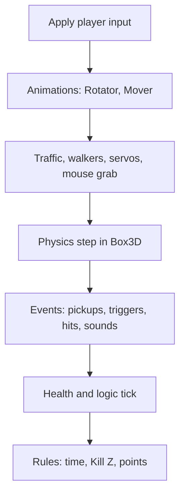

# 8 The Game Runtime – How a Level Becomes a Game

> **In short:** A level is a blueprint made of actors, and every actor is fitted with components like
> a building brick. The **GameWorld** brings this blueprint to life: it builds a physics world from
> it, runs it in fixed steps, steers the player, checks the game rules and sends out picture and
> sound. Studio and exported games use exactly the same code.

So far you've got to know the tools: graphics, physics, sound. Now comes the conductor who gets them
all to play together. This part of Kern is called `kern::game`, and it turns Kern into a real game
engine.

## 8.1 The life of a game world in five lines

The whole usage fits into five lines, taken straight from the code:

```cpp
GameWorld world(renderer, &night_windows);
world.sync(level);                  // meshes for the editor view
world.start(level, SimMode::play);  // Box3D world, controllers, rules
// every frame:
world.step(dt, input); world.update_camera(cam, dt, input);
world.present(now_ms, eye);
world.stop();                       // back to the edited level
```

In words:

- **`sync`** shows the level in the editor. It only re-uploads what has changed, and it rests while
  a simulation is running.
- **`start`** makes a copy of the level, builds the physics world and starts Simulate or Play.
- **Every frame**, the world moves one step further (`step`), the camera follows (`update_camera`),
  and everything is handed to the renderer (`present`).
- **`stop`** tears everything down and shows the level again the way it was before.

> **Watch out!** Whatever happens during a simulation – crates that fell over, balls that rolled
> away – does **not** end up in the level. After Stop, everything is back in its place. If you want
> to keep a simulated pose, use **Keep Simulation Changes** in Studio (the K key).

## 8.2 The rules for numbers

So that all the parts speak the same language, there are fixed agreements:

- Things are measured in **meters, seconds and kilograms**.
- **Z points up** (not Y, as in some other programs).
- Rotations are written as **angles in degrees**: roll, pitch, yaw – exactly as in the editor. They
  are combined in the order yaw · pitch · roll.
- Colors are **sRGB values from 0 to 1**, in the file as `#rrggbb`.
- An actor's placement is always **relative to its parent actor**. If you attach a wheel to a car,
  the wheel drives along with it.
- When simulating, child actors without a body of their own are "welded" into the body of their
  nearest ancestor. That way, a car's cabin becomes part of the car.

## 8.3 Level and actor

A **level** is the document that Kern Studio edits and saves as `.klevel`. It contains:

- a name and the **World Settings** (8.5),
- the list of **actors**,
- imported **textures** and **sounds** (stored directly in the file),
- a **level graph** for logic ([Chapter 9](09-logic.md)),
- the position of the editor camera and the next free number for new actors.

Which actor you control in Play is set in the World Settings. If no actor with a Player Controller
is entered there, Kern takes the first actor with a controller.

An **actor** is a thing in the world: a cube, a lamp, a car, a duck. Every actor has a unique number,
a name, a parent actor, a folder in the Outliner, the switches "hidden" (invisible in the editor and
in the game) and "locked" (can't be clicked in the Viewport), a transform (position, rotation,
scale) and free-form **tags** – keywords that logic can use to find it again. And then come the
components.

> **Imagine …** a building brick with studs. A bare actor is just the base brick: it has a place,
> nothing else. Snap a **mesh** onto it, and you can see it. Snap a **Rigid Body** onto it, and it
> falls down. Snap a **Player Controller** onto it, and you can drive it. That's how you build all
> sorts of things out of just a few parts.

An actor may have at most one of most components (one mesh, one light, one body …). **Colliders** and
**joints** can be as many as you like. On top of that, every actor can carry its own logic graph.

## 8.4 The components – the building kit

Here's the whole building kit at a glance. The blue book lists all fields with their defaults.

**Static Mesh** – the visible shape. You can choose box, sphere, cylinder, cone, capsule, plane,
torus, ramp or a built-in model (such as one of the Micro Duck's servos). Plus a **material**: color,
roughness, metal, glow, transparency, texture. Here's the exciting part: **friction** and
**bounciness** (*restitution*) also live on the mesh, under Mesh › Physics. Because they are the
object's physics. That's also where you'll find rolling resistance and a **surface** (`cloth`,
`tpu`, `floor`), which lets two materials get their own pair friction ([Chapter 6](06-physics.md)).
A mesh with collision switched on automatically gets a matching collider. The material also has
switches for "unlit", casting shadows and visible from both sides, as well as tiling for textures;
transparency below 1 is blended.

**Point Light** – a colored lamp with brightness and range (default 12 m).

**Rigid Body** – turns the actor into a physical body. It can be **static** (never moves),
**kinematic** (moves according to a plan, but can't be pushed) or **dynamic** (falls, rolls, bounces
off). Mass 0 means: compute it from the colliders' density. There's also damping, a gravity factor,
starting velocity, axis locks and an impact sound with a threshold ([Chapter 7](07-audio.md)). A
**bullet** checks collisions without gaps, even against moving bodies, so that fast things don't
tunnel through. A body may fall asleep when it's at rest (that saves computing time). Imported
robots (MJCF, URDF) can bring their exact mass distribution with them – center of mass and inertia
only count in that case; otherwise shapes and densities decide.

**Collider** – the invisible shape the physics calculates with: automatically fitted to the mesh,
box, sphere, capsule or convex hull. With density (default 1000 kg/m³, like water), friction and
surface. A hull without points of its own takes the mesh's hull. A collider can be a **sensor**: it
doesn't push anything away, but it notices when something comes inside – perfect for finish lines
and coins. With channels and groups you decide who collides with whom; parts with the same negative
group never collide. Every collider can have its own impact sound.

**Constraint** – a joint to another actor or to the world. Nine kinds: hinge, slider, ball joint,
fixed, rope (*distance*), wheel, motor, parallel and "no collision". Joints can have limits, motors
and springs, and they can **break** under too much force or torque (0 = unbreakable; a breaking
sound plays when they do). A rope with length 0 takes the distance at the start. A hinge can have a
reference angle: the angle it shows in the build pose. A hinge can also be a **servo** – a small
motor that steers toward a target angle, like on a real robot. The rule is easy to picture: the
farther the angle is from the target, the harder the servo pushes back, slowed down by damping and
limited by a maximum torque ([Chapter 6](06-physics.md)).

**Player Controller** – makes the actor controllable. Seven kinds of movement: Hover Car, rolling
ball, figure (*Character*), flyer, vehicle, soldier and walker (the Micro Duck). Plus speed,
acceleration, jump, boost, camera type (Chase, First Person, Top Down) with distance, height and
field of view, and sounds. The soldier has crouch speed, eye height, look sensitivity and head bob.
The walker has its own switches: walk on its own when nobody is steering; gait (`velstand` or
`alpha`); roller skates; action style (`training` or `robot`); Kern's extras (play network with ball
and sock) and the servo delay. What they do is explained in [Chapter 13](13-micro-duck.md).

**Weapon** – a weapon for soldiers: rifle, pistol, shotgun or sniper rifle. It hits instantly with an
invisible ray (*hitscan*); in multiplayer the server decides, with lag compensation (8.13). Every
type has its own values. A few examples:

| Weapon | Damage | Magazine | Range |
|---|---|---|---|
| Rifle | 24 | 30 | 300 m |
| Pistol | 30 | 12 | 120 m |
| Shotgun | 11 × 8 | 6 | 45 m |
| Sniper | 90 | 5 | 1000 m |

Plus rate of fire, spread (from the hip and when aiming), recoil, reload time, a headshot factor, a
push on bodies that are hit, the zoom field of view when aiming, and sounds of its own. The shotgun
fires 8 pellets at once.

**Health** – hit points (default 100), armor (absorbs damage first), regeneration (starting 5 s after
the last hit, 12 points per second), coming back to life (*respawn*, after 3 s; players at the
starting point, everything else right where it was), 10 points for whoever takes it out, and, if
you like, an explosion on destruction whose damage falls off to 0 toward the edge.

**Pickup** – something to collect: points, particle color, sound, optional healing or ammo, and a
time after which it comes back (0 = gone for this run).

**Trigger** – a zone that sets something off: goal, hazard, checkpoint, message, jump ramp,
teleporter, damage or just a logic event (8.12). It can be one-time, has a strength (ramp, damage)
and, for the teleporter, a destination.

**Audio Source** – a sound source on the actor ([Chapter 7](07-audio.md)).

**Rotator, Mover, City** – three helpers. The **Rotator** spins constantly (default 60 °/s around the
vertical axis). The **Mover** pushes back and forth – smoothly like a pendulum, evenly back and
forth, or over and over from the start. And the **City** builds a whole procedural city with
blocks, streets, trees, traffic and windows that light up at night. Out of the box: 7 blocks per
side, 80 m from street to street, 16 m wide streets, buildings up to 84 m tall in the center, 22
cars – all from one seed, so it's the same city every time. Rotator and Mover compute from the
simulation time.

> **Try it!** In Studio, place a **Cube** from the catalog, lift it up a bit with the gizmo and start
> Simulate (Alt+S): it stays hanging in the air. Stop, add a **Rigid Body** to it in Details via
> **+ Add** (default: dynamic) and start again. Now it falls! One more component – and gravity
> applies.

## 8.5 World Settings – the settings for the whole level

The World Settings apply to the whole level. They fall into four groups:

- **Physics:** gravity (default 9.80665 m/s² downward), step rate (default 60 per second, allowed
  15 to 480), sub-steps (1 to 16), ground friction, softness of contacts.
- **Sky and light:** time of day (0.25 sunrise, 0.5 noon, 0.75 sunset), day length (0 = frozen), sun
  direction, fog, exposure, range of the ambient occlusion (soft shadows in corners), shadow range
  (default 80 m; smaller means sharper), clouds, endless ground with color, friction and surface.
- **Game:** title, player, win condition, time limit, target score, **Kill Z** (anyone who falls
  lower than −50 m is reset) and the **Observer camera**, with which Play starts as a free spectator.
- **Sound:** volumes, music, ambience, reverb, Doppler.

## 8.6 The level file

A `.klevel` file is a **JSON document** – plain text that you can even read with a text editor. At
the top are `"format": "kern-level"` and a version number, then name, world, camera, actors (at most
100,000), textures and sounds (both embedded as data URLs) and logic. An actor looks roughly like
this (shortened):

```json
{
  "id": 12, "name": "Door", "parent": 3,
  "transform": {"position": [5.2, -12, 1.5],
                "rotation": [0, 0, 0], "scale": [1, 1, 1]},
  "tags": ["door"],
  "components": { "mesh": {...}, "body": {...} }
}
```

A door with number 12 that hangs on actor 3, stands at a certain position, carries the tag "door"
and has a mesh and a body. Entries that match the default aren't written at all – that keeps the
file slim. Numbers are rounded to six decimal places.

### Forgiving and strict at the same time

When reading, Kern follows a clever motto: **forgiving about what's missing, strict about what's
wrong.**

- Unknown entries are ignored, missing ones get default values. That way old files still load in
  new versions.
- Wrong types are errors with a clear message, such as "friction must be a number".
- Numbers outside their range are pushed into it (friction, for example, to 0 to 10).
- Missing or duplicate numbers are reassigned. If an actor points to a parent actor that doesn't
  exist, it hangs at the top afterwards. And if actors are each other's parents in a circle, the
  circle is broken up.
- A file from a **newer** Kern version is rejected.
- Error messages name the actor concerned. Broken textures or sounds (without an ID or with a wrong
  source) are skipped, and impossible values are repaired, such as a maximum distance below the
  minimum distance.

### The check before the start

Before Play, Kern checks the level (`validate`). **Errors** prevent Play, such as a missing number, a
size of zero, a joint that connects an actor to itself, a controller without a body, a non-finite
transform, a missing joint target, a joint axis of zero, or a City that doesn't hang at the very top.
**Warnings** only end up in the Output Log, such as a sound that doesn't exist (it then stays
silent), a pickup whose collider isn't a sensor, a joint without a body, a weapon without a soldier,
a controller on a non-dynamic body, two Player Controllers, or "reach goal" without a goal trigger.

## 8.7 From blueprint to physics

Before the physics engine Box3D can get going, Kern has to tell it which bodies exist. That's what
`plan_bodies` does. The nice part: Studio uses the same plan to draw the colliders in the editor. So
what you see is exactly what gets simulated.

The rules in short:

1. Every actor with a **Rigid Body** becomes a body. A static body with a Rotator or Mover becomes
   kinematic – after all, it moves.
2. Actors with colliders, meshes with collision, pickups and triggers **without** a body above them
   get an **invisible body of their own** – static or, if animated, kinematic.
3. Every actor hands its shapes to its body: its own colliders or an automatically fitted one (with
   the mesh's physics material; for pickups and triggers as a sensor). Pickups and triggers without
   a shape get a sensor sphere with a 1 m radius. Invisible bodies without a shape are dropped; a
   real Rigid Body without a shape simulates as a point mass.
4. A city becomes one static body with one box per building.
5. The **endless ground** is really a giant slab: 20,000 × 20,000 m, with its top at z = 0.

Automatic colliders adapt: box and plane become a box, sphere a sphere, capsule a capsule, everything
else (including the torus) a convex hull. Scaling is applied exactly, and tiny shapes are enlarged:
moving ones to at least 1 cm, static ones to 2 mm.

> **Did you know?** The "endless" ground isn't endless at all – it's only 20 kilometers wide. That's
> enough for any game, without anyone noticing.

## 8.8 Starting the world

`start` works through a fixed list. Here are the most important steps:

1. **Check** the level – an error aborts.
2. Make a **copy** of the level and remember the original.
3. Build the **Box3D world**, with gravity and contact settings. From 2 m/s on, a bump counts as a
   hit (logic "On Hit", camera shake). If bodies have impact sounds with a lower threshold, it drops
   to their value, but never below 0.05 m/s.
4. Sort the actors so that parents come before children.
5. Create **bodies**, then **joints**, then **walkers**.
6. Start the **city traffic**.
7. Take over the **player** (only in Play). Figures and soldiers switch to the Character Mover.
8. Reset the **rules**: points, time, status (the best time stays). In Play, the title appears as a
   message.
9. Fill up health and ammo, then start the **logic**.

There are some fine points when creating the bodies. Player vehicles are treated as "bullets" so
that they don't tunnel through walls at high speed, and **players never sleep**. Vehicles, figures
and flyers must not tip over: Kern locks their roll and pitch (only the rolling ball and the walker
are allowed to do that). The physics only reports events like hits where someone reads them – that
saves work. If a shape can't be built, it is skipped and reported in the log.

For joints there's a rule of thumb: the actor moves **relative to its target**. So a positive motor
turns the actor, not the target (only for the wheel is the actor the chassis). Target 0 means:
attached to the world. If a joint is missing a body, it is skipped with a message. Springs are
limited so that they fit the physics rhythm and don't swing wildly: at most half as many hertz as
steps × sub-steps per second.

### Four modes

| Mode | What happens |
|---|---|
| none | editor, no simulation |
| simulate | physics and logic run, nobody is controlled; bodies can be grabbed |
| play | like Simulate, plus player, rules and HUD |
| replica | copy of a server game on the network ([Chapter 10](10-networking.md)) |

With **F8** you switch between Simulate and Play in the middle of a run ("Eject" and "Possess")
without the player losing their state. You can also pause, and while paused, the **.** (period) key
does exactly one step. A restart loads the original level fresh.

> **Try it!** Open the **Physics Lab** (File › Example Levels), start Play (Alt+P), press **F8** after
> a few seconds and look at the scene from the outside. Pause and tap **.** again and again – you go
> through the physics frame by frame, like through a flip book.

## 8.9 A frame – the heart of the game loop

> **Imagine …** a flip book. Every page shows the world a tiny moment later. If you flip quickly, it
> looks like movement. A game is a flip book that draws itself: for every page, it works out where
> everything has to be now.

### Fixed steps, no matter how fast the screen is

Screens show different numbers of frames per second: 60, 120, and sometimes things stutter. If the
physics simply calculated "as much time as has passed since the last frame", every device would get
a different result. That's why Kern always calculates in **fixed steps**, normally 1/60 of a second.

It works like a piggy bank: every frame throws the time that has passed into it. As long as there's
enough inside for a whole step, Kern takes one step out and calculates it. Whatever is left over
waits for the next frame. So that a long hang doesn't mess everything up, the piggy bank is limited:
it holds at most 0.25 s, and at most 0.1 s is simulated per frame. More on this in
[Chapter 6](06-physics.md).

And because a frame usually falls between two steps, Kern smoothly slides the bodies for display
between the old and the new pose (*interpolation*). That way everything looks fluid, even though
the physics calculates in fixed bites.

### What happens in one fixed step



1. **Players:** Every player's input is applied – depending on the kind, they drive, walk or fly.
   For remote players, their most recently received input applies; after Eject, your own figure
   rests.
2. **Animation:** Rotators and Movers get their target pose.
3. **Traffic** (cars stop in front of the player), **walkers**, **servos** and any **mouse grab**.
4. **Physics:** Box3D calculates one step with its sub-steps.
5. **Events:** collected pickups, touched triggers, overlaps and hits for the logic, camera shake,
   impact sounds, breaking joints.
6. **Health** (healing, respawning) and the **logic tick**.
7. **Rules:** returning pickups, checking the time limit, resetting whoever fell below Kill Z, speed
   into the HUD, target score reached?

After that, the time of day moves on, the camera follows, and `present` gives the renderer the poses.
Hidden actors (along with their children), collected pickups and used triggers are invisible. At the
end, the world sets light, sky, fog and lamps and tells the renderer how "nighttime" it is – that
decides how brightly the city windows glow.

In Studio, a few more tasks are added every frame: update cameras and touch, collect input while
playing (in a network game the network takes over the step, [Chapter 10](10-networking.md)) and
check logic breakpoints, synchronize the level while editing, and finally draw the sound and all
visible viewports. A frame may count for at most 0.1 s.

## 8.10 Controllers – driving, rolling, walking, flying

Every frame, the player actor gets an **input**: movement forward/back and left/right, up, jump,
boost, camera rotation, zoom; for the soldier, shoot, aim, reload, crouch and use; for the Micro
Duck, its special moves (sit, pick up, kicks, roll, beak, chirp, wheee, hop – one bit each). For lag
compensation, a shooter also sends along how far in the past their view was. What comes of it
depends on the controller:

- **Hover Car:** Throttle pushes the car forward, and an invisible **hover spring** keeps it in the
  air above the ground. So that it doesn't slide as if on ice, a sideways force pushes against it.
  In reverse it pulls at 1.25×, and the faster it goes, the harder it steers (up to 9 m/s). The
  bobbing and leaning you see is just presentation.
- **Vehicle:** like the Hover Car, but without hovering – it is only driven with ground contact.
- **Rolling Ball:** force in the direction of travel, jump as an upward push, only on the ground.
- **Character:** Box3D's **Character Mover**, like in classic first-person shooters. The figure
  handles steps up to 22 % of its body height automatically, and gravity is 1.5× for snappy jumps.
  The body becomes kinematic, turns smoothly in the direction of travel, and footsteps sound
  according to stride length.
- **Flyer:** flies in every direction, gravity is canceled; it turns toward the camera.
- **Soldier:** a first-person shooter figure (8.13).
- **Walker:** The input goes to the Micro Duck's trained network, which controls its servos.

For the ball, the figure and the flyer, "forward" is always **where the camera is looking**. What
they all have in common: the boost is a supply that empties while boosting and then slowly fills
back up. Anyone who lands faster than 3.5 m/s hears a `land`.

### Pawns – the game pieces

> **Imagine …** a board game. The board is the level, and every player has their own **game
> piece**. In Kern, the game piece is called a **pawn** (as in chess).

A pawn stores everything that belongs to a player: which actor they control, their last input, view
direction, starting point, boost and soldier state. When another player joins a network game, Kern
copies the player actor along with its children, bodies, joints and logic and places the copy on a
ring around the original start – each new figure a little farther along, so that nobody lands on
anybody else. When a player leaves, their copy disappears again; the level's own figure stays.

## 8.11 The camera

The camera follows the player's **smoothed** pose. There are three kinds:

- **Chase:** For vehicles, behind the direction of travel, with the distance growing at high speed
  (0.12 m more per m/s), softly damped. Otherwise it circles around the player with the mouse or
  stick. An invisible ray keeps it from sliding into walls (the duck's own legs don't count).
- **First Person:** the player's eyes; vehicles look in the direction of travel.
- **Top Down:** from above.

Above 30 m/s, the field of view widens (by up to 10.5° more) – that makes speed feel faster. Hard
hits make the camera shake. Soldiers have a camera of their own.

## 8.12 Rules, HUD and triggers

The **HUD** is the display over the game: status (playing, won, lost), title, message, points,
collected pickups, time, speed, boost, best time – and for the soldier, health, ammo and a hit
marker too.

You set the **win condition** in the World Settings:

| Goal | Won when … |
|---|---|
| none | never – sandbox |
| collectAll | all pickups are collected (and then the goal is reached, if there is one) |
| reachGoal | a goal trigger is reached |
| survive | the time limit has been survived |
| score | the target score is reached |

With a time limit, you lose at zero – except with *survive*. A hazard trigger always loses. At the
end, Kern sets the status, plays a jingle, remembers the best time for *collectAll* and *reachGoal*
and tells the logic "game over".

**Triggers** can do a lot: *goal* wins, *hazard* loses, *checkpoint* sets the starting point 1 m
above the trigger, *message* shows a text, *launch* flings the player up and forward at half that
speed (jump ramp), *teleport* beams them to another actor (with a one-second lock against beaming
right back), *damage* takes away hit points and *event* only reports to the logic. Every trigger has
a matching default sound (`goal`, `hazard`, `checkpoint`, `confirm` for messages, `boost` for the
ramp, `powerup` for the teleporter). Before every action, it lets the logic know. A one-time trigger
is used up afterwards – except goal and hazard.

**Pickups** are collected when touched: points, sound, sparks, healing or ammo. By the way, a pure
health pack stays where it is as long as you have full health – clever, right? Here too, the logic
finds out about it, and with a respawn time the pickup comes back.

## 8.13 Soldiers

The **soldier** is a first-person shooter player, taken over from SpawnCity, the game Kern grew out
of. Everything is calculated in the fixed steps. A few fine points that make up the feel of the
game:

- **Crouching** makes the figure 60 % as tall; standing up only works if there's room above your
  head. **Sprinting** only works forward, not while aiming or crouching; while aiming, the figure
  moves at 60 %.
- **Jump buffer and coyote time:** If you press jump up to 0.14 s *before* landing, it still counts.
  And up to 0.12 s *after* you've run over an edge, you can still jump – like the coyote in the
  cartoon who stands in the air for a moment.
- **Fall damage** from a landing speed of 7.7 m/s, deadly from 15 m/s.
- **Weapon:** With an empty magazine it reloads by itself; semi-automatics fire once per press; no
  firing while sprinting. Spread grows with movement, in the air (×2.5) and with every shot, and then
  dies down again; crouching reduces it (×0.7). Bodies that are hit get a push.
- **Shots** are invisible rays from the eye. The spread looks random, but it's calculated
  **deterministically** – the bullet flies the same way on every computer.
- **Lag compensation:** On the network, the server checks where the other players were standing when
  you fired – up to 0.5 s back. A hit at the top end of the figure or on a part with the tag `head`
  is a headshot.
- **Damage:** Armor absorbs up to two thirds; freshly revived players are protected for 2.5 s. At 0
  points there's a sound, points for the shooter and a logic event. Players come back at the start
  after their waiting time (at least 0.5 s); other actors disappear and come back right where they
  were. An exploding actor pushes everything away, hurts less with distance, flashes, bangs and
  shakes the camera.
- **Camera:** a first-person camera of its own with zoom when aiming, recoil, head bob, a small dip
  on landing and curves for gamepads.

The figures (walking, running, jumping, aiming, dead), weapons in hand, muzzle flash, tracers, bullet
holes, splinters and shell casings are pure presentation – they don't change the simulation, which
is why server, other players and editor all show the same thing. The weapon models (submachine gun,
pistol, sniper rifle, 40 mm launcher) are built from basic shapes.

## 8.14 Walkers

A **walker** is an articulated robot that walks on its own servos – the Micro Duck with the trained
network from Pollen Robotics. The GameWorld creates a control state for every walker and drives it
every step: read the sensors, choose a behavior, ask the network every four physics steps, move the
servos with a short delay – just like on the real robot. That's a topic of its own, which you can
read about in [Chapter 13](13-micro-duck.md).

## 8.15 Sound

The simulation doesn't play any sound itself. It leaves **sound cues** – little notes like "jump
here" – for jumps, boost, landings, footsteps, pickups, triggers, victory and defeat, hits, shots,
explosions, breaking joints and impacts. At most 64 wait at the same time. **GameAudio** picks them
up every frame and plays them on Kern's mixer, together with music, ambience and the player's engine
sound. How exactly that sounds is in [Chapter 7](07-audio.md).

## 8.16 Touch, mouse and gamepad

Kern runs on phones too. For that, it has a touch system, also taken over from SpawnCity.

A **referee** (`InputArbiter`) decides which device you're using right now. The most recently used
one wins, with a few clever rules: at the start, desktop applies if there's a fine pointer (mouse)
or no touch points. A finger switches to touch. Every real key switches to keyboard, even on a
phone. But a mouse doesn't turn a phone into a desktop. Capturing the mouse pointer (*pointer lock*)
is only available with mouse and keyboard.

The **touch controls** put two virtual sticks in the bottom corners – left for moving, right for
looking; they're 168 px in size and only shrink if two don't fit (at least 72 px). On top of that
come buttons to match the controller:

| Game piece | Buttons |
|---|---|
| Soldier | JUMP, RELOAD, AIM, CROUCH, USE |
| Micro Duck | QUACK, PICK, SIT, KICK L/R, ROLL, BEAK, WHEEE, HOP |
| Figure | JUMP, USE |
| Ball | JUMP, BOOST |
| Flyer | UP, DOWN, BOOST |
| Vehicles | BOOST, HOP, USE |

Every finger belongs to exactly one thing: buttons come before sticks, sticks before the free screen.
A finger on the free screen fires for the soldier (and aims along with it); otherwise it looks
around. A few tricks: pushing the left stick all the way forward means sprinting. Fast swipes on the
right stick turn harder ("flick"). And if you drag the stick out past its edge, the camera simply
keeps turning (*edge turn*). When zoomed in, everything turns more slowly. Gamepads work too; Kern
smooths their sticks with dead zones and curves.

## 8.17 Logic in the world

Every actor and the level can carry a **logic graph**. The GameWorld starts them in Play and
Simulate – on the computer that's in charge (alone or as the server) – and sends them events:
overlap, hit, pickup, trigger, damage, death, respawn, interact, inputs, keys, game over, new
player. The other way around, the graphs can change the world – move, spawn and push actors, switch
joint motors, cast rays, award points, end the game. Whatever they change is recorded for the
network. More in [Chapter 9](09-logic.md).

## 8.18 The example levels

Under File › Example Levels (and File › New Level), six finished worlds are waiting:

- **Orb Run:** a procedural city with traffic. You drive a Hover Car (1200 kg, with a cabin, spoiler
  and glowing nozzles as welded-in children) and collect 24 energy orbs. The run starts in the late
  afternoon and ends at night – a whole day lasts 480 s here. Studio starts with this level. Plus the
  music `music_drive` and the city sound `city`.
- **Physics Lab:** all kinds of joints on one playground – crate pyramid, pendulum, door with a
  spring, a rope bridge made of 12 planks (the middle joints break at 60,000 N), turntable, lift and
  a self-driving rover on four sprung wheels. You're a rolling ball, collect five stars, dodge a
  rotating hazard sweeper and have to reach the goal.
- **Shooting Range:** You're a soldier with a rifle, in a shooting range with eight target dummies
  at 10 to 60 m, cover and a tower. The goal is 150 points, in multiplayer too.
- **Micro Duck:** a room at the robot's scale – really 2.5 × 2.5 m, 10 × 10 m in the world – with a
  wooden floor, books, a ball and socks. The duck walks on its own, the physics calculates at 100 Hz
  with 16 sub-steps, there's no endless ground, Play starts with the Observer camera, and a logic
  graph makes it chirp when it sees the ball.
- **Basic:** ground (40 × 40 m) and a cube. **Empty:** nothing at all.

> **Try it!** In Studio, start Orb Run with Play (Alt+P) and collect a few orbs. Then stop with Esc,
> open the World Settings and set the **time of day** to 0.75. Start again – now you're driving into
> the sunset.

## 8.19 What else the GameWorld can do

The GameWorld has many more switches – for display, state, combat, networking, logic and grabbing
bodies with the mouse. One of them is especially nice for understanding things: the **debug view**.
It draws the colliders in colors by kind – static green, kinematic blue, dynamic orange, sensor
purple, sleeping gray – plus contact points and joint axes. The full list is in the blue book.

Of course, all of this is backed up by tests: file round trip, body planning, city generator,
playing through Orb Run and Physics Lab, win rules, soldier, Character Mover, impact sounds and more.

## What you take away

- A level consists of actors; components are the building bricks that give them abilities.
- Kern measures in meters and seconds, Z points up, rotations are in degrees.
- The `.klevel` file is JSON: forgiving about what's missing, strict about what's wrong.
- `plan_bodies` turns the blueprint into physics bodies – editor and simulation see the same thing.
- The game loop calculates in fixed steps and interpolates for the picture – like a flip book.
- Simulate lets the world run, Play also gives you a player, rules and HUD; F8 switches.
- Seven controllers make driving, rolling, walking, flying, shooting and waddling possible.
- Sound runs through cues, logic through events – both deterministic in the fixed steps.

## Brain teasers

1. In Simulate, you let a tower collapse and press Stop. Where are the blocks now?
2. Why does Kern calculate the physics in fixed steps instead of with the real time since the last
   frame?
3. A cube without a Rigid Body, but with a Mover, is supposed to push a ball. What body does it get?
4. Why does a health pack stay where it is when you walk over it?
5. What is coyote time, and why does it make a game more pleasant?

### Solutions

1. Back in their places. The simulation works with a copy; only Keep Simulation Changes adopts
   poses.
2. So that exactly the same thing comes out on every device – no matter how fast the screen is.
3. An invisible body of its own, and because it's animated, a kinematic one.
4. Because you have full health – it would be wasted.
5. You can still jump shortly after leaving an edge. That forgives last-second reactions and feels
   fairer.

---

© 2026 Christian Heinrich Hohlfeld · All rights reserved · [Imprint and rights](00-imprint.md)
