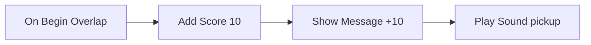

# 9 Logic Graphs – Game Rules You Snap Together

> **In short:** In Kern, you don't write game logic as program text. You snap it together from nodes
> and wires, like the Blueprints in Unreal Engine. An event sets off a chain, and the nodes fall one
> after another like dominoes. To make that fast, Kern translates every graph into machine code at
> startup – and, if you like, even into readable C++. All three routes deliver exactly the same
> result.

"When the player touches the coin, give them 10 points." That's what game logic sounds like. Kern has
**no** scripting language for it – you paint logic as a picture, and that picture is a full-fledged
program.

## 9.1 The model: nodes, wires, dominoes

A **logic graph** consists of **nodes** (little boxes that do something) and **wires** (connections
between them). It is pure data – a list of nodes and wires – and behind every node type there's a
C++ function in the engine.

> **Imagine …** a row of dominoes. You nudge the first one (an event), it tips over the next, which
> tips over the next … The white arrow wires in the graph are the gaps between the dominoes: they
> decide **what happens next**.

There are two kinds of connectors (*pins*):

- **Exec pins** (white arrows): the flow. **Event nodes** start a chain, **action nodes** continue
  it, **flow nodes** branch, repeat or wait.
- **Data pins**: values such as numbers, text or actors. Inputs **pull** their values: when a value
  is needed, the connected node calculates it at that moment. Pure calculation nodes (*pure*: math,
  queries) have no exec pin at all. Outputs of action nodes, on the other hand, keep the value from
  their last run. If an input isn't connected, the value you typed directly into the node applies.

On top of that come:

- **Variables** – a graph's memory, with a type and a starting value.
- **State machines** – states with transitions, in the style of the state editor from
  digitalisierungsplanung.de (more in 9.4).
- **Latent nodes** such as Delay or Tween – they pause the chain and continue later.

The **level** has a graph of its own, and every **actor** can carry one. In an actor graph, "Self"
is the actor itself.

### Which wires fit?

There are seven types: Exec, Bool, Int, Float, Vector, Text and Actor. Not every wire fits
everywhere – just like with plugs. These are allowed:

- the same type, always, but Exec only with Exec;
- **anything to Text** ("everything prints");
- numbers among each other;
- Actor to Bool ("is valid?");
- a number to Vector (in all three directions).

The conversions follow fixed rules: the text "0" or "false" is false, a vector as a number is its
length, a decimal number is cut off when it's converted to a whole number, and text is read as a
number.

### How a graph is stored

Graphs are stored as JSON directly in the level ([Chapter 8](08-game-runtime.md)). Nodes have a
number, a type (such as `game.add_score`) and a position; wires are short lists
`[from, output, to, input]`. Comment frames are saved too, but they don't do anything.

## 9.2 Nodes from the inside

Every node type has a description: name, category, help text, search words, its pins, its settings
(such as a variable name or a key) and its **kind** – Event, Action, Pure or Flow. Plus the actual
C++ function.

This function reports back **which exec output to continue from**. Or it says "Stop, the chain ends
here" – or "I'm waiting, wake me up later" (latent nodes).

Here's what a real game node looks like:

```cpp
lib.add(action("game.add_score", "Add Score", "Game",
    {data("points", "Points", PinType::number, 10.0)}, {},
    [](Context& c, GameWorld& w) {
      w.add_score(static_cast<f32>(c.in_number("points")));
    },
    "Adds points (wins at the target score ...).",
    "points reward"));
```

Line by line:

- A new **action node** with the type `game.add_score`, the title "Add Score", category "Game".
- It has a data input "Points", a number with a default value of 10.
- Its job: read the input and give the game world that many points.
- Then a help text and search words for the menu.

`action` adds the exec input and the "then" output automatically. Nodes see the world through a
**Context**: read inputs, write outputs, query settings, wait.

All built-in nodes live in a **Library**: the basic nodes plus the game nodes, which register
themselves when the program starts.

## 9.3 Checking before it starts

Before a graph runs, Kern checks it. **Errors** are, for example:

- an unknown node type or a wire to a pin that doesn't exist;
- a wire between types that don't fit, such as Exec to a data pin;
- two wires into the same data input;
- calculation nodes that depend on themselves (a circle);
- settings that point to missing variables or states;
- a state machine without exactly one initial state.

There's a **warning** for nodes whose exec input isn't connected anywhere – they never run.

A graph with errors is switched off at startup and reported. In Studio, **Compile** (F7) shows you
the result beforehand.

## 9.4 How a graph is run

All the graphs of a world run in one **runtime**; there, every graph becomes an **instance** for its
owner (actor or level). They're calculated in the fixed simulation steps, and only on the
**authority** – in a single-player game or on the network server.

At the start (**Begin Play**), the state machines enter their initial state, and "Begin Play" fires.
In every step (**tick**), three things then happen: due waiting times move on (the earliest first),
the tick event fires, and the state machines check their timer and condition transitions. Every
instance reveals its **tier**: "interpreter", "compiling", "compiled (WebAssembly)" or "native C++"
(9.8).

### Events and chains

An **event** has a type (such as "something enters the sensor"), optionally a target actor, and extra
values. Kern looks for all matching event nodes, writes the values into their outputs and lets the
chain run. Actors that are created in the meantime are included right away. A **Custom Event** can
be called on purpose: to all graphs or to one actor – and at the same time it switches state machine
transitions with that name.

For branches, the interpreter has a **stack** of sticky notes. A **Sequence**, for example, runs its
first output right away and puts notes for the others on the stack. When a branch is finished, Kern
takes the next note. Loops work the same way: run the body, then go back to the loop node with a
note.

If an input is connected to a calculation node, that node is recalculated on **every** read (up to
48 levels deep). If it's connected to an action node, it reads that node's stored last value.

### Protection against infinite loops

> **Watch out!** A While loop whose condition always stays true would freeze the game. That's why
> Kern keeps count: if more than **200,000 nodes** run in one step, the graph is switched off – with
> the message "infinite loop? The graph is stopped." The rest of the game keeps running.

On top of that, events that trigger events may be nested at most 64 deep. In translated code, more
than 512 nested loops or sequences stop the instance.

### State machines – like a traffic light

> **Imagine …** a traffic light. It's always in exactly one **state**: green, yellow or red. After a
> while, it jumps to the next one. That's a **state machine**.

Every state machine has exactly one initial state. A **transition** can fire:

- on an **event** with a certain name,
- after a **timer** (so many seconds in the state),
- while a **condition** (a Bool variable) is true,
- or **automatically** on the next tick.

A transition can also come "from any state" (but it doesn't fire if the machine is already in the
target state). There's at most one transition per machine and check, so a chain of automatic
transitions moves on one state per step. Entering and leaving a state trigger events of their own
that you can hang chains on; "On State Entered" also tells you the previous state. **Set State**
jumps directly into a state.

## 9.5 The basic nodes

Kern comes with **76 basic nodes**. The families:

- **Events:** Begin Play, Event Tick, Every N Seconds, Custom Event.
- **State machines:** On State Entered/Left, Set State, Current State, Is In State.
- **Flow:** Branch (if/else), Sequence, For Loop, While Loop, Do Once, Do N, Gate (open/closed),
  Flip Flop (A and B in turn), Delay, Retriggerable Delay, Tween (smoothly from 0 to 1), Switch and
  Call Event.
- **Variables:** Get, Set, Add.
- **Math and logic:** arithmetic, rounding, sine, random, comparing, And/Or/Not, Select.
- **Values, vectors, text** and **helpers** such as Game Time and Print (on the screen too, if you
  like).

A few fine points: Every N Seconds counts its own time. Sequence has 1 to 16 outputs, and For Loop
counts up to and including the last value. A Delay ignores further calls while it's waiting; the
Retriggerable Delay, on the other hand, starts over. Tween reports a value from 0 to 1 every step
(evenly or with a smooth curve) and "Finished" at the end. Switch branches by number or text,
Compare compares with a tiny tolerance (10⁻⁹), and reroute nodes (*Reroute*) only tidy up wires.

> **Did you know?** Even randomness isn't quite random in Kern. It comes from a generator whose
> starting value is fixed – **deterministic** per world. That's why replays and network games match.

## 9.6 The game nodes

On top of that come **71 game nodes** that talk to the game world. An actor input without a wire
always means **Self**.

**Events** – the nudges that start the domino chains:

| Node | Fires when … |
|---|---|
| On Begin / End Overlap | something enters or leaves this actor's sensor |
| On Entered Sensor | this actor enters someone else's sensor |
| On Hit | something crashes (from 2 m/s, at most 32 per step) |
| On Collected, On Trigger | a pickup is collected or a trigger is touched |
| On Damaged, On Death, On Respawn | damage, death, coming back |
| On Interact | the player presses F (gamepad: Y) and looks at the actor (up to 3 m) or stands next to it (2 m) |
| On Player Joined, On Game Over | a player joins, the game ends |
| On Input Action, On Key | an action (any player, any device) or a key (local only) is pressed |

By the way, an overlap counts the whole visitor: a player's capsule and head are *one* visitor, not
two.

The remaining nodes in families:

- **Actors:** Self, player and player count, finding (by name or tag, randomly too), checking tags,
  reading position, rotation, direction, speed and distance, setting, moving, switching on and off,
  **Spawn Actor** (create a copy with children and logic) and destroying, and **Set Property**,
  which can change any value of a component via its path, just like in the level file – the color,
  for example.
- **Physics:** setting velocity, impulse and force (for one step), Launch (keeps the horizontal
  speed), physics on/off (dynamic ↔ kinematic), joint motors (for doors, lifts, winches),
  explosions and ray tests (*Line Trace*).
- **Game and combat:** points, messages (for all players), winning, losing, damage, healing, killing,
  ammo, reading health, light, color, sparks, camera shake (only on this device), sounds (3D or flat)
  and "For Each Actor with Tag".
- **Robot:** making the Micro Duck walk (like with the gamepad, within the trained limits: up to
  0.4 m/s forward, 0.3 m/s sideways, turning at 57 °/s) and making it look, switching its autonomy,
  special moves like sitting, picking up, kicking, somersault or jump, beak, petting, listening,
  "is it holding something?", chirping, distance sensor, head camera and its state
  ([Chapter 13](13-micro-duck.md)).

## 9.7 Logic in the game world

The GameWorld only starts the graphs in Play or Simulate, only on the authority (not on network
copies) and only if there's any logic at all.

Its **host** supplies the graphs with the basics: the **simulation time** (counted from the steps,
not the wall clock), output and errors in the Output Log (Print as an HUD message, if you like) and
a **deterministic random generator**. Spawned actors and new players bring their graphs with them.

Where do events go? To the graph of the actor concerned – or, if it doesn't have one, to that of its
nearest ancestor with a graph. That's handy: a door's welded-in collider belongs to the door. On top
of that, the level graph **always** gets the event too; events without an actor (such as the end of
the game) go to everyone. If a level has logic, the physics reports overlaps of all movable shapes
and hits of all dynamic shapes – otherwise the graphs would have nothing to listen to. The logic
tick runs at the end of every fixed step, after the physics events.

**For the network**, Kern records what logic changes in the world: changed values, spawned actors,
moved bodies. The server sends that to everyone – including players who join later
([Chapter 10](10-networking.md)).

## 9.8 From picture to machine code

> **Imagine …** you're reading a book in a foreign language. An **interpreter** can read it to you
> sentence by sentence – that works right away, but it's slow. Or someone **translates** the whole
> book once, and after that you read it fluently. Kern's interpreter is the person reading
> aloud, the JIT is the translator.

Kern has two translators that use the same plan:

- **WebAssembly (JIT):** When Play or Simulate starts, Kern writes a small WebAssembly module for
  every graph. The browser turns it into machine code, and Kern plugs it directly into the engine.
  No JavaScript in between.
- **C++ export:** The same graph as readable C++ source code. Built into a game
  (`kern/build.sh --studio out.wasm file.cpp`), it replaces the interpreter for that graph. If
  there's exported code for a graph, it takes precedence. Outside the browser there's no JIT: there,
  the graph runs in the interpreter or as exported C++.

The translator generates simple things – branches, loops, number variables, arithmetic, comparisons
– directly. Everything else (game nodes, text, vectors, waiting times) simply calls the node's C++
function.

The generated program is a loop with a **program counter**: one case per node, like the numbered
stations of a scavenger hunt. That way any wiring works, even circles. Here, too, it keeps count and
stops in case of an infinite loop.

The exported C++ code registers itself with a **fingerprint** of the graph. The positions and
comments do **not** go into this fingerprint. So moving a node doesn't make the export invalid – but
any change to the content does. Then you have to export again.

> **Did you know?** According to measurements, the JIT is about **55 times faster** than the
> interpreter. That's measured with a million loop iterations.

Because translating in the browser takes a moment, every graph starts out in the interpreter (tier
"compiling"). As soon as the machine code is ready, it takes over – in the middle of the game. If
translating doesn't work, the graph simply keeps running in the interpreter.

## 9.9 Why all three routes must calculate the same way

Interpreter, JIT and C++ export are **interchangeable**, even in the middle of the game. That only
works because they share one memory.

> **Imagine …** a relay race. The first runner hands over the baton without stopping. For that to
> work, both have to hold the same baton. In Kern, the baton is the shared memory: variables, loop
> counters, gates and flip-flops sit in fixed **slots** that the interpreter and the machine code
> read and write alike. Nothing has to be copied over when switching.

Why is that so important?

- **Determinism:** Kern calculates the same way everywhere ([Chapter 6](06-physics.md)). If a graph
  calculated differently in the browser than natively, replays, training and debugging would be
  worthless. Even the protection against infinite loops counts the same way in all tiers.
- **Waiting times** such as Delay continue their chain the same way in every tier.
- **Debugging:** Breakpoints and the live display of running nodes work in translated code too.

This is backed up by a set of shared test cases – math loops, gates and sequences, nested loops,
state machines, a deliberate infinite loop and more. Every case runs in the interpreter, as JIT code
and as exported C++, and the results must be **identical**. That's why anyone who changes a node has
to change it the same way in three places.

## 9.10 Editing logic in Studio

The logic editor in Studio follows Unreal's Blueprint editor. You open it via **Logic** in the
toolbar (level graph) or via **Edit Logic** / **Add Logic (Blueprint)** in an actor's context menu.
[Chapter 11](11-studio.md) describes the interface; here are the most important points:

- Every edit is a command to the engine and therefore one **undo step**.
- If you drag a wire from a pin into empty space, the **action menu** only suggests nodes that fit.
  You type a search term and press Enter – the node appears and is already connected.
- **Promote to Variable** turns a pin into a new variable with one click.
- Double-clicking a wire inserts a reroute node – for tidy wires.
- Nodes snap to an 8 px grid. If a new node is missing its variable or state machine, Kern creates it
  right away. If you rename a variable, all its nodes change along with it; if you change its type,
  the value is converted.
- Copy and paste work via the graph as JSON text; pasted templates land below the existing nodes.
- Moves that belong together (picking up a wire and dropping it somewhere else, typing into the same
  pin) count as one undo step together.
- **Compile** (F7) shows problems, **C++** exports the graph (file `logic_<level>_<actor>.cpp`).
- **F9** sets a breakpoint: if the node runs while playing, the game pauses after that simulation
  step, and the editor jumps to it.
- While playing, the nodes that ran light up, and variables show their live values.

> **Try it!** Open the Basic level (File › Example Levels), click **Logic** and then **Begin Play**.
> Drag a wire from the "then" output into empty space, type "show message", press Enter and write a
> text into it. Go back to the **Viewport**, place a Rolling Ball and start **Play**: your text
> appears in the HUD!

## 9.11 Examples to rebuild

All the examples are real graphs from Kern; most of them are available in the logic editor under
**Templates**.

**Score zone.** Whoever enters the sensor gets 10 points, a message and a sound – four dominoes in a
row:



**Door.** Interact leads to a Flip Flop: the first time, a Tween opens the door in 0.8 s; the second
time, another one closes it again – a little bit every step. Plus a confirmation sound.

**Spawner.** Every 3 seconds: are there fewer than 10? Then spawn a Physics Cube and keep count. All
the other players see the copies.

**Traffic light.** A state machine "Light": green → (4 s) → yellow → (1.5 s) → red → (4 s) → green.
With every new state, a message shows which one it is.

**Avoiding obstacles.** The Micro Duck switches off its own behavior. Every 0.25 s it looks with its
distance sensor: if something is closer than 1.6 m, it turns on the spot; otherwise it walks
straight ahead.

**The duck chirps at the ball.** In the Micro Duck example level, the level graph asks every 0.25 s:
does the head camera see the ball **and** did it not see it before? Then it chirps. The variable
"Ball Seen" remembers whether the ball was already in the picture – so the duck chirps once when the
ball shows up, and not every 0.25 s.

> **Try it!** In a level, open the logic editor, choose **Templates…** and insert the **traffic
> light**. Start Play and watch the messages switch through green, yellow and red. Then change one
> timer to 1 second and try again.

> **Watch out!** The chirp graph is a demo of the robot nodes – not something the real duck does on
> its own. That's even stated explicitly in a comment frame in the graph.

## What you take away

- Kern has no scripting language: logic is graphs made of nodes and wires.
- Exec wires set the order like dominoes; data wires deliver values on demand.
- Variables are the memory, state machines the states, latent nodes wait.
- Graphs run in the fixed steps, only on the authority; their changes are replicated.
- A counter (200,000 nodes per step) stops infinite loops.
- Interpreter, JIT (WebAssembly, about 55 times faster) and C++ export deliver exactly the same.
- In Studio: Compile (F7), breakpoints (F9), templates and C++ export.

## Brain teasers

1. After the C++ export, you move a node. Do you have to export again? And what if you change a
   number in the node?
2. Why does logic only run on the server in a network game?
3. What would happen without the variable "Ball Seen" while the ball is in the picture?
4. Why do the loop counters sit in shared slots instead of in the interpreter?

### Solutions

1. Not for moving it, because positions don't count toward the fingerprint. For a changed number,
   yes.
2. So that there's only one truth. The server calculates, and the clients get the changes.
3. The duck would chirp every 0.25 s.
4. So that the JIT code can take over in the middle of the game without copying anything over.

---

© 2026 Christian Heinrich Hohlfeld · All rights reserved · [Imprint and rights](00-imprint.md)
