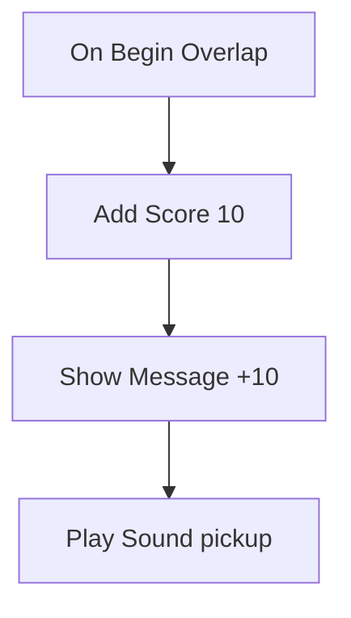

# 9 Logic Graphs – Game Rules You Plug Together

> **In short:** In Kern, you don't write game rules as program text; you plug them together from
> boxes and wires. An event sets off a chain, and the boxes fall one after another like dominoes.
> Kern can read such a picture aloud or translate it, and every way gives exactly the same result.

> **Key terms:**
> - **Program** – a precise step-by-step instruction for the computer.
> - **Machine code** – the language the processor understands directly: very fast, but unreadable
>   for people.
> - **C++** – the programming language Kern is written in; readable for programmers.
> - **WebAssembly** – a form of program that the browser turns into machine code very quickly.
> - **Variable** – a labeled box in which a program remembers something, such as "Points: 30".
> - **Authority** – the computer that's in charge: in a single-player game yours, in a network game
>   the server.
> - **Sensor and trigger** – zones that notice when something enters them
>   ([Chapter 8](08-game-runtime.md)).
> - **Deterministic** – calculated exactly the same on every device.

"When the player touches the coin, give them 10 points." That's what game logic sounds like. Kern
has **no** scripting language for it – you draw logic as a picture, and that picture is a
full-fledged program.

## 9.1 The model: nodes, wires, dominoes

A **logic graph** consists of **nodes** (boxes that do something) and **wires** (connections
between them). White wires decide **what happens next**; colored wires deliver **values** such as
numbers or names.

The graph itself is just a description – a list of boxes and wires, like a circuit diagram on
paper. Behind every kind of box there's a ready-made piece of Kern that does the actual work (how
Kern prepares the plan for this is in 9.8).

> **Imagine …** a row of dominoes. You nudge the first one (an event), it tips over the next, which
> tips the next … The white arrow wires in the graph are the gaps between the dominoes: they decide
> **what happens next**.

There are two kinds of connectors (*pins*):

- **Exec pins** (*exec*, white arrows): the order.
- **Data pins** (colored): values such as numbers, text or things. An input fetches its value
  exactly when it's needed. If it isn't connected, the value you typed directly into the box
  applies.

By their job, there are four kinds of boxes:

- **Event nodes** set off a chain ("game begins", "something enters the zone").
- **Action nodes** do something and pass the flow on ("give 10 points").
- **Flow nodes** steer the flow: branch, repeat or wait.
- **Pure nodes** only deliver values and have no white wire at all.

With pure and action nodes, a closer look is worthwhile, because they deliver their values
differently:

> **Imagine …** a **thermometer** and a **receipt**. The thermometer always shows you the value
> from *now*, every time you look at it. The receipt shows what happened on your *last shopping
> trip* – until you go shopping again.

**Pure nodes** (plus, compare, "where is the player?") are thermometers: they have no white wire and
calculate afresh every time someone reads their value. **Action nodes** (give points, create a
thing) are receipts: their result stays put until they run the next time.

When does that make a difference? Take a dice pure node ("random number from 1 to 6") and connect
it to two boxes. Each box looks at the thermometer separately, so the node rolls twice – and the two
may get different numbers. If you want the same number in two places, roll once and put the result
in a variable, like a receipt you keep.

On top of that come:

- **Variables** – a graph's memory, with a type and a starting value.
- **State machines** – states with transitions, like a traffic light (more in 9.4).
- **Waiting nodes** such as Delay (wait) or Tween (change smoothly) – they pause the chain and carry
  on later.

The **level** has its own graph, and every **actor** can carry one. In an actor's graph, the actor
itself is called "Self".

### Which wires fit?

Every wire carries a certain **type** – like cables with different plugs. Not every plug fits into
every socket. There are seven types: the exec wires are a type of their own; the other six carry
values.

| Type | In everyday life | Example |
|---|---|---|
| Exec | "your turn!" – the flow itself | the white arrow |
| Bool | yes or no | "Is the door open?" |
| Int | whole number | number of coins: 7 |
| Float | decimal number | speed: 3.5 m/s |
| Vector | three numbers for position or direction | "2 m forward, 1 m left, 3 m up" |
| Text | letters | "You win!" |
| Actor | a thing in the level | the door |

Allowed are the same types – but exec only with exec –, numbers among each other, and **everything
to text**, because everything can be printed. A few more conversions are firmly defined, such as
"thing to yes/no" (does the thing still exist?).

> **For the curious:** A vector as a number is its length, a decimal number is cut off when
> converted to a whole number, and the text "0" or "false" counts as no. The complete rules are in
> the blue book, Chapter 9.

A graph is saved as text directly in the level file ([Chapter 8](08-game-runtime.md)) – with
boxes, wires, positions and comment frames. The comments have no effect; they just help with
reading.

## 9.2 Nodes from the inside

Behind every box there's a small piece of program. When it's done, it reports **which output to
continue at** – or "Stop, the chain ends here", or "I'm waiting, wake me later".

After doing its work, every box gives exactly one of three answers:

- **"Continue at output X"** – the next domino falls.
- **"Stop"** – the chain ends here.
- **"Wake me later"** – the chain pauses, say at an egg timer, and continues at the same spot after
  the waiting time.

On top of that, every kind of box has a profile: its kind, its connectors and its work. This is the
profile of the box **"Add Score"**, in words:

> **Profile "Add Score":** Kind: action. One data input "Points", a number, preset to 10. Work: read
> the input and give the game world that many points. Answer: "Continue at output 'then'."

All the built-in boxes together make up a kind of **parts catalog**, from which the menu in the
editor takes its suggestions. The name in the menu, the help text, the search words and what such a
profile looks like in C++ are shown in the blue book, Chapter 9.

## 9.3 Checking before it starts

Before a graph runs, Kern checks it – like an electrician who tests the wiring before switching on.
Wrongly wired graphs are switched off, boxes that never get their turn are reported.

**Errors** are, for example:

- a wire between types that don't match, such as an exec wire on a data pin;
- two wires into the same data input – which value should apply then?
- pure nodes that depend on themselves (a circle that would never finish);
- settings that point to missing variables or states;
- a state machine without exactly one initial state.

There's a **warning** for boxes whose exec input isn't connected anywhere – they never run.

A graph with errors is switched off at the start and reported. In Studio, **Compile** (F7) shows the
result beforehand.

## 9.4 How a graph is run

All graphs run in time with the game steps, and only on the computer that's in charge. At the
start, "Begin Play" fires, and after that "Tick" in every step.

The calculation happens in the fixed steps of the simulation ([Chapter 8](08-game-runtime.md)), and
only on the **authority** – the computer that's in charge (8.17): in a single-player game on your
computer, in a network game only on the server. The reason: there should be **one single truth**.
If two computers decided independently of each other whether a coin has been collected, they could
disagree. So one decides, and all the others get the result.

At the start (**Begin Play**), the state machines go into their initial state, and "Begin Play"
fires. In every step (**Tick**), three things then happen: waiting times that have run out carry on,
the Tick event fires, and the state machines check whether they change state.

### Events and chains

When something happens in the world, that's an **event** – such as "something enters the sensor",
often with extra details like "who?". Kern looks for all matching event nodes, gives them the
details and lets each chain run. With a **Custom Event** you can also announce an event with a name
yourself – to all graphs or to a particular thing.

If a chain branches, for example at **Sequence** ("first this, then this, then this"), Kern works
through the branches dutifully one after another and keeps track of which are still open – like you
with a list on your shopping list.

A **loop** is a box that repeats a piece of chain: "repeat while …" or "repeat ten times". Like
peeling potatoes: peel one, look in the pot, and if it's not full yet, take the next. Kern runs the
loop's contents, returns to the loop node and asks again – until the condition no longer holds.

> **For the curious:** The open branches lie on a "stack" of notes: the one put down last is worked
> through first. How deeply chains and calculations may be nested is in the blue book, Chapter 9.

### Protection against endless loops

> **Watch out!** A While loop ("while …, repeat") whose condition always stays true would freeze
> the game. So Kern counts along: if more than **200,000 boxes** run in one step, the graph is
> switched off – with the message "infinite loop? The graph is stopped." The rest of the game keeps
> running.

Likewise, there are limits on how often events may set off new events. That way a wired-up circle
can never bring the whole game to a standstill, at most its own graph.

### State machines – like a traffic light

> **Imagine …** a traffic light. It's always in exactly one **state**: green, yellow or red. After
> a while it jumps to the next one. That's a **state machine**.

Every state machine has exactly one initial state. A **transition** to the next state can be set
off:

- by an **event** with a certain name (a Custom Event with this name triggers it),
- after a **time** (so many seconds in the state),
- as soon as a **condition** (a yes/no variable) is true,
- or **automatically** in the next step.

Per step, each state machine changes state **at most once**. If several automatic transitions are
chained one after another, it moves on one state per step, not all in one go – like a traffic light
that shows every color at least briefly instead of jumping straight from green to red. That way
every in-between state also gets its events for entering and leaving.

A transition can also come "from any state", such as an emergency stop. Entering and leaving a
state set off their own events, which you can hang chains on. **Set State** jumps directly into a
state.

## 9.5 The basic nodes

Kern comes with **76 basic nodes**: for events, flow, memory and calculating. You don't have to know
them by heart – the menu in the editor suggests matching ones. A few examples show what's in the
building set:

- **Branch – the railroad switch.** A yes/no value comes in, and the flow travels either onto the
  "True" track or onto "False". "Does the player have enough coins? Then open the door, otherwise
  show a message."
- **Delay – the egg timer.** The chain stops and carries on after the set time. If someone presses
  again during the wait, the egg timer ignores it; a second kind then starts counting again.
- **Gate – the barrier.** When the flow arrives, it only continues if the barrier is open. Other
  wires open and close it.
- **Flip Flop – the light switch.** Every press switches over: once output A, then B, then A again.
  Perfect for a door that opens and closes.
- **Tween – the dimmer.** Instead of switching a lamp on hard, it turns a value smoothly from 0 to 1
  over an adjustable time and reports in every step how far along it is.
- **Every N Seconds – the alarm clock.** Fires regularly, for example every 3 seconds.

On top of that come reading, setting and counting up variables, calculating, comparing, randomness,
text and **Print**, which writes a text to the log or onto the screen. All 76 nodes with their fine
points are in the blue book, Chapter 9.

> **Did you know?** Even randomness isn't quite random in Kern. It comes from a generator whose
> starting value is fixed – **deterministic** per world. That's why replays and network games match.

## 9.6 The game nodes

On top of that come **71 game nodes** that talk to the game world. They **listen** to what happens
in the world, and they can **change** the world. If a thing input has no wire, it always means the
thing itself (Self).

**Events** – the nudgers of the domino chains:

| Node | Fires when … |
|---|---|
| On Begin Overlap | something enters this thing's zone |
| On Hit | there's a crash |
| On Collected | a pickup is collected |
| On Interact | the player presses F (gamepad: Y) while looking at the thing or standing next to it |

On top of that there are events for damage, death, new players, end of game and individual keys –
the whole list is in the blue book, Chapter 9.

By the way, an overlap counts the whole visitor: a player's body and head are *one* visitor, not
two.

The **actions** are sorted into families. One example each:

- **Things:** **Spawn Actor** creates a copy of a thing – along with its children and game rules.
  That's how you get a spawner that spits out a crate every few seconds.
- **Physics:** **Launch** gives a thing a strong boost, for example upward like a trampoline. Other
  nodes nudge, brake or switch joint motors – for doors, elevators and winches.
- **Game and combat:** **Add Score** gives points, **Show Message** shows all players a text, others
  make you win, lose, heal or play a sound.
- **Robots:** **Walk** makes the duck walk as if with a gamepad – only as fast as it learned in
  training. Other nodes make it sit, kick or chirp, or query its distance sensor and its head camera
  ([Chapter 13](13-micro-duck.md)).

All 71 game nodes with their limits and values are in the blue book, Chapter 9.

## 9.7 Logic in the game world

The game world gives the graphs everything they need: the game time, a predictable randomness and
the events. An event goes to the thing concerned – or to its nearest "parent" with a graph.
Whatever the logic changes, all fellow players get to see.

The game world ([Chapter 8](08-game-runtime.md)) only starts the graphs during **Play** or
**Simulate**, only on the authority (9.4) and only if there is any logic at all. It gives the
graphs:

- the **game time** – counted from the simulation steps, not from the clock on the wall. If a slow
  computer stutters, the game time still counts exactly the same, and during a pause it stands
  still. An "after 3 seconds" means the same thing everywhere;
- output and errors to the **Output Log**, and Print, if you want, as a message in the HUD;
- a **deterministic randomness**.

Created things and new players bring their graphs along right away.

**Where do events go?** To the graph of the thing concerned – or, if it doesn't have one, to that of
its nearest ancestor with a graph. That's handy: the invisible shape welded into a door belongs to
the door, and the door hears the event. In addition, the level graph **always** gets the event too;
events without a thing (such as end of game) go to everyone.

**For the network**, Kern records what the logic changes in the world: changed values, created
things, moved bodies. The server sends that to everyone – including players who join later
([Chapter 10](10-networking.md)).

> **For the curious:** If a level has logic, the physics reports more contacts than usual, so that
> the graphs have something to listen to. And the logic calculates at the end of every step, after
> the physics. The details are in the blue book, Chapter 9.

## 9.8 From picture to machine code

A graph can be "interpreted" step by step or translated once as a whole. The translation is much
faster and even takes over in the middle of the game. These are the three ways you already know
from [Chapter 2](02-building-and-testing.md): interpreter, translation and C++ export.

> **Imagine …** you're reading a book in a foreign language. An **interpreter** can read it to you
> sentence by sentence – that works right away but is slow. Or someone **translates** the whole
> book once, and after that you read fluently.

Kern has one interpreter and two translators that work from the same plan. Even the interpreter
doesn't read the whole circuit diagram every time: before the start, Kern turns it into a **lookup
table** that says, for every box, which piece of Kern runs it and where each output leads – like a
table of contents with which you find the right page right away.

- **Last-second translation** (*JIT*, "just in time"): when **Play** or **Simulate** starts, Kern
  writes every graph as a small WebAssembly program. The browser turns it into machine code, and
  Kern hooks it directly into the engine.
- **The C++ export:** the same graph as readable C++ program text. If you want, you build it
  permanently into your game; then, for this graph, it replaces the interpreter.

Simple things – branches, loops, numbers, calculating, comparing – the translator writes down
directly. Everything else, such as game nodes, simply calls the ready-made piece of Kern that the
interpreter uses too. And that happens without a detour: the translated graph talks to the pieces
of Kern directly, without the JavaScript side – the waiter from [Chapter 1](01-introduction.md) –
having to go between them. That's why it's so fast.

> **For the curious:** The translator can only write numbers and yes/no values down directly,
> because only those live in the shared compartments (9.9). Text, directions and things are read by
> the translated graph through Kern's ready-made pieces too.

> **Did you know?** According to measurements, the translated graph is about **55 times faster**
> than the interpreter. It's measured with a million passes through a loop.

Which way runs? There's a fixed order of precedence:

1. If a matching **C++ export** is built in permanently for a graph, it wins.
2. Otherwise the graph is **translated**. Because that takes a moment in the browser, it starts with
   the interpreter at first; as soon as the machine code is ready, that takes over – in the middle of
   the game.
3. If translating doesn't work, the interpreter simply keeps **interpreting**.

An exported C++ text belongs to exactly one graph. That's recognized by a **fingerprint**: a number
Kern calculates from the graph's content. If the content changes, the number changes. Positions and
comments are **not** included. So moving a node doesn't make the export invalid – but any change to
the content does. Then you have to export again.

> **For the curious:** The translated program is like a scavenger hunt with numbered stations: a
> counter says at which station (which node) it carries on right now. That way any wiring works,
> even circles. How to build an exported graph into the game is in the blue book, Chapter 9.

## 9.9 Why all three ways must calculate the same

The interpreter and the translation share the same memory. Only because of that can they switch in
the middle of the game, and only because of that does exactly the same result come out everywhere.

> **Imagine …** a relay race. The first runner hands over the baton without stopping. For that to
> work, both have to hold the same baton. In Kern, the baton is the shared memory: variables, loop
> counters, barriers and light switches live in fixed compartments (*slots*) that the interpreter
> and the machine code read and write alike. When switching, nothing has to be copied over.

Why is that so important?

- **Determinism:** Kern calculates the same everywhere ([Chapter 6](06-physics.md)). If a graph
  calculated differently in the browser than elsewhere, replays, training and debugging would be
  worthless. Even the protection against endless loops counts the same on all three ways.
- **Waiting times** such as Delay continue their chain the same way on every path.
- **Debugging:** breakpoints (places where the game stops, 9.10) and the live display of running
  nodes work in the translated code too.

This is safeguarded by a set of shared test cases – calculation loops, barriers, nested loops, state
machines, a deliberate endless loop and more. Every case runs in the interpreter, as JIT code and as
exported C++, and the results must be **identical**.

## 9.10 Editing logic in Studio

In the logic editor you drag wires, get matching suggestions, can undo everything, set breakpoints
and watch during play which boxes are running right now.

You open it via **Logic** in the toolbar (level graph) or via **Edit Logic** or **Add Logic
(Blueprint)** in an actor's context menu.

> **Watch out!** The logic editor is the one place in Studio that always speaks **English** – even
> when the rest of Studio is shown in German. Its boxes, menus and buttons are called "Begin Play",
> "Add Score", **Templates…** or **Compile**. This book uses those names, just like everywhere
> else. The messages in the output log and the console commands also always stay in English.

There's a principle behind this: the editor itself has **no logic of its own**. The web page only
draws what the engine describes to it – as in [Chapter 4](04-graphics.md), where the page only
passes on painting commands. Every action is a command to the engine and therefore a step you can
undo. Whatever belongs together counts as **one** step: if you pick up a wire and drop it somewhere
else, a single **Undo** undoes both.

The most important things when editing:

- If you drag a wire from a pin into empty space, the **action menu** suggests only nodes that fit.
  You type a search term, press Enter – the node appears and is already connected.
- Every edit can be taken back with **Undo** (Ctrl+Z).
- During play, the nodes that ran light up, and variables show their current values. With **F9** you
  set a breakpoint: when the node runs, the game stops and the editor jumps to it.

**Compile** (F7) shows problems, **C++** exports the graph. All other actions are described in
[Chapter 11](11-studio.md).

> **Try it!** Open **File › Example Levels › Basic**. The level doesn't have a player character
> yet: open the **Content Drawer** with Ctrl+Space, tab **Place Actors**, group **Players**, and
> click **Rolling Ball** – the ball becomes your player. Then click **Logic** in the toolbar. The
> graph is still empty and offers you start buttons; click **Begin Play**, and the node is on the
> canvas. Drag a wire from its output "then" into empty space, type "show message", Enter, and write
> a text into it. Back in the viewport, start **Play** with Alt+P: your text appears in the HUD. One
> domino – and it has fallen!

## 9.11 Examples to build yourself

A few boxes are enough for real game rules. All the examples are real graphs from Kern; most of
them can be found in the logic editor under **Templates**.

**Points zone.** Whoever enters the sensor gets 10 points, a message and a sound – four dominoes in
a row:

**Door.** If the player presses F at the door (the Interact event from 9.6), this leads to a light
switch (Flip Flop): the first time, a dimmer (Tween) opens the door in 0.8 s, the second time
another one closes it again – a little bit every step. Plus a confirmation sound.

**Spawner.** Every 3 seconds: are there fewer than 10? Then create a physics cube and count it. All
fellow players see the copies.

**Traffic light.** A state machine "Light": green → (4 s) → yellow → (1.5 s) → red → (4 s) → green.
At every new state, a message shows which one it is.

**Avoiding obstacles.** The Micro Duck switches off its own behavior. Every 0.25 s it looks with its
distance sensor: if something is closer than 1.6 m, it turns on the spot; otherwise it walks
straight ahead.

**The duck chirps at the ball.** In the Micro Duck example level, the level graph asks every 0.25 s:
does the head camera see the ball **and** did it not see it before? Then it chirps. The variable
"Ball Seen" remembers whether the ball was already in view – so the duck chirps once when the ball
appears, not every 0.25 s.

> **Try it!** In a level, open the logic editor, choose **Templates…** and insert the traffic
> light, the entry **Traffic light (state machine)**. Start **Play** and watch how the messages
> **Green**, **Yellow** and **Red** (the names of the states) switch through. Then change a waiting
> time: it's on the arrows between the states of the state machine "Light" ("after 4 s"). Click one
> of these arrows, set the field **Seconds** in the details on the right to 1 and try again.

> **Watch out!** The chirping graph is a demo of the robot nodes – not something the real duck does
> by itself. That's even stated explicitly in a comment frame in the graph.

## What you take away

- Kern has no scripting language: logic is graphs made of boxes and wires.
- White wires decide the order like dominoes; data wires deliver values on demand.
- Pure nodes are thermometers (always fresh), action nodes are receipts (value from the last run).
- Variables are the memory, state machines the states, waiting nodes carry on later.
- Graphs run in the fixed steps and only on the computer that's in charge; all others are sent the
  changes.
- A counter stops endless loops before they freeze the game.
- Interpreter, translation (about 55 times faster) and C++ export give exactly the same result.
- In Studio: Compile (F7), breakpoints (F9), templates and C++ export.

## Brain teasers

1. After the C++ export, you move a node. Do you have to export again? And if you change a number
   in the node?
2. Why does logic run only on the server in a network game?
3. What would happen without the variable "Ball Seen" while the ball is in view?
4. Why are the loop counters in shared compartments instead of with the interpreter?

### Solutions

1. Not for moving, because positions don't count toward the fingerprint. For a changed number, yes.
2. So that there's only one truth. The server decides, the others get the changes.
3. The duck would chirp every 0.25 s.
4. So that the translation can take over in the middle of the game without copying anything over.

---

© 2026 Christian Heinrich Hohlfeld · All rights reserved · [Imprint and rights](00-imprint.md)
