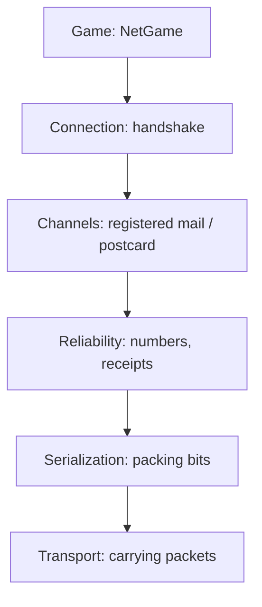

# 10 Multiplayer: How Kern Talks over the Network

> **In short:** Kern brings its own networking kit and uses it to turn **any** level into a
> multiplayer game, without any preparation. One computer is the boss (the server); the others send it
> their input and show what it reports. Here you'll learn how that works, even over shaky
> connections, and how to try it out in Studio.

The networking part is written in C++ and follows the articles by Glenn Fiedler ("Gaffer On Games")
and his libraries yojimbo, reliable.io and netcode.io. On top of it sits **NetGame**, which turns a
level into a network game.

From the connection underneath, Kern needs only one thing: sending and receiving small packets
(**datagrams**). Whether they arrive, and in what order, Kern handles itself. That's why it runs
everywhere: in the browser between tabs (via a **BroadcastChannel**), between computers (via a
**WebSocket relay**, a forwarding station) and, in tests and in Studio, over a network inside one and
the same program.

---

## 10.1 The layers

> **Imagine …** you're shipping a piece of furniture. You take it apart and pack the parts so they
> take up little space (serialization), stick numbers on the boxes so a missing one stands out
> (reliability), send some by registered mail and others as postcards (channels), make a phone call
> beforehand to say who you are (connection), and a courier carries everything (transport).



Each layer has just one job. That makes it easy to understand and easy to test.

---

## 10.2 Serialization: every bit counts

**Serializing** means turning game data into a sequence of bits and back again at the other end. For
each kind of message there is **one single** description that serves for writing, reading and
measuring at the same time. That way, writer and reader can never get out of step.

A few ways to save space:

- **Numbers with a known range** get only as many bits as they need.
- **Decimal numbers are rounded (quantized):** a position only needs 1 mm of precision.
- **Rotations** travel as "smallest three": internally, a rotation consists of four numbers; you
  leave out the largest one, and the receiver works it out again from the other three.

> **Did you know?** The reader checks **everything**: value ranges, lengths, cut-off data. A broken or
> malicious packet gets thrown away instead of crashing the game. One test feeds it 2000 random heaps of
> data.

---

## 10.3 Reliability: numbers and receipts

On the internet, packets can get lost, arrive twice or overtake each other. So Kern's reliability
layer (the **Endpoint**) sticks onto every packet a **sequence number**, the number of the last packet
received from the other side (the **ack**, the receipt) and **32 bits** for the 32 packets before
that: arrived or not.

> **Imagine …** on every postcard you write not just "Card no. 57" but also: "From you I have no. 41,
> and of the 32 before it, all except no. 38." Your friend knows right away what's missing. And if a
> card gets lost, the receipt is on the next one anyway.

Packed together, this header is at most 9 bytes. Along the way, the Endpoint measures the **round-trip
time** (RTT: how long a packet takes to get there and back), packet loss and bandwidth. **Sending never
waits**, and packets over 1 KB are split into **fragments** and put back together.

---

## 10.4 Channels: registered mail or postcard

Above that sits the **Connection**, with two kinds of channel:

| Channel | Behavior | What for |
|---|---|---|
| **reliable ordered** | exactly once, in order | things that must never go missing |
| **unreliable unordered** | sent along once, done | things that are worthless when late |

In the reliable channel, Kern sends a message again until the packet that carried it has been
acknowledged (at the earliest after 0.1 s or 1.25 times the round-trip time). Large messages travel as
**blocks**, piece by piece. The Connection reports errors (full queue, message too large, broken
packet); the exact limits are in the blue book. Positions and input go unreliably: nobody wants the
position from half a second ago delivered late; the next one is already on its way.

---

## 10.5 Connection: the handshake

Before game data flows, client and server introduce themselves. This **handshake** has four steps:

1. The client sends requests with a random number, its **salt**.
2. The server answers with a **challenge** that carries its own salt.
3. The client sends both numbers back combined (by XOR).
4. The server assigns a **slot**; from now on, the XOR result is the **connection ID** on every
   packet.

Packets from strangers or with the wrong ID are ignored. The requests are deliberately padded to full
size: that way an attacker can never get the server to send back more than it received.

> **Did you know?** Every packet starts with a checksum (CRC32) over the content **and** a protocol ID
> that means "KERN0001". Traffic from another game or another Kern version drops out this way before
> anyone reads it.

Default values: up to 16 clients, after 6 s of silence the connection counts as lost, and a sign of
life goes out at least every 0.1 s. If the server is full, the client gets "denied".
Along the way, the client passes through the states `connecting` (asking), `challenged` (answering) and
`connected`; what can go wrong is `denied`, `timed_out` or `error`. Either side may disconnect; to be
safe, the goodbye is sent several times. Client and server work in the same rhythm every frame:
receive packets, advance time, send packets.

---

## 10.6 Transports: who carries the packets

A packet is at most 1400 bytes, a cautious limit for any route. Kern knows three carriers:

- **LoopbackNetwork:** a network inside one program, for tests and for multiple players in Studio.
- **HostTransport:** two queues that the browser side fills and empties (10.10).
- **Simulator:** built into both. It imitates bad internet: delay (latency), wobble (jitter), loss,
  duplicates. With a fixed random seed, the bad network is even **repeatable**.

---

## 10.7 NetGame: one game, many players

**The server is the boss.** Only it computes Box3D physics, rules, pickups and triggers. Every new
player gets a **pawn**, a copy of the level's player character. 30 times a second, the server sends
each client a **snapshot**: the HUD and the state of all moving things.

**The client plays a replica.** It loads the same level but computes **no physics of its own**; its
things just follow the reports. Every tick it sends its input, up to four of the latest at once, the
newest first. An input contains movement, view direction, jump, boost, fire, aim, reload, crouch and
interact. Whatever the server's logic creates or changes, the client takes over with the same number
(ID) as on the server. Its bodies are kinematic – they are just placed wherever the server reports
them – and player characters don't use a character mover; only the city traffic drives locally, as
decoration. A soldier also gets its HUD state (health, ammo …).

In code: `net.host(…)` starts as a server, `net.join(…)` as a client, and every frame
`net.update(…)` computes first the network, then the world. `status()` returns text like
"Connected (slot 2)", `stats()` round-trip time, loss, bandwidth and more.

> **Imagine …** a flip book where you only get every second picture, and some of them late. If you
> show each one right away, it stutters. So you wait a little and draw the pictures **in between**
> yourself. That's exactly how the client shows the world about **100 ms in the past** and computes
> smooth transitions (interpolation). If a snapshot is missing, it estimates the motion for up to
> 250 ms more and then stops.

### So that nothing gets lost

- **Important events** (welcome, a player joined or left, pickup collected, logic changes) travel
  reliably, **sounds and shots** unreliably.
- **Jumps and shots never get lost:** the server counts them if they appear in **any** of the inputs
  sent along.
- **Lag compensation:** when the client shoots, the server turns back time for the hit test by as much
  as the client lags behind (half the round-trip time plus 100 ms, at most 0.5 s). Whatever you had in
  your sights when you pulled the trigger, you hit ([Chapter 8](08-game-runtime.md)).
- **Whoever joins later** gets the welcome, the players already there, all logic changes so far and the
  things already collected.

### The priority accumulator

A snapshot has to fit into **one** packet (900 bytes for the things in the level). So every client
keeps a pot for each thing: if it moves, 10 points go in, otherwise 0.25. Whatever is fullest gets
sent, and then its pot is emptied. The client's own character always comes first. Things that move are
up all the time; things at rest rarely, but never forgotten. Positions travel accurate to **1 mm**
(within ±8192 m), rotations with 11 bits per number, and at most 255 things fit into a snapshot. Only
things that can move (dynamic and kinematic bodies) are sent.

### Clock and checksum

Every snapshot tells the client the server time. Small delays it takes on quickly, large ones only
slowly, because the smallest one is the most honest: that packet didn't dawdle on the way.

Both sides need **the same level**. The welcome carries a checksum of the level text (without the
editor camera). If it doesn't match, the client reports "the server plays a different level" and
disconnects.

> **Watch out!** You quickly moved a cube on the host, and your friend has the old version open? Then
> joining won't work. Save, and give everyone exactly that file.

NetGame defaults: 30 ticks per second (5 to 120), 0.1 s render delay, up to 8 players (adjustable up
to 64).

---

## 10.8 Multiplayer in Studio

### Number of Players

As in the Unreal Engine, you test with multiple players in Studio, with no second computer at all:
**Play › Number of Players**, 1 to 4. The world becomes a **listen server** (a server that plays
along itself), and every additional player is a real network client with its own world and its own
viewport.

- Studio switches to **four viewports**: 1 is the server, 2 the first client, and so on.
- Only the **active** viewport gets your input; the others stand still.
- **Play › Network Emulation** makes the connection bad on purpose: Perfect, LAN (5 ms), Average
  (50 ms, 1 % loss), Bad (150 ms, 5 %), Terrible (300 ms, 20 %); except for Perfect, the delay
  wobbles a little each time (jitter from 1 to 100 ms).
- While clients are still joining, Studio exchanges packets several times per frame, so that the
  handshake doesn't wait for rendered frames.
- The status line shows role, players, round-trip time, loss and bandwidth, and for each local client
  also buffer and HUD.

> **Try it!** Open Kern Studio via https://kernengine.de/, load **File › Example Levels ›
> Shooting Range**, choose **Play › Number of Players › 2 Players** and press **Play**. Click back and
> forth between viewport 1 and 2 and control first one soldier, then the other. Then set
> **Network Emulation** to **Terrible**.

### Online: Host and Join

For other tabs or computers: **Play › Host Online Game…** and **Join Online Game…**. The dialog asks
for a **room** (default "kern") and, optionally, a relay. Left empty, only tabs of the same browser
find each other. **Leave Online Game** ends the session.

> **Try it!** Open Studio in two tabs with the same example level. In the first, **Host Online
> Game…**, in the second, **Join Online Game…**, room "kern", relay empty. And you're already playing
> together.

---

## 10.9 Exported games over the network

A game exported with **File › Package Game** ([Chapter 11](11-studio.md)) reads its address:

| Suffix | Effect |
|---|---|
| `?host=raum` | offers a game in the room "raum" |
| `?join=raum` | joins the room |
| `&relay=…` | uses this relay |

(`raum` – German for "room" – is just an example room name.) Without a room name, "kern" applies. If
it doesn't work, "Online play failed: … – playing alone" appears, and you play on your own.

---

## 10.10 KernNet: the courier in the browser

**KernNet** is a piece of JavaScript that only carries bytes between browsers, the way the UDP
protocol would. Receipts, channels and handshake are handled by the C++ part.

- **Locally** via a BroadcastChannel: the host announces itself every 500 ms, a joining player waits up
  to 4 s, otherwise it says "no game is hosted in room …".
- **Via relay** over WebSocket; without a host you get "nobody hosts room …".

Locally, your own peer ID is a random number; with the relay, the relay hands them out in sequence.
About every 8 ms (and every frame), KernNet fetches up to 256 outgoing packets from the engine;
incoming ones it passes on to it.

---

## 10.11 The relay

Browsers can't send UDP. For different computers, a small Node program forwards packets over
WebSockets:

```sh
npm install ws
node tools/net_relay.mjs 8790
```

You enter the address of that computer plus the port (default 8790) in the dialog or after `&relay=`.

> **Imagine …** a mail carrier who doesn't read letters but only looks at the house number. That's how
> the relay is **dumb on purpose**: it sees only bytes and an 8-byte recipient number, replaces it with
> the sender's number and delivers. Whoever signs up sends `{"host": raum}` or `{"join": raum}` and
> learns their own ID and the host's.

Packets are at most 1400 bytes; ones that are too short, too long or addressed to unknown IDs, the relay
throws away. Room names are shorter than 64 characters. When the host leaves, the room is closed to
newcomers. An ordinary browser visit to the port gets "Kern relay" as the answer. Security comes from
the checksum and the connection ID (10.5), not from the relay.

---

## 10.12 What runs where

| | Server (host) | Client (replica) |
|---|---|---|
| Physics, rules, pickups | computes | follows the snapshots |
| Logic graphs | run | changes arrive |
| Shots and damage | lag-compensated | display only |
| Sounds | generated | played back |
| City traffic | simulated | drives locally (decoration) |
| Camera, input | local | local, input to the server |

By the way, clients currently don't send anything over the reliable channel.

---

## 10.13 Tests

Kern's tests are tough on the network: serialization has to survive limit values, cut-off data and
2000 random buffers, and receipts and fragments have to be right. The reliable channel has to deliver
everything in order under **25 % loss, 60 ± 30 ms delay and 10 % duplicates**; connection setup
survives **500 garbage packets**, timeouts and reconnecting. Further tests check soldiers and shots
over the network, logic changes on clients and "Number of Players" with three players in Studio.

---

## What you take away

- Kern turns **any** level into a multiplayer game.
- The networking part is a stack: packing bits, numbering and acknowledging, channels, handshake,
  transport.
- **Reliable** channels for important things, **unreliable** ones for things that go stale quickly.
- The **server** computes; the **client** shows a replica about 100 ms in the past.
- A **priority accumulator** makes sure every snapshot fits into one packet.
- Everyone needs **the same level**; a checksum checks that.
- In Studio: **Number of Players**, **Network Emulation**, **Host** and **Join**, and between
  computers the **relay**.

## Brain teasers

1. Why do positions travel in the unreliable channel?
2. A packet with receipts gets lost. Why is that no big deal?
3. Why does the client deliberately show the world a little "too late"?
4. 300 crates lie still, one is rolling. Which one gets sent most often?
5. Why doesn't the relay need its own security check?

### Solutions

1. A late position is worthless; the newer one is already on its way.
2. Every packet acknowledges the last number **and** the 32 before it, so the next one repeats
   everything.
3. That way it always has two snapshots it can smoothly interpolate between.
4. The rolling one: it gets 10 points in its pot per tick, the resting ones only 0.25.
5. Security is in the packets: a checksum with protocol ID, and the connection ID.

---

© 2026 Christian Heinrich Hohlfeld · All rights reserved · [Imprint and rights](00-imprint.md)
