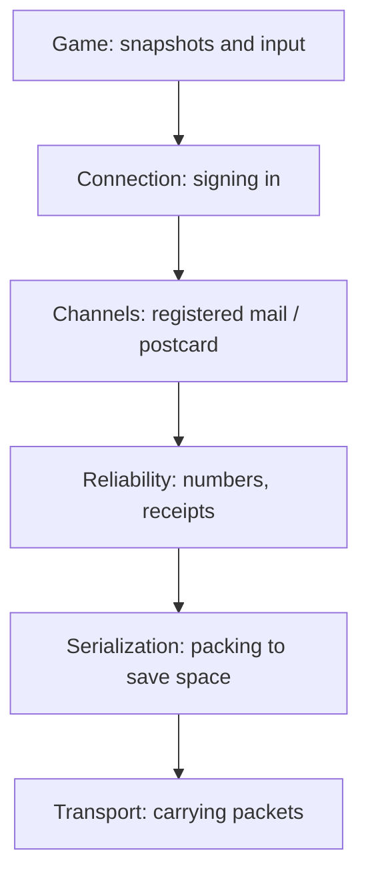

# 10 Multiplayer: How Kern Talks over the Network

> **In short:** Kern brings its own networking kit and uses it to turn **any** level into a
> multiplayer game, with no preparation. One computer is the boss (the server); the others send it
> their input and show what it reports. Here you'll learn how that works, even over shaky
> connections, and how to try it out in the Studio.

> **Key terms:**
> - **Server** or host – the computer that runs the game and is the only one that really computes.
> - **Client** or **guest** – a fellow player who signs in with the server and shows what it reports.
> - **Packet** – a small bundle of data that travels across the network as one piece.
> - **Bit** – the smallest unit of information: a yes or no, a 1 or 0. Eight bits make a
>   **byte**, enough for one letter.
> - **Round-trip time** (also called ping) – how long a packet takes to go there and back.
> - **Snapshot** – a "situation report" from the server: where everything is right now, like a photo.
> - **HUD** – the display on top of the game picture: points, time, health.
> - **Relay** – a forwarding station on the internet, a kind of post office for game packets.

Imagine playing a board game over the phone: one person has the board in front of them, the others
call out their moves and get told how things stand. That's exactly how Kern works.

From the connection underneath, Kern needs only one thing: sending and receiving packets. Whether they
arrive, and in what order, Kern handles itself. That's why Kern doesn't care whether the packets go back
and forth between two tabs of one browser, between two computers, or, just for testing, inside a
single program.

> **For the curious:** The networking part is written in C++ and follows Glenn Fiedler's well-known
> articles ("Gaffer On Games") and the design of his free networking libraries. The exact
> names and values are in the blue book, Chapter 10.

---

## 10.1 The layers

Sending is split into stages, and each stage has just one job. That way you can understand each one
on its own and test each one on its own.

> **Imagine …** you're shipping a piece of furniture, step by step from top to bottom as in the
> sketch: you register beforehand so they know who you are (connection), decide what goes by
> registered mail and what goes as a postcard (channels), stick numbers on the boxes so a missing
> one stands out (reliability), pack the parts to save space (serialization), and a courier
> carries everything (transport).

When sending, a packet moves in the picture from the top (game) to the bottom (courier); when
receiving, it goes back up. The following sections walk through the stack from the bottom up: first
packing, then numbers, channels and signing in; the courier at the very bottom gets its own section
at the end (10.6).

---

## 10.2 Serialization: every bit counts

**Serializing** means turning game data into a row of bits so it fits through the connection, and
back again at the other end. The fewer bits, the more fits into one packet.

> **Imagine …** the guessing game "I'm thinking of a number between 1 and 1000." With clever
> yes-or-no questions ("Is it bigger than 500?") you need at most ten questions. Ten yes-or-no answers
> are ten bits. So if Kern knows a number can only be between 1 and 1000, it sends exactly
> ten bits, no more.

Kern also **rounds** where nobody will notice: instead of "3.14159265 meters," "3.142 meters" is
enough, accurate to the millimeter. And it **leaves out** whatever the receiver can work out on its
own. It's like making change: if you know three bills add up to €30, someone only needs to name two of
them, and you can figure out the third yourself.

What matters is **how** Kern defines the format: for each kind of message there is just **one single**
description, like a form with fixed fields. The sender fills it out, the receiver reads with exactly
the same form, and Kern even uses it to measure in advance how much space it needs. If there were two
separate descriptions, sooner or later someone would add a field to only one of them. Then the
receiver would read everything shifted by one field.

The receiver checks **everything**: Is a number within the allowed range? Is the packet complete? A
broken or maliciously crafted packet simply gets thrown away instead of crashing the game.

---

## 10.3 Reliability: numbers and receipts

On the internet every packet travels on its own, along whatever route is free at the moment. So one
can get lost, arrive twice, or overtake another. Kern notices this by **numbering** every packet and
giving every packet a **receipt**: which of the other side's packets have already arrived.

> **Imagine …** you write postcards to a friend, and on each one you put not only "Card no. 57"
> but also: "From you I've got no. 41, and of the 32 before it, all except no. 38." Your friend knows
> right away what's missing. And if a card gets lost, the receipt is on the next one anyway.

The "32 before it" are 32 check marks, so 32 bits: arrived, yes or no. That way the whole receipt
costs only a few bytes. Along the way, Kern measures how good the connection is: the **round-trip
time** (when did the receipt for card 57 come back?), the loss, and how much data is flowing. You'll
see these values later in the Studio's status bar.

There's one thing this stage deliberately does **not** do: wait. It sends every packet right away.
Whether something lost gets sent again is decided by the stage above, because only it knows whether it
was important. Packets that are too big get cut into pieces and put back together at the receiver.

---

## 10.4 Channels: registered mail or postcard

Not everything is equally important. That's why Kern has two ways of sending, two **channels**:

| Channel | Behavior | Example |
|---|---|---|
| **Registered mail** (reliable) | arrives exactly once, in order | "Anna has joined," "Orb collected" |
| **Postcard** (unreliable) | sent along once, done | positions, input, sounds |

With registered mail, Kern sends a message again and again until a receipt shows it has arrived.
Positions, on the other hand, go as postcards: nobody wants the position from half a second ago
delivered late; the next one is already on its way. If Kern resent them, they would only get in the
way of the newer one.

> **For the curious:** In the program, the two channels are called "reliable ordered" and
> "unreliable unordered." Large messages travel through the reliable channel piece by piece. The
> exact limits are in the blue book, Chapter 10.

---

## 10.5 Connection: signing in with a callback

Before game data flows, the client signs in with the server. This sign-in is called a **handshake**.
It takes care of two things: afterward the server knows for sure that the guest really can be reached
at its sender address, and both share an **ID number** that from then on is on every packet.

> **Imagine …** you call a hotel and want a room. The front desk doesn't say yes right away; it
> **calls you back** at your number and gives you a password of its own. Only when you report that
> password back together with your own do you get a room. Anyone who gives a fake number never hears
> the callback and can't answer.

Here's how it works in Kern:

1. The guest asks and names a random number.
2. The server replies with a **challenge** that carries a random number of its own.
3. The guest sends back both numbers combined. Only someone who actually received the challenge can
   do that.
4. The server gives it a free **slot**, like a chair at the game table. From now on, the combined
   number is the ID number of the two.

Kern ignores packets from strangers or with the wrong ID number. If all slots are taken, the guest
gets turned away. If one side hears nothing from the other for a while, the connection counts as
dropped; so that this doesn't happen by accident, both regularly send a sign of life, even when they
have nothing to say.

### The checksum

Every packet also starts with a **checksum**. That's a small number the sender calculates from the
packet's entire content, similar to the check digit in a bank account number. The receiver
calculates the same number again. If it doesn't match, the packet was damaged on the way and gets
tossed.

Kern secretly mixes an extra tag into this checksum that means something like "Kern, version 1." A
packet from another game or another Kern version therefore never produces the matching number and
drops out before anyone even reads its content.

> **For the curious:** The guest's request is deliberately padded with empty bytes to 1000 bytes;
> the server ignores shorter requests. Otherwise an attacker could give a victim's address as the sender. The server
> would then answer the victim, and with a small request the attacker could get it to send the
> victim more data than the attacker put in. The exact names and values are in the blue
> book, Chapter 10.

---

## 10.6 Transports: who carries the packets

At the very bottom sits the **courier**: it carries packets from A to B and nothing else. Because all
the stages above stay the same, Kern can swap the courier depending on where you're playing.

- **The test courier inside the same program:** It carries packets between a server and clients that
  all live in the same program. Kern's tests use it, and so does the Studio when you test with
  several players there.
- **The courier for the browser:** It hands the packets to the web page, and the page delivers them
  through the browser's mailbox or through the post office on the internet (10.10).
- **The jammer:** It's built into both couriers. On request, it imitates bad internet: packets arrive
  late, sometimes faster, sometimes slower (that's called **jitter**), get lost, or arrive twice.

The jammer rolls dice to decide which packets it loses. But if you give its dice the same starting
value, it rolls exactly the same way every time. That way a bug that only shows up on a bad network
can be reproduced exactly the same way over and over until it's fixed.

---

## 10.7 One game, many players

**The server is the boss.** Only it computes the physics, the game rules, collecting, and the zones.
Every new player gets their own character, a copy of the player character from the level. 30 times
per second the server sends every guest a **snapshot**: the HUD and where all the moving things are
right now.

**The guest plays a copy, a network copy (replica).** It loads the same level but computes **no
physics of its own**. Its things simply stand where the server says they are. All it sends is what
its player is pressing right now and where they're looking. Whatever the server's logic graphs change
([Chapter 9](09-logic.md)), such as a door that opens, it takes over.

> **Imagine …** a flip book where you only get every other page, and some of them late.
> If you show each one immediately, it stutters. So you wait a little and draw the pictures
> **in between** yourself.

That's exactly why the guest deliberately shows the world about **a tenth of a second in the past**.
Then it almost always has two snapshots in hand and can smoothly calculate the movement between them;
that's called **interpolation**. If a snapshot is ever missing, it briefly continues the movement in
the same direction and then stops.

### So that nothing gets lost

- **Important things** go by registered mail: the welcome, "player arrived" or "left," a collected
  orb, everything the logic changes. **Sounds and shots** go as postcards.
- **Jumps and shots never fall through the cracks.** Each of the guest's postcards contains not only
  its newest input but also up to three before it. If a card gets lost, the jump is on the
  next one again, and the server still counts it.
- **Whoever shoots hits what they saw.** After all, the guest sees the world a bit late, also because
  of the connection's delay (called **lag**). When the guest shoots, the server briefly turns back
  time for the hit check: where was the target at the moment the guest had
  on screen? That's called **lag compensation** ([Chapter 8](08-game-runtime.md)).
- **Anyone who arrives later** gets everything delivered: the players who are already there,
  everything the logic has changed so far, and which things have already been collected.

### The priority pot

Packets on the internet can't be arbitrarily large; Kern stays on the safe side at about 1400 bytes,
roughly as much as a page of text in a book. A snapshot has to fit into **one single** packet.
Otherwise the guest would have to wait for several parts, and if one were missing, the whole picture
would be useless. But in a big level, not every thing fits into every snapshot.

> **Imagine …** every thing in the level has a pot. Each time the server packs a snapshot, it
> throws points in: 10 points if the thing has moved, only 0.25 points if it lay still.
> The things with the fullest pots get packed until the packet is full, and their pot
> gets emptied.

So whatever moves is up all the time; whatever rests comes up rarely, but is never forgotten. The
guest's own character always goes first. And things that can't move at all, such as walls, Kern never
sends: the guest already has them in its level.

### Clock and level checksum

The guest needs to know what time it is on the server; otherwise it can't show "a tenth of a second
back." That's why every snapshot carries the server's clock time.

> **Imagine …** letters with a date stamp. If you compare the stamp with the day the letter
> arrives, you know roughly how the sender's clock runs. But some letters dawdle on the way.
> So you don't blindly trust each single letter; you form an opinion from many and adjust it
> bit by bit.

The guest does the same: from the clock times of many snapshots, it estimates how far the server's
clock is ahead of its own, and corrects this estimate gently. Not all letters count the same, and the
reason is simple: **better to show things a touch too late than too early.** For a moment that's too
far ahead, the guest doesn't have a snapshot yet and would have to guess. So it quickly believes a
late snapshot and moves its estimate back a good bit right away; it believes an especially fast
snapshot only a little. That way it almost always has a snapshot after the moment it's showing, and
rarely has to extrapolate.

Both sides also need **exactly the same level**. That's why the server's welcome carries a checksum
over the entire level file (only where the editor camera happens to be doesn't count). If it doesn't
match the guest's level, the guest declines and reports "the server plays a different level."

> **Watch out!** You quickly moved a cube on the host, and your friend has the old version
> open? Then joining won't work. Save, and give everyone exactly that file.

### How many can play?

The host plays along and keeps **eight slots** free for guests, so up to nine players in total. In
the Studio you test on one computer with up to four players (10.8). The exact names and values are in
the blue book, Chapter 10.

---

## 10.8 Multiplayer in the Studio

### Number of players

In the Studio you can test with several players, no second computer needed:
**Play › Number of Players**, 1 to 4. The world becomes a **listen server**, a server that plays
along itself. Each additional player is a real guest with its own world and its own **viewport** (a
window into the 3D world; more on that in [Chapter 11](11-studio.md)), connected via the test courier
from 10.6.

- If the Studio is set to a single viewport (the default), it switches to **four viewports**:
  1 is the server, 2 the first guest, and so on.
- Only the viewport you clicked in last gets your input; the other players stand still.
- **Play › Network Emulation** turns on the jammer, in steps from **Perfect**, the perfect
  connection, through **LAN (5 ms)**, the home network (LAN means "local area network," ms stands for
  millisecond, a thousandth of a second), and **Average (50 ms, 1% loss)** to
  **Bad (150 ms, 5% loss)** and **Terrible (300 ms, 20% loss)**.
- The status line shows who is server and who is guest, how many are playing, the round-trip time,
  and the loss.

> **Try it!** Open Kern Studio at https://kernengine.de/, load
> **File › Example Levels › Shooting Range**, choose
> **Play › Number of Players › 2 Players (listen server)** and press **Play**. Click into
> viewport 2 and run off with the guest's soldier. Watch viewport 1 while you do: it's running
> there too, because the server computes it. Then set **Network Emulation** to
> **Terrible (300 ms, 20% loss)** and steer in viewport 2 again. What you'll see: the soldier reacts
> noticeably later, because every key press first has to go to the server and the result has to come
> back. Movements can stutter or briefly freeze when snapshots get lost and the tenth-of-a-second
> buffer from 10.7 isn't enough anymore. If you steer in viewport 1 instead, the server's soldier
> reacts instantly: it doesn't have to wait for anyone.

### Online: hosting and joining

For other tabs or computers: **Play › Host Online Game...** and **Join Online Game...**. The dialog
asks for a **room** (default "kern") and optionally for a relay (10.11). If left empty, only tabs of
the same browser find each other. **Leave Online Game** ends the session. Even if the host's tab is in
the background, it keeps computing. Otherwise its guests would hear nothing more from it and would be
kicked out after a while (10.5).

> **Try it!** Open the Studio in two tabs with the same example level. In the first, choose
> **Host Online Game...**, in the second **Join Online Game...**, room "kern," relay empty. And just
> like that, the two of you are playing. The nice thing: the two tabs are two completely separate
> programs. They share nothing except the packets they slip each other through the browser's
> mailbox (10.10).

---

## 10.9 Exported games on the network

A game exported with **File › Package Game (HTML)...** ([Chapter 11](11-studio.md)) can also play
online. What it should do, you write **at the end of the address** in the browser's address bar. A
**question mark** starts such an extra request to the page, and an **& sign** adds another, like
"Please … and also …" on an order slip:

| Suffix | Effect |
|---|---|
| `?host=room` | offers a game in the room "room" |
| `?join=room` | joins the room |
| `&relay=…` | uses this relay (in addition, for different computers) |

An example: if your file is called `MyGame.html`, you open it in the browser and add `?host=party` at
the end of the address bar. In a second tab of the same browser you open `MyGame.html?join=party` and
play against yourself. For a friend on another computer, you both also add `&relay=` with the address
of a relay (10.11). Without a room name, "kern" applies. If it doesn't work, the game reports "Online
play failed" and you keep playing alone.

---

## 10.10 Mailbox and post office

The web page itself is only a carrier: it takes the finished packets from the engine, delivers them,
and hands incoming ones back. It doesn't read them; numbers, receipts, channels and signing in are all
handled by Kern itself. There are two possible routes.

> **Imagine …** **In the same browser**, all tabs share a common **mailbox**, one for each room name.
> The host regularly drops in a note saying "I'm here," and a guest checks and puts its packets in
> too. You don't need a server on the internet for that. **Between different computers** there's no
> shared mailbox. Then you need a **post office** on the internet, the relay: everyone gets a P.O. box
> number there, and the post office delivers every packet to the number written on it.

If a guest finds no host in the room, the Studio tells it after a few seconds.

> **For the curious:** The mailbox is a browser feature that lets tabs of the same page slip each
> other messages. The exact names and times are in the blue book, Chapter 10.

---

## 10.11 The relay

Why do you need a post office between computers? A browser can't send loose packets directly to
another computer. It can only set up a fixed line to a server. The relay is such a server: it accepts
all players' packets over their lines and passes them on.

> **Imagine …** a mail carrier who doesn't read letters but only looks at the P.O. box number. That's
> how the relay is **deliberately dumb**: it sees only bytes and a recipient number, replaces it with
> the sender's number, and delivers. It throws away broken items and items addressed to unknown
> numbers. When the host leaves, the room is closed to newcomers.

And security? That's inside the packets themselves: the checksum and ID number from 10.5 sort out
foreign and damaged packets at the receiver. The relay doesn't need to understand anything for that.

The relay is started as a small program on a computer that all players can reach. That takes a bit of
technical know-how, or someone who knows their way around. Everyone then enters its address in the
dialog or after `&relay=`.

> **For the curious:** The relay is written in JavaScript and runs on Node, a program that runs
> JavaScript outside the browser. The exact command to start it is in the blue book,
> Chapter 10.

---

## 10.12 What runs where

| | Server (host) | Guest (network copy) |
|---|---|---|
| Physics, rules, collecting | computes | follows the snapshots |
| Logic graphs ([Chapter 9](09-logic.md)) | run | receives the changes |
| Shots and damage | checks by turning back time | only displays |
| Sounds | creates | plays them back |
| City traffic | computes | runs on each machine (just decoration) |
| Camera, input | local | local, input goes to the server |

---

## 10.13 Tests

On the real internet, packets get lost, arrive twice, or arrive in the wrong order. That's why Kern's
tests check the network under exactly those conditions. The jammer from 10.6 loses a quarter of all
packets, delays and duplicates some, and still every piece of registered mail must arrive exactly
once and in order. The sign-in has to survive hundreds of junk packets, the packing has to survive
broken data. Further tests play soldiers, shots and logic over the network, including with three
players in the Studio.

---

## What you take away

- Kern turns **any** level into a multiplayer game.
- Sending is a stack of stages: packing to save space, numbering and receipts, registered mail or
  postcard, signing in, courier.
- **Registered mail** for important things, **postcards** for things that go stale fast.
- **Signing in with a callback** makes sure the guest really can be reached; a **checksum** sorts out
  damaged and foreign packets.
- The **server** computes; the **guest** shows a copy about a tenth of a second in the past.
- A **priority pot** makes sure every snapshot fits into one packet.
- Everyone needs **the same level**; a checksum checks that.
- In the Studio: **Number of Players**, **Network Emulation**, **Host Online Game...** and
  **Join Online Game...**; between computers, the **relay** acts as the post office.

## Brain teasers

1. Why do positions travel as postcards and not by registered mail?
2. Why does the guest deliberately show the world a bit "too late"?
3. 300 crates lie still, one rolls. Which one gets sent most often?
4. Why doesn't the server hand out a slot right away when someone signs in, but first sends a
   challenge?
5. Why doesn't the relay need its own security check?

### Solutions

1. A late position is worthless; the newer one is already on its way. Resent, it would only get in
   the way.
2. That way it almost always has two snapshots and can smoothly calculate the movement between them.
3. The rolling one: its pot gets 10 points every time, the resting ones only 0.25.
4. Only someone who really can be reached at their sender address gets the challenge and can answer it
   correctly. Anyone giving a fake sender gets nowhere.
5. The security is inside the packets: the checksum (with the tag "Kern, version 1") sorts out
   damaged and foreign packets, the ID number from the sign-in sorts out everything from strangers.

---

© 2026 Christian Heinrich Hohlfeld · All rights reserved · [Imprint and rights](00-imprint.md)
