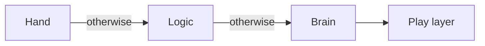

# 13 The Micro Duck – Our Hero on Two Legs

> **In short:** The Micro Duck is a real little walking robot made by Pollen Robotics. Kern
> rebuilds it so precisely that it walks with the same trained networks as the original. On top of
> that, Kern brings three things of its own: the Lehrer for training, a jump, and a play layer that
> lets the duck decide for itself whether to kick a ball or fetch a sock.

Allow me to introduce the Micro Duck. About 25 cm tall, 0.74 kg, with 14 little motors in its legs
and neck and a fifteenth one for the lower beak. These motors are called **servos**: you tell them
an angle, and they move there. The duck uses Dynamixel XL330s.

The robot was built by Pollen Robotics. There, the duck doesn't learn to walk through hand-written
rules but as a **neural network**, trained in the physics simulation MuJoCo (repository
`microduck_rl`, learning algorithm rsl_rl). The finished networks end up on the real robot as ONNX
files – an exchange format for networks.

Kern simulates the duck with its own physics (Box3D) and runs **exactly these networks**. The goal
is **fidelity**: the same model, the same servos, the same timing, the same things the network sees
and does. On top of that, Kern adds the **Lehrer** ([Chapter 14](14-lehrer.md)), the **jump**
(`jump.onnx`) and the **play layer** (`play.onnx`). Training your own networks is explained in
[Chapter 15](15-your-own-models.md), matching against the real robot in
[Chapter 16](16-calibration.md).

> **Try it!** Open Kern Studio at https://kernengine.de/ and under **New Level** pick the
> **Micro Duck** template. Press Play and watch: the duck strolls off, looks around – and when it
> spots the ball, things get exciting.

## 13.1 Where the code lives

The duck lives in just a few files under `kern/src/game/`: `walker.cpp` builds it, controls it and
reads its sensors, `walker_policy.cpp` evaluates the ONNX networks, `servo.cpp` contains the servo
model, `walker_brain.cpp` the brain and `walker_play.cpp` the play layer. Pollen's networks,
blueprints and licenses are in `third_party/microduck/`, Kern's own networks in `policies/`. The
complete list is in the blue book.

## 13.2 The golden rule: no cheating

A trained network is like a dancer who has practiced on one particular dance floor. Put them on
ice, and they fall – not because they dance badly, but because the floor is different. So the rule
is:

- **No help:** no supporting forces, no prescribed velocities, no locked trunk, no teleporting, no
  blending between networks. The duck stands up only through its servos and feet.
- **Servos made of physics building blocks:** only Box3D's own joint spring and a motor acting as a
  friction brake.
- **Fixed timing:** time is counted in steps, not by the clock. The same inputs produce, bit for
  bit, the same gait on every device – **determinism** ([Chapter 14](14-lehrer.md)).

The physics itself (Box3D, contacts, joints) is explained in [Chapter 6](06-physics.md).

> **Imagine …** you teach a child to ride a bike with training wheels and then secretly unscrew
> them. That's exactly what happens when the simulation "helps": the network relies on something
> that doesn't exist in reality.

## 13.3 The model

### From Pollen's blueprint

Pollen describes the robot in an MJCF file, MuJoCo's blueprint format: 15 bodies, 14 joints. A
Python tool (`tools/micro_duck_import.py`) turns it into code for Kern: links, simplified 3D shapes
and collision hulls. It is fussy – joint names, home pose, order of the observation, structure of
the network – and if something doesn't fit, it stops instead of building a slightly wrong duck.

### Links and joints

The duck has **16 links**: the trunk, 14 links that the network moves, and the lower beak. The 14
joints always come in the order the network expects: left leg (hip yaw, roll, pitch, knee, ankle),
neck (neck pitch, head pitch, yaw, roll), right leg. Each one has hard limits and a **home pose**,
the comfortable basic stance; the beak opens up to 0.611 rad. Kern builds the duck directly in this
pose. In the scene the trunk is called "Micro Duck", and each link carries the name of its joint.
All the angles are in the blue book.

> **Did you know?** The `head_yaw` joint ranges from −2.967 to +2.967 rad, that is, about ±170
> degrees. That lets it look almost all the way behind itself.

### Mass and the invisible disk

Mass, center of mass and inertia come from the blueprint: trunk 0.199 kg, head 0.155 kg, 0.74 kg in
total. Kern computes the mass and inertia of the lower beak from its 3D shapes and subtracts them
from the head. Things get tricky with the motor inside the servo: through a gearbox it spins 288
times faster than the axle, and that makes the joint more sluggish than its parts weigh. This extra
inertia is called **armature** (0.0018 kg·m² per joint). MuJoCo adds it directly to the axis; Box3D
can't do that. Kern's trick: every link carries along a **thin imaginary disk** on its joint axis.

> **Imagine …** you swing an empty bucket. If you glue a heavy coin to the inside wall, the swing
> gets more sluggish. The armature is a coin like that, only invisible.

Why a disk? A body that had inertia about only a single axis wouldn't be a real rigid body, and
Box3D would gain energy from it. The disk isn't perfect – it turns with the link instead of 288
times faster, and if the parent link turns about the same axis, the inertia is a bit too large –
but measurements show the duck walks closer to its training with it and jitters much less
(Section 13.14).

### What touches the world

What can collide are **convex hulls**, as if you'd stretched plastic wrap tightly around every
part. The soles and beak pads have friction 1, the servo housings 0 (as in training), the shells of
trunk and head 0.5 – so a duck that has fallen over doesn't slide around as if on ice. The shells
enclose the servos of the neighboring links and never collide with the duck itself. When a sole
touches down, it sounds like plastic.

New: the physics knows **material pairs**. Rubber on fabric grips differently from the average of
rubber on rubber and fabric on fabric:

| Pair | Friction |
|---|---|
| Cotton on cotton | 0.5 |
| TPU beak pad on cotton | 0.8 |
| Cotton on wooden floor | 0.4 |

Box3D mixes all other pairs as the geometric mean. Colliders, meshes or the world's floor (in the
level: `groundSurface`) carry a material. In the Micro Duck level the floor is wood. Box3D lets
contacts sink in by up to 5 mm; measured, the soles sit only 0.3–0.6 mm deep in the floor.

### Scale 4: the duck as a giant

Box3D likes bodies between 10 cm and 10 m. The duck's links are just 2 to 4 cm. So Kern builds it
**four times as large** and converts in exactly one place, following a rule from shipbuilding
(Froude similarity): lengths ×4, masses ×64, inertias ×1024, torques and servo stiffness ×256,
damping ×512, times and velocities ×2, angular velocities ×½. The network notices none of this:
Kern converts everything back into real robot units, and all values you get through logic or
sensors are real meters and seconds too.

### Looks, roller skates, putting it in

The 3D shapes come from Pollen's own models. They are under CC BY-NC-SA 4.0 (non-commercial), Kern's
code under Apache 2.0. That's why this book shows the duck in a design of its own. There is also a
**"Micro Duck (Rollers)"** variant with skids and two freely spinning wheels each (no drive)
instead of soles; it stands 23.5 mm higher. And one line puts a duck into the level:

```cpp
const game::ActorId duck =
    game::add_micro_duck(level, {0, 0, 0});  // trunk at z = 0
```

It attaches all links, connects the joints and sets the world to 100 steps per second with 16
substeps. The Studio does the same when you insert one and reports the changed World Settings.

## 13.4 The servo model

A real servo is soft, sluggish, has friction and reacts with a delay. Pollen measured the XL330 at
7.4 V precisely (model "m6"). Kern turns this into a **device model**: a small law in real units,
whose numbers are stored in a **profile**.

| What | XL330 | in words |
|---|---|---|
| Stiffness K | 0.554 N·m/rad | how firmly it pulls toward the target |
| Damping D | 0.053 N·m·s/rad | how strongly it brakes speed |
| Friction F | 0.0048 N·m | resistance in the joint |
| Maximum torque T | 0.963 N·m | there's no more force than this |
| Delay | 20 ms | travel time of a command |

On top of that come the armature and, for training, spreads (±10 % for armature and friction, delay
15–30 ms). In words: **The farther from the target, the harder it pulls – but never harder than T.
The faster it moves, the more it brakes. A little friction is always there.**

```
torque = clamp(K · (target − angle), −T, T) − D · velocity
         + Coulomb friction F
```

Example: 0.1 rad (just under 6°) away from the target, it pulls with 0.554 · 0.1 ≈ 0.055 N·m. It
only reaches full torque at a deviation of 1.7 rad. So the servos are **soft** – more like a gently
pushing hand than a vise.

A single function (`game::servo_step`) carries this out in every physics step – the same in the
Studio, in the Lehrer and on the calibration test bench. The pulling is done by Box3D's built-in
joint spring, which Box3D computes so that it stays stable at any stiffness. The friction is a
motor that tries to stop the joint (target speed 0), but with at most the force of the friction.

> **Did you know?** The real servo's firmware limits the current to 1.75 A, which is 0.64 N·m.
> With that, the duck could no longer get up off its back! Pollen deliberately trains without this
> limit, and so does Kern.

A profile applies to all servos of a duck or to a single joint (including the beak). You measure
your own profiles as described in [Chapter 16](16-calibration.md).

## 13.5 The timing

The **physics** computes in small steps, while the **network** thinks less often; the ratio is
called **decimation**. In training, MuJoCo computes 5 ms steps, and the network thinks every 4
steps, so 50 times per second. Kern computes 10 ms of world time per step – in the four-times-larger
world, time runs half as fast, so that's exactly 5 ms of robot time – and also lets the network
think every 4 steps. Kern works out both from the world's step rate when each duck starts. If it
doesn't fit, Kern rounds to whole steps and tells you ("set World Settings > Step Rate to 100").

The 20 ms command delay is a queue: every command waits 4 physics steps, like a letter in the mail.
The play layer thinks even less often, 25 times per second.

The game loop follows the "Fix Your Timestep" recipe: each frame supplies time, the simulation uses
it up in fixed steps, and the remainder waits in a time account (the accumulator) for the next
frame. Drawing happens between the last two states, and time is a step counter
([Chapter 8](08-game-runtime.md)).

## 13.6 The duck's networks

The walking network `velstand.onnx` is built in; the Studio loads all the others on demand. Kern
reads ONNX itself and understands exactly the shape rsl_rl uses: normalize the input, layers with
the ELU activation, a linear layer at the end. It rejects anything else and gives a reason. A test
checks Kern's computation to within two hundred-thousandths against a precise reference.

A network is like a mixing console with hundreds of thousands of knobs: 61 measurements go in at the
front, 14 servo commands come out at the back, and training means turning the knobs until the duck
walks.

### What the duck can do

| Motion | Network | Key |
|---|---|---|
| Walking and standing | `velstand` (or older: `alpha`) | W A S D |
| Sit down / stand up | `alpha_sitstand` | 1 |
| Pick up a sock | `alpha_ground_pick` | 2 |
| Kick left / right | `ball_kick_left/right` | 3 / 4 |
| Roll | `roulade` | 5 (hold) |
| Roller skating / crouching | `roller`, `roller_crouch` | W A S D / 2 |
| **Jump** (Kern) | `jump` | 7 |
| Beak open / closed | no network | 6 |

Walking runs **continuously**; other networks run **episodically**, with a beginning and an end:
the kick 0.5 s, the jump 2 s, sitting down 2 s, standing up 1 s, a roll 1 s. The older gait `alpha`
switches to its standing network `alpha_stand` below a walking command of 0.05. Picking up gets a
clock along with it (4 s per cycle) and ends at 70 % of that; the roll keeps going as long as you
hold the key. You choose the gait in the Details panel under **Walking network**.

### Whose turn it is

The controller works like Pollen's robot software robotd: first end any motions that have run out,
then choose the network (running motion before picking up before sitting before rolling before
standing before walking), give each network its commands in the form it was trained on, compute,
advance the clock. Only ever one motion at a time, and none from sitting. Otherwise a reason comes
back, such as "the robot is sitting - stand it up first". The memory of the last action, which every
network gets, is shared by all networks.

> **Watch out!** If a network's file is still missing, no other one steps in. The duck holds its
> basic stance and says once which file is missing. If it stubbornly stands still, check the
> messages.

### From command to servo target

The network doesn't say "knee to 30°" but "knee a bit farther than in the basic stance": servo
target = **home pose + action**. Kern runs every network **as trained**, without scaling down or
smoothing (only roller skating and crouching with a factor of 0.8). Pollen's software on the real
robot scales down by 0.9 and smooths (head 0.5, legs 0.7) – fine-tuning for the hardware. Under
**Actions to servo goals** you choose `training` (the default) or `robot`. Measured, the kicks tip
over with `robot`; walking works with both.

The target may go up to ±π, the servo's full range. If it lies beyond the joint limit, the joint
pushes against its hard stop, as in MuJoCo.

## 13.7 What the network sees: 61 in, 14 out

All motion networks get the same 61 numbers: how fast the trunk is turning, which way is down, 14
joint angles (relative to the basic stance), 14 joint velocities (one tick old, as in training),
its own last action, the walking command (up to 0.4 m/s forward, 0.3 m/s sideways, 1 rad/s turning;
gently smoothed, as on the robot), a head command and the body posture. Kern's jump uses slots 55
and 56, which Pollen's networks never touch, for its clock. Out come 14 numbers, one per joint. The
walking network has three layers in between, with 512, 256 and 128 neurons.

> **Did you know?** The network doesn't know where it is in the room. It only knows its own body.
> For the duck, walking is pure body sense.

## 13.8 Senses

The duck sees only what the real robot sees, with sensors in exactly the places given in the
blueprint.

**Distance sensor (ToF).** A ToF sensor (time of flight) measures distances with light: 8 × 8
zones, 45° × 45°, up to 4 m, 15 times per second. Kern sends out one ray per zone, which skips the
duck's own links. Each zone reports **floor** (a downward ray that reaches at least 85 % of the
sensor's height), **too close** (under 10 cm) or **obstacle**, plus the nearest distance, its
direction and whether it's clear up to 1 m on the left and right. For the brain, hits up to 0.35 m
high and 1.5 m away count.

> **Imagine …** at night you feel your way forward with 64 long, invisible fingers at once. That's
> all the ToF "sees" – but it's enough not to bump into the shoebox.

**Head camera.** A 62° field of view across the long side, mounted rotated by a quarter turn, so
it's upright: 62° high, 37.4° wide. Kern checks whether the center of an actor is in the image and
not hidden. With its head fully lowered, the camera looks 87° downward and sees the floor 6 to
15 cm in front of the trunk.

> **Try it!** Start Play in the Micro Duck level. In the top right of the viewport you see the
> duck's camera image, and next to it the ToF grid (show flag **Robot Camera**, on by default).
> Take it over with **F8** and walk toward the ball!

**Balance.** An IMU (an orientation sensor like the one in your phone) reports which way is down.
"Fallen" means, as in the original: clearly tilted for 200 ms. Stumbling doesn't count. velstand
gets up by itself; an autonomous duck then reports the state "GetUp".

**Beak as a feeler.** If the mouth servo is set to "closed" but is open by more than 2°, the duck
is holding something. Empty, it rests at 0°; a sock holds it open 3.6 to 7.8°. The mouth moves from
−5° (pressed against the pads) to 30°.

## 13.9 Who's in control?



On every control tick: if you move the stick (more than 5 %) or press a robot key, you're in charge
for 2 s, and the brain and play layer pause. Otherwise logic commands apply (**Walk**, **Look**),
for their duration or until the next command. Otherwise the duck decides for itself, if
**Autonomous** is on. The walking command and head are then limited and gently smoothed. If it's
standing still and nobody has steered its head for 2 s, the **idle gaze** from Pollen's software
takes over: soft glances along jerk-free curves, little jumps, slow drifting, dozing and an
occasional yawn.

### Picked up!

A duck that has been picked up shouldn't keep kicking its legs in the air. For this, Pollen trained
a tiny network, the **pick-up detector** (around 8000 parameters). It always looks at the last
second (50 ticks with 63 values each: rotation, gravity, joints, last targets …) and estimates how
likely it is that the duck is being held. Kern computes it itself, to within 10⁻⁵ of the reference,
and only once a full second has been collected. If the estimate is above 80 % for 5 ticks in a row,
the servos glide into a calm standing pose within 300 ms, and the duck reports "Held". If it drops
below 35 % for 4 ticks (after 300 ms at the earliest), the networks start fresh. It only watches
while the walking or standing network is driving; a motion, sitting, roller skates or the Lehrer end
the pause. Kern doesn't know the servo currents – but the shipped network doesn't read them either.
In the test, the duck walks for 20 s without a false pause, stays paused when lifted 15 cm, and
keeps walking without falling once it's set down.

> **Try it!** Start Play in the Micro Duck level. It begins with the **Observer camera**: you
> watch and can grab bodies. Pull the duck up by its trunk (it works the same way in **Simulate**).
> The grip holds it upright like a hand, and soon it stops kicking. Set it down – it keeps
> walking.

## 13.10 The brain: the duck thinks for itself

If nobody is driving, the duck decides for itself. The brain is a port of Pollen's program `autod`
(Apache 2.0, as of 10/01/2026) with its states, durations and numbers, and it issues the same
commands as a gamepad: walking, head, body posture, mouth and sounds. The result is a little
personality:

| State | What the duck does |
|---|---|
| Chill, LookAround | stands and looks around (3–7 s), tilts its head |
| Wander | walks 1–3 m in one of 16 directions |
| TurnInPlace | turns, head first |
| Zoomies | full speed, jerky turns, "Wheee" (only with more than 1.2 m clear) |
| Stretch, Ruffle, Dance | stretches, shakes itself, grooves |
| Sneeze | sneezes and looks dazed |
| GroundPick, Nap | picks something up; sits down, dozes for 12–40 s |
| Petted | gets petted |
| BallPlay, Kick | plays with the ball, kicks |

On top of that there's an **energy** level that helps decide the next state, a **novelty grid**
(when wandering it prefers rarely visited directions), **quack bursts**, **hearing** and an
**obstacle model** (a 24 cm wide corridor ahead, measured from the beak): below 0.45 m it slows
down and swerves, below 0.15 m it turns away and avoids the spot for 5 minutes. Wander ends at the
goal or when it hasn't made 10 cm of progress in 8 s. Hearing (a voice gets an answer, a noise
wakes it up) and petting come in through logic or code, because Kern has no microphone and no touch
sensor. Even the brain's randomness is deterministic. During a motion, while sitting down and
standing up, and after a fall, the brain keeps still.

### BallPlay

Pollen's earlier software had the BallPlay state: "approach / line up / kick". Kern rebuilds it
from this description with its own code and Pollen's kick network (their code isn't public); it is
**on by default** and doesn't need Kern extras. It runs when the duck is autonomous, isn't wearing
roller skates, the kick network is loaded and no play layer is ready. If the duck sees a ball on
the floor (the nearest one, if there are several), it first turns toward it if it's far off to the
side, and walks up to within 35 cm with its head lowered (only the head pitches; a bent neck would
spoil the gait). Then it lines the ball up in small steps until, as in kick training, it lies 9 cm
in front of and 4.2 cm beside the left foot (±1.5 cm); if it loses sight of the ball right in
front of itself, it steps back. It stands still for at least 3 s, until it's slower than 1 cm/s,
and kicks. Afterwards it quacks happily, and the ball is uninteresting for a short while. If it
doesn't see a distant ball for 6 s, it gives up (a nearby one it looks for at the last spot); if it
doesn't manage a kick in 45 s, it leaves the ball alone for 20 s. It only kicks with the left foot,
because the right kick sometimes knocks the duck over in Kern. The ball is "seen" by a geometric
visibility test, not an image recognition network.

## 13.11 The play layer

Pollen's networks are the duck's **muscles**. None of them can see. What it **intends** to do with
a ball or sock – look at it, walk over, kick, pick it up, carry it off, spit it out – is decided by
Kern's own network `play.onnx`, trained by the Lehrer. If it's there, it replaces BallPlay. There's
no hand-written game logic in it, only perception around the network.


> **Imagine …** a child sits with a gamepad in front of the duck's camera image and presses
> buttons: forward, turn, head down, beak open, kick, pick up. The duck performs the motions
> themselves with Pollen's networks. The child is the play layer.

It needs **Kern extras** and **Autonomous** in the Details panel, `play.onnx`, a mouth servo and no
roller skates. It steps in as long as it knows about a ball or sock, has something in its beak or
one of its own motions is running, and nobody else is steering; then the duck reports "Play", and
the brain starts neither picking up nor sitting.

**Detector:** a device model, like the servo. It reports the nearest visible object of each kind (a
sock as soon as part of it can be seen) and its position on the floor (a ball higher than 8 cm or a
sock higher than 3 cm doesn't count, such as the one in the beak). For training it can add noise –
the farther away, the less precise – and drop out like a real camera; in the Studio it is perfect.

**Tracker:** the memory. If an object disappears, it remembers the last position for 3 s (30 s
right in front of the feet). It ignores a kicked ball for 15 s and a carried-off sock for 40 s;
carried off means at least 0.25 m, and a sock lost while picking it up remains a target. It also
counts how far and how long the duck has been carrying something.

The play layer sees 23 numbers from the duck's point of view (x ahead, y to the left), never true
positions: what it knows about the ball and sock, where its left foot is, whether it's holding
something, whether it's walking, picking up or kicking, and how long it has been carrying,
standing still or walking. "Standing still" counts the foot contacts, not the command – because
Pollen's gait sometimes doesn't start at all on "a tiny bit forward". Out come 9 commands: forward,
sideways, turn, head yaw and pitch, neck bow, beak open, kick left, pick up, with at most 0.3 m/s
forward, 0.2 m/s sideways and 1 rad/s turning. The walking commands have a **dead zone** like a
gamepad stick (below 20 % it stays put). Backward, like Pollen's `autod`, it first goes at 0.3 m/s
for 0.6 s, then never below 0.15 m/s – any slower and the gait doesn't start from standing at all.
Going forward, the network has learned by itself to push off firmly. A motion only starts when none
is running and the beak is empty. During picking up, the beak belongs to the network: it has
learned when to bite. Without the play layer, Kern extras opens the beak at phase 0.16 of picking
up and bites at 0.24.

**Sock and ball:** The sock is seven little lumps of fabric, 12.5 mm each (four on the bottom, two on
top of those, one on top; 25 g, 3.4 cm high), connected by soft springs. It gives way under the beak,
and whatever the beak grabs pulls the rest along. Each lump has rolling resistance; otherwise the
pile would creep across the floor. The ball in the example level is 12 cm, 50 g and has a bit of
rolling resistance; otherwise it would roll forever.

**The example level** is a 2.5 × 2.5 m room with a wooden floor, a shoebox, a stack of books, a
crate, a flowerpot, a ball and two socks. The duck is autonomous, and Kern extras are on. A small
blueprint makes the duck chirp (the "Chirp" node) when the ball comes into view – a demonstration of
the logic nodes.

**How well does it play?** Over 32 runs on the clean robot: ball kicked away 9 out of 11 times (on
average after 17 s), sock picked up 4 out of 21 times, 2 falls. With full variation (randomly
altered servos, sensors, build): 7 out of 11, 13 out of 21, but 10 falls. Picking up, carrying off
and spitting out in one go has succeeded only once so far, and only a few grips held (2 out of 14
and 1 out of 15, respectively). Two tests check in Studio physics that only the network makes the
decisions: a ball 30 cm in front of the duck gets kicked, a sock 30 cm in front of it gets fetched
and bitten. Kicking works well; fetching socks still has room for improvement
([Chapter 14](14-lehrer.md)).

## 13.12 Controlling the duck

| Motion | Keyboard | Gamepad | Touch |
|---|---|---|---|
| Walk / turn | W S / A D | left stick | MOVE |
| Sit down / stand up | 1 | B | SIT |
| Pick up | 2 | Y | PICK |
| Kick left / right | 3 / 4 | – | KICK L / R |
| Roll | 5 | X | ROLL |
| Beak | 6 | – | BEAK |
| Jump | 7 | – | HOP |
| Quack / "Wheee" | Space / V | RT / LT | QUACK / WHEEE |

Walking goes up to 0.4 m/s, turning up to 1 rad/s. On the gamepad there's a round dead zone of 10 %
with a gentle curve; on the phone, QUACK and PICK sit at the bottom under your thumb.

In the Micro Duck level, Play starts with the **Observer camera** ([Chapter 11](11-studio.md)): you
fly freely (W A S D, Q / E down and up, on the phone with your fingers), watch, and can lift the
ball, a sock or the duck with the mouse or your finger. **F8** takes over the duck; F8 again goes
back to watching.

The **voice** is a bit-exact port of Pollen's synthesizer, with its own voice for each duck
([Chapter 7](07-audio.md)): "greet" when waking up and when the gamepad comes back, "inquire" when
it's gone, "chirp" when quacking, "wheee" for as long as it's held, "peck" when sitting down.

**The jump** (key 7, HOP or the logic node **Robot Move** with "jump") runs like a kick: 2 s of
`jump.onnx`, then back. The network gets its clock in slots 55 and 56. In the Studio: 3 out of 3
real jumps, 9 mm high, 120 ms in the air, 8° tilt – afterwards the duck stands and walks again.

> **Try it!** Start Play in the Micro Duck level, take over the duck with **F8** and press **7**.
> Then **3** when the ball is in front of the left foot. And finally **1**: Sit, duck!

**Loading networks:** The Studio loads missing networks on demand and tries again after errors
(after 5, 10, 20 s …, at most once per minute). Networks trained in the browser with the Lehrer are
picked up on the same device, and open Studio tabs switch over immediately.

**Details panel:** **Autonomous**, **Walking network**, **Actions to servo goals** and **Kern
extras**; only in the level JSON are `rollers` (roller skates) and `servoDelay` (bus delay, default
0.02 s). The logic editor has the **Robots** category with **Walk**, **Look**, **Set Autonomous**,
**Chirp**, **Robot Move**, **Robot Beak**, **Pet Robot**, **Robot Hears**, **Robot ToF**, **Robot
Camera Sees**, **Robot State** and **Robot Holds Something** ([Chapter 9](09-logic.md),
[Chapter 11](11-studio.md)).

## 13.13 Controlling the duck from C++

```cpp
const game::ActorId duck = w.walkers().front();
w.walker_command(duck, 0.2f, 0, 0, 3.0f);  // 0.2 m/s ahead, 3 s
std::string why = w.walker_skill(duck, "pick");  // "" = go
bool holds = w.walker_holding(duck);
std::string state = w.walker_state(duck);  // "Wander", "Play" …
```

Line by line: get the first duck in the world; send it forward at 0.2 m/s for 3 s; ask it to pick
something up (an empty answer means "will do", otherwise it contains the reason); ask whether it
has something in its beak; ask what it's doing right now. There are also `walker_look` (head),
`walker_sensors` (ToF, gravity, fall), `walker_sees` (camera) and `walker_driving` (which network is
driving right now, or "held"). For the Lehrer there are separate inputs through which a learning
network steers ([Chapter 14](14-lehrer.md)).

## 13.14 Measured

| Command | Kern | Pollen (MuJoCo) |
|---|---|---|
| stand | 8 s, drift under 2 mm | stands |
| 0.4 m/s forward | ≈ 0.135 m/s | ≈ 0.17 m/s |
| turn at 1 rad/s | ≈ 0.61 rad/s | ≈ 0.97 rad/s |

Without the armature disk it would be only 0.105 m/s and 0.52 rad/s, and the trunk and head would
jitter more than three times as much (trunk 3.6 instead of 1.0 rad/s, head 6.7 instead of 1.9).
Lying on its belly or back, the duck is back on its feet after 12 s at most. All motions succeed;
the left kick sends the ball 4 m; only the right one sometimes tips over. No joint goes more than
0.004 rad past its limit. And even without Kern extras at all, the duck sees a ball, walks up,
lines it up and kicks without falling.

## 13.15 What's still missing

- **Gear backlash** (±1°) is missing; the networks are robust against it. A case for
  [Chapter 16](16-calibration.md).
- **Armature** is a co-rotating disk, not a real rotor.
- **Friction mixing:** Box3D averages two surfaces, MuJoCo uses the sole. On a floor with 0.6 that
  would come to 0.77, still within the training variation (0.7–1.3); in the example level it
  doesn't matter (both 1.0).
- **Kick right** sometimes tips over; the cause is still open (backlash, contact softness, foot
  friction).
- **BallPlay** is a rebuild based on a description; there are no **servo currents**.
- **Only in Kern:** the play layer, the beak timing when picking up (both only with Kern extras),
  the jump – and, always on, sounds such as plastic, footstep and servo noises.

The complete list of deviations is in the blue book.

## What you take away

- The Micro Duck is Pollen's real walking robot: 25 cm, 0.74 kg, 14 servos plus the beak.
- Kern runs its real networks and never cheats with the physics.
- For Box3D it's built 4 times as large and cleanly converted.
- Every servo is a device model with a profile: soft, braked, with friction and delay.
- 61 numbers in, 14 servo commands out, 50 times per second.
- Hand before logic before autonomy; the brain gives it personality, the play layer a playful
  streak.
- Kern is honest about where it deviates from the original.

## Brain teasers

1. Why would a small invisible supporting force against falling over be a bad idea?
2. The duck is built 4 times as large. How much heavier is it in the simulation, then?
3. A servo is 0.2 rad away from its target. Roughly how hard does it pull?
4. You press 2, but the duck is sitting. What happens?
5. Why does "standing still" in the play layer count via the foot contacts?

### Solutions

1. The network would rely on the support, which doesn't exist on the real robot.
2. 4 · 4 · 4 = 64 times. For the network, Kern converts back into real units.
3. 0.554 · 0.2 ≈ 0.11 N·m, far below the maximum torque of 0.963 N·m.
4. Nothing: no motion starts from sitting – stand up first.
5. Because Pollen's gait sometimes doesn't start at all on a tiny walking command. Then the duck is
   actually standing, and it's the legs that give this away, not the command.

---

© 2026 Christian Heinrich Hohlfeld · All rights reserved · [Imprint and rights](00-imprint.md)
