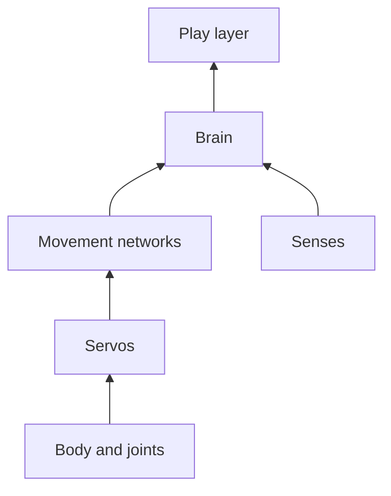
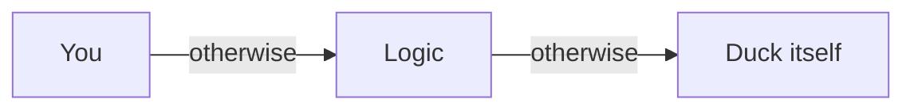

# 13 The Micro Duck – Our Hero on Two Legs

> **In short:** The Micro Duck is a real little walking robot by Pollen Robotics. Kern rebuilds it so
> precisely that it walks with the same trained "brains" as the original. On top of that, Kern brings
> three things of its own: the Lehrer for training, a jump, and a play layer that lets the duck decide
> by itself whether to kick a ball or fetch a sock.

> **Key terms:**
> - **Servo** – a small motor you give an angle to, and it turns the joint there
> - **Neural network** – a calculating machine like a giant mixing desk: measurements go in at the front, commands come out at the back
> - **Training** – adjusting the mixing desk's sliders until the right thing comes out
> - **Policy** – a fully trained network that controls a movement, such as walking or kicking
> - **Simulation** – the world recalculated inside the computer, with gravity, impacts and friction
> - **Box3D** – the physics engine that calculates this world in Kern ([Chapter 6](06-physics.md))
> - **Inertia** – how much effort it takes to get something moving or turning
> - **Tick** – the fixed rhythm in which things are calculated and decided

May I introduce: the Micro Duck. About 25 cm tall, 0.74 kg heavy, with 14 servos in its legs and
neck and a fifteenth one for the lower beak. What the Micro Duck level looks like in the Studio is
shown in the picture in [Chapter 1](01-introduction.md).

The robot was built by Pollen Robotics. There, the duck doesn't learn to walk from rules someone
writes down ("first the left knee, then …") but by training a neural network in a simulation. The
finished networks then go onto the real robot.

> **Imagine …** a mixing desk with around two hundred thousand sliders. At the front, 61 cables are
> plugged in: how the body is turning right now, where down is, how each joint is positioned. At the
> back, 14 cables come out: one command for each joint. At first the sliders are all over the place,
> and the duck falls over. Training means: nudging the sliders a tiny bit, again and again, until the
> measurements turn into commands that make it walk. The finished mixing desk is the policy.

Kern recalculates the duck with its own physics and runs **exactly these networks**. The goal is
called **fidelity**: the same body, the same servos, the same tick, the same things the network feels
and does. On top of that, Kern adds the **Lehrer** ([Chapter 14](14-lehrer.md)), the **jump** and the
**play layer**. Training your own networks is explained in [Chapter 15](15-your-own-models.md), and
matching against the real robot in [Chapter 16](16-calibration.md).

> **Try it!** Open Kern Studio at https://kernengine.de/ and load the example level
> (**File › Example Levels › Micro Duck**). Press **Play** and watch: the duck strolls off, looks
> around – and when it spots the ball, things get exciting.

## 13.1 The duck at a glance

A duck in Kern is made of layers, like an animal: a **body** of limbs and joints, the **muscles** (the
servos), **movements** (Pollen's networks: walking, sitting, kicking …), **senses** (distance, camera,
balance), a **brain** that decides what it does next, and on top, Kern's **play layer** for ball and
sock. This chapter goes from the bottom up.

## 13.2 The golden rule: no cheating

A trained network can only do its thing in the world it practiced in. That's why the duck's simulation
must never secretly help anywhere.

> **Imagine …** a dancer has practiced for months on one particular parquet floor. Put them on ice
> and they fall – not because they dance badly, but because the floor is different.

So the rules are:

- **No helpers:** no support forces, no holding the torso, no repositioning, no soft blending from one
  movement to the next. Blending would be a helper too: a mix of two networks is something neither
  network ever experienced in training. That's why every command comes entirely from one network. The
  duck stands only by its servos and its feet.
- **Servos made of real physics building blocks:** in Kern, a servo is only what the physics already
  knows for joints anyway, a spring and a brake, nothing more (13.4).
- **Fixed tick:** time is counted in steps, not with the clock. The same inputs give exactly the same
  gait, down to the last hair, on every device. That's called **determinism**
  ([Chapter 14](14-lehrer.md)).

> **Imagine …** you teach a kid to ride a bike with training wheels and then secretly unscrew them.
> That's exactly what happens when the simulation "helps": the network relies on something that
> doesn't exist in reality.

## 13.3 The model

### From Pollen's blueprint

Pollen describes the robot in a blueprint: what parts there are, how they're connected, how heavy they
are. A Kern tool automatically translates this blueprint into Kern's language. It's picky about it: if
joint names, the base pose, or the order of the measurements don't match exactly what the network
expects, it stops. Better no duck at all than one that's a tiny bit wrong, because the network
wouldn't forgive the mistake.

### Limbs and joints

The duck has a torso, two legs, a neck with a head, and a lower beak. The network moves 14 joints,
always in the same order: left leg, neck, right leg.

- Each **hip** can turn in three ways. The easiest way to picture it is with your own head:
  **yaw** is shaking your head no, **pitch** is nodding yes, **roll** is tilting your head toward
  your shoulder.
- Then there are the **knees** and **ankles**.
- The **neck** can pitch, and the **head** can pitch, yaw and roll.

Each joint has hard limits, like your elbow, which doesn't bend backward, and a **home pose**, the
comfortable base posture. Kern builds the duck directly in this posture.

> **Did you know?** The duck's head can turn about 170 degrees to each side. That lets it look
> almost straight back.

### Mass and the invisible disk

How heavy each part is and where its center of mass is are in the blueprint. The whole duck weighs
0.74 kg; the torso and the head are the heaviest parts. It gets interesting with **inertia**: how much
effort it takes to get a joint turning.

Inside the servo there's a tiny motor, and between motor and joint sits a gearbox. When the joint turns
a little, the motor behind it has to turn along much faster, almost three hundred times as fast.
Getting this fast little motor going takes force. That's why every joint feels **more sluggish than
its parts weigh**. This extra inertia is called **armature**.

> **Imagine …** a bike in its highest gear. The wheel is light, and yet you can barely get the pedals
> around when starting off, because everything at the back has to turn much faster than your feet.
> The duck's joint is the pedal, the motor in the servo is the fast rear wheel.

Kern's physics can't enter such gearbox inertia directly. That's why every limb gets an **invisible
disk** on its joint axis. It makes turning around exactly that axis more sluggish, like the motor
behind the gearbox. How Pollen's training solves this differently is in the blue book, Chapter 13.

The trick isn't perfect: the disk only turns as fast as the limb, not three hundred times as fast as
the real motor. So it only brakes roughly like the motor does. But measured, the duck walks clearly closer to the training with it and fidgets much less
(13.14).

### What touches the world

For collisions, what counts isn't the fine shape of each part but a simplified hull, as if you'd
stretched plastic wrap tightly around each component. Pollen's training does the same.

How strongly something grips is described by **friction**, a number usually between 0 and 1: 0 means
slippery as ice, 1 means grippy as rubber. The duck's soles grip fully, the servo housings are smooth
as in training, and the shells of torso and head are in between. That way a duck that has fallen
over doesn't slide across the floor as if on ice.

New in Kern: **material pairs**. How strongly two things grip each other depends on both of them.
Normally a physics engine simply estimates the friction of two materials from their individual values,
as a kind of average. For some pairs that isn't right: how firmly the soft beak pad holds cotton
doesn't follow from the individual values. For such pairs, Kern enters a value of its own, a measured
one. This matters for the sock: the floor in the Micro Duck level is made of wood, so how strongly a
cotton sock grips wood gets a value of its own as well.

### Scale 4: the duck as a giant

Box3D likes best to calculate with things between 10 cm and 10 m. The duck's limbs are only 2 to 4 cm
small, and such small parts easily make physics engines wobbly. So Kern builds the duck **four times
as big** and converts everything to match.

How much heavier does it get? Four times as long, four times as wide and four times as tall means
4 · 4 · 4 = **64 times as much material**, so 64 times as heavy. Not everything is quite that simple,
but the idea is always the same: every quantity is converted so that the big duck moves exactly like
the small one, just bigger.

And **time**? Big things move more leisurely. A long swing swings more slowly than a short one, and a
stone takes longer to fall from a tall tower than from a low one. The rule behind it: if something is
four times as big, such a movement takes **twice** as long; if it's nine times as big, three times as
long. So the giant duck walks in slow motion: every step takes twice as long as for the real one.

The network notices none of this. Kern converts everything back into real robot measurements before
the network sees it, and all values you get through logic or sensors are real meters and seconds too.

> **For the curious:** This conversion follows a rule from shipbuilding, used to test models in a
> water tank. The factors for inertia, force, damping and turning speed are in the blue book,
> Chapter 13.

### Looks and roller skates

The duck's 3D shapes come from Pollen's own models. Those may only be used non-commercially, while
Kern's program text is free. That's why this book shows the duck in a design of its own.

There's also a **Micro Duck (Rollers)** variant: instead of soles, it wears runners with freely turning
little wheels without a drive, like roller skates. It still has to skate by itself, with a network of
its own.

## 13.4 The servo model

A servo pulls the joint toward its target, **the harder, the farther away it still is**, but never
harder than its maximum force. **The faster the joint moves, the more it brakes.** And **a little
friction** is always there. That's the whole law.

> **Imagine …** a rubber band pulls the joint toward the target: the more it's stretched, the harder
> it pulls, until it won't give any more. Add a hand that brakes when things go too fast, and a bit of
> sand in the joint.

An example: if a joint is 6 degrees away from its target, the servo pulls with only a small part of
its force. It reaches full force only at a distance of almost 100 degrees. So the duck's servos are
**soft**, more a gently pushing hand than a vise. That's exactly how Pollen measured them on the real
servo.

Kern calls something like this a **device model**: a small law in real units. Its numbers (how firmly
it pulls, how strongly it brakes, friction, maximum force, and how long a command is on its way,
13.5) are in a **profile**, a kind of data sheet for the servo. The same law applies the same way
everywhere, in the Studio, in the Lehrer, and on the calibration test bench.

And what if the target lies beyond what the joint can do at all? Then the servo pulls the joint up to
its limit and presses it against the stop there, like your elbow when you straighten it all the way
and still want to go further.

In training, these numbers are deliberately made to **vary** a little: every practice duck gets
slightly different servos, sometimes more sluggish, sometimes with more friction, sometimes with more
delay. That way the network learns to cope with servos that don't match the data sheet exactly, as on
a real robot, where no two servos are alike.

A profile applies to all servos of a duck or to a single joint, including the beak. You measure your
own profiles as in [Chapter 16](16-calibration.md).

> **Did you know?** The real servo can limit its own force so it doesn't get too warm. With this
> limit, the duck couldn't get up off its back anymore! Pollen trains explicitly without
> it, and so does Kern.

The exact values and the law as a formula are in the blue book, Chapter 13.

## 13.5 The tick

Two clocks tick inside the duck. The **physics** moves the world forward in very small steps. The
**network** thinks less often: only on every fourth physics step. In between, the servos simply hold
their last target.

> **Imagine …** the physics is the second hand, ticking tirelessly. The network is someone who only
> looks at the clock on every fourth tick and then decides what comes next.

That's exactly how it was in training, and that's exactly how it has to be in Kern. In training, the
physics calculates 200 steps per second and the network thinks 50 times per second. Here the slow
motion from 13.3 helps, and a numerical example makes it clear:

| | per second of world time | per second of duck time |
|---|---|---|
| Physics steps | 100 | 200, as in training |
| Network decisions | 25 | 50, as in training |

**World time** is the time on your clock, **duck time** is time as the giant duck experiences it. The
Studio calculates 100 steps per second of world time; that's why the **Step rate** in the World
Settings says 100. Because the giant duck lives twice as slowly, only half a second passes for it in
one second of world time. So: **100 steps per second of world time = 200 in duck time**, exactly as in
training. Kern works this out by itself when each duck starts.

A command doesn't reach the servo immediately either. It takes a few hundredths of a second, like a
letter in the mail. So Kern makes every command wait exactly as long as on the real robot.

### Substeps

When you put a Micro Duck into a level, the Studio switches the physics to its tick by itself and
additionally splits every physics step into 16 **substeps**. Why so many? The duck is a long chain of
limbs: torso, hip, thigh, knee, ankle, foot. If the physics calculates too coarsely, the joints in
such a chain give a little, and the duck gets stretched apart like a rubber toy. Many small steps hold
the chain firmly together.

> **Try it!** In an empty level, place a **Micro Duck** from the **Content Drawer** and look at the
> **Output Log**: the Studio reports that it has adjusted the **World Settings**. Under
> **World Settings › Physics (Box3D)** you see the new **Step rate** and the **Sub-steps**, the
> substeps. You don't have to set anything: the message is that the Studio has made the physics finer
> for the duck by itself.

### The piggy bank

The screen doesn't deliver its pictures in step with the physics. Sometimes a picture comes earlier,
sometimes later. So that the duck still lives in fixed steps, Kern uses the **piggy bank** from
[Chapter 6](06-physics.md), 6.12: every picture deposits the elapsed time, the simulation withdraws it
only in whole, equal-sized steps, and the rest waits in the piggy bank for the next picture. What gets
drawn is a smooth transition between the last two steps, so nothing stutters.

## 13.6 The duck's networks

### What the duck can do

There's a network of its own for every movement. Walking runs **all the time**. The other movements
have a beginning and an end: a kick lasts half a second, a jump two, then the walking network takes
over again.

| Movement | Key | By whom? |
|---|---|---|
| Walking and standing | W A S D | Pollen |
| Sitting / standing up | 1 | Pollen |
| Picking up a sock | 2 | Pollen |
| Kick left / right | 3 / 4 | Pollen |
| Roll | 5 (hold) | Pollen |
| Roller skating / crouching | W A S D / 2 | Pollen |
| **Jump** | 7 | Kern |
| Beak open / closed | 6 | no network, just the servo |

For walking there are two gaits; you choose them in the Details panel under **Walking network**.

### Whose turn it is

There's always **only one** movement running. If several want to go at once, a fixed order applies:

1. a movement that's currently running, such as a kick,
2. picking up,
3. sitting or standing up,
4. rolling,
5. last of all, standing and walking.

From sitting, no movement starts; the key then simply has no effect. (A program that controls the
duck gets the reason as an answer, such as "the robot is sitting - stand it up first," 13.13.)

> **Watch out!** If the network for a movement is still missing, no other one steps in: the movement
> simply doesn't start. If the network for the chosen gait is missing, the duck holds its base pose and
> reports once which network is missing. If it stubbornly stands still, check the messages.

### From command to servo target

The network doesn't say "knee to 30 degrees" but "knee a bit further than in the base pose." So the
target for each servo is **base pose plus the network's command**. Kern passes the commands on
exactly as the network gave them in training. Pollen's software on the real robot, on the other hand,
damps and smooths them a little, as fine-tuning for the real hardware. In the Details panel you can
switch this under **Actions to servo goals**:

- **As trained (scale 1, no filter)** passes the commands on unchanged;
- **As the robot's daemon (scale 0.9, low-pass 0.5 / 0.7)** does it like Pollen's software. The
  **daemon** is the background program on the real robot; the **scale** of 0.9 weakens each command
  by a tenth, and the **low-pass** smooths it, like a shock absorber that swallows fast jitter and
  only lets the calm movement through.

Measured: walking works with both, but the kicks tip over with the robot setting.

### How the networks get into the browser

The walking network is built permanently into Kern. All other networks are separate files, and the
page only loads them once a level contains a duck. That way nobody who's only building a racing game
has to download them. Pollen's networks are in one folder, Kern's own (jump and play layer) in a
second one.

It works like a conversation: the engine reports which networks it's missing, the page fetches them,
and the engine checks each one. Kern runs the networks itself and only knows mixing desks wired the
same way as Pollen's; it rejects a differently wired one and gives the reason. If loading doesn't
work, the page tries again later. Until then, that movement doesn't start; the duck can still walk
and stand with the built-in network.

> **Did you know?** Networks you train yourself with Kern Lehrer in the browser
> ([Chapter 14](14-lehrer.md)) stay in the storage of the same browser. The Studio fetches them from
> there, and an open Studio takes over a new network immediately. So your own jump replaces the one
> that ships with Kern, without you copying a file.

## 13.7 What the network sees: 61 in, 14 out

All movement networks get the same 61 numbers, and each has its fixed place, like a cable in a fixed
socket of the mixing desk. They only describe what a body feels from the inside:

- **Sense of balance:** how fast the torso is turning and where down is,
- **Joint sense:** how each of the 14 joints is positioned and how fast it's moving,
- **Looking back:** what the network itself just commanded (the network has no memory of its own,
  so it gets this delivered along with the rest),
- **Task:** where and how fast it should walk, where the head should look, and what posture is
  wanted.

Out come 14 numbers, one per joint. Kern's jump uses two sockets that stay empty in Pollen's networks
as a clock: that way the jump network knows how far along the jump already is.

> **Did you know?** The network doesn't know where it is in the room. It only knows its own body.
> For the duck, walking is pure body sense, just as you can walk in the dark without seeing anything.

Exactly how the 61 numbers are arranged and how big the mixing desk is inside is in the blue book,
Chapter 13.

## 13.8 Senses

The duck perceives only what the real robot perceives, with sensors in exactly the places in the
blueprint.

**Distance sensor.** In the head sits a sensor that measures distances with light (ToF, "Time of
Flight": it measures how long light takes to go there and back). It splits its field of view into
8 × 8 cells and reports for each how far it is to the nearest thing. For this, Kern sends out an
invisible ray per cell that skips the duck's own limbs. Each cell reports **floor**, **too close** or
**obstacle**, and from that the duck knows whether left or right is clear.

> **Imagine …** you're feeling your way forward at night with 64 long, invisible fingers at once.
> The distance sensor doesn't "see" more than that – but it's enough not to ram the shoebox.

**Head camera.** The duck has a camera in its head, mounted upright. Important: Kern **doesn't analyze
any image**. It doesn't recognize a ball by its color or shape. Kern simply checks geometrically
whether the center of a thing lies within the camera's field of view with nothing in front of it.
That's simpler than real image recognition and exactly the same for every duck on every device. When
the duck looks all the way down, the camera sees the floor right in front of its feet.

> **Try it!** Start **Play** in the Micro Duck level. At the top right of the viewport you see the
> duck's camera image and next to it the 8×8 grid of the distance sensor (toggle
> **Window › Show › Robot Camera**, on by default). In the grid, red means obstacle (brighter the closer), green floor, yellow too close, and
> dark nothing. Take over the duck with **F8**, walk toward the ball, and watch the grid turn red.

**Balance.** A tilt sensor like the one in a phone reports where down is. "Fallen" means, as in the
original: clearly tilted for a while. A brief stumble doesn't count. The walking network gets back up
by itself, and a duck that decides for itself then shows "GetUp."

**Beak as a feeler.** If the beak is supposed to be closed but stands a bit open, something is stuck
in it. That's how the duck notices it's holding a sock, without a sensor of its own for that.

## 13.9 Who's steering?

The duck has several possible drivers, and there's a clear order: **you** come first, then your
level's **logic**, and only when neither of them wants anything does the **duck decide for itself**.

If you move the stick or press a duck key, you're in charge for two seconds, and the duck holds back
its own ideas. Otherwise, commands from logic graphs such as **Walk** and **Look** apply. Otherwise
the duck decides for itself, if **Autonomous (camera, ToF)** is on in the Details panel (13.10 and
13.11). All commands are gently smoothed at the end so nothing jerks.

If the duck stands still and nobody has steered its head for a while, the **idle gaze** from Pollen's
software takes over: soft glances around, small head twitches, slow drifting, dozing, and now and
then a yawn.

### Picked up!

A duck that's been picked up shouldn't keep kicking its legs in the air. For this, Pollen trained a
tiny extra network, the **pick-up detector**. It looks at the body sense of the last second and
estimates: how likely is it that someone is holding me right now? It only judges once a full second
of measurements has been collected. It never saw a half-filled time window in training, and the golden
rule from 13.2 says: only what was practiced.

The trick is in the switching. It pauses only when the estimate is **very high several times in a
row**; it continues only when the estimate is **clearly low several times in a row**. In between,
everything stays as it is. That way the duck doesn't flicker back and forth between "held" and "not
held" just because a single measurement wobbles.

> **Imagine …** a heater with a thermostat. It doesn't switch on and off at every little
> fluctuation; it only heats when it's noticeably cold and only stops when it's noticeably warm.

When it's held, the servos glide gently into a calm standing pose, and the duck reports "Held." When
it's set down, the networks start fresh and it walks on. This watch is only kept while walking and
standing. Kern runs the detector itself, and tests check that it answers exactly like Pollen's
original and that the duck never pauses for no reason.

> **Try it!** Start **Play** in the Micro Duck level. It begins with the observer camera: you watch
> and can grab bodies. Pull the duck up by its torso (it works the same way while **Simulate** is
> running). The grab holds it upright like a hand, and soon it stops kicking. Set it down – it walks
> on.

## 13.10 The brain: the duck thinks for itself

When nobody's driving, the duck decides for itself. The brain is a port of Pollen's own program for
the real robot, with its moods, durations and numbers. It gives the same commands as a gamepad: walk,
move the head, posture, beak and sounds. That adds up to a little personality:

| State | What the duck does |
|---|---|
| Chill, LookAround | stands for a few seconds and looks around, tilts its head |
| Wander | walks a meter or two in a random direction |
| TurnInPlace | turns on the spot, head first |
| Zoomies | full speed, jerky turns, "Wheee" (only when there's lots of room) |
| Stretch, Ruffle, Dance | stretches, ruffles its feathers, grooves |
| Sneeze | sneezes and looks dazed |
| GroundPick, Nap | picks something up; sits down and dozes |
| Petted | is being petted |
| BallPlay, Kick | plays with the ball, kicks |

On top of that there are:

- an **energy** level that helps decide whether zoomies or a nap is more likely next,
- **curiosity**: when wandering, it prefers corners it hasn't been to in a long time,
- **avoidance**: if something comes close ahead, it brakes and swerves; if it's very close, it turns
  away and avoids the spot for a while,
- **hearing** and **petting**: these come via logic or a program, because Kern has no microphone and
  no touch sensor.

Even the brain's randomness is **repeatable**. That sounds like a contradiction, but it isn't: the
random numbers come from a fixed starting number, like a well-shuffled deck of cards that you shuffle
exactly the same way again and again. To the duck it looks random, but the same starting number means
the same sequence (13.2). During a movement, while sitting down and standing up, and after a fall, the
brain holds still.

### BallPlay

Pollen's earlier software had a BallPlay state: walk over, line up, kick. Its program isn't public,
but its description is. Kern rebuilds BallPlay from that with its own code and Pollen's real kick
network. It belongs to the brain and is therefore always there as soon as the duck decides for itself.
The story goes like this:

1. The duck **sees** a ball on the floor (via the camera's visibility test from 13.8).
2. It **walks over**, head lowered so it keeps the ball in view. Only the head pitches, not the neck:
   bending the neck shifts the weight forward, and the gait suffers.
3. It **lines up**, in small steps, until the ball lies exactly where it lay in front of its left foot
   in the kick training.
4. It **waits** until it's standing completely still, moves its head to the base position because the
   kick was trained that way, and **kicks**.
5. It **celebrates** with a happy quack, and the ball is uninteresting for a moment.

If it loses sight of the ball for too long or the kick just won't work, it gives up and looks around
instead. It only kicks with the left foot, because the right kick sometimes knocks the duck over in
Kern.

If Kern's play layer is switched on (13.11), it takes over instead of BallPlay. In the example level
it's on, so that's what you see there. BallPlay steps in when you switch off the Kern extras in the
Details panel.

## 13.11 The play layer

Pollen's networks are the duck's **muscles**: they can walk, kick and pick up, but none of them sees
anything. What the duck **intends** to do with a ball or sock – look at it, walk over, kick, pick up,
carry away, spit out – is decided by Kern's own network trained by the Lehrer, the **play layer**.
There are no hand-written game rules in it.

> **Imagine …** a kid sits with a gamepad in front of the duck's camera image and presses
> buttons: forward, turn, head down, beak open, kick, pick up. The duck makes the movements themselves
> with Pollen's networks. The kid is the play layer.

The play layer decides even less often than the movement networks. To have it join in, turn on
**Kern extras (ball play, sock fetching, beak in the pick)** and **Autonomous (camera, ToF)** in the
Details panel (in the example level, both are on). Then it steps in as soon as it knows about a ball or
a sock or has something in its beak, and the duck reports "Play." You and the logic still come first.

Two helpers deliver the world to it:

- The **detector** is its eye. It reports where the nearest ball and the nearest sock are lying on
  the floor. Like the servo, it's a device model: in training it may deliberately be inaccurate, the
  more so the farther away something is, and sometimes miss a picture, like a real camera. In the
  Studio it's perfect.
- The **tracker** is its memory. If something disappears from the picture, it remembers for a while
  where it last was: usually only a few seconds, but much longer for a thing right in front of it,
  because then it lies below the camera and doesn't move away by itself. A ball it just kicked and a sock it just carried away are left alone for a while, so the
  duck doesn't immediately do the same thing again.

**What it sees:** everything from the duck's point of view, never the true positions. Roughly where
ball and sock are and how old this information is, where its left foot is, whether it has something in
its beak, whether it's currently walking, picking up or kicking, and how long it's been carrying,
standing or walking.

**What it can do:** forward, sideways, turn, turn and pitch the head, bend the neck, open the beak,
start a left kick, start a pickup. Very small walking commands don't count, like a gamepad stick that
has a little play in the middle. During a pickup, the beak belongs to the network: it has learned by
itself when to bite down.

**The punchline:** whether the duck is standing still, the play layer measures by the **feet**, not by
the command. You see, Pollen's gait sometimes doesn't respond at all to "a tiny bit forward"; from
standing, it needs a strong push. Then the duck is really standing, even though "walk" is commanded.
What the legs do is the truth.

**Sock and ball:** the sock is a small pile of seven little clumps of fabric connected by soft
springs. It gives way under the beak, and whatever the beak grabs pulls the rest along. The ball is a
small toy ball. Both have some rolling resistance; otherwise the sock would creep across the floor and
the ball would roll forever.

**The example level** is a small room with a wooden floor, shoebox, stack of books, crate, flower pot,
a ball and two socks. A small logic graph makes the duck chirp when the ball comes into view. That's a
demonstration of the logic nodes, not a behavior of the duck.

**How well does it play?** In short: **it usually kicks the ball; the sock usually slips out of its
beak.** To fetch the sock it walks over, positions itself, picks up and bites; it's just that the bite
rarely holds. That's not down to the decision but to the fact that grabbing fabric is hard in this
physics. And on a deliberately slightly altered robot (stiffer servos, more slippery soles), Pollen's
gait tips over more easily, especially when turning on the spot. The measurements are in
[Chapter 14](14-lehrer.md), section 14.8.

Two tests check in the Studio that really only the network decides: a ball in front of the duck gets
kicked, a sock in front of it gets fetched and bitten. How things continue is in
[Chapter 14](14-lehrer.md).

## 13.12 Steering the duck

| Movement | Keyboard | Gamepad | Touch |
|---|---|---|---|
| Walk / turn | W S / A D | left stick | MOVE |
| Sit / stand up | 1 | B | SIT |
| Pick up | 2 | Y | PICK |
| Kick left / right | 3 / 4 | – | KICK L / KICK R |
| Roll | 5 | X | ROLL |
| Beak | 6 | – | BEAK |
| Jump | 7 | – | HOP |
| Quack / "Wheee" | Space / V | right / left rear shoulder button (RT / LT) | QUACK / WHEEE |

In the Micro Duck level, **Play** starts with the observer camera ([Chapter 11](11-studio.md)): you
fly freely (W A S D, Q / E down and up, with your fingers on a phone), watch, and can lift the ball,
sock or duck with the mouse or a finger. **F8** takes over the duck, and F8 again goes back to
watching.

The **voice** is a faithful port of Pollen's sound generator, with a voice of its own for each duck
([Chapter 7](07-audio.md)). It greets you when it wakes up, asks after you when the gamepad is gone,
chirps when quacking, calls "Wheee" as long as you hold V, and pecks when sitting down.

**The jump** (key 7, the HOP touch button, or the **Robot Move** logic node with "jump") is Kern's
first movement of its own, trained by the Lehrer. It runs like a kick: two seconds of the jump network,
then back to walking. In the Studio the duck really takes off, only a few millimeters, but with both
feet in the air, and lands safely afterward.

> **Try it!** Start **Play** in the Micro Duck level, take over the duck with **F8** and press
> **7**: it jumps! Then steer it with W, A and D close to the ball so that it's lying just in front of
> its left foot, and press **3**. Finally **1**: sit, duck! And now, while it's sitting, try **2** –
> what happens?

In the logic editor there's a category of its own, **Robots**, with nodes for walking, looking,
starting movements, quacking, petting, and querying sensors and state ([Chapter 9](09-logic.md)). The
remaining settings in the Details panel are in [Chapter 11](11-studio.md), the complete list in the
blue book, Chapter 13.

## 13.13 Controlling the duck from programs

If you program in C++, you can give the duck the same commands as a logic graph: "walk slowly forward
for three seconds," "look left," "pick something up." If you ask it for a movement, it answers "will
do" or with the reason why it can't right now. And you can ask it: Do you have something in your beak?
What do you see? What are you doing right now? Which network is driving right now? For the Lehrer
there are additional inputs through which a learning network controls the duck
([Chapter 14](14-lehrer.md)). The commands are in the blue book, Chapter 13.

## 13.14 Measured

Kern measures how close the duck comes to the original and compares it with Pollen's own training
simulation:

| Command | Kern compared to Pollen |
|---|---|
| stand | both stand; Kern's duck barely moves for 8 s |
| full speed ahead | about 80% of Pollen's speed |
| turn on the spot | just under two thirds of Pollen's turning speed |
| on belly or back | both get back up, Kern's duck after at most 12 s |

Don't be surprised: the original doesn't quite reach the commanded top speed when walking either. A
command is a wish to the network, and how fast it actually walks from it, the network learned in
training. That's why the comparison with Pollen is what counts.

The invisible disk from 13.3 pays off: without it, the duck would walk more slowly, and torso and head
would fidget more than three times as much. All movements succeed, the left kick shoots the ball
across the room, only the right one sometimes tips over. And even without the Kern extras at all, the duck sees a ball, approaches, lines it up and kicks without
falling.

## 13.15 What's still missing

Kern says honestly where the duck still differs from the original:

- **Gear backlash:** if you turn a real gearbox back and forth, it wobbles a tiny bit before it
  engages. This wobble of about one degree is missing in Kern. It hardly bothers the networks, because
  in training it's varied randomly anyway. A case for [Chapter 16](16-calibration.md).
- **The disk** only roughly replaces the real, fast-turning motor (13.3).
- **Friction between two surfaces:** Kern and Pollen's simulation calculate the friction between sole
  and floor slightly differently. In the example level this makes no difference.
- **The right kick** sometimes tips over; the cause is still open.
- **BallPlay** is a rebuild from a description, and Kern doesn't measure the current in the servos.
- **Only in Kern:** the play layer, the beak timing when picking up (both only with the Kern extras),
  the jump, and, always on, sounds like plastic clacking, footsteps and servo whirring.

The complete list of differences is in the blue book, Chapter 13.

## What you take away

- The Micro Duck is Pollen's real walking robot: 25 cm, 0.74 kg, 14 servos plus the beak.
- A network is a mixing desk: measurements in, commands out; training turns the sliders.
- Kern runs the real networks and never cheats with the physics; otherwise what was practiced no
  longer fits.
- The duck is built four times as big: 64 times as heavy, at half speed, and cleanly converted back
  for the network.
- A servo is a device model: it pulls softly toward the target, brakes, has friction, delay and the
  inertia of its gearbox.
- The physics ticks finely, the network thinks on every fourth tick; substeps hold the chain of limbs
  together.
- Hand before logic before its own will; the brain gives it personality, the play layer its playful
  streak.
- Kern says honestly where it differs from the original.

## Brain teasers

1. Why would a small invisible support force against falling over be a bad idea?
2. The duck is built 4 times as big. How much heavier is it then in the simulation, and why?
3. One servo is far from its target, another only just. Which one pulls harder? And is there a
   limit?
4. You press 2, but the duck is sitting. What happens?
5. Why does "standing still" count by the feet in the play layer and not by the command?

### Solutions

1. The network would rely on the support, which doesn't exist on the real robot, like a kid whose
   training wheels are secretly unscrewed.
2. 64 times: four times as long, four times as wide, four times as tall, so 4 · 4 · 4 times as much
   material. For the network, Kern converts back into real measurements.
3. The one farther away pulls harder, like a more stretched rubber band. But never harder than its
   maximum force.
4. Nothing: from sitting, no movement starts – first stand up with 1.
5. Because Pollen's gait sometimes doesn't respond at all to a tiny walking command. Then the duck is
   really standing, and the legs give that away, not the command.

---

© 2026 Christian Heinrich Hohlfeld · All rights reserved · [Imprint and rights](00-imprint.md)
