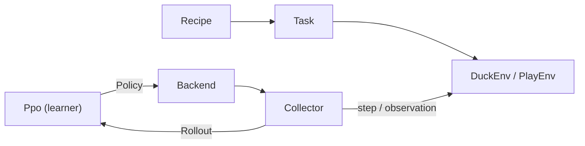

# 14 The Lehrer – a School for the Duck

> **In short:** The Lehrer is Kern's own training school for the Micro Duck. Dozens of ducks
> practice at the same time in the simulation. First they are shown a demonstration, then they try
> it themselves, until random numbers have turned into a network that can jump. Everything runs in
> Kern's own C++, on your computer as well as in the browser, and comes out identical everywhere,
> bit for bit.

No Python, no PyTorch: simulation, learning method and export run in C++ on Kern's engine and the
Box3D physics. The Lehrer learns natively on all processor cores (even without a screen, on a
server) and as WebAssembly in the browser, on desktop and phone. On all platforms checked in CI, a
run produces **the same network, bit for bit**.

The duck in the Lehrer is **the same** as in the Studio: the same `GameWorld`, the same servos and
sensors, the same 50 Hz controller, the same physics with 16 sub-steps ([Chapter 13](13-micro-duck.md)).
That is why a network from here runs unchanged in the Studio. It is exported in the format of
Pollen's networks (Pollen Robotics built the real robot and its networks). It has not been tested
on the real robot: if you load it onto hardware, you do so at your own risk
([Chapter 16](16-calibration.md)).

This is how Kern's own networks were made: `policies/jump.onnx` (the jump) and `policies/play.onnx`
(the play layer). This chapter shows how the Lehrer is built and how it computes. What a neural
network is and how imitation and reinforcement learning work is explained from the ground up in
[Appendix A](A-neural-networks.md); how to operate it is described in
[Chapter 15](15-your-own-models.md).

## 14.1 What's inside?

The Lehrer lives in `src/lehrer/` and `include/kern/lehrer/`: about a dozen pairs of files for the
environment, tasks, network, PPO, threads, recipes, demonstration and CMA-ES, play layer, ONNX
export, calibration, fingerprint and browser interface, plus the tool `kern_lehrer` and the page
`web/lehrer/`. The status according to `docs/lehrer.md`:

| Step | Status |
|---|---|
| Simulation without graphics, network with Adam, PPO, ONNX export | done |
| Variation, learning in the browser, determinism | done |
| The jump: demonstration → imitation → practice | done |
| Digital twin: device models, calibration | done (without real measurement data) |
| Playing: kicking a ball, picking up a sock, carrying, spitting it out | being reworked |

## 14.2 Who does what?

> **Imagine …** a sports school. The **curriculum** (`Recipe`) decides what gets practiced. The
> **exercise** (`Task`) says what earns points. A duck works out in the **gym** (`Env`).
> **Helpers with clipboards** (`Collector`) write everything down (`Rollout`). The **coach** (`Ppo`)
> evaluates the notes and hands out new instructions (`Policy`). The **building** (`Backend`)
> decides how many gyms are open at the same time.



`DuckEnv` takes one duck through episodes (61 observations in, 14 actions out), `PlayEnv` does the
same for the play layer (23 in, 9 out). The tool and the browser use the same recipes, so the same
run produces the same network everywhere. Policy and rollout can be packed into flat buffers and
sent between threads or Web Workers that way. `ThreadBackend` spreads groups of ducks across
threads; in the browser, each Web Worker is a collector, and one more is the learner.

That keeps the training loop short:

```cpp
IterationStats train_iteration(Ppo& ppo, Backend& backend) {
  std::vector<Rollout> rollouts;
  backend.collect(ppo.policy(), ppo.config().steps_per_env,
                  ppo.iteration() + 1, rollouts);
  std::vector<const Rollout*> ptrs;
  for (const Rollout& r : rollouts) ptrs.push_back(&r);
  ppo.set_parallel(backend.update_parallel());
  return ppo.learn(ptrs);
}
```

In words: the backend has all the ducks practice with the current policy and fills the list of
rollouts. Collect pointers to them, lend the backend's threads to the learner, learn. That is
**one** iteration; thousands of them make a jump. Before each iteration, the backend also calls
the curricula ("from now on, a fall costs more").

## 14.3 The duck's gym

### One duck, one world

Each `DuckEnv` builds a duck on flat ground in a `GameWorld` **of its own**. The renderer stays
headless; the graphics card is never touched. A switch makes sure that the duck's controller takes
the Lehrer's action, exactly as in training: default pose plus action, with the bus delay of the
servo profile. If a finished movement (skill, pick-up, sitting) is currently running, it takes
priority.

One `step(action)` is one **control tick** of 20 ms of robot time: action to the controller,
compute 4 world steps, now and then a push (when variation is on), then `walker_probe` measures
everything the reward and the critic need (orientation, velocity, rotation rate, sole contacts,
foot heights, ground contact of other parts, joints). The task computes the reward and says whether
the episode is over. Finally the new observation is built: first exactly what the controller sees,
plus the task's commands in slots 48–60. The critic gets this clean version plus extra knowledge.
If the task has a demonstration, it now asks it what it would do (for the imitation reward). Only
at the very end do the sensor errors get stamped onto it, **for the actor only**.

### The task: what earns points?

A `Task` is a small C++ class: name, episode length, random start, commands, reward, curricula.
Rewards follow the mjlab convention: **weight × term × dt** (dt = 0.02 s), each term with a name so
that `--trace` can show it. Only one-off events such as a fall are not multiplied by dt.

Two tasks are built in. **`stand`** is the quick test: stand for 4 s, points for staying upright,
for leg and neck posture and the right height (0.115 m), a small deduction for jittery actions; a
fall costs −4 and ends the episode. **`jump`** is the jump (14.6).

### The asymmetric critic

During learning, two networks work together (foundations in Appendix A.11). The **actor** acts and
sees only what the sensors deliver, errors and all. Only the actor is exported. The **critic**
estimates how good a situation is. It exists only during learning and may therefore see more: the
clean observation and things no sensor measures. For the jump, these are 9 extra values, such as
the torso height above the start, the torso velocity, the foot heights and whether the duck has
already been airborne.

> **Imagine …** a student driver with fogged-up glasses and a driving instructor with a clear view.
> Later, the student has to drive alone. But during practice, the feedback is much better because
> the instructor sees more.

### Variation: every duck a little different

If the duck always practiced in the same perfect world, it would learn exactly that world by heart.
That is why the Lehrer rerolls lots of things for every episode, as in Pollen's recipes
(**domain randomization**):

- **Start:** any heading, ±3° tilt, sole friction × 0.7 to 1.3.
- **Build:** torso mass and inertia ±5 %, centers of mass shifted by ±3 mm (for the jump, via a
  curriculum, up to ±15 mm in the torso and ±10 mm in the head).
- **Servos:** each with its own friction and inertia (XL330: ±10 %), bus delay 15–30 ms.
- **Sensors (actor only):** noise on the gyro, gravity and joints, an encoder offset, an IMU that
  is up to one tick late.
- **Pushes:** every 3–6 s up to 0.3 m/s; via a curriculum only from iteration 300 on, and up to
  500 with 27 %.

How to measure the servo spread is explained in [Chapter 16](16-calibration.md).

> **Did you know?** The Lehrer evaluates every network **twice**: on the clean robot and with full
> variation. A network that can only stand with exactly one mass, one friction and one delay will
> not stand on the real robot.

The randomness itself is reproducible: `Rng` is splitmix64, small and fast. In a run with seed s,
duck k gets the seed s · 1000003 + k. It depends only on the duck's number, never on the thread
that computes it (important for 14.7).

## 14.4 The networks: Mlp, Normalizer, Adam

**The network.** `Mlp` is a multilayer perceptron as in rsl_rl, the library Pollen uses to train
the duck's networks: ELU between the layers, a linear last layer. The jump actor has the shape
**61 → 512 → 256 → 128 → 14**, just under 200,000 knobs (worked out in Appendix A.1). All
parameters sit in one long vector, the weights stored "input by input." That sounds like
bookkeeping, but there is a clever reason: it turns both directions of computation into simple
loops that the compiler speeds up **without changing the order of the additions** – and that order
is sacred (14.7). Even the exponential function inside the ELU comes from Kern's deterministic math
library.

At the start, the weights are drawn at random as in PyTorch, in the range ±1/√(number of inputs).
In the backward pass (Appendix A.5), Kern uses a trick: the derivative of the ELU in the negative
range is exactly "output + 1," so the stored output is all it needs. Gradients are **accumulated**
so that the pieces of a minibatch can be added up. A test checks the whole thing against finite
differences.

**The normalizer** converts every input to a common scale (Appendix A.7):

```
y = (x − mean) / (√variance + 0.01)
```

It keeps updating the mean and variance as it goes (Chan's formula, in double precision). On
export, it ends up at the front of the network as `Sub` and `Div`, as with Pollen. The critic has
its own.

In a **warm start**, the actor takes over the weights and normalizer of Pollen's standing and
walking network velstand and **freezes the normalizer**, because the weights belong to exactly
these values. Inputs that velstand never used (for the jump, the phase slots 55 and 56) get weight
0. The actor then acts exactly like velstand at first, until it learns to use them.

**Adam** (Appendix A.6) runs with PyTorch's default values. Before that, the gradient is clipped to
a total length of 1.0. Adam's memory goes into the checkpoint too.

## 14.5 PPO step by step

Kern follows the PPO of rsl_rl. Why PPO is built the way it is is covered in Appendix A.11; here we
look at how it runs in Kern.

| Setting | Default | Jump | Play layer |
|---|---|---|---|
| Actor | 512, 256, 128 | 512, 256, 128 | 256, 128 |
| Critic | 512, 256, 128 | 256, 128 | 256, 128 |
| Noise at the start | 1.0 | 0.3 | 0.2 |
| Ticks per duck | 24 | 48 | 64 |
| Entropy bonus | 0.01 | 0.005 | 0 |
| Learning rate | 10⁻³ | 10⁻⁴ | 10⁻⁴ |

The same everywhere: 5 epochs, 4 minibatches, clip 0.2, γ = 0.99, λ = 0.95, target KL 0.01 with
an adaptive learning rate, gradient limit 1.0, clipped value loss.

1. **Collect.** Each duck runs its ticks. The actor delivers a mean μ, and noise is added:
   **a = μ + σ · ε**. The noise is curiosity – without it, the duck never tries anything new.
   Stored are the observations, action, reward and whether the episode ended with a fall
   ("terminal") or by running out of time ("timeout").
2. **Sort.** The learner puts all rows into **one** fixed order, step by step, and within each step
   duck by duck. Then the normalizers learn from everything at once (a frozen one stays frozen).
3. **Re-evaluate the old policy** – with the fresh normalizers. With only a few dozen ducks, they
   shift noticeably between two iterations; otherwise the "new versus old" comparison would be
   skewed.
4. **Advantage with GAE.** Was each action better or worse than expected (example in Appendix
   A.11)? A **timeout** is not a failure: the episode could have continued, so the value of the
   future is estimated instead of being set to zero. A **fall** has no future. At the end of the
   rollout, the critic estimates the value of the situation each duck is in at that moment. Then
   all advantages are brought to mean 0 and spread 1, so that the step size does not depend on the
   scale of the reward.
5. **Update.** 5 epochs × 4 minibatches = 20 learning steps. Each minibatch is split into exactly
   **8 fixed pieces** that run on the threads. Before each step, the learner uses the KL divergence
   to measure how far the policy has already moved: above 0.02 it divides the learning rate by
   1.5, below 0.005 it multiplies it by 1.5 (always between 10⁻⁵ and 10⁻²). That keeps every step
   inside a "trust region." The clipped loss makes good actions more likely, but only up to a
   ratio of 1.2 (bad ones less likely, down to 0.8). The critic learns to predict the returns, a
   small entropy bonus keeps the noise alive, and σ itself is a learned knob per action (at least
   0.001). Finally, the 8 partial gradients are summed in a fixed order, and one Adam each takes a
   step for the actor and the critic.

> **Watch out!** After imitation, the actor can already jump, but the critic has no idea what
> that is worth. If the actor learned along right away, the critic's random judgments would steer
> it and destroy what it had learned. That is why, for the first 30 iterations (play layer: 20),
> **only the critic** learns – "critic first."

After every iteration there are statistics: mean reward, return and length of the finished
episodes, the losses of critic and actor (value and surrogate loss), entropy, learning rate, mean
σ, the timings and the total number of duck steps. A checkpoint (identifier `KERNPPO1`) contains
the whole learner with both networks, normalizers and Adam memories.

## 14.6 Demonstration, imitation, practice: how the jump came about

### Why PPO alone failed

The first runs with pure PPO – with curricula, a phase signal, warm start, various network sizes
and learning rates – did not find the takeoff. Three reasons:

- A takeoff needs **all leg servos at their limit at the same time**. The servos are soft and
  reach their maximum torque only at 1.7 rad of deviation, so the network has to set targets far
  beyond the joint limits. Random trial and error practically never produces that.
- Standing is safe and earns points; a failed attempt costs a fall.
- With only a few dozen ducks, the gradient is noisy.

> **Imagine …** you want to teach a dog a somersault, and you only give it a treat when it happens
> to do one by chance. You'll wait forever. If you show it the movement piece by piece, it suddenly
> works.

So the Lehrer teaches in three steps: **find a demonstration → imitate → practice.** At runtime,
there is only the network; the demonstration exists only during learning.

### The demonstration: a jump in 15 numbers

`JumpDemo` describes a jump with **15 numbers**: the servo targets of the hip, knee and ankle of
the left leg at five points in time (crouch, push-off, tuck, landing, cushioning); the right leg
mirrors them. In between, the values are interpolated, and everything is sent through tanh with an
amplitude of 2.5 rad. That makes targets beyond the joint limits possible, and the servo pushes with
full force. Before and after the jump, velstand keeps the balance.

### Finding the 15 numbers: CMA-ES

"15 numbers in, jump score out" is an entire physics simulation, with no derivative. This is where
**CMA-ES** helps, an evolution strategy without gradients (Appendix A.13).

> **Imagine …** you are looking for the deepest spot of a lake in the dark, and each time you throw
> 16 stones around you. You move to where the splash sounds deepest – and remember in which
> direction it gets deeper.

Kern wrote CMA-ES itself, following Hansen's tutorial, deterministic like everything else. The
Lehrer uses it wherever there is no derivative: here for the demonstration, in
[Chapter 16](16-calibration.md) for the servo calibration. CMA-ES learns not only where to go, but
also the shape of the search cloud (which numbers should move together). The starting point is
evaluated first, so the result is never worse; all candidates of a generation compute in parallel.
Per generation 16 candidates, search width σ = 0.8 from the default pose (0.3 from a given start);
each one jumps 6 episodes, one clean, five with full variation. All candidates of a generation face
**the same** robots (a fair comparison), each generation different ones (no demonstration tailored
to lucky ducks). The score rewards rising, flight time and height, penalizes tilt above 15° and
falls (early ones more than late ones) and gives bonus points for standing at the end and for a
real jump. What comes back is the **center** of the search cloud, not the best individual, because
that one may just have been lucky. The built-in demonstration needed three stages with a total of
**370 generations**.

### Imitation with DAgger

If the network learns only from runs of the demonstration, it only knows the demonstration's
states. A small mistake of its own leads into the unknown, where it makes a bigger one, and the
errors build up: **distribution shift** (Appendix A.9). DAgger turns the tables: **the network
drives, the demonstration comments.** In round 0 the demonstration drives; from round 1 on the
network drives (with a little noise, 0.05), and on every tick the demonstration says what it would
have done. After each round, the network learns from **all** examples so far. That way the dataset
contains exactly the situations the network itself gets into, together with the right answer for
them. The prerequisite: the demonstration must have a sensible answer in every one of those
situations.

For the jump: 8 rounds of 96 episodes each with full variation; learning uses the mean squared
error with its own fresh Adam (10 epochs, minibatch 256, learning rate 10⁻³). It does not matter who
computes which part of a round: put together, the result is exactly the same round.

After that comes **practice**: noise 0.1, 30 iterations of "critic first," then PPO with the jump
reward, an imitation reward and full variation, until the jump is robust.

### The task `jump`

The only command is a **phase signal**: cos and sin of the phase t / 2 s in slots 55 and 56. The
episode lasts 2 s. No script, no inverse kinematics, no artificial forces – the movement comes from
the network alone, through 14 servo targets. The reward has 15 terms; the most important ones:

| Term | Weight | What for |
|---|---|---|
| `airborne` | 20 × upright | in the air and rising during the flight window |
| `lift` | 20 × upright | rising speed at takeoff |
| `landed` | 6 × upright | on both soles after the flight |
| `imitate` | 10 | close to the demonstration's action |
| `tilt` | −30 | tilting costs |
| `fall` | −2 → −20 | one-off, stricter via a curriculum |

Plus smaller terms: posture of legs and neck, slipping, a second hop, rotation rate, self-contact,
jittery actions (stricter via a curriculum from iteration 200 on) and, only without a
demonstration, a reference height. A fall means more than 60° of tilt or a torso below 5 cm.

> **Watch out!** An episode ends on **any ground contact by a part other than the soles**.
> Otherwise, the safest bet would be to prop itself up on its beak or tail. Networks are masters at
> exploiting loopholes.

What counts as a **real jump** is decided by the strict `JumpMeter`: all parts in the air for at
least 60 ms, the torso rising at least 5 mm above the liftoff height in the process (just pulling
up the feet doesn't count), never more than 30° of tilt, and at the end the duck stands upright on
both soles. With this measure, `evaluate_jump` measures every policy in Studio physics: real jumps,
falls, height, rise, flight time, tilt.

## 14.7 Determinism: the same network everywhere

Simulation, training and replayed robot logs come out the same on all CI platforms: GCC on x86,
Apple clang on ARM, WebAssembly. That makes a bug repeatable instead of noise that looks different
on every computer.

> **Did you know?** A single different bit in the last rounding step of a sine is enough for the
> simulated duck to have a different gait after a few seconds.

What it takes:

- **No FMA contraction** (`-ffp-contract=off`): otherwise `a*b+c` rounds differently on some
  processors than in WebAssembly.
- **Box3D without SIMD**, as in WebAssembly; natively this costs nothing, since the joint solver is
  the bottleneck.
- **Its own math library:** `sin`, `cos`, `exp` … round differently in the last bit on different
  systems. Kern uses the versions from musl everywhere, via `kern::dm::`. Only what IEEE defines
  as exact (`sqrt`, `fabs`, `floor`) stays from `std::`.
- **Independent of the number of workers:** seeds from the global duck number, a canonical order,
  always 8 pieces in a fixed summation order.

So the same seed and the same number of ducks give the same network, on 1 core, 16 cores or in
4 Web Workers. This is checked with a **fingerprint**: `kern_lehrer --fingerprint 400` lets the
clean duck walk and turn for 400 ticks and outputs, per tick, a hash over the exact bits of
orientation and joints. The first tick that differs shows when two builds drift apart. CI checks
this three times; another test learns with 1, 2 and 4 workers and compares the networks byte for
byte. **Rule for new code:** `kern::dm::sin` instead of `std::sin`, no sums in thread order, no
`-ffast-math` ([Chapter 2](02-building-and-testing.md)).

## 14.8 Learning the play layer

The play layer ([Chapter 13](13-micro-duck.md)) decides whether the duck goes to the ball or the
sock, and kicks, picks up, carries and spits out. It learns like the jump: demonstration, DAgger,
PPO.

**`PlayEnv`:** The duck walks on its own with Kern extras; the Lehrer controls only the play layer,
and below it Pollen's networks run unchanged. One step is one decision (40 ms), and an episode lasts
at most 60 s. The actor is 23 → 256 → 128 → 9; the critic also knows 6 secret values (whether ball
and sock are present and where they really are).

**Scenes:** random heading; 30 % of the time a ball, 30 % a sock, 40 % both, often close together.
Sometimes the target is right in front of the duck, usually 0.35 to 1.2 m away, sometimes out of
sight. Balls with a radius of 3.5 to 6 cm, 15 to 50 g, from foam to rubber; 30 % of the time a
second sock. On top of that, variation as for the jump and an object detector that is noisy and
drops out up to 20 % of the time.

**Reward** per decision: −0.01 for time, +2 × approach, +3 for a pick-up that holds, something for
carrying, **+10 for a ball kicked 0.25 m away or a sock carried 0.25 m and spat out**, −5 for a
fall. Approach counts toward the true target (sock before ball), and not while the duck is holding
something. A successful kick or drop ends the episode as a timeout, not as a failure.

**The demonstration** sees **exactly the same as the network**, no true positions, and has no
hidden memory except the starting spot of the left foot (plus the ball radius and the measured bite
position). Only then can the network really learn it. Simplified: if it sees nothing, it turns.
Otherwise it heads for the closer target (a ball in the way gets kicked first), approaches slowly
in a line once it's close, says "stop" and stands. If it's standing in the right place, it starts
the kick or the pick-up; otherwise it backs up and tries again (tolerance: sock ±8 mm ahead and
±12 mm sideways, ball ±2 cm). "Standing" means both soles on the ground for longer than 0.25 s. When
picking up, the beak is open from phase 0.04 to 0.30. If it's holding something, it carries it
0.3 m and spits it out. The wish to kick or pick up rises as a **ramp** over the last half second
of standing still, so that the network can read it from the standing time.

**What the Lehrer measures itself:** Where does the beak grab a sock? Instead of writing a number
into the code, the Lehrer places the sock on a grid of 11 × 9 spots in front of a standing duck,
has it pick the sock up and checks whether the sock is still in the beak after 3 s of carrying. It
chooses a spot around which many others also hold, because walking up is never accurate to the
millimeter. If the physics changes, it measures again; if nothing holds anywhere, it takes 6.5 cm in
front of the torso, centered. In the same way, it measures how far the duck keeps walking after
"stop."

Imitation works as for the jump, with DAgger (30 epochs, minibatch 256, learning rate 10⁻³). After
that, the network is supposed to practice (`--spielen-ueben`): warm start from the file with a
frozen normalizer, noise 0.1, 20 iterations of "critic first," and only what works is rewarded – it
finds out by itself where the bite really holds. During imitation and practice, half of the
episodes run clean and half with variation. `play.onnx` came from 12 rounds of imitation with 32
episodes each; round 8 was selected:

| | clean robot | full variation |
|---|---|---|
| Ball kicked away | 9 of 11 | 7 of 11 |
| Sock picked up | 4 of 21 | 13 of 21 |
| picked up, carried, spat out | 1 of 21 | 0 of 21 |
| Grips that held | 2 of 14 | 1 of 15 |
| Falls | 2 of 32 | 10 of 32 |

The **ball has been learned**: the network places the left foot behind the ball and starts
Pollen's kick; if it doesn't fit, it lines up again. It approaches the sock the same way and bites,
but with the measured friction of the pads on cotton, the bite rarely holds. The bottleneck is the
**grip in this physics**, not the decision. Next up are a sock model that settles into the beak
like fabric, and practice with rewards.

## 14.9 Results of the jump

`policies/jump.onnx`: jump recipe, 32 ducks on 2 cores, seed 1, 3000 practice iterations.

| | clean (40 episodes) | full variation (40) |
|---|---|---|
| real jumps | 40 of 40 | 36 of 40 |
| rise in the air | 11.6 mm | 8.2 mm |
| flight time | 120 ms | 109 ms |
| largest tilt (mean) | 8° | 9° |
| falls | 0 of 40 | 0 of 40 |

The four "not real" jumps were just too flat. The way there, in duck steps: demonstration search
once, about 2 million (18 minutes on 2 cores), the network's first real jump after 7 imitation
rounds (43,355), imitation finished after 49,936, practice 2.3 million.

| Platform | first real jump | practice (steps/s) |
|---|---|---|
| native, 2 threads | 106 s | 1431 |
| native, 1 thread | – | 763 |
| browser, 2 collectors + learner | 515 s | 391 |
| browser, everything on 1 core | 539 s | 336 |

The browser learns **the same network**, just about 4 to 5 times slower (WebAssembly without SIMD
and without threads in the worker). Natively, the physics manages about 1300 duck steps per second
per core. With 8 instead of 16 sub-steps it would be 1.6 times faster, but the gait and movements
change measurably – so it stays at 16. In the Studio: 3 of 3 real jumps, after which the duck keeps
standing and walking.

> **Try it!** On https://kernengine.de/, open the example level (File › Example Levels ›
> Micro Duck), start Play, take control of the duck with F8 and press **7**. What you see is
> `jump.onnx` from the Lehrer: about 9 mm of rise, 120 ms of flight.

## 14.10 Exporting to ONNX

ONNX is an open file format for networks (Appendix A.14). Kern writes the actor in exactly the shape
of Pollen's networks: `obs ─ Sub ─ Div ─ Gemm ─ Elu ─ … ─ Gemm ─ actions`. The normalizer sits at
the front, then come the layers. Kern reads the file back in as a check (accurate to 10⁻⁴), and
ONNX Runtime, the runtime on the real robot, loads it too. The metadata has the same keys as with
Pollen (joint names, default pose, observation names …) plus `task` and `lehrer`
("Kern (C++ PPO on Box3D)"). The play layer has its own, including `rate_hz` = 25.

## 14.11 The Lehrer in the browser


`kern/build.sh --lehrer` builds `kern_lehrer.wasm`. The page `/lehrer/` loads the module once and
hands it to every Web Worker. **Collector workers** run their ducks and send rollouts; **one
learner worker** does the imitation, the PPO update, a jump test every 25 iterations and the
export. It also accepts settings as JSON that override the recipe.

On the page, you choose the movement (jump, or standing as a quick test), workers (default: cores
− 1, at most 8), ducks per worker (8), iterations (1500), seed, initial noise and learning rate. It
shows the iteration, steps per second, return, episode length, real jumps, height and flight time
as numbers and curves, and keeps the screen awake.

Every 25 iterations and at the end, it saves the network **in the browser** (IndexedDB
"kern-lehrer") and announces it via BroadcastChannel: **open Studio tabs pick it up immediately.**
".onnx herunterladen" delivers the file. The play layer cannot be trained in the browser.

> **Try it!** On kernengine.de, open the Lehrer page `/lehrer/`, choose standing as the quick test
> and start. Watch the return and the episode length: how long do the ducks hold out? Then start a
> jump run with an open Studio tab next to it – the new network lands there all by itself.

> **Did you know?** Chrome's CPU throttling only slows down the main thread, not the workers, so it
> is no good as a stand-in for a phone. Instead, "everything on one core" was measured, and on a
> phone the page itself shows how many duck steps per second it manages.

## 14.12 Tests

About a dozen tests check the backward pass, Adam, PPO, bit-identical episodes, the fingerprint,
identical networks with 1, 2 and 4 workers, the export, the jump in the Lehrer **and** in the
Studio, and the calibration ([Chapter 16](16-calibration.md)).

## What you take away

- The Lehrer trains in pure C++ on Kern's physics, natively and in the browser, identical bit for
  bit.
- The duck in the Lehrer is the same as in the Studio, so a network runs there without changes.
- Recipe, task, environment, collector and learner are kept separate; a backend distributes them.
- The actor sees only faulty sensors, the critic sees more. Only the actor is exported.
- Variation makes networks robust; evaluation is always clean **and** with variation.
- This is how the jump came about: demonstration with CMA-ES, imitation with DAgger, practice with
  PPO, "critic first."
- Determinism needs its own math functions, no FMA and fixed summation orders.
- The play layer already kicks the ball well; for gripping the sock, the physics is the bottleneck.

## Brain teasers

1. Why may the critic see things that no sensor measures, but the actor may not?
2. An episode ends after 2 s without a fall. Why doesn't the Lehrer set the value of the future to
   zero?
3. Why does CMA-ES return the center of the search cloud and not the best candidate?
4. You compute the same run with 2 and with 8 threads. What has to stay the same so that the same
   network comes out?
5. Why does a jump episode end as soon as the beak touches the ground?

### Solutions

1. The critic is only needed during learning and is never exported. The actor has to make do with
   the robot's real sensors.
2. A timeout is not a failure; the duck could have kept standing. Its value is estimated. Only a
   fall has no future.
3. The scores are noisy; the best individual may just have been lucky. The center is more
   reliable.
4. The seed and the total number of ducks. The number of threads only changes the speed.
5. Otherwise the network learns that propping itself up reliably earns points, instead of jumping.

---

© 2026 Christian Heinrich Hohlfeld · All rights reserved · [Imprint and rights](00-imprint.md)
