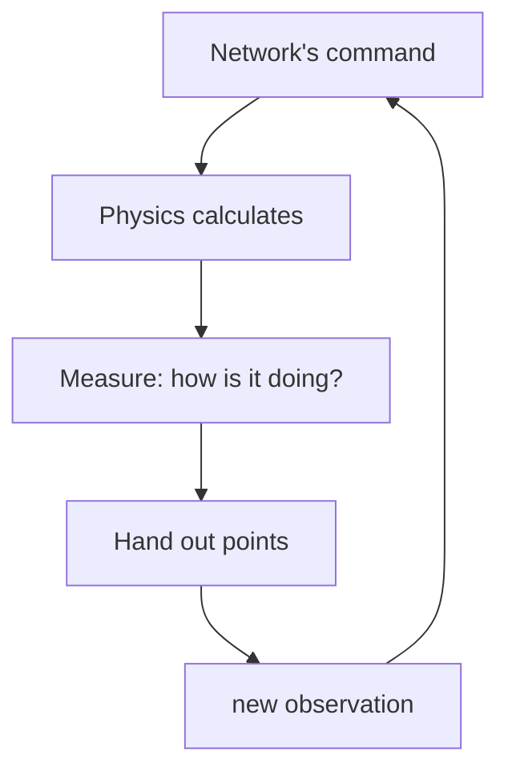
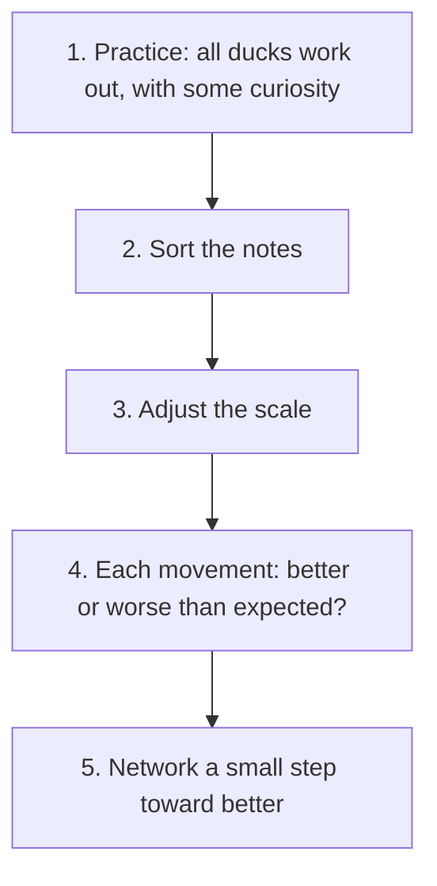

# 14 The Lehrer – A School for the Duck

> **In short:** The Lehrer is Kern's own training school for the Micro Duck. Dozens of simulated
> ducks practice at the same time, are first shown a role model and then try for themselves, until
> randomly set sliders have turned into a network that can jump. Training runs on your own computer
> as well as in the browser, and comes out the same everywhere, down to the last digit.

## What you need to know for this

> **Key terms:**
> - **Neural network** – a mixing desk with a great many sliders: measurements go in, commands for
>   the motors come out. "Learning" means readjusting the sliders.
> - **Servo** – the small motor in each of the duck's joints. It gets a target angle and pulls toward it.
> - **Observation** – everything the duck knows about itself at one moment: how it's tilted, how its
>   joints are positioned, what it last commanded.
> - **Action** – the network's answer: a new target angle for each of the 14 joints.
> - **Tick** – a moment of decision. The duck decides 50 times per second.
> - **Episode** – one practice run, from the start until a fall or until time is up.
> - **Reward** – points the duck gets or loses on every tick. More points means better.
> - **Practice round** – all ducks practice a short stretch, then the evaluator readjusts the sliders
>   once. Experts say **iteration**. Thousands of rounds make a jump.

You don't need any programming knowledge. It helps if you know the duck from
[Chapter 13](13-micro-duck.md): in the Studio it walks on ready-made networks by Pollen Robotics (the
company that built the real robot and its networks). With **F8** you take it over, and with the
**7** key it jumps.

A network can learn in two ways, and the Lehrer uses both:

- **Imitating:** a role model shows what to do in every situation, and the network learns to do it
  the same way – like copying from the answer key.
- **Learning through reward:** nobody tells it the right answer. The duck tries things, gets points,
  and learns what pays off – like a dog that gets treats for tricks. Experts call this
  **reinforcement learning**.

[Appendix A](A-neural-networks.md) explains both step by step. For this chapter, the terms above are
enough; the text explains any others when they come up.

The most important thing first: the duck in the Lehrer is **the same** as in the Studio, with the same
motors, sensors and the same physics. So a network that learns here runs in the Studio without any
rework. It hasn't been tested on the real robot: anyone who loads it onto hardware does so at their own
risk ([Chapter 16](16-calibration.md)). This is how Kern's own networks came about: the jump and the
play layer (the network that decides whether the duck plays with a ball or a sock).

> **For the curious:** The Lehrer is written in C++, the language Kern itself is written in. Most AI
> researchers, by contrast, train with Python tools such as PyTorch. Kern getting by without them
> means: it needs nothing but Kern, and training runs in the browser too.

## 14.1 What's inside?

Today the Lehrer can: simulate ducks without a picture, train a network and save it as a file, let the
ducks practice under changing conditions, deliver the same result everywhere – and it has taught the
duck to jump. The tool for matching the simulated motors to real ones (Chapter 16) is finished too;
only real measurement data is still missing for it. Playing with ball and sock is still being worked
on.

The exact names of the building blocks and files are in the blue book, Chapter 14.

## 14.2 Who does what?

A training run consists of a few roles that are cleanly separated. That lets each role work wherever
there's room at the moment: on several **cores** of a computer (a core is one of the calculating units
in a processor; today's computers have several that work at the same time) or in several **background
processes** of a browser (helpers the browser lets work in the background at the same time).

> **Imagine …** a sports school. The **curriculum** sets what gets practiced. The **task** says what
> earns points. In each **gym**, one duck works out. **Helpers with clipboards** write down
> everything that happens there. The **evaluator** goes through the notes and hands out new
> **instructions**. How many gyms are open at once depends on how many cores are pitching in.

A practice round goes like this: the helpers let all ducks work out with the current instructions and
take notes. The evaluator collects all the notes, goes through them, and writes better instructions.
That's **one** round; thousands make a jump. Before each round, the curriculum also checks whether
it's time for stricter rules ("from now on, a fall costs more").

Computer and browser use the same curriculum, so the same run gives the same network everywhere.

> **For the curious:** The class names of the roles, the training loop in C++, and how the notes are
> sent between cores are in the blue book, Chapter 14.2.

## 14.3 The duck's gym

### One duck, one world

Each duck practices in its **own little world**, without any picture: everything is calculated,
nothing is drawn. That saves time, because nobody needs to see anything while practicing.

For the duck, a tick lasts 1/50 of a second and always goes the same way:

Everything that counts for the points gets measured: tilt, speed, which sole touches the floor,
whether some other body part touches the floor. Only at the very end does the new observation get
small measurement errors, like real sensors have (more on that in a moment).

### The task: what earns points?

A **task** sets what earns points, how long an episode lasts, and when it's over. Each points item
has a name and a weight, meaning how much it counts. That way you can check later what the duck got
its points for – and whether it cheated.

Two tasks are built in. **Stand** is the quick test: stand for 4 seconds. Points come from being
upright, a tidy posture of legs and neck, and the right height; frantic fidgeting costs a little. A
fall costs a lot and ends the episode. The second task is the **jump** (14.6).

### The critic sees more

When learning, **two** networks work together. The **acting network** controls the duck. It only sees
what the sensors deliver, with all their errors – and only this network later goes into the Studio
and the robot. (Experts say "actor"; that has nothing to do with the actors, the things in a Studio
level.) The second network is the **critic**. It doesn't act; it only estimates: "How many points can
still be earned from this situation?" It's only needed while learning and is therefore allowed to see
more: the error-free observation and things no sensor measures, such as how high the torso is above
its starting point or whether the duck has already been airborne.

Because the two see different amounts, this is called an **asymmetric** critic (asymmetric means
unequal).

> **Imagine …** a driving student with fogged-up glasses and a driving instructor with clear
> vision. Later, the student has to drive alone. But while practicing, the feedback is much better
> because the instructor sees more.

### Variation: every duck a little different

If the duck always practiced in the same perfect world, it would learn exactly that world by heart –
and fail at the slightest deviation. That's why the Lehrer rerolls many things in every episode. This
is called **variation** (experts say domain randomization):

- sometimes a more slippery floor, sometimes a grippier one, and the duck starts facing any direction,
- sometimes a slightly heavier body, sometimes the center of mass sits a few millimeters off,
- every motor a bit different: sometimes stiffer, sometimes more sluggish, and commands sometimes
  arrive earlier, sometimes later,
- the sensors are noisy and slightly off, and sometimes a reading arrives one tick late,
- every now and then a shove from the side – but only once the duck has a few hundred practice rounds
  behind it, and gently at first.

Only the acting network feels the sensor errors; the critic still sees clearly.

> **Did you know?** The Lehrer checks every network **twice**: on the clean robot and with full
> variation. A network that can only stand with exactly one weight, one floor and one motor won't
> stand on the real robot.

The randomness is still repeatable: each duck gets its own **starting number** for its dice (the
technical term is **seed**), and the same starting number always gives the same rolls. The starting
number depends only on the run's starting number and the duck's number, not on which core happens to be calculating it. That becomes important
in 14.7. How to measure the spread of real motors is explained in [Chapter 16](16-calibration.md);
the exact ranges are in the blue book, Chapter 14.3.

## 14.4 The networks: starting with a head start

The duck's acting network is a mixing desk with just under **200,000 sliders**: 61 measurements go
in, 14 target angles come out. In between are three **layers**: three mixing desks in a row, each
passing its results on to the next (how that's calculated is shown in Appendix A.1).

**All measurements on a common scale.** Before the measurements go into the network, they're
converted so that each one is roughly the same size. Otherwise a value that happens to be measured in
big numbers would drown out all the others – like a musician who plays much louder than the rest. For
this, the Lehrer keeps a running record of which values are typical (Appendix A.7).

**Warm start: don't begin at zero.** This is the most important principle of this section. The duck
doesn't start the jump with random sliders but with Pollen's finished standing and walking network
"velstand." So it can stand from the very first tick and only has to learn jumping on top.

> **Imagine …** you want to learn a backflip. You don't start out as a baby who first has to learn
> to walk, but as someone who already stands steadily. All the practice time goes into the new thing.

There are two tricks to this:

1. **The scale stays the way it was.** The network also takes over velstand's common scale and keeps
   it fixed. velstand's sliders were set for exactly this volume of the musicians; if you changed the
   volumes, the mix would no longer be right.
2. **The new input starts at zero.** The jump gets a new signal that velstand never saw (the jump's
   clock, 14.6). Like a new slider on the mixing desk that starts all the way down, it changes nothing
   at first. So at the start the duck acts **exactly** like velstand and then gradually learns to use
   the new signal.

The sliders are adjusted with a proven method that remembers which direction it last went in and
therefore makes steady progress (Appendix A.6). Exactly how all of this is calculated is in the blue
book, Chapter 14.4.

## 14.5 Practicing with PPO: small, careful steps

When practicing for points, the Lehrer uses **PPO** – the same method Pollen uses to train the duck's
networks. The name stands for Proximal Policy Optimization; the idea fits in one sentence:
**improve the network in the direction of "better than expected," but never too far at once.** In
Appendix A.11 this is called "improving with a seat belt."

> **Imagine …** you're tuning a radio. If you turn the knob wildly, all you get is static. If you
> turn it a little, listen, and then keep turning, you find the station – and don't lose it again.

A practice round in five steps:

1. **Practice.** Each duck works out for a short stretch. Some randomness is added to each of the
   network's commands. This **noise** is the curiosity: without it, the duck would never try anything
   new.
2. **Sort.** The evaluator puts all the notes into a fixed order, tick by tick and duck by duck, like
   playing cards you always arrange the same way before counting. Who calculated which duck no longer
   matters after that. This is important so that the same result comes out on every device, down to
   the last digit; why even the order matters is explained in 14.7.
3. **Adjust the scale.** The common scale from 14.4 is adjusted to the new notes – unless, as with
   the jump, it was taken over from velstand and kept fixed.
4. **Better or worse than expected?** For each movement, the evaluator compares how many points
   actually came afterward with what the critic had expected. The difference is called the
   **advantage**. Positive means: this movement was better than thought, so more of that. What counts
   isn't only what came right after, but also part of what followed later, because a movement may only
   pay off a few ticks later, like winding up before a jump (technical term **GAE**, Appendix A.11).
5. **Adjust a small step.** The evaluator adjusts the sliders so that good movements become somewhat
   more likely and bad ones somewhat less likely – but per round, a movement becomes at most about a
   fifth more or less likely. It adjusts in several small substeps and measures before each one how
   far the network has already changed; if it's too far, it makes the next steps smaller. The critic
   learns to estimate better along the way too.

**Who lowers the curiosity?** How much the duck tries things out, it learns along with everything
else: as a movement gets more confident, it gets less randomness. A small bonus for curiosity makes
sure the noise doesn't disappear entirely too early and the duck never stops trying new things.

**Why so careful?** The notes come from the **old** network. If the network jumps too far, they no
longer apply, and a good network can break in a single step. After that it collects bad notes it can
hardly recover from.

**Fall or time running out?** An episode can end in two ways, and the evaluator treats them
differently. A **fall** is a real end: no more points come after it. If, on the other hand, **time is
just up**, the duck could have kept standing. Then the evaluator adds the points that would still have
come, as the critic estimates them. Otherwise the duck would learn that standing well suddenly isn't
worth anything at the end of the time.

> **Watch out! Critic first.** For the jump, before practicing for points, the network first learns
> by imitating a role model (14.6 tells that story). After that it can already jump, but the critic
> has no idea what that's worth. If the network learned along right away, the critic's random
> judgments would steer it – and destroy what it had learned. That's why in the first 30 practice
> rounds **only the critic** learns. Only once it estimates sensibly may the network learn along.

> **For the curious:** All the settings (network sizes, learning rates, how many ticks per round, how
> strongly it brakes) and the PPO formulas are in the blue book, Chapter 14.5.

## 14.6 Role model, imitation, practice: how the jump came about

### Why practice alone failed

The first attempts had the duck practice only for points, with many variations. It never found the
takeoff. There were three reasons:

- **The takeoff is too rare.** The duck's motors are like soft rubber bands: they only pull with full
  force when you give them a target far beyond what the joint can do at all. For a takeoff, all leg
  motors have to do that at the same time. Through random trying, that practically never happens.
- **Standing is safe.** Standing reliably earns points; a failed jump attempt ends in a fall. So the
  duck prefers to stay standing.
- **Too little experience per round.** With only a few dozen ducks, each round collects little
  experience. The direction in which the evaluator adjusts the sliders is then uncertain.

> **Imagine …** you want to teach a dog a somersault and only give it a treat when it happens to do
> one. You'll wait forever. If you show it the movement piece by piece, suddenly it works.

That's why the Lehrer teaches in three steps: **find a role model → imitate → practice.** The role
model only exists while learning; the finished duck jumps on its own with its network.

### The role model: a jump in 15 numbers

The role model is a very simple movement plan: five postures one after another – **crouch, push off,
tuck, land, cushion**. For each posture there are three target angles for the left leg (hip, knee,
ankle); the right leg mirrors it. Five times three makes **15 numbers**. The postures blend smoothly
into each other, and everything is limited so that the motors may push with full force but nothing
nonsensical happens. Before and after the jump, velstand keeps the balance.

### Finding the 15 numbers: clever trial and error

Which 15 numbers make a good jump? You can't calculate it – there's a whole physics simulation in
between. You can only try things and see how good the jump turns out. That's done by a search method
called **CMA-ES** (Appendix A.13).

> **Imagine …** at night, with 15 friends, you're looking for the deepest point of a lake, each with
> a plumb line in their own boat. You spread out like a **cloud** around a center point, call out your
> depths, and the center moves to where it was deepest. If you notice that the lake slopes down a long
> way in one direction, you spread out further in that direction. (The same picture is in
> Appendix A.13.)

Each round with 16 attempts is called a **generation**. Each attempt jumps several times, once on the
clean robot and several times with variation, and gets a grade: rising, flight time and height earn
points, tilting and falls cost, staying upright at the end and a real jump earn a bonus. Two rules
keep the search honest:

- **Fair comparison:** all attempts in a generation jump on **the same** robots. But each generation
  gets new ones. That way no role model wins that only works on a few lucky ducks.
- **The center instead of the best:** at the end, the Lehrer doesn't take the best single attempt but
  the center of the cloud of boats. The best single one may simply have been lucky; the center is more
  reliable.

Kern also uses the same search to match the simulated motors to real ones
([Chapter 16](16-calibration.md)).

### Imitating with correction

Now the network should imitate the role model. The simplest way would be: the role model jumps, the
network watches. But that has a trap.

> **Imagine …** you learn to ride a bike only by watching someone who always rides perfectly in the
> middle of the path. Then you ride yourself, drift a few centimeters off – and don't know what to do,
> because you've never seen a situation like that. You correct the wrong way and end up in the bushes.

That's why the Lehrer turns the tables: **the network drives, the role model comments.** In the first
round, the role model still jumps. From the second on, the network jumps itself, and on every tick the
role model says what it would have done at that point. After each round, the network learns from
**all** the examples collected so far. That way it practices exactly the situations it gets itself
into, with the right answer for them. The precondition: the role model must have a sensible answer in
every situation. The method is called **DAgger** (short for "Dataset Aggregation").

After that comes **practice**, and carefully: little curiosity, small steps, critic first (14.5).
There are also points for staying close to the role model. That way what was imitated doesn't get
lost, and the duck learns under full variation to make the jump reliable.

### The jump task

The duck gets only a single signal: a kind of **jump clock**. Picture a clock hand that goes around
once in 2 seconds; the duck gets two numbers saying where its tip is right now: one for left-right,
one for up-down. From that it can tell how far along the jump is. No script, no artificial
forces: the whole movement comes from the network, via the motors' 14 target angles. An episode lasts
2 seconds.

What earns points (the most important items):

| For what | Points |
|---|---|
| being in the air, at the right moment and rising | big plus (only upright) |
| pushing off upward forcefully | big plus (only upright) |
| landing on both soles after the flight | plus (only upright) |
| staying close to the role model | plus |
| standing tilted | big minus |
| fall | one-time minus, stricter over time |

Plus smaller items for a tidy posture, against slipping away, against a second hop, and against
frantic fidgeting.

> **Watch out!** An episode ends on **any floor contact by a body part other than the soles**.
> Otherwise the safest bet would be to prop itself up on its beak or tail. Networks are masters at
> exploiting loopholes.

**Points aren't the same as the test.** Whether a jump really was one is decided by a separate,
strict measurement, independent of the points: all body parts must be in the air for at least 60
milliseconds, the torso must rise by at least 5 mm during that time (just pulling up the feet doesn't
count), the duck may never tilt more than 30°, and at the end it stands upright on both soles. The
points help with learning; the measurement says whether the goal has been reached.

## 14.7 Determinism: the same network everywhere

**Determinism** means: same start, same result – on every device, down to the last decimal place.
That matters so that bugs can be found again. If a duck runs differently on your computer than on
mine, nobody knows whether there's a bug in the program or just in the randomness.

That sounds obvious, but it isn't.

> **Did you know?** Decimal numbers in a computer are tricky: (0.1 + 0.2) + 0.3 doesn't come out
> exactly the same in a computer as 0.1 + (0.2 + 0.3). The difference is in the very last digit. In a
> robot simulation, such a tiny difference is enough for the duck to have a different gait after a
> few seconds.

So Kern takes care of four things:

- **Always the same order.** Every sum is calculated in the same order, no matter how many cores
  (14.2) are helping.
- **Its own math functions.** Built-in math functions, for example for angle calculations, round
  differently in the last digit on different systems. Kern brings its own, which round the same way
  everywhere.
- **No shortcuts when translating.** The translation program that turns the program text into the
  finished program also isn't allowed to combine or shortcut calculation steps. Otherwise it rounds
  differently, and the last digit changes.
- **A starting number per duck.** Each duck's randomness depends only on the run's starting number and
  the duck's number.

That's why: **the same starting number and the same number of ducks give the same network** – on one
core, on 16, or in the browser. More cores only make training faster.

This is checked with a **fingerprint**: a duck walks and turns for 400 ticks, and after each tick a
**checksum** is formed from its exact pose, a kind of digit sum that changes at even the smallest
deviation. If you compare the checksums of two computers, you see right away whether and from which
tick they drift apart. Automatic checks compare this on three kinds of systems, including in the
browser.

> **For the curious:** Which switches are needed when translating, where the math functions come
> from, and which rules apply to new code are in the blue book, Chapter 14.7.

## 14.8 Learning the play layer

The **play layer** ([Chapter 13](13-micro-duck.md)) decides whether the duck goes to the ball or the
sock, kicks, picks up, carries and spits out. Walking itself is still handled underneath by Pollen's
networks; the play layer gives them walking commands and starts a kick or a pickup. It learns like the jump: role model,
imitation, practice. Every scene is different: sometimes a ball, sometimes a sock, sometimes both,
sometimes right in front of the duck, sometimes out of sight, plus variation and a camera that's
sometimes off or briefly recognizes nothing. Points come mainly for a ball kicked away and a sock
carried away and spat out. The Lehrer may calculate the points from the truth, such as how close the
duck came to the real target, because the points only exist while learning. The acting network itself
never sees the truth. When the kick succeeds or the sock has been put down, the practice ends. The
evaluator treats this end like time running out, not like a fall (14.5): after a fall no more points
come, and the duck should fear that. If a success counted the same way, it would learn that kicking is
"deadly" and would rather not do it. Success isn't failure.

**The role model may not know more than the network.** That's the most important principle here. The
role model sees exactly the same observations as the network (13.11), no true positions of ball and
sock. If it knew more, the network could never copy it – it would learn answers it lacks the reasons
for. Simplified, the role model does the following: if it sees nothing, it turns. Otherwise it goes to
the nearer target, approaches slowly, stops, and kicks or picks up. If it's standing wrong, it steps
back a bit and tries again.

Why so roundabout? Pollen's gait can only be stopped, not placed millimeter by millimeter, and from
standing it needs a strong push. That's why the role model approaches slowly along a line and says
"stop" in time. For that, it has to know how far the duck keeps going after "stop."

**Measuring instead of entering numbers.** Where does the sock have to lie for the beak to grip it
well? Instead of writing a number into the program, the Lehrer tries it out: it places the sock at
many spots of a grid in front of a standing duck, has it pick up, and checks whether the sock is still
in the beak after 3 seconds of carrying. It chooses a spot around which many others hold too, because
the approach is never accurate to the millimeter. If the physics changes, it simply measures again.
It also measured how far the duck keeps walking after "stop"; that number, however, is entered as a
fixed value and has to be measured again after a physics change (16.6).

The current play network came from 12 rounds of imitation; the best was round 8, not the last one
(why that's often the case is in [Chapter 15](15-your-own-models.md), 15.4). Results:

| | clean robot | full variation |
|---|---|---|
| Ball kicked away | 9 of 11 | 7 of 11 |
| Sock carried and spat out | 1 of 21 | 0 of 21 |

The **ball has been learned**: the network places the left foot behind the ball and starts Pollen's
kick; if it doesn't fit, it tries again. It approaches the sock in the same way and bites, but the bite
rarely holds in the simulation, and the sock slips out while being carried. So the bottleneck is the **grip in this physics**, not the decision. Next up are a
sock that settles into the beak like fabric, and practicing for points.

> **For the curious:** Scenes, points, the role model's tolerances and the size of the grid are in the
> blue book, Chapter 14.8.

## 14.9 Results of the jump

The finished jump network came from 32 ducks and 3000 practice rounds. It was tested in 40 episodes
each:

| | clean robot | full variation |
|---|---|---|
| real jumps | 40 of 40 | 36 of 40 |
| rise in the air | 11.6 mm | 8.2 mm |
| flight time | 120 ms | 109 ms |
| largest tilt (mean) | 8° | 9° |
| falls | 0 of 40 | 0 of 40 |

11.6 mm is a good centimeter – for a duck the size of the Micro Duck, a decent hop. The four "not
real" jumps were just too flat; the duck never fell.
In the Studio too, the jump worked 3 out of 3 times, with 9 mm of rise and 120 ms of flight, and
afterward the duck kept standing and walking. (The 9 mm comes from this Studio measurement, the 11.6
and 8.2 mm from the test in the Lehrer.)

**Computer versus browser.** Because training calculates the same way everywhere, the browser learns
**the same network**, just more slowly, about 4 to 5 times, because the browser can't use some of the
processor's accelerators. On the test computer with 2 cores, the first real jump in the browser came
after just under 9 minutes, and imitation was finished after about 11 minutes. The practice that
follows takes considerably longer. On your device it may go faster or slower.

> **Try it!** At https://kernengine.de/, open the example level via
> **File › Example Levels › Micro Duck**, start **Play**, take over the duck with **F8** and press
> **7**. What you see is the network from the Lehrer. Pay attention: all feet are briefly in the air,
> and the duck lands upright – exactly what counts as a real jump. It's a small hop, about one
> centimeter high.

> **For the curious:** How many duck steps each phase needed, and the speed table for computer and
> browser, are in the blue book, Chapter 14.9.

## 14.10 The network as a file

Finally, the acting network is saved as a file in the **ONNX** format. ONNX is a standard file format
for networks, like PDF for documents: many programs can read it. Kern saves the network exactly the
way Pollen saves its networks, so the real robot's software can load it too. The common scale from
14.4 is built right into the front of the network, so nobody has to deliver it separately. An
automatic test reads such a file back in and compares it with the network in the Lehrer
(Appendix A.14).

The exact building blocks and labels of the file are in the blue book, Chapter 14.10.

## 14.11 The Lehrer in the browser

On the **Lehrer page** (address: kernengine.de/lehrer/) you can train yourself, without installing
anything. Several of the browser's background processes share the work: some let ducks work out (the
helpers), one learns (the evaluator).

The page is labeled in German. At the top you choose the "Bewegung" (motion): "Sprung" (jump) or
"Stehen (Schnelltest)" (stand, quick test). You can leave the other fields (workers, ducks per worker,
iterations, seed, action noise, learning rate) at their defaults. The page shows continuously how
things stand. The most important readouts:

- **mittlere Episoden-Rückgabe** (mean episode return): the points of a whole episode added up,
  averaged over all ducks. If it rises over many rounds, the ducks are learning. (When learning
  itself, the evaluator calculates with a variant, the **return**: only the points from now on, later
  ones worth a bit less, Appendix A.10.)
- **Aktionsrauschen (std)** (action noise): how much randomness is still added to the commands, the
  curiosity from 14.5 ("std" is short for the technical term standard deviation, a measure of spread).
  It drops as the duck gets more confident.
- **Episodenlänge (s)** (episode length): how long an episode lasts on average. Short means: the ducks
  fall over early. For standing, an episode lasts at most 4 seconds, for the jump 2.
- **echte Sprünge** (real jumps): how many of 5 test jumps on the clean robot were real. That's the
  actual goal.

After imitation, then every 25 rounds, and at the end, the page saves the network **in the browser**
and reports "Für Kern Studio gespeichert als …" (saved for Kern Studio as …). Open Studio tabs in the
same browser take over a new jump network immediately. With ".onnx herunterladen" (download .onnx)
you get the file. The play layer can't be trained in the browser.

> **Try it!** Open **kernengine.de/lehrer/**, choose "Stehen (Schnelltest)" and press **Start**. At
> the beginning the sliders are random and the ducks fall over quickly: the episode length is short.
> Watch how it grows over the rounds, toward 4 seconds – then the ducks no longer fall over. You don't
> have to wait until the end; **Pause** stops it. You train the jump in
> [Chapter 15](15-your-own-models.md).

> **For the curious:** How the page is built, how it stores the network in the browser, and how it
> notifies open Studio tabs is in the blue book, Chapter 14.11.

## 14.12 Tests

About a dozen automatic checks make sure everything calculates correctly: from learning itself through
"the same network everywhere" to a real jump in the Lehrer **and** in the Studio. The list is in the
blue book, Chapter 14.12.

## What you take away

- The Lehrer is Kern's own training school: on the computer and in the browser, everywhere with
  exactly the same result.
- The duck in the Lehrer is the same as in the Studio, so a network runs there without any rework.
- The acting network sees only faulty sensors, the critic sees more. Only the acting network goes onto
  the robot.
- Variation makes things robust; testing is always done clean **and** with variation.
- Warm start: the duck begins with a network that can already stand.
- Practicing means: in small, careful steps toward "better than expected" – and after imitation, the
  critic learns first.
- The jump came about like this: a role model found through clever trial and error, then imitated,
  then practiced. Points help with learning; a strict measurement checks the result.
- The play layer already kicks the ball well; for gripping the sock, the physics is the bottleneck.

## Brain teasers

1. Why may the critic see things no sensor measures, but the acting network may not?
2. A standing episode ends after 4 seconds without a fall. Why doesn't the Lehrer act as if no more
   points come afterward?
3. Why does the role model search take the center of the cloud of boats at the end, and not the best
   single attempt?
4. You run the same run once with 2 and once with 8 cores. What has to stay the same for the same
   network to come out?
5. Why does a jump episode end as soon as the beak touches the floor?

### Solutions

1. The critic is only needed while learning and never goes onto the robot. There, the acting network
   has to get by with the real, faulty sensors.
2. Time running out isn't a failure; the duck could have kept standing. The points that would still
   have come are estimated. Only after a fall does nothing more really come.
3. The grades fluctuate due to randomness; the best single one may have been lucky. The center is more
   reliable.
4. The starting number and the total number of ducks. The number of cores only changes the speed.
5. Otherwise the network learns that propping itself up reliably earns points, instead of jumping.

---

© 2026 Christian Heinrich Hohlfeld · All rights reserved · [Imprint and rights](00-imprint.md)
