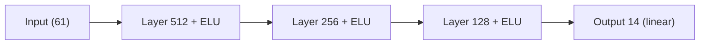
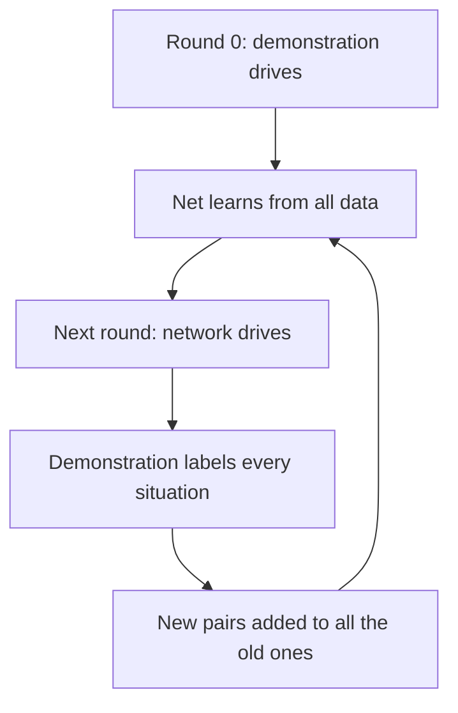
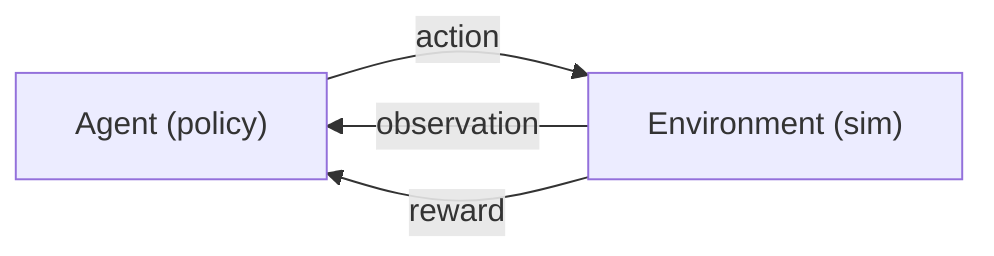
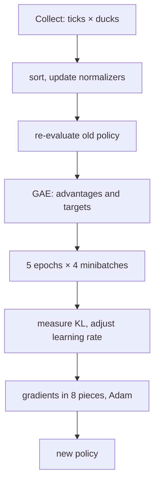
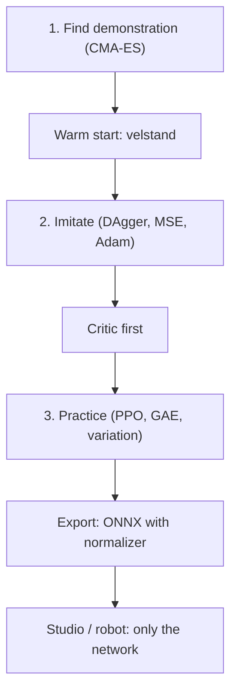

# Appendix A – How Machines Learn: Networks, Imitation, Reward

> **In short:** This appendix explains, without a math degree, how a neural network works, how it
> learns by copying and by reward, and why the Micro Duck can jump in the end. All you need is basic
> arithmetic and a bit of curiosity. Every concept comes first in general, then with an example,
> then with the place where Kern uses it.

How Kern's Lehrer puts all of this into practice is in [Chapter 14](14-lehrer.md), how you train
yourself is in [Chapter 15](15-your-own-models.md). The code lives in `src/lehrer/`.

## A.1 What a neural network is

### A mixing board with lots of knobs

> **Imagine …** a giant mixing board. Signals come in at the front, music comes out at the back. In
> between sit thousands of knobs. At first they are set at random, and it sounds awful. "Learning"
> means adjusting the knobs until the right thing comes out.

A neural network is exactly that kind of mixing board; mathematically, it is a function: numbers
in, numbers out. For the Micro Duck, **61 numbers** go in (orientation of the torso, joint angles,
joint velocities, the last action, commands) and **14 numbers** come out: the targets for the 14
servos. The knobs are called **parameters** (weights and biases). Nobody sets them by hand; they are
learned. What counts as "right" is defined by a number that should become as small as possible: the
loss (A.3).

### The neuron

The smallest building block is the artificial **neuron**. It does three things:

1. Multiply each input by its **weight** (how much does it count? can also be negative).
2. Add everything up and add a **bias** (a kind of baseline setting).
3. Send the result through an **activation function** that "bends" it.

```
 x1 ──w1──┐
          ├──► sum + b ──► z ──► ELU(z) ──► output
 x2 ──w2──┘
```

**Let's work one out.** Two inputs x₁ = 0.5 and x₂ = −1, weights w₁ = 2 and w₂ = 0.5, bias b = 0.1:

- Sum: 2 · 0.5 + 0.5 · (−1) + 0.1 = 1 − 0.5 + 0.1 = **0.6**
- The ELU activation leaves positive numbers unchanged: output **0.6**.

Now we turn only the bias: b = −0.9. The sum becomes 1 − 0.5 − 0.9 = **−0.4**. For negative numbers,
ELU computes e^z − 1 = e^(−0.4) − 1 ≈ 0.670 − 1 = **−0.330**. A single knob has flipped the answer.
That is exactly how a network learns: it turns thousands of knobs by a tiny amount.

### Layers and the MLP

Many neurons side by side that see the same inputs form a **layer**. Several layers one after the
other make a **multilayer perceptron** (MLP). Kern builds the jump actor like this:



The last layer is **linear**, without activation, because servo targets may be any number. How many
knobs is that? A layer from n to m neurons has n · m weights and m biases:
61 · 512 + 512 · 256 + 256 · 128 + 128 · 14 = **196,864 weights**, plus **910 biases**, for a total
of **197,774 parameters**. Almost 200,000 knobs! In Kern's recipes, the critic has the shape
(256, 128), and the play layer's network is 23 → 256 → 128 → 9.

In Kern, this is `Mlp` in `nn.h`. All parameters sit in a single long vector, the weights stored
"input by input" – [Section 14.4](14-lehrer.md) explains why.

### Why the activation matters so much

Without activation, a deep network would be useless: linear calculations one after another are
again a linear calculation. A hundred layers could then do no more than one. Only the "bending"
allows curved relationships such as "bend the knee more the faster the torso tips, but only up to
the limit."

Kern uses **ELU**, like the library rsl_rl, which Pollen Robotics uses to train the Micro Duck's
networks:

| z | ELU(z) | z | ELU(z) |
|---|---|---|---|
| −4 | −0.98 | 0 | 0 |
| −1 | −0.63 | 1 | 1 |
| −0.4 | −0.33 | 2 | 2 |

On the right, ELU is a straight line; on the left, it bends gently and approaches −1. Unlike the
widespread ReLU (simply 0 on the left), there is no "dead" zone in which a neuron stops learning.
In code, it is one line:

```cpp
y[k] = y[k] > 0 ? y[k] : kern::dm::expm1(y[k]);  // ELU
```

If the value is positive, it stays; otherwise e^z − 1 is computed. `expm1` does this accurately
even for tiny numbers, and `kern::dm` is Kern's own math library, which computes bit-identically on
every device (A.11).

### The start: random, but small

Setting all knobs to 0 would be fatal: all neurons of a layer would compute the same thing, get the
same correction and stay **twins** forever. That's why they are drawn at random, and small enough
that the sums don't explode from layer to layer. Kern does it like PyTorch: uniformly distributed
between −1/√n and +1/√n, where n is the number of inputs. With 61 inputs, that's about ±0.128. For
the last layer there is an extra factor (`output_gain`) that can keep the first outputs small.

## A.2 The forward pass

"Forward" means computing layer by layer, from the input to the output, usually for a whole stack
(**batch**) of inputs at once; Kern computes four rows at a time. For learning, the forward pass
remembers all intermediate results (the **cache**); when merely acting, it doesn't.

The innermost loop always runs over weights that sit right next to each other in memory, and
computes "y plus a times x." That way the compiler can speed it up **without changing the order of
the additions**. That is exactly why the weights are stored input by input: otherwise the compiler
would have to reorder sums, and reordered floating-point sums are no longer bit-identical (A.11).

## A.3 The loss: how bad am I right now?

For a network to learn, it needs a number that says how wrong it is: the **loss function**. The
smaller, the better.

The classic is the **mean squared error** (MSE): for each output, take the distance to the target
value, square it, average everything. Example: the network says (0.5, 2), the right answer would be
(1, 1). Errors: (0.5 − 1)² = 0.25 and (2 − 1)² = 1, average **0.625**. Squaring has two advantages:
minus and plus count the same, and large errors count extra.

In Kern, imitation uses exactly this loss (`Ppo::imitate`), and the critic also learns with a
squared error (A.11).

> **Imagine …** the loss is a landscape. Every setting of the knobs is a place, and the loss is the
> altitude. You want to get to the deepest valley. But the landscape has almost 200,000 directions,
> and there is no map. You are standing in **thick fog** and can only feel how steep the ground under
> your feet is.

## A.4 Gradient descent: downhill in the fog

### The basic idea

The slope under your feet is called the **gradient**. It points uphill. So you take a step in the
opposite direction:

```
new knob = old knob − learning rate × gradient
```

The **learning rate** is the step length. An example with just one knob θ and the loss θ² (a
valley with its lowest point at 0). The gradient is 2θ.

| Step | Learning rate 0.1 | Learning rate 1.1 |
|---|---|---|
| Start | 1 | 1 |
| 1 | 1 − 0.1 · 2 = 0.8 | 1 − 1.1 · 2 = −1.2 |
| 2 | 0.64 | 1.44 |
| 3 | 0.512 | −1.728 |

With 0.1, you walk obediently into the valley. With 1.1, you jump over the valley every time, land
higher than before and swing further and further. Steps that are too small, on the other hand, barely
make progress. That makes the learning rate one of the most important knobs of all.

### Minibatches and epochs

Computing the exact gradient over **all** examples is expensive. So you estimate it from a random
handful, a **minibatch**, and take many small steps (stochastic gradient descent). The estimate is
noisy, and small minibatches are noisier. That is exactly what slowed down the jump training with
only a few dozen ducks. One pass through all the data is called an **epoch**. Kern shuffles the
order with its own random number generator.

### The emergency brake

A single outlier can produce a huge gradient and ruin the network in one step. That's why the
**length** of the whole gradient is limited: if it is larger than 1.0, it is clipped to 1.0. The
direction stays the same. In Kern, this brake sits in `Adam`; it measures the length in double
precision and, for the actor, over the network weights **and** σ together.

## A.5 Backpropagation: whose fault is it?

For each of the 200,000 knobs, we need the gradient: "If I turn this knob a little, how does the
loss change?" Nudging each knob individually and recomputing would mean doing the whole calculation
200,000 times. **Backpropagation** manages it in a single backward pass.

> **Imagine …** a relay race has been lost. The coach asks the anchor runner: "How much did you
> lose?" She answers and passes the question on to the runner before her, in proportion to that
> runner's contribution. That way the blame travels from the finish back to the start, and in the
> end every runner knows what she needs to improve.

Mathematically, this is the **chain rule**: the error at the output is passed backward layer by
layer, each time combined with the weights and the slope of the activation.

### Worked out by hand

A mini network: one input x, one ELU neuron, one linear output y, loss (y − t)².
Starting values: x = 1, target t = 1, w₁ = 0.5, b₁ = −1, w₂ = 2, b₂ = 0.5.

**Forward:** z = 0.5 · 1 − 1 = −0.5. h = ELU(−0.5) = e^(−0.5) − 1 ≈ −0.393. y = 2 · (−0.393) + 0.5
≈ −0.287. Loss (−0.287 − 1)² ≈ **1.656**. Pretty far off.

**Backward:**

| What | Calculation | Value |
|---|---|---|
| Error at the output | 2 · (y − t) | −2.574 |
| Blame of w₂ | −2.574 · h | 1.013 |
| on to h | −2.574 · w₂ | −5.148 |
| Slope of the ELU | h + 1 | 0.607 |
| Blame of w₁ and b₁ | −5.148 · 0.607 | −3.122 |

The slope of the ELU in the negative range is e^z, and that is exactly h + 1. So you only need the
neuron's output. Kern uses this trick too.

**One step downhill** with learning rate 0.1: w₂ becomes 1.899, b₂ becomes 0.757, w₁ becomes 0.812,
b₁ becomes −0.688. **Forward once more:** z = 0.124 (now positive), y ≈ 0.994, loss ≈ **0.00004**.
Here, a single step has almost eliminated the error. In real networks with many examples that
contradict each other, progress comes in tiny steps.

In Kern, `Mlp::backward` does this. The gradients are **accumulated** so that parts of a batch can
be computed on different threads and summed afterward. Whether everything is right is checked by a
test with **finite differences**: turn a knob up and down by a minimal amount and see how the loss
changes.

## A.6 Adam: the clever hiker

Plain gradient descent has two weaknesses: all knobs get the same step size, even though some
gradients are huge and others tiny, and it reacts nervously to noise. **Adam** (Kingma and Ba, 2015)
keeps two moving averages for each knob:

- the usual **direction** (smoothed gradient, "momentum"),
- the usual **size** (square root of the smoothed squared gradient).

The step is then roughly learning rate × direction / size. That way, every knob takes steps of
similar size, no matter how large its numbers are.

**Example:** in the very first step, after Adam's initial correction, direction = g and size = |g|.
So the step is exactly ± learning rate, **whether the gradient is 0.000001 or 1000**. Like a hiker
in the fog who always takes steps of the same size and only pays attention to the direction.

Kern uses PyTorch's default values (smoothing 0.9 and 0.999, learning rate 10⁻³). Actor, critic and
imitation each have their own Adam (the one for imitation is fresh, so that its momentum doesn't
carry over into the later PPO), and its memory goes into the checkpoint: a resumed run takes exactly
the steps an uninterrupted one would have taken.

## A.7 Normalization: everyone on equal footing

The 61 inputs have very different sizes: angles around tenths, joint velocities in the double
digits, the direction of gravity between −1 and 1. The large inputs would dominate the sums and slow
down learning. That's why each input is converted to mean 0 and spread 1:

```
normalized = (x − mean) / (spread + 0.01)
```

**Example:** a joint velocity has a mean of 2 and a spread of 4. The value 10 becomes
(10 − 2) / 4.01 ≈ **2.0**: "two spreads above the usual." The 0.01 prevents a division by zero for
inputs that are almost constant.

Because a better duck experiences different states, the mean and spread are updated continuously.
An exact formula (Chan's algorithm) is enough for that, needing only three numbers per input.

Important: **the normalizer belongs to the network.** Without exactly this conversion, the network is
worthless, which is why it sits at the very front of the exported network (A.14) and travels with
the policy to every collector. In a warm start, it is frozen; new inputs get mean 0, divisor 1 and
weight 0, so that the network initially acts exactly like the old one
([Section 14.4](14-lehrer.md)).

The learner updates the normalizers once per iteration with all collected observations and then
re-evaluates the old policy **with the new** values. With only a few dozen ducks, they would
otherwise drift noticeably, and PPO's ratios (A.11) would be distorted.

## A.8 Memorizing versus understanding

A network with 200,000 knobs can **memorize** a small amount of data: perfect answers to the
practice problems, nonsense on new ones. This is called **overfitting**. Remedies: more and more
varied data, testing on data that was never used for learning, stopping in time (taking the best
network, not the last one) and smaller networks.

In robotics, overfitting usually means: the network has tuned itself to **exactly this
simulation**. The remedy is variation (A.12); Kern checks every network clean **and** with
variation, and picking the best round is "stopping in time."

## A.9 Learning by copying

### Supervised learning and behavior cloning

In **supervised learning**, there is a right answer for every input, like a workbook with the
answers in the back. The network minimizes the error, done. In robotics, the "right answer" is the
action of an expert: you have the expert demonstrate, write down pairs (what it sees, what it does)
and train the network on them. This is called **behavior cloning**. In Kern, the expert is called
the **demonstration**.

### The trap: distribution shift

> **Imagine …** you learn to ride a bike only by watching someone who always rides perfectly down
> the middle of the path. Then you ride yourself, drift a few inches off the path – and don't know
> what to do, because you've never seen a situation like that. You correct the wrong way, drift even
> further off, and end up in the bushes.

```
 Demo:     ●──●──●──●──●──●──●   (always in the middle)
 Clone:    ●──●──●─╲
                    ●─╲          small error → unknown situation
                       ●──╲      → bigger error → ...
                           ●  fall
```

This is called **distribution shift**: while driving, the network itself produces states it never
saw during learning. Researchers have shown that the total error can then grow with the **square**
of the episode length instead of just with the length.

### DAgger: the student drives, the teacher comments

**DAgger** (Ross, Gordon and Bagnell, 2011) turns the tables. The student drives itself, and at
every moment the demonstration says what **it** would have done.



That produces data exactly where the student really ends up, with the right answer for it. In
Kern, the network drives from round 1 on with a little noise (0.05), so that situations just next
to its path come up as well; after each round it learns from **all** examples (10 epochs, minibatch
256, learning rate 10⁻³). For the jump, the network makes its first real jump after 7 rounds. The
play layer learns the same way. The demonstration is called `JumpTeacher` for the jump and
`PlayEnv::teacher` for playing.

One condition is what makes DAgger possible at all: the demonstration may only see what the network
sees, and must not have any hidden memory. An answer that depends only on the observation can be
learned exactly by a network; one that depends on something hidden cannot.

## A.10 Learning by reward

Behavior cloning needs an expert. If there isn't one, or if the network should become better than
the expert, **reinforcement learning** (RL) helps.

> **Imagine …** dog training. You don't tell the dog how to move its muscles. It tries something,
> and if it was good, it gets a treat. Over time, it does more often what earns treats.

### The loop



The **agent** (the duck with its network) sees an **observation**, chooses an **action**, and the
environment responds with a new observation and a **reward**. In Kern, the environment is an `Env`;
in `DuckEnv`, one step is one control tick of 20 ms (50 per second).

A step (`step`) delivers the reward and whether the episode ended with a fall or by running out of
time.

Experts call this a **Markov decision process**: states, actions, a physics that determines the next
state, rewards. "Markov" means: what happens next depends only on the now, not on the history.

### State versus observation

The duck does not know its state completely. It only sees what its sensors report, with noise and
delay: joint angles, gyro, direction of gravity, its last action, commands. It does **not** see its
true height above the ground or its velocity in space. The last action in the observation acts like
a small memory. Experts call this "partially observable" (POMDP). How much the sensors are noisy and
delayed is set by `Task::Noise` (numbers in [Chapter 14](14-lehrer.md)).

### Reward and return

The **reward** is one number per step and the only place where you tell the agent what it should
do. And it takes it **literally**.

> **Watch out!** In early runs, the duck learned to sit on its tail, do dives or prop itself up –
> because the reward allowed it. Every loophole had to be closed with a stricter rule
> ([Section 15.11](15-your-own-models.md)).

In Kern, `Task::reward` delivers the reward, following the mjlab convention, as a sum of weight ×
term × tick duration; the individual terms stay visible for reports.

The **return** is the sum of all future rewards. So that it doesn't become infinite, later rewards
count less: each step into the future multiplies by the **discount factor** γ. Kern uses γ = 0.99.
A reward 100 steps away then counts only 0.99¹⁰⁰ ≈ 0.37 times as much, and 300 steps away only
about 0.05 times. So the duck "looks" roughly 100 ticks ahead, which is 2 seconds: exactly as long
as a whole jump.

> **Did you know?** The return can be computed backward: return now = reward now +
> γ × return from the next step on. Almost everything that follows builds on this one line.

### Policy, value and advantage

The **policy** is the decision rule: observation in, action out. For learning, it is **random** (it
rolls the dice around a mean); on the robot, only the mean is used.

The **value** V of a situation says: "How much return do I expect from here?" The **action value**
Q says: "How much return do I expect if I first choose exactly this action and then carry on as
usual?" The **advantage** of an action is Q minus V, so: "Was it better or worse than what I usually
do here?" Positive means better. That is exactly what learning needs: do more of what was better
than usual.

A simple estimate of the advantage from one step is the **TD error**: what happened (reward plus the
value of the new situation times γ) minus what was expected (value of the old situation).

### Fall or timeout?

An episode can end in two fundamentally different ways. With a **fall**, there is no future; its
value is 0. With a **timeout**, the duck would still be standing; the time limit is just a property
of the training. If you treat both the same, you teach the network that effort shortly before the
end is pointless. That's why Kern tells them apart and, on a timeout, includes an estimate of the
value of the future ("bootstrapping").

### How does the policy learn? The policy gradient

The reward depends on the action through the physics, and the physics cannot be differentiated. The
trick: you differentiate only the **probability** of the chosen action. If an action had a positive
advantage, you make it more likely; if negative, less likely. For that, the policy has to roll the
dice.

Kern rolls the dice with a **bell curve** (normal distribution) per servo: action = mean from the
network + σ × random number. σ is a separate, learnable knob per action: large at the start (lots
of trying things out), smaller later. For the jump, it starts at 0.3 and is set to 0.1 after
imitation, so that a network that can already jump doesn't unlearn everything. The lower limit is
0.001, and the default without a recipe is 1.0. Each duck rolls with its **own** random stream,
which depends only on the seed and its number, never on which worker computes it.

### Entropy: keeping curiosity alive

**Entropy** measures how uncertain a distribution is. For the bell curve, it depends only on σ:
σ = 1 gives 1.419 per action, σ = 0.1 gives −0.884 (for continuous distributions, entropy may be
negative). Without a countermeasure, σ often shrinks too fast, the duck stops trying things out and
gets stuck on the first halfway usable solution. A small **entropy bonus** in the loss keeps it
curious (Kern: 0.01, for the jump 0.005).

## A.11 Actor, critic and PPO

### Two networks, one team

For the advantage, you need the value V. A second network estimates it: the **critic**. The network
that acts is called the **actor**. Both learn at the same time: the critic learns to predict
returns; the actor learns from the advantages the critic works out. Each has its own normalizer and
its own Adam.

After imitation, the actor is already good, but the critic knows nothing; its judgments would be
random. That's why in Kern, **only the critic** learns at first (30 iterations).

### GAE: the advantage, well estimated

The TD error of a single step is not very noisy, but it is skewed if the critic is wrong. The full
return is very noisy, but honest. **GAE** (Generalized Advantage Estimation) mixes both with a
second knob λ: you go backward through time, and each advantage is its own TD error plus γ · λ
times the advantage of the next step. Kern uses λ = 0.95, so γ · λ = 0.9405. With λ = 0, only the TD
error would remain; with λ = 1, the full return.

**Let's compute three steps:** rewards (1, 0, 2), values V = (5, 4, 6), value afterward 3.

| t | TD error | Advantage | Critic's target |
|---|---|---|---|
| 2 | 2 + 0.99 · 3 − 6 = −1.03 | −1.03 | 4.97 |
| 1 | 0 + 0.99 · 6 − 4 = 1.94 | 1.94 − 0.9687 = 0.9713 | 4.9713 |
| 0 | 1 + 0.99 · 4 − 5 = −0.04 | −0.04 + 0.9135 = 0.8735 | 5.8735 |

On its own, step 0 looked slightly bad, but overall it was **good**: it led into a situation from
which things went better than expected. The critic's target is always advantage plus value. In
Kern, that's three lines:

```cpp
const f32 delta = reward + live * cfg_.gamma * next - v;
adv = delta + live * cfg_.gamma * cfg_.lam * adv;
return_buf_[row] = adv + v;
```

Line 1 is the TD error, line 2 the GAE backward sum, line 3 the critic's target. `live` is 0 after
an episode has ended; then there is no continuation. For the last step of the rollout, the critic
estimates the value where each duck is currently standing. Finally, all advantages are brought to
mean 0 and spread 1, so that their size doesn't depend on the size of the rewards.

### Why steps that are too big are dangerous

The data comes from the **old** policy. If you take a big step, the new policy is far away, the
advantages no longer apply to it, and a good policy can break in a single step. Then it collects bad
data from which it barely recovers. Several epochs on the same data – actually handy, because you
make better use of the data – make it even worse.

### PPO: improving with a seatbelt

**Proximal Policy Optimization** (Schulman and others, 2017) limits how far the policy may move per
update. The key is the **ratio** ρ: how much more likely is the new policy to choose the collected
action than the old one? ρ = 1 means "the same." PPO allows improvements only until ρ leaves the band
from 0.8 to 1.2 (clip ε = 0.2):

| Advantage | Ratio | Keeps learning? | Meaning |
|---|---|---|---|
| positive | up to 1.2 | yes | reinforce a good action |
| positive | above 1.2 | **no** | reinforced enough already |
| negative | from 0.8 | yes | weaken a bad action |
| negative | below 0.8 | **no** | weakened enough already |

**Example:** advantage 1, ρ = 1.3. Unbraked, the gain would be 1.3; braked, 1.2. PPO takes the more
cautious value, and because that one is stuck at the cap, no gradient flows: the step that would
push even further in this direction doesn't happen.

> **Did you know?** PPO is pessimistic on purpose. Improvements are capped, deteriorations never.
> If the new policy chooses a **bad** action more often than before (advantage negative, ρ = 1.3),
> that always gets corrected.

In addition, like rsl_rl, Kern regulates the **learning rate** via the **KL divergence**, a measure
of how different the old and new policies are: if it is larger than 0.02, the learning rate is
divided by 1.5; below 0.005, it is multiplied by 1.5, always between 10⁻⁵ and 10⁻². Big steps when
things are calm, small ones when the policy is jumping around.
The critic has a brake too: its estimate may move only by ε away from the old value per update.

### A whole PPO update



Kern's default values: 24 ticks per duck (jump 48), 5 epochs, 4 minibatches, clip 0.2, γ = 0.99,
λ = 0.95, learning rate 10⁻³ (jump 10⁻⁴).

Collecting and learning are kept separate in Kern: collectors only need the policy and deliver
rollouts; the learner takes all the rollouts. That's why the collectors can be threads or Web
Workers.

### The same result on every computer

Floating-point numbers in a computer are tricky: (0.1 + 0.2) + 0.3 does not give exactly the same
result in the computer as 0.1 + (0.2 + 0.3) – they differ in the last bit. If you sum gradients in
an order that depends on the number of threads, you get different networks on 2 and 16 cores. Kern
prevents that:

- Each duck gets its seed from its global number.
- All rollouts are put in a fixed order, and summing always happens in a fixed order (each
  minibatch in exactly 8 pieces).
- All math functions come from `kern::dm`.
- No FMA: the compiler may not merge "a times b plus c" into a single instruction that rounds
  differently depending on the processor.

The result: same seed, same number of ducks, same network, natively as well as in the browser
([Section 14.7](14-lehrer.md), [Appendix C](C-physics.md)).

## A.12 From simulation to reality

A network trained in simulation meets a robot that is different: inaccurately measured masses,
servos that vary, changing floors, noisy sensors. Bridging this **sim-to-real gap** is the core task
of robot learning. Two strategies complement each other:

1. **Bring the simulation closer to reality:** accurate models calibrated against measurements
   ([Chapter 16](16-calibration.md)).
2. **Make the network insensitive:** it learns in many slightly different worlds, so that the real
   one is just one more. That is **domain randomization**. Everything Kern varies is listed in
   [Section 14.3](14-lehrer.md).

> **Imagine …** you practice table tennis sometimes with a heavy ball, sometimes with a light one,
> sometimes on a slippery floor, sometimes on a grippy one, sometimes with glasses, sometimes
> without. On tournament day, you don't care what the hall is like.

Two subtleties: some variation only comes in gradually (**curricula**), because too much chaos at
the start prevents the movement from emerging at all. For the jump, the center-of-mass spread grows
from iteration 200 over 600 iterations, and the pushes come from iteration 300 on. And whatever
can't be measured accurately is **varied**, so that the network doesn't rely on it: the servo
profile has a spread next to each value, and training draws each servo from it.

On top of that come the **asymmetric critic**, which may see more during learning than the robot
(9 extra values for the jump, 6 for the play layer), and the **warm start**: Kern's jump begins as
Pollen's velstand network, so it can already stand and only has to learn the jump in addition. For
this, its weights are re-sorted from the ONNX layout into Kern's input-by-input layout.

## A.13 Searching without a gradient: CMA-ES

Some problems have no usable gradient. For the jump demonstration, 15 numbers are the input and a
whole simulation with flight, landing and fall is the evaluation; noisy, because each generation
faces different robots. In calibration, 6 servo parameters are to be chosen so that the simulation
reproduces measurements.

This is where **evolution strategies** help: roll candidates around a center point, evaluate them,
shift the center point toward the better ones. **CMA-ES** (after Hansen) also learns the **shape**
of the cloud of samples:

```
 Generation 1          Generation 5            Generation 20
   ·  ·   ·              · ·                      ·
  ·  ●  ·  ·            ·●··                     ●:
   · ·  ·               ·  ·  ↗                  (narrow, along
  (round, large)       (stretched toward valley) the valley)
```

Roughly, per generation:

1. Draw candidates from the cloud and evaluate them.
2. The better half gets weights, the best ones the most.
3. The center point moves to their weighted mean.
4. The step size grows when several generations went in the same direction, and shrinks when the
   steps cancel each other out.
5. The cloud stretches in the directions where things went well.

Kern wrote CMA-ES itself following Hansen's tutorial (`cmaes.cpp`). Without a setting, it uses
4 + ⌊3 · ln n⌋ candidates (for 6 parameters that would be 9); calibration uses 12, the
demonstration search 16. The starting point
is evaluated first, so the result is never worse. All candidates of a generation are evaluated in
parallel. What comes back is the best point **and** the center point, and with noisy scores the
center point is the better answer: the best one may just have been lucky. CMA-ES also computes with
Kern's own randomness and `kern::dm`, so it is reproducible. The exact formulas are in the blue
book.

For the demonstration, CMA-ES searches freely across the whole number space; only tanh times the
amplitude turns that into servo targets, which therefore always stay within ±2.5 rad. Each
candidate jumps 6 episodes (one clean, five with variation), all candidates of a generation on the
same robots.

## A.14 ONNX: the network to go

**ONNX** is an open file format for computation graphs. A model is a chain of building blocks
(operators) with the weights as constants in the same file. Programs such as ONNX Runtime run it, on
the robot, in the browser or on the server, without knowing the software that trained it. For an
MLP you need only four: `Sub` and `Div` (the normalization), `Gemm` (a layer: weights times input
plus bias) and `Elu`.

```
obs ─► Sub ─► Div ─► Gemm ─► Elu ─► … ─► Gemm ─► actions
```

Kern writes the file with its **own tiny writer** for the Protobuf format, without a library, in
the same format as Pollen's networks (61 in, 14 out).
Only the **mean** of the policy is exported: on the robot, there is no more trying things out; σ
and the critic stay in the learner. For this, the weights are re-sorted as [output][input], and the
metadata carries the same keys as with Pollen plus `task` and `lehrer`. A test reads the file back
in and compares to an accuracy of 10⁻⁴, and ONNX Runtime loads it too. More in
[Section 14.10](14-lehrer.md).

## A.15 How it all comes together



The guiding principle is in Kern's code: "At run time there is only the network: the demonstration
exists only while it learns." Demonstration, critic, noise, variation – all of it is **scaffolding**
that helps during learning and is taken down afterward. What remains is a normalization and a
handful of matrix multiplications with ELU in between. And that's enough to make a duck jump.

> **Try it!** On https://kernengine.de/, open the Micro Duck level (File › Example Levels ›
> Micro Duck), start Play, take control with F8 and press **7**. At that moment, every servo gets a
> number 50 times per second from just under 200,000 knobs that were once pure chance.

> **Try it!** On the Lehrer page (`/lehrer/` on kernengine.de), you can follow the learning live.
> Set the initial noise large once and small once, and compare the curves: curiosity versus
> caution.

## What you take away

- A neural network is a mixing board with lots of knobs: weighted sums plus activation, layer by
  layer. The jump actor has 197,774 knobs.
- Learning means making the loss smaller: downhill in the fog, with the learning rate as the step
  length.
- Backpropagation distributes the blame backward; Adam takes even, clever steps.
- Normalization puts all inputs on equal footing and is a fixed part of the network.
- Imitation needs DAgger; otherwise small errors build up.
- Reinforcement learning learns from reward, and the reward is taken literally.
- PPO improves with a seatbelt: small, safe steps, with a critic estimating the advantage.
- Variation, curricula and the asymmetric critic build the bridge from simulation to reality.

## Brain teasers

1. A neuron has x₁ = 1, x₂ = 2, w₁ = 0.5, w₂ = −1, b = 1. What does it output with ELU?
2. Why would a network without an activation function and with 100 layers be no smarter than one
   with a single layer?
3. You train with learning rate 1.1 on the loss θ². What happens?
4. With γ = 0.99: how much does a reward 100 steps away count compared with one right now?
5. PPO: advantage −1, ratio ρ = 1.3. Does this still get corrected?

### Solutions

1. Sum: 0.5 − 2 + 1 = −0.5. ELU: e^(−0.5) − 1 ≈ −0.39.
2. Linear calculations one after another are again a linear calculation; only the activation
   allows curved relationships.
3. The value jumps over the valley every time and keeps getting bigger: 1, −1.2, 1.44 …
4. About 0.37 times as much.
5. Yes. The new policy chooses the bad action more often; PPO only caps improvements, never
   corrections of deteriorations.

---

© 2026 Christian Heinrich Hohlfeld · All rights reserved · [Imprint and rights](00-imprint.md)
