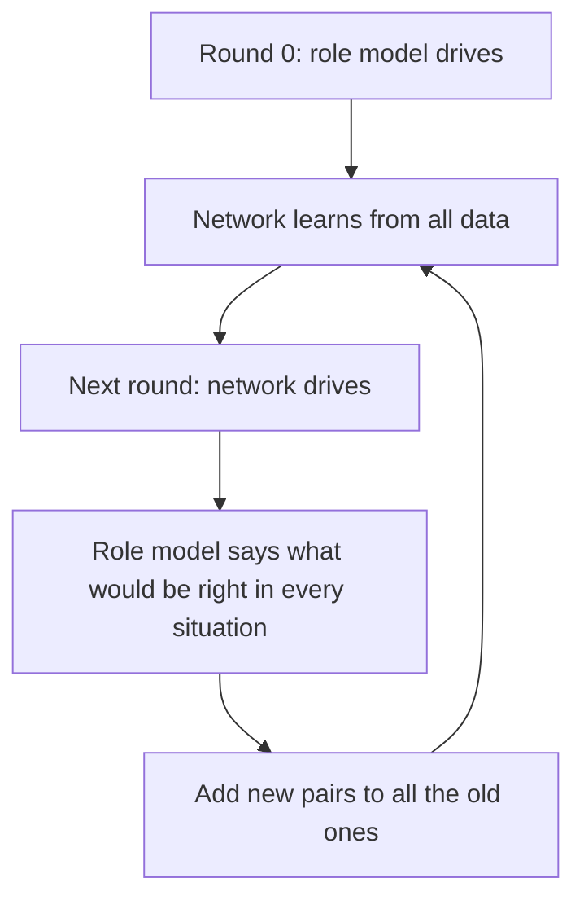
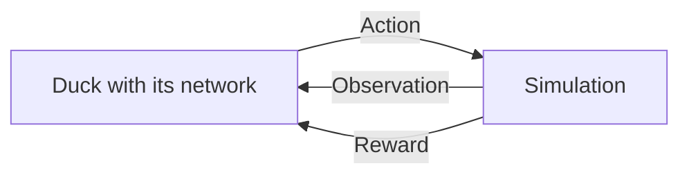
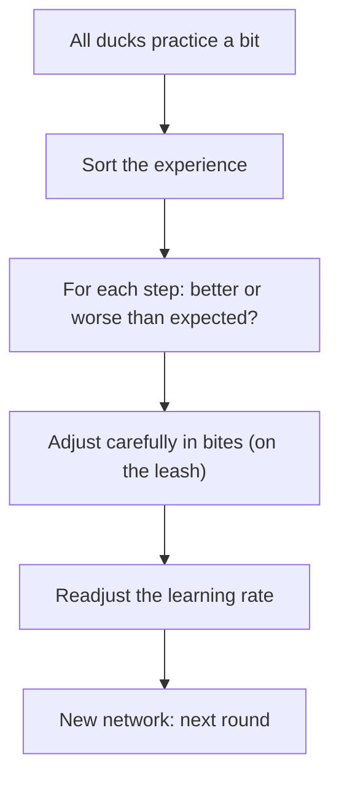
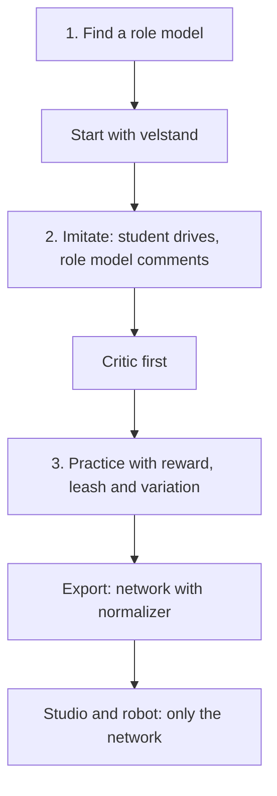

# Appendix A – How Machines Learn: Networks, Imitation, Reward

> **In short:** This appendix explains, without a math degree, how a neural network works, how it
> learns by imitating and through reward, and why the Micro Duck can jump in the end. Basic
> arithmetic is enough almost everywhere. Where a bit more comes up – exponents, the exponential
> function, a slope, the bell curve – we introduce it right there with a picture and a small table.
> You're welcome to skip the worked examples: the pictures carry the ideas.

> **Key terms:**
> - **Servo** – a small motor you give an angle to and that then moves there; the duck has 14 of
>   them.
> - **Simulation** – the rebuilt duck inside the computer, which walks and falls by the rules of physics.
> - **Tick** – the heartbeat of the control: 50 times per second the duck measures and gets new targets.
> - **Episode** – one practice run, from the start until a fall or until time is up.
> - **Lehrer** – Kern's training system, which lets the duck's networks learn.
> - **Seed** – the starting number for randomness: same seed, same randomness.
> - **velstand** – Pollen Robotics' finished walking and standing network, which ships with Kern.
> - **Core** – one of the calculating units in the processor; several cores can calculate at the same time.

How Kern's Lehrer puts all this into practice is in [Chapter 14](14-lehrer.md), how you train yourself
in [Chapter 15](15-your-own-models.md). The exact formulas, names and values are in the blue book,
Appendix A.

## A.1 What a neural network is

### A mixing desk with many sliders

A neural network is a calculating machine: numbers in, numbers out. In between sit a great many
sliders, and **learning** means readjusting these sliders until the right thing comes out.

> **Imagine …** a giant mixing desk. Signals come in at the front, music comes out at the back. In
> between are thousands of knobs. At first they're set at random, and it sounds awful.
> "Learning" means: readjusting the knobs until it sounds good.

For the Micro Duck, **61 numbers** go in: how the torso is lying, how the joints are positioned and
how fast they're moving, what the duck last did, and which command currently applies. Out come
**14 numbers**: the target angles for the 14 servos. Nobody sets the sliders by hand; they're learned.
What counts as "right" is measured by a number that should become as small as possible: the **loss**
(A.3).

### The neuron

The smallest building block is the artificial **neuron**. It does three things:

1. Multiply each input by its **weight**: how much does this input count? Weights may also be
   negative.
2. Add everything up and add a **base setting** (technical term **bias**).
3. Send the result through an **activation** that "bends" it (more on that in a moment).


**Let's work one through.** Three inputs 0.5, −1 and 0, weights 2, 0.5 and 3, bias 0.1. The third
input happens to be 0 and therefore contributes nothing:

- Sum: 2 · 0.5 + 0.5 · (−1) + 3 · 0 + 0.1 = 1 − 0.5 + 0 + 0.1 = **0.6**
- The activation leaves positive numbers as they are: output **0.6**.

Now we turn only the base setting: bias −0.9. The sum becomes 1 − 0.5 − 0.9 = **−0.4**. The
activation squashes negative numbers; according to the table in the next section, −0.4 becomes about
**−0.33**. A single slider has flipped the answer. That's exactly how a network learns: it turns
thousands of sliders a tiny bit each.

### Why bending matters so much

Without bending, a network could only **multiply and add up**. That always gives a straight line:
twice as much in, twice as much out. If you chain such calculations one after another, you again get
only a straight line. A hundred layers could then do no more than one. Only bending allows "crooked"
relationships such as "bend the knee more, the faster the torso tips, but only up to the stop."

> **Imagine …** you build a curve out of straight wooden slats. With a single long slat, it never
> works. With many short slats that each turn at a kink, it does. Each neuron supplies such a kink.

Kern uses the **ELU** activation, as Pollen Robotics does when training the duck. In words:
**Positive numbers stay as they are. Negative ones get squashed, and never below −1.**


Right of 0 the points lie on a straight line; on the left they bend gently away and get ever closer
to −1. That's all you need; for the examples in this appendix, this table is enough:

| Input | ELU turns it into |
|---|---|
| 1 | 1 |
| 0 | 0 |
| −0.4 | −0.33 |
| −0.5 | −0.39 |
| −1 | −0.63 |
| −2 | −0.86 |
| −4 | −0.98 |

> **For the curious:** Where do the numbers on the left come from? From the **exponential function**,
> a shrinking by always the same share: each whole step to the left leaves a good third, like a cake
> of which just under two thirds gets eaten at every step. At −1 there's 0.368 left, at −2 still
> 0.135. ELU subtracts 1 from that: 0.368 − 1 ≈ −0.63. That's why ELU gets ever closer to −1 without
> ever reaching it – the cake is never completely gone. Another common activation simply sets all
> negative numbers to 0; then a neuron can end up in a region where it no longer learns anything. ELU
> never becomes completely flat on the left and doesn't have this "dead" region.

### Layers

Many neurons side by side that all see the same inputs form a **layer**. Several layers one after
another make a network. The duck's jump network looks like this:


The last layer doesn't bend, because a servo target may be any number, even a strongly negative one.
Altogether the network has almost **200,000 sliders**.

> **For the curious:** Here's how to count: a layer with n inputs and m neurons has n · m weights and
> m base settings. 61 · 512 + 512 · 256 + 256 · 128 + 128 · 14 = 196,864 weights, plus 910 base
> settings, together 197,774 sliders.

### The start: random, but small

Before learning, the sliders have to stand somewhere. All at 0 would be fatal: then all neurons of a
layer would calculate exactly the same thing, get the same correction, and stay **twins** forever.
That's why they're set at random, but small. The more inputs a neuron has, the smaller the starting
values – otherwise the sums would get bigger and bigger from layer to layer and explode.

## A.2 The forward pass

**Calculating forward** means: put the input in at the front, pass it on layer by layer, until the
answer comes out at the back. That's all a finished network does, 50 times per second.

> **Imagine …** a bucket brigade at a fire. The first person takes the water, hands it to the next,
> who passes it on, until the last one dumps it onto the fire. Each layer is a person in the chain:
> it takes what the previous one gives it, works on it, and passes it on.

In the picture of the jump network above, that's the row from left to right: each layer delivers an
**intermediate result** to the next, the last one delivers the servo targets.

When **learning**, there's one difference: then the chain remembers every intermediate result, like
notes left lying at each station. You'll need them shortly, when the error is spread backward (A.5).
When just acting on the robot, they're thrown away immediately.

> **For the curious:** Kern arranges the calculation so that the computer can do it quickly,
> **without** changing the order of the additions. Why that matters is in A.11 under "The same result
> on every computer."

## A.3 The loss: how bad am I right now?

For a network to learn, it needs a number that says how wrong it is: the **loss**. The smaller, the
better. Learning then simply means: making the loss smaller.

The classic is the **mean squared error**: for each output, take the distance to the target value,
multiply it by itself ("square" it), then take the average. Example: the network says 0.5 and 2; right
would be 1 and 1. The distances are −0.5 and 1; squared, 0.25 and 1; average **0.625**. Squaring has
two advantages: an error downward counts as much as one upward, and big errors count especially much
(double the distance, four times the loss).

The Lehrer uses this loss when the network imitates a role model (A.9).

> **Imagine …** the loss is a landscape. Every setting of all the sliders is a place, and the loss is
> the height there. You want to get to the deepest valley. Only this landscape doesn't have two
> compass directions like a real one, but almost 200,000 – one for each slider. And there's no map.
> You're standing in **thick fog** and can only feel how steep the ground under your feet is.

## A.4 Gradient descent: downhill in the fog

### The basic idea

In the fog you can only feel the **slope** under your feet: which way is uphill, and how steep? So you
take a step in the opposite direction, downhill. The slope for all sliders together is called the
**gradient**. The step length is called the **learning rate**.

```
 new slider = old slider − learning rate × slope
```

How do you measure a slope? Without any higher math: step a tiny bit to the side and see how much
higher you're then standing. Slope = difference in height divided by the step length.

**A valley to try out.** A single slider r, and the loss is r · r (**r²** for short, "r squared").
That's a valley with its lowest point at r = 0.


If the slider is at 1, the loss is 1 · 1 = 1. One hundredth further, at 1.01, it's
1.01 · 1.01 = 1.0201. The difference 0.0201 divided by 0.01 gives about **2**. That's how you get the
slope at any spot, and for this valley the answer is always "two times r":

| Slider r | Loss r² | Slope there |
|---|---|---|
| −2 | 4 | −4 (downhill to the right) |
| −1 | 1 | −2 |
| 0 | 0 | 0 (at the very bottom) |
| 1 | 1 | 2 (downhill to the left) |
| 2 | 4 | 4 |

Now let's set off, from r = 1, with two different learning rates:

| Step | Learning rate 0.1 | Learning rate 1.1 |
|---|---|---|
| Start | 1 | 1 |
| 1 | 1 − 0.1 · 2 = 0.8 | 1 − 1.1 · 2 = −1.2 |
| 2 | 0.64 | 1.44 |
| 3 | 0.512 | −1.728 |

With 0.1 it goes obediently into the valley. With 1.1 you jump over the valley every time, land
higher on the other side than before, and swing yourself up – like a ball that's pushed too hard. In
this valley the limit is exactly at learning rate 1: then the ball jumps back and forth between 1 and
−1 forever; below that it arrives at the bottom, above that it swings itself up. Steps that are too
small, on the other hand, barely make progress. That's why the learning rate is one of the most
important sliders of all.

### Bites instead of everything: minibatches and epochs

Calculating the exact slope over **all** practice examples takes a long time. So you estimate it from
a small, random handful, a **minibatch**, and take many small steps instead.

> **Imagine …** a survey. If you ask five people, you get a shakier result than with a thousand – but
> you're done much faster and can ask more often.

So small bites give a shakier direction. The duck's jump training felt that. When practicing with
reward (A.10), the practice examples are what the ducks experienced. If only a few dozen ducks
practice at once, there's little experience per round – the bites get small and the direction
correspondingly restless. Going through all the data once is called an **epoch**.

### The emergency brake

A single crazy example can produce a huge slope and ruin the network in a single step. That's why the
step length is capped: the **direction** stays, but steps that are too big are shortened to a maximum
length.

> **Imagine …** a car with a speed limiter that can never be driven faster than 130 km/h. You can steer
> freely; only the speed has an upper limit.

## A.5 Backpropagation: who's to blame?

For each of the 200,000 sliders you need the slope: "If I turn this slider a little, how does the
loss change?" Nudging each slider separately and recalculating everything would mean doing the whole
calculation 200,000 times. **Backpropagation** (spreading backward) manages it in a single pass from
back to front.

> **Imagine …** a relay race has been lost. The team captain asks the anchor runner: "How much did
> you lose?" She answers and passes the question on to the runner before her, in proportion to that
> runner's contribution. That way the blame travels from the finish to the start, and in the end
> everyone knows what she needs to improve.

Here's how it works: at the output it's clear how wrong the answer was. You pass this error forward
layer by layer. Each layer passes it on proportionally – a lot to the sliders that contributed a lot
to the answer, a little to the others. How much each one contributed is on the notes the forward pass
left lying around (A.2). The calculation rule behind this is called the **chain rule**; if you like,
you can work it through on a mini network in the box below.

The result of a small example in words: a mini network starts out quite far off, with a loss of
**1.656**. After a single backward pass and one step downhill, the loss is almost **0**. With real
networks and many examples that partly contradict each other, on the other hand, progress comes in
tiny steps.

> **For the curious: the mini network to work through.** You can skip this box without losing
> anything; it's only for number fans, to show where the two numbers above come from.
>
> One input x = 1, one neuron with ELU, one output without bending, target 1. The sliders: first
> weight 0.5, first base setting −1, second weight 2, second base setting 0.5.
>
> **Forward:** sum 0.5 · 1 − 1 = −0.5. ELU from the table: **−0.393**. Output
> 2 · (−0.393) + 0.5 ≈ −0.287. Loss (−0.287 − 1)² ≈ **1.656**.
>
> **Backward.** One rule carries everything: a weight's blame is the error that arrives at it, times
> what went through this weight.
>
> | What | Calculation | why | Value |
> |---|---|---|---|
> | Error at the output | 2 · (−0.287 − 1) | slope of the square (A.4) | −2.574 |
> | Blame, 2nd weight | −2.574 · (−0.393) | × its input | 1.013 |
> | Blame, 2nd base setting | −2.574 · 1 | always counts fully | −2.574 |
> | passed on to the neuron | −2.574 · 2 | × the 2nd weight | −5.148 |
> | Slope of ELU | −0.393 + 1 | see below | 0.607 |
> | Error in the neuron | −5.148 · 0.607 | × slope of ELU | −3.122 |
> | Blame, 1st weight | −3.122 · 1 | × its input x = 1 | −3.122 |
> | Blame, 1st base setting | −3.122 · 1 | always counts fully | −3.122 |
>
> Two tricks are hidden in this. First: the error at the output is the slope of the square – the same
> rule "two times the distance" as in the valley from A.4. Second: in the squashed region, the slope
> of ELU is exactly "output plus 1." And because the input x = 1, the first weight and the first base
> setting get the same blame.
>
> **One step downhill** with learning rate 0.1: new value = old value − 0.1 × blame.
>
> | Slider | old | − 0.1 × blame | new |
> |---|---|---|---|
> | 2nd weight | 2 | − 0.101 | 1.899 |
> | 2nd base setting | 0.5 | + 0.257 | 0.757 |
> | 1st weight | 0.5 | + 0.312 | 0.812 |
> | 1st base setting | −1 | + 0.312 | −0.688 |
>
> **Forward once more:** the sum is now 0.812 − 0.688 = 0.124 (positive, ELU leaves it alone), the
> output 1.899 · 0.124 + 0.757 ≈ 0.99, the loss almost **0** (calculated without rounding, about
> 0.00004).

> **For the curious:** Kern checks whether the backward calculation is right exactly the slow way
> from the first paragraph: turn a slider a tiny bit up and down and see how the loss changes. Both
> ways must give the same slope.

## A.6 Adam: the clever hiker

Simple downhill walking has two weaknesses: all sliders get the same learning rate, even though some
slopes are huge and others tiny, and every wobble in the terrain throws the hiker off stride. **Adam**
is a cleverer method. It remembers two things for each slider:

- the **usual direction** of the last steps – that gives momentum and smooths out wobbles,
- the **usual size** of the last slopes.

Both are **moving averages**: averages of the last steps in which newer ones count more than older
ones, just as with the weather you pay more attention to the last few days than to the last month.

> **Imagine …** an experienced hiker in the fog. They look at where their last steps went and always
> take roughly equally long, calm steps – no matter whether the slope is steep or flat. A single stone
> under their shoe doesn't throw them off the path.

That's how Adam does it: the usual direction says **where** the step goes; the usual size makes sure
it becomes **roughly as long as the learning rate**. That way a slider with tiny slopes makes just as
much progress as one with huge ones.

> **For the curious:** In terms of calculation, Adam divides the usual direction by the usual size.
> On the very first step, both are exactly the same size, so the step is as long as the learning rate,
> whether the slope is 0.000001 or 1000. Because Adam's memory is still empty at the beginning, it
> also compensates the first steps; otherwise they'd be much too small.

Everyone who learns gets their **own** Adam memory: the actor, the critic (A.11) and imitation (A.9)
one each. Like three students with a notebook each – what one writes down doesn't confuse the others.

Adam's memory is part of the training's saved state: if an interrupted run is continued, it takes
exactly the steps an uninterrupted one would have taken.

## A.7 Normalization: everyone on equal footing

The duck's 61 measurements differ greatly in size: angles around a few tenths, speeds in double
digits, the direction of down between −1 and 1. The big ones would dominate the sums and slow down
learning. That's why each measurement is converted to a common scale: **"How far above or below the
usual is it?"** The **normalizer** takes care of that.

> **Imagine …** school grades from different countries: a 2 in Germany, 15 out of 20 in France, a "B"
> in England. Only when you convert them all into one common system can you compare them.

For this you need two numbers per measurement: the **average** and the **spread**. The spread says
how far the values usually deviate from the average.

**Example:** a joint speed is 2 on average and usually deviates from that by 4. The value 10 is 8
above the average, so two usual deviations above it: converted, **2**. The value 2 becomes 0, the
value −2 becomes −1.

Because a better duck experiences different situations, the Lehrer keeps updating the average and the
spread while practicing.

Important: **the normalizer is a fixed part of the network.** Without exactly this conversion, the
network no longer understands its inputs. That's why it sits at the very front of the finished
network (A.14).

## A.8 Memorizing versus understanding

A network with 200,000 sliders can **memorize** a small set of practice problems: perfect answers to
the known problems, nonsense for new ones. That's called **overfitting**. Remedies: more and more
varied practice data, testing on problems that were never used for learning, stopping in time (taking
the best network, not the last one), and smaller networks.

> **Imagine …** a student who knows the answers on the worksheet by heart. In the class test with new
> numbers, that doesn't help one bit.

In robotics, overfitting usually means: the network has tuned itself to **exactly this simulation**.
The remedy is variation (A.12). That's why the Lehrer checks every network on the clean **and** on
varied robots, and choosing the best round at the end is the "stopping in time."

## A.9 Learning by imitating

### With an answer key: behavior cloning

In **supervised learning**, every problem comes with the right answer, like a workbook with
solutions. The network makes the loss between its answer and the solution small, done. In robotics,
the "right answer" is what an expert does: you have the expert demonstrate, write down pairs (what
they see, what they do), and train the network on them. That's called **behavior cloning**. In the
Lehrer, the expert is called the **role model**.

### The trap: situations you've never seen

> **Imagine …** you learn to ride a bike only by watching someone who always rides perfectly in the
> middle of the path. Then you ride yourself, drift a few centimeters off the path – and don't know
> what to do, because you've never seen a situation like that. You correct the wrong way, drift even
> further, and end up in the bushes.


Experts call this **distribution shift**: when riding on its own, the network gets into situations it
never saw while learning, and small errors build up. And faster than the ride is long: on a ride
twice as long, there can be up to four times as many errors.

### DAgger: the student drives, the teacher comments

**DAgger** turns the tables. The student drives on their own, and at every moment the role model says
what **it** would have done at that point.



That way practice data is created exactly where the student really ends up, along with the right
answer for it. So that situations just beside its path come up too, the network drives with a little
randomness. For the duck's jump, the network makes its first real jump after 7 rounds.

One condition is what makes DAgger possible in the first place: the role model may only see what the
network sees too.

> **Imagine …** the driving instructor says "Brake now!" because he saw a child behind the hedge. The
> student doesn't see the child. He can't learn this rule – for him, the braking comes out of
> nowhere.

## A.10 Learning through reward

Behavior cloning needs an expert. If there isn't one, or if the network is supposed to get better
than the expert, **reinforcement learning** helps: you don't say **how** something is done, only
**whether** it was good.

> **Imagine …** dog training. You don't tell the dog how to move its muscles. It tries something, and
> if it was good, there's a treat. Over time it does more often what earns treats.

### The cycle



The one acting – technical term **agent**, here the duck with its network – sees an **observation**,
chooses an **action**, and the world answers with a new situation and a **reward**. For the duck,
this cycle turns once per tick, so 50 times per second (in the duck's time, see Chapter 13.5), until
the episode ends with a fall or with time running out.

> **For the curious:** Experts call this cycle a Markov decision process. "Markov" means: what
> happens next depends only on the situation now, not on how you got there.

### What the duck knows and what it doesn't

The duck doesn't know its situation completely. It only sees what its sensors report, and those are
noisy and lag a little behind: joint angles, a rotation sensor in the torso, the direction of down,
its last action, the command. It does **not** see its true height above the floor or its speed in the
room. The last action in the observation acts like a small memory.

### Reward and return

The **reward** is a number per tick and the only place where you tell the duck what it should do. It's
usually a sum of individual items, each with its own weight – for the jump, for example, for being in
the air, for the landing, and for staying upright; the list is in [Chapter 14](14-lehrer.md). And the
duck takes the reward **literally**.

> **Watch out!** In early runs the duck learned to sit on its tail, do dive jumps, or prop itself
> up – because the reward allowed it. Every loophole had to be closed with a stricter rule
> ([Chapter 15](15-your-own-models.md)).

The **return** is the **total score from now on**: all future rewards together. So that it doesn't
grow to infinity, later rewards count less. Each tick into the future multiplies the reward by 0.99,
so it costs one percent.

> **Imagine …** an ice cream in the sun that gets one percent smaller every second. An ice cream now
> is worth more than the same ice cream you only get two minutes from now.

How much is left after many ticks? For that you multiply 0.99 by itself as many times as ticks pass;
for short, you write this with an **exponent**: 0.99¹⁰⁰ means "multiply by 0.99, 100 times in a
row."

| Ticks into the future | Seconds | how much the reward still counts |
|---|---|---|
| 1 | 0.02 | 0.99 |
| 10 | 0.2 | 0.90 |
| 50 | 1 | 0.61 |
| 100 | 2 | 0.37 |
| 300 | 6 | 0.05 |

So the duck "looks" roughly 100 ticks ahead, which is 2 seconds: about as long as a whole jump.

> **Did you know?** You can calculate the return backward: total score from now on = reward now +
> 0.99 × total score from the next tick on. You start at the end of the episode and work back to the
> beginning.

### Policy, value and advantage

The **policy** is the duck's decision rule: observation in, action out – in other words, its network.
For learning it's **a bit random** (more on that in a moment); on the robot you only take its best
idea.

The **value** of a situation says: "How many points do I expect from here on, if I do what I always
do?" The **advantage** of an action says: "Was it better or worse than what I usually do here?"
Positive means better. That's exactly what learning needs: **do more of what was better than usual.**

**Example:** at this spot the duck normally still gets 5 points. This time it tried something else and
got 7. Advantage: **+2**. This action should become more frequent.

### Fall or time running out?

An episode can end in two fundamentally different ways. After a **fall** there's no future anymore;
its value is 0. When **time runs out**, the duck would still be standing; the time limit is just a
property of the training. If you treat both the same, you teach the network that effort shortly before
the end is pointless. That's why the Lehrer distinguishes them and, when time runs out, estimates how
many points the duck would still have gotten.

### How does the policy learn? Rolling dice and shifting

The reward depends on the action through the whole physics. You can't get a slope here as in A.4: a
foot touches the floor or it doesn't, the duck falls or it doesn't – the points jump instead of rising
smoothly. And for 200,000 sliders you'd have to replay the whole episode every time. The trick: the
duck **rolls dice a little**. The network says "roughly like this," and each time the duck deviates a
little from it at random. If a deviation was good (positive advantage), you shift the "roughly like
this" in its direction. If it was bad, away from it.

How far it deviates follows the **bell curve** (technical term **normal distribution**): small
deviations are common, big ones rare. How wide the bell is, a single number tells you, the **spread
σ** (pronounced "sigma") – the same idea as the spread in A.7: how far the values usually deviate
from the middle.


| Range around "roughly like this" | how many attempts land in it |
|---|---|
| ± 1 σ | about 2 out of 3 |
| ± 2 σ | about 19 out of 20 |
| ± 3 σ | almost all |

**Example:** the network says 0.2 for a knee, and σ is 0.1. Then about two out of three attempts land
between 0.1 and 0.3, almost all between −0.1 and 0.5.

σ is itself a slider the training learns along with everything else, separately for each servo. At
the beginning the bell is wide (lots of curiosity); later it gets narrower. For the jump, it's
deliberately set narrow after imitation, so that a network that already jumps doesn't scramble
everything again. Each duck rolls with its **own** fixed randomness, which depends only on the seed
and its number.

### Entropy: keeping curiosity alive

Without a countermeasure, the bell often gets narrow too quickly: the duck stops trying new things and
gets stuck with the first halfway usable solution. A small bonus for curiosity helps against that.
Curiosity is measured with **entropy**: a number that says how widely the duck tries things out.

> **Imagine …** a cook who only ever cooks their first halfway good recipe. A small bonus for trying
> things keeps them open to something better – without them putting something completely new on the
> table every day.

| Bell | how widely the duck tries things | Entropy |
|---|---|---|
| σ = 1 | very widely | high |
| σ = 0.3 | medium | medium |
| σ = 0.1 | close around its best idea | low |

The bonus is small. It's only meant to slow down the narrowing, not prevent it.

## A.11 Actor, critic and PPO

### Two networks, one team

For the advantage you need to know how many points are **usual** at a spot, that is, its value. A
second network estimates that, the **critic**. The acting network is called the **actor**. (Watch
out: in the Studio, "actor" means something else, namely a thing in the level. Here it always means
the acting network.)

> **Imagine …** an athlete and her coach. The athlete does the routine (actor). The coach never does
> it herself, but after every routine she says: "That was better than usual" or "worse than usual"
> (critic).

Both learn at the same time: the critic learns to predict the total score – with the same loss as in
imitation (A.3), the distance between its estimate and the points actually reached. The actor learns
from the advantages the critic calculates. After imitation, the actor is already good, but the critic
doesn't know anything yet; its judgments would be random. That's why at first, for a while, **only
the critic** learns ("critic first").

### GAE: a bad step may have been good

How good was a single action really? Sometimes a step looks bad on its own but leads into a situation
from which everything goes better.

> **Imagine …** in chess you sacrifice a piece. On its own, a loss. Three moves later you checkmate.
> Looking back, the sacrifice was the best move of the game.


That's exactly what **GAE** does (technical term, roughly "well-estimated advantage"). You go
**backward** through time: each step first gets its own **surprise**, that is, how much better or
worse things went right after it than the critic had estimated. To that is added part of the
surprises of the steps that came afterward. The further away the consequences, the less they count.

Why not simply add up all the real points until the end? Because they're shaken up by the randomness
of many later steps. And why not just trust the critic? Because it can be wrong. GAE mixes the two: a
bit of trust in the critic, a bit of real experience.

> **For the curious:** How strongly later consequences count is governed by a second discount factor
> besides the 0.99, in the Lehrer 0.95. At the end, all advantages are also brought to a common scale,
> as with the normalizer (A.7). The whole calculation is in the blue book, Appendix A.

### Why steps that are too big are dangerous

The experience comes from the **old** behavior. If you change the network a lot all at once, the
experience no longer fits it, and good behavior can break in a single step. Then the duck collects bad
experience it can hardly recover from. Several epochs on the same data – actually handy, because you
make better use of the data – make it even worse.

> **Imagine …** a teacher gets feedback after a single lesson and thereupon overhauls her whole
> teaching style. But the feedback applied to the old style, not the new one.

### PPO: improving with a seat belt

**PPO** is the Lehrer's learning method. Its idea: **per round, the behavior may only change a
little.** This is measured with a simple ratio: how much more often does the new network choose a
particular action than the old one? 1 means "equally often," 1.2 means "20 percent more often."

> **Imagine …** a dog on a leash. It may sniff wherever it likes, but only as far as the leash
> reaches. In the next round, the leash is measured again from the new spot.


The vertical axis shows the **benefit**: how much the Lehrer gains this round from pushing the action
further – where the line goes flat, further pushing brings nothing more.

- A **good** action (positive advantage) may become at most 20 percent more frequent per round. Beyond
  that, it isn't strengthened any further.
- A **bad** action may become at most 20 percent less frequent. Beyond that, it isn't weakened any
  further.

A numerical example in words: a **good** action is now chosen 1.2 times as often instead of 1.0
times. Up to that point it gets rewarded; beyond it, no longer: the goal for this round has been
reached. A **bad** action, on the other hand, that the network by mistake chooses even more often than
before (1.3 times as often), is **always** pushed back. So the leash only curbs overdoing it in the
right direction, never bringing things back from the wrong one.

> **For the curious:** In addition, the Lehrer adjusts the learning rate by itself: if the behavior
> changes too much per round, it gets smaller; if it stays very calm, it gets bigger. And the critic
> has a leash too: its estimate may only move a certain distance from the old value per round.

### A training round as a whole



Such a round is called an **iteration**. Practicing and learning are separate: the **helpers**
(technical term collectors) only need the current network and hand in their experience; the
**evaluator** (technical term learner) improves the network from it, just like in the sports school
from Chapter 14.2. That's why the helpers can work on several cores at the same time. The exact
settings are in the blue book, Appendix A.

### The same result on every computer

Decimal numbers in a computer are tricky. The computer stores each decimal number with only a limited
number of digits and rounds after every calculation step – like a pocket calculator with a short
display. Depending on the order, rounding happens at a different place. That's why (0.1 + 0.2) + 0.3
doesn't come out exactly the same in a computer as 0.1 + (0.2 + 0.3); they differ in the very last
digit. If, while learning, you add things up in an order that depends on how many cores are helping,
you get different networks on 2 and on 16 cores. Kern prevents this:

- Each duck has its own fixed dice, which depend only on its number and the seed.
- Adding up always happens in the same order, no matter how many cores help.
- Kern brings its own math functions that round the same way on every device.
- Kern forbids the computer shortcuts where some processors round differently from others.

The result: the same seed, the same number of ducks, **the same network** – on a laptop as well as in
the browser on a phone ([Chapter 14](14-lehrer.md), [Appendix C](C-physics.md)).

## A.12 From simulation to reality

A network that learned in the simulation meets a robot that's always a bit different: imprecisely
measured masses, servos that vary, changing floors, noisy sensors. Bridging this **sim-to-real gap**
is the core task of robot learning. Two approaches complement each other:

1. **Bring the simulation closer to reality:** precise models fitted to measurements
   ([Chapter 16](16-calibration.md)).
2. **Make the network insensitive:** it practices in many slightly different worlds, so that the real
   one is just one more. That's **variation** (technical term domain randomization).

> **Imagine …** you practice table tennis sometimes with a heavy ball, sometimes with a light one,
> sometimes on a slippery floor, sometimes on a grippy one, sometimes with glasses, sometimes without.
> On tournament day, you don't care what the hall is like.

Three refinements help here:

- **Curricula:** some variation only gets added step by step, because too much chaos at the beginning
  prevents the movement from developing at all. Like practicing the piano: first slowly, then faster;
  first without disturbances, then with. For the jump, for example, the shoves only get added after a
  few hundred rounds.
- **Whatever can't be measured precisely gets varied:** every servo value comes with a spread, and
  training draws each servo from it. That way the network doesn't rely on numbers nobody knows exactly.
- **The asymmetric critic:** the critic is only needed while practicing. That's why it may see more
  than the robot, such as the exact height of the torso. That makes its judgments more accurate – and
  only the actor goes onto the robot anyway.

On top of that comes the **warm start**: Kern's jump doesn't begin with random sliders but as Pollen's
velstand network. So it can already stand and balance and only has to learn the jump on top. So that
nothing breaks in the process, the new network at first acts **exactly** like the original: the new
input that the old network never knew – the "clock" that says where in the jump the duck is right
now – starts with weight 0 and only gets used gradually. And the conversion of the measurements (the
normalizer from A.7) is taken over from velstand and stays fixed – unlike usual, it isn't updated here,
so that the inherited skill doesn't slip.

## A.13 Searching without a slope: CMA-ES

Sometimes you can't calculate a slope at all. For the jump role model, 15 numbers are the input
(target angles of the left leg at five moments of the jump), and a whole simulation with flight,
landing and maybe a fall is the evaluation; on top of that it's noisy, because every round meets
different robots. In calibration, 6 servo values are supposed to be chosen so that the simulation
replays measurements ([Chapter 16](16-calibration.md)).

Then systematic trial and error helps: roll a **cloud** of candidates around a center point, evaluate
them all, move the center toward the better ones. **CMA-ES** also learns the **shape** of the cloud.

> **Imagine …** at night, with friends, you're looking for the deepest point of a lake, each with a
> plumb line in their own boat. You spread out, call out your depths, and everyone rows toward those
> with the deepest values. If you notice that the lake slopes down a long way in one direction, you
> spread out further in that direction.


Per round, roughly this happens:

1. Draw candidates from the cloud and evaluate them.
2. The better half counts, the best ones the most.
3. The center moves toward them.
4. If things went in the same direction for several rounds, the steps get bigger; if they cancel out,
   smaller.
5. The cloud stretches in the directions where things went well.

Two tricks make the method reliable. The starting point is evaluated first, so the result is never
worse than the beginning. And with noisy evaluations, you take the **center** rather than the best one
at the end: the best one may just have been lucky. So that the comparison within a round is fair, all
attempts there jump on the same robots ([Chapter 14](14-lehrer.md)).

> **For the curious:** Kern wrote CMA-ES itself; it calculates with Kern's own randomness and
> therefore always delivers the same result for the same seed. The formulas are in the blue book,
> Appendix A.

## A.14 ONNX: the network to go

A finished network has to get out of the Lehrer: into the Studio, onto the robot, into other programs.
For that there's a common file format for networks, **ONNX**. It describes the network as a chain of
simple calculation building blocks, with all slider values in the same file.

> **Imagine …** a PDF. No matter which program a document was written with – as a PDF, anyone can
> open it and it looks the same everywhere. ONNX is the PDF for networks: the robot doesn't need to
> know what the network was trained with.

The chain for the duck is short, the same as in A.1:


Kern writes its networks in exactly the same format as Pollen Robotics. Only the network's "roughly
like this" is exported, without the dice: **on the robot, there's no more trying things out.** The
critic stays home too; it only advised during practice.

> **For the curious:** Kern doesn't need an outside library for the export; it has its own tiny
> writer. An automatic test reads such a file back in and compares. Details in the blue book,
> Appendix A and Chapter 14.

## A.15 How it all comes together



The guiding principle is in Kern's code, translated: "At runtime there is only the network – the role
model exists only while it's learning." Role model, critic, dice, variation – it's all
**scaffolding** that helps while learning and is taken down afterward. What remains is a conversion of
the measurements and a few layers that multiply, add up and bend. And that's enough to make a duck
jump.

> **Try it!** At https://kernengine.de/, open the Micro Duck level via
> **File › Example Levels › Micro Duck**, start **Play**, take over the duck with **F8** and press
> **7**. At this moment, each servo gets a number 50 times per duck second (13.5) from just under
> 200,000 sliders that were once pure randomness.

> **Try it!** Open the Lehrer page **kernengine.de/lehrer/** and choose "Stehen (Schnelltest)"
> (stand, quick test) as the motion. Enter 1 under "Aktionsrauschen am Anfang" (initial action noise)
> and press **Start**. Let it run a few dozen iterations (the "Iteration" counter shows how far along
> it is), press **Pause**, and note the curve of the episode length (how long the ducks hold out) and
> the "Aktionsrauschen" (action noise) number. Reload the page, enter 0.1, and repeat with just as
> many iterations. What you can expect: with 1 the bell is wide, and the ducks try things out wildly;
> with 0.1 they stay close to their idea. Watch how the action noise number changes while practicing –
> that's σ, learning along. How you recognize "better": the curve of the episode length rises faster
> toward 4 seconds, so the ducks hold out to the end sooner. Which setting manages that, you'll find
> out yourself. A run takes some patience; the tab has to stay open while it runs.

## What you take away

- A neural network is a mixing desk with many sliders: multiply, add up, bend, layer by layer. The
  jump network has almost 200,000 sliders.
- Learning means making the loss smaller: downhill along the slope in the fog, with the learning rate
  as the step length.
- Backpropagation spreads the blame backward; Adam takes even, calm steps.
- The normalizer puts all measurements on equal footing and is a fixed part of the network.
- Imitation needs DAgger: the student drives, the role model comments.
- Learning through reward: roll dice, and whatever was better than usual becomes more frequent. The
  reward is taken literally.
- PPO learns on a leash; the critic estimates what's usual.
- Variation, curricula and the asymmetric critic build the bridge from simulation to reality.

## Brain teasers

1. A neuron has the inputs 1 and 2, the weights 0.5 and −1, and the base setting 1. What does it
   output with ELU? (The table from A.1 helps.)
2. Why would a network without bending, with 100 layers, be no smarter than one with a single layer?
3. You go downhill in the valley r² with learning rate 1.1. What happens?
4. How much does a reward 100 ticks from now count compared with one now?
5. PPO: an action was bad (negative advantage), but the new network chooses it 1.3 times as often as
   the old one. Does that still get corrected?

### Solutions

1. Sum: 0.5 · 1 − 1 · 2 + 1 = −0.5. According to the table, ELU turns it into about **−0.39**.
2. Without bending, there's only multiplying and adding up; chained together, that again gives just a
   straight line. Only bending allows crooked relationships.
3. The slider jumps over the valley every time and lands higher and higher: 1, −1.2, 1.44, −1.728 …
4. About 0.37 times as much, a good third (table in A.10).
5. Yes. PPO only caps improvements, never the correction of mistakes.

---

© 2026 Christian Heinrich Hohlfeld · All rights reserved · [Imprint and rights](00-imprint.md)
