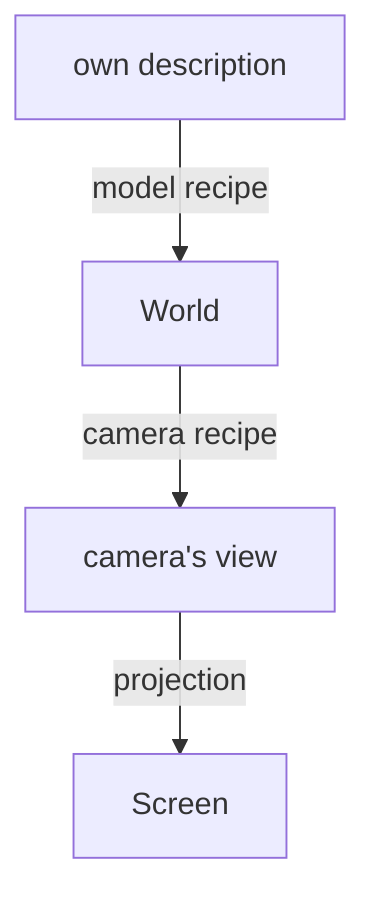
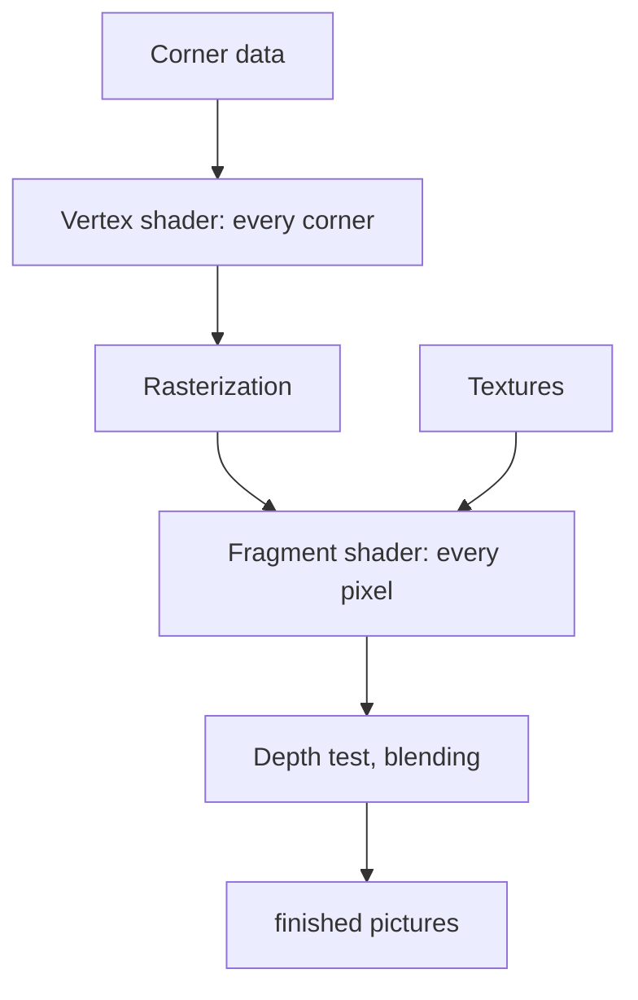
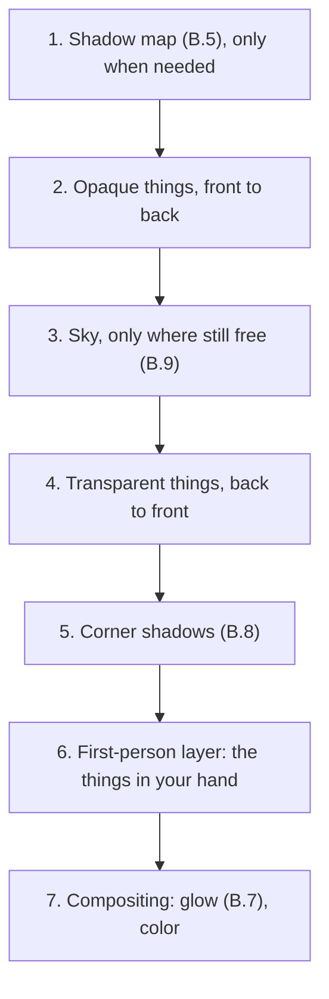
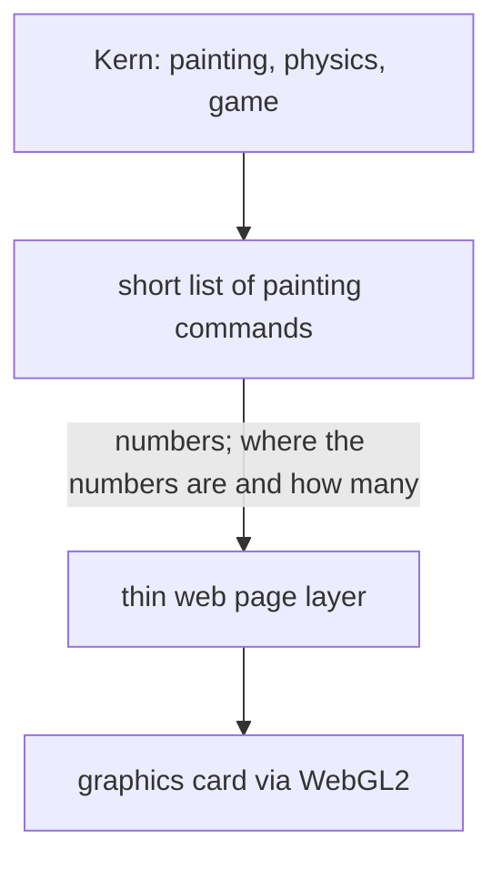

# Appendix B – Basics: How Triangles Become Pictures

> **In short:** This appendix explains the craft behind every 3D game: how a thing gets to the right
> spot on the screen, how the graphics card turns triangles into pixels, and how light, shadow, gloss
> and color come about – 60 times per second in the browser. For each basic concept you'll briefly
> learn how Kern implements it.

> **Key terms:**
> - **Pixel** – a single dot on the screen; a picture is made of millions of them.
> - **Coordinates** – three numbers that say where something is: how far to the right, forward, up.
> - **Graphics card** (also GPU) – the special chip that colors in millions of pixels at once.
> - **Mesh** – the wire frame of triangles a 3D thing is made of.
> - **Shader** – a small painting program that runs on the graphics card.
> - **Texture** – an image glued onto a mesh like a sticker.

It's best to read this appendix **before** [Chapter 4](04-graphics.md): that chapter is about how Kern
puts the building blocks together; here it's about the "why." The exact names and values are in the
blue book, Appendix B.

## B.1 Coordinate spaces

### The matrix: a recipe for every point

A thing in a 3D game has to be moved all the time: shifted, rotated, made bigger or smaller. For that
you use a **matrix**. Picture it as a **recipe** that's applied to every single point of a thing:
"Stretch it to double, rotate it by 90 degrees, push it 5 m to the right." You throw a point in, and
the new point comes out. If you apply the same recipe to all the corners of a mesh, the whole thing
moves.

Written down, such a recipe is a small table of 4 × 4 = 16 numbers. You don't need to know how to
calculate with it – what matters are three properties:

- **One recipe for everything:** stretching, rotating and moving fit into a single matrix.
- **Recipes can be combined:** two recipes one after the other make another recipe. That's called
  **multiplying** matrices. The graphics card then only has to apply one recipe instead of many.
- **The order matters:** first rotating, then moving is something different from first moving, then
  rotating (see the trap in a moment).

### The fourth number w

A point has three coordinates. Even so, you attach a **fourth number** to it, called w. Why?

A recipe can only calculate with the numbers the point brings along: it can multiply and add them up,
nothing more. But "plus 5 m" is a fixed extra that has nothing to do with any of the point's
coordinates. The trick: you give every point a fixed fourth number that's simply **1**. Then the
recipe can say: "plus 5 m times this fourth number" – and 5 m times 1 is exactly 5 m.

A **direction**, on the other hand ("north," "straight up"), gets a **0** as its fourth number.
"5 m times 0" is nothing: it gets rotated but never moved – a direction has no location. An example
with the recipe "5 m to the right":

| What | before (x; y; z; w) | after |
|---|---|---|
| Point | (1; 2; 3; **1**) | (**6**; 2; 3; 1) |
| Direction | (1; 2; 3; **0**) | (1; 2; 3; 0), unchanged |

> **Imagine …** a house number and the direction "north." If the whole town moves 5 km east, your
> house has a new location. "North" stays north.

Later, w helps a second time, with perspective (further below).

**In Kern:** there are two ways of calculating, one for points (w = 1) and one for directions
(w = 0).

### Why there are several spaces

The Micro Duck's torso is defined once in its **own** description: "The head sits a bit above the
middle." Then the duck stands somewhere in the world, a camera looks at it, and in the end it lands on
pixels. Each step is a different coordinate system – a different **space** – and for each change
there's a recipe:

> **Imagine …** the way to your favorite table in a café: "in the back on the left by the window"
> (the café's own description), "the café is at 12 Main Street" (world), "from where I am, diagonally
> ahead to the right" (camera's view), "top right in the photo on my phone" (screen). One table, four
> descriptions.

Because all the steps are recipes, you combine them into a single one. That way the graphics card
calculates each corner in one go, from its own description all the way onto the screen.

### Kern's habits

Kern calculates in **meters**, and **Z points up** – x and y span the floor
([Chapter 3](03-foundations.md)). Kern always builds a thing's pose in the same order: first
**stretch**, then **rotate**, then **move**.

> **Watch out!** Order matters! Picture a game piece in the middle of a table (● is the middle of
> the table; the recipe is supposed to rotate by 90° and push 5 m to the right; the tip of ▶ and ▲
> shows where the piece is facing). In the picture below, the piece ends up to the right of the
> middle in the first case and above it in the second: the rotation always works around the middle of
> the table, and anything that has already moved away gets swung around with it.

> **For the curious:** In a formula, such a combined recipe is written "backward," as
> move · rotate · stretch. The recipe standing right next to the point acts first. That's why
> Chapter 3 says the point is multiplied onto the matrix "from the right" – it means the same thing.
> By the way, Kern stores rotations as a **quaternion**, four numbers instead of three angles: three
> angles one after another can block each other, so that suddenly a direction of rotation is missing.

### View and perspective

The **camera recipe** does something surprising: it doesn't move the camera, but the **whole
world** – until the camera stands in the middle and looks straight ahead. Like filming in a car:
instead of driving the car, you pull the scenery past the window. The recipe is built from three
pieces of information: where the camera stands, where it's looking, and where "up" is.

If the camera looks exactly in the "up" direction (or exactly the opposite), that doesn't work:
someone looking straight up no longer knows where up should be in the picture. Kern then refuses the picture instead of painting nonsense.

**Perspective** means: twice as far away appears half as big. So how big something appears in the
picture is its size **divided by the distance**.

So a 2 m tall tree 10 m away appears just as big as a 1 m tall one 5 m away. But a recipe can only
multiply and add up, not divide. So it notes the distance in the fourth number, and at the end the
graphics card itself divides everything by this number.

For editor views there's also the **parallel view** without perspective: there, distant things don't
get smaller, as on a floor plan. Kern's default values for the camera are in the blue book,
Appendix B.

The blue book works a point 10 m in front of the camera through step by step to its pixel, including
the intermediate stations between camera and screen.

> **Try it!** In Kern Studio, open the **≡** menu at the top of the viewport and switch the **Field
> of View**, the opening angle, between 50° and 110° – at 110° the world looks as if seen through a
> wide-angle lens, strongly stretched at the edges. With **Alt+J** you jump to the **Top** view, a
> parallel view from above: distant buildings are suddenly as big as nearby ones.

### Depth is unevenly distributed

For each pixel, the graphics card remembers how far away what was painted there is (the depth buffer,
B.2). But it doesn't store this depth like a normal tape measure. Close to the camera the marks are
very tight, in the distance very wide.

> **Imagine …** a ruler whose marks are a hair's width apart close to your eye and meters apart at
> the back. Up close you can measure tiny differences, far away only coarse ones.

Why? At the end, the graphics card divides everything by the distance, as in the previous section,
and depth is no exception. The same division that makes distant trees small in the picture also
squeezes distant distances tightly together on the depth scale: between 100 m and 200 m there are
hardly more marks there than between 1 m and 2 m.

How coarse it gets is shown by this small table with Kern's settings:

| Distance | smallest gap the depth can still tell apart |
|---|---|
| 10 m | about 0.1 mm |
| 1000 m | about 1.2 m |

How tight the marks are at the front depends mainly on the **near plane**: the distance from which the
camera sees anything at all (in Kern 5 cm). Everything in front of it is cut off. The ruler starts at
the near plane, and that's where its tightest marks are. If it's very close to the lens, many of these
precious marks get used up on the empty space right in front of the camera, where there's almost never
anything. If you push the near plane twice as far out, the marks slide along, and the depth becomes
**twice as precise everywhere**.

> **Did you know?** That's why in some games distant surfaces lying close together flicker
> ("Z-fighting"): there, the depth buffer simply can't tell them apart anymore and paints sometimes
> one, sometimes the other.

### Normals

A **normal** is an imaginary arrow pointing straight out of a surface. It's the surface's "gaze" and
determines how bright the surface is in the light: if it faces the sun, it's bright; if it faces away,
dark (B.4).

If you squash a thing unevenly, you mustn't simply squash the normals along with it – otherwise they'd
stand crooked. An example: a roof is tilted at 45°, and its normal points diagonally upward. If you
squash the house to half its height, the roof gets flatter – so its normal should point *more steeply*
upward. But if you simply squash the arrow along, it tips *flatter*. Exactly the wrong way around!

The rule of thumb: whatever stretches the surface has to squash the normal, and vice versa. For that,
each thing needs a small recipe of its own just for its normals.

**In Kern:** Kern calculates this normal recipe once per thing; it rejects a thing squashed to size
zero, because there's no such recipe for it.

## B.2 From triangle to pixels

After projection, the three corners of a triangle lie as points on the screen. Now the graphics card
checks which pixels lie inside the triangle. That's called **rasterization**. For each such pixel a
**fragment** is created, a candidate for a pixel – "candidate" because it can still fail later, for
example if something closer is already at that spot (more on that with the depth buffer in a moment).

Whatever is at the corners – color, normal, texture coordinate – gets **mixed** in between
(interpolated). Each corner gets a share, and together the shares add up to 100%. A fragment exactly
in the middle gets a third from each corner; one right at corner v0 gets almost everything from v0.
That's how soft color gradients come about across the triangle.

Mixing has one catch: because distant things appear smaller, on a triangle running diagonally toward
the back, the back half lies on fewer pixels than the front half. If the graphics card mixed evenly
across the picture, a texture would get distorted – the joints of a tiled floor would be too far apart
at the back. That's why it mixes **with correct perspective**: when mixing, it takes into account the
distance of each corner, and the tiles get evenly smaller toward the back.

**The depth buffer.** If several triangles hit the same pixel, the graphics card has to decide what's
in front. For that it keeps the **depth buffer**: an invisible second picture that stores, for each
pixel, how far away what has been painted so far is. A new fragment is only painted if it's closer.

> **Imagine …** a painter who notes next to every brushstroke how far away what was painted was. When
> a new stroke for the same spot comes along, he looks at his notes: if the new one lies further back,
> he doesn't even paint it.

For opaque things, the order then doesn't matter – for speed it does. Kern paints opaque things **from
front to back**: that way hidden things fail early, before the expensive shader runs. **Transparent**
things come afterward, **from back to front**, and are mixed with what's behind them; here the order
matters, as with sheets of foil on top of each other. The **sky** only fills the gaps, and the things
in your hand (the first-person layer) come last ([Chapter 4](04-graphics.md), 4.7).

**Back faces.** For closed bodies, triangles facing away from the camera are always hidden – like the
back of a cube. The graphics card recognizes them by whether their corners follow each other clockwise
or counterclockwise on the screen, and leaves them out (**backface culling**). A mirroring reverses
this winding order; that's why Kern treats mirrored copies separately ([Chapter 4](04-graphics.md),
4.4).

> **Try it!** In Kern Studio, switch to **Wireframe** with **Alt+2** and see the triangles everything
> is made of. **Alt+3** shows **Unlit**, color without light, and **Alt+4** goes back to **Lit**, with
> light.

## B.3 The graphics card's assembly line

The graphics card works like an assembly line. Every painting job – a **draw call**, meaning "Paint
this shape" – runs through the same stations:

Two stations are programmable: the **vertex shader** runs once per corner and says where it lands on
the screen. The **fragment shader** runs once per fragment and says what color it gets. While doing
so, they work with four kinds of data:

| Kind | Example |
|---|---|
| Profile of each corner (or copy) | position, normal |
| Announcement for the whole draw call | sun direction, material color |
| Intermediate value mixed across the triangle | color between the corners |
| Glued-on image (texture) | wood grain, shadow map |

The technical terms for these are in the blue book, Appendix B.

Three tricks make the assembly line fast:

- **Instancing (copies):** you paint a hundred identical trees with **one** draw call. The shape
  exists only once; each copy only brings its location and color tint along. If something moves, only
  this information changes – the shape itself stays on the graphics card.
- **Skinning (skin over bones):** for characters, each corner follows up to four bones, each with a
  share, together 100% – that's how the skin bends softly at the elbow.
- **Several pictures at once:** a fragment shader can write into several pictures at the same time.
  That saves a second pass over all the triangles.

**In Kern:** every shape is painted as a package of copies, and the one standard shader writes three
pictures at once – the finished photo, the real light for the glow (B.7), and notes for the corner
shadows (B.8).

## B.4 Lighting

### What makes a pixel bright

The light that comes from a surface into your eye is its **own glow** plus all the light that falls on
it and that it **throws back in your direction**. How a surface does this is its "character profile":
a mirror throws everything in one direction, a wall spreads it out evenly.

Adding up all the light in the world, including what bounces off walls, would be far too expensive.
Games therefore split it up: **direct light** (sun, lamps) is calculated precisely, **indirect light**
from the surroundings only roughly estimated.

### Matte surfaces

A matte surface, such as paper or a field, spreads light evenly in all directions. How bright it is
depends only on **how steeply the light hits it**.

> **Imagine …** a flashlight pointed straight down at the table: a small, bright circle. If you tilt
> it, the spot becomes a long, pale oval – the same light, more area.

| Light falls … | share of full brightness |
|---|---|
| straight on | 100% |
| tilted by 45° | a good 70% |
| tilted by 60° | 50% |
| grazing (90°) | 0% |
| from behind | 0% |

Then there's the **albedo**: how much light a surface throws back at all – snow a lot, asphalt
little. So a gray surface with half the albedo is half as bright as a white one in the same light.
This rule bears the name of its discoverer, **Lambert**. By the way, metals have no matte share; their
light is all in the gloss.

One limit always applies: **no surface throws back more light than falls on it** – not even
brilliant white paper. The light is only spread out, not multiplied, like water from a bucket poured
into many cups. Kern's calculation is built to obey this rule; otherwise a white wall would shine more
brightly than the sun shining on it.

**Lamps** in reality get weaker with distance but never quite reach zero – so every lamp would have to
light the whole world. That would be far too expensive.

**In Kern:** every lamp has a range at which its light fades softly to zero, and at most six lamps
shine at the same time.

### Gloss

Glossy surfaces throw light back in a particular direction, hence the bright spot on an apple. Today's
explanation: a surface consists of millions of tiny **little mirrors**, tilted at different angles.

Three questions determine the gloss:

1. **How many little mirrors are pointing exactly so that they throw light into my eye?** On smooth
   surfaces all the little mirrors point the same way: you see the gloss from only one direction, but
   very bright. On rough ones they point every which way: you see a bit of gloss from many directions,
   but faint.
2. **How strongly does the surface reflect at this viewing angle?** Much more at a shallow angle –
   like a lake that mirrors the sky when seen at a slant but looks transparent from above. That's
   called the **Fresnel effect**. Head-on, non-metals reflect only a little, metals on the other hand
   strongly and in their own color: a gold ring reflects a white lamp as gold, a red cup reflects it
   as white.
3. **Do the little mirrors hide each other?** On rough surfaces they cast small shadows on each other.

**In Kern:** two sliders, **roughness** and **metallic**, control a simplified gloss model with a sun
highlight and sky reflection.

> **For the curious:** The technical names of the three questions are distribution (usually after
> "GGX"), Fresnel (usually after "Schlick") and geometry. Kern answers the third question with the
> simplest assumption and caps the first, so that no individual giant highlights flicker.

### Light from the surroundings

Indirect light – we call it **ambient light** – doesn't come from a lamp but from all around: from
the blue sky, the ground, walls. You can't calculate it exactly, so you estimate it with a few colors:
sky color above, ground color below, mixed in between according to the tilt of the surface. A wall
thus gets half sky, half ground; a roof almost only sky. Finer is a colorful dome that runs from the
ground over the horizon to the sky above you.

**In Kern:** both exist, and the ambient light is carried along separately, so that the corner shadows
(B.8) darken only it.

## B.5 Shadow maps

A point lies in shadow if something stands between it and the sun. So you paint the scene once **from
the sun's point of view** and note, for each point of this map, only how far away the first thing hit
is – the **shadow map**. During normal painting, each spot asks: "Am I farther away than what was
noted?" If so, something is in front of it.

That sounds simple but has its pitfalls:

| Problem | Cause | Remedy |
|---|---|---|
| fine stripes ("shadow acne") | surface shadows itself | small safety margin |
| shadow detaches from the thing | safety margin too big | keep the margin small |

More pitfalls, such as stair-step edges or shimmering, and their remedies are in the blue book,
Appendix B.

The **safety margin** is the most important remedy: the surface only counts as shadowed if it's a tiny
bit farther away than what was noted. Otherwise it would darken itself because of the coarse map – like
the stripes in a photo of a screen. If the margin is too big, on the other hand, the shadow floats a
bit beside the thing; experts call this "Peter Panning," after the storybook character, because Peter
Pan loses his shadow.

The second remedy is a **step to the side**: before a spot looks something up on the map, it moves a
little in the direction its surface is facing – a bit further when light falls at a slant, because
that's where the danger is greatest. That way the surface doesn't measure against itself, and the
safety margin can stay small.

**In Kern:** the map only covers what you can see up to the shadow distance, snaps to whole points,
and is only repainted when something changes – why that matters so much and how it all fits together
is in [Chapter 4](04-graphics.md), 4.8.1.

## B.6 Bright light, screen and color

### Tone mapping

Real light has an enormous range, from almost dark to blindingly bright. A screen, on the other hand,
can only go from black to white. So you calculate with the **real** light, even when it's much
brighter than white (technical term **HDR**, *high dynamic range*), and only squeeze it into the
screen's range at the very end. This squeezing is called **tone mapping**. A good curve leaves medium
brightnesses almost as they are and rounds off very bright ones softly:

**In Kern:** the curve is a proven film curve from cinema technology, as other widespread graphics
programs use too; a color correction can follow after it.

> **Try it!** In the **World Settings** tab, turn the **Exposure** up and down. Bright spots run
> softly into white instead of cutting off hard – the film curve at work.

### Gamma and sRGB

Screens and image files don't store brightness the way light behaves, but the way our eye perceives
it: a screen knows only 256 brightness levels per primary color, and dark tones get many more of
them, because we see finer differences there. This way of writing it is called **sRGB**. The way of
writing that reflects real light is called **linear**: twice as much light is twice as big a number
there.

| real light (linear) | stored as an sRGB value |
|---|---|
| 5% | about 25% |
| 18% | about 46% |
| 50% | about 74% |
| 100% | 100% |

The second row is famous: the eye perceives 18% of the light as **middle gray**, and in sRGB it
actually sits almost in the middle of the scale.

The problem: light adds up **linearly**. Two lamps make twice as much light – but the sRGB value
doesn't double. If you calculate with sRGB numbers, you calculate wrong, roughly as if you were adding
up shoe sizes. That's why the rule is: convert colors **to linear first**, calculate linearly, and
convert **back to sRGB** at the very end.

> **Watch out!** If you calculate in sRGB, you get transitions that are too dark and wrong mixed
> colors.

### Fog

Fog gets denser with distance. Kern mixes it in so that nearby things stay clear for a long time and
the haze then closes in quickly. With Kern's standard fog:

| Distance | share of fog |
|---|---|
| 100 m | barely any, under 1% |
| 500 m | about 17% |
| 1000 m | about half |
| 2000 m | almost all |

**In Kern:** if you like, the fog gets thinner toward the top and glows in the sun's color in the
direction of the sun.

## B.7 Bloom: the glow

**Bloom** is the halo around very bright spots, like backlight in the eye or in a camera. The recipe:
cut out the very bright parts, blur them, and lay them back on top. The blurring is often done on
shrunken pictures – that's cheaper and gives a wider glow.

Blurring means: each pixel is mixed with its neighbors in a square. That's many looks per point. It's
much faster in two passes.

> **Imagine …** you want to blur a picture made of little squares. Instead of mixing each square with
> all its neighbors in a square, you first blur each row to the left and right and then each column up
> and down. The result is the same – but for a square of 9 × 9 little squares you need only 18 looks
> instead of 81.

The mixing shares add up to exactly 100%, so the picture gets neither brighter nor darker. More
money-saving tricks are in the blue book, Appendix B.

**In Kern:** the glow comes from the shader's real light, is blurred on two shrunken levels, and is
laid over the finished photo as a thin film ([Chapter 4](04-graphics.md), 4.8.3).

## B.8 Corner shadows: ambient occlusion

In corners, joints and under things, less ambient light arrives, because part of the sky is blocked.
This **ambient occlusion** (AO for short) makes things "stand" on the ground instead of floating. It
asks: *how much sky above this point is free?* Sky directly above the surface counts more than sky
just above the horizon – for the same reason as with the flashlight: steeply falling light hits a
surface more strongly than shallow light. The sun has its own shadows; AO only affects the ambient
light.

> **Imagine …** you're lying in a hollow in the grass looking up. The deeper the hollow, the smaller
> your piece of sky – and the darker it is where you are, even without sun shadows.

Sending rays through the whole scene would be too expensive. That's why you estimate the occlusion
from the finished depth buffer, that is, from what's already on the screen anyway. The **GTAO** method
looks in a few directions from each point, searches left and right for how high the surroundings block
the sky (the **horizon**), and calculates how much sky stays free in between.

**In Kern:** Kern uses GTAO, uses it to darken only the ambient light the shader noted along the way,
and needs no second pass over all the triangles for it ([Chapter 4](04-graphics.md), 4.8.4).

## B.9 Sky and atmosphere

The sky is blue because the air deflects (**scatters**) blue light to the side much more strongly than
red – several times more strongly. So deflected blue reaches your eye from everywhere in the sky. At
the horizon the path through the air is longer; the light gets deflected several times, the sky there
is brighter, and when the sun is low it turns reddish – the blue has already been scattered out along
the way. Around the sun, bigger particles such as dust and droplets deflect the light only a little,
on almost straight ahead, and create the bright halo.

> **For the curious:** The technical names are **Rayleigh scattering** (the air, which scatters the
> blue) and **Mie scattering** (the bigger particles, which make the halo around the sun).

Real sky models follow the light step by step along every line of sight through the air.
**In Kern:** the sky is deliberately not such a light calculation but a cheap recipe of color
gradient, golden hour, sun, moon, stars and clouds that looks similar and only fills the gaps
([Chapter 4](04-graphics.md), 4.8.2).

## B.10 Leaving out what's invisible

Whatever lies outside the picture doesn't need to be painted. The region a camera sees is a pyramid
lying on its side with its tip cut off, the **viewing pyramid** (*frustum*). To check whether a thing
lies inside it, you put it in an imaginary **bounding sphere** and ask: does the sphere lie completely
behind one of the pyramid's walls? Then the thing is invisible.

The test is **cautious**: it never throws away anything visible, but sometimes lets something
invisible through, for example spheres near a corner of the pyramid. When in doubt, it just gets
painted.

**In Kern:** that's how Kern checks every thing before painting – except characters with a skeleton,
whose arms and legs can stick out of the sphere. A package with many copies (B.3) gets a sphere that
encloses **all** the copies. If even one copy is visible, the whole package is painted – after all,
it's a single draw call.

> **Try it!** In Kern Studio, under **Window › Show**, turn on **Bounds** and see the hulls Kern uses
> to decide what lies inside the viewing pyramid – including around trees, buildings and the duck.

A related problem is **clicking**: which triangle is under the mouse? For that you send an imaginary
**ray** from the eye through the mouse pointer into the world and look for the first triangle it hits.
With many triangles, a **tree of boxes** (*BVH*) helps: at the top, a box around everything, inside it
two smaller boxes, inside those two more, until single triangles lie at the bottom. If the ray misses a
box, everything inside drops out in one go – like in the number-guessing game with "bigger or
smaller?", where ten questions are enough instead of a thousand attempts.

**In Kern:** the tree of boxes serves **clicking** – which triangle is under the mouse? – not
painting; the physics has its own ([Appendix C](C-physics.md)). Only the world's **unmoving** shapes
get a tree. Why? If a shape moves, its boxes no longer fit in the next picture, and the tree would
constantly have to be rebuilt. So Kern checks moving shapes directly, triangle by triangle.

## B.11 Few big jobs

Every **draw call** costs time before the graphics card even starts: checking settings, preparing
data, sending values – and in the browser, on top of that, the trip across the bridge to the web page,
including checks. Thousands of small calls can take longer than the actual painting work. Every switch,
say to a different texture, costs too.

> **Imagine …** you go shopping. Running to the store a hundred times for one ingredient each takes
> much longer than going once with a full basket – even though the same things end up in the fridge.

### How a picture comes together

How do the shadows, sky, corner shadows and glow from this appendix mesh with each other? For every
picture, Kern goes through the work in a fixed order, like a painter who puts in the background first
and the highlights last:

Opaque things come front to back, so that hidden pixels aren't even calculated; transparent things
back to front, so that glass correctly mixes in what lies behind it.

**In Kern:** a single painting program, copies instead of duplicates, a memo against repeated values,
a shadow map only when needed, and shapes uploaded only once – and a statistic shows how many jobs a
picture cost ([Chapter 4](04-graphics.md), 4.7 and 4.12).

## B.12 Why Kern and the browser work together this way

Kern is a fast program of its own that runs **inside** the web page. It's written in a programming
language for fast programs (C++); out of the box, though, browsers only understand their own language
(JavaScript). The bridge is called **WebAssembly**: a compact format the browser runs almost as fast
as a normal program. A WebAssembly program, however, may only exchange numbers and may only use what
the web page explicitly hands it at startup. Only the web page can reach the graphics card, via
**WebGL2**, the browser's painting interface.

> **Imagine …** Kern lives as a subtenant in the web page. Only the main tenant, the page, has the key
> to the basement with the graphics card. Kern writes its wishes on notes and passes them through the
> door – and only numbers are written on the notes.

From this follow Kern's most important decisions, in everyday language:

| Decision | Why |
|---|---|
| everything in one language | then it calculates the same everywhere – in the browser, in tests, in the Lehrer |
| wafer-thin web page layer | nothing twice, nothing that could calculate differently |
| short, fixed list of painting commands | everything needed is in one place |
| numbers instead of things | only numbers fit across the bridge (coat check tickets) |
| copies of everything | insurance in case the browser takes the graphics card away |
| few jobs, memo | every trip across the bridge costs |
| painting without a screen possible | the Lehrer calculates the same world without graphics |
| one thread per Kern copy | more speed via helpers with their own Kern copy |

The **Lehrer** is Kern's training school, which teaches the Micro Duck new movements
([Chapter 14](14-lehrer.md)). It doesn't need a picture, only the same world with the same physics.
And it illustrates the last row of the table: in the browser, Kern works on a single **thread**, like
a cook who does everything one after another. If more is supposed to happen at once, the web page
starts additional helpers (**Web Workers**), and each gets its own copy of Kern – several cooks, each
in their own kitchen, instead of many cooks at one stove.

The exact names of the components are in the blue book, Appendix B.

## What you take away

- A **matrix** is a recipe that stretches, rotates and moves every point; recipes can be combined into
  one, and the order matters.
- The **fourth number w** is 1 for locations and 0 for directions – the house number moves, "north"
  doesn't.
- Like the café table, a thing travels through four descriptions onto the screen.
- **Twice as far away, half as big**; for that, the graphics card divides by w.
- The depth buffer measures very finely up close and coarsely far away; the **near plane** decides.
- Vertex shaders calculate corners, fragment shaders pixels.
- Light = matte share (flashlight) + gloss (little mirrors, lake) + rough ambient light.
- Shadow maps are a photo from the sun's point of view, with a small safety margin.
- Calculations use **real, linear light**; a **film curve** squeezes it onto the screen.
- Few big jobs make a game fast – shopping once with a full basket.

## Brain teasers

1. Why does a direction get w = 0 and a location w = 1?
2. A thing is twice as far away as another one of the same size. How big does it appear?
3. In the distance, two surfaces lying close together flicker. What helps most?
4. Why can't you simply add colors as sRGB numbers?
5. Why does Kern paint the sky *after* the opaque things?

### Solutions

1. With w = 0 nothing is moved – a direction has no location. The house number moves, "north" stays
   north.
2. Half as big: the graphics card divides by the distance.
3. Push the near plane farther out: twice as far means twice as precise everywhere, because the fine
   marks are no longer used up on the empty space right in front of the camera.
4. Light adds up linearly, but sRGB numbers don't – like shoe sizes. Mixtures and gradients then come
   out wrong, usually too dark.
5. Then the sky only comes through at spots where nothing is lying yet, and the expensive sky shader
   only runs where there really is sky.

---

© 2026 Christian Heinrich Hohlfeld · All rights reserved · [Imprint and rights](00-imprint.md)
