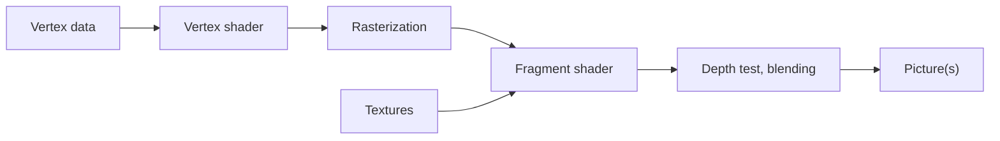

# Appendix B – Foundations: How Triangles Become Pictures

> **In short:** This appendix explains the craft behind every 3D game: how coordinates and matrices
> bring a figure to the right spot on the screen, how the graphics card turns triangles into pixels
> and how light, shadow, shine and color are computed – 60 times per second in the browser. For
> every basic concept, you briefly learn how Kern puts it into practice.

How Kern assembles the building blocks in detail is described in [Chapter 4](04-graphics.md) and
[Chapter 5](05-scene-and-geometry.md). Here it's about the "why." Which source file contains which
building block is listed in the blue book at the beginning of Appendix B.

## B.1 Coordinate Spaces

### Why There Are Several Spaces

The body of the Micro Duck is described once in its **own** coordinate system. Then the duck stands
somewhere in the world, a camera looks at it, and in the end it lands on pixels. Every step changes
the coordinate system:


> **Imagine …** … the way to your favorite table at the café: "at the back on the left, by the
> window" (model space), "the café is at 12 Main Street" (world space), "diagonally ahead of me to
> the right" (camera space), "top right in the photo on my phone" (screen). One table, four
> descriptions.

In **camera space**, the camera sits at the origin and looks along −z. In **NDC** ("normalized
device coordinates"), everything visible lies in the cube from −1 to 1; on the **screen** there are
pixels and a depth value between 0 and 1.

### Homogeneous Coordinates: The Trick with the Fourth Number

A 3×3 matrix can rotate and stretch, but it can't move things – "plus 5 m to the right" is not a
multiplication. The trick: a **fourth number w**. A **point** gets w = 1, a **direction** w = 0.
The translation sits in the last column of a 4×4 matrix and only has an effect where w = 1.

Example: a translation by (5, 0, 0). The point (1, 2, 3, **1**) becomes (6, 2, 3, 1). The direction
(1, 2, 3, **0**) stays as it is – a direction has no location. And because all the steps are now
4×4 matrices, you can multiply them one after another:

```
p_clip = P · V · M · p_model
```

(M is the model matrix, V the view matrix, P the projection matrix.) In Kern, `Mat4::transform_point`
computes with w = 1, `transform_vector` with w = 0.

### Kern's Conventions

The header of `math.h` says it in one sentence: column-major 4×4 matrices in the OpenGL layout,
meters, right-handed, Z up. So: lengths are in **meters**; **Z points up**, x and y span the ground
(the default camera stands at (0, −18, 8) and looks at (0, 0, 2); physics and the sky compute the
same way). Matrices are stored **column by column**, and the translation sits in fields 12–14 –
exactly the layout WebGL expects. A matrix acts **from the left**: In A · B, B acts first. Kern
describes rotations with **quaternions**, four numbers without the pitfalls of three angles.

> **Watch out!** Order matters! First rotating and then moving 5 m is something different from
> first moving and then rotating – in the second case, the object swings along a circle around the
> origin. That's why Kern's "translate · rotate · scale" means: first scale, then rotate, then
> translate.

### View and Perspective

The **view matrix** (`Mat4::look_at`) builds three perpendicular camera axes from the eye point,
the target point and "up"; the camera looks along the negative third axis. The matrix is the
inverse of the camera's placement: It rotates and moves the world so that the camera ends up at the
origin. If the view direction and "up" lie on one line (the same or exactly opposite), the camera
is undefined; Kern then refuses the picture ("degenerate camera direction/up").

**Perspective** means: Twice as far away looks half as big – the picture position is x divided by
the distance. A matrix can't divide, but it can write the distance into w, and the graphics card
then divides by w: the **perspective division**. Kern's projection has a vertical opening angle of
60°, so the zoom factor is f = 1 / tan(30°) ≈ 1.732, and a near and a far plane at 0.05 m and
1800 m.

**Worked example:** a 960 × 540 picture (aspect ratio 1.778, horizontal factor 1.732 / 1.778 ≈
0.974), a point in camera space at (1, 0.5, −10), so 10 m in front of the camera:

| Step | Calculation | Result |
|---|---|---|
| Clip x, y, w | 0.974 · 1, 1.732 · 0.5, 10 | 0.974, 0.866, 10 |
| NDC | divide by w | 0.0974, 0.0866 |
| Pixel | (NDC + 1) / 2 · (960, 540) | (526.8, 293.4) |

The point lands just to the right of and above the center of the picture (480, 270), counted from
the bottom left. For editor views there is the **parallel** projection (`Mat4::ortho`), in which
distant things don't get smaller.

> **Try it!** In Kern Studio, switch the **Field of View** in the viewport menu **≡** between 50°
> and 110° – at 110° the world looks as if seen through a wide-angle lens, strongly stretched at the
> edges. With **Alt+J** (Top) you jump into an orthographic view: Distant buildings are suddenly as
> big as near ones.

### Depth Is Distributed Unevenly

The stored depth value is (apart from constants) proportional to **1 / distance**. The values crowd
toward 1 in the distance. With Kern's planes and a 24-bit depth buffer:

| Distance | Depth value | smallest separable gap |
|---|---|---|
| 1 m | 0.950026 | |
| 10 m | 0.995028 | ≈ 0.1 mm |
| 100 m | 0.999528 | ≈ 1.2 cm |
| 1000 m | 0.999978 | ≈ 1.2 m |

Already at 1 m, 95% of the value range is used up! The precision gets worse with the **square** of
the distance and depends almost only on the near plane: Doubling it doubles the precision
everywhere. Kern's ambient occlusion runs the formula backward to get the real distance back
(`viewDepth`).

> **Did you know?** That's why distant surfaces lying close together flicker in some games
> ("z-fighting"): The depth buffer simply can't tell them apart there anymore.

### Normals

A **normal** points perpendicularly away from a surface. If you squash an object unevenly, a normal
that was simply transformed along with it would end up crooked. The right thing is the **inverse
transpose** of the 3×3 part of the model matrix – roughly: Whatever stretches the surface has to
squash the normal. Kern computes it on the CPU, once per instance. It rejects a matrix with a scale
of 0, because such a matrix has no inverse.

## B.2 Rasterization and the Depth Buffer

After the projection, the corners of a triangle are available as screen points.
**Rasterization** checks which pixel centers lie inside; for each one, a **fragment** is created, a
pixel candidate.

```
     v2
     /\
    /  \       ■ = pixel center in the triangle → fragment
   / ■■ \
  / ■■■■ \
 /________\
v0        v1
```

Whatever sits at the corners (color, normal, texture coordinate) is **blended** in between, with
three weights that add up to 1 – a fragment exactly in the middle gets one third from each corner.
Because perspective distorts distances, the graphics card blends **perspective-correctly**.

If several triangles hit the same pixel, the **depth buffer** (z-buffer) decides: It remembers the
smallest depth so far for each pixel, and only a fragment that passes the test gets written. For
opaque things the order therefore doesn't matter – but for speed it does. Kern tests with "less
than or equal" and paints opaque things front to back (hidden things fail early, before the
expensive shader runs). Transparent things come back to front, blended according to their opacity
and without writing into the depth buffer – here the order matters. After that, the sky fills the
gaps at depth 1, and the first-person layer comes after a depth clear
([Chapter 4](04-graphics.md), 4.7).

With closed bodies, triangles that point away from the camera are always hidden. The graphics card
recognizes them by the **winding order** of their corners (clockwise or counterclockwise) and throws
them away: **backface culling**. A mirroring reverses the winding order, which is why Kern treats
mirrored instances separately (Chapter 4, 4.4).

> **Try it!** In Kern Studio, switch to **Wireframe** with **Alt+2** and see the triangles that
> everything is made of. **Alt+3** shows **Unlit** (color without light), **Alt+4** goes back to
> **Lit**.

## B.3 The GPU Pipeline and Shaders

The graphics card works like an assembly line:



Two stations are programmable: The **vertex shader** runs per corner and delivers its screen
position, the **fragment shader** runs per fragment and delivers colors. They work with four kinds
of data:

| Term | changes | Example |
|---|---|---|
| Attribute | per corner or instance | position, normal, model matrix |
| Uniform | per draw call | sun direction, material color |
| Varying | blended per fragment | world position, color |
| Texture | picture, sampled | color image, shadow map |

In Kern, the attributes have fixed slots, the same in the standard shader and the shadow shader.
Extensions attach their own attributes, uniforms and code at agreed-upon places without copying the
shader. Three tricks make the assembly line fast:

- **Instancing:** You paint a hundred identical trees with **one** call; an attribute that advances
  "per instance" instead of per corner gives each tree its position and tint. In Kern every mesh is
  instanced; when something moves, only this instance data changes, and the geometry stays on the
  graphics card.
- **Skinning:** For characters, every corner follows up to four bones, weighted, with weights that
  add up to 1 – in Kern with up to 32 bones, in the standard shader and in the shadow shader.
- **Several targets:** A fragment shader can write into several pictures at the same time. Kern
  fills three – the finished picture, the real light for bloom, the AO record – and so needs **no
  second pass** over all triangles for bloom and AO.

## B.4 Lighting

### What Makes a Pixel Bright

The **rendering equation** (after Kajiya) says in words: *light that comes out = self-illumination
+ all incoming light, weighted by how the surface throws it toward the eye and by the angle of
incidence.* How a surface redirects light is described by the **BRDF** – its "character profile."
Adding everything up is too expensive; real-time rendering splits it into **direct light** (sun,
lamps, computed exactly) and **indirect light** from the surroundings (greatly simplified).

### Lambert: Matte Surfaces

A matte surface scatters light evenly in all directions. Its brightness depends only on the
**angle of incidence**.

> **Imagine …** … a flashlight pointing straight down at the table: a small, bright circle. If you
> tilt it, the spot becomes a long, pale oval – the same light, more area.

Formula: brightness = albedo / π · light intensity · cos(angle of incidence); light from behind
counts as 0. The **albedo** is the share that the surface reflects; the 1/π keeps a white surface
from giving off more light than it receives. **Example:** a gray surface (0.5), the sun at 45°
(cos = 0.707), Kern's sun at 2.8 in the red channel: 0.5 · 2.8 · 0.707 / π ≈ **0.315**. Metals have
no matte share.

**Point lights** in reality get weaker with the square of the distance, but never reach zero –
every lamp would have to light the whole world. That's why Kern lets them fall off **smoothly to 0
at their range**, with at most 6 lamps. Each one has a position, range, color and strength. Kern
counts the distance as at least 0.2 m (0.04 squared), so that a lamp sitting directly on a surface
doesn't become infinitely bright.

### Shine

Shiny surfaces reflect light in a particular direction. The classic **Blinn–Phong** takes the
**half vector** exactly between the light and the eye: If the normal lies close to it, you see a
highlight.

Modern **PBR** (physically based rendering) uses **microfacet theory**: A rough surface consists of
millions of tiny mirrors, each tilted differently. Three questions determine the shine (the
Cook–Torrance formula): **D**, the distribution – how many little mirrors throw light into the eye?
(usually after **GGX**; smooth means a small, sharp spot, rough means a broader shimmer). **F**,
Fresnel – how much gets reflected at all? Much more at a grazing angle, like a lake that mirrors the
sky when you look at it from the side; the approximation after **Schlick** starts head-on at about
**4%** for non-metals and at the base color for metals. **G**, geometry – how much do the little
mirrors hide one another?

**Kern** has two knobs, roughness and metalness, and a **simplified PBR**: Lambert for matte light,
GGX and Schlick for the sun highlight, a reflection of the sky. Shortcuts: shine only for metal or
roughness below 0.95; a Schlick in which rough surfaces shine less at the edge; no G term of its
own – with the simplest assumption, the formula cancels down to the factor 1/4 that's in the
shader; and D capped at 40 against single giant pixels. Depending on roughness, the sky reflection
is blended between soft skylight and the sharper sky gradient and weighted with F. Glass (set by
extensions) additionally reflects the sky, so that panes don't look black.

Kern computes **indirect light** from just a few colors: a **hemisphere light** (sky color above,
ground color below, blended according to the tilt) and an **environment dome** made of zenith,
horizon and ground. It is carried along separately, so that the ambient occlusion (B.8) darkens
only this share.

## B.5 Shadow Maps

A point lies in shadow if something is between it and the sun. So you paint the scene once **from
the sun's point of view** and note down, for each map point, only the distance to the first object
– the **shadow map**. During normal painting, every point asks: "Am I farther away than what was
noted?" If so, something is in front of it.

```
   Sun ═════╗  (parallel rays)
            ║  ↓   ↓   ↓   ↓
            ║     ███          stored depth: roof
            ║  ↓  ███  ↓   ↓
            ║  ── ─── ─────    ground behind → shadow
```

| Problem | Cause | Remedy |
|---|---|---|
| Shadow acne (stripes) | surface shadows itself | bias, polygon offset |
| Peter Panning | too much bias, shadow detaches | keep the bias small |
| Jagged edges | one map point covers many pixels | filtering (PCF) |
| Flickering | map slides by fractions | snap to the grid |
| Blurry up close | map covers too much | fit it to the view |

For the sun, Kern uses a parallel (orthographic) projection, snaps to whole map points, fits the map
to the view (shadow distance), combines three kinds of bias (polygon offset, a small comparison
margin, **normal offset**) and filters with **PCF** (*percentage closer filtering*: several
comparisons, averaged) – 1, 4 or 9 samples, where the graphics card already compares and blends
four neighbors in each one. Only depth goes into the map, and only from shadow casters; it is
reused as long as the sun, the map position and the shadow casters stay the same. Surfaces that
point away from the sun don't even ask. With a shadow distance, the shadow fades out over the last
tenth. How all of this works together is described in [Chapter 4](04-graphics.md), 4.8.1. Why the
fitting matters so much: With the default values (512 map points over ±120 m), one map point is
2 · 120 / 512 ≈ **0.47 m** wide – much too coarse for something as small as the Micro Duck.

## B.6 HDR, Tone Mapping and Gamma

### Tone Mapping

Real light has a huge range; Kern's sun goes up to 2.8, but a screen can only show 0 to 1. That's
why you compute in **linear HDR** (*high dynamic range*) and only squeeze the result onto the screen
at the end. This mapping is called **tone mapping**. A good curve is almost straight in the middle
and rounds off the highlights softly:

```
 Output
  1 |            ____________
    |        _--
    |      /
    |    /
    |  /
  0 |/________________________ Input (linear)
    0    1    2    3    4
```

Kern uses the **ACES film curve** in the three.js version (factor in the exposure, a rational
approximation of the film curve, clamp to 0 to 1), optionally followed by its color grading.

> **Try it!** Turn the **Exposure** in the **World Settings** up and down. Bright spots run softly
> into white instead of being cut off hard – the film curve at work.

### Gamma and sRGB

Screens and image files store colors in **sRGB**: Dark tones get more of the 256 steps, because the
eye distinguishes more finely there. But light adds up **linearly**. So: convert input colors **to
linear**, compute linearly, and at the end convert back **to sRGB**. For brighter values, roughly
sRGB = 1.055 · linear^(1/2.4) − 0.055, and the other way around linear = ((sRGB + 0.055) /
1.055)^2.4 (very dark values have a small straight section).

**Example:** Linear middle gray 0.18 becomes 1.055 · 0.18^(1/2.4) − 0.055 ≈ **0.461** – almost
half the scale, even though it's only 18% of the light.

> **Watch out!** If you compute in sRGB, you get transitions that are too dark and wrong mixed
> colors. If colors are already linear, you have to say so – in Kern via `linear_colors`, or in the
> browser via `markLinearColors` – otherwise they get converted twice.

### Fog

After tone mapping, Kern mixes in fog, like three.js: fog share = 1 − e^(−(density ·
distance)²). With the default density of 0.00085, that's 0.085² ≈ 0.0072 at 100 m, so **0.7%**, and
at 1000 m it's 0.85² ≈ 0.72 and 1 − e^(−0.72) ≈ **51%**. Because of the square, the near range stays
clear for a long time, and then the haze closes in quickly. With height falloff it gets thinner
higher up; with sun scattering it glows in the direction of the sun.

## B.7 Bloom

**Bloom** is the halo of light around very bright spots, like backlight in your eye. Recipe: cut out
the bright parts, blur them (preferably on shrunken pictures – cheaper and wider), add them back.

A Gaussian blur is **separable**: Instead of 9 × 9 = 81 reads, 9 horizontal plus 9 vertical reads
are enough. Even cheaper: If you read **between** two texels, the hardware blends them for free, so
**five** reads replace nine weights. Kern's weights: 0.2270 in the middle, 0.3162 each at ±1.3846
and 0.0703 each at ±3.2308 texels – together 0.2270 + 2 · 0.3162 + 2 · 0.0703 = **1**, so that the
picture gets neither brighter nor darker.

In Kern, the scene also writes the real light into a copy made of 16-bit floating-point numbers.
From it, the bloom cuts out the bright parts with a soft threshold starting at about 0.88, blurs
them at a quarter and an eighth of the picture size (strengths 0.13 and 0.08) and, when combining,
adds only the **difference** that the glow makes after tone mapping; pixels without glow stay
bit-exact. If the device needs more than 27 ms per frame on average for 3.5 s, a guard switches the
glow off, unless it is forced. More in Chapter 4, 4.8.3.

## B.8 Ambient Occlusion: SSAO and GTAO

In corners, joints and under things, less ambient light arrives, because part of the sky is
covered. This **ambient occlusion** (AO) makes things "stand" on the ground instead of floating. It
asks: *How much of the sky above this point is open?* – where steep directions count more than flat
ones. The sun has its own shadows; AO only affects indirect light.

> **Imagine …** … you're lying in a hollow in the grass and looking up. The deeper the hollow, the
> smaller your piece of sky – and the darker it is where you are, even without a sun shadow.

Rays through the whole scene are too expensive. **SSAO** (*screen-space AO*) uses the depth buffer
and checks with random samples whether neighboring pixels lie "above" the point – a rough estimate.
**GTAO** (*ground-truth AO*, Jimenez and colleagues 2016) goes about it systematically: For each
pixel, choose a few directions ("slices"), in each one search left and right for the **horizon** –
the highest angle at which neighboring geometry covers the sky –, plug a **ready-made formula** in
for the open arc in between and average over the slices.

```
             Horizon h1
   View ↓       ╲   │n   ╱  Horizon h0
                 ╲  │   ╱
   ████████       ╲ │  ╱      ████
   ████████████────●────────████████
                  Pixel
   visible sky: arc between h0 and h1
```

Kern follows Intel's XeGTAO: the normal from the depth, a radius in meters (default 1.6), a 4×4
pattern that rotates the slices and that an edge-aware filter averages away again, and a
**multi-bounce correction**: Bright surfaces win back light that bounces back and forth between the
occluders. The result is a picture of its own (default: half resolution) with visibility and depth;
the depth makes sure that nothing bleeds across edges when scaling up. Four quality levels and a
guard that steps down on slow devices keep it fast. It is applied **only to the indirect share**,
which the standard shader writes along in its third output. Because the shader knows that share
anyway, Kern needs no second geometry pass for it (Chapter 4, 4.8.4).

## B.9 Sky and Atmosphere

The sky is blue because air molecules scatter blue light much more strongly than red light – the
**Rayleigh scattering**, proportional to 1 / wavelength⁴. Blue (about 450 nm) is thus scattered a
good four times more strongly than red (about 650 nm). At the horizon, the path through the air is
longer, the light brighter and, with a low sun, reddish. Around the sun, larger particles scatter
forward: The **Mie scattering** creates the bright halo.

Real sky models compute this scattering along the view ray. Kern's sky is deliberately **not** such
an integral, but a cheap recipe that looks similar: a color gradient, a golden hour with a band that
gets brighter toward the sun, a sun disk with a Mie-like halo, the moon, twinkling stars, clouds
from five layers of noise (pushed along by the wind, brighter toward the sun) and a transition into
the scene's fog color and sun scattering – painted as a screen-filling triangle that only fills the
gaps (Chapter 4, 4.8.2).

## B.10 Culling and Scene Structures

What lies outside the picture doesn't need to be painted. A camera's visible region is a **truncated
pyramid** (*frustum*) made of six planes. Gribb and Hartmann showed that you can read them off
directly by adding and subtracting the rows of the camera matrix. For each mesh, Kern tests a
**bounding sphere**: If its center lies more than one radius behind a plane, the mesh is invisible.

```
       \         /
        \  ●    /     ● visible
   ○     \     /      ○ rejected: fully behind the left plane
          \   /
           \ /
          Camera
```

The test is **cautious**: It never throws away anything visible, but sometimes lets something
invisible through (spheres near a corner). Kern checks every mesh this way whose material has
`frustum_culled` set – except characters with a skeleton, because their bones can leave the sphere.
For instanced meshes, the sphere encloses all instances. The shadow map tests against its own
pyramid.

> **Try it!** In Kern Studio, switch on **Bounds** under **Show** and look at the hulls Kern uses to
> decide what lies inside the view pyramid.

With many objects, a **BVH** (*bounding volume hierarchy*) helps: a tree in which every node has a
bounding box around all its children. If a ray misses a node, the whole branch drops out – like in
a number-guessing game with "higher or lower?", where ten questions are enough instead of a thousand
tries.

```
            [ all ]
           /        \
     [ left ]     [ right ]
      /    \        /    \
   [△△]  [△△]   [△△]  [△△]   leaves: triangles
```

In Kern, the BVH is used for **clicking**, not for painting: Static world objects with 36 triangles
or more get a tree over their triangles (always split in the middle), and moving ones are checked
directly. The ray is tested against the boxes with the slab test and against the triangles after
Möller–Trumbore. The physics has its own BVH in Box3D ([Appendix C](C-physics.md)).

## B.11 Draw Calls and State Changes

Every **draw call** costs processor time: checking state, binding buffers, uploading uniforms – and
in the browser also the trip from WebAssembly through JavaScript, including a check. Thousands of
small calls can take longer than the graphics card's actual work. **State changes** (a different
program, a different texture) cost something too.

> **Imagine …** … you go shopping. Walking to the store a hundred times for one ingredient each
> takes much longer than going once with a full basket – even though the same things end up in the
> fridge.

Kern's remedies: **one** standard program, instancing, a uniform cache, per-frame values set once
per frame, remembered texture and back-face settings, a shadow map only when needed, a visibility
check before painting and uploading geometry only once. The statistics (`RenderStats`) show draw
calls, triangles, instances, rejected meshes and the time on the CPU and – if the browser supports
it – on the GPU. The sequence of a frame is shown in [Chapter 4](04-graphics.md), 4.7.

## B.12 Why WebAssembly and WebGL2 Are Connected This Way

Kern is C++, but the browser only offers JavaScript interfaces. **WebAssembly** (WASM) is a compact
format that the browser translates into machine code. A WASM module has a **linear memory** (one big
array of bytes) and may only call functions that it is given as **imports** when it loads.
**WebGL2** is the browser's graphics interface, essentially OpenGL ES 3.0. Kern compiles with
wasi-sdk (target `wasm32-wasip1`); `gl.h` declares exactly the WebGL2 functions that are used,
`kern.mjs` translates numbers into WebGL objects and passes data on **without copying**, through
windows onto Kern's memory that are renewed after the memory grows. The page creates the WebGL2
access without antialiasing and without transparency, because Kern paints into its own targets and
does the compositing itself; only Kern Studio and exported games switch antialiasing on (Chapter
4, 4.2).


| Decision | Reason |
|---|---|
| everything in C++/WASM | one codebase for browser, tests, Lehrer, server; deterministic physics |
| wafer-thin JavaScript | logic in JS would be duplicated and harder to test |
| small, fixed import list | everything that's used is in one place |
| numbers instead of JS objects | WASM can only hold numbers |
| copies of all meshes, textures | rebuilding after a context loss |
| few calls, uniform cache | every call crosses the border |
| headless mode | the Lehrer computes the same world without graphics |
| one thread in WASM | Box3D single-threaded; parallelism via web workers |

## What you take away

- A point travels through **model, world, camera and clip space** onto the screen; the fourth
  number w turns translation and perspective into matrix multiplications.
- Kern computes in **meters, Z up**, with column-major matrices.
- The depth buffer is extremely precise up close and coarse far away; the **near plane** decides.
- Vertex shaders compute corners, fragment shaders compute pixels.
- Light = matte share (Lambert) + shine (GGX, Fresnel) + simplified ambient light.
- Shadow maps are a photo from the sun's point of view; bias, snapping and PCF keep them clean.
- Compute **linearly in HDR**, squeeze with a **film curve**, and finish with **sRGB**.
- Few draw calls make a game in the browser fast.

## Brain teasers

1. Why does a direction get w = 0 and a point w = 1?
2. One point is twice as far away as another. How big does it look?
3. You want to separate distant surfaces more precisely. What helps the most?
4. Why can't you simply add colors in sRGB?
5. Why does Kern paint the sky *after* the opaque objects?

### Solutions

1. With w = 0, the translation has no effect – a direction has no location.
2. Half as big: The perspective division divides by the distance.
3. Move the near plane farther out: twice as far out means twice as precise everywhere.
4. Light adds up linearly; in sRGB, mixes and gradients come out wrong, usually too dark.
5. Then only free pixels pass the depth test, and the expensive sky shader only runs where there is
   sky.

---

© 2026 Christian Heinrich Hohlfeld · All rights reserved · [Imprint and rights](00-imprint.md)
