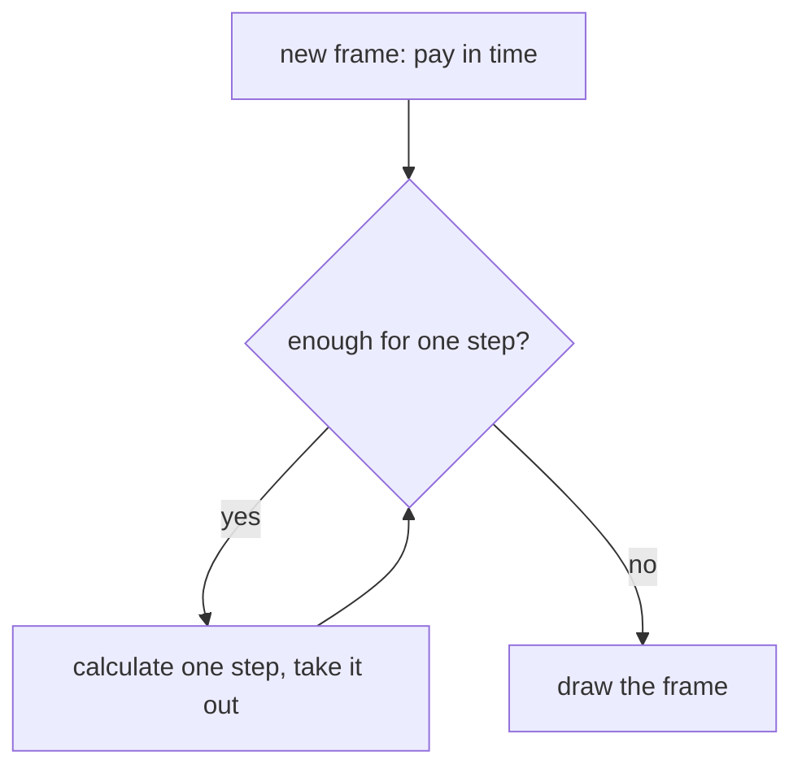
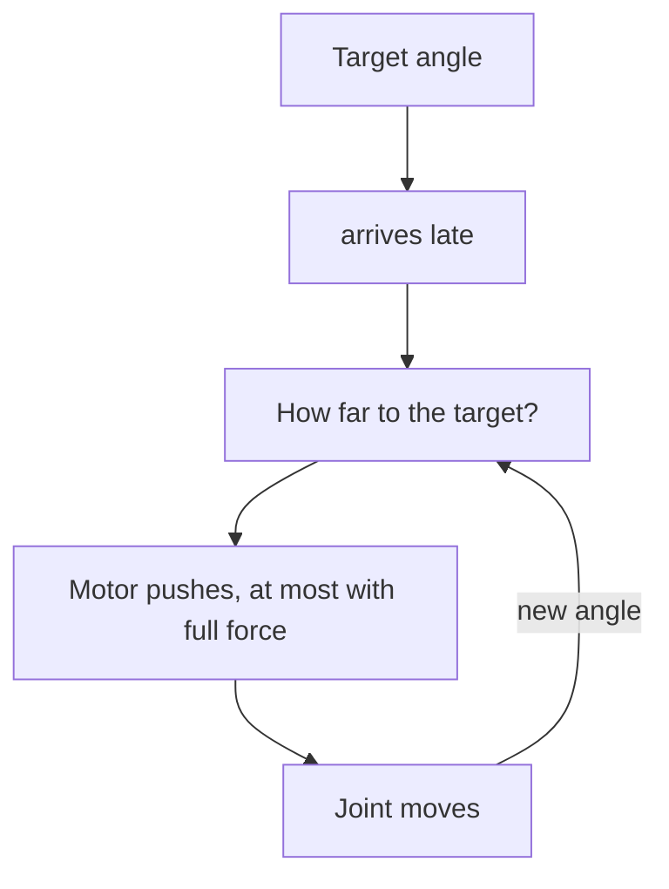

# Appendix C – Background: How a Physics Simulation Thinks

> **In short:** How do you teach a computer that crates fall, balls bounce and doors swing? This
> appendix explains the ideas behind every physics simulation: state, time steps, collisions,
> friction, joints, the solver, servos as a control loop – and why Kern gives the same result bit
> for bit on every computer.

> **Key terms:**
> - **Hertz (Hz)** – "how many times per second". A swing that swings back and forth twice a
>   second swings at 2 Hz.
> - **Torque** – turning force. With a long wrench, the same hand produces more of it. Measured in
>   newton meters (N·m).
> - **Force and impulse** – a force pushes for a while, an impulse is a short kick, like kicking a
>   ball.
> - **Rule (constraint)** – a condition the physics has to keep, such as "these two things aren't
>   stuck inside each other" or "these two points stay together".
> - **Solver** – the part of the physics that satisfies all rules at the same time in every step.
> - **Network** – the Micro Duck's learned control program, a neural network trained through lots
>   of trial and error in the simulation ([Chapter 13](13-micro-duck.md) and [14](14-lehrer.md)).
> - **Bit** – the smallest digit of a number in a computer. "The same bit for bit" means: the same
>   down to the very last digit.

Kern calculates with **Box3D** by Erin Catto. How Kern uses Box3D in practice is in
[Chapter 6](06-physics.md); here it's about the why.

## C.1 Rigid bodies and their state

A **rigid body** never deforms: two points on it always keep the same distance. That's a
simplification, because every real thing gives a little. But for crates, cars and robot limbs it
fits very well. The big advantage: a few details describe the whole movement.

> **Imagine …** you have to describe to someone on the phone exactly what a thrown brick is doing
> right now. Four details are enough: where it is, how it's rotated, how fast it's flying and how
> fast it's spinning. Because the brick doesn't bend, that says it all.

These four details are called the **state**. On top of that come properties that never change:

- the **mass** – how hard the body is to push,
- the **center of mass** – the point where you could balance it,
- the **rotational inertia** – how hard it is to turn around each direction. A long rod is easy to
  twirl around its long axis, but hard to swing crosswise.

The physics now works out how the state changes from moment to moment: forces accelerate the body,
torques set it turning. On top of that comes an astonishing effect: a thing spins cleanly around
its longest and its shortest axis, but around the middle one it wobbles.

> **Imagine …** you toss a phone into the air on its edge with a spin (over the bed!). Around the
> long and the short axis it spins cleanly; around the middle one it starts to tumble. Box3D
> calculates this effect too.

Because you can't calculate the movement in one piece, you go in small time steps. That's called
**integration**.

> **For the curious:** Box3D stores a body's rotation as a **quaternion**: four numbers that
> record a rotation compactly and without special cases.

## C.2 Integration: the flip book

Integration means: working out the next picture from the current one. To do that you have to make
an assumption, and depending on the assumption, a swinging spring stays calm, rocks itself up or is
slowed down.

> **Imagine …** a flip book. You know the current picture and have to draw the next one. You know
> how fast everything is moving right now – but while you turn the page, that changes too. Which
> speed do you take for the whole page? The one from the beginning? The one from the end? Every
> answer is a different method.

The best test object is a weight on a spring. Without friction, it swings equally far forever. A
good method shouldn't change that. Three candidates:

| Method | The bet | The swinging … |
|---|---|---|
| forward | speed from the start of the page | **grows** on and on until everything explodes |
| half-and-half | first the new speed, then move on with it | stays the same, as long as the pages are close enough together |
| backward | forces from the end of the page | gets **smaller**, but always stays well-behaved |

The differences in words:

- **Half-and-half** first looks at how the speed changes on this page and then moves on with the
  **new** speed, not with the old one as "forward" does. A tiny difference with a big effect.
- **Backward** sounds like magic: how can you know the forces at the end of the page before it's
  drawn? You don't know them; you search for them. What you're looking for is the position that
  fits the forces at its **own** end, as in the riddle "Which number multiplied by itself gives
  49?". That's more calculation work, but never explosive.

The problem with the middle method: if a spring swings very fast, the pages of the flip book are
too far apart to still capture the swinging. Then it becomes unstable too.

The lesson: **stiff springs and big steps don't get along** – unless you calculate backward.

> **For the curious:** The technical terms are explicit, semi-implicit and implicit. An example:
> the physics looks only twice per back-and-forth of a spring. The forward method then makes the
> swinging more than three times as big with every step, after ten steps 150,000 times as big.

> **Try it!** In Kern Studio at https://kernengine.de/, use **File › Example Levels** to open the
> level **Physics Lab**, start **Simulate** with Alt+S and stop it with **Play › Pause** or the
> **Pause** key. With **.**, in the menu **Advance One Frame**, you move on one step. You're
> turning the pages of the flip book one by one. You don't see which method is behind it, but you
> do see the individual pages.

### What Box3D does

Box3D uses the **middle method**. It's fast, keeps energy well and therefore suits games. The
built-in damping (a brake that lets movements die away slowly), on the other hand, Box3D calculates
backward, so always stably. Hence Kern's rule: damping only through Box3D's setting, never
home-made. A home-made brake would be calculated forward: it brakes with the speed from the start
of the page, even when the thing has long since slowed down. With a light body, it brakes past the
target and flings it backward, even harder on the next page, until everything explodes.

### Fixed time step and sub-steps

Because big steps blow springs apart, a simulation must **never** calculate with the fluctuating
time between two screen frames. A single slow frame would be a huge step, and the result would
depend on how fast the computer happens to be.

The solution is the piggy bank from [Chapter 6](06-physics.md) (6.12): every frame pays in the time
that has passed, the physics only ever takes out equal portions, and the rest waits for the next
frame.

On top of that, Box3D splits every step into **sub-steps**. Smaller steps make chains of joints
stiffer, because errors have less time to build up. How Kern sets step and sub-steps is in
[Chapter 6](06-physics.md).

## C.3 Collision detection

With 1000 bodies there are almost 500,000 possible pairs. Checking them all precisely would be far
too expensive. So you work in two rounds: first coarse, then precise.

**Coarse:** every shape gets an invisible box that always stands upright and encloses it completely.
Two shapes can only touch if their boxes overlap – that's quick to check. As in
[Chapter 5](05-scene-and-geometry.md), the boxes are sorted into boxes inside boxes. That way you
find the neighbors very quickly: with twice as many bodies, only one small step is added instead of
the work doubling. And because the boxes have a bit of air, not every body has to be re-sorted in
every step.

**Precise:** here **convex** shapes count, that is, shapes without dents: the line connecting two
points always lies completely inside. Sphere, capsule, box and hulls are convex; a banana isn't. For
convex shapes there are two proven ideas:

> **Imagine …** two boxes on the table. If you can kneel down so that you see a gap of light
> between them, they're not touching. If you can't find a gap from any direction, they're touching.

- The **light-gap idea** (technical name SAT) checks exactly that: is there a direction from which
  you can look through between the bodies?
- The **distance idea** (technical name GJK) measures how far apart two shapes are. The nice thing:
  it only needs each shape to answer a single question: "Which of your points lies farthest out in
  this direction?" That's why it works with any convex shape.

What comes out is where the two touch and in which direction they have to push each other away.

A **hull** is the smallest convex shape around a cloud of points, like a rubber sheet stretched
tight around it. Things with dents (a car, a foot with a recess) are put together from several
hulls. Arbitrary triangle meshes exist only for things that never move.

> **For the curious:** The distance idea works with a trick, the **Minkowski difference**: you
> subtract every point of one shape from every point of the other. If the origin lies inside the
> shape this produces, the two are touching.

### Contacts that look ahead

A fast body could "jump" through a thin wall between two pages of the flip book: on one page it's in
front, on the next already behind. That's called *tunneling*.

> **Imagine …** a tennis ball, photographed at two pictures per second. In the first photo it's
> flying in front of the net, in the second it's lying behind it. Did it touch the net? You can't
> tell from the photos.

That's why Box3D creates contacts **shortly before** the touch and allows only as much approach in
this step as there's room for. For very fast bodies it also checks the whole path between two
steps. Because this slack is fixed in meters, the size rule from [Chapter 6](06-physics.md) applies.

## C.4 Contacts, friction and restitution

### The contact rule

For every contact point, three simple statements apply:

1. The bodies must not be stuck inside each other.
2. A contact can only **push, never pull**. (A table holds a cup, but it doesn't suck it down.)
3. Either they touch and push, or they're apart and there's no force.

The solver doesn't satisfy such either-or rules quite exactly, but very well (C.6).

### Friction

Friction holds as long as you don't push too hard. If more is asked of it, things slide.

> **Imagine …** you push a heavy wardrobe. First you push and nothing happens: friction holds
> against you. You push harder, and suddenly it slides. If the wardrobe is full of books, you have
> to push even harder.

How much friction can hold at most depends on two things: on the **material** (the friction value:
rubber holds a lot, ice little) and on **how firmly the things press on each other** (the full
wardrobe). Box3D knows only one friction value, not separate values for sticking and sliding. It
also brakes twisting on the spot, so that a thing lying flat doesn't spin around itself forever.

> **For the curious:** All the forces that friction can still hold together form a **friction
> cone**: the grippier the material, the wider the cone. Box3D really calculates it round, equally
> strong in every sliding direction.

### Two friction values, one contact

Every shape has its own friction value. But the contact needs **one**. Box3D takes a special kind
of average, the **geometric mean**: you multiply the two values and take the square root (a
calculator can do it; the table shows the results).

| Material A | Material B | Geometric mean | Ordinary average |
|---|---|---|---|
| 0.6 | 1.0 | 0.775 | 0.8 |
| 0.05 (ice) | 1.0 (rubber) | 0.224 | 0.525 |
| 0 | 1.0 | 0 | 0.5 |

The nice property: the geometric mean lies closer to the more slippery partner. Ice with rubber
stays slippery, and a completely smooth surface stays smooth, whatever it's paired with.

Still, it's only a rule of thumb; real pairs have their own values. That's why Kern gives certain
pairs their own friction ([Chapter 6](06-physics.md)). The reason is the Micro Duck: it picks up a
sock with its beak. Beak pad on sock has to grip, sock on floor has to slide. A single value per
shape can't do both.

### Restitution

**Restitution** says how much momentum is left after an impact: 0 means lying still, 1 means
bouncing back without loss. Of two shapes, the bouncier one counts – a rubber ball bounces on
concrete too. Very gentle, slow impacts don't bounce at all, otherwise a resting body would jitter
forever because of tiny leftovers.

### Rolling resistance

An ideal ball on an ideal floor rolls forever, because it touches it at only one point. Real balls
and floors give a little, and that brakes: **rolling resistance**. Kern's notes on the Lehrer, its
training program, say what it's needed for: "The sock crawled across the floor by itself (round
lumps of fabric rolled)." and "The ball rolled forever." Both have rolling resistance now.

## C.5 Joints as rules

For the physics, a **joint** is a rule that should always apply, such as: "This point of the door
and this point of the frame stay together." The solver works with velocities here: it makes sure
the two points don't start moving away from each other in the first place.

In every step, the solver then searches for exactly the kick that keeps the rule. How big it has to
be depends on **how heavy the movement feels**.

> **Imagine …** you stop a door that's swinging shut. A light room door you stop with one finger,
> for a heavy front door you need your whole hand. The joint has to grab "with the whole hand" or
> "with one finger" in just the same way, depending on what hangs on it.

Because small errors come up when calculating, the solver also nudges a little every step, so that
the points don't slowly drift apart.

Which joints Box3D knows (hinge, drawer, ball joint, rope, wheel …) is shown in the table in
[Chapter 6](06-physics.md). Important for all of them: a robot is built in its **resting
position**, because that's where the angle zero is, and the limits have to include it. Otherwise
the joint would already be outside its limits at the start and would be yanked into them.

> **For the curious:** In textbooks, this is where the **Jacobian matrix** appears, a table that
> says how each velocity affects a rule. From it, the solver works out how heavy a movement feels.

## C.6 The solver

### Many rules at once

A robot has many joints and dozens of contact points. Every kick in one place disturbs the others.

> **Imagine …** a group lines up for a group photo. One person moves to the left, which puts the
> next one off, who corrects themselves, and so on. After a few rounds everyone is standing neatly.
> That's how the solver works: rule by rule, several rounds.

**Warm start:** a resting stack needs almost the same kicks every step. If the solver starts with
the kicks from last time instead of from zero, it's done after a few rounds – as if the group lined
up for the second photo straight away the way they stood for the first.

> **For the curious:** Experts call the method Gauss-Seidel or *sequential impulses*. The rule
> "only push, never pull" applies to the sum of all kicks in a step: one round may take back what an
> earlier one pushed too much.

And where does the solver sit in a page of the flip book from C.2? Right in the middle of the
half-and-half method: first Box3D renews the velocities from the forces, **then** the solver
corrects them so that nothing is stuck inside anything and all joints hold, and **only then** do
all things move on with these corrected velocities.

### Soft rules

If every error were corrected immediately and completely, everything would jitter, and energy would
even get pumped in.

> **Imagine …** a child has sunk a millimeter into a mattress. If you yank them out, they fly into
> the air. If you lift them out gently, they simply lie on top again.

That's why Box3D makes **all** rules soft: each one acts like a very stiff, well-damped spring that
reduces errors gently in fractions of a second. Because this spring is calculated backward (C.2),
it always stays stable. A millimeter too deep is pushed out gently instead of with a jolt.

A final pass in every sub-step, called **relax**, then takes out the extra momentum that came from
pushing out. Think of the child on the mattress: they're pushed upward and would afterwards still
have some momentum upward. Without relax, a body would fly on with this momentum after a
correction.

### Limits of stiffness

A spring can only be calculated if it swings more slowly than the physics looks.

> **Imagine …** you watch a fast swing only once a second. It swings back and forth twice a second.
> Every time you look, it's in the same spot – you think it's standing still. To capture a swing, you
> have to look at least twice per back-and-forth.

That's why: **stiffer only works with more sub-steps.** Box3D and Kern limit every spring to what
the sub-steps can still capture cleanly.

> **For the curious:** This limit of "at least two looks per swing" is called the **Nyquist
> limit**. Kern keeps every spring in the level safely below it.

> **Try it!** In the Physics Lab, under **World Settings › Physics (Box3D)**, set the
> **Sub-steps** once to 1 and once to 16, start **Simulate** each time and pull on the rope bridge
> with the mouse. Watch how much the chain gives: with few sub-steps it stretches more, with many it
> holds together more firmly.

> **Watch out!** A heavy body on a very light one needs many solver rounds until the kicks have been
> passed along; until then the joints stretch. Like a truck being towed by a bicycle. That's why
> neighboring parts shouldn't differ too much in weight, and a rigid part becomes **one** body with
> several shapes ([Chapter 6](06-physics.md)).

## C.7 Servos as a control loop

A **servo** is a small positioning motor, as in model airplanes. The Micro Duck has one in every
joint. It gets a **target angle** and steers itself there: measure, compare with the target, push,
measure again. That's a **control loop**.

> **Imagine …** you adjust the temperature in the shower. Feel: too cold. Turn it up a bit. Feel
> again: almost right. A little more. And because the warm water only arrives after a moment, you
> sometimes turn it too far.

### Spring and shock absorber

The simplest usable controller has two parts:

> **Imagine …** a torsion spring ("pull toward the target") and a shock absorber ("not so
> hectic"), both on the joint. The farther the joint is from the target, the harder the spring
> pulls. The faster it moves, the harder the absorber brakes.

Experts call this a **PD controller**. How strong the absorber is compared to the spring decides
the path to the target:

| The absorber is … | The joint … |
|---|---|
| weak | overshoots the target and swings in |
| just right | reaches the target the fastest way, without overshooting |
| strong | creeps slowly toward the target |

The Micro Duck's servo is **soft and well damped**: it hardly overshoots and gives way when
something pushes against it.

### Saturation, friction, delay

- **Saturation:** a motor has a maximum force. From a certain distance to the target, it's already
  pushing with full force – even farther away doesn't help any more. Because the duck's servo is so
  soft, its network often has to set the target far beyond the spot where the joint is supposed to
  end up, to get enough force.
- **Friction:** the gearbox holds a resting joint until enough force is applied.
- **Delay:** time passes between command and effect, as with the warm water in the shower. That can
  set an otherwise calm controller swinging. A network that has never practiced with delay fails on
  the real robot.

### In Kern

Kern builds the servo only from Box3D's **own** parts, without extra forces: the hinge's spring is
the controller, a motor that wants to stand still is the friction, and the delay is a queue. The
same calculation drives Studio, the Lehrer (the training program) and the test bench for the
measurements. How it works in detail is explained in [Chapter 6](06-physics.md), Section 6.15.

Kern has to translate one thing here. Box3D describes a spring by how many times per second it
swings (in hertz). A servo, on the other hand, says how hard it pulls per degree. But how fast a
spring swings depends on how much hangs on it – a rubber band with a bunch of keys bobs faster than
with a shopping bag. How sluggish the parts at a joint are changes with the duck's posture. That's
why Kern converts anew in every step. And because Box3D calculates this spring "backward" (C.2), it
stays calm at any stiffness.

## C.8 What you shouldn't do

A few prohibitions follow from the basics:

- **Whatever should push continuously, as a force, anew every step.** The physics forgets forces
  after every step.
- **Jumps as an impulse**, that is, as a short kick, not as a simply set velocity. Setting a
  velocity means simply ordering the thing "you're flying this fast now", without a force having
  pushed it. A kick, on the other hand, goes through the solver, which also thinks of joints and
  the ground.
- **Don't set velocities on bodies with joints or contacts.** That bypasses the solver, fights
  against its rules and pumps energy in.
- **No helper forces for robots.** "They don't exist in the real world either."

> **Imagine …** you push a child on a swing – but at the wrong moment, against the movement, and
> then with it again. The swing jerks, and sometimes it flies higher than expected. Whoever sets
> velocities past the physics is pushing at the wrong moment in just the same way.

## C.9 Determinism

A simulation is **deterministic** if the same starts and the same inputs give the same result **bit
for bit**. For Kern that's central: a training run should give the same network everywhere, an error
should be reproducible, and a robot recording should play back the same everywhere.

"Almost the same" isn't enough, because physics is **chaotic**: tiny differences grow quickly. Or as
Kern's notes put it: "In a robot simulation, one bit turns into a different gait within seconds."

### The traps of decimal numbers

Computers round after every calculation. Every single calculation is precisely defined, but the
**order** matters:

> **Did you know?** (0.1 + 0.2) + 0.3 gives 0.6000000000000001 in a computer, but 0.1 + (0.2 + 0.3)
> gives 0.6.

From this follow Kern's countermeasures:

| Danger | Countermeasure |
|---|---|
| The compiler reorders calculations to go faster | forbidden |
| Several processor cores add up in changing order | fixed order, the physics calculates everything one after another |
| Some processors take a shortcut for "times and plus" | switched off, everywhere |
| Every system calculates sine & co. minimally differently | Kern brings its own sine calculation |
| The frame time fluctuates | fixed step, time counts steps |
| Randomness | its own random generator with fixed starting numbers |

The **compiler** ([Chapter 1](01-introduction.md)) turns Kern's program text into the instructions
for the processor. The **shortcut**: some processors calculate "a times b plus c" in one go and
round only once instead of twice. That's even more precise, but just different from a device that
rounds twice.

**Sine & co.** are calculations with angles, such as: "In which direction does an arm point that's
turned by 30 degrees?" The physics needs them all the time.

The worldwide standard for decimal numbers prescribes plus, times and square root exactly, but not
sine and co.: for them there's no rule about how precisely to round. That's why it isn't enough just
to fix the order: Kern also has to bring along its own rules for calculating the sine.

> **For the curious:** The math library it brings along comes from the free project musl. The exact
> switches and names are in the blue book, Appendix C.

### Checking

Determinism has to be measured. A test lets Pollen Robotics' network steer the duck for a while and,
after every tick, forms a **fingerprint** of its state: a short check number that changes completely
with the slightest change. Two versions of Kern are the same exactly when all fingerprints are the
same. The first difference shows when they start to diverge. It's checked with every change on a
Linux PC, on a Mac and in the WebAssembly module that the browser also uses.

## What you take away

- A rigid body is completely described by four details: where, how rotated, how fast, how fast
  spinning.
- Integration is a flip book; stiff springs need pages close together. Box3D uses the middle method;
  its damping is always stable.
- Collision runs in two rounds: coarse with boxes, precise with the light-gap and distance ideas on
  shapes without dents.
- Contacts only push; friction holds up to a limit, and two friction values become one mean that
  leans toward the more slippery one.
- The solver lines up all rules round by round like a group photo, starts with the result from last
  time and corrects gently instead of with a jolt.
- A servo is a spring plus a shock absorber, with maximum force, friction and delay.
- The same result on every computer needs fixed orders and its own calculation rules for sine & co.

## Brain teasers

1. A spring swings back and forth 40 times a second, but the physics looks only 50 times a second.
   What threatens?
2. Ice (0.05) meets rubber (1.0). Which friction value applies in Box3D, and why is that more
   plausible than the ordinary average of 0.525?
3. Why does the solver need the relax pass?
4. A servo is already so far from its target that it's pushing with full force. You move the target
   even farther away. Does it push harder now?
5. Why isn't "almost the same" enough for determinism?

### Solutions

1. Fewer than two looks per swing: the physics can no longer capture the swinging, and the spring
   becomes unstable. Remedy: more sub-steps or a softer spring.
2. About 0.224 (the square root of 0.05 times 1.0). Ice stays slippery – the geometric mean leans
   toward the more slippery partner.
3. It takes out the momentum that came from gently pushing out; otherwise the body would fly on with
   it.
4. No. Full force is full; more distance doesn't bring more force. That's called saturation.
5. Physics is chaotic: a difference in the last digit grows quickly until the robot walks
   differently.

---

© 2026 Christian Heinrich Hohlfeld · All rights reserved · [Imprint and rights](00-imprint.md)
