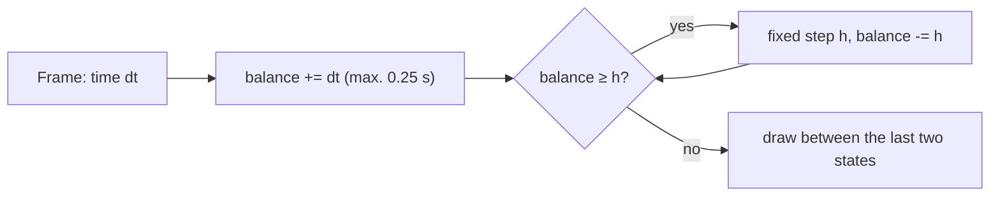
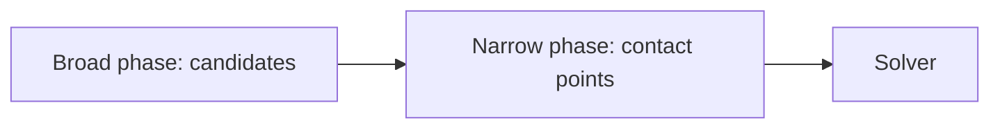
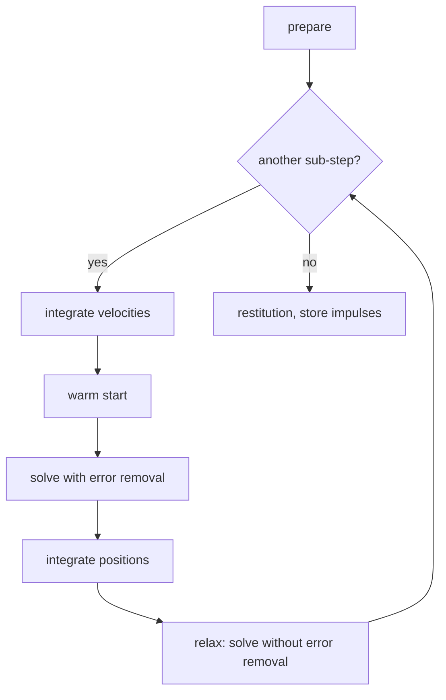
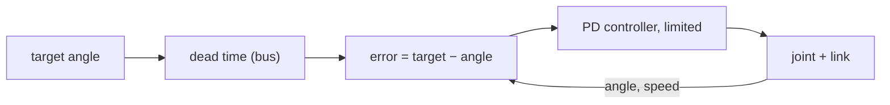

# Appendix C – Foundations: How a Physics Simulation Thinks

> **In short:** How do you teach a computer that crates fall, balls bounce and doors swing? This
> appendix explains the ideas behind every rigid body simulation: state, time steps, collisions,
> friction, joints, the solver, servos as a control loop – and why Kern delivers the same result bit for
> bit on every computer.

Kern calculates with **Box3D** by Erin Catto. How exactly Kern uses Box3D is in
[Chapter 6](06-physics.md); here it's about the why.

## C.1 Rigid bodies and their state

A **rigid body** never deforms: the distance between any two of its points always stays the same.
That's an approximation (every real body gives a little), but for crates, cars and robot links it's a
very good one. Its big advantage: a few numbers describe the motion completely.

The **state** consists of four quantities: where the center of mass is (position), how the body is
rotated (orientation, stored as a quaternion), how fast it's moving and how fast it's spinning. On top
of that come properties that never change: the **mass** (how hard it is to accelerate), the **center
of mass** and the **inertia tensor** – a 3 × 3 table that says how hard it is to rotate around each
axis. A long rod turns easily around its long axis, and with difficulty across it. Inside the body
itself this table is fixed; seen from the world, it rotates along with the body.

In Kern, mass and inertia come from the shapes and their density. Imported robots bring their measured
values with them ([Chapter 6](06-physics.md)).

The motion follows two laws: **Newton** (force = mass × acceleration) for moving along, and **Euler**
for rotating. Euler's equation contains an extra, the **gyroscopic term**. It makes long, thin bodies
tumble when they aren't spinning exactly around one of their principal axes. The rotation itself
changes via a quaternion product with the rotational speed. These equations describe how the state
*changes*. A simulation has to solve them in small time steps. That's called **integration**.

## C.2 Integration: the flip book

> **Imagine …** a flip book. You know the current picture and have to draw the next one. You know how
> fast everything is moving right now – but while you turn the page, that changes too. Every
> integration method is a different bet on which speed to use for the whole page.

The best test object is a mass on a spring. Without friction, it swings equally strongly forever. A
good method should neither inflate nor destroy its energy. Three candidates:

| Method | What it uses | What happens |
|---|---|---|
| explicit | everything from the old picture | energy always **grows** – it explodes |
| semi-implicit | first the new velocity, then the new position with it | energy stays, as long as the step is small enough |
| implicit | the force at the end of the step | energy **drops**, always stable |

More precisely: semi-implicit stays stable as long as step size × angular frequency is below 2 (the
angular frequency is 2π × hertz).

**Worked example:** a spring at 30 Hz, step size 1/60 s, so step size × angular frequency ≈ 3.14.
Explicitly, the oscillation grows by a factor of 3.3 per step – after ten steps, to 150,000 times its
size. For semi-implicit, the step is too big here; that becomes unstable too. Implicitly, the
oscillation is heavily damped, but it behaves itself.

The lesson: **stiff springs and big steps don't mix** – unless you calculate implicitly.

> **Try it!** In Kern Studio at https://kernengine.de/, open the **Physics Lab** via
> **File › Example Levels**, start Simulate (Alt+S) and press Pause. With **.** you advance exactly one
> physics step – one page of the flip book.

### What Box3D does

Box3D calculates **semi-implicitly**. In every sub-step, the velocities are first updated from forces
and gravity, then the solver resolves contacts and joints (C.6), then the positions move forward
**with the new velocity**; the rotation is normalized again afterward.

- The built-in **damping** is applied with a factor between 0 and 1 and is therefore always stable.
  Kern's rule from this: damping via Box3D's setting, never home-made as a force against the velocity
  – that would be explicit and becomes unstable on light bodies.
- Box3D solves the **gyroscopic term** implicitly ("This improves the simulation of long skinny
  bodies").
- Velocities are capped: in Kern at 400 m/s, and rotation at most an eighth of a turn (π/4) per time
  step.

### Fixed time step and sub-steps

Because big steps blow springs apart, a simulation must **never** calculate with the fluctuating frame
time. A slow frame would be a giant step, and the result would depend on the computer. The solution is
Glenn Fiedler's **accumulator**:

How exactly Kern implements this (60 Hz by default, at most 0.1 s of simulation per frame, time as a
step counter) is in [Chapter 6](06-physics.md). In addition, Box3D splits each step into
**sub-steps**: for the Micro Duck that's 100 Hz × 16 sub-steps, so a sub-step of 1/1600 s = 0.625 ms.
Small steps make chains of joints stiffer.

## C.3 Collision detection

With 1000 bodies there are almost 500,000 possible pairs. Checking them all precisely would be far too
expensive. That's why the work happens in two phases:

**Broad phase (coarse):** Every shape gets an axis-aligned bounding box. Two shapes can only touch if
their boxes overlap – six comparisons. The boxes live in a tree (a BVH, as in
[Chapter 5](05-scene-and-geometry.md)). So that the tree doesn't have to be rebuilt every step, the
boxes are a bit bigger (up to 50 mm). Only a shape that leaves its box gets re-sorted. Fixed bodies
have a tree of their own. With the tree, you find a box's neighbors in logarithmic time: with twice as
many bodies, only one step is added, instead of the work doubling.

**Narrow phase (precise):** Here, **convex** shapes are what count, meaning shapes without dents: the
line connecting any two points always lies entirely inside. Spheres, capsules, boxes and convex hulls
are convex. For them, there are robust methods:

- **GJK** (after Gilbert, Johnson and Keerthi) measures the distance between two convex shapes. The
  trick: you subtract every point of B from every point of A (the **Minkowski difference**). If the
  origin lies inside it, the shapes are touching. GJK feels its way toward the origin with simple
  shapes (point, line segment, triangle, tetrahedron) and needs only one piece of information from each
  shape: "Which point lies farthest out in this direction?"
- **SAT** (*separating axis theorem*): two convex bodies are not touching exactly when there is a
  direction in which you can look through between them – a **separating axis**. The only candidates are
  the face normals of both bodies and the cross products of their edges. This is how Box3D builds the
  contacts between hulls, and it remembers the most recently found axis, because it's usually right
  again in the next step.

> **Imagine …** two cardboard boxes on a table. If you can kneel down so that you see a sliver of light
> between them, they aren't touching. That's the whole idea of SAT.

The result is a **manifold**: one contact direction (normal) and a few contact points with their
distance (negative if they overlap).

A **convex hull** is the smallest convex shape around a cloud of points – like a rubber sheet stretched
around it. Box3D allows up to 128 corners. Things with dents (a car, a foot with a cutout) are put
together from several hulls. Box3D rejects flat or degenerate point clouds. Arbitrary triangle meshes
are only available for fixed bodies. For display, Kern builds the triangles of a hull with `hull_mesh`.

### Speculative contacts

A fast body could fly through a thin wall in a single step (*tunneling*). So Box3D creates contact
points **before** the bodies touch, starting at a distance of 20 mm, and in that step only allows as
much approach as there is room for. For very fast bodies there's also **continuous collision**; Kern
leaves it on and makes fast player vehicles "bullets". The fixed tolerances in meters: 5 mm of allowed
overlap (linear slop), 20 mm of speculative distance (four times as much), 50 mm for reusing contacts.
Because these tolerances are fixed in meters, the size rule from [Chapter 6](06-physics.md) applies:
moving bodies 0.1 to 10 m – which is why the Micro Duck is scaled up fourfold.

## C.4 Contacts, friction and restitution

### The contact rule

Three simple statements apply to every contact point:

1. The bodies must not overlap.
2. A contact can only **push, never pull**.
3. Either they touch and push, or they're apart and there is no force.

Either-or rules like these are called **complementarity conditions**. A solver doesn't satisfy them
exactly, but it approximates them very well (C.6).

### Coulomb friction

Friction acts in the contact plane against sliding. It's at most **friction coefficient μ × normal
force**. As long as less than that is needed, the contact **sticks**; if more is demanded, it
**slides**. The solver calculates with **impulses** (force × time) instead of forces; the impulse
perpendicular to the surface is called the **normal impulse**.

All the allowed forces form a **friction cone** around the normal: a force inside means sticking, on
the edge means sliding; the larger μ, the wider the cone (half the opening angle is arctan μ). Physics
distinguishes between static and sliding friction; Box3D knows only **one** friction coefficient. It
solves friction once at the center of the manifold, limited by the sum of the normal impulses of all
the points. The cone really is **round**: a friction impulse that's too large is shortened as a whole,
not direction by direction. In addition, Box3D brakes twisting around the normal.

### Two friction values, one contact

Every shape has its own friction coefficient (default 0.6). But the contact needs one. Box3D takes the
**geometric mean**: the square root of the product.

| μ A | μ B | √(A · B) | ordinary average |
|---|---|---|---|
| 0.6 | 1.0 | 0.775 | 0.8 |
| 0.05 (ice) | 1.0 (rubber) | 0.224 | 0.525 |
| 0 | 1.0 | 0 | 0.5 |

The nice property: a frictionless surface stays frictionless, no matter what it's paired with. Ice
with rubber stays slippery. Still, it's only a rule of thumb; real pairs have their own values. Kern
gives such pairs their own friction via surfaces like `cloth`, `tpu` and `floor`
([Chapter 6](06-physics.md)). Why? The Micro Duck picks up a sock with its beak: beak pad on sock has
to grip, sock on floor has to slide. A single value per shape can't do both.

### Restitution

**Restitution** e says how much speed is left after an impact: e = 0 means it stays put, e = 1 is
perfectly elastic. Box3D takes the **maximum** of both shapes – a rubber ball bounces on concrete, too.
Impacts below 1 m/s don't bounce at all; otherwise a body at rest would jitter forever because of tiny
leftovers. Restitution is applied after the actual solving, using the approach speed from before the
step (Kern: 2 passes).

### Rolling resistance

An ideal sphere on an ideal floor rolls forever, because the contact is a single point. Real spheres
and floors give a little, and that slows things down: **rolling resistance**. For this, Box3D limits
the torque that brakes the rolling to coefficient × radius × normal force. Kern's Lehrer notes say why
you need it: "The sock crawled across the floor by itself (round fabric lumps were rolling)." and "The
ball rolled forever." Both now have rolling resistance.

## C.5 Joints as rules

Mathematically, a **joint** is a condition that should always hold, such as "this point of body A and
this point of body B coincide". If you differentiate it, you get a rule for the velocities: the two
points must not move apart. A table called the **Jacobian matrix** says how each velocity affects the
rule.

The solver then looks for an impulse that satisfies the rule. How big it has to be depends on the
**effective mass**: how heavy does this movement feel? For a door hinge, that's the door's inertia
around the hinge axis. A heavy door needs a big impulse, a light one a small one. For a revolute joint
between two bodies, it's exactly 1 divided by the sum of the "ease of turning" (inverse inertias) of
both bodies around the axis. A correction part also removes errors that have already crept in (drift).

Which joints Box3D knows (hinge, rail, ball joint, rope, wheel …) is shown in the table in
[Chapter 6](06-physics.md). Important for all of them: a preset is built in its **rest pose**, because
that's where the zero angle is, and the limits have to include it.

## C.6 The solver

### Many rules at once

A robot has 15 joints and dozens of contact points. Every impulse in one place disturbs the others.

> **Imagine …** a group lining up for a group photo. One person moves to the left, which leaves the
> next one standing crooked, who corrects themselves, and so on. After a few rounds, everyone is
> standing neatly. That's how the solver works: rule by rule, several rounds.

This method is called **projected Gauss–Seidel**, and in game physics **sequential impulses**.
Inequalities like "only push, never pull" apply to the **accumulated** impulse: a single step may take
back what was too much before; only the sum must never pull.

**Warm starting:** A stack at rest needs almost the same impulses every step. If you start with the
impulses from last time instead of zero, the solver is done after just a few rounds.

### Soft rules and the soft step

A hard constraint corrects errors immediately and completely. That jitters and can pump energy in. So
Box3D makes **all** constraints soft: each one behaves like a very stiff, damped spring with a frequency
in hertz and a damping ratio – and is solved **implicitly**, which makes it stable (C.2). From the
frequency, damping and sub-step length, Box3D computes three numbers: how fast an error is removed, and
two parts that add up to 1 – one stands for "completely hard", the other for "not at all". Every
constraint lies somewhere in between.

**Worked example** with Kern's contact values (30 Hz, damping 10) for the Micro Duck: an overlap of
1 mm is pushed out at about 6.6 mm/s – gently instead of with a jolt. Against fixed bodies, such as feet
on the ground, Box3D calculates with double the frequency and half the damping (60 Hz, 5); there it's
about 26 mm/s. The maximum is 3 m/s (Kern's Contact push-out speed).

The **relax** pass removes the extra velocity that was created while removing errors. Without it, a
body would keep flying with it after a correction.

### Limits of stiffness

A spring can only be calculated if it oscillates more slowly than the sub-steps "look". Box3D limits
joint springs to a quarter and contact springs to an eighth of the sub-step rate. For the Micro Duck
(1600 sub-steps per second), that means at most 400 Hz for joints and 200 Hz for contacts; Kern's servo
joints use 240 Hz. Stiffer is only possible with more sub-steps. On top of that, Kern keeps springs in
the level below half the sub-step frequency (Nyquist limit: an oscillation needs at least two "looks"
per period).

> **Try it!** In the Physics Lab, set the **Sub-steps** under World Settings › Physics (Box3D) once to
> 1 and once to 16, start Simulate each time and pull on the rope bridge. Notice how much the chain of
> joints gives way. Turn on the **Contact Points** under **Window › Show** as well.

> **Watch out!** A heavy body on a very light one needs many solver rounds before the impulses are
> passed through; until then, the joints stretch. Keep neighboring masses within about 10 : 1. That's
> why Kern gives the duck's 5 g hip brackets a minimum mass and makes rigid parts **one** body with
> several shapes.

## C.7 Servos as a control loop

A hobby servo like the Micro Duck's Dynamixel XL330 receives a **target angle** and steers itself
there: measure, compare with the target, generate torque, measure again. That's a **control loop**.

### The PD controller

The **PD controller** calculates: torque = K × error − D × rotational speed.

> **Imagine …** a torsion spring (K, "pull toward the target") and a shock absorber (D, "not so
> hectic"), both at the joint. Together with the inertia of the link, they make a damped oscillator.

Whether it overshoots the target is decided by the damping ratio: below 1 it overshoots, exactly 1 is
the fastest way there without overshooting, above 1 it creeps toward it. With the XL330 values from
Kern (K = 0.554 N·m/rad, D = 0.053 N·m·s/rad, only the rotor inertia of 0.0018 kg·m²), you get a natural
frequency of about 2.8 Hz and a damping ratio of 0.84: a soft, well-damped servo. With a link attached,
it gets slower still.

### Saturation, friction, dead time

- **Saturation:** A motor has a maximum torque T. It's reached at a deviation of T/K, for the XL330
  0.963/0.554 ≈ 1.74 rad. That's why Kern's Lehrer notes say: "The network has to set targets far
  beyond the joint limits."
- **Friction:** The gearbox holds a joint at rest in place up to a small torque (XL330: 0.0048 N·m).
- **Dead time:** Time passes between a command and its effect (bus, processing). At 2.8 Hz and 20 ms,
  that's a shift of about 20°. Dead time can make a stable controller oscillate – and a network that has
  never practiced with dead time fails on the real robot.

### In Kern

Kern builds the servo only from Box3D's own parts ([Chapter 6](06-physics.md), section 6.17): the PD
controller **is** the hinge's joint spring and is therefore implicitly stable. Saturation comes from
limiting the **target** to a distance of at most T/K. Friction is a motor with target speed 0. The
rotor inertia is a disk on the axis, and the dead time a queue: 20 ms × √4 (time scaling) × 100 Hz =
4 world steps. The same function drives Studio, the Lehrer and the calibration bench
([Chapter 16](16-calibration.md)).

But Box3D wants springs as a frequency and a damping ratio, not in N·m/rad. `set_joint_spring` converts,
using the effective mass m from C.5: angular frequency ω = √(K / m), frequency = ω / 2π, damping ratio =
D / (2 · m · ω). Because m depends on the pose, this happens every step. All the values are in a
**device profile**: K, D, F, T, armature, dead time – and, for training, their spreads.

## C.8 What not to do

- **Continuous loads as forces, every step** – forces are reset after every step.
- **Jumps as an impulse** (mass × change in velocity), not a set velocity.
- **Don't set velocities on bodies with joints or contacts.** That goes around the solver and pumps
  energy in.
- **No helper forces for robots.** "They don't exist in the real world either."

## C.9 Determinism

A simulation is **deterministic** if the same starting conditions and the same inputs give the same
result **bit for bit**. For Kern this is central: a training run should produce the same network
everywhere, a bug should be reproducible, a robot log should play back the same way everywhere. And
"almost the same" isn't enough, because physics is **chaotic**: "In a robot simulation, one bit turns
into a different gait within seconds."

### The traps of decimal numbers

Computers round after every calculation. Each individual calculation is precisely defined, but the
**order** matters:

> **Did you know?** (0.1 + 0.2) + 0.3 gives 0.6000000000000001 on a computer, but 0.1 + (0.2 + 0.3)
> gives 0.6.

From this follow Kern's countermeasures:

| Danger | Countermeasure |
|---|---|
| The compiler reorders sums (`-ffast-math`) | forbidden |
| Threads add up in a changing order | fixed parts, fixed order; Box3D with one thread |
| FMA: a × b + c with one rounding instead of two | `-ffp-contract=off` everywhere, Box3D without SIMD |
| sin, cos, exp … round differently depending on the system | own library (musl) under `kern::dm::` |
| Fluctuating time step, time measurement | fixed step, time counts steps |
| Randomness | own random number generator with fixed seeds |

FMA is a processor shortcut that calculates a multiplication and an addition in one go. Both results
are correct, but different – and WebAssembly doesn't do it, while native builds sometimes do. The
floating-point standard prescribes plus, times and square root exactly, but not sine and friends:
glibc, Apple's libm, Android's bionic and wasi-libc round them differently in the last bit. That's why
Kern brings along musl's implementations (MIT license), and everything that feeds the simulation uses
`kern::dm::sin` instead of `std::sin`. `sqrt`, `fabs` and `floor` are exact and stay `std::`; Box3D has
its own deterministic trigonometric functions.

### Checking

Determinism has to be measured. One test has Pollen Robotics' network steer the duck for 400 control
ticks and stores a fingerprint of the exact state for each tick. Two builds are bit-identical exactly
when all the fingerprints are the same; the first difference shows when they start to drift apart. CI
checks this with GCC on x86, with WebAssembly and with Apple clang on ARM. And a freely hanging servo
leg runs bit for bit identically at 1 and 4 times the size, because the scaling factors are powers of
two, and then everything is rounded identically.

## What you take away

- A rigid body is completely described by its position, rotation, velocity and rotational speed.
- Box3D integrates semi-implicitly; stiff springs need small steps or implicit solving.
- Collision happens in two phases: coarse with bounding boxes, precise with GJK and SAT on convex
  shapes.
- Contacts only push; friction is limited by μ × normal force, and two friction values become
  √(a · b).
- The solver works rule by rule in rounds, with warm starting and soft, implicitly solved constraints.
- A servo is a PD controller with saturation, friction and dead time.
- Bit-for-bit determinism needs fixed orders, no FMA and a math library of its own.

## Brain teasers

1. Why is a spring at 30 Hz dangerous with a step size of 1/60 s?
2. Ice (0.05) meets rubber (1.0). Which friction value applies in Box3D, and why is that more plausible
   than 0.525?
3. Why does the solver need a relax pass?
4. An XL330 is 2 rad away from its target. Does it get more torque than at 1.8 rad?
5. Why isn't "almost the same" good enough for determinism?

### Solutions

1. The step is too coarse for such a fast oscillation: explicitly it grows 3.3-fold per step, and it
   becomes unstable semi-implicitly too.
2. √(0.05 · 1.0) ≈ 0.224. Ice stays slippery – the geometric mean pulls toward the smaller friction.
3. It removes the velocity created while removing errors; otherwise the body would fly on with it.
4. No. From about 1.74 rad on, the maximum torque is reached; more distance doesn't bring more force.
5. Physics is chaotic: a difference in the last bit grows quickly until the robot walks differently.

---

© 2026 Christian Heinrich Hohlfeld · All rights reserved · [Imprint and rights](00-imprint.md)
