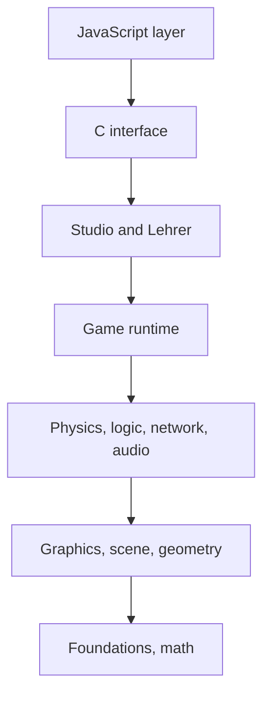

# 1 Welcome to the Workshop

> **Your level:** You're stepping into Kern, a real 3D engine that runs in the browser. You'll find
> out what's inside it, which rules it's built by, and how to play this book.

Hi, and welcome! Underneath every game there's an **engine**, the motor under the hood. All the
game says is: "There's a car here, and when you press W, it drives." Drawing, physics and sound are
the engine's job.

In this book, you take the engine **Kern** apart. Waiting for you at
https://kernengine.de/ are **Kern Studio**, an editor where you build worlds and play them right
away; the **Micro Duck**, a two-legged robot by Pollen Robotics that walks in Kern with its real,
trained networks; the **Lehrer**, which trains new networks for this robot; plus playable levels
like **Orb Run** and **Physics Lab** and the C++ examples `hello` and `orbrun`.


> **Mission:** Open Kern Studio. The very first time you start it, **Orb Run** is loaded
> (otherwise use **File → Example Levels → Orb Run**). Press **Play** (Alt+P), take off in the
> hovercar and collect orbs. **Esc** ends the game.

> **Watch out, trap:** On a German system, Kern Studio shows German menus, for example "Datei"
> instead of "File". This book uses the English names. So click the **DE | EN** button at the
> bottom right of the status bar to switch to English, or open Studio with `?lang=en` at the end of
> the address. Studio remembers your choice on your device.

## 1.1 What Kern Is

Kern is written in **C++20**. Browsers don't understand C++, so the toolkit **wasi-sdk** translates
Kern into **WebAssembly**, a machine language for browsers. Drawing is done with **WebGL2**. Kern
grew out of the game **SpawnCity**, but the engine doesn't know SpawnCity: games talk to the
engine, never the other way around.

| Part | What it does |
|---|---|
| Foundations, math | types, errors, JSON, vectors |
| Renderer, scene, geometry | drawing, buildings, roads, terrain |
| Physics (Box3D) | collisions, joints, gravity |
| Audio | mixer, 3D sound, the duck's voice |
| Game runtime | levels, players, rules |
| Logic, networking | building blocks, multiplayer |
| Studio, Lehrer | editor and trainer |
| JavaScript layer | bridge to the browser |

## 1.2 Kern's Rules

**Everything homemade.** Kern uses neither the graphics engine three.js nor the compiler
Emscripten. The renderer calls WebGL2 directly. The module is a **reactor**: there's no main
program; instead, the browser calls a startup function once and after that whatever it needs.
Because Kern only uses the core of WebAssembly plus four widely supported extensions, it runs in
every WebGL2 browser, even Safari 15 and later.

**JavaScript is just the waiter.** In the browser, only JavaScript can reach the graphics card,
keys, sounds and files. That – and only that – is what the JavaScript layer does. It even draws the
Studio windows only as the C++ editor tells it to, and the Blueprint editor keeps no graph of its
own: every change is a command to the engine.

> **Picture it like this:** The waiter carries the order to the kitchen and the food to the table.
> He doesn't cook. JavaScript is the waiter, C++ is the kitchen.

Everything a game does lives in C++ and can be tested without a browser.

**Exactly the same everywhere.** A simulation or a training run comes out **bit for bit** the same
on a PC with an x86 chip, on a Mac with an ARM chip and in the browser. That's called
**determinism**. To get there, Kern never merges `a*b+c` into a single calculation step, runs Box3D
without special instructions, brings its own `sin`, `cos` and friends, and, while learning,
computes the same way no matter how many helpers are working along ([Chapter 3](03-foundations.md)).
A **fingerprint** checks this on three platforms ([Chapter 2](02-building-and-testing.md)).

> **Crazy but true:** Because Kern computes so exactly, a difference between the real robot and the
> simulation is a real model error and not random noise ([Chapter 16](16-calibration.md)).

**Even more rules:**

- No exceptions: when something goes wrong, you get `false` and a message.
- Inputs are checked, and broken ones don't change anything that already exists. The JSON reader,
  for example, rejects texts that are nested too deeply.
- JavaScript allocates no new memory while drawing.
- No cheating: the Micro Duck stays upright only through its servos and contact with the ground.
- Editor, game and Lehrer share the game world, the servos and the physics.
- If the browser loses the graphics card, Kern pauses and rebuilds everything afterward.

## 1.3 The Blueprint: Floors

Kern is like a skyscraper: each floor uses only the floors below it.



Some floors are only added with a switch: `--app` (games written entirely in C++), `--physics`
(Box3D), `--game` (brings the physics along), `--studio` and `--lehrer` (bring the game runtime and
the physics along). Everything else, such as graphics, audio, logic and networking, is always in.

Between C++ and JavaScript there's only one door: the module's memory. The browser puts numbers
there and gives the engine the address; texts travel as "address plus length". Studio answers with
JSON text in memory. The other way around, the engine calls the browser's functions, for example
for drawing or to get the time ([Chapter 17](17-reference.md)).

> **Watch out, trap:** Which number sits where is firmly agreed on both sides. If you change it
> only in C++, the two sides talk past each other.

## 1.4 Four Forms, One Code

**A game entirely in C++.** This is how the smallest example, `hello`, sets up its renderer:

```cpp
RendererOptions configure() override {
  RendererOptions o;
  o.shadows = true;
  o.shadow.resolution = 1024;
  o.shadow.extent = 40;
  return o;
}
```

An empty settings sheet `o`, shadows on, a shadow map with a resolution of 1024 that covers
40 meters in every direction, hand in the sheet. After that, the browser calls `update()` every
frame ([Chapter 12](12-your-own-games.md)). The bigger `orbrun` has a city, traffic, and day and
night.

**Just the renderer.** This is how SpawnCity uses Kern: JavaScript loads the module and lets it draw
([Chapter 4](04-graphics.md)).

**Studio and exported games.** The whole Studio is **one** HTML file that runs offline with a
double-click. **File → Package Game (HTML)…** also turns your level into a single HTML file that
plays with the same C++ classes ([Chapter 11](11-studio.md)).

**The Lehrer.** It trains networks for the Micro Duck: as a program on all processor cores or in the
browser at `/lehrer/`. Same seed, same number of ducks – the same network everywhere. Studio loads
it just like Pollen's networks ([Chapter 14](14-lehrer.md)).

In the Micro Duck, everything meshes together: Pollen's model, limbs made of Box3D bodies, servos
with a device model, networks that Kern computes itself, a voice from the mixer, logic blocks in the
*Robots* category – and in Studio, an actor like any other.

> **Mission:** Stop a running game with **Esc**, because the menu entries are locked during Play.
> Load **File → Example Levels → Micro Duck** and press **Play**. First you watch the duck walk
> around on its own. **F8** lets you take over: **W** walks, **A**/**D** turn, the **spacebar**
> quacks.

> **Mission:** From the home page, open the **Lehrer** and take a look around.

## 1.5 Where Everything Lives

The source code is open: https://github.com/ChristianHohlfeld/kernengine.de (Apache License 2.0).

```
tools/        build Studio, relay, import
site/         home page
generated/    finished build files
kern/         the engine
  include/    headers     src/   code
  web/        JavaScript  tests/ tests
  examples/   hello, orbrun
  policies/   Kern's own networks
  third_party/  Box3D, musl, Micro Duck
  docs/       documents and books
```

For physics and the Micro Duck, `kern/docs/physics.md` and `walker.md` are the binding references.

> **Watch out, trap:** The SpawnCity files mentioned in `kern/README.md` live in the SpawnCity
> repository.

## 1.6 How to Play This Book

**Every chapter is a level.** At the top it says **Your level**. You work your way from the bottom
up: building and foundations, graphics through networking, Studio and your own games, Micro Duck
through calibration, and finally the [reference](17-reference.md). Three bonus levels explain
neural networks ([A](A-neural-networks.md)), real-time graphics ([B](B-rendering.md)) and
physics ([C](C-physics.md)).

| Box | What's in it |
|---|---|
| **Mission** | a task in the real Studio |
| **Picture it like this** | a comparison from everyday life |
| **Crazy but true** | an amazing fact |
| **Watch out, trap** | a typical mistake |
| **For pros** | a peek ahead for the curious |

At the end: **Level complete!** and the **Puzzle corner**.

Shortcuts: changing Kern – 2 and 3 (before physics or the robot, also 6 and 13). Building games –
11 or 12, plus 8 and 9. The duck – 13, 14, 16. Building Kern into a web page – 4 and 17.

**Three books, one content.** You're reading the **yellow book**. The **green** one explains
everything simply for adults without prior knowledge; the **blue** one goes technical down to the
last detail and is the source for all three. If a topic grabs you, look it up in the blue book!

> **For pros:** The code in this book comes from the real source code. Paths start at `kern/`,
> except for `tools/`, `site/` and `generated/`.

## Level complete!

- You know what an engine is and what's inside Kern.
- You know C++20, WebAssembly and WebGL2 as the ingredients.
- You know why JavaScript is just the waiter.
- You know Kern's floors and the four forms from one code.
- You played Orb Run and steered the Micro Duck.

## Puzzle corner

1. Why doesn't Kern run directly as C++ in the browser?
2. You build with `--studio`. What comes along automatically?
3. **Boss puzzle:** Why does a network trained in the Lehrer behave exactly the same in Studio?

### Solutions

1. Browsers don't understand C++; wasi-sdk translates it into WebAssembly.
2. The game runtime (`--game`) and the physics (`--physics`).
3. The Lehrer and Studio share the game world, the servos and the physics, and Kern computes bit for
   bit the same everywhere. The network meets exactly the same world.

---

© 2026 Christian Heinrich Hohlfeld · All rights reserved · [Imprint and Rights](00-imprint.md)
