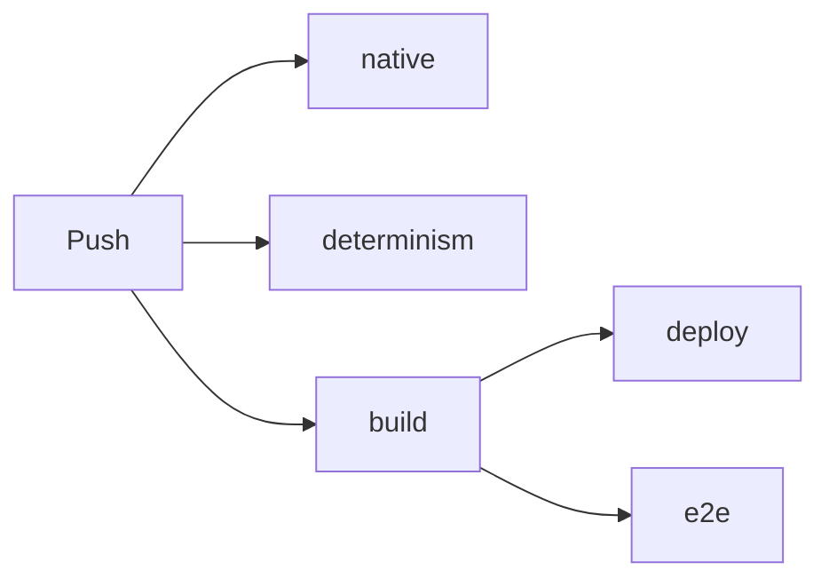

# 2 Build, Check, Prove

> **Your level:** This is where source code becomes a running engine – and you'll see how Kern keeps
> an eye on itself: with thousands of checks, a robot that clicks its way through Studio, and a
> fingerprint that gives away every wrong bit.

Imagine you change one line in the physics. Does the Micro Duck now stumble after three seconds?
Does Studio still run on a phone? Does the Mac still compute like the PC? Nobody can check all that
by hand after every change. That's why pros write **tests**: programs that do it every time, in
minutes.

## 2.1 The Big Picture

For **building**, there are three scripts: `kern/build.sh` (a WebAssembly module),
`tools/build_studio.sh` (Studio as a single file) and `kern/tools/lehrer.sh` (the Lehrer as a
program). For **checking**, there are the unit tests `kern/tests/run.sh`, two tests under Node
(logic and the Lehrer in the module) and the browser test. The shortest route:

```sh
export WASI_SDK=/opt/wasi-sdk-25.0-x86_64-linux
tools/build_studio.sh
CXX=g++ CC=gcc kern/tests/run.sh
```

Line 1 says where the toolkit is, line 2 builds `generated/studio.html`, which then runs offline
with a double-click, and line 3 starts all the unit tests. For development, you serve the
repository folder with a small web server and open `kern/web/studio/index.html`.
`play.html?level=orbRun` plays a level without the editor (also `physicsLab`, `shootingRange`,
`microDuck`, `basic`). `kern/build.sh --app` builds the C++ examples, for example
`kern/examples/hello/hello.cpp` into `hello.wasm`. For the browser test, you first start a
web server: `python3 -m http.server 8771`.

## 2.2 The Toolkit

Kern needs **wasi-sdk 25**: the compiler clang, the linker wasm-ld and libraries for WebAssembly,
no Emscripten. `WASI_SDK` points to the folder (otherwise `/opt/wasi-sdk`). For the tests and the
Lehrer, a normal compiler is enough (GCC, Clang, Apple clang). On top of that: `python3` for Studio,
Node (the CI uses Node 22) and Playwright with Chromium for the browser test.

## 2.3 Building the Module

Without switches, `kern/build.sh` builds the basic set; `--app`, `--physics`, `--game`, `--studio`
and `--lehrer` add floors ([Chapter 1](01-introduction.md)). Arguments ending in `.cpp` or `.cc` are
compiled along as game sources; others go to the compiler as options. Variables:
`KERN_BUILD=debug` optimizes less (the linker still always throws out debug info), `KERN_JOBS`
controls how many things run in parallel, `KERN_OBJ_CACHE` the cache.

The options are strict: `-ffp-contract=off` everywhere ([Chapter 3](03-foundations.md)), Box3D on
the simple scalar path, musl just as strict, C++ without exceptions and RTTI, only what's marked is
visible to the outside, and anything unused gets thrown out. The module becomes a reactor with a
1 MiB stack, 32 MiB of starting memory (2 GiB at most) and a growable function table, where the
logic JIT puts its graphs ([Chapter 9](09-logic.md)). At the very end: `built <out> (<n> bytes)`.

Each source is compiled in parallel and stored; Studio and the examples share the objects. The key
of an object contains the source path, the source content and the content of **all** headers.

> **Watch out, trap:** A changed header rebuilds everything. That's on purpose: simple and safe.

## 2.4 Studio in One File

`tools/build_studio.sh` first builds `generated/kern_studio.wasm` (with `--skip-wasm`, it uses an
existing one). Then a Python part glues everything into one page: the stylesheet, the module as
base64 text and the four JavaScript files as **one** embedded script. That's why the page runs even
under strict security rules. `kern.mjs` and `game.mjs` are also inside it as text – Studio uses them
to write exported games.

> **Crazy but true:** If a source contains the characters `</script`, the build stops. The browser
> would think the embedded script ended right there.

## 2.5 The Lehrer as a Program

`kern/tools/lehrer.sh` builds `kern_lehrer` for Linux and macOS, x86 and ARM, fully optimized, from
all sources except Studio and App, plus the WebGL stand-in (the Lehrer doesn't draw anything). With
`KERN_NATIVE=1`, the compiler uses the processor's best instructions – the result stays the same,
because `-ffp-contract=off` applies ([Chapter 14](14-lehrer.md), [Chapter 17](17-reference.md)).

## 2.6 Unit Tests: Thousands of Small Questions

`kern/tests/run.sh` starts all tests; `kern/tests/run.sh micro_duck` starts only those whose name
contains `micro_duck`. A test is a question with a fixed answer. `CHECK(...)` checks it,
`CHECK_NEAR(a, b, eps)` checks "roughly equal". At the end it says `<n> checks, <m> failures`, with
file and line for any failures. Kern wrote its little test framework itself. A few real names:
`micro_duck_stands_walks_and_turns_on_its_policy`, `lehrer_ppo_learns_to_reach`,
`net_reliable_channel_under_bad_network`. Everything gets tested, from math to Studio.

**Sanitizers.** For the tests, Kern's code is compiled with **AddressSanitizer**, which notices when
code reaches past the edge of a memory area, and with **UndefinedBehaviorSanitizer**, which catches
"undefined behavior" like a number overflow and stops immediately. Box3D and musl run without them.
On top of that, `-Werror` applies: every warning stops the test build.

> **Picture it like this:** A referee with video replay. During a match you might miss a small
> foul. The video replay sees every one.

**The GL stand-in.** No browser, no WebGL. `gl_stub.cpp` plays the graphics card and writes down
what the renderer asks for. That way, the renderer can be tested without a graphics card – even the
case where the browser loses the graphics card (context loss). The same stub is inside the Lehrer.

## 2.7 Logic: Three Paths, One Result

A logic graph runs in the **interpreter**, as a **JIT** or as **exported C++**
([Chapter 9](09-logic.md)). All three must deliver the same thing bit for bit. The shared test
cases are small graphs as JSON in `kern/tests/logic_cases.h`. `run.sh` checks the interpreter and
(only without a filter) the exported C++; the CI tests the JIT under Node, just like in the
browser, and on the side measures a million loop iterations in both tiers.

## 2.8 The Robot That Operates Studio

`kern/tests/e2e/studio_e2e.mjs` controls a real Chromium browser and clicks its way through Studio:
menus, flying, selecting, Play, Simulate, Undo, four viewports, the logic editor, the Micro Duck
with its head camera, multiplayer across two tabs, packaging and playing a game, all of it in phone
format too.

It computes the graphics without a graphics card, at about **one frame per second**. That's why
every check waits for its effect instead of a fixed time, and `ink()` counts the colors in the
image to see whether anything was really drawn. Screenshots are only taken when `KERN_E2E_SHOTS`
names a folder. You'll see some of them in this book.

> **Mission:** Be the test robot yourself! In Studio, hold the right mouse button and press **W**
> to fly. Click an actor, press **F**, then **Play** (Alt+P), **Esc**, **Simulate** (Alt+S),
> **Esc**. Did it all work? Check passed.

> **Mission:** Open the Content Drawer (Ctrl+Space), click **Cube** and move it three times with
> the Move tool (**W**). Open **Edit → History...** and click an earlier step. Studio jumps exactly
> back there.

## 2.9 The Fingerprint

Now for the heart of it all: how do you prove that a Mac, a PC and a browser simulate the Micro
Duck **exactly** the same?

Kern makes the duck walk with Pollen's walking network `velstand`: 150 ticks straight ahead, then it
turns on the spot. After every control tick, Kern throws the position, rotation, velocities and all
joint angles into a **hash** (FNV-1a). It turns lots of numbers into a short ID. If a single bit
changes, a completely different ID comes out.

> **Picture it like this:** A fingerprint identifies a person without describing them completely.
> Here, one line of letter soup gives away the duck's complete state.

The reference for 400 ticks is in `kern/tests/determinism_fingerprint.txt` and starts like this:

```
0 7588b1a57dfadf95
1 46e1d239a7ed5cfe
```

The comparison happens three times: with GCC on x86 including sanitizers, in the WebAssembly module
under Node, and with Apple clang on ARM. By hand, you first build the Lehrer and then compare:

```sh
kern/tools/lehrer.sh
kern/build/kern_lehrer --fingerprint 400 \
  | diff - kern/tests/determinism_fingerprint.txt
```

The Lehrer prints 400 fingerprints, and `diff` compares them. No output means: everything's the same.

If something differs, either the simulation was changed on purpose (then a new reference, with a
reason) or some code computes in a platform-dependent way: `std::sin` instead of `kern::dm::sin`,
a missing `-ffp-contract=off` option, a sum whose order depends on the number of threads. A second
test learns with 1, 2 and 4 workers (8 ducks in total) and compares the networks byte for byte.

> **Crazy but true:** Every single one of the 400 ticks gets checked. If one differs, the unit test
> names the first tick that differs (`first differing tick`). That's how you find the spot where the
> calculation drifts apart for the first time.

## 2.10 The CI: The Tireless Checker

The **CI** (`.github/workflows/ci.yml`) runs on every push to `main`, on pull requests and at the
push of a button:



- **native:** all unit tests with sanitizers.
- **determinism:** build the Lehrer with Apple clang on ARM, compare the fingerprint.
- **build:** build Studio, the examples and the Lehrer (with a cache), check the JavaScript syntax,
  test the Lehrer in the module (two ducks collecting, one learner, one PPO step, ONNX export,
  fingerprint), test the logic JIT, put together the website including the build ID and networks.
- **deploy:** only on `main`; pushes the site into the `gh-pages` branch, and it shows up at
  https://kernengine.de/.
- **e2e:** the browser test with Playwright 1.56.0 on the published files.

The site goes online as soon as `build` is done; the tests run in parallel and don't hold that up.
On `main`, every push runs to the end, so that every green state goes online; a run takes about
17 minutes. On pull requests, a new push cancels the older run.

> **Mission:** Open the published Studio and look at the bottom right of the status bar. It shows
> "v" and seven characters: the beginning of the build ID that the CI wrote into the page when
> publishing it.

> **For pros:** The `README.md` still mentions a `pages.yml`. It doesn't exist; the `deploy` job
> takes care of that.

## 2.11 At Home Like the CI

The same order works locally: unit tests, fingerprint, modules, Node tests, web server on port
8771, browser test. The development pages load their files relatively; only the Lehrer page expects
the folders of the published site.

## 2.12 When Things Get Stuck

| Message | Cause | Fix |
|---|---|---|
| `clang++ not found` | `WASI_SDK` wrong | set the variable |
| `missing …kern_studio.wasm` | `--skip-wasm` | build without it |
| `runtime error` | sanitizer finding | run the test alone |
| `first differing tick` | calculation depends on platform | see 2.9 |
| `runs in "interpreter"` | JIT failed | read the console |
| test hangs at start | server/module missing | start both |
| Playwright missing | not installed | `npm install` |

## Level complete!

- You know why pros test every change automatically.
- You know the build scripts and the cache.
- You know what sanitizers and the GL stand-in do.
- You know the robot that clicks its way through Studio.
- You understand the fingerprint and why one bit counts.
- You know the five jobs of the CI.

## Puzzle corner

1. What does `kern/tests/run.sh micro_duck` do?
2. Why does the browser test wait for effects instead of fixed times?
3. **Boss puzzle:** On the Mac, the fingerprint differs from tick 212 on. Name two possible causes.

### Solutions

1. It runs only the tests whose name contains `micro_duck`.
2. Without a graphics card, the browser draws about one frame per second; a fixed time would
   sometimes be too short and sometimes a waste.
3. For example, `std::sin` instead of `kern::dm::sin`, a missing `-ffp-contract=off` option or a sum
   whose order depends on the number of threads.

---

© 2026 Christian Heinrich Hohlfeld · All rights reserved · [Imprint and Rights](00-imprint.md)
