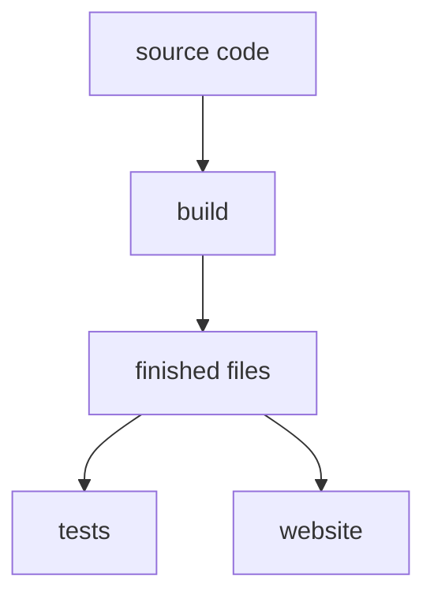

# 2 Build, Check, Prove

> **Your level:** Here, source code turns into a running engine – and you see how Kern watches
> over itself: with thousands of checks, a robot that clicks its way through Studio, and a
> fingerprint that gives away every wrong bit.

> **Words you need:**
> - **Source code** – the text of a program, the way people write it.
> - **Compiler** – a translator program: it turns source code into commands a computer can carry
>   out.
> - **Module** – the fully translated file of Kern that the browser loads.
> - **Processor** – the computer's calculating unit. Modern processors have several **cores** that
>   can calculate at the same time. Don't mix them up: these processor cores have nothing to do
>   with the engine Kern; the names just happen to sound almost the same.
> - **Memory** – the computer's workspace, where a program puts down its numbers.
> - **Actor** – a thing in a Studio level, such as a cube, a lamp or the duck.
> - **GitHub** – a website where Kern's source code lives and from which changes are checked and
>   published.

Imagine you change one line in the physics. Does the Micro Duck now stumble after three seconds?
Does Studio still run on a phone? Does the Mac still calculate like the PC? Nobody can check that
by hand after every change. That's why pros write **tests**: programs that do it automatically,
every time, in minutes.

## 2.1 The Overview

Between the source code and the engine in your browser lie two jobs: **building** and
**checking**. Building means translating the source code into finished files. Checking means
proving with tests that these files actually work correctly.

> **Picture it like this:** a bakery. The recipe is the source code. The oven turns it into a
> cake – that's building. Before the cake goes into the shop, a taster tries every piece – those
> are the tests.

Kern builds three things: the module for the browser, all of Studio as one single file, and the
Lehrer as a separate program. It's checked in three ways: with lots of small tests, with a robot
that operates Studio in the browser, and with the duck's fingerprint.

The exact commands, paths and settings are in the blue book, Chapter 2.

## 2.2 The Toolbox

A **compiler** is a translator: it reads C++ and writes machine language. For the browser, Kern
needs a special compiler that writes WebAssembly. For the tests and the Lehrer, which run directly
on your computer, an ordinary compiler is enough, the kind every programmer has. Kern uses only
simple, freely available tools for this and no big outside construction kit.

> **For pros:** The toolbox is called wasi-sdk (version 25). Which other programs and versions you
> need is in the blue book, Chapter 2.

## 2.3 Building the Module

**Building to order.** When translating, you say which floors from
[Chapter 1](01-introduction.md) should go into the module: just graphics, plus physics, plus game
rules, Studio or Lehrer. A game can have its own source code translated along with it.

**Strict rules for translating.** A compiler is normally allowed to cheat a little to get faster,
for example by merging two calculation steps into one. Kern forbids that. As a result, every
computer calculates exactly the same. Why two steps instead of one make a difference is something
you'll work out yourself in [Chapter 3](03-foundations.md).

For the same reason, the physics does without its turbo path. It would have its own way of
calculating that uses special commands of some processors to calculate several numbers at once.
That path doesn't exist in the browser. So Kern switches it off everywhere, and the physics
calculates the same simple way on every computer.

**The cache.** Kern is made of many dozens of source files. Translating all of them takes quite a
while. So Kern translates each file on its own, many at the same time on all processor cores, and
puts the result into a **cache**. The next time it builds, Kern checks: has this file changed? If
not, it takes the finished part from the cache. Only what changed gets translated again. Studio
and the example games share the finished parts of the engine.

> **Picture it like this:** your homework binder. If one assignment changes, you only copy out
> that page again, not the whole binder. But if the template that all the pages are based on
> changes, you redo everything just to be safe.

How does Kern recognize "changed"? A code number, a **hash**, is made from the content of a file
(more on this in 2.9). If even a single character changes, the code number changes.

> **Watch out, trap:** Some files are used by almost all the others, like the template. If you
> change a shared file like that, Kern rebuilds everything. That's on purpose: better to wait a
> minute longer than to keep working with an outdated part.

## 2.4 Studio in One File

A website normally consists of many files: text, look, programs, pictures. For Studio, all these
parts, together with the translated module, are packed into **one single** file. For that, the
module is rewritten into ordinary letters, because it consists of raw numbers, and a website may
only contain text. That's why Studio even runs without internet with a double-click. Studio also
puts the building blocks for finished games right into the file, so that it can pack your
exported game from them.

> **Picture it like this:** an envelope with a letter, photos and craft instructions inside.
> Whoever has the envelope has everything and doesn't need to order anything else.

> **For pros:** Websites mark program parts with `` at
> the end, like brackets. If this end mark happened to appear in the middle of the packed program,
> the browser would think it ended there. That's why building stops with a message in that case.

## 2.5 The Lehrer as a Program

Training the duck takes a long time. That's why the Lehrer exists not only in the browser but also
as a separate program for computers running Linux (an operating system like Windows) and for Macs.
As a program, it uses all the processor's cores and doesn't paint a single picture – that saves a
lot of time. So it can even train on a server, a computer in a data center without a screen.

Here the compiler may use the fastest commands of each processor. Isn't that the cheating that was
forbidden in 2.3? No. What's forbidden is changing the **calculation steps**, for example merging
two into one. What's allowed is carrying out the same steps with faster commands. That's why the
result stays the same bit for bit.

> **Picture it like this:** a math problem. You may write with a faster pen. But you have to do
> the same calculation steps in the same order and round at the same places. Then the same result
> is at the bottom as on your desk neighbor's sheet.

## 2.6 Unit Tests: Thousands of Small Questions

A **unit test** is a question to a small piece of Kern that has exactly one right answer. "What's
2 + 3?" – "5." If the answer is right, the test passes. Kern has thousands of such checks, from the
math to Studio. A few questions Kern really asks itself:

- Does the Micro Duck stand, walk and turn with its network?
- Does the Lehrer learn a simple task?
- Does a message arrive in multiplayer mode, even when the network is bad?

With decimal numbers, a test sometimes asks "roughly equal?", because computers round (see
[Chapter 3](03-foundations.md)). That doesn't contradict the "same bit for bit" from Chapter 1:
here the comparison is with the mathematically **correct** result, not with another computer. An
example: the test asks "Is 1 : 3 roughly 0.333?" Whether the computer gets exactly 0.3333333 or
0.3333334 doesn't matter to it. That every computer gets the **same** one of these two numbers is
checked instead by the fingerprint in 2.9. At the end, the test reports how many checks there were
and how many failed, with the exact spot in the source code. Kern wrote the small test framework
itself.

**Extra checkers.** While the tests run, two watchdogs run along, called **sanitizers**:

- The first notices when a program reaches past the edge of its memory area. That's like reading
  row 11 in a table with 10 rows: something is written there, just not what you're looking for.
- The second catches forbidden calculations, for example a **number overflow**. That's like a
  five-digit odometer that suddenly shows 00000 again after 99999.

If either of the two finds something, the test stops immediately. Also, when testing, every
**warning** from the compiler counts as an error. A warning is a hint from the translator: "This
looks suspicious."

> **Picture it like this:** a referee with video review. During the game, you might miss a small
> foul. Video review sees every one.

**The graphics dummy.** The tests run without a browser, so also without a graphics card. A
**dummy** therefore plays the graphics card: it draws nothing, but writes down exactly what the
engine asks of it. That way you check whether the engine gives the right commands. The dummy can
even pretend that the browser briefly took the graphics card away, so you can test whether Kern
rebuilds everything afterwards. The Lehrer uses it too, since it doesn't draw anything.

> **Picture it like this:** a crash-test dummy. It doesn't drive the car itself, but the sensors
> in it reveal exactly what would happen in an accident.

## 2.7 Logic: Three Ways, One Result

In Studio you can plug game sequences together out of building blocks, for example "When the
player touches the door, it opens." Such a sequence is called **logic** ([Chapter 9](09-logic.md)).
Kern can run it in three ways:

1. read it out step by step and carry it out (the slowest way),
2. translate it lightning-fast into machine language during play and then run it,
3. output it as C++ source code that's built firmly into a game.

> **Picture it like this:** a recipe. You can read it out while cooking, memorize it beforehand,
> or give it to a friend in print. The cake has to taste the same every time.

That's exactly what the logic tests check: the same small sequences run in all three ways, and all
of them must deliver the same result bit for bit.

## 2.8 The Robot That Operates Studio

A test program controls a real browser and clicks its way through everything important in Studio
like a human, in phone format too.

The test computer has no graphics card. So the processor has to draw by itself, laboriously, and
manages only about **one picture per second**. That's why every check waits for its **effect**
instead of a fixed time: "Wait until the menu is open" instead of "Wait two seconds." And to check
whether something was really drawn, the test counts how many different colors are in the picture.
An empty window would have almost only one.

> **Picture it like this:** You wait for the bus until it's there, not exactly five minutes. If it
> comes earlier, you get on earlier. If it comes later, you're not left standing on an empty street
> for nothing.

On request, the test takes screenshots. You'll see some of them in this book.

> **Mission:** Be the test robot yourself! In Studio, hold the right mouse button and press **W**
> to fly. Click an actor and press **F**, which means **Focus Selection**: the camera flies to it.
> Then press **Play** (Alt+P): you play along yourself. **Esc** stops. Press **Simulate** (Alt+S):
> now only the physics runs, and you watch with a free camera. **Esc**. Did everything work? Test
> passed.

> **Mission:** Open the **Content Drawer** with the button at the far left of the status bar (on
> Windows and Linux, Ctrl+Space works too; on a Mac, better use the button, because the Mac often
> uses these keys itself). Click **Cube**. Now press **W**, this time without the right mouse
> button: then W doesn't mean "fly" but the tool **Move (W)**. Colored arrows appear on the cube.
> Drag one arrow three times with the left mouse button to move it. Open **Edit › History...** and
> click an earlier step. Studio jumps exactly there. Kern's tests check this too: undo has to bring
> back exactly the same state every time.

## 2.9 The Fingerprint

Now the centerpiece: how do you prove that Mac, PC and browser simulate the Micro Duck **exactly**
the same?

Kern lets the duck, with a walking network from Pollen, first walk straight ahead and then turn on
the spot. After every **control tick** (that's what each moment is called in which the network
decides anew; it happens 50 times per second in the real duck's time), Kern takes all the numbers
that describe the duck: position, rotation, speeds, all joint angles. From them it makes a short
code of letters and digits, a **hash**. If a single bit changes anywhere in these numbers, a
completely different code comes out.

> **Picture it like this:** A fingerprint gives a person away without describing them completely.
> Here, one line of jumbled letters gives away the duck's complete state.

> **For pros:** Kern calculates the duck four times larger and twice as slow for it
> ([Chapter 6](06-physics.md), section 6.2). In simulation time, that's why there are 25 control
> ticks per second, for the real duck 50.

Why isn't something simple like the digit sum enough? Try it: 1234 has the digit sum
1 + 2 + 3 + 4 = 10. But the number 1243 also has the digit sum 10. So the digit sum doesn't notice
that two digits were swapped. A good hash mixes the numbers so thoroughly that even the smallest
change or swap produces a completely different code.

For 400 control ticks, that is 8 seconds in the life of the real duck (400 : 50 = 8), the correct
code of every tick is stored as a **reference**. The comparison happens in three ways: on a PC, in
the browser and on a Mac whose calculating unit is built quite differently from the one in a PC.
If all 400 codes match, everyone calculates exactly the same.

If something differs, there are two possibilities:

- Someone changed the simulation **on purpose**. Then it gets a new reference, with a reason.
- Somewhere a piece of code **doesn't calculate the same everywhere**. For example, it uses a
  calculating function of the computer that rounds differently at the last digit, or it merges
  two calculation steps. Or it adds up numbers in an order that depends on how many helpers are
  calculating at the same time (say, on several processor cores from the word box). Why the order
  matters is shown in [Chapter 3](03-foundations.md).

That's why there's a second test: the Lehrer learns the same task several times, each time with a
different number of helpers calculating at the same time. At the end, all networks must be the
same down to the last bit.

> **Crazy but true:** Every single one of the 400 ticks is checked. If one differs, the test names
> the first tick that differs. That's how you find the spot where the calculation first starts to
> drift apart.

The command to compare the fingerprint yourself is in the blue book, Chapter 2.

## 2.10 CI: the Tireless Checker

**CI** stands for *continuous integration*, meaning roughly "constantly merging together." Every
time someone uploads a change to Kern on GitHub, a computer on the internet automatically starts
all the jobs: building, testing, publishing. Nobody has to remember to do it.

> **Picture it like this:** an assembly line with quality control. Every new part runs through the
> same stations. Once a part is built, it already goes into the shop while quality control is still
> checking it. If they find something, you see it right away and fix it.

- **Tests with checkers:** all unit tests with the sanitizers.
- **Fingerprint on the Mac:** The Lehrer calculates the fingerprint. That's why the Lehrer is built
  on a Mac and has to move the duck exactly like the PC and the browser do.
- **Building:** Studio, examples and Lehrer are built (with the cache from 2.3). The Lehrer and the
  logic are also tested in their browser form, and the website is put together.
- **Publishing:** The finished site appears at https://kernengine.de/.
- **Robot in the browser:** the test from 2.8, and with exactly the files that get published.

The site goes online as soon as building is done. The tests keep running at the same time and
don't hold it up. That's a deliberate compromise: a whole run takes a good quarter of an hour, and
this way a change gets to you faster. If a test then reports an error, you see it right away and
fix it.

But only what has already arrived in Kern's **main version** gets published. If someone only
proposes a change (on GitHub that's called a **pull request**), the CI builds and checks it just
the same but doesn't publish it. So a proposal never gets onto the website unchecked.

> **Mission:** Open the published Studio and look at the bottom right of the status bar. There it
> says "v" and seven characters: the beginning of the **build ID** that the CI wrote into the page
> when publishing. That way you always know which version you're using. If you report a bug, this
> ID lets people find exactly the change your version comes from.

## 2.11 Build It Yourself

Everything the CI does, you can also do at home on your own computer, in the same order: first
the tests, then the fingerprint, then building, and finally the robot in the browser. And if
something gets stuck, the message usually already tells you where: which test, which line, which
tick.

The exact commands, paths and a table of typical errors and how to fix them are in the blue book,
Chapter 2.

## Level complete!

- You know why pros test every change automatically.
- You know what "translating" means and how the cache saves time.
- You know that a test is a question with a fixed answer.
- You know what sanitizers and the graphics dummy do.
- You know why the test robot waits for effects instead of time.
- You understand the fingerprint and why one bit matters.
- You know how the CI, like an assembly line, checks and publishes every change.

## Puzzle corner

1. You change a single file that nothing else uses. Why is the next build much faster than the
   first one?
2. Why does the browser test wait for effects instead of fixed times?
3. **Boss puzzle:** The fingerprint on the Mac differs from tick 212 on, even though nobody changed
   the simulation on purpose. Name two possible reasons why a computer might calculate differently.

### Solutions

1. The cache already has all the other files fully translated. Kern only translates the one changed
   file again.
2. Without a graphics card, the test computer draws about one picture per second. A fixed time
   would sometimes be too short, sometimes a waste.
3. For example: a calculating function of the computer rounds differently at the last digit. Or two
   calculation steps were merged into one. Or numbers are added up in an order that depends on how
   many helpers are calculating along.

---

© 2026 Christian Heinrich Hohlfeld · All rights reserved · [Imprint and rights](00-imprint.md)
