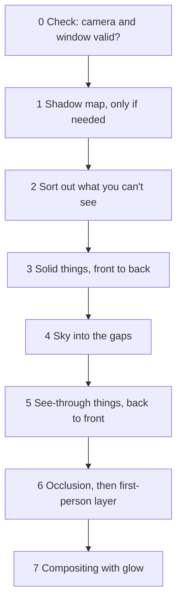

# 4 Graphics – How Kern Paints 60 Pictures per Second

> **Your level:** Now you watch the engine paint. You find out how C++ code in the browser reaches
> the graphics card, how triangles, light and shadow become a picture, and which tricks Kern uses
> to do as little work as possible. At the end, the windows of a whole city light up – without
> anyone having built a single window.

> **Words you need:**
>
> - **C++ and JavaScript** – two programming languages. Kern is written in C++. But the browser
>   offers its graphics only to JavaScript.
> - **Mesh** – the wire mesh of triangles that a 3D thing is made of.
> - **Instance** – a copy of the same mesh in another place, such as the 50th tree along an
>   avenue.
> - **Matrix** – a small table of numbers that says where something is, how it's rotated and how
>   big it is ([Appendix B.1](B-rendering.md)).
> - **Shader** – a small painting program that the graphics card runs for every corner and every
>   pixel at the same time, like a thousand students solving the same problem with different
>   numbers.
> - **Draw call** – an order to the graphics card: "Paint this mesh!" Every order takes time, no
>   matter how small it is.
> - **Texture** – a picture that's stuck onto a shape like a sticker. Its pixels are called
>   **texels**.
> - **Depth buffer** – an invisible picture in which the graphics card notes for every pixel how
>   far away the frontmost thing so far is. Only what's closer may paint over it.

This chapter shows **what Kern does**. Why light, shadow and perspective work the way they do is
explained in [Appendix B](B-rendering.md) with pictures and worked examples. If you want to dig
deeper, read B.2, B.3 and B.5 there first.

## 4.1 Overview

The **renderer** is the part of Kern that paints the pictures. Before we start, a basic picture:
inside the computer, **two separate workers** are at work, each with its own memory. The
**processor** is the head. It thinks up the game: who stands where, what moves. The **graphics
card** is like a thousand fast painting hands. Whatever the hands are supposed to paint first has
to be carried over to them. That's called **uploading**, and every trip over takes time.

Three basic rules hold the renderer together:

1. **One program for everything.** Every object is painted with the same shader. Why? Every
   switch of painting program takes time ([Appendix B.11](B-rendering.md)). Games change the look
   through small extensions that are inserted into this one program (4.6).
2. **Upload once, after that only movement.** The shape goes from the processor to the graphics
   card once; after that, only *where* something stands. The work per picture depends on what
   moves – not on the size of the world.
3. **Your own copy is the truth.** Kern keeps the corners, colors and positions of every object
   itself, in the processor's memory. From that, it calculates what's visible and what you can
   click. And if the graphics card suddenly forgets everything (that can happen, 4.11), Kern
   rebuilds everything from it.

> **Picture it like this:** a theater. The scenery is set up once; during the performance, only
> the actors move around. And the director has the plan of the stage in his head – if it burns
> down, he builds it back up exactly the same.

## 4.2 The Bridge to the Graphics Card

Kern is C++, but the graphics in the browser (called **WebGL2**) only exist for JavaScript. So
Kern needs a bridge. The principle: **only numbers go across the bridge.**

> **Picture it like this:** the coat check at the theater. You hand in your coat and get a token
> with the number 7. Later you just say "number 7" and get it back. You don't have to carry the
> coat around with you the whole time.

That's exactly how Kern works:

- **Graphics objects are numbers.** The real things on the graphics card are kept by JavaScript
  in a list: textures, programs and **buffers** (a piece of memory on the graphics card, for
  instance for all the corners of a mesh). Kern only gets the slot number. 0 means "nothing."
- **Data is "from here, this much."** Kern's memory is a long row of numbered compartments. Each
  holds one **byte**, which is 8 **bits** (8 yes-no places), enough for a number from 0 to 255. If
  Kern wants to upload 1000 corners, for example, it just says: "From compartment 5000, so many
  bytes." JavaScript reads directly in Kern's memory, without copying anything out. Like a page
  reference in a book instead of a copy.

Which graphics commands Kern may use is in **one** short list. At startup, Kern says "I need these
commands," and JavaScript hands them in (these are called **imports**). For tests without a
browser, there's a dummy that only writes the commands down. That way the tests check which
commands Kern would have sent.

The JavaScript side is deliberately thin: loading Kern, managing number lists, offering
convenient access. **There's no game logic in it.** Why? The same engine also runs without a
browser: in the tests and in the Lehrer, when it practices on a computer without a browser. There's
no JavaScript there. Whatever was written in JavaScript would have to be written a second time
there, and the tests couldn't check it. Whether a C++ game ([Chapter 12](12-your-own-games.md)), a
JavaScript program like SpawnCity or Kern Studio ([Chapter 11](11-studio.md)): they all use the
same renderer.

> **For pros:** The website creates the drawing surface, not the engine. Kern's own page switches
> off edge smoothing there, because Kern paints into its own picture buffers anyway (4.7), where it
> would have no effect; Studio and exported games switch it on. The exact names and values are in
> the blue book, Chapter 4.

## 4.3 Programs and the Notepad

A **program** is a finished shader made of two parts: the **vertex shader**, which calculates for
every corner where it lands on the screen, and the **fragment shader**, which calculates the color
for every pixel ([Appendix B.3](B-rendering.md)). The graphics card first has to **translate** the
painting program into its own language. If that fails, Kern writes the error message with a name
tag into the **log**, the record in which Kern collects messages. That way you see which shader is
to blame.

**Uniforms** are settings that apply to a whole draw call, such as "roughness = 0.5" or "the sun
comes from the left." Once set, they stay until you change them. Kern takes advantage of this with
a **notepad**: it notes every value it sent last. Before Kern sends a value, it checks. If the same
number is already there, it sends nothing.

> **Picture it like this:** A teacher doesn't rewrite the whole board every lesson. She only wipes
> away and writes down what has changed.

Why the effort? Every command takes the long road from C++ via JavaScript to the browser, which
checks it first, and then over to the graphics card. With hundreds of objects with the same
material, the notepad saves most of the trips. For long lists of numbers, it only notes a
fingerprint (**hash**, see [Chapter 2](02-building-and-testing.md)). The bones of moving figures
(like an arm that bends, see 4.5) go out without the notepad – they change every picture anyway.

## 4.4 Mesh, Material and Instances

A **mesh** is a shape made of triangles; the **material** says what it looks like: color, shine,
glow.

### What Every Corner and Every Copy Brings Along

Every **corner** brings along: where it is, which way its surface faces (the **normal**, an arrow
that sticks straight out of the surface), what color it has and which spot of the texture lies on
it. For figures, add which bone it hangs on. Every **instance** brings along: where it stands (as a
matrix), how it's **tinted** and how its normals are rotated. The tint is a color that the whole
copy gets colored with, such as an enemy flashing red. All of this has fixed slots that the shader
knows – like compartments in a type case.

Kern paints **every** mesh as instances, even if it only appears once. That way there's only one
single way of painting, whether for one tree or for a thousand.

The **normals** (the arrows that stick straight out of a surface) need a calculation of their own.
If you squash a roof to half its height, it gets flatter, but its normal has to get **steeper** to
keep standing straight up on it. If you simply squashed it along, it would tip in the wrong
direction:


Kern does this extra calculation itself; you can work it through in
[Appendix B.1](B-rendering.md), "special treatment." Kern rejects a matrix that squashes an object
into a completely flat disk. Because with a flattened shape, you can no longer calculate which way
its surfaces face.

> **For pros:** The shader has 16 fixed slots for corner data. Two of them are free for extensions
> (4.6). A figure may have at most 32 bones, a scene at most 6 lamps at the same time. The exact
> layout is in the blue book, Chapter 4.

### The Material

A material has these properties:

| Property | What it does |
|---|---|
| color | the base color |
| opacity | solid, cut out or see-through |
| roughness, metal | matte or shiny, plastic or metal |
| emission | glows by itself, starts to shine |
| unlit | shows the color pure, without shading |
| double-sided | the back side gets painted too |
| casts shadow | on or off |
| first-person layer | gets painted last |

**Cut out** means: a pixel is either fully there or fully gone – like a leaf or a chain-link fence
stuck as a picture onto a square. **See-through** is glass or smoke.

Every color is made of three numbers: red, green and blue. A screen has only 256 brightness levels
for each of them. Colors are stored in **sRGB**: dark tones get more of the levels, because the eye
sees more finely there. For the light, Kern first makes them **linear**, which means: twice as much
light = a number twice as big ([Appendix B.6](B-rendering.md)).

Only **solid** materials cast shadows. Why? The shadow map (4.8.1) only remembers one distance per
square: "Something is here." It can't store "half see-through" or "cut out here." Kern's shadow
painting program doesn't even look at the color.

The **first-person layer** is for the weapon in your hand in a first-person shooter and for
Studio's gizmos (the colorful arrows for moving things in Studio): Kern clears the depth buffer
beforehand and paints them very last. That way no wall you're standing in front of can cut off your
hand.

Normally Kern leaves out the back sides of the triangles, because you never see them on a closed
thing anyway – like the inside of a soccer ball. That saves half the work
([Appendix B.2](B-rendering.md)). Only materials with **double-sided** also show the back side,
such as a thin leaf.

> **For pros:** You recognize back sides by their corners running the other way around. A mirror
> image reverses this winding direction. If **all** copies of a mesh are mirrored, Kern therefore
> leaves out the front sides; if only **some** are mirrored, it leaves out nothing at all, because
> a draw call can only have one rule for all its copies.

### Creating: All or Nothing

First a small picture: a cube has 8 corners, but 12 triangles. So every corner belongs to several
triangles. That's why a triangle doesn't store three corners of its own, just three **corner
numbers**, such as "corner 1, 2 and 5." That way every corner is in the list only once.

A new mesh only has to bring the positions of its corners; whatever is missing, Kern fills in with
simple stand-in values (such as white color). Then the rule is: **all or nothing.** First Kern
checks everything: are all numbers real numbers? Does every corner number point to a corner that
exists? Do the lengths of the lists fit? Do the bone shares of each corner (see 4.5) add up to
100%? Only if everything is right does Kern build the new mesh and swap it for the old one.

> **Picture it like this:** First you check whether all the ingredients are there, then you cook.
> If the flour is missing, you don't even start – and the old cake is still on the table.

> **Crazy but true:** That's why an editor can't break anything while you're typing. An invalid
> in-between state doesn't delete any object – Kern simply keeps showing the last good one.

> **For pros:** Only the renderer itself hands out the numbers of the meshes. That way two parts of
> a program can never share the same slot.

### Saving Space When Uploading

Every triangle is uploaded as three corner numbers. If a mesh has at most 65,536 corners, Kern
uses only 16 bits (16 yes-no places) for each number instead of 32, because with 16 bits you can
write 2¹⁶ = 65,536 different numbers. That halves the triangle list. Large objects that don't move
also get a search tree, so that a mouse click finds them quickly
([Chapter 5](05-scene-and-geometry.md), picture in [Appendix B.10](B-rendering.md)).

### Moving: Only What Changes

For everything that moves, there's a separate path that only sends the instances again:

- Only the tint is new? Then only it goes out, and the shadows stay valid.
- Everything is exactly the same as before? Then nothing happens at all.
- More instances than room? Then the room is **at least doubled**.

> **Picture it like this:** Your collection is growing. If you buy a shelf with just one more
> compartment every time, you're hauling shelves all the time. If you buy one twice as big right
> away, you've got peace for a long time.

When the game runs along calmly, Kern doesn't even set up new memory when moving things. It uses
the same shelves over and over.

Other commands change bones, visibility or material. If something changes on a thing that casts
shadows, Kern counts up a **shadow counter** – then it knows the shadow map has to be redone
(4.8.1).

### Layers

**Layers** are switches in a single number. Every switch has a value, and every value is twice as
big as the one before:

| Switch | Value |
|---|---|
| 1 | 1 |
| 2 | 2 |
| 3 | 4 |
| 4 | 8 |

You add up the values of the switches that are on. So 5 = 4 + 1 means "switch 3 and switch 1 on."
Every sum comes about in exactly one way, so a single number holds the whole row of switches. When
painting, for shadows and when clicking, Kern asks: is this object's layer switched on? Kern
Studio uses this, for example, to separate the grid on the ground and the gizmos from the actual
world.

### Textures

Kern either creates **textures** itself and keeps a copy of the pixels, or a JavaScript program
registers its own picture and leaves a recipe for how to refill it. Both serve basic rule 3: if
the graphics card forgets everything, Kern can restore every texture (4.11).

## 4.5 The Standard Shader

The standard shader is **one** painting program for everything. Kern puts it together at startup
from fixed building blocks; at marked spots, the snippets of the extensions go in (4.6).

The **vertex shader** pushes every corner into its place: it fetches the instance's matrix, works
in the bones for figures, and brings the corner onto the screen. Bones work like this: a corner at
the elbow hangs 70% on the upper arm and 30% on the forearm. If the forearm rises by 10 cm, the
corner moves along by 0.3 · 10 = 3 cm. That way the skin bends softly instead of at a sharp angle.

The **fragment shader** calculates for every pixel: get the color from texture and material, throw
away cut-out pixels, calculate light, bring everything to screen brightness, put fog over it. In
doing so, it writes **three results at once**: the finished picture, the bright raw light for the
glow (4.8.3) and a note for the occlusion (4.8.4). That way Kern doesn't have to paint the scene
three times.

### Light and Material

Light arrives in two ways. **Direct**: a sunbeam or a lamp hits the surface in a straight line.
**Indirect**: light that has first bounced off the sky, the ground or walls. That's why it isn't
pitch-dark in the shade. The ideas behind this are explained in [Appendix B.4](B-rendering.md).
Kern mixes these ingredients:

| Ingredient | direct or indirect | Example |
|---|---|---|
| sun | direct | patch of sunlight on the ground |
| up to 6 lamps | direct | headlights, orbs |
| sky gradient | indirect | blue light from above |
| hemisphere light | indirect | faint brightening at night |
| shine | both | highlight, reflection |
| glass | indirect | window pane |
| glow | shines by itself | lampshade, window |

With the **sky gradient**, what matters is which way the surface faces: a roof looks at the sky
and gets sky color; a vertical wall looks half at the sky, half at the ground, and gets a mix of
both. **Zenith** means: straight above you. The reflection of the sky also comes from the sky
gradient. The **hemisphere light** only provides a faint basic brightness at night.

Kern keeps track of the indirect light **separately**. Why? Later, the occlusion in corners (4.8.4)
should darken only this light – the sun already has its own shadow.

**Shine** is both: the sun's bright highlight is direct light, the reflected sky is indirect. Metal
has no matte part, it only reflects. "Unlit" shows the base color pure. Kern caps the sun's
highlight, so that very smooth surfaces don't get single super-bright pixels that would flicker in
the glow. A game brings **glass** itself, as an extension (4.6, example in 4.13). It reflects the
sky, the more so the flatter you look at it. **Glow** has no upper limit. Whatever is brighter than
1 (1 = the brightest the screen can show, more on that in a moment) glows later.

> **Mission:** Open Kern Studio via https://kernengine.de/, choose **File › New Level...** ›
> **Basic** and click **Add** › **Shapes** › **Sphere** in the toolbar (you'll find the same thing
> in the **Content Drawer** too, and on Windows and Linux also with Ctrl+Space). In **Details**,
> under **Material**, set **Roughness** to 1 and **Metallic** to 0: the sphere is matte like rubber.
> Then **Roughness** 0.1 and **Metallic** 1: it reflects the sky like a Christmas ornament. Finally,
> set **Emissive color** to a color and turn **Emissive strength** up – it glows and shines out
> beyond its edge.

### From Raw Light to Pixel

The calculated light can be much brighter than 1, but the screen only shows 0 to 1. That's why
there's a chain at the end:

1. **Save the raw light** – for the glow (4.8.3).
2. **Exposure** – brighter or darker, like with a camera.
3. **Squeeze** with a film curve: almost unchanged in the middle, the very bright parts gently
   compressed (that's called **tone mapping**, picture in [Appendix B.6](B-rendering.md)).
4. **Color grading** – slightly stronger colors, warmer lights, cooler shadows. Can be switched
   off.
5. **To sRGB** – ready for the screen.
6. **Fog** over it.

With fog, Kern has three extras: **height fog** – the haze lies on the ground like milk at the
bottom of a glass, above the roofs it's clear. **Sun scattering** – if you look toward the sun, the
fog glows in its color. **Horizon fog** – the sky blurs into the fog color at the horizon (4.8.2).

## 4.6 Shader Extensions

A **shader extension** is a little snippet of painting program that a game inserts into Kern's
shader without changing Kern itself. The game hands in its extensions at startup.

> **Picture it like this:** a fill-in-the-blanks text. Kern writes the text; the game only fills
> in the blanks. The rest stays the way it is – and keeps working.

The blanks sit at two kinds of spots: where corners are pushed into their place, and where pixels
get their color. A game can, for example, change the color there, throw a pixel away or make a
surface shine like glass. An extension may also bring its own data per corner (that's what the two
free slots from 4.4 are for) and its own settings.

In front of every inserted snippet, Kern writes a line with the name of the extension. If
something goes wrong, the error message says whose snippet it was. An example follows in 4.13. The
exact names of the blanks are in the blue book, Chapter 4.

## 4.7 How a Picture Comes Together

A picture comes together in fixed steps, 60 times per second each time:



The most important reasons:

- **Check first.** If the camera is broken – if it looks, for example, straight up, so that there's
  no clear "right" ([Appendix B.1](B-rendering.md)) – Kern stops before it has changed anything.
- **Sorting out.** Invisible things, switched-off layers and everything outside the field of view
  drop out. For this, every thing has a stored **bound**, an invisible sphere that encloses it
  completely. Kern only checks the sphere, which is fast ([Appendix B.10](B-rendering.md)). Only
  figures with bones aren't sorted out: their arm can stick out of the bound.
- **Solid things front to back.** Then the near things are already in the depth buffer, and
  everything hidden fails the depth test before the expensive fragment shader calculates.
- **See-through things back to front.** Like stained-glass panes you lay on top of each other: the
  back one has to be down first, otherwise the mixed colors aren't right. See-through things check
  the depth buffer **but don't enter themselves in it**. That's because they're only sorted roughly
  by the middle of each thing. If a glass pane entered its depth, it could lock out a second pane
  behind it that only comes next. That one would then be invisible instead of shining through.
- **Sky after the solid things** – it only fills the gaps (4.8.2).
- **Occlusion before the first-person layer.** The occlusion (darkening corners, 4.8.4) needs the
  depth of the world. But for the first-person layer, the depth buffer gets cleared.

For glow and occlusion, Kern needs its own **picture buffers** – invisible pictures it paints into
before the result goes onto the screen. They hold the finished picture, the raw light, the note
with the indirect share, and the depth. But if the window is split into several sub-windows, Kern
paints each sub-window directly onto the screen, without these buffers – and then there's neither
glow nor occlusion. At the end, Kern counts draw calls, triangles and instances (4.12).

> **For pros:** The finished picture, raw light and occlusion note together need exactly 16 bytes
> per pixel. That much fits into the fast tile memory of phone graphics chips, which paint the
> picture in small tiles. That's why the note is deliberately stored coarsely. The exact formats
> are in the blue book, Chapter 4.


Kern Studio paints each viewport separately. A single large viewport isn't a sub-window and gets
glow and occlusion; in the four-way view, both are missing.

> **Mission:** Load **File › Example Levels › Orb Run** and, in the **World Settings**, drag the
> **Time of day** to 0.9 – now it's night, and lots of windows are lit. Fly close enough to a few
> houses that the windows are easy to see. In the viewport's **≡** menu, **Viewport options**,
> switch **Layout** to **4 viewports**. Only one of the four shows the world with perspective and
> light (the others show wireframes from the top, front and side); in that one, find the same
> windows. Then use the button at the far right of its bar to make it single and large again (its
> tooltip: **Maximise this viewport**). **What you see:** Large, every lit window has a soft halo
> that shines out past its edge onto the wall. In the four-way view, the windows are just sharp,
> bright rectangles without a halo. **What you learn:** The glow only comes about in Kern's own
> picture buffers – in a sub-window it's missing. The same goes for the occlusion, which you try
> out in daylight in 4.8.4. (If your device is very slow, Kern may already have switched the glow
> off completely, see 4.8.3.)

## 4.8 The Extra Passes in Detail

Besides the actual painting, Kern does four extra passes: sun shadows, sky, glow and occlusion.

### 4.8.1 Sun Shadows

For the sun's shadows, Kern takes a "photo" from the sun's point of view in which the only thing
recorded is how far away the nearest thing is – the **shadow map**
([Appendix B.5](B-rendering.md)). The sun is so far away that its rays are parallel. How good the
shadows look depends on a single question: **How big is one square (texel) of the map in
meters?** Small squares give sharp shadows, big squares give shadows made of chunky blocks. (The
exact settings of the map are in the blue book, Chapter 4.)

**Shadow distance.** In the **World Settings**, the field **Shadow distance (smaller: sharper)**
sets how far into your view the shadows reach (in the Micro Duck level only 10 m, for very sharp
shadows). Kern then covers exactly the part of your field of view up to this distance with the
map – and does it with a **sphere**.

Imagine your field of view as an angular ice-cream cone lying on its side: the tip is your eye, the
opening is a rectangle at the shadow distance – as big as the picture you see at that distance.
Kern puts a sphere around the whole cone. With a wide-angle camera like Studio's, the center of the
sphere lies exactly in the middle of this rectangle, and the sphere reaches out to its corners.
(With a very narrow field of view, the center moves a bit closer to you.) Seen from above, the
sphere on the right and, for comparison, a box on the left:


Why is the tip, your eye, inside the sphere too? The sphere reaches from the middle of the
rectangle to its corners. But your eye is closer to that middle than the corners are – in the
picture it's the point inside the sphere. Whatever is closer to the middle than the edge is inside.
So the whole cone is inside the sphere.

**Worked through** with Studio's camera: at 80 m shadow distance, the sphere is about 230 m wide.
The map is as wide as the sphere, and Studio gives it 2048 squares: 230 ÷ 2048 ≈ **11 cm** per
square. At 10 m shadow distance, the sphere is only just under 30 m wide, one square ≈ **1.4 cm**.
So a smaller distance means sharper shadows that don't reach as far.

> **For pros:** Here's how you get to the sphere. Studio's camera has a 70° field of view and a
> picture in 16 : 9 format. At 70°, the picture is about 1.4 times as tall at any distance as it is
> far away (this 1.4 is "height ÷ distance," not the zoom factor 1.43 from Appendix B.1). At 80 m,
> the rectangle is therefore 1.4 · 80 = 112 m tall and 112 · 16 ÷ 9 ≈ 199 m wide. From the middle to
> the corner it's 56 m up and 99.6 m across. With the Pythagorean theorem: radius =
> √(56² + 99.6²) ≈ 114 m, so the sphere is 228 m wide.

And why a sphere? **Turn around on the spot.** The ice-cream cone swings around, its rectangle tilts
into all sorts of positions – but a sphere looks the same from every side. Its size stays, and so
does the size of the squares. A box would have to get bigger and smaller as you turn, and the
shadows would pump. Without a shadow distance, there's the simple case: the map covers a fixed
square around the point the camera is looking at.

**Snapping.** If the map slides along with the camera by fractions of a square, shadow edges fall
on the grid a little differently in every picture – they "swim" and flicker. That's why Kern only
moves the map by **whole squares**.

> **Picture it like this:** graph paper on which you may only move your drawing by whole squares.
> Every line then always lies on the same squares.

**Reusing.** From the position, sun direction and size of the map, Kern makes a fingerprint, plus
the shadow counter from 4.4 and the switched-on layers. If everything stays the same, the map isn't
painted again.

> **Crazy but true:** If the camera stands still above a calm city, the shadow afterwards costs
> **not a single** draw call.

**Painting and looking up.** The sun only "photographs" solid things that cast shadows. Against
stripes and staircase edges, Kern uses the remedies from [Appendix B.5](B-rendering.md): a little
offset and averaging several neighboring squares. Surfaces that face away from the sun don't even
ask the map – the sun doesn't reach them anyway. Outside the map, everything counts as lit. With a
shadow distance, the shadow fades out softly over the last tenth instead of breaking off at the
edge.

> **Mission:** Load Orb Run and fly so low toward a house that you look at an angle at the ground
> right in front of you and house and ground are only a few meters away. In the **World
> Settings**, set **Shadow distance (smaller: sharper)** to 10, then 80, then 500. At 10, the
> shadows right in front of you are the sharpest, and everything farther than 10 m has none. At
> 500, they reach far, but their edges get coarser – the same squares have to cover a much bigger
> sphere.

### 4.8.2 Sky

The sky is painted **after** all the solid things, as a huge triangle at the very back that sticks
out beyond the whole screen and so covers it completely:


The numbers in the picture are screen coordinates: x and y run from −1 at the left and bottom
edge to 1 at the right and top edge, no matter how many pixels the screen has – so a corner at 3
lies far outside.

Why a triangle and not a rectangle? A triangle is enough if it's big enough, and for the graphics
card it's the simplest painting order. The depth test only lets the sky through where nothing has
been painted yet. That way the expensive sky painting program only calculates where you really see
sky.

It mixes: a **gradient** from the horizon to the zenith, the **golden hour** (low sun: horizon
orange, zenith violet), the **sun** with halo and disk, at night **moon and stars**, and **clouds**
that drift with the wind – an explosion even pushes them away. The clouds are made from **noise**:
random-looking but soft light and dark patches, like cotton balls. If you want, the horizon blurs
in **horizon fog**. The physics behind it is in [Appendix B.9](B-rendering.md). Views without
perspective (such as from above) have no sky.

In the game, all the light is calculated from the **time of day**: sun position, sky, fog, night
([Chapter 8](08-game-runtime.md)). All the starting values for light, camera and shadows are in the
blue book, Chapter 4.

### 4.8.3 Glow and Compositing

**Glow** (*bloom*) is the halo around very bright things, like a streetlight in the dark
([Appendix B.7](B-rendering.md)). Kern does it like this: cut out the bright parts from the raw
light, blur them on a shrunken picture, once more smaller and even softer, and then mix them back
in. Shrunken, because that's much faster and the halo automatically gets wider: one pixel in the
small picture covers many pixels in the big one.

The raw light has values above 1. But a normal picture can only store 0 to 1. That's why the glow
needs picture buffers with decimal numbers that can also hold 2.5. If the device can't paint into
such buffers, Kern reports "not supported" and paints directly without glow.

There's a trick in the **compositing**. Simply adding the glow doesn't work: the film curve from
4.5 is bent. In the dark it rises steeply, so a bit more raw light makes almost as much more
difference on the screen. In the bright parts it gets flat, so the same extra hardly makes any
difference anymore – like a glass that's almost full. So how much brighter a pixel gets from the
glow only shows once you send it through the curve. But simply sending the raw light plus glow
through the curve again doesn't work either: the finished picture already contains the fog, the
raw light doesn't. The fog would be gone. So Kern calculates twice through the same curve and only
adds the **difference**:

| Calculation | Result |
|---|---|
| raw light without glow, through the curve (without fog) | 0.60 |
| raw light with glow, through the curve (without fog) | 0.70 |
| difference = what the glow adds | 0.10 |
| finished pixel (already with fog) | 0.50 |
| finished pixel + difference | 0.60 |

(The numbers are made up so you can see the principle.) The fog stays, the glow gets added. The
occlusion gets into the picture the same way (4.8.4). Pixels without glow and without occlusion are
simply copied – that saves time.

**Frame-time watchdog.** Kern constantly watches the average of how long a picture takes. Single
outliers, such as a brief hang, don't count. If a picture takes more than 27 milliseconds on
average for 3.5 seconds – that's fewer than 1000 ÷ 27 ≈ 37 pictures per second – the glow switches
itself off. The compositing keeps running for the occlusion. If the page is hidden, the watchdog
starts over, because the browser deliberately slows down pages in the background.

> **Picture it like this:** If you're riding your bike uphill and getting too slow, you shift down
> a gear. You give up a bit of speed, but you keep moving smoothly.

### 4.8.4 Ambient Occlusion (GTAO)

In corners, joints and under things, less skylight arrives, because part of the sky is blocked.
That's called **ambient occlusion** (AO for short). Kern uses a technique called **GTAO** for it,
whose idea [Appendix B.8](B-rendering.md) explains with pictures. What's special in Kern is how it's
built in: **nothing has to be painted a second time.**

1. During normal painting, the shader notes on its note (4.5) **what share of each pixel is
   indirect light**: if 0.3 of 1.0 light comes from the sky, it says 0.3 there. It also writes how
   bright the color of the surface is. See-through things and the first-person layer write 0 and
   are never darkened, because they're not in the depth buffer that the occlusion calculates from
   (4.7).
2. GTAO only looks into the finished depth buffer and calculates how hidden every point is.
3. The compositing darkens **only** the indirect share. Sun and lamps stay as they are – they have
   their own shadows.

Kern **guesses the normal**, that is, which way a surface faces, **from the depth**. An example
with three pixels side by side:

| Pixel | Depth |
|---|---|
| left | 10 m |
| middle | 10.5 m |
| right | 11 m |

To the right it gets evenly farther away, so the surface tilts away to the back, like a wall you
look at from an angle. From that it follows which way it faces. If the depth at one neighbor
suddenly jumps a lot, it probably belongs to another thing; then Kern prefers to take the neighbor
on the other side.

The **radius** says in meters how far Kern searches around a point for occluders. Only the
neighborhood counts: whatever lies near the edge of this search circle counts less and less, and
whatever is farther away doesn't count at all. Otherwise a house 50 m away would darken the ground
in front of you.

> **For pros:** To make it fast, Kern searches only in a few directions per pixel and turns these
> directions further from pixel to pixel by a fixed pattern. A filter then averages the pattern out
> smoothly, without smearing across edges. There are quality levels from *low* to *ultra* (more
> directions, more steps); on slow devices Kern calculates at half resolution.

**Multiple bounces:** Bright surfaces brighten their own corners a bit, because they throw light
back into the corner. That's why a white house corner gets less dark than a black one. How bright
the surface is, is on the note from step 1.

On slow devices, a watchdog like the one for the glow (4.8.3) switches the occlusion to a more
economical level. AO only runs with perspective and only with Kern's own picture buffers – those
belong to the glow. So if the device has no decimal-number picture buffers (4.8.3), there's no
occlusion either. The scene itself sets the radius: **World Settings › Ambient occlusion radius
(0 = off)**. Levels and starting values are in the blue book, Chapter 4.

> **Mission:** In the **World Settings**, set **Ambient occlusion radius (0 = off)** to 0, then to
> 3. In a large viewport, look at house corners in the shade and at the ground under objects. The
> effect is subtle; it's clearest in the shade, because almost only indirect light arrives there –
> and that's the only light the occlusion darkens.

## 4.9 Particles and Point Lights

**Particles** are small squares that always turn toward the camera – sparks, smoke, muzzle
flashes. All particles of one system together are **one** mesh with many instances, see-through,
without collision, without light and without shadow. Every particle has a starting place, speed,
color, lifetime, size, gravity, growth and fade-out.

A spark's path is the throw from everyday life: first it rises, gravity slows it down more and
more, then it falls. A spark that starts upward at 5 m/s and falls as strongly as everything on
Earth:

| Time | Height |
|---|---|
| 0.25 s | 0.94 m |
| 0.5 s | 1.27 m |
| 0.75 s | 0.99 m |
| 1 s | 0.10 m |

Over time it gets more see-through until it disappears. Kern sorts the particles from back to
front (like the stained glass in 4.7). Kern has to do that itself, because all the sparks are a
single draw call, and in it, the graphics card simply mixes the copies in their order. And even if
the game's clock jumps back after a pause, Kern never lets the particles age backwards – otherwise
sparks that had already gone out would reappear.

> **For pros:** The height is starting speed times time minus ½ · 9.81 · time². After 0.5 s:
> 5 · 0.5 − ½ · 9.81 · 0.25 ≈ 1.27 m. That's the law of falling bodies from physics class.

The shader only manages **6 lamps** at the same time. But a game may request many more. In every
picture, Kern picks the most important ones:

> Points = strength ÷ (1 + distance ÷ range)

Lamp A (strength 10, range 5, 20 m away): 10 ÷ (1 + 4) = 2. Lamp B (strength 4, range 20, 10 m
away): 4 ÷ (1 + 0.5) ≈ 2.67. **B wins, even though it's weaker** – it's closer and reaches farther.
In a tie, the earlier request wins. In Orb Run, the car requests a headlight and every orb a light.

## 4.10 Settings

Everything that comes up in this chapter can be adjusted: picture size, shadows, glow, occlusion,
color grading, light colors, fog, exposure and camera. In the game you hardly have to set any of it
yourself, because the game calculates the light from the time of day (4.8.2), and in Studio you
set everything in the **World Settings**. The camera has, like everywhere in Kern, **+Z up**: to x
and y from your math notebook comes a third axis z, and it points up
([Appendix B.1](B-rendering.md)). The complete list with all starting values is in the blue book,
Chapter 4.

## 4.11 Context Loss

The browser may take the graphics card away from Kern **at any time** – when memory gets tight,
the graphics driver restarts or the phone sends the page into the background. That's called
**context loss**.

1. **Loss:** Kern forgets all the graphics numbers from 4.2 (the things behind them no longer
   exist) and stops painting. Its own copies stay. You can still create new meshes; they wait in
   the copy.
2. **Restore:** Kern rebuilds all painting programs, extra passes and extensions and uploads
   everything again from its copies.
3. **If that fails,** Kern cleans up and tries again from the start later.

The same path allows running **with no graphics card at all** – that's how the Lehrer
([Chapter 14](14-lehrer.md)) calculates the same world without painting.

> **Watch out, trap:** Anyone who keeps their data only on the graphics card sees black after a
> context loss. That's exactly what basic rule 3 is for.

## 4.12 Performance Tips

Almost everything comes down to one rule: **as few draw calls as possible, and only send what
changes** ([Appendix B.11](B-rendering.md)). Every draw call takes time for the trip to the
graphics card, like every single trip to the store. Fetching one item a hundred times takes longer
than going once with a big basket.

- **Instancing:** The city paints all tree trunks as one mesh, all treetops as a second.
- **Merging:** a few big meshes instead of many small ones – that means fewer trips.
- **Only send changes**; pure color changes leave the shadow valid.
- **Go easy on shadows:** Every moving shadow caster repaints the whole map. Streets, ground and
  particles don't need a shadow – switch **Cast shadow** off for them. With a shadow distance, a
  moving camera also repaints the map as soon as it shifts by one square.
- **Let invisible things be sorted out** – only switch sorting out off where the stored bound (the
  sphere from 4.7) isn't right. That's the case with particles, for example: the sparks constantly
  fly somewhere else, so there's no fixed sphere around them.
- **Measure:** Kern counts draw calls, triangles, instances and times. Glow and occlusion scale
  themselves down on slow devices anyway (4.8.3, 4.8.4).

> **Mission:** Load Orb Run, switch on **Stats** via **Show** in the viewport's bar, and fly
> through the city. **What you see:** The viewport shows how many pictures per second (fps) Kern
> manages. First stand still, then turn around quickly in a circle. **What you learn:** Even though
> the city is made of thousands of trees, houses and windows, the number stays high on a normal
> computer, because identical things are instances and together cost only one draw call. If the
> number drops while turning (most likely on a phone), that's partly due to the shadow map: when
> the camera stands still, it's reused; when turning, it has to be repainted.

## 4.13 Example: Windows That Glow at Night

The houses in Orb Run have **no** windows in their shape – just smooth walls. Even so, thousands of
them glow at night. A shader extension from 4.6 does that. Every corner of a wall carries a small
data record: how long and how tall the wall is, a code number for the house and the story height.
Also, for every pixel of a wall, the shader knows how many meters it is from the start of the wall
(u) and how high it lies.


The idea: the wall is divided in your head into cells, **3 m wide** and **one story high**. A
window goes into the middle of each cell. The heart of it, in words instead of shader language:

```
column  = whole part of  u ÷ 3
story   = whole part of  height ÷ story height
x in cell = remainder of  u ÷ 3
y in cell = remainder of  height ÷ story height
window  = x between 0.22 and 0.78
          AND y between 0.28 and 0.78
```

"Whole part" is the number before the decimal point, "remainder" is what comes after the decimal
point.

> **Watch out, trap:** "Remainder" here does **not** mean the remainder from elementary school
> (10 : 3 = 3 remainder 1). It means the part after the decimal point: 10 ÷ 3 = 3.33, so the
> remainder is 0.33. It says how far into the cell you already are: one third.

Line 1: at u = 10 m, 10 ÷ 3 = 3.33, so **column 3**. Counting starts at 0, as almost always in a
computer: column 0 is the first cell, so column 3 is the fourth. Line 2: the stories, the same way.
Lines 3–4: the remainder says where you are **in the cell**: 0.33 means "a third from the left."
Lines 5–6: there's a window where the remainder lies horizontally between 0.22 and 0.78 and
vertically between 0.28 and 0.78. 0.33 fits horizontally. If the height fits too, you're standing
in front of a window.

A shader doesn't know "AND" like Scratch does. It calculates every condition as a number: 1 for
yes, 0 for no. Then it **multiplies** the four numbers. Only 1 · 1 · 1 · 1 gives 1; if there's a 0
anywhere, 0 comes out. That's how "times" turns into "and."

The rest:

- Windows only exist on walls, from the second floor up to 1 m below the roof.
- Whether a window is lit is decided by a **hash** of column, story and house: a calculation that
  looks jumbled like chance but **always gives the same** result for the same numbers. Like a die
  that was rolled once for every window and then stays put. That's why a window stays on or off
  all night and doesn't flicker. About 58% of the windows are on.
- Lit windows get a warm **glow** and therefore shine in the bloom. Dark windows become **glass**
  and reflect the sky.
- If a house is far away, several windows fit into one pixel. Then the pixel hits a window in one
  picture and the wall in the next, and the picture flickers. That's why, in the distance, the
  whole facade glows evenly and faintly instead.
- Streets and ground have no data record. There the shader reads 0, and nothing happens.
- How dark it is, is set by a single setting "night," which the game sets once per picture via the
  notepad from 4.3. The game turns **one** number, and thousands of windows react.

> **For pros:** The wall data record is passed on to the pixels **unchanged**, not mixed between
> the corners as usual ([Appendix B.2](B-rendering.md)). Mixing would create tiny rounding errors,
> and even those would scramble the hash. The blue book, Chapter 4, shows the real shader code.

Kern Studio and exported games always have this extension along. Whether a city's houses get the
data record is decided by the component **Procedural City** with **Lit windows at night**
([Chapter 5](05-scene-and-geometry.md)).

> **Mission:** Load Orb Run and, in the **World Settings**, drag the **Time of day** to about 0.9
> (0.25 is sunrise, 0.5 noon, 0.75 sunset; at 0.9 it's full night): the windows come on. Select the
> actor "City" in the Outliner and, in **Details**, switch **Lit windows at night** off and on
> again. **What you see:** The windows disappear, and the houses are just smooth walls. Switched
> back on, the windows glow again. **What you learn:** The shape of the houses stays the same; only
> the painting program makes up the windows.

## Level complete!

- Kern talks to the graphics card only through numbers – like coat-check tokens.
- Three basic rules: one program, upload once, your own copy is the truth.
- A new mesh is first checked completely and then swapped: all or nothing.
- A picture comes together in fixed steps, and you know the reason for every order.
- Why Kern's shadows don't jitter: sphere, snapping, reusing.
- Glow and occlusion get into the picture without anything being painted twice.
- An extension makes a whole city glow, with remainder math and "times means and."

## Puzzle corner

1. Why are solid things painted front to back, see-through things back to front?
2. A mesh has 70,000 corners. Are 16 bits enough for its corner numbers?
3. Why are glow and occlusion missing in Studio's four-way view?
4. Lamp A: strength 8, range 10, 30 m away. Lamp B: strength 3, range 30, 30 m away. Which one
   wins?
5. **Boss puzzle:** The camera stands still, a car drives through the city. Is the shadow map
   repainted? And what if "casts shadow" were switched off for the car?

### Solutions

1. Front to back: hidden things fail the depth test early and cost no calculating time. Back to
   front: see-through things have to lie on top of each other in the right order, like stained
   glass.
2. No: with 16 bits there are only 2¹⁶ = 65,536 different numbers. For 70,000 corners, Kern needs
   32 bits.
3. Every viewport is a sub-window and is painted directly onto the screen. But glow and occlusion
   need Kern's own picture buffers with raw light and depth.
4. A: 8 ÷ (1 + 3) = 2. B: 3 ÷ (1 + 1) = 1.5. A wins.
5. Yes: a shadow caster moves, the shadow counter goes up, and the whole map is repainted. Without
   shadow, the car doesn't count as a shadow caster, and the map would stay valid – but the car
   would have no shadow.

---

© 2026 Christian Heinrich Hohlfeld · All rights reserved · [Imprint and rights](00-imprint.md)
