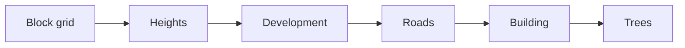

# 5 Scene and Geometry – A City Made of Triangles

> **Your level:** Kern decides what the camera can see, finds the triangle under your mouse in a
> flash and builds an entire city out of a few numbers. Here you'll learn how.

Two building blocks sit around the renderer: **scene** (visibility, BVH, **picking**) and
**geometry** (building shapes on the processor). After that comes the procedural city. The renderer
is explained in [Chapter 4](04-graphics.md), the math in [Appendix B](B-rendering.md).

## 5.1 The Ground Rules

- **Z points up**, and everything is measured in **meters** – everywhere in Kern.
- All builders deliver `MeshData`: positions, normals (where a surface faces), colors, UVs,
  optionally an **extra stream** – and **indices**. Without indices, the mesh is a **triangle soup**:
  every three vertices in a row form a triangle.
- Colors are **sRGB**, like all vertex colors of the standard shader.
- When uploading, the extra stream goes into one of two extension slots; slot 2 or higher means
  "leave it out."

## 5.2 Frustum Culling: Not in the Picture, Not Drawn

The camera looks into a cut-off pyramid with six walls, the **frustum**. So that the test is cheaper
than drawing, Kern checks only **one sphere** per mesh against the walls. If its center lies **more
than the radius** behind a wall, it's definitely outside. Kern reads the walls straight out of the
view-projection matrix (the method of Gribb and Hartmann) and **normalizes** them, so the distance
comes out in meters.

> **Picture it like this:** A basketball (radius 12 cm) with its center 30 cm behind the gym wall is
> completely outside; at 5 cm, it still pokes in.

The test is **cautious**: near a corner, a sphere sometimes gets drawn for nothing, but it's never
wrongly left out. Broken spheres count as visible.

The spheres are created during upload: one around the mesh, one around all instances. How much a
matrix stretches at most, Kern prefers to estimate too high – using the square root of the sum of
the squares of its nine rotation and stretch numbers. If a matrix only stretches x to double, that
gives √(4 + 1 + 1) ≈ 2.45 instead of 2.

> **Watch out, trap:** A forest as *one* instanced mesh spread over the whole map almost always
> counts as visible. Better to split it into spatial groups.

Never discarded are animated (skinned) characters, because a pose can stick out beyond the rest
pose, and meshes with `frustum_culled = false`. The shadow pass tests against the sun's frustum in
exactly the same way.

## 5.3 The BVH: Boxes in Boxes

Picking tests a ray against triangles – tens of thousands of them in one city tile. A **BVH** packs
them into boxes, and those into bigger boxes. If the ray misses a box, its contents are done with.

> **Picture it like this:** In a dictionary, you open to the middle and keep halving. With 10,000
> triangles, after 11 halvings at most 5 per box are left
> (10,000 → 5000 → 2500 → … → 10 → 5) – that's enough, because a leaf may hold up to 8.

**Building:** Kern splits the triangles along the direction in which their centers are spread out
the most, exactly **at the median**. At most 8 triangles make a leaf. The tree is at most 32 deep,
so a fixed stack with 64 slots is enough; everything lives in flat lists.

**Searching:** Ray against box (the "slab test," reliable even at edges), and in a leaf against the
triangles. **The nearer box goes first**; an early, close hit crosses out all the farther ones.

A BVH is only given to **fixed world geometry** (no lines, one unmoved instance, not animated, 36
triangles or more). If you move the mesh or it gets more instances, the BVH gets thrown out; once it
stands unmoved again, it gets rebuilt.

## 5.4 Picking: What's Under the Mouse?

Kern sends the pixel backward through the camera onto the near and the far plane; the line between
them is the **ray**. In perspective, it starts at the eye; in orthographic view, on the near plane
(all rays parallel).

For every mesh that's in the running:

1. **Rough test** against the world sphere (not for animated characters).
2. **Fine test** with the BVH or triangle by triangle. Kern takes animated characters in their
   **current pose** – what you see, you can click.
3. **Triangle test** after Möller and Trumbore; back sides only for double-sided materials.

The hit names the mesh, instance, triangle, distance, point and normal, up to 1800 m away. In the
example `hello`, a click turns a box red this way.

**Kern Studio** translates the mesh into its actor, lets the ray fly on through the floor and locked
actors, and selects lights and empty actors by their icon.

> **Mission:** On https://kernengine.de/, open File › Example Levels › **Orb Run** and click a
> skyscraper. The actor that gets selected is **City** – the whole city belongs to it.

## 5.5 Earcut: Cutting Polygons into Triangles

Footprints are often not convex (L-shape) and have holes (courtyards). Kern breaks them up with a
C++ version of **Earcut** v3.0.2 by Mapbox (ISC license). It's meant to compute exactly like the
JavaScript original; the comparison test lives in the SpawnCity project, while Kern itself checks
areas and triangle counts.

**Clipping ears:** A polygon with n vertices always has at least two "ears" – vertices whose
triangle with their neighbors lies completely inside the polygon. Clip one off, repeat: you get
**n − 2 triangles**. A quadrilateral gives 2, an L-shape with 6 vertices gives 4. An ear has to point
outward, and no other vertex may lie inside the triangle. Earcut only has to check nearby vertices
that point inward.

**When it gets stuck** (map data is rarely clean): remove duplicate vertices, repair
self-intersections, and as a last resort split with a diagonal.

**Holes** are first connected to the outer ring with a "bridge" (Eberly's method): from the
leftmost point of the hole to a visible vertex on the outside, cut there and back. Then everything is
one ring.

**From 80 vertices on**, every vertex gets a **z-order number**: the bits of x and y are interleaved
like the teeth of a zipper. Nearby points have similar numbers, so Earcut only checks vertices with
a matching number.

Afterwards, the building builder compares the triangle areas with the footprint. **Above 0.7%
deviation**, the building is skipped instead of being built with a broken roof.

## 5.6 Primitives: The Construction Kit

Ready-made builders, Z up: **box** (24 vertices; also "on the ground"), **sphere**, **capsule**,
**torus**, **cylinder**, **cone** (both standing on z = 0) and **plane**. `append` attaches one mesh
to another with a matrix (without the extra stream). That's how the car in Orb Run is made of three
boxes, and all the ground plates of the city are **one** mesh.

## 5.7 Welding: Merging Duplicate Vertices

In a triangle soup, vertices sit in memory several times. An **indexed** mesh stores each one only
once – that saves memory and loading time. Kern only merges vertices that are **bit-for-bit
identical**. That's why nothing gets lost, and sharp edges stay sharp.

> **Picture it like this:** A cube as a soup has 12 · 3 = 36 vertices. Every cube corner touches
> three sides with three normals. After welding, 24 are left – exactly as with the box builder.

The search uses a **hash table** (the bits are turned into a bin number). Kern indexes **only when
it pays off**; the conditions are no indices yet and at most 4 extra values.

> **Crazy but true:** With 1300 buildings from Konstanz, building and welding in Kern take about
> 45 ms. The earlier JavaScript solution needed about 1260 ms – almost 28 times as long.

A **content hash** tells whether a freshly built piece differs from the old one.

## 5.8 Buildings from Footprints

The building builder extrudes footprints given as a list of numbers and sorts the buildings into
square **chunks**. In C++:

```cpp
FootprintStream footprints;
footprints.begin(seed, 0, height); // seed, base, eaves
footprints.ring(outer, 4);         // outer ring
footprints.ring(court, 4);         // hole (courtyard)
```

Line 2 starts a building (the seed picks colors and facade), line 3 gives the outer ring, line 4 a
courtyard. Per building:

1. **Cleanup:** points less than 1.5 cm apart get thrown out; with fewer than 3 points or under
   0.08 m², the ring is empty.
2. **Winding:** the outside counterclockwise, holes clockwise.
3. **Sorting out** for an empty ring, a wall of 0.1 m or less, or an Earcut error above 0.7%.
4. **Colors** from the seed; one story is 3.1 to 3.6 m high.
5. **Roof** from Earcut triangles, facing up; courtyards stay open.
6. **Walls** for every edge; UVs in meters along and upward.
7. **Cornice** (for edges over 1.2 m and walls over 3.5 m): 0.55 m high, sticking out 0.24 m.

Four extra values per vertex (wall length, with −1 for roof and −2 for cornice; wall height; seed
number; story height) are used by `NightWindows` ([Chapter 4](04-graphics.md)) for glowing windows.

```cpp
BuildingBuilder b;
b.begin(stream, length, options);
while (!b.step(4.0)) { /* next frame */ }
```

`step(4.0)` builds whatever fits into about 4 ms and reports `true` when everything is done – that
way, a huge city spreads over many frames without stuttering. Large chunks save draw calls, small
ones improve culling; the default is 320 m, at most 2600 buildings.

## 5.9 Roads

The road builder lays curb, roadway and dashed center line onto the terrain, divided every 6 m so
they follow the hills. Heights: 9 cm, 11.2 cm and 13.5 cm. If they were all at the same height, it
would flicker (**Z-fighting**). Dashes: 3 m long, every 7 m. A radius cuts out a section of the map.

The height comes from a **HeightSampler** ("height at x, y?"); without one, the ground is flat. In
the source code, it's called the "physics truth": the same height as in the physics, so cars drive
exactly on the visible road. A number that isn't finite means abort. In JavaScript:
`kern.heightSampler`.

## 5.10 Terrain Tiles

A terrain tile is a grid of 1 to 128 by as many squares, each split along the southwest–northeast
diagonal. The normals come from the neighboring heights: 4 m on the left and 6 m on the right at
1 m spacing means 2 m over 2 m, so a 100% slope. An extra row all around makes neighboring tiles
fit seamlessly; on request, the tile reports its lowest and highest height.

The **GeoProjector** converts longitude and latitude (WGS84) into meters, with an earth radius of
6,378,137 m. That way, map data lands directly in Kern coordinates.

## 5.11 Geometry from JavaScript

`renderer.beginBuildings(...)` starts a building job that builds, for example, 4 ms per frame;
`commit` welds each chunk, uploads it, reports the bytes and frees the memory. It rejects an unknown
stream name in `extraKey` with an error. `upsertTerrainTile` builds a terrain tile in one go. The
`weld` switch welds a mesh before uploading – if it's a pure soup with normals.

## 5.12 The Procedural City

The **Procedural City** component (Place Actors, group **World**) is Orb Run's city generator. It
creates buildings, roads, ground plates, trees, collision bodies and traffic.


Fields in Details (default): **Seed** (20261022), **Blocks per side** (7; 1–16), **Block pitch**
(80 m; at least 30), **Street width** (16 m; at least 6, at most half the pitch), **Tallest
building** (84 m), **Trees**, **Traffic cars** (22), **Lit windows at night**. Anything invalid is
rejected.

**Same seed, same city.** According to the source code, the random number generator (an
"xorshift32") delivers the same sequence as in Orb Run.



1. **Block grid:** 7 × 7 blocks, 80 m apart. Each one gets an 18 cm high ground plate and a
   collision box.
2. **Heights:** Every block has a "closeness to the center" from 0 to 1, which gets **squared**. The
   maximum height ranges from 14 m to 84 m; at a closeness of 0.5, it's 14 + 0.25 · 70 = 31.5 m. That
   way, a mountain of skyscrapers grows in the middle.
3. **Development**, one of four kinds: one block-sized building (in 60% of cases with a 14 m deep
   courtyard), four separate buildings with 5 m alleys, an L-building plus a small one, or three
   long rows.
4. **Roads** along every block edge, reaching 60 m beyond the city, with curb and center line.
5. **Building** in 200 m chunks with six wall colors and three roof colors; everything gets welded.
6. **Trees** every 11 m along the block edges, with 35% gaps. Trunks are cylinders, crowns are
   cones – each **one** instanced mesh.

Every chunk is a mesh with the City actor's matrix as its instance; moving it only changes the
matrix, and it only gets rebuilt when parameters really change. The buildings only get the window
values when **Lit windows at night** is on. Roads don't cast shadows. If the city sits unmoved at the
origin, every chunk gets a BVH.

For the physics, the city is **one** static Box3D body with one box per building wing and plate
(friction 0.5, [Chapter 6](06-physics.md)). The cars (9 to 15 m/s, five colors, one instanced mesh)
are parked in the editor. In Play and Simulate, they drive as kinematic bodies, jump to the other
side at the edge of the city and **stop** when the player stands less than 10 m in front of them.
Random points on the streets spread out the orbs of Orb Run.

> **Mission:** In Orb Run, select **City** and change the **Seed** and **Tallest building** in
> Details. Then type 20261022 and 84 again: the old city is back, exactly.

## 5.13 Shapes in the Level and Built-In Meshes

A Static Mesh has a shape: Box, Sphere, Cylinder, Cone, Capsule, Plane, Torus, Ramp or Mesh, around
the actor's origin, white (the material provides the color). Box, plane and ramp have UVs in meters
times "Texture tiling." The ramp is a wedge rising toward +X. For the physics, there are dimensions,
hull points and the choice of a matching collider ([Chapter 6](06-physics.md)).

The shape **Mesh** takes a built-in mesh: the parts of the **Micro Duck** by Pollen Robotics (for
example `duck/neck`). They're under CC BY-NC-SA 4.0, may **not be used commercially**, aren't shown
here and are missing from the commercial build. They're stored compactly (8 and 16 bits per value,
plus hull points) and unpacked on first access. On the PC, a mutex protects this memory, because
the Lehrer builds on several threads ([Chapter 14](14-lehrer.md)). Mirrored scaling flips the
triangles. An **unknown name** gives a 10 cm cube, so that the mistake gets noticed. More in
[Chapter 13](13-micro-duck.md).

> **Mission:** Export Orb Run with File › **Package Game (HTML)...** and start it with
> **Play it** – like in the picture in 5.12.

## Level complete!

- You know why Kern tests spheres against six walls.
- You can explain how "boxes in boxes" make picking fast.
- You know how Earcut cuts n − 2 triangles out of n vertices.
- You know the steps from footprint to building and from line to road.
- You can generate your own city with a seed.

## Puzzle corner

1. How many triangles does Earcut make out of a footprint with 10 vertices?
2. A sphere with a 3 m radius has its center 2 m behind a frustum wall. Is it left out?
3. **Boss puzzle:** You move the city by 100 m. What gets rebuilt, and what happens to the BVHs?

### Solutions

1. **8**, because 10 − 2 = 8.
2. **No**, it still pokes in by 1 m.
3. Nothing gets rebuilt; only the instance matrix changes. Because it's no longer the identity
   matrix, Kern throws away the BVHs; picking then goes triangle by triangle.

---

© 2026 Christian Heinrich Hohlfeld · All rights reserved · [Imprint and rights](00-imprint.md)
