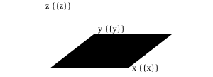
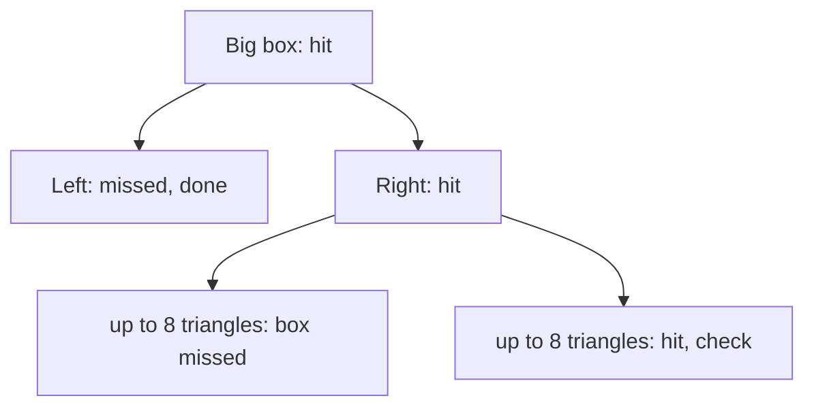
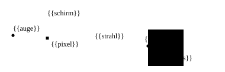
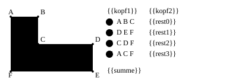
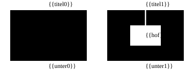
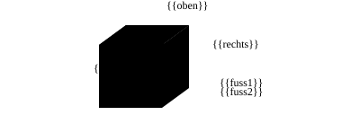
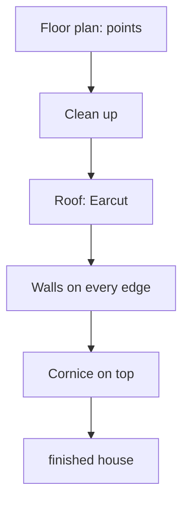
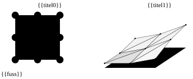
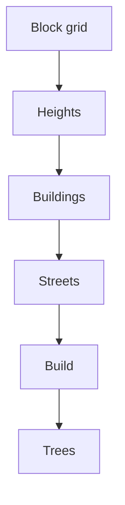
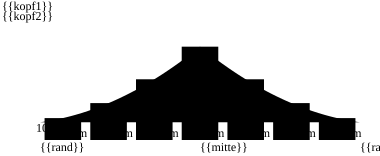

# 5 Scene and Geometry – a City Made of Triangles

> **Your level:** Kern decides what the camera can see, finds the triangle under your mouse in a
> flash, and builds a whole city out of a few numbers. Here you learn how.

> **Words you need:**
>
> - **Mesh** – the wire mesh of triangles that a 3D thing is made of.
> - **Corner** (*vertex*) – a point in the mesh. Every corner has a position and often also a
>   color, a normal and a UV.
> - **Indices** – a list of numbers that says which three corners together form a triangle.
> - **Normal** – a small arrow that points straight out of a surface. The light calculates with
>   it: surface toward the sun bright, surface away from the sun dark.
> - **UV** – two numbers per corner that say which spot of a picture (a **texture**) gets stuck on
>   there, like a sticker.
> - **Matrix** – a small table of numbers that says how a thing is moved, rotated and stretched.
> - **Instance** – the same mesh once more in another place, just with a different matrix. A
>   hundred trees, but only one stored tree.
> - **Actor** – a thing in a Kern Studio level, for example a crate, a light or the whole city.

This chapter has two parts. The **scene** answers questions about finished meshes: what does the
camera see? What's under the mouse? The **geometry** builds new meshes: roofs, walls, streets,
ground. At the end, Kern puts everything together into a whole city. How things get painted is
explained in [Chapter 4](04-graphics.md), the math behind it in [Appendix B](B-rendering.md).

## 5.1 The Rules of the Game

Everywhere in Kern, two rules apply: **Z points up**, and everything is measured in **meters**. So
a house 20 meters tall reaches from z = 0 to z = 20. That way graphics, physics and sound fit
together without converting.

In school you draw a coordinate system on a sheet of paper: x to the right, y up. In 3D, a third
axis is added. Lay the sheet flat on the table, like a map: x points to the right (east), y to the
back (north), and the new axis z points to the ceiling. It's the height above the map. Because Kern
builds whole cities from map data, this map view is handy.

Several **builders** come up in this chapter. A builder is a part of the program that builds a new
shape out of a few numbers, for example a house from a floor plan. All builders deliver their
result in the same form: a list of **corners** (with position, normal, color and UV) and, if it's
worth it, a list of **indices**.

> **Picture it like this:** A cube has 8 corners and 6 sides; every side is 2 triangles, 12 in
> all. Without indices, you write down its three corners for every triangle: 12 · 3 = 36 corners,
> many of them twice. That's called **triangle soup**. With indices, you write down every corner
> once and after that just numbers like "triangle 1 = corner 0, 1, 2." That's like a
> connect-the-dots picture: first the dots, then the lines between their numbers.

Colors and the path of the data to the graphics card are explained in [Chapter 4](04-graphics.md).
The exact names and values are in the blue book, Chapter 5.

## 5.2 Frustum Culling: Not in the Picture, Not Drawn

Whatever isn't in the picture doesn't have to be drawn. The camera looks into a cut-off pyramid with
six walls (left, right, top, bottom, near, far). This pyramid is called the **frustum**. Kern leaves
out everything that's definitely outside. That's called **culling** (sorting out).

The test has to be much faster than drawing, otherwise it's not worth it. That's why Kern doesn't
check thousands of triangles but **one sphere** that encloses the whole mesh. If its center lies
**farther than its radius** on the outside of one of the six walls, the whole sphere is outside,
and so is the mesh.

> **Picture it like this:** A basketball has a 12 cm radius. If its center is 30 cm behind the gym
> wall, it's completely outside (30 > 12). If the center is only 5 cm behind it, it still sticks in
> by 7 cm (5 < 12).

The test is **cautious**: near a corner of the pyramid, a sphere sometimes gets drawn for nothing,
but it's never wrongly left out. Better to paint once too often than to have a hole in the picture.
That's why broken spheres count as visible. Broken means: nonsense came out of the calculation, for
example not a real number.

Kern calculates the sphere once, when the mesh goes to the graphics card. If a mesh has many
instances, a single sphere encloses **all** of them together.

> **Watch out, trap:** A forest as *one* mesh with trees all over the map has a huge sphere. It's
> almost always in the picture, so the whole forest is always painted. Better: split the forest
> into groups that stand close together.

Two exceptions: Kern never leaves out animated figures, because an outstretched arm can stick out
beyond the sphere of the basic pose. And you can switch culling off for a mesh. Kern also uses the
same test for the shadows: there, Kern pretends the sun is a camera with its own view pyramid.

> **For pros:** Kern reads the six walls directly from the camera's matrix, and it deliberately
> estimates a little too high how much an instance matrix stretches a sphere at most. How that
> works is in the blue book, Chapter 5.

## 5.3 The BVH: Boxes in Boxes

A **ray** is a straight line that Kern shoots into the world from a point in one direction, for
example from the camera through the mouse pointer (more on that in 5.4). If you want to know which
triangle a ray hits, in the worst case you have to check every single one, and one city tile has
tens of thousands. A **BVH** (*bounding volume hierarchy*, roughly "levels of bounding boxes") packs
the triangles into small boxes, the boxes into bigger boxes, and so on. If the ray misses a box,
its whole content is done with in one go.

**Building:** Kern looks at which direction the triangles are spread out the most and splits them
there exactly in the middle, so that the same number lies left and right (this middle is called
the **median**). Kern repeats this until there are **at most 8** triangles in every smallest box.
Then Kern stops splitting.

> **Picture it like this:** In a dictionary, you open the middle, see which half your word belongs
> in, and keep halving. With 10,000 triangles, Kern halves until there are at most 8:
> 10,000 → 5000 → 2500 → … → 20 → 10 → 5. After 11 halvings, only about 5 are left in a box, which
> is below the limit of 8. Instead of 10,000 tests, a ray then needs just a few dozen.

**Searching:** The ray first checks boxes, and only then the triangles in the smallest boxes. **The
nearer box comes first.** If the ray already finds a hit there, it can skip all the boxes that are
farther away.

A BVH is only worth it for **fixed world geometry**: a big mesh that has only a single instance,
stands unmoved and isn't animated. That's because the BVH's boxes stand fixed at certain places in
the world. If you move the mesh, the boxes are in the wrong place, and the ray would miss. That's
why Kern then throws the BVH away; when the mesh stands unmoved again, Kern rebuilds it. Kern
checks everything else triangle by triangle. The exact conditions are in the blue book, Chapter 5.

## 5.4 Picking: What's Under the Mouse?

**Picking** means: finding out what you just clicked. For this, Kern sends a **ray** into the
world from the mouse pointer. The first triangle it hits is the one clicked.

The ray starts in the camera's eye and goes through the pixel under the mouse, that is, right
through the pyramid from 5.2, from its near wall to its far wall. For every mesh in question, Kern
does two tests:

1. **Rough test:** Does the ray hit the sphere around the mesh? If not, the mesh is done with.
2. **Fine test:** with the BVH or triangle by triangle. Kern checks animated figures in their
   **current pose**: whatever you see, you can also click.

The hit reveals, among other things, which mesh was hit and at which point. In a small example
program of Kern's, a click colors a crate red this way.

**Kern Studio** then also asks: which actor does this mesh belong to? It simply lets the ray fly
through the ground and actors you've locked with a padlock. Lights and empty actors have no mesh;
you select them via their icon in the picture.

> **Mission:** On https://kernengine.de/, open **File › Example Levels › Orb Run** and click a
> high-rise. What gets selected is the actor "City": in the **Outliner** (the list of all actors),
> "City" is highlighted, and **Details** shows the city's settings. What happened? The ray hit a
> triangle of the high-rise, but the high-rise isn't an actor of its own: it belongs to the city,
> so Studio selects the whole city.

> **For pros:** The triangle test is named after its inventors, Möller–Trumbore. Back sides of
> triangles only count for materials that are painted double-sided.

## 5.5 Earcut: Cutting Polygons into Triangles

The graphics card can only paint triangles. But a house roof from map data is a **polygon**, often
with a bend (L-shape) and sometimes with a hole (inner courtyard). A polygon with a bend inward is
called **not convex**: you can find two points in it whose connecting line runs outside. Kern
breaks such polygons apart with **Earcut**, a proven technique that anyone may use for free.

**Cutting off ears:** A polygon with n corners always has at least two **ears**. An ear is a corner
whose triangle with its two neighboring corners lies completely inside the polygon. If you cut it
off, a polygon with one corner fewer is left. You repeat that until only one triangle is left.
There are always **n − 2 triangles**.

In step 1, B is the ear: the line from A to C cuts off corner B, like cutting a corner off a piece
of paper with scissors. In step 2, E is the ear; in step 3, D is the ear. What's left after that is
already a triangle. 6 corners became 6 − 2 = 4 triangles.

An ear has to be a **tip**, not a **dent**: the corner sticks outward like B, not inward like C.
Also, no other corner may lie in its triangle. That's why C isn't an ear at the start.

**When it gets stuck:** Map data is rarely clean. If Earcut can't find any more ears, it cleans up
and carries on with emergency solutions instead of giving up.

**Holes:** Earcut can only cut up a single ring. That's why it first cuts a narrow **bridge** from
the hole to the outer edge, there and back. Now the inner courtyard is part of the edge, and
everything is one ring again.

Imagine running your finger along the edge. Before, you never get to the courtyard. Afterwards,
you go in at the top through the narrow slit, once around the courtyard, out through the slit
again and on along the outer edge. A single path, so a single ring.

**Checking:** Afterwards, the house builder compares the area of all triangles with the area of the
floor plan. If they differ a lot, the house is skipped. Better one house fewer than one with a
broken roof.

> **For pros:** Kern uses a C++ version of Earcut by Mapbox. It finds the bridge with a technique
> by David Eberly. For large polygons, it only checks corners nearby; it finds them through numbers
> where nearby points get similar numbers (z-order). If it gets stuck, it repairs small crossings
> and finally splits the polygon into two halves with a line. Version, license and limits are in
> the blue book, Chapter 5.

## 5.6 Primitives: the Construction Kit

**Primitives** are ready-made basic solids that Kern builds at the push of a button, all with Z up:
**box** (called **Box** in Studio), **sphere**, **capsule** (a pill: a cylinder with a half-sphere
at each end), **torus** (a ring like a donut), **cylinder**, **cone** and **plane**. Cylinder and
cone stand on the ground; the others sit around their center.

Shapes can be **chained together**, moved and rotated, so that a single mesh comes out. One mesh is
faster for the graphics card than many small ones, because every mesh needs its own draw call, and
every draw call takes time. That's how the car in Orb Run is built from three boxes, and all the
city's ground slabs are **one** mesh.

By the way, a cube from the construction kit has 24 corners, not 8. Why is coming up right away in
5.7.

## 5.7 Welding: Merging Duplicate Corners

**Welding** turns a triangle soup into a mesh with indices: every corner that appears several times
is stored only once, and the triangles point to it with numbers. That saves memory and loading
time. And it helps the graphics card when painting: it has to calculate for every corner where it
lands on the screen. If the same corner number comes up again right away in the next triangle, it
takes the already finished result instead of calculating again.

Kern only merges corners that are **exactly the same**: same position, same normal, same color,
same UV, down to the last digit. That way nothing gets lost, and sharp edges stay sharp.

> **Picture it like this:** Look at a cube's corner. Three sides meet there: top, front and right.
> Every side has its own normal, so its own arrow (picture below). Same position, but three
> different arrows: for the computer, those are three different corners. The soup has 36 corners.
> Welding puts together all the ones that are really the same, and 8 · 3 = 24 are left. If Kern
> averaged all three arrows into one, the cube would look soft and round.

To find identical corners quickly, Kern uses a **hash table**: from the numbers of every corner, a
compartment number is calculated, like the compartment number in a cabinet with lots of drawers.
Identical corners land in the same compartment, so Kern only has to look there. And Kern indexes
**only when it's worth it**: if it saves no space, the soup stays the way it is.

> **Crazy but true:** With 1300 buildings from Konstanz, building and welding in Kern take about
> 45 ms. The earlier JavaScript solution needed about 1260 ms, almost 28 times as long.

Kern also uses a similar number as a **check number**: a single number is calculated from all the
numbers of a finished mesh. If a newly built piece of city is the same number for number as the old
one, the same number comes out, and Kern sees right away that nothing has changed. For the city
(5.11), Kern calculates such a number from all the settings: if it stays the same, the city doesn't
have to be rebuilt.

## 5.8 Houses from Floor Plans

The **house builder** turns floor plans into finished houses: it pulls the floor plan up into the
air, puts a roof on top and builds a wall on every edge. A floor plan is just a list of points: the
outer edge and, if there is one, the edge of the inner courtyard. Add to that a random number (the
**seed**, see 5.11) for colors and facade, the height of the base and the height of the roof edge.

For each house, this happens:

1. **Cleaning up:** Points that lie almost on top of each other get thrown out. If the edge is tiny
   after that, the house is skipped.
2. **Setting the winding direction:** The outer edge runs counterclockwise, inner courtyards
   clockwise. Why does that help? In your head, walk counterclockwise around a house: the house is
   always on your left, outside is always on your right. With the inner courtyard you walk the
   other way around, and again "outside" is on your right, namely the courtyard. That way Kern
   knows for every wall where outside is, and lets the normal point there.
3. **Roof:** Earcut breaks the floor plan into triangles, all with the normal pointing up. Inner
   courtyards stay open.
4. **Walls:** Every edge gets a wall made of two triangles, from the base to the roof edge. Their
   UVs are **in meters**: a corner's UV is simply how many meters along the wall and above the base
   it lies. A pattern then repeats like tiles every meter, so it's the same size on a short and a
   long wall.
5. **Cornice:** If a house is taller than 3.5 m, a projecting band runs around the roof at the top,
   like a frame.
6. **Colors:** The seed chooses wall and roof color and the story height.

Every corner also gets a small **wall profile**: how long is this wall, how tall, how tall is one
story? From that, a **shader** (a small painting program that runs on the graphics card) paints
windows that glow at night, without a single window being built ([Chapter 4](04-graphics.md),
4.13).

**Building in bite-size pieces:** The house builder sorts the houses into square map pieces, the
**chunks**. Every chunk becomes its own mesh. Big chunks mean fewer draw calls to the graphics
card; small chunks are easier to sort out (5.2). And the builder works with a **time budget**: in
every picture, it builds only as many houses as fit into a few milliseconds, then it's the next
picture's turn. That way even a huge city comes about without the game stuttering.

**Kern as a geometry construction kit:** Not only Kern's own games may use the house and street
builders. A completely different website can also use Kern as a pure construction kit for shapes:
it orders houses, and Kern builds them over many pictures, the way a baker also bakes for the café
next door. When a chunk is finished, it's welded (5.7) and sent to the graphics card. After that,
Kern throws away the temporary storage right away, because the graphics card now has its own copy.
That's like a scrap of paper you throw away as soon as you've copied everything into your notebook.

The exact names, sizes and commands are in the blue book, Chapter 5.

## 5.9 Streets

The **street builder** turns a line on the map into a street band with curb, roadway and dashed
center line. So that the street follows a hill instead of hanging in the air, it splits it into
short pieces a few meters long. Every piece gets the height of the terrain at its corners.

Curb, roadway and center line each lie **a few centimeters higher** than the layer below. If they
lay at exactly the same height, the graphics card couldn't decide which surface is in front, and it
would decide differently in every picture. The picture then flickers; that's called
**z-fighting**.

The height comes from a **height query**: "How high is the ground at x, y?" If there isn't one, the
ground is flat. What matters is that the graphics use **the same** height as the physics. Otherwise
the cars would drive a bit above or below the street you see. If the query returns nonsense, the
builder would rather stop than build a broken street.

Like with the house builder, there are chunks and a time budget.

## 5.10 Terrain Tiles

The ground of a big map is made of **tiles**. A tile is a grid of squares; every grid corner has
its own height, and every square is split along the diagonal into two triangles. If the corners lie
at different heights, the triangles slope, and hills come about.

For the light, every corner needs a **normal**, because a slope facing the sun is bright and a
slope facing away from it is dark. For this, Kern looks at the neighbors: if a corner on the left
is at 4 m and one on the right at 6 m, each 1 m away, the ground rises by 2 m over 2 m of distance.
That's a 100% slope, and the normal tips to the side accordingly: a 100% slope is a 45° hillside,
so it tips by 45°. For the corners at the edge, Kern also looks one row into the neighboring tile.
That way two tiles fit together without a visible seam.

Map data is given in degrees of longitude and latitude; Kern calculates in meters. A **converter**
turns degrees into meters east and north of a center point. That way real floor plans land
directly in the game world.

## 5.11 The Procedural City

**Procedural** means: not built by hand but calculated by rules. The component **Procedural City**
(in **Place Actors**, group **World**) is the city generator of Orb Run. From a few numbers, it
creates houses, streets, ground slabs, trees, traffic and the **collision bodies**: the invisible
shapes you bump into in the physics.

In **Details**, you set among other things: the **Seed**, how many blocks per side, how far apart
the blocks are, how wide the streets are, how tall the tallest house gets, whether there are trees,
how many cars drive and whether windows glow at night. Kern rejects nonsensical values.

**Same seed, same city.** The computer doesn't really roll dice. From a starting number, the
**seed**, it calculates a long sequence of numbers that looks random but is always the same.

> **Picture it like this:** A deck of cards that's always shuffled in exactly the same way.
> Whoever gets the same deck draws the same cards in the same order. A different seed is a
> differently shuffled deck.

1. **Block grid:** The city is a chessboard of blocks with streets in between. Every block gets a
   flat ground slab.
2. **Heights:** Every block has a **closeness to the center** from 0 (edge) to 1 (middle). Kern
   multiplies it **by itself** (squares it). The maximum height then ranges from 14 m up to the
   value in Details, 84 m in the example. The room in between is 84 − 14 = 70 m. At closeness 0.5,
   that's 14 + 0.5 · 0.5 · 70 = 14 + 17.5 = 31.5 m. Exactly 14 m would apply only right at the
   edge. But even the outermost block lies a bit further in, so in the picture below it has about
   20 m. The houses themselves then get a random height of at most this limit.
3. **Buildings:** Every block gets one of four kinds: one big house (often with an inner
   courtyard), four single houses with alleys, an L-house plus a small one, or three long rows.
4. **Streets** along every block edge, a bit beyond the city, with curb and center line.
5. **Building:** The house and street builders from 5.8 and 5.9 build everything in chunks;
   afterwards, everything is welded (5.7).
6. **Trees** along the block edges, with gaps. Trunks are cylinders, crowns cones, each **one**
   mesh with many instances.

Why square it? Look at a cut through the city:

Small numbers get even smaller when squared: 0.5 · 0.5 = 0.25, but 0.9 · 0.9 = 0.81. That's why
most blocks stay low, and only right in the middle does a steep **high-rise mountain** grow.

The whole city hangs on **one** matrix, that of the City actor. If you move the city by 100 m, Kern
only changes the numbers in this small table, and all the houses move along. Nothing gets rebuilt,
just as a picture stays the same when you move the frame on the wall. It's only rebuilt when you
change a setting (the check number from 5.7 notices that). When the city stands unmoved, every
chunk gets a BVH (5.3), and picking in the city is fast.

For the physics, the whole city is **one** solid body made of many boxes. The cars stand still in
the editor and only start driving once the world runs: with **Play** – you play along yourself –
or **Simulate** – the physics runs, and you just watch. If you stand less than 10 m in front of a
car in its lane, it stops. [Chapter 6](06-physics.md) explains more about the physics.

> **Mission:** In Orb Run, select the actor "City" and change the **Seed** and **Tallest
> building** in **Details**. Then enter 20261022 and 84 again: the old city is back exactly. Same
> seed, same city.

> **Mission:** Export Orb Run with **File › Package Game (HTML)...** and start it with **Play
> it**. Now you drive through the city from the picture above yourself.

## 5.12 Shapes in the Level and Built-in Meshes

Every shape you put into the level as a **Static Mesh** comes from the construction kit in 5.6.
There's also the shape **Ramp**, a wedge that's high on one side and flat on the other. Kern builds
the shape white and with its middle exactly on the actor's **origin**, that is, on the point you
move when you move the actor. The color only comes from the material. Here too, the UVs for box,
plane and ramp run in meters, like on the house walls in 5.8: that way a pattern is the same size
on big and small surfaces. Which collision body fits the shape is explained in
[Chapter 6](06-physics.md).

The shape **Mesh** takes a mesh that's built firmly into Kern: the parts of Pollen Robotics' **Micro
Duck**, for example its neck or a leg. These parts belong to Pollen Robotics and may not be sold;
that's why they aren't shown in this book.

**Making errors visible:** If you enter an **unknown name**, a small 10 cm cube appears. That's on
purpose: an error should stand out. If there were simply nothing there, you'd spend a long time
searching whether the shape is missing, invisible or somewhere else. You see the cube right away.

How the duck is put together from its parts is shown in [Chapter 13](13-micro-duck.md). The exact
names are in the blue book, Chapter 5.

## Level complete!

- You know what a mesh is made of: corners, normals, UVs and indices.
- You know why Kern tests spheres against six walls.
- You can explain how "boxes in boxes" make picking fast.
- You know how Earcut cuts n corners into n − 2 triangles.
- You know the steps from floor plan to house and why street layers lie at different heights.
- You can create your own city with a seed and find it again.

## Puzzle corner

1. How many triangles does Earcut make from a floor plan with 10 corners?
2. A sphere with a 3 m radius has its center 2 m behind a frustum wall. Is it left out?
3. A flat, square ground slab as a soup has 2 triangles. How many corners does it have before and
   after welding?
4. **Boss puzzle:** You move the city by 100 m. What gets rebuilt, and what happens to the BVHs?

### Solutions

1. **8**, because 10 − 2 = 8.
2. **No**, because 2 m < 3 m: it still sticks in by 1 m.
3. Before, 2 · 3 = **6**; after, **4**. All corners have the same normal (up), so the two corners on
   the diagonal are duplicates and get merged. It's worth it too: 4 corners plus 6 short numbers
   take less space than 6 full corners with position, normal, color and UV.
4. Nothing gets rebuilt; only the city's matrix changes. Because the chunks are now moved, Kern
   throws away the BVHs; picking then goes triangle by triangle. If you put the city back, Kern
   builds the BVHs again.

---

© 2026 Christian Heinrich Hohlfeld · All rights reserved · [Imprint and rights](00-imprint.md)
