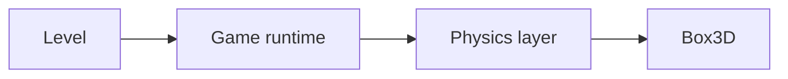

# 6 Physics – Box3D on a Leash

> **Your level:** Stacking crates, swinging doors, breaking bridges. Here you see how Kern uses
> Box3D, which rules it sets for itself, and how a real servo becomes a model.

> **Words you need:**
>
> - **Rigid body** – a thing that never bends or dents, like a wooden block.
> - **Newton (N)** and **weight force** – the newton is the unit of force. The Earth pulls on every
>   kilogram with 9.81 N, so the weight force is **mass · 9.81**. A bar of chocolate (100 g)
>   presses on your hand with just under 1 N.
> - **Impulse** – a single short push, like a kick against a ball. It changes the speed in one go:
>   impulse = mass · change in speed.
> - **Torque** – how strongly something turns: force times lever. 1 N at the end of a 1 m long
>   wrench is 1 newton meter (N·m). Long wrench, same force, more torque.
> - **Moment of inertia** – how hard it is to get a thing turning. On an office chair you spin
>   faster with your arms pulled in than with them stretched out: mass far out makes things
>   sluggish.
> - **Radian (rad)** – another way to measure angles. Lay a string as long as the radius along the
>   edge of a circle: the angle for it is 1 rad, about 57°. All the way around, the string fits a
>   good 6.28 times.
> - **Hertz (Hz)** – how often per second. A spring at 2 Hz bounces back and forth twice per
>   second; a 60 Hz rate means 60 calculation steps per second.
> - **Damping** – the brake on swinging, like the shock absorber on a bike. Lots of damping: the
>   spring comes to rest without bouncing on.

Kern simulates **rigid bodies** with **Box3D**, a free physics engine by Erin Catto. Box3D sits in
Kern **unchanged**. How physics in a computer thinks in general is explained in
[Appendix C](C-physics.md); here it's about how Kern works with it.

The basic rule: **Box3D is never adapted to Kern.** If a model doesn't fit Box3D, **the model**
gets adapted: enlarged, masses distributed differently, calculated more finely. It's like in
soccer: if your tactics don't work, you change the tactics, not the rules of the game. A real
device like a servo gets a small model of its own (6.17).


> **Mission:** On https://kernengine.de/, open **File › Example Levels › Physics Lab** and press
> **Simulate** (Alt+S). Grab a crate of the pyramid with the left mouse button, lift it and let
> go: it flies on with momentum. Give the pendulum a push and open the door.

## 6.1 How the Layer Is Built

Between the game and Box3D lies a thin **layer**. It's the **only place** where Kern talks to
Box3D. Every nonsensical value is caught there, such as a negative radius or a position that isn't
a number (that happens when, for example, 0 : 0 came out of a calculation earlier). Box3D only
gets clean values. Like a bouncer: whoever doesn't fit doesn't even get in, and the error is
reported ([Chapter 3](03-foundations.md)).



The **game runtime** in the picture is the part of Kern that runs a level as a game
([Chapter 8](08-game-runtime.md)).

The layer calculates in **meters, seconds and kilograms**, with **Z up**, just like the graphics.
Angles are in **radians**. You only see degrees in Kern Studio and in level files; the conversion
happens **in exactly one place**, during setup. Why only in one? Imagine everyone in a class
converting euros to dollars on their own. If one person forgets or converts twice, the cash box
doesn't add up at the end, and nobody knows where the error is. If there's only one place that
converts, you know right away where to look. A **world** owns everything that comes about in it and
cleans it all up when it closes.

The exact names and commands are in the blue book, Chapter 6.

## 6.2 The Right Size

Box3D feels most comfortable with things between **10 cm and 10 m**. The reason: it works with
fixed tolerances in meters. For example, it tolerates up to **5 mm** of overlap between two bodies
before it pushes them apart. With a 1 m crate you don't notice. With a 2 cm robot leg, that's a
quarter of the leg.

Hence rule one: **moving bodies between 0.1 m and 10 m, never under 1 cm.** Kern automatically
raises tiny moving shapes to at least 1 cm.

> **Crazy but true:** The Micro Duck at real size has limbs of 2 to 4 cm. Its body sank 9 cm
> through its own legs in 10 pictures. Enlarged four times, the joints hold.

### Scaling Instead of Changing the Rules

Box3D could change its tolerances, but only for the whole world, and in a level, cars stand next
to small robots. So Kern does it the other way around: a small real model is enlarged as a whole by
a **factor S**, and every quantity is converted to match. For the Micro Duck, **S = 4**:

| Quantity | Factor | at S = 4 |
|---|---|---|
| length | S | ×4 |
| mass | S · S · S | ×64 |
| time | square root of S | ×2 |

**Mass ×64**, because a cube with four times the edge has 4 · 4 · 4 = 64 times the volume. Made of
the same wood, it's 64 times as heavy.

**Time ×2**, because a pendulum four times as long swings half as fast. So the enlarged duck moves
as if in slow motion, half as fast. One real second is two seconds in the world. The table says
"square root of S" for this. The **square root** of a number is the number that, multiplied by
itself, gives the first one: the square root of 4 is 2, because 2 · 2 = 4. The square root of 9 is
3.

> **Try it out:** Let a bunch of keys swing on a short string (about 25 cm) and count the swings
> in 10 seconds. Then take a string four times as long (1 m). You'll count only about half as many
> swings.

Why does the time have to grow too at all? Because **gravity stays the same**. When the big duck
stumbles, it falls four times as far, but the Earth doesn't pull any harder. That's why every fall,
tip and swing takes longer, just like with the long pendulum. If Kern lets the time grow to match,
every movement looks exactly like with the small duck, just bigger and slower.

> **Picture it like this:** Filmmakers shoot scenes with a model railroad and play the film back
> more slowly. Then the small train looks like a real big train. With the duck it's the other way
> around: you'd only have to play a film of the big, slow duck twice as fast and shrink it to a
> quarter, and you'd see exactly the small duck.

In this sense, it's **the same duck**: same poses, same steps, same tipping. If you divide lengths
by 4 and times by 2, the small duck comes out. That's why everything goes out in real units again:
to the **network** (the learning program that controls the duck), in logs and to
[Chapter 16](16-calibration.md).

And if the simulation and the real robot still differ? Then it's **not because of the
enlargement**, but because of the models: how exactly servo, contacts and masses are rebuilt.
That's why measurements are taken on the real robot and things are improved
([Chapter 16](16-calibration.md)). A few Box3D values are fixed in real meters and don't grow
along, for example how soft contacts feel. Kern doesn't convert those but sets them so that they
match the measurement: **calibrated, not scaled**. But a simulation is never a guarantee for the
real robot.

> **For pros:** Moment of inertia (×1024), torque (×256) and damping (×512) are converted too.
> That's called Froude similarity. A small test leg, hanging freely, even calculates bit for bit
> the same at single and four-times size (Appendix C.9). All values are in the blue book,
> Chapter 6.

## 6.3 The World

A **world** is the space in which the physics calculates. It has a **gravity** of 9.81 m/s² in the
direction **minus Z**: Z points up, so minus Z pulls down.

The unit m/s² (meters per second per second) means: **every second, a falling thing gets 9.81 m/s
faster.** After 1 second it falls at 9.81 m/s, after 2 seconds at 19.62 m/s, if nothing slows it
down. That's the same number as the 9.81 N per kilogram from the word box, just seen from the other
side: exactly this force on every kilogram causes exactly this speeding up.

The world isn't calculated on smoothly but in **small, fixed steps**, like a flip book page by
page. Why the steps are always the same length is shown in 6.13.

In Kern, Box3D calculates on a **single processor core**. A processor core is a part of the
processor that carries out calculations. Modern computers have several that could work at the same
time. But then sometimes one would be done first, sometimes another, and the calculations would
arrive in a different order every time. Why the order alone changes the result is shown in 6.14.

The world's default values are in the blue book, Chapter 6.

## 6.4 Bodies

A **body** is a thing that can move in the physics. There are three kinds. In Kern Studio you
choose them in **Details** under **Rigid Body (Box3D)** › **Mobility**:

- **Static**: never moves. Ground, walls, houses.
- **Kinematic**: moves the way you tell it to and can't be stopped by anything. Moving platforms,
  rotating beams, the city's cars.
- **Dynamic (simulate physics)**: reacts to forces, pushes and gravity. Real physics.

> **Picture it like this:** Static is the gym wall, kinematic is the escalator (it moves no matter
> who's standing on it), dynamic is the ball.

A body also has a position, rotation, starting speed and a brake against movement (damping). It
can **sleep**: if it lies still for a long time, Box3D stops calculating it until something bumps
it. That saves a lot of time. A **bullet** is a very fast body that Box3D checks particularly
carefully against everything, so that it doesn't fly through things.

You can move a body in two ways: with a **force** that acts for only one step (like pushing), or
with an **impulse** that changes the speed in one go (like a kick). You can also **lock**
individual directions, so that a body doesn't tip over, for example.

It's best to create a body right away **in its place and with the right kind**. Building it
somewhere else first and then beaming it over, or giving it a different kind afterwards, costs
Box3D double the work, like a wardrobe you first assemble in the hallway and then carry into the
room.

Box3D calculates **mass and moment of inertia** from the shape and the **density** (how much a
cubic meter weighs). You can also set them yourself. That's how rebuilt robots get their measured
values, and the shape then only takes care of where they bump into things.

## 6.5 Shapes

A body is made of one or more simple **shapes**: **box**, **sphere**, **capsule** (a cylinder with
round ends, like a pill), **hull** and **mesh**. In Kern Studio, such a physics shape is called a
**Collider**. If an actor has none of its own, Studio automatically builds a fitting one for its
basic shape.

A **hull** is the shape you get when you stretch a rubber band around a handful of nails, only in
3D: around the outside, with no dents inward. Such shapes without dents are called **convex**, and
Box3D can calculate with them especially quickly and reliably (Appendix C.3). For Box3D, a box is
also a hull.

A **mesh** made of any triangles is only allowed for **fixed** bodies, for example for hilly
ground. Why? A mesh may have dents, and it's just a thin skin with no inside. Box3D can't calculate
from it how heavy it is, and for contacts it assumes that the mesh doesn't move. For a ground,
neither matters: it doesn't have to weigh anything and always stays where it is. That's why moving
things are built from convex shapes.

With a mesh, Kern makes sure that nothing gets caught on the seam between two triangles. Without
this care, a rolling ball could hop at the seam as if there were an invisible edge there. That's
called a **ghost collision**.

### Material

Every shape has a **material**. The default values in Kern Studio:

| Field | Default | Meaning |
|---|---|---|
| Density | 1000 kg/m³ | like water |
| Friction | 0.6 | how strongly it brakes |
| Restitution (bounce) | 0 | bounciness, 0 to 1 |
| Rolling resistance | 0 | brakes rolling |
| surface | none | for pair friction (6.6) |
| Sensor (overlap only) | off | only report overlap |

A **sensor** doesn't bump into things; it only reports who walks into it. That's how goal zones
and triggers work.

### Who Collides with Whom?

Every shape can say on **channels** which group it belongs to and which groups it wants to collide
with. An example: bullets should fly through ghosts but bounce off walls. Then the ghosts belong to
a channel the bullets ignore.

For robots there's something even simpler: all parts of a robot go into **one shared group** whose
members never bump into each other. That way a robot doesn't trip over its own legs.

## 6.6 Surfaces with Pair Friction

If two shapes with different friction touch, the contact needs **one** value. Box3D uses a rule of
thumb: the square root of the product of the two values, √(a · b). For 0.5 and 0.5 that's 0.5; for
0 and anything, it's always 0. Why exactly this way is explained in Appendix C.4.

But for real pairs of materials, the rule of thumb isn't always right. The Micro Duck shows this:
it picks up a sock with its beak. The soft pad on the beak has to **grip** the sock, but the sock
has to **slide** on the wooden floor. A single friction value per shape can't do both.

That's why Kern knows **surfaces**: cotton knit (*cloth*), soft printed rubber (*tpu*) and wood or
laminate floor (*floor*). For pairs of these surfaces there are values of their own, chosen
according to measurements from the scientific literature:

| Pair | Friction | Like in everyday life |
|---|---|---|
| knit on knit | 0.5 | sock on sock |
| rubber on knit | 0.8 | beak grips sock |
| knit on wood | 0.4 | sock slides across the parquet |

Box3D stays unchanged for this. At every contact it asks: "Which friction applies here?" Kern
answers: if the pair has a value of its own, that one applies; otherwise the rule of thumb.
Bounciness and rolling resistance stay as they are.

The duck's soles have **no** surface. They keep the friction Pollen Robotics trained its network
with (1.0 on a ground with 1.0, so √(1 · 1) = 1). More about the duck in
[Chapter 13](13-micro-duck.md).

## 6.7 Friction, Bounciness, Rolling Resistance

Three values determine how things touch:

- **Friction** brakes sliding. 0 is ice, 1 is rubber on asphalt.
- **Restitution** (bounciness) determines how much speed is left after an impact. 0 stays put, 1
  bounces back perfectly. Box3D takes the **larger** of the two shapes' values: a rubber ball
  bounces on concrete too. Impacts under 1 m/s don't bounce at all, otherwise things at rest would
  jitter forever: tiny calculation leftovers would make them hop up a tiny bit again and again.
- **Rolling resistance** brakes rolling. A perfect ball on a perfect floor would roll forever. Real
  balls and floors give a little, and that brakes.

In Kern Studio you set them under **Details › Static Mesh › Physics** (for the automatic
collider) or under **Details › Collider**. You set the endless ground under **World Settings** ›
**Physics (Box3D)** › **Ground friction** and **Ground bounciness**. That's also where you set how
softly things rest on each other: in the fields **Contact stiffness** and **Contact damping
ratio**. They don't apply per shape but to the whole world.

Kern sets rolling resistance on round things. The ball in the Micro Duck level has 0.03, because "a
rubber ball on a wooden floor rolls to a stop." The sock is made of round lumps of cloth and has
0.5, because "a lump of cloth doesn't roll." Without it, the sock crept across the floor on its
own. **Robot feet** don't need rolling resistance: they're built wide, flat and grippy, so that
they don't roll or slide in the first place.

> **Mission:** If **Simulate** is still running, stop with Esc. In the Physics Lab, select the top
> crate, the actor "Crate 15." In **Details › Collider › Friction**, set the value from 0.7 to 0 (the
> crates in the Physics Lab have 0.7 instead of the default 0.6). Start **Simulate**, put the crate
> on the ground with the mouse and give it a shove. It glides as if on ice. Why? 0 times anything
> is 0, and the square root of 0 is also 0.

## 6.8 Joints

A **joint** connects two bodies so that they can only move against each other in a certain way.
Every joint has an **axis**: for a hinge it's the line something turns around; for a rail it's the
line something slides along.


The most important joints in Kern Studio (field **Type** in the section **Constraint**):

| In Studio | What for |
|---|---|
| **Hinge (revolute)** | door, bridge |
| **Slider (prismatic)** | elevator |
| **Ball (spherical)** | like the shoulder |
| **Distance / rope** | fixed distance or rope: pendulum |
| **Wheel (suspension)** | wheel with suspension and drive |

> **For pros:** On top of that there are special joints: **Fixed (weld)** connects rigidly or
> slightly springy, **Motor** pulls a part toward a target position, **Parallel** gently keeps a
> part upright (more in 6.15), and **No collision (filter)** only prevents two bodies from
> colliding.

Depending on the joint, there's a **spring** (how often per second it wants to swing, in Hz, and
how strongly it's damped), **limits** (the door only opens as far as the wall) and a **motor**
(turns or pushes at a speed, but never harder than its maximum force). Normally, two connected
bodies don't collide.

**Build it in the rest position:** A joint measures its angle from the position it was built in.
There, the angle is 0. Limits and springs refer to this 0. If you build a door in half open, it
thinks "half open" is closed, and the limit "as far as the wall" sits in the wrong place. That's
why you build a joint the way it looks at rest.

**Breaking:** You can give a joint a **break force**. If more force pulls on it, Box3D reports
that. The game runtime then destroys the joint, counts it, reports it in the **Output Log** and
plays a breaking sound. In the Physics Lab, the bridge's three middle joints have such a threshold:
the joints of Plank 06, 07 and 08, with 60,000 N each. That's a high threshold.

> **Mission:** If **Simulate** is running, stop with Esc. Select the actor "Plank 06" and in
> **Details › Constraint › Breaking**, enter 20,000 as **Break force (0 = never)**, a much lower
> threshold than the 60,000. Start **Simulate**: the bridge still holds. Grab the plank with the
> mouse (6.11 explains how grabbing works) and pull it up hard two or three meters. The joint
> breaks, and the **Output Log** reports it. Why? The tightly stretched bridge already pulls on this
> joint with over 10,000 N at rest. That's not enough yet, but your grip adds some more. Afterwards,
> try 2000 too: then the joint snaps right after the start, without you at all.

> **For pros:** Box3D wants joint springs in hertz; a servo calculates in N·m per radian. Kern
> converts at the boundary, anew every step, because it depends on the current position of the
> limbs (Appendix C.5). The Box3D names of the joints are in the blue book, Chapter 6.

## 6.9 Queries

You can also **ask** the physics world things without moving anything:

- **Ray:** What does a line hit first? Example: is the figure standing on the ground? Send a ray a
  little way down. If it hits, the figure is standing.
- **Sphere sweep:** like a ray, but with a sphere instead of a thin line, like a thick ray. It
  doesn't slip through a narrow gap or past an edge.
- **Explosion:** All bodies within a radius get a push outward. With a negative value, they're
  pulled inward (implosion).
- **Pushing:** If a game character walks into a crate, the crate gets exactly enough of a push that
  it isn't slower in front of the character than the character is.

A hit reveals the shape, the body, the point and the normal. Rays ignore sensors, and you can
exclude bodies. That way a robot's sensor doesn't see its own limbs.

## 6.10 Contacts and Events

After every step, the physics reports what happened in **this** step: who started or stopped
touching whom? Who walked into a sensor or out again? Who hit hard (a *hit*, with point and speed)?
And which joint is over its threshold?

**Reports cost time.** That's why the game runtime only switches them on where the game actually
reads them: on sensors, on the player, on things with an impact sound, and in levels with logic
(the game rules from [Chapter 9](09-logic.md)).

You can also ask a body directly: at which points are you touching something right now? Whom are
you touching, and how hard? That's how the Micro Duck feels whether its foot touches the ground and
whether it bumps into itself ([Chapter 13](13-micro-duck.md)).

> **Mission:** In the Physics Lab, under **Window › Show** – or in the **Show** menu at the top of
> the Viewport – switch on **Collision Shapes**, **Constraints** and **Contact Points** and start
> **Simulate**. Now you see what Box3D really calculates with: the simple shapes instead of the
> pretty meshes, the joints, and the points where things touch.

## 6.11 The Mouse Grip

When you grab something with the mouse during **Simulate**, it hangs on an **invisible spring**.
Your mouse pulls at one end, the thing hangs at the other.


Because it's a spring and not a teleport, the thing stays a real physics body: it bumps into
things, tips, swings, and flies on with its momentum when you let go. The spring is damped so that
it doesn't bounce. And it manages at most **100 times the weight force**. A 15 kg bridge plank
weighs 15 · 9.81 ≈ 147 N, so the spring pulls with at most about 14,700 N. Together with the over
10,000 N the bridge already pulls with at rest, that's enough to break the joint in the mission
above (threshold 20,000 N).

Normally the thing may turn freely on the grip. If you lift the Micro Duck, a second spring keeps
it upright, like a hand, instead of it dangling from the grip point. Fixed and kinematic bodies
can't be grabbed.

## 6.12 The Character Mover

Game characters walk differently from how crates roll. For this, Kern uses Box3D's **character
mover**: the character is a **capsule** that calculates its own movement instead of letting
contacts push it around. If it walks into a crate, it pushes the crate.

The trick for stairs is a **pogo spring**: the capsule floats a little above the ground on an
invisible spring, as if on a pogo stick. If a step comes along that's lower than this gap, the
capsule simply springs up onto it.


Each step, the mover calculates: brake, accelerate, jump, fall. Then it looks at which walls and
floors it touches and cuts the movement off at them. **So pushing against a wall doesn't make you
faster**; you slide along it. Surfaces that are too steep don't count as floor.

The player types **Character** and **Soldier (first person shooter)** use the mover
([Chapter 8](08-game-runtime.md)). The Character falls 1.5 times as hard as the world, so that
jumps feel snappier; the Soldier falls with the real gravity. The exact values are in the blue
book, Chapter 6.

## 6.13 The Beat: Time Step and Sub-Steps

Box3D **always gets steps of the same length**, no matter how fast your screen is. Long steps would
make springs rock themselves up, and every computer would end up somewhere else (Appendix C.2). You
set the **step rate** in the level: the default is 60 steps per second; never use fewer than 30.

How does that fit with pictures that sometimes take 10 ms and sometimes 25 ms? With a **time piggy
bank**: every picture throws its time in. Whenever there's enough in it for a whole step, the
physics calculates one step and takes the time back out. An example at 60 Hz (one step takes
1/60 s ≈ 16.7 ms): a picture takes 25 ms, so one step, and 8.3 ms stay in the piggy bank. The next
picture takes 25 ms again; now there are 33.3 ms in it, so two steps.

Kern's safeguards here:

- **No vicious circle:** If the computer hangs for a long time once, Kern catches up at most 0.1 s
  per picture. Otherwise every catch-up step could make the next picture even slower, and the
  physics would never catch up again – like someone who wants to catch up on so much homework that
  they miss the new assignments. In an emergency, it's better for a few steps to be dropped.
- **Counting steps:** The game time is "number of steps divided by step rate." If Kern instead
  added 0.0167 every time, tiny rounding errors would pile up, because a computer rounds a tiny bit
  after every calculation (more on this in 6.14).
- **Inputs apply per step.** The network that controls the duck counts steps too, not seconds.

The drawing happens **between** the last two physics states: if only 40% of the time for the next
step has passed, the picture shows the body at 40% of the way. That way the movement looks smooth
on every screen. The camera follows this position. If it followed the last real physics state
instead, it would sometimes be a bit ahead of, sometimes a bit behind the painted car, and a fast
car would wobble back and forth in the picture.

**Sub-steps** split every step once more (default 4, 1 to 16 in the level). Smaller steps hold
long **joint chains** together more firmly. The reason is like the **game of telephone**: if you
pull on one end of the chain, the correction has to be passed on from link to link, and in each
sub-step it only gets a bit further. More sub-steps means: the message gets through more often and
further (Appendix C.2). At the duck's hip, the gap grew to 5 cm under load with 4 sub-steps; with
16 it stayed under 1 mm. That's why, when Studio adds a robot, it sets 16 sub-steps and the robot's
rate (Micro Duck: 100 Hz) and tells you so.

A spring must not swing faster than the sub-steps "look." Otherwise the physics only sees the
spring here or there by chance and calculates nonsense. To recognize a back-and-forth, you have to
look at it **at least twice per swing**: once when the spring is over here, once when it's over
there. If you only look once per swing, the spring looks the same every time, as if it were
standing still. That's why a spring may swing at most half as often as you look. Kern limits every
spring like this:

**highest spring frequency = 0.5 · step rate · sub-steps**

At 60 Hz and 4 sub-steps, the physics looks 60 · 4 = 240 times per second. Half of that is
0.5 · 240 = 120 Hz: at most 120 swings per second.

> **Mission:** In the Physics Lab, start **Simulate** and give the pendulum a push. Then press the
> **Pause** key, on laptops without this key **Alt+Shift+P** (or in the menu **Play › Pause**), and
> after that press **.** (period) several times. Every press is exactly one fixed step: the
> pendulum moves on a tiny bit each time. You'll find the step rate and sub-steps under **World
> Settings** › **Physics (Box3D)** as **Step rate** and **Sub-steps**.

> **For pros:** Box3D itself limits joints and contacts even more strictly. Servo joints get a
> particularly stiff setting, so that light limbs don't stretch. The values are in the blue book,
> Chapter 6.

## 6.14 Determinism

**Deterministic** means: same start, same inputs, **exactly** the same result, down to the last
bit. Kern manages this on PCs, on Macs and as WebAssembly, the form in which Kern runs in the
browser.

Why is that hard? Computers **round** after every calculation, and then the order matters:

```
(0.1 + 0.2) + 0.3  =  0.6000000000000001
0.1 + (0.2 + 0.3)  =  0.6
```

A tiny difference, but physics is **chaotic**: a difference in the last bit turns into a different
step of the duck within seconds. If every computer rounded a little differently, the robot would
learn something different on every computer, and bugs couldn't be reproduced.

That's why Kern makes sure that everywhere, calculations happen **in the same order and by the same
rules**:

- **Fixed beat** (6.13).
- **A single processor core** for Box3D (6.3), so that the order is always the same.
- **No shortcuts when translating.** Kern is written as text. Before a computer can run it, this
  text is translated into computer commands. Nothing may be reordered or merged in the process,
  otherwise the order changes, as above.
- **Own calculating rules for sin, cos and co.** Those are kinds of calculations for angles that
  you'll learn later in math. The ready-made calculating rules that every system brings along
  deliver minimally different results for them depending on the computer. That's why Kern brings
  its own.

This is checked with a **fingerprint**: the duck walks 400 **control ticks**. A control tick is one
time the duck's network gives new commands. After every tick, its whole state is calculated into a
long check number. If even one bit changes, the number changes. All 400 numbers must match a stored
list. How that works exactly is explained in [Chapter 2](02-building-and-testing.md), section 2.9.

> **For pros:** It's checked with GCC on x86, Apple clang on ARM and WebAssembly. Box3D runs
> without vector instructions, everything is translated without fused multiply-add, and Kern brings
> its own math library (Appendix C.9 and blue book, Chapter 6).

## 6.15 The Rules

Kern has a binding rulebook for everyone who changes physics or builds a robot, a vehicle or a
ragdoll. It's based on Erin Catto's own advice and on measurements in Kern. The most important
principles, each with its reason:

1. **Better to adapt the model than the physics.** Box3D stays the way it is. If something doesn't
   fit, the model gets scaled, built differently or calculated more finely.
2. **Not too small, not too uneven.** Moving parts between 10 cm and 10 m (6.2). Neighboring parts
   at most about 10 times as heavy as each other. If something heavy hangs on something light, the
   physics has to pass every correction through the light part for many rounds, and until then the
   joints stretch (Appendix C.6). If a limb is very light, it gets a **minimum mass** rather than
   tweaking the physics: the duck's 5 g hip brackets weigh at least 20 g in Kern (calculated at real
   size). And a rigid part is **one** body with several shapes, not several bodies glued together.
   Because the physics never holds glued-together bodies completely rigid; they wobble against each
   other like a tower of blocks held with tape.
3. **Always steps of the same length** (6.13), more sub-steps for robots.
4. **Build joints in the rest position**, and every motor gets a **maximum force**. A motor without
   a limit would be infinitely strong; nothing like that exists.
5. **No helper forces that don't exist in reality.** No secret righting, no holding, no directly
   setting the speed of bodies with joints. Once, someone tried to keep the duck straight with such
   a "gyroscope" directly through its speed. That fought against the joints, and the body jumped. A
   network that learns to walk with helper forces can't do it on the real robot. If a body should
   stay gently upright, you use a **Parallel joint** instead: a soft spring with a maximum force
   that rights it, like a hand on its back that gives way.
6. **A robot has to be able to fall.** That's why no direction is ever locked for walking robots.
   And players and robots never sleep, because slow walking would look like standing still to
   Box3D.
7. **Give continuous forces anew every step**, because a force only applies for one step. A jump,
   on the other hand, is a single impulse.
8. **Kinematic bodies drive instead of jumping.** A platform gets a speed or a target it should
   reach by the next step – like an escalator that moves instead of beaming itself somewhere else.
   Simply relocating it in the middle of the game costs Box3D double the work. And careful: a
   target the body would have to crawl to only very slowly gets "slept through" by Box3D, because
   such a slow body looks like a sleeping one to Box3D (6.4).

Every new robot comes with a **test** that checks three things: it stands. Its joints hold (the
gap in a joint stays under 1% of the limb length, so under 1 mm for a 10 cm leg). And it does
exactly the same thing every time. The whole rulebook with a checklist is in the blue book,
Chapter 6.

## 6.16 How the Game Runtime Uses the Physics

A game doesn't build its bodies by hand but from the level: first the game runtime **plans** which
bodies and shapes are needed, then it builds the **bodies**, then the **joints** (after all, a
joint needs two finished bodies it can connect).

Why a plan first? Because Kern Studio uses **the same plan** to draw the colliders in the editor.
So what you see as a physics shape in the editor is exactly what will be calculated with later in
the game. There's no second version that could secretly be different.

In every step, things then go in a fixed order: first **control** (players, animations, traffic
and the servos from 6.17 say what they want), then **Box3D** calculates, then the **reports**
come. That way the physics always calculates with the fresh commands of this step, and the game
reads afterwards what happened. How that works in detail is in [Chapter 8](08-game-runtime.md).

## 6.17 The Servo Model – Bridge to the Micro Duck

A **servo** is a small motor with a gearbox and a built-in controller that turns a joint to a
commanded **target angle**. Box3D doesn't know servos, only bodies and joints. That's why Kern
rebuilds the servo as a small **calculation model**, with values measured on the real servo.

> **Picture it like this:** The servo pulls the joint toward the target angle like a **rubber
> band**. The farther away it is, the harder it pulls. But never harder than its motor can. On top
> of that there's a shock absorber that brakes turning that's too fast.

The model has four parts:

1. **Spring:** pulls toward the target, the harder the bigger the distance.
2. **Maximum force:** beyond a certain distance, the servo doesn't pull any harder. Kern achieves
   this with a trick: it never sets the target farther away than the motor can pull. For the rubber
   band, that means: if you never hold its end more than 10 cm away, it can never pull harder than
   at 10 cm, no matter how far away you actually want to go.
3. **Friction in the gearbox:** a small counter-torque holds the joint in place until enough force
   is applied.
4. **Delay:** a command only arrives at the servo about 20 ms after it was sent. That's why Kern
   runs the commands through a **queue**, like letters that are on the way for a day.

Kern builds this only from Box3D's own parts:

- **The spring is the hinge's joint spring.** Box3D calculates this spring so that it stays calm at
  every stiffness and never rocks itself up. That's why it's the safe choice.
- **The friction is a joint motor with speed 0.** Sounds strange, but it fits: a motor that wants to
  stand still but has only a little force holds the joint in place until someone pushes harder. Then
  it gives way. That's exactly how friction feels.

The servo is deliberately **springy** like a rubber band and not a rigid control that stubbornly
forces the joint to a speed. The reason: the duck's network was trained with a soft servo. If it
got a hard one in Kern, that would be a different robot.

The same calculation drives Kern Studio, the training ([Chapter 14](14-lehrer.md)) and the test
bench for calibration.

The values are in a **profile**: stiffness, damping, friction, maximum force, the motor's inertia
and delay. The **motor's inertia** comes about like this: inside the servo, a small motor spins
along very fast through a gearbox. Because of that, the joint is harder to get turning than the
leg alone would suggest. Box3D doesn't know anything like that. Kern doesn't fake it with a
made-up number. Instead, Kern puts a real thin disk with the same inertia on the joint axis, so
something that can really exist in Box3D. That's a fixed rule in Kern: whatever Box3D can't
represent at all gets written down, not faked with made-up numbers.

A different servo is simply a different profile. Because no measurement is completely exact, the
profile also says **how certain** each value is. In training, every servo deliberately gets
slightly different values from this range. That way the network learns to cope with slightly
different servos instead of relying on a number nobody knows exactly – like a soccer player who
trains on lots of different fields and therefore plays confidently on any grass. Built in is the
Micro Duck's servo, the way Pollen Robotics trained it. How profiles are measured is shown in
[Chapter 16](16-calibration.md).

The enlargement from 6.2 happens **exactly once**, at the boundary to Box3D (for the reason from
6.1). The delay is converted too: time in the world runs twice as slowly, so 20 ms real time
becomes 40 ms world time. At 100 steps per second, one step takes 10 ms, so the queue is **4
steps** long.

> **For pros:** As a formula: torque = stiffness · (target − angle), limited to the maximum force,
> minus damping · turning speed. Appendix C.7 works this through with the servo's real numbers.
> The profile's values and all names are in the blue book, Chapter 6.

## Level complete!

- You know why Kern adapts the model and never Box3D.
- You can explain why the duck is simulated four times as big, 64 times as heavy and half as fast
  and still moves just the same: gravity stays the same, so time grows along.
- You know the three kinds of bodies, the shapes and what joints are for.
- You understand pair friction, rolling resistance and breaking joints.
- You know why the physics calculates in fixed steps and comes out the same on every device.
- You can explain how a servo is rebuilt as a rubber band with a limit and a delay.

## Puzzle corner

1. Which kind of body fits a platform that stubbornly follows its path?
2. Sock (knit) on a wooden floor: which friction applies? And without surfaces, if one shape has
   friction 0 and the other 0.9?
3. 100 Hz, 16 sub-steps: how often per second may a spring swing at most?
4. **Boss puzzle:** A robot has a 20 ms delay, is enlarged with S = 9 and runs at 150 steps per
   second. How long is the queue?

### Solutions

1. **Kinematic**: it follows its instructions and can't be slowed down.
2. With surfaces, the pair value **0.4**. Without surfaces, the rule of thumb applies, and 0 times
   0.9 is 0, so **0**: the shape stays slippery as ice.
3. The physics looks 100 · 16 = 1600 times per second. A spring has to be seen at least twice per
   swing, so at most 1600 ÷ 2 = **800 Hz**.
4. Time grows with the square root of S, and the square root of 9 is 3 (because 3 · 3 = 9). 20 ms
   becomes 60 ms of world time. In one second (1000 ms) there are 150 steps, so in 60 ms
   150 · 60 ÷ 1000 = **9 steps**.

---

© 2026 Christian Heinrich Hohlfeld · All rights reserved · [Imprint and rights](00-imprint.md)
