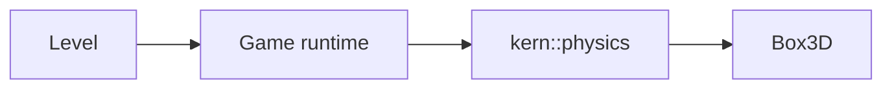

# 6 Physics – Box3D on a Leash

> **Your level:** Stacking crates, swinging doors, breaking bridges. Here you'll see how Kern uses
> Box3D, which rules it sets for itself and how a real servo turns into a model.

Kern simulates **rigid bodies** with **Box3D** by Erin Catto, the 3D successor of Box2D v3. It sits
**unchanged** in the same WebAssembly module as the renderer. The thin layer `kern::physics` is the
**only place** where Kern talks to Box3D. How physics thinks on the inside is explained in
[Appendix C](C-physics.md); here it's about how Kern works with it.

The ground rule: **Box3D is never adapted to Kern** – not the source code, not the constants, not
the solver settings. If a model doesn't fit, **the model** gets adapted: scaled, masses distributed,
more sub-steps. A real device like a servo gets its own device model (6.17).


> **Mission:** On https://kernengine.de/, open File › Example Levels › **Physics Lab** and press
> **Simulate** (Alt+S). Grab a crate from the pyramid with the left mouse button, lift it up and let
> go – it keeps flying with momentum. Give the pendulum a push and open the door.

## 6.1 How the Layer Is Built



- Meters, seconds, kilograms; **Z up** – just like in the renderer.
- Angles in **radians** (one full circle ≈ 6.28). Degrees only exist in level files and in the
  Details panel.
- Bodies, shapes and joints are **handles**, 64-bit numbers; 0 means "none."
- A world owns everything created in it and cleans it all up along with itself.
- Errors return an invalid handle or `false`; `last_error()` tells you why
  ([Chapter 3](03-foundations.md)). Nonsense values never reach Box3D.

The layer is built with `kern/build.sh --physics` ([Chapter 2](02-building-and-testing.md)).

## 6.2 The Right Size

Box3D has fixed tolerances **in meters**: 5 mm of allowed overlap ("linear slop"), 20 mm for
speculative contacts, up to 50 mm of padding around the bounding boxes and 50 mm for reusing
contacts. Hence rule number one: **moving bodies between 0.1 m and 10 m, never under 1 cm.** The
game runtime raises moving shapes to at least 1 cm (spheres 5 mm radius); fixed ones may be as thin
as 2 mm.

> **Crazy but true:** The Micro Duck at real size has limbs of 2 to 4 cm. Its torso sank 9 cm
> through its own legs in 10 frames. Scaled up four times, the joints hold.

### Scaling Instead of Tweaking Tolerances

Box3D could change its length unit – but only for the whole world, and in one level, cars stand
next to small robots. That's why Kern converts units **in exactly one place**: at the border to
Box3D. Small real models get scaled up as a whole by a factor S, with every quantity matched to its
unit. For the Micro Duck, **S = 4**:

| Quantity | Factor | at S = 4 |
|---|---|---|
| Length | S | ×4 |
| Time, velocity | √S | ×2 |
| Mass | S³ | ×64 |
| Moment of inertia | S⁵ | ×1024 |
| Torque, stiffness | S⁴ | ×256 |
| Damping | S⁴ · √S | ×512 |
| Gravity | 1 | ×1 |
| Frequencies | 1/√S | ×½ |

Mass ×64, because a cube with four times the edge length has 4 · 4 · 4 = 64 times the volume. Time
×2, because a pendulum four times as long swings half as fast (try it with a bunch of keys). That's
**Froude similarity**: same poses and gait, inside Box3D's comfort zone.

Within the accuracy of the model, it stays the same duck – a **change of units**, not a bigger
robot. Toward the outside (networks, logs, [Chapter 16](16-calibration.md)), everything goes out in
real units. But a simulation is never a guarantee for the real robot.

A test builds a small servo leg at 1, 4 and 8 times its size. **Hanging freely**, 1× and 4× run
**bit for bit identically** (powers of two round exactly the same way). **On the ground**, Box3D's
fixed lengths kick in: 4× and 8× end up 0.23 mm apart, 1× and 4× 0.27 mm. That's why anything that's
fixed in real units gets **calibrated, not scaled**: a contact stiffness of 30 Hz in the world
matches 60 Hz on the real robot, a push-out speed of 3 m/s matches 1.5 m/s, the restitution
threshold of 1 m/s matches 0.5 m/s and the servo joint softness of 240 Hz matches 480 Hz. So
deviations come from the models (servo, contact, masses), not from the scaling.

## 6.3 The World

```cpp
physics::WorldSettings ws;
physics::World world;
if (!world.create(ws)) { /* last_error() */ }
world.step(1.0f / 60, 4);  // 1/60 s, 4 sub-steps
```

Take the default values, build the world, check for errors, then one step of 1/60 s in 4 sub-steps.

Defaults: gravity (0, 0, −9.80665) m/s², sleep and continuous collision on, restitution threshold
1 m/s (2 passes), hits from 1 m/s, contacts at 30 Hz, damping 10 and 3 m/s push-out speed, speed
limit 400 m/s. Kern always sets **a single thread** (WebAssembly only has one) and its **pair
friction** (6.6). On the PC, a lock protects the creation of worlds, because the Lehrer runs many
worlds on several threads ([Chapter 14](14-lehrer.md)).

A `step` ignores nonsense times, computes with 1 to 64 sub-steps and collects the new events
(6.10). **How long** a step is gets decided by the caller (6.13). You can count bodies, awake bodies
and steps.

## 6.4 Bodies

```cpp
physics::BodySettings bs;
bs.type = physics::BodyType::dynamic;
bs.position = {0, 0, 3};
const physics::Body ball = world.create_body(bs);
```

A dynamic body, 3 m above the origin. There are three types:

- **fixed:** never moves – ground, walls, buildings.
- **kinematic:** moves the way you tell it to and can't be stopped – moving platforms, spinning
  beams, the city's cars.
- **dynamic:** reacts to forces, impacts and gravity.

On top of that come rotation, starting velocity, damping, **gravity scale**, sleep and **bullet**
(check fast bodies against moving ones too). At runtime: read and set position and velocity, apply
**forces** (they last for one step) and **impulses**, **lock** axes, set target poses for kinematic
bodies. What force and impulse are: [Appendix C](C-physics.md).

Mass and inertia come from shape and density. You can set just the **mass** (the inertia grows
along with it) or **everything**: mass, center of mass, six inertia values. That's how imported
robots get their measured values; the shapes then only take care of contact.

## 6.5 Shapes

A body carries as many shapes as you like: **box** (internally a hull), **sphere**, **capsule**
along Z, **hull** (convex, 4 points or more) and **mesh** (any triangles, **only on fixed bodies**).
Nonsense gets rejected. For meshes, Kern welds vertices less than 0.5 mm apart and lets Box3D detect
inner edges – that way, nothing bumps over the seam between two triangles (**ghost collisions**).

Every shape has a **material**:

| Field | Default | Meaning |
|---|---|---|
| Density | 1 kg/m³ | at least 0.0001 |
| Friction | 0.6 | ≥ 0 |
| Restitution | 0 | bounciness 0 to 1 |
| Rolling resistance | 0 | slows down rolling |
| Surface | none | for pair friction |
| Sensor | off | overlap only |

Then there are **channels**: A and B only collide if A's category is in B's mask and the other way
around. Shapes with the same **positive group** always collide, with the same **negative group**
never – that way, a robot doesn't collide with itself. And there are switches for contact, sensor
and hit events.

`hull_mesh` creates the triangles of a hull with the same builder that's used for collision; Studio
uses it to draw hull colliders (4 to 4096 points, not flat).

## 6.6 Surfaces with Pair Friction

Box3D combines two friction values into √(a · b) and bounciness as the larger of the two (why is
explained in [Appendix C](C-physics.md)). For real pairs, that's not always right: according to the
source code, TPU on cotton has its own measured value, not the average of TPU on TPU and cotton on
cotton.

That's why Kern knows **surfaces**: `cloth` (cotton knit), `tpu` (soft printed rubber), `floor`
(wood or laminate) and `none`. Measured static friction, dry:

| Pair | Friction | Range according to the code |
|---|---|---|
| cloth – cloth | 0.5 | knit on knit 0.4–0.6 |
| cloth – tpu | 0.8 | rubber on fabric 0.6–1.0 |
| cloth – floor | 0.4 | fabric on wood 0.3–0.5 |

Box3D stays unchanged for this: the surface is stored as a material number in the shape, and the
world gets its own **friction function**, which Box3D asks at every contact. If the pair has a
value, that one applies; otherwise √(a · b). Bounciness and rolling resistance stay untouched.

> **Watch out, trap:** If you add a surface, you also have to update the upper limit of the numbers
> in the friction function (3 today), the name and the pairs.

Surfaces are stored as text in the level file (on mesh colliders, custom colliders and the endless
ground); there's no Details field for them (as of this code). The Micro Duck
([Chapter 13](13-micro-duck.md)): sock `cloth`, beak pad `tpu`, wooden floor `floor` (the endless
ground is `floor` too, but switched off). Soles have **no** surface and keep their training values:
1.0 on 1.0 gives √(1 · 1) = 1.

## 6.7 Friction, Bounciness, Rolling Resistance

In Studio, you set **friction**, **restitution** and **rolling resistance** under Details › Static
Mesh › Physics (for the automatic collider) or under Details › Collider. For the endless ground:
World Settings › Physics (Box3D) › **Ground friction** and **Ground bounciness**, where you'll also
find Contact stiffness, Contact damping ratio and Contact push-out speed.

Box3D takes restitution as the larger of the two shapes; impacts under 1 m/s don't bounce.
**Rolling resistance** counts with the larger value of the two shapes, times a rolling radius: the
radius for spheres and capsules, a quarter of the inner radius for hulls (boxes are hulls too). Kern
sets it for round things: the ball in the Micro Duck level 0.03 ("rolls to a stop"), the rover tires
in Physics Lab 0.02, sock lumps 0.5 ("a lump of fabric doesn't roll"). **Robot feet** are wide, flat
and grippy.

> **Mission:** If Simulate is still running, stop it with Esc. In Physics Lab, select the top crate,
> **Crate 15**. In Details › Collider, set its **Friction** from 0.7 to 0, start Simulate, put the
> crate on the ground and give it a shove: it slides like on ice – because √(0 · ground friction) is
> always 0.

## 6.8 Joints

A joint connects two bodies through one small **frame** each (position plus axes). Hinge, ball and
parallel joints work **around Z** of the frame, slider and wheel **along X**. Angle 0 is where both
frames line up; a helper function builds the frame from an anchor and an axis.

| In Studio | Box3D | What for |
|---|---|---|
| Hinge | revolute | hinge: door, bridge |
| Slider | prismatic | rail: lift |
| Ball | spherical | ball joint with a cone limit |
| Fixed | weld | rigid or soft |
| Distance/rope | distance | distance, rope: pendulum |
| Wheel | wheel | wheel with suspension, drive |
| Motor | motor | drives position via velocity, spring |
| Parallel | parallel | keeps axes softly parallel |
| No collision | filter | only prevents collision |

Depending on the type, there's a **spring** (Hz, damping), **limits** and a **motor** (velocity,
maximum force). Kern swaps limits that are the wrong way around, and negative maximum forces become 0.
All joints have "connected bodies collide" (default: no) and a joint softness (Box3D default 60 Hz,
damping 2). A joint connecting a body with itself is rejected. At runtime, you can set the motor,
spring and breaking thresholds, and read the angle, angular velocity, constraint force and constraint
torque.

**Breaking:** Box3D reports joints above their force or torque threshold. The game runtime then
destroys them, counts them, writes `Joint on "…" broke` to the log and plays the breaking sound. In
Physics Lab, the three middle joints of the 13 bridge joints have such a threshold (60,000 N): the
joints of Plank 06, 07 and 08.

> **Mission:** Stop a running Simulate with Esc. Select **Plank 06** and, in Details › Constraint ›
> Breaking, lower the **Break force** to 20,000. Start Simulate: the bridge holds. Grab the plank
> with the mouse and pull it up hard, two or three meters. The joint breaks, the Output Log reports
> it, and the status bar keeps count ("1 broken"). Why is the grab enough (6.11)? The tightly
> stretched bridge already pulls on this joint with over 10,000 N while at rest; the grab adds a
> bit on top. That's why with 2000, it snaps right after the start.

**Springs in real units:** Box3D wants springs in hertz and damping ratio, while servos compute in
N·m/rad and N·m·s/rad. Kern converts at the border, the same way Box3D does internally, using the
joint's **effective mass** ([Appendix C](C-physics.md)). Because that changes with the pose, the
spring gets set anew **every step**. Box3D solves it implicitly: stable at any stiffness.

## 6.9 Queries

**Rays** find the nearest hit (ignoring sensors and excluded bodies). **Sphere casts** are a "thick
ray" for probing the ground. **Explosions** push bodies away from a point (negative: implosion).
**Pushing** gives a body just enough of a shove that it's not slower than a running character in
front of it. A hit delivers the shape, body, point, normal and fraction of the distance. For the
Character Mover, there are two extras: how far does the capsule get, and which planes (up to 32)
does it touch?

## 6.10 Contacts and Events

After every step, the events of **that** step are ready: contacts begin and end, sensors are entered
and left, **hits** (hard impacts with point, normal, speed) and joints above their threshold. The
events also carry the bodies, in case a shape has already been destroyed.

**Events cost time**, so the game runtime only switches them on where the game reads them: sensors,
players, impact sounds and levels with logic.

Two queries read Box3D's contacts directly: the **contact points** of a body (Studio shows them with
the show flag **Contact Points**) and the **touches** – who is the body touching, and how hard?
That's how the Micro Duck feels foot contact and self-collision ([Chapter 13](13-micro-duck.md)).

> **Mission:** In Physics Lab, switch on **Collision Shapes**, **Constraints** and **Contact
> Points** under Window › Show and start Simulate. Now you can see what Box3D is really computing
> with.

## 6.11 MouseGrab

The mouse grab pulls with a **spring**: an invisible kinematic "mouse body" plus a **motor joint**
to the body. The spring has 7.5 Hz, is critically damped (no wobbling afterward) and manages at most
100 times the body's weight. For a 300 kg crate from Physics Lab, that's
100 · 300 · 9.81 ≈ 294,000 N; for a 15 kg bridge plank, around 14,700 N. The body may rotate freely;
with "keep orientation," a second spring holds it upright like a hand – that way, a lifted Micro
Duck doesn't dangle. The body stays fully inside the physics: it bumps into things, tips over and
keeps flying when you let go. Fixed and kinematic bodies can't be grabbed. Studio uses the grab in
Simulate, after Eject (F8) and with the Observer camera.

## 6.12 The Character Mover

The Character Mover is a game character as a capsule, built on Box3D's still experimental mover
technology. It runs **outside the solver**: it computes its own movement and shoves bodies it walks
into. Defaults: radius 0.4 m, height 1.8 m, step height 0.45 m, 6 m/s top speed, acceleration 10
and ground friction 8 per second, 25% control in the air, constant friction below 3 m/s, jump
6 m/s, sprint ×1.6, its own gravity of 20 m/s² (snappier than the world's), floors up to 50°, push
strength 1.

Per step: friction, acceleration, jump, gravity; a **pogo spring** (4 Hz) keeps the capsule at step
height – that's how it climbs stairs. In up to five rounds, the movement gets aligned with the
planes it touches (pushing against a wall doesn't make you faster), then come the shoves. The player
types Character and Soldier use the mover ([Chapter 8](08-game-runtime.md)).

## 6.13 The Beat: Time Step and Sub-Steps

Box3D **never** gets a step length that wobbles. The step rate is a level setting: default
**60 Hz**, allowed 15 to 480, but never use anything coarser than 30 Hz. Why, and how the
accumulator works, is in [Appendix C](C-physics.md). Kern's limits here:

- A long frame counts for at most 0.25 s, and at most 0.1 s of simulation runs per frame – against
  the "spiral of death," in which the simulation never catches up. When it falls behind, whole steps
  get dropped.
- The simulation time **counts steps** instead of adding up decimal numbers.
- Inputs apply **per step**; a network running at 50 Hz counts steps, not seconds.

Drawing happens **between** the last two physics states: if a picture falls at 40% of the time,
the body stands at 40% of the way. The camera follows this position; otherwise fast cars wobble.

**Sub-steps** split every step once more (default 4, in the level 1 to 16). Long chains of joints
then stretch less: at the duck's hip, the gap grew to 5 cm under load with 4 sub-steps; with 16, it
stays under 1 mm. When Studio inserts a robot, it sets 16 sub-steps and the robot's rate (Micro
Duck: 100 Hz) and reports it.

Box3D caps joint stiffness at a quarter and contact stiffness at an eighth of the sub-step rate. On
top of that, Kern keeps every spring below half:

**highest spring frequency = 0.5 · step rate · sub-steps**

At 60 Hz and 4 sub-steps, that's 120 Hz. Servo joints get 240 Hz softness (or the limit) with
damping 2.

> **Mission:** In Physics Lab, start Simulate, press the **Pause** key (or Play › Pause) and then
> press **.** (period) several times:
> every press is exactly one fixed step. You'll find Step rate and Sub-steps in World Settings ›
> Physics (Box3D).

## 6.14 Determinism

Kern is **bit-for-bit deterministic** on all tested platforms: GCC on x86, Apple clang on ARM and
WebAssembly. Why that's hard is explained in [Appendix C](C-physics.md). The physics helps with a
fixed beat, a single thread, Box3D without vector instructions (SIMD), the compiler switch
`-ffp-contract=off` and Kern's own math library (`kern::dm::sin` and so on; `sqrt`, `fabs` and
`floor` are exact anyway). A **fingerprint** checks this: the duck walks 400 control ticks, every
tick becomes a check number, and all of them have to match a stored list
([Chapter 14](14-lehrer.md)).

> **For pros:** Code that feeds the simulation uses `kern::dm::` instead of `std::` for sin, cos,
> tan, asin, acos, atan, atan2, exp, expm1, log, log10, pow and hypot – without thread-dependent sums
> and without `-ffast-math`.

## 6.15 The Rules

`docs/physics.md` is required reading before you change the physics or the game runtime, or build a
robot, a vehicle or a ragdoll. It's based on Erin Catto's documentation and talks, and on
measurements in Kern with tests:

- **Sizes:** meters, kilograms, seconds, radians; moving bodies 0.1–10 m; convert only at the
  border; scale small models with S. **Forbidden:** changing Box3D's length unit.
- **Masses:** neighbors at most about 10 : 1, otherwise joints stretch. (Erin Catto's recipe for a
  tank with 467 : 1: make the light parts heavier and the heavy parts lighter.) A rigid part is
  **one** body with several shapes – **forbidden:** welding bodies together. Light limbs get a
  minimum mass (the duck's 5 g hip brackets at least 20 g).
- **Beat:** as in 6.13. **Forbidden:** wobbling steps.
- **Joints:** build them in the **rest pose**, with limits around 0; hinges around Z; self-collision
  with a negative group or "No collision"; only raise Box3D's joint softness for servos.
- **Motors and servos:** always a **finite** maximum torque. Servos are the joint spring with a target
  angle, with real values and a limited error (6.17) – **not** Erin Catto's velocity control "motor
  speed = factor × error," because the network has learned a compliant servo. Rotor inertia is a disc
  on the axis; whatever Box3D can't do gets written down, not faked. Joint friction is a motor with
  speed 0. Staying upright is done with a **parallel joint**.
- **Forbidden: bypassing the physics** – no extra torques, no velocities set directly on bodies with
  joints or contacts, no gyros, locks or support forces for robots. They don't exist in the real
  world either. (A "gyro" at the velocity level made the duck jump.)
- **Forces:** continuous loads as a force every step; jumps as an impulse; use the built-in damping
  instead of a homemade braking force.
- **Bodies:** create them at their final position (don't teleport them), set the type right away;
  move kinematic bodies via velocity or target pose; characters on the mover; locks **never for
  walking robots** – a robot has to be able to fall. Joints not built at their zero position remember
  their build angle.
- **Collision and sleep:** continuous collision on, fast player vehicles as bullets; players and
  robots never sleep (slow walking is below the sleep threshold of 5 cm/s).

**Checklist for a new model with joints:** (1) Every moving part is ≥ 10 cm; otherwise scale it.
(2) One body per rigid part. (3) Masses within 10 : 1, minimum masses. (4) Build in the rest pose.
(5) Servos as a joint spring, friction as a motor, no helper forces. (6) 8–16 sub-steps.
(7) Filter self-collision. (8) A test: the model stands, joint gaps are under 1% of the limb
length, and it does its job – deterministically.

## 6.16 How the Game Runtime Uses the Physics

Games build bodies from the level ([Chapter 8](08-game-runtime.md)): first, it **plans** which
bodies and shapes are needed (Studio draws the colliders with the same plan), then the **bodies** are
built with material, channels, events and mass, then the **joints** (degrees to radians, spring
limit, servo softness, breaking thresholds). In every step, controllers, animations, traffic, walking
robots, servos and the mouse grab run, then Box3D, then the events.

## 6.17 The Servo Model – Bridge to the Micro Duck

A real servo has a controller, friction in the gearbox and a delay on the data bus. Kern recreates
that as a small **device model** with a **profile** in real units. A different servo is a different
profile; profiles are tuned on measurements and checked against other measurements
([Chapter 16](16-calibration.md)). The law for a position servo like the Dynamixel XL330:
torque = stiffness K × (target − angle), limited to ± maximum torque T, minus damping D × velocity;
plus friction F, the rotor inertia A and a delay. How such a controller works is worked out with
numbers in [Appendix C](C-physics.md).

Kern implements it using only Box3D's own building blocks. The function `servo_step` does this every
step:

1. **Spring:** The joint spring pulls toward the target – but the target lies at most T/K away from
   the current angle. That way, K × error never gets bigger than T, exactly like a real servo
   saturates.
2. **Friction:** a joint motor with speed 0 whose maximum torque is F.

The same function drives Studio, the Lehrer and the calibration test bench.

In the level, the `servo` switch turns a Hinge into a servo (default: target 0°, K = 50 N·m/rad,
D = 2 N·m·s/rad, F = 0.1 N·m, T = maximum motor force; keys `servoTarget`, `servoStiffness`,
`servoDamping`, `servoFriction`, `maxMotorForce`).

A **profile** is a JSON file (`"kind": "servo"`) with name, source, K, D, F, T, A, delay and
**spreads**. During training, every servo draws its own values within these limits, so the network
doesn't rely on anything that wasn't measured. Values outside the ranges are rejected. Built in is
the XL330-M288 at 7.4 V, the way Pollen Robotics trains it (model "m6" from BAM – Better Actuator
Models by Rhoban):

| Value | Number |
|---|---|
| K stiffness | 0.554 N·m/rad |
| D damping | 0.053 N·m·s/rad |
| F friction | 0.0048 N·m |
| T maximum torque | 0.963 N·m |
| A armature | 0.0018 kg·m² |
| Delay | 20 ms (training 15–30) |
| Spread | armature, friction ±10% each |

At the border to Box3D, scaling happens **exactly once**: stiffness, friction, maximum torque × S⁴,
damping × S⁴ · √S, inertia × S⁵. So at S = 4, 0.963 N·m becomes 0.963 · 256 ≈ 246.5 N·m. The
armature is added as a thin **disc** on the axis (full value around the axis, half across it) – an
inertia around only one axis wouldn't be a real body, and Box3D would gain energy from it. The delay
runs through a **queue** of whole steps: 20 ms in real time is exactly 40 ms of world time at S = 4,
so at 100 Hz that's **4 steps**. More in [Chapter 13](13-micro-duck.md).

## 6.18 Tests

Tests check bodies, shapes, events, rays, all nine joints, the grab, the scaling, hulls, materials,
Physics Lab including the bridge break, the Character Mover and the fingerprint.

## Level complete!

- You know why Kern adapts the model and never Box3D.
- You can explain why the duck is simulated four times as big, 64 times as heavy and half as fast –
  and still stays the same duck.
- You know the body types, shapes, materials and the nine joints.
- You understand pair friction, rolling resistance and breaking joints.
- You can explain how a servo turns into a profile and a joint spring.

## Puzzle corner

1. Which body type fits a platform that stubbornly follows its track?
2. Sock (`cloth`) on a wooden floor (`floor`): which friction applies? And without surfaces, with
   0.4 and 0.9?
3. 100 Hz, 16 sub-steps: how fast may a spring oscillate at most?
4. **Boss puzzle:** A robot has a 20 ms bus delay, S = 9, rate 150 Hz. How long is the queue?

### Solutions

1. **Kinematic** – it follows its instructions and can't be slowed down.
2. With surfaces, the pair value **0.4**; without, √(0.4 · 0.9) = √0.36 = **0.6**.
3. 0.5 · 100 · 16 = **800 Hz**.
4. Time grows with √9 = 3, so 60 ms of world time. One step lasts 1/150 s ≈ 6.67 ms, so
   **9 steps**.

---

© 2026 Christian Heinrich Hohlfeld · All rights reserved · [Imprint and rights](00-imprint.md)
