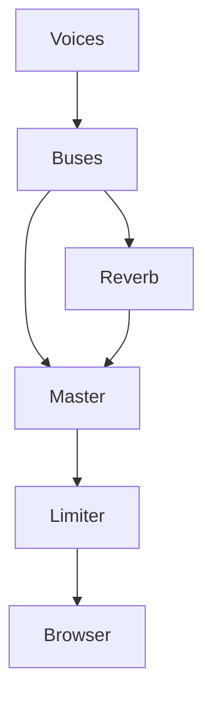
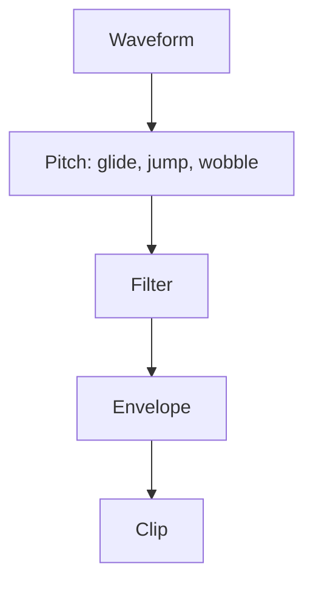

# 7 Audio – Kern Turns Up the Sound

> **Your level:** A game without sound is a silent movie. Here you get to know a complete sound
> studio: a mixing desk for 3D sound, a synthesizer that builds every noise out of math, and the
> voice of the Micro Duck.

> **Words you need:**
> - **Hertz (Hz)** – "per second." 48,000 Hz means: 48,000 times every second.
> - **Frequency** – how often a sound vibrates back and forth per second. High frequency = high
>   tone.
> - **Mono / stereo** – one sound channel for both ears / two channels, one left, one right.
> - **Clip** – a finished piece of sound in memory, for example the noise when jumping.
> - **Loop** – a sound that repeats endlessly, such as an engine hum.
> - **Pan value** – how far left or right a sound sounds: −1 all the way left, 0 middle, +1 all
>   the way right.
> - **Deterministic** – with the same inputs, exactly the same thing always comes out.
> - **Filter** – a sieve for sounds: a *low-pass* lets only the low ones through; the high ones get
>   caught.

Kern has its own **sound engine**. It calculates every sound itself. The browser is just the
loudspeaker and unpacks sound files that you import yourself. (MP3 and co. are squeezed together so
they take up little space. The browser turns them back into the long row of numbers we're about to
talk about.)

Sound is vibrating air. The computer measures this wave very often per second. Every measurement is
a number and is called a **sample**. How often it measures is called the **sample rate**: 48,000 Hz
is 48,000 numbers per second and ear.

> **Picture it like this:** Draw a wavy line on graph paper and put a dot on every vertical line,
> exactly where the wave crosses it. The heights of the dots are the samples. The closer together
> the squares, the more exactly the dots describe the wave.

## 7.1 Why a Mixer of Its Own?

A **mixer** mixes many sounds into one stereo signal for the speakers. Kern builds its own instead
of using the browser's sound building blocks. That brings three things:

- **Always the same:** The same events give the same samples on every device. The sound is
  deterministic, just like the physics. That way automatic tests can check the sound number for
  number, and a replay sounds exactly like the original.
- **One program for everything:** Studio, exported games and the automatic tests use the same
  mixer.
- **Full control:** no clicking when stopping, no clipping.

**Clipping** means: the speaker membrane can only swing up to a highest deflection; in the
computer, that's the number 1 (downward −1). Whatever lies above it gets cut off, the wave gets
flat peaks and sounds scratchy. That's why in Kern every sample stays between −1 and +1 (how is in
7.4).

## 7.2 The Mixer

The mixer has a fixed supply of **voices**. A voice is a sound that's currently playing. Studio
uses 64 voices. Every voice plays a clip, with its own settings: volume, pitch, pan, loop, a group
(*bus*, 7.4), a **priority** (how important it is) and, for 3D sounds, the place in space.

> **Picture it like this:** a DJ desk with 64 tracks. Every track has its fader, tracks run
> together in groups, and at the end the master fader sits in front of the speakers.

**All slots full?** Then Kern takes the slot away from another voice. That's called **voice
stealing**. Stealing only happens at equal or lower priority: first the least important voice, in
a tie the quietest, then the oldest. If all the others are more important, the new sound doesn't
start at all. That way a bang never pushes out the music.

**Never cut off hard.** Imagine the wave is right at the top, and in the next sample it's suddenly
0. The speaker membrane jumps back in one jolt, and you hear a **click**, like when you pull out a
headphone cable while music is playing. That's why Kern always fades out when stopping, and volume
changes glide smoothly too. That also applies when a source flies past you: its volume doesn't
change in jumps from block to block but glides softly to the new value within each small
calculation block. Otherwise there'd be a quiet crackling. The game pause holds voices without
forgetting where they were.

**Pitch through speed.** Pitch 2 means: play it twice as fast. The wave then vibrates twice as
often per second, and the sound is an **octave** higher (the same note, just one step higher, the
way a woman's voice sings the same melody higher than a man's voice). Playing twice as fast means
for the mixer: it reads only every second number, so sample 0, 2, 4 … At pitch 1.5, it jumps one
and a half squares further each time:

At 0, 3 and 6 there's a dot. At 1.5 and 4.5 there's none, because sample 1.5 doesn't exist. Kern
estimates the value there from the neighbors with a smooth curve, like a line you draw through the
dots on the graph paper.

If an imported file has a different sample rate than your device (more on this in 7.10), Kern has
to convert it to the device's rate. There's a thorough calculation for this that's very exact but
slow. That's why Kern does it only **once when loading**. When playing, the fast estimate with the
smooth curve is enough after that.

> **Crazy but true:** If a 3D voice is so far away that it's practically inaudible, it becomes
> **virtual**: it's no longer mixed, but its position in the clip keeps running. If you fly back to
> the machine, it hums on at the right spot and doesn't start over.

> **For pros:** Whoever starts a voice gets a number with which they can later make it quieter or
> stop it. The number also contains which use of the slot this is. If the slot has been handed out
> again in the meantime, the old number no longer fits and goes nowhere, instead of accidentally
> adjusting someone else's voice.

> **Mission:** In Kern Studio on https://kernengine.de/, open the **Content Drawer** with the
> button at the far left of the status bar (on Windows and Linux also with Ctrl+Space), tab
> **Sounds**. A click on a sound plays it. There's only sound after your first click or key press.
> Listen to one from every category. Then click a long sound like `music_calm` and, while it's
> playing, right away a second one. Pay close attention to the moment the music stops: it
> disappears without clicking, so quickly and softly that you only hear the new sound. No click
> like with a pulled-out headphone cable, because Kern fades out instead of cutting off.

## 7.3 3D Sound

In the game, every sound comes from a place. The **listener** sits at the camera. For every 3D
voice, Kern asks four things: how loud does it arrive? From which side? How muffled? How high?

**How loud: distance.** In nature: twice the distance, half the volume. Kern calculates the same
way by default. Up to an **inner radius**, the sound is at full volume; after that, volume = inner
radius divided by distance. With 1 m: at 2 m distance 0.5, at 4 m 0.25, at 10 m 0.1. This curve
never quite reaches zero. That's why Kern also fades out shortly before the **hearing range** (in
Studio the field **Falloff distance**), so that it's really quiet beyond it. You can choose two
more curves (straight and steeper) in Studio under **Roll-off**.

**Which side: panning.** The position of the source turns into a pan value. Then Kern distributes
the sound across the left and right speakers. The simplest would be a straight line: all the way
left 1 / 0, in the middle 0.5 / 0.5. But then the sound in the middle sounds **quieter**. That's
because for our ear, what counts isn't the number itself but the number **times itself**. Check it:

| Source | straight line | arc (equal power) |
|---|---|---|
| all the way left (left / right) | 1 / 0 | 1 / 0 |
| middle (left / right) | 0.5 / 0.5 | 0.71 / 0.71 |
| ear strength all the way left | 1·1 + 0·0 = 1 | 1·1 + 0·0 = 1 |
| ear strength middle | 0.25 + 0.25 = **0.5** | 0.5 + 0.5 = **1** |

With the straight line, only half as much ear strength is left in the middle. That's why Kern uses
an arc where the sum stays **the same everywhere**: **equal power**. A source driving past doesn't
get quieter in the middle.

Kern pushes very close sources less to the side; otherwise a sound right by your head would jump
hard back and forth. And a source can also be **wide**; then the mixer pushes it less or not at all
to the side. That suits noises that surround you instead of coming from one point. (The
ready-made **Ambient Wind** from the catalog goes even further: it has no place in space at all;
see **Spatial (3D)** in 7.9.)

> **For pros:** If you plot left and right as a point in a coordinate system, all the points of the
> arc lie on a quarter circle around the origin. Pythagoras says: left² + right² = radius². At the
> end, Kern also multiplies all the values in the table by √2 ≈ 1.41, so that the middle comes out
> as exactly 1 / 1. That turns 0.71 / 0.71 into 1 / 1, and 1 / 0 all the way left into 1.41 / 0.

**How muffled: air and direction.** High sounds get lost in the air faster; a distant thunderstorm
only rumbles. Kern sends every 3D voice through a low-pass: close in front of you, everything up to
20,000 Hz gets through; at 120 m, only up to 10,000 Hz. With two ears, you can hear well whether
something is left or right. But whether it's in front or behind sounds the same at first, because
both ears are the same distance away. That's why Kern also makes sounds from behind more muffled.
That's how you tell front and back apart.

**How high: Doppler.** An ambulance drives past: first higher, then lower. If the source comes
toward you, the wave crests arrive closer together. More wave crests per second means a higher
frequency, so a higher sound. If it drives away, they arrive farther apart, and the sound gets
lower.

> **Picture it like this:** A duck swims across a smooth pond, paddling evenly. In front of it,
> the rings of waves crowd closely together; behind it they lie far apart. It's exactly the same
> with sound.

For a listener standing still: new pitch = pitch · 343 / (343 − v). Here 343 m/s is the speed of
sound and v the speed of the source **toward you** (if it drives away, v is negative).

Example: a car comes toward you at 34.3 m/s. 343 / (343 − 34.3) = 343 / 308.7 ≈ 1.11. The sound is
11% higher. If you move yourself, Kern factors that in, and the factor glides smoothly.

> **Mission:** From **Place Actors › Audio**, place a **Radio**, start **Simulate** (Alt+S) and fly
> around holding the right mouse button and using W A S D. Turn so that the radio is to your left,
> to your right and behind you. Do you hear how it gets quieter, more to the side, and more muffled
> behind you? Then turn up the **Camera speed** in the toolbar and fly past the radio quickly: do
> you hear the Doppler, first a bit higher, then lower?

## 7.4 Buses, Reverb and Limiter

A **bus** is a collecting line: many voices run into it and can be made louder, quieter or muted
together. Kern has five: **Music**, **Effects**, **Ambience** for the background, **Interface** for
interface clicks, and **Voice** for voices. All of them flow into the **master**, the main fader.

Muting glides too, so it doesn't click. Every bus can have its own low-pass and a fader for how
much it sends into the reverb.

**Reverb:** Clap in an empty gym. The sound bounces back off all the walls, the echoes arrive
slightly offset and get quieter and quieter until they melt into a long reverb tail. Kern rebuilds
this with the free recipe **Freeverb**: eight echo loops play the walls. Each one sends its echo
back into itself again and again, quieter every time, the highs faster than the lows. The loops are
**different lengths**, so their echoes arrive jumbled together and melt into a dense echo cloud. If
they were all the same length, the echoes would arrive in lockstep, and it would sound more like a
tin pipe than a hall. More stages mix the echoes up so thoroughly that you can no longer pick them
out one by one. The right channel has slightly longer echoes than the left one. That makes left and
right sound a bit different, and the reverb seems to come from everywhere instead of from the
middle. Music and interface get no reverb.

**Limiter:** At the end sits a bouncer. No peak may go over 0.92. If a spot is too loud, the limiter
turns the volume down **instantly**, so that not a single peak gets through. Then it lets it back
up **slowly** (in about a tenth of a second). If it went straight back up, the volume would audibly
flutter up and down with every loud bang. Whatever still slips through gets rounded off by a soft
curve. That way every sample stays safely between −1 and +1.

The **level meter** in Studio's status bar shows how loud it is right now.

> **Mission:** With **File › New Level...**, create a level with the template **Basic**, place a
> **Crate Stack** from **Place Actors › Physics** and start **Simulate**. Grab a crate with the left
> mouse button, keep the button held, drag the crate quickly to the side and let go so that it
> flies. Watch the level meter at the bottom. Stop with Esc, set **Reverb** to 1 under **Audio** in
> the **World Settings**, and try it again. Now every impact echoes as if you were standing in a big
> hall.

## 7.5 The Synthesizer

> **Crazy but true:** Kern brings **not a single sound file** along. Every built-in sound, from
> the jump to the music, is calculated from math when loading.

That's done by a **synthesizer**, a program that builds sounds out of simple vibrations. Every
sound is a recipe of knobs (a **patch**). Even the noise in it isn't real randomness: computer
randomness is a long chain of calculations, and whoever starts with the same starting number (the
**seed**, see [Chapter 5](05-scene-and-geometry.md)) gets the same chain. That's why every sound
sounds the same on every device.

This is how a sound comes about:

**1. The waveform** gives the tone color:

| Waveform | Shape | sounds like |
|---|---|---|
| sine | round like a water wave | soft whistle, bell |
| square, pulse | jumps between top and bottom | beeping of old video games |
| sawtooth | falls at a slant, jumps straight up | buzzy, sharp |
| triangle | straight up, straight down | between sine and square |
| noise | random wiggling | hissing, wind, explosion |

This is what the five waves look like, three vibrations each, as tall as Kern generates them. A
label like "±0.6" means: the wave swings from −0.6 to +0.6.

**2. The pitch** can glide (a laser zaps from high to low), wobble (*vibrato*) or jump.
**3. Filters** take away highs or lows; for example, a low-pass turns noise into a muffled wind
noise. **4. The envelope** determines how the volume runs over time: rise, hold, fade. A piano note
is there at once and fades out long; a violin note swells slowly.

An example from Kern, the **pickup** sound when collecting: a short, bright beep from a pulse wave
(a kind of square wave) that's there at once. After a moment it jumps up a bit. Underneath, a bell
sounds quietly. And there's the typical "pling-plong."

**Expensive calculations less often.** Gliding, wobbling and filtering change all the time.
Calculating them anew for each of the 48,000 samples per second takes a lot of time. Kern
calculates them only every 16 samples, which is every three ten-thousandths of a second. Nobody
hears such small steps, but the synthesizer finishes much faster.

For certain sounds, Kern has extra tricks:

- **Impacts:** An object that something hits vibrates with a few tones of its own that fade
  quickly. Kern mixes a few sine tones with a short burst of noise. Low, long-sounding tones seem
  like a hollow crate. But a solid plastic part sounds neither low nor long. That's why Kern uses
  medium-high tones for plastic that fade very quickly.
- **Seamless loops:** The end is faded softly over the beginning, so you don't hear the seam when it
  repeats.
- **Music:** Two pieces are stored as notes: `music_drive` (upbeat) and `music_calm` (calm). If the
  same note comes up several times, Kern calculates it only once and reuses it, just as you don't
  look up a word again that you've already looked up. Even so, the music takes a few hundred
  milliseconds. That's why Kern calculates it **in bite-size pieces**, say one bar after another.
  That way the game doesn't stutter while loading.

Kern brings 38 built-in sounds in eight groups. You can hear them all in the **Sounds** tab of the
**Content Drawer**. In the level, they're called `builtin:` plus their name. For reference
(* = loop):

| Category | Sounds |
|---|---|
| **Gameplay** | pickup, powerup, jump, land, goal, hazard, checkpoint, lose, laser |
| **Combat** | gunshot, smg, pistol, sniper, launcher, reload, hit, down |
| **Physics** | explosion, impact, impact_light, break, step, plastic, plastic_step |
| **Vehicle** | engine*, hover*, boost |
| **Ambience** | wind*, city*, hum* |
| **Robot** | servo*, quack, beep |
| **UI** | click, confirm, error |
| **Music** | music_drive*, music_calm* |

The exact knobs and values of every sound are in the blue book, Chapter 7.

## 7.6 The Voice of the Micro Duck

The Micro Duck has no recordings either, but a small synthesizer of its own, taken over from
Pollen Robotics' original project. **A single number**, the **seed**, sets how the duck sounds:
pitch, how nasal, how shaky, how "quacky," how fast. The same seed always sounds the same. The real
robot makes the seed from its serial number, via a **fingerprint**: a number that looks random but
is always the same for the same name. Kern uses the actor's name and number for it.

A sound is made of a fundamental tone and quieter **overtones** (tones with double, triple …
frequency; they give the tone color), plus vibrato, fast volume fluttering (the "quacking") and a
bit of noise as breath. There are seven kinds of sounds, such as greeting, question, alarm and
chirping, each in several variants. A random one gets played, so that the duck doesn't sound like
a stuck recording.

> **Crazy but true:** The duck's voice is **bit-exact** like the original. If you compare all 328
> sounds with the original program, they're the same length, and every single sample matches
> exactly. That way the duck in the game sounds exactly like the real robot.

Finally, a filter takes away the very low tones; the robot's small loudspeaker can't go that low.
In the game, every sound comes from the duck's **head**, where the loudspeaker sits, and a new
sound cuts off the old one, like a single loudspeaker that can only do one thing at a time.

One sound is special: the **wheee** that the duck calls out when zooming around. It's split into
three parts: beginning, a middle part that repeats, and end. That way it lasts exactly as long as
the ride, whether that takes two or ten seconds. That's the same trick as with the engine hum,
which runs as a loop as long as the engine is on.

Kern calculates the sounds ahead of time, one per picture, so that the phone doesn't stall. When
the duck calls out what: [Chapter 13](13-micro-duck.md).

## 7.7 Cues and Impact Sounds

The simulation **never** plays sound **itself**. Instead, in its fixed physics steps, it writes
**cues**, small order slips: "Play the sound `pickup` at this place, this loud, on this bus." Later
in the picture, the sound layer picks up the slips and plays them (7.8).

> **Picture it like this:** a shopping list on the fridge. Whoever in the family notices that the
> milk is gone writes it on the list instead of running off right away. Whoever goes shopping takes
> the whole list along later. The simulation writes the list; the mixer takes care of it.

Why the detour? The fixed steps run the same on every device, so the slips do too. The simulation
stays deterministic and even runs without speakers, for example when training the duck.

In multiplayer, the same idea carries on: sounds are sent by "postcard," which may get lost.
Important events like a collected pickup, on the other hand, arrive by "registered mail"
([Chapter 10](10-networking.md)). A lost bang doesn't matter; a lost point does.

**Impact sounds.** Every body has an impact sound (normally `impact`) and a **threshold**, a
minimum speed. Every shape part the physics calculates with (a **Collider**, see
[Chapter 6](06-physics.md)) can also have its own sound: the duck's sole makes `plastic_step`, its
housing `plastic`.

Reporting impacts costs the physics work. That's why it only reports where someone is listening:
for shapes that have a sound (or that the player or the logic need). How sensitively it reports
depends on the smallest threshold of all sounding bodies. So an impact sound isn't completely free.
The rules:

1. Below the threshold it stays quiet. A light nudge makes no sound.
2. **The harder the impact, the louder**, from quiet to full. Soft bumps play the quieter
   `impact_light`.
3. Heavy things sound lower, light ones only a little higher; otherwise it would sound like glass.
4. At most **six** impact sounds per physics step. Nobody can pick out more than that anyway.
5. **Debouncing:** A sole rolls from heel to toe and bounces a tiny bit while doing so. The physics
   reports every bounce as a hit. That's why a step sounds at most every half second, a knock at
   most about every tenth of a second.

The Micro Duck has a very small threshold, so that you can hear even light touches. Breaking joints
play `break`.

## 7.8 Sound in the Game

In the level, you name a sound by its name: a built-in one, an imported one (in a common sound
format; the file is inside the level), "none" for silence, or "auto" for the fitting default.

**Before the start**, Kern orders **everything** the level could need in sounds and calculates or
unpacks it. That way everything is ready when playing.

**In every picture**, the following then happens in order:

1. If the game is paused, the sound pauses too.
2. The **listener** is placed at the camera.
3. **Music and background** run as loops.
4. The **player's engine** hums at the vehicle, louder and higher with speed and throttle. If its
   sound is set to "auto," Kern adjusts it: the **Hover car** floats with `hover`, the **Vehicle**
   hums with `engine`, and on the Micro Duck the servos whir.
5. Every **Audio Source** from 7.9 follows its actor.
6. The **cues** from 7.7 get played.

With many sounds at the same time, the ranking of **priorities** counts. Kern hands them out on its
own:

1. Music and background
2. The player's engine
3. Audio sources with **Loop**: continuous sounds, such as a humming machine
4. Audio sources without **Loop** (play once and stop)
5. The simulation's order slips (jump, impact, pickup …)

So a short effect never pushes out the music, but the music may take a slot away from an effect.

Two clever little details:

- The player's engine has **no Doppler**, because the camera moves along. Listener and engine move
  together.
- If the camera jumps to a different place (a cut), its speed would be huge, and everything would
  howl. Kern recognizes such jumps and then counts the speed as 0.

> **Watch out, trap:** A bang half a second after the flash seems broken. Too late is worse than
> never. If a cue's clip still isn't ready after a quarter of a second, Kern throws the cue away.

## 7.9 Level Settings and Audio Source

In the **World Settings**, under **Audio**, you set for the whole level: **Master volume**,
**Music** and **Ambience** with their volumes, **Reverb** and **Doppler** (how strong the effect
is).

The component **Audio Source** turns any actor into a sound source, such as a humming machine or a
radio:

| Field | Default | Meaning |
|---|---|---|
| **Sound** | `builtin:hum` | which sound |
| **Volume**, **Pitch** | 1, 1 | how loud, how high |
| **Loop**, **Play on start** | on, on | repeat, start when the game starts |
| **Spatial (3D)** | on | off: no place in space |
| **Inner radius** | 2 m | full volume up to here |
| **Falloff distance** | 40 m | quiet from here on |
| **Pitch by speed** | 0 | higher, the faster |
| **Start delay** | 0 s | waiting time |

On top of that come **Bus**, **Roll-off** and **Doppler**. Ready-made variants in the catalog:
**Audio Source**, **Ambient Wind**, **City Ambience** and **Radio** ([Chapter 11](11-studio.md)).

> **Mission:** Place a **Physics Cube** from **Place Actors › Physics** and leave it selected. In
> the **Sounds** tab, double-click `engine`, and the crate gets an **Audio Source**. Set **Pitch by
> speed** to 1, start **Simulate** and throw the crate. The engine howls up with the speed!

## 7.10 The Browser Connection

> **Picture it like this:** a water canister with a tap. At the top, the game pours sound in; at
> the bottom, it flows evenly into the loudspeaker. If the canister ever ran empty, from then on
> you fill in a bit more ahead of time.

Kern always calculates a bit of sound ahead and puts it into a **queue**, a supply of a few
hundredths of a second. A small sound program in the browser plays it evenly.

How big should the supply be? That's a trade-off:

- **Too small:** If the game hitches briefly, the canister runs empty, and there's a gap in the
  sound.
- **Too big:** The sound comes late. What you hear was calculated a while ago, so it no longer
  quite matches your key press.

That's why Kern sets the size itself: if the supply runs empty, Kern makes it bigger. If
everything runs smoothly for a long time, it gets smaller again, so that the sound reacts quickly
to your keys.

Two safeguards come on top. If the supply does run empty once, the sound glides briefly to zero
instead of clicking. And a timer refills it even when the tab is in the background.

From the start, the mixer calculates with your device's sample rate. That way the browser doesn't
have to convert anything anymore.

**Sound only after a click.** Browsers only play sound once you've clicked, tapped or pressed a
key. That's a rule of the browsers, not a bug in Kern: websites shouldn't start blaring without
being asked.

The loudspeaker button **Sound on / off** in Studio's status bar mutes everything, even across
**Play** and **Stop**.

The browser unpacks **imported files** and passes the samples on to Kern. If unpacking fails, Kern
reports the error, and cues with this sound are thrown away instead of waiting forever.

> **For pros:** The small sound program is called **AudioWorklet** and runs in the browser
> separately from the rest of the page. Two more details: on the iPhone, Kern makes sure the mute
> switch doesn't mute the game. And a file with more than two channels (such as movie surround
> sound) is mixed down to stereo before playing. The milliseconds for the supply are in the blue
> book, Chapter 7.

## 7.11 Tips for Your Games

- Built-in sounds cost no download. Your own files are worth it for music and special noises.
- Put every sound on the fitting bus (field **Bus** of the **Audio Source**): music on **Music**,
  continuous noises on **Ambience**, effects on **Effects**. Then faders and reverb work as
  expected.
- Don't set the **Falloff distance** bigger than needed. Beyond it, voices become virtual and cost
  no calculating time.
- Think about whether a sound is a continuous sound. Kern automatically gives audio sources with
  **Loop** priority over one-time sounds and effects (7.8). So an important continuous noise should
  run as a loop, so that it doesn't get stolen during lots of action.
- Don't pick the impact threshold too small. Bodies that are lying or rolling touch the ground anew
  a tiny bit all the time. With too small a threshold, every one of these mini-touches counts as an
  impact, and the body knocks constantly.

> **For pros:** The mixer doesn't depend on the game runtime. In your own C++ program
> ([Chapter 12](12-your-own-games.md)) you can use mixer and synthesizer directly, but you have to
> connect an output to the browser yourself. If you want to know every detail: the blue book.

## Level complete!

- You know what samples and the sample rate are and why faster playback makes the sound higher.
- You understand voices, priorities and voice stealing.
- You can calculate volume and Doppler and know why panning needs an arc.
- You know buses, reverb and limiter.
- You know how a synthesizer builds sounds out of waves and why Kern needs no sound file.
- You know why the simulation writes order slips instead of playing sound itself.
- You know why the browser only makes sound after a click.

## Puzzle corner

1. All 64 voices are taken, and a crate hits the ground. When does its impact still get a slot,
   and when not?
2. Inner radius 2 m, distance 8 m, natural falloff curve: how loud is the source?
3. Why does the player's engine have no Doppler?
4. 30 crates hit the ground in the same physics step. How many impact sounds are there at most?
5. **Boss puzzle:** A source drives away from you at 68.6 m/s. By what percentage does the pitch
   change? (Hint: if it drives away, v is negative.)

### Solutions

1. Only if there's a voice with equal or lower priority; then the least important one gets stolen.
   If all the others are more important (music, engine, loops), the impact stays silent.
2. 2 / 8 = 0.25, so a quarter.
3. The camera moves along. Listener and engine move together; a Doppler would sound wrong.
4. Six. Kern allows at most six per step.
5. 343 / (343 + 68.6) = 343 / 411.6 ≈ 0.83. The sound gets about 17% lower.

---

© 2026 Christian Heinrich Hohlfeld · All rights reserved · [Imprint and rights](00-imprint.md)
