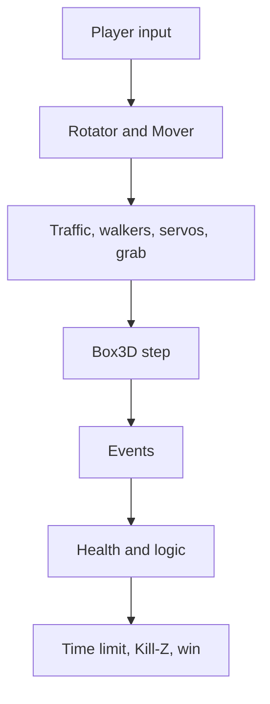

# 8 The Game Runtime – From Blueprint to Game

> **Your level:** This is where Kern becomes a real game engine. You'll find out what a level is
> made of, how it's saved and what happens in every single frame while you play. After that you'll
> know how vehicles drive, triggers fire and games are won.

A **level** is a document made of **actors**, meaning things in the world that carry
**components**. Kern Studio edits levels and saves them as `.klevel` files. The **GameWorld**
displays a level and plays it with the Box3D physics engine: with controls, camera, rules,
triggers, sound and logic. Studio uses the same GameWorld for editing, Simulate and Play, and
exported games run on exactly this code.

> **Picture it like this:** The level is the recipe, the GameWorld is the kitchen. The recipe sits
> neatly in the cookbook. The cooking happens on a copy, so the book stays clean.

The code lives in the `kern::game` area: level, file format, GameWorld, soldier, logic, sound,
touch, multiplayer, the Micro Duck and demo levels.

## 8.1 The whole life of a game in five lines

```cpp
GameWorld world(renderer, &night_windows);
world.sync(level);
world.start(level, SimMode::play);
world.step(dt, input);
world.stop();
```

1. The GameWorld is created with the renderer.
2. `sync` brings the 3D models up to date with the level. Only what changed gets uploaded again.
   While a simulation is running, `sync` is ignored.
3. `start` copies the level, builds the physics world and starts Simulate or Play.
4. Every frame: `step` keeps computing. On top of that come the camera (`update_camera`) and
   drawing (`present`).
5. `stop` tears everything down and shows the edited level again.

So whatever happens during the game does **not** end up in the document. If you want to keep
simulated poses, use "Keep Simulation Changes" in Studio.

> **For pros:** When switching levels, `sync` removes an old city through its own models, not
> through the actor number. The new level could give that same number to the ground – which would
> otherwise go missing.

## 8.2 The ground rules for numbers

- Units: meters, seconds, kilograms. **Z points up.**
- Rotations are stored as three angles in degrees: x = roll, y = pitch, z = yaw, applied like a
  rotator in the editor.
- Colors are sRGB from 0 to 1, in the file as `#rrggbb`.
- An actor's position is **relative to its parent actor**.
- Child actors without a body of their own get "welded" onto the body of their nearest ancestor
  during simulation. Several shapes then form one shared body (*compound*).

## 8.3 Level and actor

A **level** contains a name, **World Settings** (8.5), actors, imported images and sounds (inside
the file itself), a logic graph, the editor camera and the next free actor number. The **player**
is the actor listed as Player in the World Settings that has a Player Controller – otherwise the
first one with a controller.

An **actor** has:

- a unique **number** (0 means "none") and a **name** in the Outliner,
- a **parent actor** and an **Outliner folder**,
- **Hidden** (invisible) and **Locked** (can't be clicked in the Viewport),
- a **transform**: position, rotation, scale,
- **tags**, free keywords (for logic or as the head marker `head`),
- **components**: at most one of most kinds, as many colliders and joints as you like,
- a **logic graph** of its own.

## 8.4 The components

Components are like Lego attachments: each one gives the actor an ability. In the file every field
has a key, and when reading, numbers are clamped to sensible ranges (8.6).

**Static Mesh** – the visible shape: Box, Sphere, Cylinder, Cone, Capsule, Plane, Torus, Ramp or a
built-in model (such as one of the Micro Duck's servo motors). It can automatically create a
matching collider, with friction (0.6), bounciness (*restitution*), rolling resistance and
**surface** ([Chapter 6](06-physics.md)) – in Details under Mesh › Physics. Then there's the
**material**: color, roughness, metal, glow, transparency, shadows, texture.

**Point Light** – a lamp with color, brightness (20) and range (12 m).

**Rigid Body** – turns the actor into a physics body. It's `static` (never moves), `kinematic` (is
moved, but can't be pushed) or `dynamic` (real physics). Plus: mass (0 = from density), damping,
gravity factor, "Bullet" for very fast bodies, sleeping, axis locks, starting velocity, impact sound
([Chapter 7](07-audio.md)). Imported robots may set their center of mass and inertia exactly.

**Collider** – the shape for collisions: automatically fitted to the mesh, box, sphere, capsule or
convex hull. Plus offset, density (1000 kg/m³, like water), friction, bounciness, **sensor** (only
notices overlaps), collision channels, group and an impact sound of its own.

**Constraint** – a joint to another actor or to the world: Hinge, Slider (rail), Ball (ball joint),
Fixed (welded), Distance (rope), Wheel, Motor, Parallel and No Collision. Joints have an anchor, an
axis, limits (default −45° to 45°), a motor, a spring and a **break force** (0 = unbreakable) with a
break sound. A hinge can be a **servo**, like the motors of real robots. Then this applies:

```
torque = stiffness · (target − angle)
         − damping · angular velocity
```

At most up to the maximum force, plus a bit of joint friction. A number example with a stiffness of
50 N·m/rad: If the joint is 0.1 rad (just under 6°) away from its target and standing still, the
servo pushes back with 5 N·m. The farther away, the stronger – like a rubber band.

**Player Controller** – makes the actor controllable. Movement types: Hover Car, Rolling Ball,
Character, Flyer, Vehicle, Soldier and Walker (the Micro Duck). Adjustable: top speed (36 m/s),
acceleration, turn rate, jump (6 m/s, 0 = none), boost, hover height, camera type (Chase, First
Person, Top Down) and sounds. The soldier has crouch speed, eye height and mouse sensitivity; the
walker has fields like "walks on its own," gait and roller skates ([Chapter 13](13-micro-duck.md)).

**Weapon** and **Health** – for the first-person-shooter game model. The weapon comes as a rifle,
pistol, shotgun or sniper rifle. Each type brings its own values for damage, fire rate, magazine,
reload, spread and range. A shot is a straight test ray (*hitscan*). Health gives hit points (100),
armor, regeneration, respawn, points and optionally an explosion – for targets and barrels too.

**Pickup** – something to collect: points (1), particle color, respawn (0 = gone), sound, healing,
ammo.

**Trigger** – an invisible switch with an action (8.12), message text, "only once," sound, strength
and teleport target.

**Audio Source** – a sound source, covered in detail in [Chapter 7](07-audio.md).

**Rotator, Mover, City** – movement and city:

- The **Rotator** spins constantly, by default 60° per second around Z.
- The **Mover** swings around an offset (default 1 m up) with a period (2 s). Mode `sine` glides
  smoothly, `pingPong` goes back and forth, `loop` jumps back. The GameWorld computes both from the
  simulation time.
- **City** builds a whole city from a seed: 7 × 7 blocks, an 80 m grid, 16 m wide streets,
  buildings up to 84 m, trees, 22 cars and windows that light up at night.

> **Mission:** Open the **Physics Lab** level on https://kernengine.de/ via File › Example Levels.
> Click the door and look in Details: Which components does it have? Find the type, the limits and
> the spring on the Constraint. Then start **Simulate** (Alt+S) and, in the Viewport under Show,
> turn on **Collision Shapes** and **Constraints**.

## 8.5 The World Settings

The World Settings apply to the whole level:

| Area | Settings |
|---|---|
| Physics | gravity −9.80665 m/s², 4 sub-steps, 60 steps/s, contact softness |
| Sky | time of day (0.25 sunrise, 0.5 noon, 0.75 sunset), day length, sun position |
| Image | fog, exposure, ambient occlusion, shadow distance, clouds |
| Ground | endless ground on/off, color, friction, bounciness |
| Game | title, win condition, time limit, target score, player, Kill-Z |
| Audio | volumes, music, ambience, reverb, Doppler |

Two special features: **Kill-Z** (−50 m) resets a player who falls below it. And with **Observer
camera**, Play starts with a free camera; F8 then takes over the player.

## 8.6 The `.klevel` format

A level is a **JSON file**, which means easy-to-read text. At the very top come
`"format": "kern-level"`, a version (1), name, World Settings, editor camera, next free number, the
actors (at most 100,000), images, sounds and the level graph. An actor looks like this (shortened):

```json
{
  "id": 12, "name": "Door", "parent": 3,
  "transform": {"position": [5.2, -12, 1.5]},
  "tags": ["door"],
  "components": {"mesh": {}, "body": {}}
}
```

**When writing**, values are rounded to six decimal places, and −0 becomes 0. Fields with default
values are often left out, which keeps the file small.

**When reading**, Kern is forgiving about missing things and strict about wrong things:

- Unknown keys are ignored, missing ones get default values. That way old files load in new
  versions. A file with a version that's too new is rejected.
- Wrong types are errors with a message, such as "friction must be a number." The message names the
  actor.
- Numbers are clamped to their range: friction 0 to 10, roughness 0 to 1, step rate 15 to 480 Hz,
  field of view 20° to 120° and so on. Vector values must be finite and at most 10 million in size.
- Missing or duplicate numbers are reassigned. A parent actor that doesn't exist becomes "none,"
  and **loops** (A is the parent of B, B of A) are broken up.

> **Watch out, trap:** Parent loops happen easily when you edit files by hand. Without this check,
> the program would search "upward" forever and hang.

**Checking before the start:** A check (`validate`) looks for problems. **Errors** prevent Play –
for example duplicate numbers, a scale of 0, a joint that connects an actor to itself, a controller
without a body, or a city that isn't at the very top of the tree. **Warnings** only go to the Output
Log – for example a sound name that doesn't exist (then it stays silent), a weapon without a
soldier, or more than one player.

## 8.7 From level to physics world

Before simulating, Kern plans which Box3D bodies it needs. The same plan also draws the colliders
in the editor – so both see exactly the same thing.

1. Actors with a Rigid Body get a body. A static body with a Rotator or Mover becomes kinematic.
2. Actors with colliders, colliding meshes, pickups and triggers that don't belong to any body get
   an **invisible body of their own**: static or, if they're animated, kinematic.
3. Every actor hands its shapes to its body. An automatic collider is fitted to the mesh: Box and
   Plane become a box, Sphere a sphere, Capsule a capsule, everything else a convex hull. Pickups
   and triggers become sensors; without a shape, they get a sensor sphere with a 1 m radius.
4. Invisible bodies without a shape are dropped.
5. The city becomes a static body with one box per building and sidewalk.
6. The endless ground is a static box of 20 × 20 km whose top edge is at z = 0.

Scale goes exactly into the dimensions. Moving shapes are at least 1 cm in size, fixed ones at
least 2 mm.

## 8.8 Starting the GameWorld

`start` goes through these steps:

1. Check the level. An error stops everything.
2. Create a working copy and remember the original.
3. Build the Box3D world with gravity and contact softness. A hit counts from 2 m/s (for logic and
   camera shake); for quiet impact sounds the threshold is lowered, but never below 0.05 m/s.
4. Set all actors to "alive," sort parents before children.
5. Create bodies, then joints, then walkers.
6. Start the city traffic: kinematic cars on the lanes.
7. Take over the **player** (only in Play). It gets a **pawn** with a starting point.
8. Reset rules, HUD, health and ammo. The best time stays.
9. Start the **logic**.

**Creating bodies:** Player vehicles are always "bullets," and players never sleep. Vehicles,
characters and flyers are locked against tipping over; only Rolling Ball and Walker are allowed to
tip. Box3D only reports events where someone reads them. Rejected shapes are skipped with a message.

**Creating joints:** If one end is missing its body, the joint is skipped with a message. Target 0
means "attached to the world." A positive motor value moves the actor relative to its target (for
the wheel, Box3D's own ordering applies). Springs are limited so they stay stable.

**The modes:**

| Mode | Meaning |
|---|---|
| none | no simulation, editor only |
| simulate | physics and logic run, nobody is controlled, bodies can be grabbed |
| play | like Simulate, plus player, rules and HUD |
| replica | copy of a server game over the network ([Chapter 10](10-networking.md)) |

You can switch between Simulate and Play in the middle of a run (Studio: F8); the player keeps its
state. You can restart (Ctrl+R), pause and advance by exactly one step (the `.` key).

> **Mission:** In the Physics Lab, start **Simulate**, press **Pause** and then press the **.** key
> several times – the world runs step by step. In between, grab a crate with the left mouse button.
> With **K** you copy the poses of the selected actors into the level.

## 8.9 What happens in a frame

The frame rate wobbles, but physics wants **fixed steps** (60 per second by default). So `step`
collects time like in a piggy bank and pays it out in fixed steps. A frame counts for at most
0.25 s and simulates at most 0.1 s, so a hiccup doesn't set off an avalanche
([Chapter 6](06-physics.md)).

> **Picture it like this:** A bus leaves exactly every 10 minutes, no matter when the passengers
> show up. If lots of them come at once, two buses just leave one after the other. The physics is
> the bus, the frames are the passengers.

One fixed step:



1. **Players:** For every pawn, get the input (local, or the latest received over the network),
   turn it into events for the logic, and drive the controller.
2. **Animation:** Rotator and Mover bodies get their target for the step.
3. **Traffic** (cars stop in front of the player), **walkers**, **servos** and the **mouse grab**.
4. **Box3D computes** with its sub-steps.
5. Advance the step counter and game time.
6. **Events:** pickups, triggers, overlaps, hits, camera shake, impact sounds, breaking joints.
7. **Health** (healing, respawn) and the **logic tick**.
8. Respawning pickups, time limit, Kill-Z, speed for the HUD, target score.

After that, the time of day moves on, and the poses are **interpolated** between the last two
steps – that keeps movement smooth even at 144 frames per second. Then the camera moves, and
`present` hands everything to the renderer: collected pickups and used triggers stay invisible,
traffic, shots and particles are added, and at night the windows light up.

**In Studio**, these are added every frame: cameras and touch, checking breakpoints, messages to the
Output Log, syncing the level while editing, and finally drawing and audio. Here too, a frame counts
for at most 0.1 s.

## 8.10 Controllers: driving, rolling, walking, flying

Every frame, each player gets an **input**: movement forward/back and left/right (each −1 to 1),
up/down, jump, boost, camera rotation, zoom; for the soldier fire, aim, reload, crouch and use;
gamepad values; and for the Micro Duck, moves as **bits** (sit, pick up, kicks, roll, beak, chirp,
wheee, jump).

> **Crazy but true:** Nine duck moves fit into a single number. Each move is a bit: 1, 2, 4, 8,
> 16 … If you want to pick up (2) and chirp (64) at the same time, you simply send 66.

For Rolling Ball, Character and Flyer, movement is **camera-relative**: "forward" means wherever the
camera is looking.

| Mode | How it moves |
|---|---|
| Hover Car | throttle as a force, side grip as a force, steering based on speed; a spring over a ray keeps the hover height |
| Vehicle | like Hover Car without hovering, drive only with ground contact |
| Rolling Ball | force in the direction of travel, jump as an impulse, only on the ground |
| Character | Box3D's Character Mover: capsule, steps up to 22% of its height, 1.5 times gravity |
| Flyer | desired speed including up and down, gravity is canceled out |
| Soldier | Character Mover with real gravity (8.13) |
| Walker | the Micro Duck's trained network drives its servos |

For all of them: **Boost** is a supply from 0 to 1 that drops by 0.45 per second while boosting and
otherwise grows by 0.12 per second. After a fall faster than 3.5 m/s, a landing plays the `land`
sound.

Do the math: A full boost supply lasts 1 / 0.45 ≈ 2.2 seconds. Refilling it completely takes
1 / 0.12 ≈ 8.3 seconds.

**Pawns:** A pawn is a player's control state – actors, last input, view direction, starting point,
boost. When someone joins in multiplayer, Kern copies the player actor along with its children onto
a ring around the start: the angle grows by about 2.4 rad per player, the radius with the square
root of the number of players. That way nobody stands on top of anybody else.

## 8.11 Camera

The camera follows the player's **interpolated** pose:

- **Chase for vehicles:** behind the vehicle, farther away the faster it goes.
- **Chase otherwise:** circles around the player with the mouse or stick. A ray keeps it out of
  walls.
- **First Person:** the eyes on the body.
- **Top Down:** from above.

Above 30 m/s the field of view gets wider (up to 10.5° more) – that feels faster. Hard hits shake
the camera. Soldiers have a camera of their own.

## 8.12 HUD, rules and triggers

The **HUD** shows, on top of the game, status, title, message, points, pickups, time, remaining
time, speed, boost, best time and, for the soldier, health and ammo.


**Win conditions:**

| Goal | You win when … |
|---|---|
| none | never – sandbox |
| collectAll | all pickups are collected (if there's a Goal, you then still have to get there) |
| reachGoal | the Goal trigger is reached |
| survive | you outlast the time limit |
| score | the target score is reached |

With a time limit, you lose at 0, except with `survive`. A Hazard always makes you lose. At the end,
Kern sets the status, plays a short melody, remembers the best time and tells the logic "game over."

**Pickups:** When a player touches one, they get healing and ammo, points, a sound, particles, and
the logic hears about it. A pure health pack stays where it is as long as you have full health.
With a respawn time, it shows up again later.

**Trigger actions:**

| Action | Effect | Sound |
|---|---|---|
| goal | wins | goal |
| hazard | loses | hazard |
| checkpoint | new starting point 1 m above it | checkpoint |
| message | shows a message | confirm |
| launch | flings up and forward | boost |
| teleport | moves you to the target actor | powerup |
| damage | takes away hit points | – |
| event | just an event for the logic | – |

The teleporter locks itself for 1 s so you don't get beamed straight back. Every trigger reports to
the logic first. With "only once," it's used up afterward – except Goal and Hazard.

> **Mission:** Use File › New Level... to create a **Basic** level. From Place Actors, place a
> **Rolling Ball** (Players), three **Stars** and a **Goal** (Gameplay). In World Settings, set the
> **Win condition** to "Collect all pickups" and press **Play** (Alt+P). What happens if you touch
> the Goal before the last star?

> **Mission:** Build a **Jump Pad** and a **Teleporter** into your level and try both out with the
> Rolling Ball.

## 8.13 Soldiers and figures

The **soldier** is the game model for first-person shooters, taken from SpawnCity. It moves with the
Character Mover, crouches, sprints and jumps; a press just before landing or just after leaving an
edge still counts. A shot is a test ray from the eye, and the spread is **deterministic** (computed
from the actor number and the shot count). In multiplayer, the server makes up for network delay
(*lag compensation*, at most 0.5 s back). Armor absorbs up to two-thirds of the damage, freshly
spawned players are protected for 2.5 s, and from a landing speed of 7.7 m/s there's fall damage
(deadly from 15 m/s). At 0 hit points, a player restarts after a waiting time; other actors
disappear and, if set up that way, return to their place. An actor with an explosion radius
explodes in the process and pushes and damages whatever is nearby. The figure and weapon are built
from basic shapes and are purely for show. A camera of its own comes with it.

## 8.14 Walkers

A **walker** is a robot with joints that walks on its own servos – the Micro Duck with Pollen
Robotics' trained network. At the start, the GameWorld creates a control state for every walker.
Every step, it reads its sensors, chooses the behavior, asks the network (every four physics
steps), waits out the servos' delay and then drives the servos. On top of that there are lots of
interfaces for sensors, commands, training and play. Everything else is in
[Chapter 13](13-micro-duck.md).

## 8.15 Sound connection

The simulation never plays sound itself. In its fixed steps it writes **sound cues**, little order
slips, and so stays deterministic:

```cpp
struct SoundCue {
  std::string sound;
  Vec3 position;
  f32 volume = 1, pitch = 1;
  bool spatial = true;
  audio::Bus bus = audio::Bus::sfx;
  ActorId actor = 0;
  bool voice = false, silence = false;
};
```

Line by line: which sound, where, how loud and how high, whether it has a position in space, on
which bus, for which actor and whether it's that actor's voice (one at a time). At most 64 cues are
collected – for jumps, landings, pickups, triggers, hits, explosions, impacts and more. The impact
rules and playback through GameAudio are in [Chapter 7](07-audio.md).

## 8.16 Touch, mouse and gamepad

The touch controls also come from SpawnCity and run in C++, so Studio and exported games use them
the same way.

A **referee** decides which device is in control – the one used last wins. A finger switches to
touch, any real key to mouse and keyboard (on a phone too). A mouse on a tablet does **not** switch
to desktop. Pointer lock is only available with a mouse.

The **touch controls** have two sticks of 168 px in the bottom corners (smaller only if two don't
fit). On the left you move (MOVE; STEER / GAS for vehicles; FLY for the Flyer), on the right you
look (LOOK). Next to them are buttons depending on the controller:

| Controller | Buttons |
|---|---|
| Soldier | JUMP, RELOAD, AIM, CROUCH, USE |
| Walker | QUACK, PICK, SIT, KICK L, KICK R, ROLL, BEAK, WHEEE, HOP |
| Character | JUMP, USE |
| Rolling Ball | JUMP, BOOST |
| Flyer | UP, DOWN, BOOST |
| Hover Car, Vehicle | BOOST, HOP, USE |

Buttons come before sticks, sticks before the screen. Pushing the left stick all the way forward
means sprinting. If you pull the right stick past 92% of its radius, you keep turning (**Edge
Turn**). Gamepads get dead zones so small wobbles don't move anything.

## 8.17 Logic in the world

Every actor and the level can carry a logic graph. The GameWorld starts them in Play and Simulate,
but only where the game holds "the truth": in a single-player game or on the server. It delivers
events to them (overlap, hit, pickup, trigger, damage, death, interact, key, game over, new player
…) and lets them take actions (set values, spawn copies, push, give points, end the game …).
Whatever the logic changes is recorded for the network. More in [Chapter 9](09-logic.md).

## 8.18 The demo levels

Under File › Example Levels and File › New Level you'll find the built-in levels:

- **Orb Run:** a city with traffic, a Hover Car (1200 kg), 24 orbs to collect. A day lasts 480 s,
  and the run ends at night. Studio starts with this level.
- **Physics Lab:** every kind of joint – crate pyramid, pendulum, door, rope bridge (three joints
  break at 60,000 N), turntable, lift, rover. You roll as a ball, collect five stars and reach the
  Goal, past a spinning Hazard.
- **Shooting Range:** a shooting range with targets at 10 to 60 m, cover, crates, a barrel and a
  tower. Goal: 150 points. Also playable in multiplayer.
- **Micro Duck:** a room at the robot's scale (2.5 × 2.5 m in reality, 10 × 10 m in the world) with
  a ball and socks. The duck walks on its own, 100 steps per second, observer camera. A level graph
  makes it chirp when its head camera sees the ball. Because Play starts with the Observer camera
  here, you take over the duck with **F8**.
- **Basic:** 40 × 40 m of ground and a cube.
- **Empty:** nothing at all, not even ground.

> **Mission:** Open **Orb Run** and start **Play** (Alt+P). Collect a few orbs, then press **F8**:
> you get out, the game keeps running, and you fly around freely. Press **F8** again, and you're
> back behind the wheel. How many seconds do you need for all 24?

## 8.19 What else the GameWorld can do

There are more interfaces for display, state, messages, combat, network, logic, grabbing and debug
lines (colliders in color: static green, kinematic blue, dynamic orange, sensor purple, sleeping
gray). If you want to know every detail: the blue book.

## 8.20 Tests

Automatic tests check rotations, saving and loading, body planning, the city, Orb Run, Physics Lab,
the rules (Goal wins, Hazard loses), the camera, the soldier, the Character Mover, sound fields and
physics materials.

## Level complete!

- You know how levels, actors and components fit together.
- You know the most important components and what they do.
- You can read a `.klevel` file and know how Kern handles errors in it.
- You understand how a level becomes a physics world.
- You know what happens in every fixed step and why poses are interpolated.
- You know the controllers, win conditions and trigger actions.
- You can build a small game with a goal yourself.

## Puzzle corner

1. What happens to the changes made during Simulate when you stop?
2. A pickup with no mesh and no collider – how does Kern notice that you touch it?
3. The win condition is "Collect all pickups," and there's a Goal trigger. You have all the orbs.
   Have you won?
4. For the Micro Duck, "sit" (1) and "chirp" (64) should be pressed at the same time. Which number
   does the input send?
5. **Boss puzzle:** The physics runs at 60 steps per second. Your computer is only managing 20
   frames per second right now. How many fixed steps does Kern compute per frame on average? And
   what's the most it would be if one frame hangs for a whole second?

### Solutions

1. They disappear. The simulation runs on a copy. You can only keep poses with "Keep Simulation
   Changes" (K).
2. With a sensor sphere with a 1 m radius that Kern creates automatically.
3. Not yet. Only once you reach the Goal afterward.
4. 1 + 64 = 65.
5. One frame takes 1/20 s = 0.05 s, which is 3 steps of 1/60 s each. If a frame hangs for a second,
   Kern still simulates at most 0.1 s, so 6 steps. The world then runs a little slower for a moment
   instead of getting stuck in a computing avalanche.

---

© 2026 Christian Heinrich Hohlfeld · All rights reserved · [Imprint and rights](00-imprint.md)
