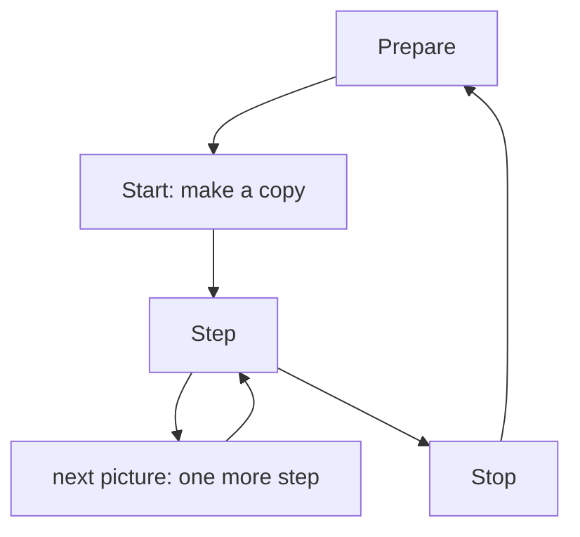
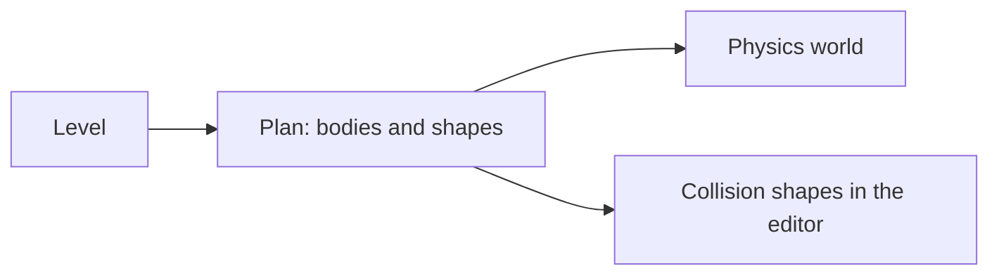
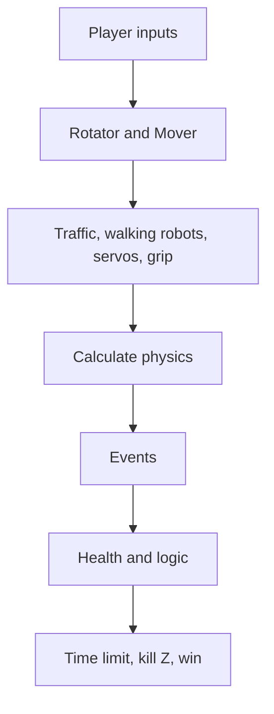
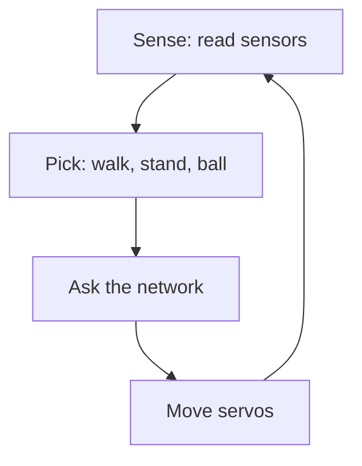

# 8 The Game Runtime – from Blueprint to Game

> **Your level:** Here Kern becomes a real game engine. You find out what a level is made of, how
> it's saved, and what happens in every single picture while you play. After that, you know how
> vehicles drive, triggers go off and games are won.

> **Words you need:**
> - **Actor** – a thing in the level: a crate, a lamp, a car, the player character.
> - **Component** – a building block that gives an actor an ability, such as "being visible."
> - **Collider** – the invisible shape the physics uses to check whether things collide.
> - **Sensor** – a collider that doesn't stop anything but only reports when something comes in.
> - **Static / kinematic / dynamic** – stands fixed / is moved by the game but can't be pushed /
>   real physics with falling and bumping.
> - **Fixed step** – the physics calculates in time slices that are always the same length,
>   usually 60 per second.
> - **Server** – in multiplayer, the one computer that decides what really happens.
> - **Network** – a program that learned by practicing for a long time instead of being programmed
>   rule by rule.

A **level** is a document made of actors that carry components. Kern Studio edits levels and saves
them as a file with the ending `.klevel`. The **GameWorld** plays a level: it shows it and runs it
with the physics engine Box3D, with controls, camera, rules, triggers, sound and logic. Studio uses
the same GameWorld for editing, for **Simulate** and for **Play**. Exported games run with exactly
the same program. The exact names of the program parts, all fields and all default values are in
the blue book, Chapter 8.

> **Picture it like this:** The level is the recipe; the GameWorld is the kitchen. The recipe stays
> neatly in the cookbook. The cooking happens with a copy, so that the book stays clean.

## 8.1 The Whole Life of a Game

A game always goes through the same four stations: prepare, start, calculate on step by step,
stop.



1. **Prepare:** The GameWorld brings the 3D models up to the level's state and sends them to the
   graphics card. If you only moved one crate, only that one is sent again.
2. **Start:** The GameWorld makes a **copy** of the level, builds the physics world from it and
   starts **Simulate** or **Play**.
3. **Step:** In every picture, it calculates on, moves the camera and draws (8.9).
4. **Stop:** Everything is taken down, and you see your unchanged level again.

So whatever happens during the game does **not** end up in your level. Crates that fell over stand
neatly again after stopping. If you want to keep a simulated position, use **Keep Simulation
Changes** in Studio (key K, 8.8).

## 8.2 The Rules for Numbers

So that all parts of Kern mean the same thing, fixed rules apply:

- **Units:** meters, seconds, kilograms.
- **Z points up.** X and Y lie flat on the ground.
- **Rotations** are written as three angles in degrees.

> **Picture it like this:** an airplane. In Kern, a vehicle looks in the x direction, so x is its
> long axis from back to front. **Roll** means it tips around its long axis and one wing goes down
> (rotation around x). **Pitch** means the nose goes up or down (around y). **Yaw** means the nose
> swings left or right, as when steering (around z).

- **Parents and children:** An actor can be placed under another one. Its position then applies
  **relative to its parent actor**. A wheel as a child of a car stands, for example, "1.2 m in
  front of the middle of the car," no matter where the car is right now. If the car drives, the
  wheel drives along.
- **Welded on:** If a child has no physics body of its own, it's "welded" onto its parent actor's
  body when simulating. With the hovercar in Orb Run, cabin, spoiler and jets are such children:
  for the physics, the whole vehicle is **one** body made of several shapes.

## 8.3 Level and Actor

A **level** contains:

- a name and the **World Settings**, that is, settings for the whole world (8.5),
- all actors,
- imported pictures and sounds (they're right inside the file),
- a logic graph for the whole level ([Chapter 9](09-logic.md)),
- the position of the editor camera.

The **player** is the actor entered in the **World Settings** in the field **Player (controlled in
Play)**. If the entry is missing, Kern takes the first actor with controls.

An **actor** has:

- a unique **number** and a **name**. You see the name in the **Outliner**, the list of all actors
  in Studio,
- a **parent actor** (or none) and optionally a folder in the Outliner,
- **Hidden (editor and game)**, so invisible, and **Locked (not selectable)**, so not clickable in
  the Viewport,
- a **Transform**: **Location**, **Rotation** and **Scale**,
- **tags**, free keywords the logic can search for,
- **components**: of most kinds at most one, of colliders and joints as many as you like. A thing
  only looks one way, but it can be made of several collision shapes and be attached in several
  places,
- a **logic graph** of its own.

## 8.4 The Components

Components are like add-ons from a construction kit: a bare actor is just a point in space. Plug a
mesh onto it, and it becomes visible. Add a **Rigid Body**, and it falls down. That way you build
everything from the same building blocks.

| Component | What it can do | Example |
|---|---|---|
| **Static Mesh** | visible shape with material | crate, ball, ramp |
| **Point Light** | lamp with color and range | streetlight |
| **Rigid Body** | makes the actor a physics body | crate that falls over |
| **Collider** | shape for collisions | a soldier's head |
| **Constraint** | joint to another actor | door on its hinge |
| **Player Controller** | makes the actor controllable | hovercar, ball |
| **Weapon**, **Health** | weapon and hit points | shooting range, barrel |
| **Pickup** | something to collect | orb, star |
| **Trigger** | invisible switch | goal, jump pad |
| **Audio Source** | sound source ([Chapter 7](07-audio.md)) | radio |
| **Rotator** | keeps turning | revolving door, star |
| **Mover** | moves back and forth | elevator, platform |
| **Procedural City** | builds a whole city | Orb Run |

A few building blocks in detail:

**Static Mesh** is the visible shape: box, sphere, cylinder, cone, capsule, plane, torus, ramp or a
built-in model, such as a limb of the Micro Duck like its neck. The **material** determines the
look: color, how rough or shiny, whether metallic, whether it glows by itself, whether you can see
through it. A mesh can automatically bring a fitting collider along. You set its friction,
bounciness and surface ([Chapter 6](06-physics.md)) right here, under **Static Mesh › Physics**.
They belong next to the look, because they're the thing's physics.

**Rigid Body** makes the actor a physics body. In Studio, under **Mobility**, you choose **Static**
– never moves –, **Kinematic** – gets moved but can't be pushed – or **Dynamic (simulate physics)**
– real physics. Add to that mass, gravity factor, starting speed and **Continuous (bullet)**, called
"bullet" in Box3D. A bullet is for very fast bodies: in a single step, a fast ball could jump from
in front of the wall to behind the wall without ever touching it. A bullet checks the distance in
between especially carefully ([Chapter 6](06-physics.md)), so that nothing slips through walls.

**Colliders** give the shape for collisions: automatically fitted to the mesh, box, sphere,
capsule or a tight-fitting hull. Every collider has a **density** from which Kern calculates the
mass. In the level it's 1000 kg/m³ at first, as dense as water. So a cube with 1 m edges weighs a
ton if you don't change anything. If you enter a **mass** yourself on the **Rigid Body** instead,
that applies instead of the density. A collider can be a **sensor**. With channels and groups you
decide who can collide with whom at all, for example so that bullets fly through your own teammates
but bounce off walls ([Chapter 6](06-physics.md)).

The component **Constraint** connects two actors: hinge, slider, ball joint, weld, rope, wheel and
a few more. Joints can have limits, a motor and a spring, and they can **break** under too much
force. A hinge can be a **servo**, like the motors of real robots: the farther the joint is from
its target angle, the harder it pushes back, and the faster it turns, the harder it brakes. Twice
as far away means twice as strong a turning force, like a rubber band.

**Rotator** and **Mover** move things without logic: the Rotator turns evenly; the Mover swings
softly, back and forth, or jumps back to the start at the end. Both calculate with game time, so
they run the same at every start.

**Procedural City** builds a whole city with streets, houses, trees, cars and windows that glow at
night from a single number (the seed) ([Chapter 5](05-scene-and-geometry.md)).

The remaining building blocks (Player Controller, Weapon, Pickup, Trigger) come up in 8.10 to 8.13.

> **Mission:** On https://kernengine.de/, open the level Physics Lab via **File › Example
> Levels**. Click the door and look in **Details**: which components does it have? On the
> **Constraint**, find the **Type**, the **Limits** and the **Spring**. The limits set how far the
> door opens; the spring pulls it closed again. Then start **Simulate** (Alt+S), give the door a
> push with the left mouse button and check whether that's right. Under **Window › Show** – or with
> the **Show** button at the top of the Viewport – switch on **Collision Shapes** and
> **Constraints**. The colors give away the type: static green, kinematic blue, dynamic orange,
> sensor violet, sleeping gray. "Sleeping" means: a body has been lying still for a long time, so
> the physics stops calculating it until something bumps it.

## 8.5 The World Settings

Some settings don't apply to one thing but to the whole world. They're in the **World Settings**:

| Area | Examples |
|---|---|
| physics | strength of gravity, how many fixed steps per second |
| sky | time of day (0.25 sunrise, 0.5 noon, 0.75 sunset), day length |
| picture | fog, brightness, clouds |
| ground | endless ground on or off, color, friction |
| game | title, win condition, time limit, player, kill Z |
| audio | volumes, music, reverb, Doppler ([Chapter 7](07-audio.md)) |

The time of day is a fraction of the day: 0.5 is half, so noon. Two special features: **Kill Z
(respawn below)** is a height. If a player falls lower, for example off the world, they're reset.
And with **Observer camera (Play: fly, watch, drag bodies)**, **Play** starts with a free camera;
with F8 you then take over the player.

## 8.6 The `.klevel` Format

A level is saved as **JSON**. That's completely normal, readable text with brackets, names and
values. You can open a `.klevel` file with any text editor. An actor looks like this (shortened):

```json
{
  "id": 12, "name": "Door", "parent": 3,
  "transform": {"position": [5.2, -12, 1.5]},
  "tags": ["door"],
  "components": {"mesh": {}, "body": {}}
}
```

Line by line: the actor has the number 12, is called "Door" and is a child of actor 3. It stands at
x = 5.2 m, y = −12 m, z = 1.5 m (relative to its parent actor). It carries the keyword "door" and
has a mesh and a rigid body. Whatever is missing in the curly braces when reading in gets default
values. When saving, Kern writes every component out completely; it only leaves out empty entries
like a missing parent actor or no keywords.

**When reading**, a clever principle applies: **forgiving about what's missing, strict about
what's wrong.**

- If something is **missing**, Kern takes the default value. It skips unknown entries. That way old
  files also load in new versions of Kern.
- **Wrong** is, for example, text where a number belongs. Then Kern reports an error, such as
  "friction must be a number," and names the actor.
- It rejects a file from a **newer** Kern version completely. Why not simply skip the unknown parts?
  A newer file could contain things that the old Kern would misunderstand. Then the level would look
  different from how it was built. Better not to load at all than to load wrongly.
- Numbers outside their sensible range are set to the nearest allowed value, the way a volume knob
  doesn't go beyond "full volume."
- Missing or duplicate numbers are handed out again. A parent actor that doesn't exist becomes
  "none," and **loops** in the family are broken up.

> **Watch out, trap:** A loop means: A is B's parent, and B is A's parent. Something like that
> easily happens when you edit files by hand. Without a check, the program would search "upward"
> forever and get stuck.

**Checking before the start:** Before playing begins, Kern looks for problems. **Errors** prevent
the start, for example a size of 0, a joint that connects an actor with itself, or controls without
a physics body. **Warnings** only end up in the **Output Log**, for example a sound name that
doesn't exist (then it stays quiet), or more than one player.

## 8.7 From Level to Physics World

Before simulating, Kern makes a **plan**: which physics bodies does this level need, and which
shapes belong to which body? The important thing about it: **the same plan** also draws the
colliders in the editor. So what you see in the editor with **Show › Collision Shapes** is exactly
what will be calculated with later.



The plan's rules:

1. Every actor with a **Rigid Body** gets a body. A static body with a **Rotator** or **Mover**
   becomes kinematic; after all, it has to move.
2. Some things need a body even though you didn't set a rigid body: a wall with a collider, a star
   to collect, a trigger. They get an **invisible body of their own**, static or, if they move,
   kinematic.
3. Every actor gives its shapes to its body, including welded-on children (8.2). An automatic
   collider is fitted to the mesh.
4. Pickups and triggers become sensors. If they have no shape at all, they get a sensor sphere with
   a 1 m radius.
5. The city becomes a single static body made of many boxes: for the houses (courtyard houses and
   L-houses from several) and for the ground slabs.
6. The endless ground is a huge flat box whose top lies exactly at z = 0.

## 8.8 Starting the GameWorld

When you press **Play**, the GameWorld goes through these steps:

1. **Check** (8.6). An error stops it.
2. **Make a copy.** Playing happens with the copy; the original stays untouched.
3. **Build the physics world:** set gravity, then create all bodies, joints and walking robots
   according to the plan from 8.7, parents before their children. The city's cars start driving.
4. **Take over the player** (only when playing). The player gets a **pawn**: a notepad on which Kern
   remembers everything about this player's controls, that is, last input, viewing direction,
   starting point and boost.
5. **Start rules and logic:** points, time, health and ammo back to the start; the best time stays.
   Then the logic graphs start running.

Player vehicles always get the special "bullet" treatment, so that they don't slip through walls at
high speed. Vehicles, characters and flyers are secured against tipping over; only the rolling ball
and the walking duck may tip.

**Only report where someone is listening.** Reporting every touch costs the physics work. That's
why Kern only switches reports on where someone reads them: for sensors, for the player, for bodies
with an impact sound and, if the level has logic, for everything that moves. A crate nobody cares
about falls quietly and saves calculating time.

**The modes:**

| Mode | Meaning |
|---|---|
| editing | no simulation, you build in the editor |
| **Simulate** | physics and logic run, nobody is controlled, bodies can be grabbed |
| **Play** | like Simulate, plus player, rules and HUD |
| client copy | copy of a server game on another player's computer ([Chapter 10](10-networking.md)) |

You can switch between **Simulate** and **Play** in the middle of a run (Studio: F8); the player
keeps their state. You can restart (Ctrl+R), pause and go forward exactly one step (key `.`).

> **Mission:** In the Physics Lab, start **Simulate**, press **Pause** (the pause button next to
> **Play** in the toolbar, or Alt+Shift+P) and then press the **.** key several times – the world
> runs step by step. Press **Pause** once more so that it keeps running, and grab a crate with the
> left mouse button. Then briefly click a fallen crate in the Viewport (without dragging); that's
> how you select it. Press **K** (**Play › Keep Simulation Changes**): the simulation ends, and the
> crate stands in your level exactly the way it was lying.

## 8.9 What Happens in One Picture

Your computer's frame rate varies, but the physics wants **fixed steps** (why is explained in
[Chapter 6](06-physics.md)). That's why the GameWorld collects the time that has passed as if in a
piggy bank and pays it out in fixed steps.

> **Picture it like this:** Every picture throws the time that has passed since the last picture
> into the piggy bank. The physics takes out 1/60-second coins as long as there's enough in it and
> calculates one step for every coin. The rest stays there for the next picture. A long picture
> throws in a lot, then there are several steps. A short one throws in little, then maybe none at
> all.

If a picture hangs for a very long time, the physics catches up at most 0.1 s and throws the rest
away. Otherwise there'd be a calculation traffic jam: catching up would take so long that the next
picture would have even more to catch up. The result: the world then runs a bit slower for a
moment instead of getting stuck.

Fixed steps also set a limit: a spring can't swing back and forth faster than the physics
calculates steps. That's why at startup Kern limits the stiffness of every spring and every joint
to match the step rate. Why is in [Chapter 6](06-physics.md).

One fixed step:



1. **Players:** For every player, get the input and move their vehicle or character.
2. **Animation:** Rotator and Mover get their target for this step.
3. **Traffic** (cars stop in front of the player), walking robots, servos and the **mouse grip**.
4. **Box3D calculates** one physics step.
5. **Events:** What was collected, which trigger touched, who hit, which joint broken? The impact
   sounds come from this too.
6. **Health** (healing, respawn) and the **logic** ([Chapter 9](09-logic.md)).
7. **Rules:** time limit, kill Z, score, won or lost?

After that, the drawing happens. Screens often show more pictures per second than the physics makes
steps. That's why Kern doesn't simply draw the last step but an **in-between state** between the
last two steps. That's called **interpolating**. If a picture lies exactly in the middle, the crate
stands exactly in the middle between its two last positions. That way the movement stays smooth
even at 144 pictures per second. Finally, the camera moves, collected pickups disappear, and at
night the windows glow.

**In Studio**, the editor's work comes on top in every picture, such as checking the logic's
breakpoints and writing messages to the **Output Log**.

## 8.10 Controllers: Driving, Rolling, Walking, Flying

A **controller** turns keys into movement. In every picture, every player gets an **input**:
forward and back, left and right (each from −1 to 1), up and down, jump, boost, camera turning,
and for the Soldier fire, aim, reload, crouch and use. For the Micro Duck, its moves come on top
(sit, pick up, two kicks, roll, beak, chirp, wheee, jump), all together in a single number.

> **Crazy but true:** Nine duck moves fit into a single number. Every move gets a value, and every
> value is double the one before: 1, 2, 4, 8, 16, 32, 64 … Such an on-off switch is called a
> **bit**. If you want to pick up (2) and chirp (64) at the same time, you simply send 66. The trick
> with the doubling: all the smaller values together are always smaller than the next one
> (1 + 2 + 4 = 7, less than 8). That's why every sum can be split up in only one way, 66 only as
> 64 + 2. With the values 1, 2, 3 that wouldn't work: 3 could mean "3" or "1 and 2."

With **Rolling ball**, **Character** and **Flyer**, the movement is **camera-relative**: "forward"
means wherever the camera is looking.

The modes are in the **Player Controller** in the field **Movement**:

| Mode | How it moves |
|---|---|
| **Hover car** | floats above the ground on an invisible spring, throttle pushes, a side force prevents sliding; its bobbing and leaning are just looks |
| **Vehicle** | like the hovercar, but on the ground; throttle only works with ground contact |
| **Rolling ball** | a ball you push; jumping only from the ground |
| **Character** | a game character that walks, jumps and climbs steps |
| **Flyer** | flies in every direction, up and down too; gravity is canceled out |
| **Soldier (first person shooter)** | like the Character, for first-person shooters (8.13) |
| **Walker (robot on its trained network)** | the Micro Duck walks with its own motors (8.14) |

Character and Soldier use the **character mover** from [Chapter 6](06-physics.md). The Character
deliberately falls faster than in reality, so that jumps feel snappy and not floaty. The Soldier
falls like in reality, as usual in first-person shooters.

For all of them: **boost** is a supply from 0 to 1. While boosting, it drops by 0.45 per second;
otherwise it grows by 0.22 per second. After a deep fall, a landing plays the sound `land`.

Do the math: a full boost supply lasts 1 / 0.45 ≈ 2.2 seconds. Refilling it completely takes
1 / 0.22 ≈ 4.5 seconds.

**Several players:** Every player has their own **pawn** (8.8). When someone joins in multiplayer,
Kern copies the player character along with its children and places the copy on a spiral around
the starting point, each new player a bit farther out. That way nobody stands on top of anyone
else.

## 8.11 Camera

The camera follows the player's **interpolated** position (8.9), so always the smooth in-between
state:

- **Chase** **with vehicles:** behind the vehicle, the farther away the faster it drives.
- **Chase otherwise:** circles around the player with the mouse or stick. A **check ray**, an
  invisible line from the player to the camera, keeps it out of walls: if the line hits a wall, the
  camera moves in front of it.
- **First person**: the eyes on the body.
- **Top down**: from above.

Above 30 m/s (about 108 km/h), the field of view gets a bit wider, which feels faster.
Hard hits shake the camera. Soldiers have a camera of their own.

## 8.12 HUD, Rules and Triggers

The **HUD** is the display over the game: status, title, message, points, pickups, time, time left,
speed, boost, best time and, for the Soldier, health and ammo.


You set **win conditions** in Studio under **World Settings › Win condition**:

| Goal | Won when … |
|---|---|
| **None (sandbox)** | never – sandbox |
| **Collect all pickups** | all pickups collected (if there's a goal trigger, then you still have to get there) |
| **Reach a goal trigger** | goal trigger reached |
| **Survive the time limit** | time limit survived |
| **Reach a target score** | target points reached |

With a time limit, you lose at 0, except with **Survive the time limit**. A danger (hazard trigger)
always loses. At the end, Kern sets the status, plays a short melody, remembers the best time and
reports "game over" to the logic.

**Pickups:** If a player touches one, they get points, healing or ammo, plus sound and sparks, and
the logic finds out about it. A pure health pack stays where it is as long as you have full health.
With a respawn time, it shows up again later.

**Trigger actions:** A trigger is an invisible switch. What it does is set by its action:

| Action in Studio | Effect | Ready-made in the catalog |
|---|---|---|
| **Goal (win)** | wins | **Goal** |
| **Hazard (lose)** | loses | **Hazard** |
| **Checkpoint (respawn here)** | new starting point 1 m above it | **Checkpoint** |
| **Message** | shows a message | **Message Trigger** |
| **Jump pad (launch)** | flings you up and forward | **Jump Pad** |
| **Teleport** | moves you to the target actor | **Teleporter** |
| **Damage zone** | takes away hit points | **Damage Zone** |
| **Logic event only** | only an event for the logic | – |

Almost every action plays its fitting sound. The teleporter locks itself for 1 s, so that you don't
get beamed right back. Every trigger reports to the logic first. With **Only once**, it's used up
afterwards, except goal, hazard and teleporter.

> **Mission:** With **File › New Level...**, create a level with the template **Basic**. From
> **Place Actors**, place a **Rolling Ball** from the group **Players**, three times **Star** and a
> **Goal** from the group **Gameplay**. In the **World Settings**, set the **Win condition** to
> **Collect all pickups** and press **Play** (Alt+P). What happens if you touch the goal before the
> last star? And what afterwards?

> **Mission:** Build a **Jump Pad** and a **Teleporter** into your level (both under **Gameplay**)
> and try them out with the rolling ball. The teleporter consists of two pads: you step onto A and
> arrive at B.

## 8.13 Soldiers and Characters

The **Soldier** is the game model for first-person shooters, taken over from Kern's predecessor
game SpawnCity. It walks with the character mover, crouches, sprints and jumps. A jump press just
before landing or just after an edge still counts, which feels fair.

A shot is a straight **check ray** from the eye. The bullet doesn't really fly; Kern only checks
what gets hit first along the line. The spread is **deterministic**: it's calculated from the
shooter's number and the count of their shots instead of rolled. That way the server and every
replay calculate exactly the same hits.

**Lag compensation:** In multiplayer, your shot arrives at the server with a bit of delay. In the
meantime, the others have moved on. So the server looks up **where the opponent was when you
pulled the trigger** and checks the hit there, at most half a second back.

> **Picture it like this:** a referee with video review. He rewinds to the moment you fired and
> then decides.

On top of that come armor (catches part of the damage), brief protection after respawning, fall
damage on hard landings and **respawn**: a player starts again after a waiting time; other actors
disappear and, if set up that way, reappear in their place. A barrel with an explosion radius
explodes and pushes whatever is nearby. Character and weapon are built from simple bodies and are
pure display: they change nothing in the simulation.

## 8.14 Walkers

A **Walker** is a robot with joints that walks with its own servos. In Kern, that's the Micro Duck.
It's not controlled by rules that someone programmed but by a **network** that Pollen Robotics
trained: through a great deal of practice, it has learned which motor movement fits which
position.

In every step, a cycle runs:



**Choosing a behavior** means: a program decides what the duck wants to do next, such as walk
around, stand still or play with the ball. The network then makes sure it doesn't fall over while
doing so.

The network is asked regularly, but only every few physics steps. It was asked exactly that often
during training, and the real robot asks it that often too. As with real servos, its command also
arrives at the motors with a small delay, and Kern deliberately rebuilds that too. That sounds
strange: why make something worse than it could be? Because the network learned to walk with
exactly this delay. Without it, it would misjudge and stumble. That's a principle of the whole
book: the simulation should behave like the real robot. Everything else about the duck is in
[Chapter 13](13-micro-duck.md).

## 8.15 Sound Connection

The simulation never plays sound itself but writes **cues** in its fixed steps, order slips for
noises: for jumps, landings, pickups, triggers, hits, explosions, impacts and more. That's why it
stays deterministic. How the slips come about and get played is in [Chapter 7](07-audio.md),
sections 7.7 and 7.8.

## 8.16 Touch, Mouse and Gamepad

The touch controls also come from SpawnCity and are built into the engine, so that Studio and
exported games use them the same way.

A **referee** decides which device is in control right now: the one used last wins. A finger on
the screen switches to touch; any real key switches to mouse and keyboard, on a phone too. But a
mouse on a tablet does **not** switch to desktop: on a phone or tablet, the finger is the main
control, and a plugged-in mouse shouldn't make the touch buttons disappear. **Pointer lock** only
exists with a mouse: the mouse pointer stays trapped in the game, so that you can turn around
endlessly.

The **touch controls** have two sticks in the bottom corners. On the left you move (**MOVE**, with
vehicles **STEER / GAS**, with the Flyer **FLY**), on the right you look (**LOOK**). Next to them are
buttons, different ones depending on the kind of movement: the duck, for example, has **QUACK**, the
ball **JUMP** and **BOOST**.

> **For pros:** All buttons for reference:
>
> | Movement | Buttons |
> |---|---|
> | Soldier | JUMP, RELOAD, AIM, CROUCH, USE |
> | Walker | QUACK, PICK, SIT, KICK L, KICK R, ROLL, BEAK, WHEEE, HOP |
> | Character | JUMP, USE |
> | Rolling ball | JUMP, BOOST |
> | Flyer | UP, DOWN, BOOST |
> | Hover car | BOOST, DRIFT, LIFT, VIEW |
> | Vehicle | BOOST, DRIFT, HOP, VIEW |

Every finger gets exactly one job, and it's decided where it first touches down. If there's a
button there, it presses the button and never becomes a stick, even if it keeps swiping afterwards.
If there's no button but a stick there, it moves the stick. If it touches down on the free screen,
it fires for a Soldier with a weapon (and aims while doing so); for all others, it looks around.
Left stick all the way forward means sprinting. If you pull the right stick to the edge, you simply
keep turning (*edge turn*). Gamepads get **dead zones**: very small wobbles on the stick are
ignored, like a scale that only shows something from a few grams on.

## 8.17 Logic in the World

Every actor and the level can carry a logic graph ([Chapter 9](09-logic.md)). The GameWorld starts
them during **Play** and **Simulate**, reports **events** to them (overlap, hit, pickup, trigger,
damage, death, key, game end, new player …) and lets them **do things** (change values, spawn
copies, push, give points, end the game …).

Logic only runs where the game **"has the truth."** Alone, that's your own computer. In
multiplayer, it's only the **server**: it decides what happens, and the other players get the
result sent to them. If every computer calculated its own logic, a door could be open on one and
closed on the other. That's why Kern records everything the logic changes, and the server sends it
to everyone ([Chapter 10](10-networking.md)).

## 8.18 The Demo Levels

Under **File › Example Levels** and **File › New Level...** you'll find the built-in levels:

- **Orb Run:** a city with traffic, a hovercar and 24 orbs to collect. It's late afternoon, and the
  run ends at night. Studio starts with this level.
- **Physics Lab:** all kinds of joints – crate pyramid, pendulum, door, rope bridge (three joints
  can break), turntable, elevator, a self-driving rover. You roll as a ball, collect five stars and
  reach the goal, past a spinning hazard.
- **Shooting Range:** a shooting range with targets at 10 to 60 m, cover, crates, a barrel and a
  tower. Goal: 150 points. Playable in multiplayer too.
- **Micro Duck:** a room at the robot's scale with a ball and socks. The duck walks on its own. A
  level graph makes it chirp when its head camera sees the ball. **Play** starts here with the
  observer camera switched on; with **F8** you take over the duck.
- **Basic**: ground, sun, sky and a cube.
- **Empty**: nothing at all, not even ground.

Automatic tests play through these levels and check, for example, that a goal wins and a hazard
loses.

> **Mission:** Open **Orb Run** and start **Play** (Alt+P). Collect a few orbs, then press **F8**:
> you get out, the game keeps running, and you fly around freely. Press **F8** once more, and
> you're back at the wheel. How many seconds do you need for all 24?

## Level complete!

- You know how levels, actors and components fit together.
- You know the most important components and their jobs.
- You can read a `.klevel` file and know: forgiving about what's missing, strict about what's
  wrong.
- You understand why the editor and the game use the same plan for the physics.
- You know what happens in every fixed step and why Kern interpolates between two steps.
- You know the controllers, win conditions and trigger actions.
- You can build a small game with a goal yourself.

## Puzzle corner

1. What happens to your changes made while simulating when you stop?
2. A pickup without a mesh and without a collider – how does Kern notice that you touch it?
3. The **Win condition** is **Collect all pickups**, and there's a goal trigger. You have all the
   orbs. Have you won?
4. On the Micro Duck, "sit" (1) and "chirp" (64) should be pressed at the same time. Which number
   does the input send?
5. **Boss puzzle:** The physics runs at 60 steps per second. Your computer only manages 20 pictures
   per second right now. How many fixed steps does Kern calculate per picture on average? And how
   many would it be at most if a picture hangs for a whole second?

### Solutions

1. They disappear. Simulating happens on a copy. You can only keep the position of selected actors
   with **Keep Simulation Changes**, key K.
2. With a sensor sphere with a 1 m radius, which Kern creates automatically when planning the
   physics.
3. Not yet. Only once you reach the goal afterwards.
4. 1 + 64 = 65.
5. A picture takes 1/20 s = 0.05 s; that's 3 steps of 1/60 s each. If a picture hangs for a second,
   Kern still catches up at most 0.1 s, so 6 steps. The world then runs a bit slower for a moment
   instead of getting stuck in a calculation traffic jam.

---

© 2026 Christian Heinrich Hohlfeld · All rights reserved · [Imprint and rights](00-imprint.md)
