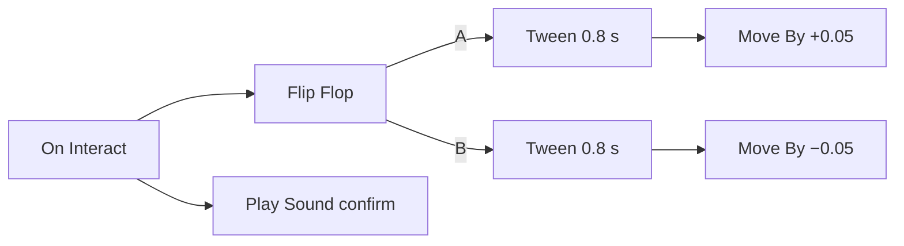

# 9 Logic Graphs – Programming with Boxes and Wires

> **Your level:** Now you'll learn how games "think": doors that open, traffic lights that switch,
> points for a zone. In Kern you don't write code for that – you connect boxes with wires. And
> you'll find out how Kern turns these pictures into machine code at lightning speed.

Kern has **no scripting language**. Game logic is made of **graphs**, like Unreal Engine's
Blueprints: nodes (boxes) and wires. A graph is pure description; every node type is a C++ function.
Kern checks the graph and runs it in the fixed simulation steps – but only where the game holds "the
truth": in a single-player game or on the network server. Whatever it does is passed on to all the
other players.

There are **three tiers**: an **interpreter** that works through the graph node by node; a **JIT**
that translates the graph into WebAssembly when Play or Simulate starts, which the browser then
turns into machine code; and an **export as readable C++** that you can build into your game. All
three must deliver exactly the same result (9.9).

> **Picture it like this:** like Scratch – building blocks instead of text. Except you don't stack
> them, you connect them with wires.

## 9.1 The model

- **Exec pins** (white arrows) say what runs next. An **event node** starts a chain, **actions**
  continue it, **flow nodes** branch, repeat or wait.
- **Data pins** carry values with a type. Inputs **pull**: calculation nodes (*pure*, such as math)
  are only worked out when someone needs their value. Outputs of actions keep the value from their
  last run. An input without a wire takes the value entered in the node.
- **Variables** belong to the graph and have a type and a starting value.
- **State machines** have states and transitions. A transition fires on an event, after a time,
  as long as a condition is true, or immediately. Entering and leaving trigger events.
- **Latent nodes** like Delay and Tween pause the chain and continue later. A Delay ignores calls
  while it's waiting; a **Retriggerable Delay** starts over from the beginning instead.
- **Comment frames** organize the graph for you. They have no effect on the game.

The level has a **level graph**, and every actor can have one of its own. For an actor's graph,
"Self" is the actor itself.

The pin types are Exec, Bool, Int, Float, Vector, Text and Actor. Which wires are allowed:

- same type always, Exec only with Exec,
- **anything to Text** ("anything can be printed"),
- numbers among each other (Bool, Int, Float),
- Actor to Bool ("does it exist?"),
- number to Vector (into all three components).

The conversions are fixed: the text "0" or "false" is false, a vector as a number is its length, and
a decimal number as an Int gets cut off (3.9 becomes 3).

A graph is saved as JSON in the level ([Chapter 8](08-game-runtime.md)): variables, nodes, wires as
`[from, output, to, input]`, state machines and comment frames.

## 9.2 Nodes and the library

Every node type is a **definition**: key (such as `flow.branch`), title, category, help, kind
(event, action, pure, flow), pins, settings and the C++ function `run`. Pins and titles can depend
on settings ("Every 3 s").

`run` returns **which exec output** things continue on – or "stop" (the chain ends) or "wait" (a
latent node continues later). Through a **context**, a node function reads its inputs, sets
outputs, waits, remembers state and gets access to the world.

Kern ships with built-in nodes; the game nodes register themselves when the program starts. A real
example, the "Add Score" node (shortened):

```cpp
lib.add(action("game.add_score", "Add Score",
  "Game",
  {data("points", "Points", PinType::number, 10.0)},
  {},
  [](Context& c, GameWorld& w) {
    w.add_score(c.in_number("points")); },
  "Adds points ...", "points reward"));
```

Lines 1–2: an action with key, title and category. Line 3: a number input "Points," default 10.
Line 4: no data outputs. Lines 5–6: the function reads "Points" and gives the points to the world.
Line 7: help text and search words. `action` adds the exec input and the "then" output on its own.

## 9.3 Checking

Before a graph runs, Kern looks for **errors**: unknown nodes, settings that point to missing
variables or states, wires to pins that don't exist, wrong types, two wires into one data input,
calculation nodes that depend on themselves, and state machines without exactly one initial state.
There's a **warning** for nodes that can never run.

A graph with errors is switched off at the start and reported, and the rest of the game keeps
running. In Studio, **Compile** (F7) shows the result.

## 9.4 Execution

A **runtime** runs all the graphs of a world, and each one runs as an **instance** for its owner.
Every instance knows its tier: interpreter, "compiling," "compiled (WebAssembly)" or "native C++."

In the **tick** of every step, waiting times that are due continue first, then the "Tick" event,
then the state machines' transitions. An **event** goes to all matching instances, including graphs
of actors that were only just spawned.

You build your own events with **Custom Event**: you give it a name, and a **Call Event** with that
name triggers it – in all graphs or only on the target actor. The same name also switches event
transitions of state machines. "On State Entered" also tells you the previous state.

The interpreter works with a **stack**. If a node makes a note of something for later (a Sequence
its remaining outputs), it goes onto the stack. When a branch ends, things continue with the top
entry.

> **Picture it like this:** a stack of homework sheets. You work on the current task. If you think
> of "math afterward" along the way, you put that sheet on top. When you're done, you take the top
> one.

Data is pulled on every read, up to 48 calculation nodes deep.

**Protection against infinite loops:**

- More than **200,000** nodes in one step: the instance is switched off ("infinite loop? The graph
  is stopped.").
- Events that trigger events may nest at most 64 deep.
- In compiled code, more than 512 nested loops stop.

> **Watch out, trap:** A While Loop whose condition never becomes false freezes the whole game in
> many engines. In Kern, only your graph stops – with a message. Read it in the Output Log!

**State machines:** At the start, each one enters its initial state. Per machine and check, at most
**one** transition fires, so automatic chains move forward one state per step. A transition "from
any state" never leads back into its own target state. With Set State you jump directly.

## 9.5 Core nodes

Kern ships with **76** built-in nodes:

| Category | Examples |
|---|---|
| Events | Begin Play, Event Tick, Every N Seconds, Custom Event |
| State Machines | On State Entered/Left, Set State, Current State |
| Flow | Branch, Sequence, For, While, Do Once, Do N, Gate, Flip Flop, Delay, Tween, Switch |
| Variables | Get, Set, Add |
| Math | plus, minus, times, divided by, remainder, sin/cos (degrees), square root, random |
| Logic | Compare, AND, OR, XOR, NOT, Select |
| Vector | Make, Break, length, distance, dot product, cross product |
| Text, values | Append, Contains, literals |
| Utilities | Game Time, Print |

**Tween** counts smoothly from 0 to 1 over a duration, and **Gate** is a door for the chain.
**Random** comes from the world and is **deterministic** – replays and the network match.

## 9.6 Game nodes

On top of that come **71** game nodes. An Actor input without a wire means "Self."

**Events:** On Begin/End Overlap (something enters or leaves the sensor), On Entered Sensor, On Hit
(impact from 2 m/s), On Collected, On Trigger, On Damaged, On Death, On Respawn, On Interact (key F
or Y on the gamepad, looking at the actor up to 3 m away, or an actor within 2 m), On Player Joined,
On Game Over, On Input Action and On Key. An overlap counts the visitor as a whole: a player's
capsule and head are one visitor.

**Actors:** Self, Get Player, Find Actor by Name or Tag, location, rotation, move, Spawn Actor (copy
of a template), Destroy and Set Property, which changes any component value through its path, such
as `components.mesh.material.color`.

**Physics:** velocity, impulse, force, Launch, physics on/off, joint motor, explosion, Line Trace.

**Game and effects:** points, Show Message, Win, Lose, damage, healing, ammo, light, color, sparks,
camera shake, Play Sound and For Each Actor with Tag.

**Robots:** You can steer the Micro Duck (forward up to 0.4 m/s, turning up to 57° per second – the
trained ranges), turn its head, trigger moves (sit, pick up, kicks, roll, jump), make it chirp
("Chirp"), move its beak, switch its autonomy on and off, and query its distance sensor (ToF), its
camera and its state. Details: [Chapter 13](13-micro-duck.md).

> **Mission:** Open a **Basic** level on https://kernengine.de/ and click **Logic** in the
> toolbar. Click **Begin Play**, drag a wire from the "then" output into empty space, type "show
> message," press Enter and enter some text. Go back with **Viewport**, place a **Rolling Ball** and
> press **Play**. Your text appears in the HUD!

## 9.7 Logic in the GameWorld

The GameWorld only starts logic in Play or Simulate, only on the computer that holds "the truth,"
and only if there are graphs. Then each graph gets its instance.

The world gives the logic the **time** (simulation time, not the wall clock), **output** ("Logic:
…" in the Output Log) and **randomness** with a fixed seed.

An event goes to the graph of the actor it concerns – or, if that actor has none, to the graph of
its nearest ancestor that has one. So a door's collider reports to the door. The level graph gets
every event as well. The logic tick runs at the end of every step, after the physics. So that
graphs notice anything at all, Kern turns on overlap and hit reports for all moving bodies when
there's logic.

Whatever the logic changes – values, new copies, moved bodies – is recorded. The server sends it to
everyone, including players who join later ([Chapter 10](10-networking.md)).

## 9.8 From graph to machine code

Kern has two translators with **the same plan**: one for WebAssembly (the browser turns it into
machine code that calls the engine's C++ nodes directly) and one for C++ source code.

Control flow, number variables, math and comparisons are translated directly. **Everything else**
calls the node's C++ function.

The state lives in fixed memory slots: slots for number variables, eight slots per node (loop
counters, open gates, results), a stack with 512 places and counters for the budget.

The generated program is **one loop with a program counter** and one case per node. Every pass is
counted; above the budget, it reports an infinite loop. In the C++ export, that's an endless
`for (;;)` loop with a `switch (pc)` inside.

The exported code registers itself with a **fingerprint** (*hash*) of the graph. Positions and
comments don't go into the hash. So moving nodes doesn't make the export invalid, but any change to
the content does – then you have to export again.

**In the browser:** At the start, Kern checks the graph. If there's built-in C++ code for its hash,
that wins. Otherwise the browser translates the WebAssembly module in the background. Until it's
done, the graph runs in the **interpreter**; after that, Kern calls the machine code directly. If
the translation fails, the interpreter stays.

> **Crazy but true:** The translated graph is about **55 times faster** than the interpreter. That's
> measured with a million loop passes.

## 9.9 Why all three tiers must compute the same

The tiers are swapped **in the middle of the game**. A graph starts in the interpreter – Begin Play,
the first ticks, running counters – and switches to machine code as soon as it's ready. That's why
the state lives in **the same memory slots** that the generated code uses. Nothing has to be copied
over when switching.

On top of that, Kern is deterministic ([Chapter 6](06-physics.md)): if the browser computed
differently from the interpreter, replays, training and debugging would be worthless. The budget
also counts the same everywhere, and breakpoints work in translated code too.

This is checked with the same test cases in all three tiers (loops, gates, nested While Loops, state
machines, infinite loop …). The result must be **identical**. So if you change a node, you have to
change it the same way in three places.

## 9.10 Editing in Studio

The logic editor looks like Unreal's Blueprint editor; [Chapter 11](11-studio.md) describes the
interface. The web page only draws. Every edit is a command to the engine and **one undo step** in
the level.

You search for nodes in the **action menu** (if you drag from a pin, only matching ones appear),
snap them to the 8 px grid, connect them, create variables and state machines, turn a pin into a
variable ("Promote to Variable"), insert a reroute node by double-clicking a wire, check, export C++
and set breakpoints with **F9**: when the node runs, the game pauses after the step and the editor
jumps there. While playing, you see live which nodes ran and what values the variables have.

> **Mission:** In the level graph of your level with the Rolling Ball, use **Templates** to insert
> the template **Traffic light (state machine)** and press **Play**: the HUD shows Green, Yellow,
> Red one after the other. Stop with **Esc**, select a node in the graph, set a breakpoint with
> **F9** and press **Play** again – the game pauses as soon as the node runs.

## 9.11 Examples

All of these are real graphs from Kern, and most are also available as templates.

**Score zone:** On Begin Overlap → Add Score (10) → Show Message ("+10") → Play Sound (pickup).

**Door:**



Interact switches between opening and closing. Each Tween runs for 0.8 s and pushes the door by
5 cm every step. At 60 steps per second, that's around 48 steps, so about 2.4 m.

**Spawner:** Every 3 s, as long as "Spawned" is below 10: create a Physics Cube at (0, 0, 6) and
increase "Spawned" by 1.

**Traffic light:** A state machine "Light": Green → (4 s) → Yellow → (1.5 s) → Red → (4 s) → Green.
When each state is entered, its name is displayed.

**Avoiding obstacles:** The Micro Duck no longer walks on its own. Every 0.25 s: if its ToF sees
something closer than 1.6 m, it turns on the spot for 0.6 s; otherwise it walks straight ahead.

**The duck chirps at the ball:** In the Micro Duck level, a graph asks every 0.25 s: Does the head
camera see the ball, and did it **not** see it before? Then it chirps. A variable "Ball Seen"
remembers the last state; otherwise the chirping would go off every 0.25 s. A comment in the graph
says: this is a demo, not a behavior of the real robot.

> **Mission:** Open File › Example Levels › **Micro Duck** and, there, the level graph
> (**Logic**). Find the variable "Ball Seen" and the Branch. Start Play and roll the ball in front
> of the duck's camera.

## Level complete!

- You know exec pins, data pins, variables and state machines.
- You know which wires are allowed and how values are converted.
- You understand how the interpreter works with a stack.
- You know how Kern catches infinite loops.
- You know the three tiers – interpreter, WebAssembly and C++ – and why they must compute the same.
- You can build and debug a graph of your own in Studio.

## Puzzle corner

1. What does a wire between two exec pins show?
2. Are you allowed to connect an Actor output to a Text input?
3. A Text input gets the number 3.9, and so does an Int input. What arrives in each?
4. After the C++ export, you move a few nodes. Do you have to export again?
5. **Boss puzzle:** A Custom Event runs 4000 nodes every time it's called, and no other logic is
   running. How many times can it run in one step before Kern switches off the graph?

### Solutions

1. The order: what runs next.
2. Yes. Anything can be converted to text.
3. The Text input gets the number as text; the Int input cuts it off: 3.
4. No. Positions don't count toward the hash. Only a change to the content requires a new export.
5. 200,000 / 4000 = 50 times. On the 51st time, the budget would be exceeded.

---

© 2026 Christian Heinrich Hohlfeld · All rights reserved · [Imprint and rights](00-imprint.md)
