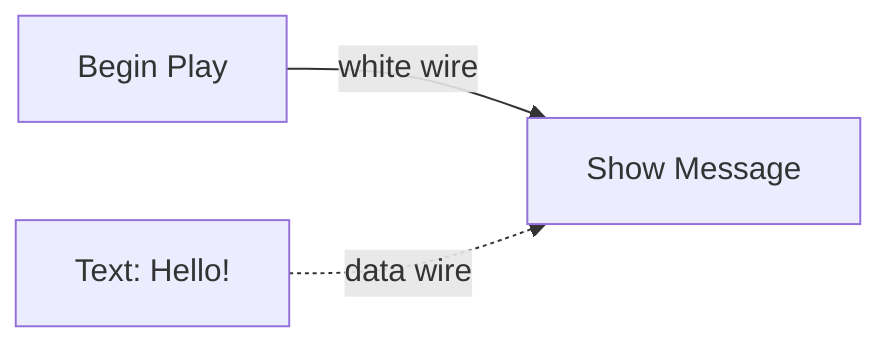
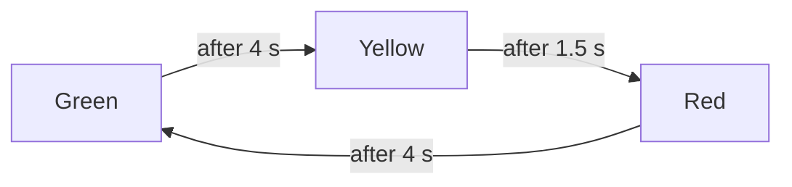

# 9 Logic Graphs – Programming with Boxes and Wires

> **Your level:** Now you learn how games "think": doors that open, traffic lights that switch,
> points for a zone. In Kern you don't write code for this; you connect boxes with wires. And you
> find out how Kern makes these pictures lightning-fast in the background.

> **Words you need:**
> - **Graph** – a picture made of boxes and connecting lines.
> - **Node** – a box in the graph that does one thing or calculates something.
> - **Pin** – a connector on the edge of a node that a wire goes to.
> - **Event** – something that happens and sets something in motion, such as "game begins" or
>   "something touches me."
> - **Variable** – a labeled compartment in memory where the graph remembers a value.
> - **Step** – a fixed calculation step of the simulation, usually 60 per second
>   ([Chapter 8](08-game-runtime.md)).
> - **Server** – in multiplayer, the one computer that decides what really happens.
> - **Deterministic** – with the same inputs, exactly the same thing always comes out.

> **Picture it like this:** like Scratch – building blocks instead of text. Only you don't stack
> them; you connect them with wires.

Kern has **no scripting language** that you type text into. Game logic is **graphs**, built like
the Blueprints of the Unreal Engine: nodes and wires. Behind every box there's a small piece of
program in the engine. Kern checks your graph and runs it in the simulation's fixed steps.

**Where does the logic run?** Only where the game **"has the truth."** If you play alone, that's
your computer. In multiplayer, it's only the **server**. It calculates the logic, and the other
players get the result sent to them: if the door opens, everyone sees it open. That way it can
never happen that it's open for you and closed for your friend.

**How does the logic run?** For this, Kern has three stages that all do exactly the same thing,
just at different speeds:

> **Picture it like this:** a book in a foreign language.
> - **Reading aloud:** An interpreter reads sentence by sentence and translates each sentence at
>   the moment they read it out. That works right away but is slow.
> - **Translating:** The book is translated once, completely. After that you read it directly,
>   much faster. Only the translating itself takes a moment.
> - **Shipping it printed:** The finished translation is packed right into the game.

If the game already comes with a printed translation, Kern takes that right away. Otherwise Kern
starts with reading aloud, translates in the background and then switches over. How that works
and why not a single result may come out differently is in 9.8 and 9.9.

## 9.1 The Model

A graph has two kinds of wires. **White wires** (between the **exec pins**) say **what happens
next**. **Colored wires** (between the **data pins**) carry **values**, for example a number or a
text.

Read the picture like this: when the game begins, Show Message runs. Where does the text come from?
Over the data wire from the text box.

- An **event node** starts a chain, such as Begin Play. **Actions** continue it, such as Show
  Message. **Flow nodes** branch (Branch: if … then …), repeat or wait.
- **Calculation nodes** like plus or times have no white pins. They only calculate when another
  node needs their result right then, the way you only use a calculator when you need the result.
  And they calculate **anew every time** someone asks. An input without a wire takes the value
  entered in the node.
- **Actions**, on the other hand, only calculate when the white wire starts them. Some output a
  value while doing so; for example, **Spawn Actor** delivers the new copy. The output **keeps**
  this value until the action runs the next time. If you read it later, you get the result of the
  last run. Like a receipt: it shows the last purchase, not the one you're about to make. That's
  why such a value can be "old," but a calculation node's never can. An example: if you read Spawn
  Actor's "new copy" **before** Spawn Actor has run this time, you get the copy from last time.
- **Variables** belong to the graph and have a type and a starting value.
- **Waiting nodes** like **Delay** (wait a few seconds) and **Tween** pause the chain and carry on
  later. A **Tween** runs for a set time. In **every step** of this time, its output "Update"
  fires, and its value "Alpha" counts up smoothly from 0 to 1 – like a progress bar. At the end,
  "Finished" fires. With it you can, for example, open a gate step by step (9.11).
- **Comment frames** organize the graph for you. They have no effect on the game.

> **For pros:** If you call a waiting Delay again, it ignores that. The variant **Retriggerable
> Delay** instead starts waiting from the beginning again. With it you can build a light that goes
> off 5 seconds after the **last** movement.

The level has a **level graph**, and every actor can have one of its own. For it, "Self" is the
actor itself.

### State Machines, with a Traffic Light as an Example

A traffic light is always in exactly **one state**: green, yellow or red. After a while it changes
to the next one. That's exactly what a **state machine** is.

The arrows are called **transitions**. A transition can trigger in four ways: on a certain event,
after a time (like with the traffic light), as long as a condition is true, or immediately, that is,
at the next step (more on this in 9.4). A transition can also start **from any state**. That's handy
for an emergency stop: you could build a transition where an event "fault" switches the light to
red immediately, no matter whether it's showing green or yellow right now. When the machine enters
or leaves a state, there's an event for that. You attach actions to it, such as "show the name of
the new state." Exactly this traffic light exists as a template (mission in 9.10).

### The Data Types

Every data pin has a **type**. Scratch knows number, text and true/false. Kern distinguishes more
precisely:

| Type | means | Example |
|---|---|---|
| Exec | "go on now," no value | the white wire |
| Bool | true or false | "door open?" |
| Int | whole number | 3, −7, 120 |
| Float | decimal number | 3.9 or 0.25 |
| Vector | three numbers x, y, z | a position (5, −12, 1.5) |
| Text | letters and characters | "Hello!" |
| Actor | a thing in the level | the door, the player |

A vector is like an arrow in space. It also has a **length**. Draw the arrow (3, 4, 0) on graph
paper: 3 squares to the right, 4 up. Measure the slanted line from the start to the tip with your
ruler: it's exactly 5 squares long.

> **For pros:** You can calculate the length with the Pythagorean theorem:
> √(3² + 4²) = √(9 + 16) = √25 = 5. With three numbers, z² is simply added.

**Which wires are allowed?**

- the same type always; a white exec wire only with exec,
- **anything to Text** ("everything can be printed out"),
- numbers among themselves (Bool, Int, Float; a Bool counts as a number here: true is 1, false is
  0),
- Actor to Bool ("does it exist?"),
- number to Vector (the number goes into all three places).

A decimal number that goes to an Int pin gets cut off: 3.9 becomes 3, not rounded.

> **For pros:** Kern sometimes converts away from the wires too, for example when a node checks a
> value itself. That's precisely defined: the text "0" or "false" counts as false; a vector as a
> number is its length. As a wire, though, Text → Bool and Vector → number aren't allowed.

## 9.2 Nodes and the Library

Behind every box there's a small piece of program in the engine. All node types together make up
the **library**. Every type has a description there: title, category, help text, its pins and
settings. The action menu in the editor searches exactly this library. That way the editor
automatically knows every node the engine can do. A new node is just a new entry in the library,
and right away it shows up in the menu.

When a node has run, it says how things continue: at which white output (a Branch takes **True** or
**False**), whether the chain ends here, or whether it waits for now.

What a node looks like exactly in the program is in the blue book, Chapter 9.

## 9.3 Checking

Before a graph runs, Kern looks for **errors**: unknown nodes, wires to pins that don't exist,
types that don't fit together, two wires into the same data input (which value should apply
then?), settings that point to a variable that doesn't exist, or a state machine without exactly
one starting state. A **loop of calculation nodes** is also an error: if plus needs the result of
times, and times in turn needs the result of plus, each would wait for the other, and neither would
ever get to a result. There's a **warning** for nodes that can never run because no white wire
leads to them.

A graph with errors is switched off at the start and reported. The rest of the game keeps running.
In Studio, **Compile** (F7) shows the result.

## 9.4 Running

Every graph runs for its **owner**: an actor or the level. If you spawn ten copies of a crate with
a graph, ten separate runs go on, each with its own variables. Like ten students who all get the
same worksheet, but each writes on their own.

**In every step**, the following happens in order: waiting nodes whose time is up carry on. Then
comes the event **Tick**. Then the state machines check their transitions. An **event** like
"something overlaps" goes to all fitting graphs, including those of actors that have only just come
into being.

You build your own events with **Custom Event**: you give it a name, and a **Call Event** with this
name triggers it, in all graphs or only on the target actor. The same name can also switch a state
machine's transition.

**The stack.** Some nodes have several outputs one after another, such as **Sequence** ("first
this, then this, then this"). Kern does the first one right away and puts the others on a
**stack**. When a **branch** ends (a chain of white wires after which nothing else comes), it takes
the top entry off the stack and carries on there.

An example with a Sequence that has three outputs:

| Moment | Kern is doing | on the stack (top first) |
|---|---|---|
| Sequence starts | output 1 | slip "output 2," slip "output 3" |
| branch 1 has ended | output 2 | slip "output 3" |
| branch 2 has ended | output 3 | – |

Loops use the same stack: before Kern runs the inside of a loop once, it puts a slip "back to the
loop" on top. When the inside is finished, it finds this slip and checks whether another round is
due.

> **Picture it like this:** a stack of homework slips. You work through the current task. If you
> think of "math after that" along the way, you put that slip on top. When you're done, you take
> the top one.

**Protection against endless loops:** Kern counts how many nodes all graphs together run in one
step. If it's more than **200,000**, Kern switches off the graph that's running right now and
reports "infinite loop? The graph is stopped." In the same way, a chain stops if events keep
triggering new events: event A calls event B, B calls A again, A calls B again, and so on. If this
chain gets too long, Kern breaks it off.

> **Watch out, trap:** A While Loop whose condition never becomes false freezes the whole game in
> many engines. In Kern, only your graph stops – with a message. Read it in the **Output Log**!

**State machines in step:** At the start, every machine enters its starting state. Per step, every
machine makes **at most one** transition on its own (after time, condition or "immediately");
transitions caused by an event come on top. Why the limit? If there were "immediately" transitions
from yellow to red and from red back to yellow, the machine could otherwise jump back and forth
endlessly in a single step. So if the traffic light had an "immediately" transition from yellow to
red, it would still stay on yellow for one step. With **Set State** you jump directly into a state.

> **For pros:** Data wires are calculated anew every time they're read, through at most 48
> calculation nodes in a row. The other limits are in the blue book, Chapter 9.

## 9.5 Core Nodes

Kern brings **76** built-in nodes:

| Category | Examples |
|---|---|
| events | Begin Play, Event Tick, Every N Seconds, Custom Event |
| state machines | On State Entered/Left, Set State, Current State |
| flow | Branch, Sequence, For, While, Do Once, Do N, Gate, Flip Flop, Delay, Tween, Switch |
| variables | Get, Set, Add |
| math | plus, minus, times, divided by, remainder, square root, random, calculating with angles |
| logic | Compare, AND, OR, XOR, NOT, Select |
| vector | build, split, length, distance |
| text, values | Append, Contains, fixed values |
| utilities | Game Time, Print |

What you know from Scratch:

- **For** = "repeat with a counter," **While** = "repeat as long as …".
- **Switch** = one of several outputs depending on a number or text, like a railroad switch with
  many tracks.
- **AND, OR, NOT** = "and," "or," "not." **XOR** = "either – or, but not both."
- **Append** = join texts together, **Contains** = "does the text contain …?"

A few flow nodes explained: **Do Once** lets things through only the first time, **Do N** exactly N
times. **Gate** is a door for the chain that you can open and close. **Flip Flop** takes output A
and B alternately, like a light switch. **Select** picks one of two values depending on true or
false.

**Random** comes from the world and is **deterministic**: it starts with the same starting number
every time the same level starts. That way replays and all players in the network agree.

## 9.6 Game Nodes

On top come **71** game nodes. An actor input without a wire means "Self."

**Events** report that something happened, for example On Begin Overlap (something enters the
sensor), On Hit (an impact), On Collected (something was collected), On Death or On Interact (key F,
or Y on the gamepad, when you look at the actor or stand right next to it) – and many more. An
overlap counts the visitor as a whole: a player's body and head are one visitor.

Begin Overlap and Entered Sensor sound the same but come from different sides. **On Begin Overlap**
is reported by the sensor itself: "Someone has come into me." **On Entered Sensor** is reported by
the visitor: "I've come into someone else's sensor." So a goal zone uses the first; a game character
that should react to every zone uses the second.

**Actors:** Self, Get Player, Find Actor by Name or Tag, location, rotation, moving, Spawn Actor (a
copy of a template), Destroy and Set Property. Set Property changes any value you can also set in
**Details**, such as the color.

**Physics:** speed, impulse, force, launch, physics on/off, joint motor, explosion and **Line
Trace**, a check ray that reports what it hits first. Impulse and force differ as in
[Chapter 6](06-physics.md): an **impulse** is a one-time shove, like a kick against a ball. A
**force** only pushes for one step. If it should push longer, you call it anew in every step, for
example on Tick.

**Game and effects:** points, Show Message, Win, Lose, damage, healing, ammo, light, color, sparks,
camera shake, Play Sound and For Each Actor with Tag.

**What everyone sees and what only one sees.** In multiplayer, logic only runs on the server
(beginning of the chapter). Some nodes still have an effect for everyone: all players see a **Show
Message**. **Camera Shake**, on the other hand, only shakes the camera of the computer the logic
runs on. If your friend runs the server and you play along, only their camera shakes, not yours.
It's similar with keys: **On Key** only listens to this computer's keyboard, so to the player
sitting there. **On Input Action** ("jump," "fire" …), on the other hand, reports every player, no
matter which device they use. So for multiplayer games, On Input Action is the right choice.

**Robots:** The Micro Duck can be steered (within the limits its network was trained for), turn its
head, trigger moves (sit, pick up, kicks, roll, jump), chirp ("Chirp"), move its beak, and switch
its autonomy on and off. You can query its distance sensor (**ToF**, measures how far away the
nearest thing in front of it is), its camera and its state. Details:
[Chapter 13](13-micro-duck.md).

> **Mission:** On https://kernengine.de/, open a level with the template **Basic** and click
> **Logic** in the toolbar. The logic editor, like the messages in the Output Log and the console,
> is in English in both of Studio's languages, so this book names its labels as they appear there.
> Click **Begin Play**, drag a wire from the output "then" into empty space, type "show message,"
> press Enter, and enter a text. Go back with **Viewport**, place a **Rolling Ball** – it's your
> player: without a controllable actor, Studio only simulates, and then there's no HUD – and press
> **Play**. Your text appears in the HUD!

## 9.7 Logic in the GameWorld

The GameWorld only starts logic during **Play** or **Simulate**, only on the computer that has the
truth (see the beginning of the chapter), and only if there are any graphs at all.

The world gives the logic three things: the **time**, the **output** and the **randomness**. The
time is **game time**, counted in fixed steps, not the clock on the wall. If you pause the game,
the logic's time stands still too. And a graph ticks on a slow computer just as on a fast one.
Whatever a graph outputs appears as "Logic: …" in the **Output Log**.

An event goes to the graph of the actor concerned. If it has none, Kern keeps searching at the
parent actor, then at its parent actor and so on upward (this whole line is called **ancestors**,
like parents, grandparents, great-grandparents). The first one with a graph gets the event. So if
the door has a welded-on child without its own graph, such as the handle, the handle reports to the
door. The level graph gets every event as well. The logic runs at the end of every step, after the
physics.

So that graphs find out about touches at all, in levels with logic Kern switches on the physics'
touch reports for all movable bodies ([Chapter 6](06-physics.md)). Without logic, it saves itself
this work.

Whatever the logic changes, such as a value, a new copy or a moved wall, Kern records. The server
sends it to all players, including those who only join later ([Chapter 10](10-networking.md)).

## 9.8 From Graph to Fast Code

When **Play** or **Simulate** starts, Kern translates your graph into fast code **in the
background**. Until the translation is finished, the graph runs in the slow "reading aloud" mode,
but already correctly. After that, it's about **55 times faster**. If translating ever fails, it
simply stays with reading aloud.

Not every node gets translated. A translator also leaves proper names as they are instead of
inventing "Berlin" anew. Simple things like branches, loops, numbers and calculations are
translated directly. These are exactly the parts that often run thousands of times in loops. For
everything else, such as "Spawn Actor," the translated code calls the node's finished piece of
program in the engine. These pieces of program are already translated, fast engine code.
Translating them again would bring nothing.

You can also **export** a graph, as finished program text that goes into the game. So that Kern
knows which graph the export belongs to, it gets a **fingerprint** (*hash*): a number calculated
from the graph's content. If the content changes, the number changes. Positions and comments don't
count. So moving nodes doesn't make the export invalid, but every change to the content does. Then
you have to export again. If there's a matching export for a graph, Kern takes it right away.

> **For pros:** Translating while the game is running is called **JIT** ("just in time"). Kern
> translates into **WebAssembly**, the language the browser turns into machine code lightning-fast.
> The export is readable **C++**. Both translators build the same program: a loop with a counter
> that points to the node currently running.

## 9.9 Why All Three Stages Have to Calculate the Same

The switch from reading aloud to translated code happens **in the middle of the game**. A graph
starts in reading-aloud mode, does Begin Play and the first ticks, maybe already counts up a loop,
and then the fast code takes over.

> **Picture it like this:** a relay race. The second runner has to keep running exactly where the
> first one stopped, with the same baton in hand. Kern makes sure that both stages put their numbers
> (variables, loop counters, open gates) in the same place in memory. When switching, nothing has to
> be handed over; the baton is already there.

And Kern is **deterministic** ([Chapter 6](06-physics.md)). If the translated code calculated even a
tiny bit differently from reading aloud, a replay would run differently from the original, and you
could no longer trust the results when training the duck or hunting bugs. The limit against
endless loops also counts the same everywhere, and breakpoints (9.10) work in the translated code
too.

This is checked with **the same test cases** in all three stages: loops, gates, nested While Loops,
state machines, a deliberate endless loop. The result has to be **identical**.

> **For pros:** So a simple node like Branch sits in three places: in the reader and in the two
> translators. Whoever changes it has to change it the same way in all three places. That's exactly
> what the shared test cases are for: if you forget one place, the test raises the alarm.

## 9.10 Editing in Studio

The logic editor looks like Unreal's Blueprint editor; [Chapter 11](11-studio.md) describes its
interface. The editor itself changes nothing. It only draws what the engine describes to it and
sends each of your changes to the engine as a command, like a waiter passing on orders. The engine
carries out the change and writes it into the same list as any other change to the level. That's
why every edit is **one undo step** in the level, and you can take everything back with Ctrl+Z.

The logic editor is in English in both languages: buttons like **Compile** and **Templates**, the
menus and all node names appear here the way Studio shows them.

You search for nodes in the **action menu**. If you drag from a pin while doing so, it only shows
nodes that fit it. You connect nodes, create variables and state machines, check with **Compile**
and export. With **Promote to Variable** on a pin, Kern creates a new variable of the fitting type
and attaches it to this pin right away. With **F9** you set a **breakpoint**: when the node runs,
the game pauses after the step, and the editor jumps there. While playing, you see live which nodes
ran and which values the variables have.

> **Mission:** In the level graph of your level with the rolling ball, insert the template
> **Traffic light (state machine)** via **Templates** and press **Play**: the HUD shows Green,
> Yellow, Red one after another. Stop with **Esc**, click the node **On State Entered** in the
> graph, set a breakpoint with **F9** and press **Play** again. The game pauses as soon as the
> traffic light enters a state (right at the beginning, at Green), and the editor shows the node.
> With the Resume button in the bar above the graph, it continues until the next change.

## 9.11 Examples

All of these are real graphs from Kern; most exist as templates under **Templates**.

**Score zone:** On Begin Overlap → Add Score (10) → Show Message ("+10") → Play Sound (pickup).
Whoever enters the sensor gets 10 points, a message and a sound.

**Gate** (template **Door that opens on Interact**; it opens upward like a garage door, which is
why it's called a gate here):

Interact switches between opening and closing via a Flip Flop. Each Tween runs for 0.8 s. Its
output "Update" fires in every step as long as the Tween is running (9.1), and pushes the gate up
or down by 5 cm each time. This example doesn't need the Alpha value at all. At 60 steps per second,
that's about 48 steps, so about 2.4 m.

**Spawner:** Every 3 s, as long as the variable "Spawned" is under 10: create a physics cube at a
height of 6 m and increase "Spawned" by 1. All players see the copies.

**Traffic light:** the state machine from 9.1. When each state is entered, its name is shown.

**Avoiding obstacles:** The Micro Duck no longer walks on its own. Every 0.25 s: if its ToF sees
something closer than 1.6 m, it turns on the spot for 0.6 s; otherwise it walks straight ahead.

**The duck chirps at the ball:** In the level Micro Duck, a graph asks every 0.25 s: does the head
camera see the ball, and did it **not** see it before? Then it chirps. A Bool variable "Ball Seen"
remembers the last state; otherwise the chirping would go off every 0.25 s as long as the ball is in
the picture. A comment in the graph says: this is a demo, not a behavior of the real robot.

> **Mission:** Open **File › Example Levels › Micro Duck** and there the level graph with the
> **Logic** button. Find the variable "Ball Seen" and the Branch. Start **Play**. Here the game
> begins with the free camera: grab the ball with the left mouse button and drag it in front of the
> duck's head. It chirps once, and only again once the ball was gone and shows up again.

## Level complete!

- You know white exec wires, data wires, variables and state machines.
- You know what Bool, Int, Float and Vector are, which wires are allowed and how values are
  converted.
- You understand how Kern works with a stack and catches endless loops.
- You know why logic only runs on the computer with the truth.
- You know the three stages reading aloud, translating and shipping along, and why they have to
  calculate the same.
- You can build your own graph in Studio and examine it with breakpoints.

## Puzzle corner

1. What does a white wire between two nodes indicate?
2. May you connect an Actor output to a Text input?
3. A Text input gets the number 3.9, and so does an Int input. What arrives in each case?
4. After exporting, you move a few nodes. Do you have to export again?
5. **Boss puzzle:** A Custom Event runs 4000 nodes every time it's called; no other logic runs. How
   often may it run in one step before Kern switches the graph off?

### Solutions

1. The order: what happens next.
2. Yes. Everything can be converted to text.
3. For the Text, the number arrives as text; for the Int, it's cut off: 3.
4. No. Positions don't count toward the fingerprint. Only a change to the content calls for a new
   export.
5. 200,000 / 4000 = 50 times. That's exactly 200,000 nodes, so still allowed. On the 51st time, the
   limit would be exceeded.

---

© 2026 Christian Heinrich Hohlfeld · All rights reserved · [Imprint and rights](00-imprint.md)
