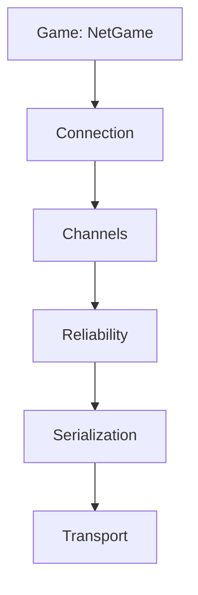

# 10 Playing Together: Kern on the Network

> **Your level:** How can several players move around the same world when the internet loses
> packets and delivers them late? Here you'll learn the tricks Kern uses to hide that.

Kern has its own networking system in C++, built after Glenn Fiedler's articles ("Gaffer On
Games") and his libraries yojimbo, reliable.io and netcode.io. On top sits **NetGame**: it turns
**any level into a multiplayer game**. All Kern needs from the connection is small packets
(**datagrams**). That's why, in the browser, it runs over a **BroadcastChannel** (tabs on one
computer) or a **relay** (different computers), and in tests and in Studio over a network in memory.

---

## 10.1 The Layers



Each layer builds on the one below it, from carrying packets all the way up to the game.

---

## 10.2 Serialization: Every Bit Counts

For every data type there is **one single** function, `serialize()`, that writes, reads **and**
counts bits. That way, sender and receiver can never disagree. A number with a range gets only as
many bits as it needs: the player slot is between 0 and 254, which is 255 values, and 2⁸ = 256 is
enough – so **8 bits** instead of 32. Yes/no needs 1 bit.

> **Picture it like this:** rolling T-shirts instead of folding them. Kern packs rotations with
> "smallest three": of four numbers whose squares add up to 1, it leaves out the largest – it can be
> worked out from the other three.

**Readers check everything.** A value outside the range, a buffer that's too short, a wrong length:
the packet gets thrown away instead of crashing the game. This is also where the CRC32 checksum
lives.

---

## 10.3 Reliability: Numbers and Receipts

Every packet carries a **number** (16 bits) and a **receipt**: "Your last one was number 500," plus
32 yes/no bits for the 32 before it – squeezed into 9 bytes at most. **Sending never waits**; the
layer above decides whether something gets sent again. Packets over 1024 bytes are split up. Along
the way, Kern measures **ping**, **loss** and **bandwidth**, smoothed out so spikes don't throw it
off.

> **Picture it like this:** In the class group chat: "Read up to 500, of the 32 before that I'm
> missing 497 and 490." One reply confirms 33 messages.

---

## 10.4 Channels: Registered Mail or Postcard

- **Reliable and ordered** (registered mail): exactly once, in order. Anything not confirmed is
  sent again, after 0.1 s or, if that's longer, after 1.25 times the ping. Big messages (over 512
  bytes) travel in blocks.
- **Unreliable** (postcard): once, with the next packet – for positions, inputs and effects that are
  worthless when they arrive late.

---

## 10.5 Connection: The Handshake

1. The client sends requests with a random number (**salt**), padded on purpose: a faked request
   can never get the server to send back more than it received.
2. The server answers with a **challenge** and its own salt.
3. The client sends back both numbers combined with XOR.
4. The server hands out a **slot**; from now on, the XOR result is the **connection ID**.

Kern ignores packets from strangers or with the wrong ID. Every datagram starts with a **CRC32**
over the tag "KERN0001" and the contents – other games and versions get kicked out. Default: at most
16 clients, after 6 s without a packet it's over, a sign of life every 0.1 s. If the server is full,
the client gets turned away.

---

## 10.6 Transports

A datagram has at most 1400 bytes. **LoopbackNetwork** is the in-memory network, **HostTransport**
hands packets over to the browser side. Both contain a **simulator** for delay, wobble (jitter),
loss and duplicate packets. With a fixed random seed, a bad network is **exactly equally bad** every
time – perfect for testing.

---

## 10.7 NetGame: One Game, Many Players

- The **server** is the boss: only it calculates physics, rules, pickups and triggers. Every player
  gets a **pawn** (a copy of the player character). 30 times per second, every client receives a
  **snapshot** with the HUD and the position of everything that moves.
- The **client** plays a **replica** without its own physics and logic, sends its input and shows
  the world about **100 ms in the past**. Only the city traffic drives on the client itself.
- Important things (welcome, player joins/leaves, pickup gone, logic change) go by registered mail;
  sounds and shots go by postcard.
- Both need **the same level**. The welcome carries a checksum (without the editor camera); if it
  doesn't match, you get "the server plays a different level".
- After the welcome, a new client gets all pawns, everything logic has created or changed so far,
  and which pickups are already gone. That way, even a latecomer sees the same world.
- In the replica, all moving bodies are **kinematic**: they just follow the poses from the
  snapshots.

```cpp
game::NetGame net(world);
net.host(level, transport);
net.update(time, dt, local_input);
```

Line 1 connects network and world. Line 2 makes you the server; a client calls `join` with the
server address instead. Line 3 runs every frame. You can set the ticks per second (30), the delay
(0.1 s), the space per snapshot (900 bytes) and the number of players (8).

An input contains movement, jump, boost, look, fire, aim, reload, crouch and use. The client always
sends the last four along. Jumping and firing count if they appear in **any** of them – that way a
jump never gets lost. With the Soldier game model, its HUD values such as health and ammo come
along too.

> **For pros:** For **lag compensation**, the server turns back time for your shot by about "half
> the ping plus 100 ms" (at most 0.5 s) – that's what your world looked like when you pulled the
> trigger ([Chapter 8](08-game-runtime.md)).

### The Priority Pot

A snapshot has to fit into one packet. Every client has a points pot for each thing. Per snapshot,
a thing gets **+10** if it has moved since it was last sent (or has never been sent), otherwise
**+0.25**. Your own pawn always comes first, then the others by points, until 900 bytes are full (at
most 255 things). Whatever makes it in drops to 0. A resting crate needs 40 snapshots
(10 ÷ 0.25) to collect as many points as a moving car gets after one.

> **Crazy but true:** Positions travel accurate to **1 mm** within a range of ±8192 m. That's
> 16,384,000 millimeter steps, and 2²⁴ = 16,777,216 is enough: 24 bits per coordinate. The rotation
> uses "smallest three" with 11 bits per number.

### Clock and In-Between Frames

With every snapshot, the client adjusts its **clock**: it follows smaller time gaps quickly (20%)
and larger ones slowly (2%), because the fastest packet was held up the least. Then it
**interpolates**: A says "x = 10 m" at 1.00 s, B says "x = 12 m" at 1.10 s; what's shown is 1.05 s,
so x = 11 m. If nothing new arrives, it keeps calculating along the last movement for up to 250 ms
and then stops. The **buffer** in the status bar tells you how far the newest snapshot is ahead of
the time being shown.

> **Picture it like this:** A flip book with missing pages. Kern shows a page that's a little
> behind and draws the pictures in between by itself.

---

## 10.8 Multiplayer in Studio


**Play › Number of Players** (1–4) turns the world into a **listen server**, a server that also
plays. Every additional player is a real client with its own world and its own viewport, connected
over the in-memory network. If only one viewport was open, Studio switches to four; client 1 shows
up in viewport 2. While clients are still joining, Studio exchanges packets four times per frame so
the handshake finishes quickly. Only the **active viewport** gets your input. The status bar shows
role, players, ping, loss, bandwidth and the buffer for each client.

| Network Emulation | Delay (± jitter) | Loss |
|---|---|---|
| Perfect | 0 | 0 |
| LAN | 5 ms (±1) | 0 |
| Average | 50 ms (±10) | 1% |
| Bad | 150 ms (±40) | 5% |
| Terrible | 300 ms (±100) | 20% |

> **Mission:** Open Orb Run in Studio on https://kernengine.de/, set **Play › Number of Players**
> to **2 Players (listen server)** and press **Play**. Click into viewport 2 and drive. Free the
> mouse with **Shift+F1** (Esc would stop), set **Play › Network Emulation** to **Terrible** and
> watch ping and loss in the status bar.

The console commands for this (`netPlayers`, `netSimulate`) are in the blue book.

**Online:** **Play › Host Online Game…** or **Join Online Game…** asks for a **room** (default
"kern") and, optionally, a **relay**; empty means: tabs of this browser. Everyone needs the same
level. **Leave Online Game** ends the session.

> **Mission:** Open Studio in two tabs with the same level. Tab 1: **Host Online Game…**, room
> "kern", **Host**. Tab 2: **Join Online Game…**, the same room, **Join**. Now you're driving
> together.

---

## 10.9 Exported Games on the Network

An exported game ([Chapter 11](11-studio.md)) reads its address: `?host=room` hosts, `?join=room`
joins, `&relay=` plus an address uses a relay. Without a room name, "kern" applies. If it doesn't
work, you'll see "Online play failed: … – playing alone", and you play by yourself.

---

## 10.10 The Messenger in the Browser: KernNet

**KernNet** only carries bytes, the way UDP would; the C++ part does everything else. Locally it
uses a BroadcastChannel: the host announces itself every 500 ms, a guest waits up to 4 s, otherwise
"no game is hosted in room …". With a relay, it goes over a WebSocket connection; if there's no host
there, the message is "nobody hosts room …".

---

## 10.11 The Relay

Browsers can't send UDP. That's why `tools/net_relay.mjs` (Node, package `ws`) passes datagrams
between computers – **with no logic of its own**:

```sh
npm install ws
node tools/net_relay.mjs 8790
```

Line 1 installs the package, line 2 starts the relay on port 8790 (the default). In the dialog, you
enter `ws://`, the computer's name and `:8790`. The relay hands out numbers, puts them in front of
every datagram and delivers it. It throws away packets that are too big or can't be delivered; if
the host leaves, the room is closed to newcomers. Instead of the number, you can also use the
environment variable `PORT`. If you open the port in the browser, all it answers is "Kern relay".

> **Picture it like this:** A mail carrier who never opens the letters. Whether a packet is genuine
> is checked by the receivers, with CRC32 and the connection ID.

---

## 10.12 What Runs Where

| Task | Server | Client |
|---|---|---|
| Physics, rules, logic | yes | gets the results |
| Shots, hits | yes, lag-compensated | shows them |
| Sounds | creates them | plays them |
| City traffic | simulated | local, decoration |
| Camera, input | local | local, input goes to the server |

So far, clients only send inputs, nothing by registered mail.

---

## 10.13 Tests

`kern/tests/run.sh` checks serialization, receipts, channels, the handshake (also with 500 junk
packets), games over the network, the Soldier, logic changes and Number of Players in Studio.

> **Crazy but true:** In the stress test, 25% of the packets get lost, the delay jumps around
> between 30 and 90 ms, 10% arrive twice – and still every message arrives complete and in order.

> **Mission:** Play with two players in Studio, once with **Perfect**, once with **Bad**. How do
> ping, loss and buffer change?

---

## Level complete!

- You know why Kern packs data tightly and reads every packet with suspicion.
- You know numbers, receipts, registered mail and postcards.
- You understand the handshake with salt, challenge and XOR.
- You know what snapshots, the priority pot and interpolation do.
- You test in Studio with several players and a bad network.

## Puzzle corner

1. Which channel fits "pickup collected"?
2. How many bits does a number from 0 to 15 need?
3. Why does the client show the past on purpose?
4. **Boss puzzle:** A crate and a car have both been sent once before and are at 0 points. Now the
   crate is resting, the car is driving, and exactly one thing fits per snapshot (not counting your
   pawn). Which one gets sent, and what points are left?

### Solutions

1. **Registered mail** – the pickup has to disappear for everyone.
2. **4 bits**: 16 values, 2⁴ = 16.
3. That way it almost always has two snapshots it can calculate between.
4. Car 10, crate 0.25: the **car** gets sent and drops to 0; the crate keeps **0.25**.

---

© 2026 Christian Heinrich Hohlfeld · All rights reserved · [Imprint and rights](00-imprint.md)
