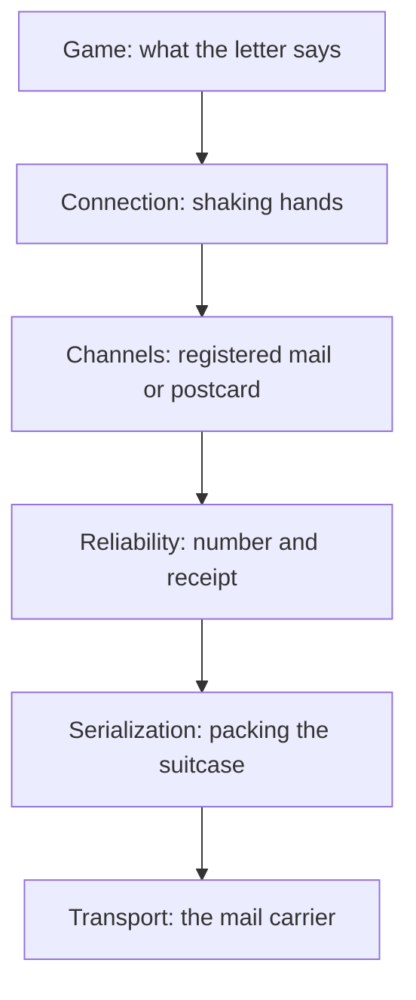

# 10 Playing Together: Kern on the Network

> **Your level:** How can several players roam the same world when the internet loses packets
> and delivers them late? Here you'll learn the tricks Kern uses to hide all that.

> **Words you need:**
> - **Server** – the computer that runs the game and decides what really happens.
> - **Client** – a player who connects to the server.
> - **Datagram** – a single small packet of data, sent off with no guarantee.
> - **Bit** – a single yes or no (1 or 0). **8 bits are 1 byte.**
> - **Ping** – how long a message takes to get there and back, in **ms** (milliseconds,
>   thousandths of a second; 100 ms is 0.1 s).
> - **Salt** – a random number the client sends along when it knocks on the door.
> - **Challenge** – the server's reply with its own random number ("Prove it!").
> - **Slot** – the player number the server gives a client, like an assigned seat.

The internet is like the mail on a bad day: letters arrive late, in the wrong order, twice, or not
at all. A game played by several people has to cope with that. Kern has its own networking system
for it. Its top part turns **any level into a multiplayer game**, without you having to prepare
anything in the level (10.7).

Kern needs just one thing from the connection: sending and receiving datagrams. Everything else –
order, receipts, handshake – it builds on top by itself. That's why it runs everywhere: between
tabs, between computers, and even with no real network at all, in the memory of a single program.

> **For pros:** Kern's networking follows Glenn Fiedler's articles ("Gaffer On Games") and the
> design of his libraries yojimbo, reliable.io and netcode.io.

---

## 10.1 The Layers

The network is built like a stack. Each layer solves exactly **one** problem and relies on the
layer below it. Think of it as the mail service:

In the diagram the game is at the top and the mail carrier at the bottom. The following sections
walk through the stack from the bottom up, so in the diagram from the lowest layer upward.

---

## 10.2 Serialization: Packing the Suitcase

**Serialization** means turning numbers and text into a row of bits so they fit into a packet –
and unpacking them again on the other side. The tighter you pack, the more fits in. Just like a
suitcase: roll your T-shirts instead of folding them.

The trick: a number whose range you know only gets as many bits as it needs. Each extra bit
doubles the number of possible values:

| Bits | possible values | enough for |
|---|---|---|
| 1 | 2 | yes or no |
| 4 | 2⁴ = 16 | 0 to 15 |
| 8 | 2⁸ = 256 | 0 to 255 |
| 32 | over 4 billion | any normal whole number |

Inside a computer, normal whole numbers get 32 bits, no matter how small they happen to be – that
way there's room for any number. Kern is more frugal:

**Example:** The player number (the slot) lies between 0 and 254. That's 255 values, and 256 is
enough. So it needs **8 bits** instead of 32 – a quarter of the space.

Kern describes each packet **just once**. The same description packs, unpacks, and counts the
bits in advance, so Kern knows whether everything fits into one packet. Sender and receiver use
the same packing list, so they can never disagree about where each number sits.

**The receiver is suspicious.** When unpacking, Kern checks everything: if a number is outside its
range, the packet is too short or a length is wrong, the packet gets thrown away. That way a broken
or forged packet can never crash the game.

> **Crazy but true:** Positions travel with **1 mm** precision, in a range from −8192 m to
> +8192 m. That's 16,384,000 millimeter steps, and 2²⁴ = 16,777,216 is enough: 24 bits per
> coordinate instead of 32. So Kern rounds the decimal number to a millimeter grid.

> **For pros:** Kern stores a rotation as a quaternion, which is four numbers
> ([Chapter 3](03-foundations.md)). Their squares add up to exactly 1. That's why Kern can leave
> out the largest of the four and work it out from the other three when unpacking ("smallest
> three").

---

## 10.3 Reliability: Numbers and Receipts

A packet on its own doesn't know whether it arrived. That's why each one carries a **number**,
and every packet going the other way carries a **receipt**: "I already have this one."

> **Picture it like this:** In the class chat you write: "Read up to message 500, and of the 32
> before it I'm only missing 497 and 490." A single reply gives information about 33 messages at
> once: 31 arrived, 2 are missing.

That's exactly how Kern does it: the receipt names the newest number that arrived, plus one
yes/no bit for each of the 32 before it. If a number says "no," the sender knows: this packet got
lost on the way. If a receipt gets lost, no problem – the next one contains the same information
again.

**Sending never waits.** You could do it differently: after every letter, wait until the receipt
is there, and only then send the next one. On a bad network everything would grind to a halt.
Kern just keeps sending, right away, and only remembers what was confirmed. Whether something
lost gets sent again is not decided by this layer itself. The layer above does that, because some
things aren't worth sending again at all (10.4). Packets that are too big get split into pieces
and put back together at the receiver – like moving house in several boxes.

Along the way, Kern measures three values: the **ping**, the **loss** (what percentage of packets
don't arrive) and the **bandwidth** (how much data per second goes through the line). The values
are **smoothed**: each new measurement counts only a little, so a single outlier doesn't make the
display jump.

> **Crazy but true:** The number has 16 bits, so it only goes up to 65,535. After that it starts
> again at 0, like an odometer that rolls over. Kern handles that fine: number 2 counts as newer
> than 65,530, because it's only a few steps "past zero."

> **For pros:** The header of a packet – its number and the whole receipt – is squeezed into at
> most 9 bytes, and anything bigger than 1024 bytes gets split. The exact names and values are in
> the blue book, Chapter 10.

---

## 10.4 Channels: Registered Mail or Postcard

Not every message is equally important. That's why there are two **channels**:

- **Registered mail** (reliable and ordered): every message arrives **exactly once** and **in the
  right order**. If the receipt is missing, Kern sends it again until it's confirmed. Big messages
  travel in pieces, one after another.
- **Postcard** (unreliable): the message rides along once with the next packet. If it gets lost,
  it's simply gone.

How does registered mail manage "exactly once and in order"? With numbers again. Every registered
message has its own number. If a number arrives a second time, the receiver throws it away. If
number 8 arrives while 7 is still missing, it puts 8 aside and only hands it to the game once 7 is
there – like chapters of a serialized story that you only read once the gap is filled.

And when does a message count as lost? Kern waits about as long as a packet takes there and back,
so roughly one ping (but never shorter than a fixed minimum time). If no receipt has come by then,
it sends the message again. Any earlier would be pointless, because the receipt could still be on
its way.

Why postcards at all? Because some things are **worthless when late**. Where your friend's car was
half a second ago doesn't interest anyone anymore – the next packet already brings the new
position. If Kern sent the old one again, it would arrive too late and just clog up space. That's
why positions, inputs, sounds and effects travel by postcard, and things like "pickup collected"
by registered mail.

---

## 10.5 Connection: the Handshake

Before anyone plays, client and server have to be sure that they're really talking to each other –
and not to a stranger, a forger, or a completely different game. That's what the **handshake** is
for.

> **Picture it like this:** The verification code by text message. You sign up somewhere with your
> phone number, and the service sends a code to exactly that number. Only someone who actually has
> the phone in hand can type in the code. If you give someone else's number, you never see the
> code.

1. The client sends a request with a random number, the **salt**. Every packet carries the address
   it comes from, like a return address.
2. The server answers with a **challenge** that carries its own random number – and sends it to
   exactly that return address.
3. The client mixes both numbers and sends the result back.
4. If it's correct and comes from the same address, the client gets a **slot** (its player
   number), and the mixed result becomes the **connection number**. From now on it's on every
   packet.

Why do forgers stay out? If you write someone else's return address on your request, your
challenge lands at that other address. The forger never gets to see the server's number, so they
can't mix it and can't answer correctly. The numbers aren't secrets to keep – what matters is that
the reply only arrives at the real address.

Kern ignores packets with the wrong connection number or from strangers. If the server is full,
the client gets turned away. So that a connection isn't declared dead by mistake, packets keep
going back and forth even when there's nothing to say – they're **signs of life**; if nothing at
all comes for a while, the connection is cut.

One special thing: the client's request is **deliberately padded**, to 1000 bytes – much bigger
than the server's answer. Why? Otherwise someone could use small, forged requests to get the
server to send lots of big answers to someone else – like ordering pizzas in another person's
name. This way you never get back more than you sent.

> **For pros:** "Mixing" here means XOR: compare bit by bit, the same gives 0, different gives 1.
> 1010 and 0110 become 1100. With no packets, it's over after 6 s.

### The Checksum

Every packet starts with a **checksum** (technical name CRC32): a number calculated from the whole
content and a fixed game ID of Kern. The receiver does the math again. If it doesn't match, the
packet is broken, from a different game or from a different Kern version – and it gets kicked out
before it's even unpacked.

> **Picture it like this:** The barcode at the supermarket checkout. Its last digit is calculated
> from the others. If the scanner misreads a digit, the math doesn't work out, and the register
> doesn't beep – it asks for another try.

---

## 10.6 Transports: the Swappable Mail Carrier

Since Kern needs nothing from the transport except "packet over, packet back," the mail carrier
can be swapped. There are two:

- a **network in memory**: server and clients run in the same program and hand the packets
  directly to each other. The tests use it, and so does Studio when two of you play on one
  computer.
- a **hand-off tray for the browser**: Kern puts packets into it, and the web page actually sends
  them (10.10).

Both contain a **simulator** for bad internet. It can delay packets, make the delay wobble (that's
called **jitter**), lose packets and deliver them twice.

The special part: a bad network is **exactly equally bad** every time. Randomness in a computer is
actually a calculated sequence of numbers that begins with a **seed**. Same seed, same sequence –
like a die that always rolls the same numbers. That's why the same packets get lost in every test
run, and a bug can be repeated as often as needed until it's found.

---

## 10.7 NetGame: One Game, Many Players

> **Picture it like this:** A soccer game with a referee. The players shout what they want to do,
> but only the referee decides what really happens – and everyone goes by the referee.

In Kern, the **server** is the referee. That's called **authoritative**: only the server
calculates physics, rules, pickups, triggers and logic.

- Everyone who joins gets a **pawn**: a copy of the level's player character that belongs to them.
- 30 times a second, the server sends each client a **snapshot**, a photo of the world: the HUD
  and the position of everything that can move. With the Soldier game model it also contains the
  health and ammo of your own soldier.
- The client plays a **replica**, a copy: the same level, but without its own physics and without
  logic. All moving things there are like puppets (kinematic, see [Chapter 6](06-physics.md)):
  they only move to where the photos put them. Only the city traffic drives on each player's own
  machine, because it's pure decoration.
- The client sends only its **input**: movement, jump, boost, look direction, fire, aim, reload,
  crouch, use.
- It deliberately shows the world about **0.1 s in the past**. The section "Clock and in-between
  frames" explains why.

Whatever **has to arrive** goes by registered mail: the welcome, "player joins" and "player
leaves," "pickup is gone," and everything logic has changed. Sounds and shots go by postcard.

Both need **the same level**. That's why the welcome contains a checksum of the level; if the
server is playing a different one, the client is turned away. Anyone who joins later gets, after
the welcome, all pawns, all changes made by logic, and the list of collected pickups. That way
even a latecomer sees the same world.

**No jump gets lost.** Inputs travel by postcard, and postcards sometimes get lost. That's why the
client always sends its **last four** inputs along. Jump and fire count if they're in **any** of
them. If a packet gets lost, your jump is simply in the next one. Each input carries a number. The
server only takes the newest one per client; if an older one arrives late or the same one arrives
twice, it throws it away. That way your character never runs backward in time.

> **For pros:** When you shoot, your world already looked a bit older than the server's. That's
> why, to check hits, the server turns back time by about half the ping plus the 0.1 s delay (at
> most 0.5 s). That's called **lag compensation** ([Chapter 8](08-game-runtime.md)). An online
> game normally takes up to 8 guests, plus the host; in Studio on a single computer you test with
> up to 4 players (10.8). The exact names and values are in the blue book, Chapter 10.

### The Priority Pot

A snapshot has to fit into **one** packet. With lots of things, that's not enough room. Who gets
to come along?

> **Picture it like this:** A waiting room with points. Every round, everyone gets points, and
> whoever is urgent gets a lot. Whoever has the most gets called – and then starts again at 0.

For each client, every thing has a pot of points. Per snapshot it gets:

- **+10** if the thing has moved since it was last sent (or has never been sent),
- **+0.25** if it's standing still.

Your **own pawn** always comes along first. Then everything is sorted by points and packed until
the packet is full. Whoever comes along drops to 0.

**Example:** A moving car has 10 points after one snapshot. A resting crate needs
10 ÷ 0.25 = **40 snapshots** for that. So moving things get their turn all the time, resting ones
rarely – but never not at all.

### Clock and In-Between Frames

> **Picture it like this:** A flip book with some pages missing. Kern doesn't flip to the newest
> page, but to one a little behind it. That way it almost always has a page before and a page
> after – and draws the pictures in between itself.

Snapshots only come 30 times a second, and some get lost. If the client always showed the newest
photo, everything would stutter. That's why it shows the world 0.1 s in the past. Then there are
almost always **two** known photos around the time being shown, and it calculates in between.
That's called **interpolating**.

**Example:**

| Time | What the client knows | What it shows |
|---|---|---|
| 1.00 s | photo A: car at x = 10 m | – |
| 1.05 s | exactly halfway | x = 11 m |
| 1.10 s | photo B: car at x = 12 m | – |

If nothing new arrives, it keeps calculating the last movement for a short moment and then stops
the thing.

One question remains: 0.1 s before **what** time? Each photo carries the server's time. For the
client to know which photos belong to "server time now minus 0.1 s," it has to know the **server's
clock** – its own clock runs differently.

To do that, it compares the time on each photo with its own clock at the moment it arrives. But
every photo was on the way for a while, sometimes shorter, sometimes longer. A photo that dawdled
for a long time carries a rather old time. Going by that photo, it looks as if the server clock
were further **behind**.

Here Kern deliberately plays it safe: if a photo says "the server clock is further behind than I
thought," the client accepts that **quickly**. If one says "it's further ahead," the client
believes it only **very slowly**. So its estimate follows the **most delayed** packets. Why?
**Better to show a bit too far in the past than too far ahead.** Then there's almost always a
photo *after* the time being shown, and the client doesn't have to guess what happens next – even
when the delay wobbles a lot.

> **Picture it like this:** A live stream with a buffer. It runs a few seconds behind the real
> action. In return, the next piece is always already loaded, and nothing freezes. A stream that
> sticks right at the live edge stutters at the tiniest wobble in the network.

> **For pros:** In numbers: a sample that says "further behind" pulls the estimate 20% of the way,
> a sample that says "further ahead" only 2%. The client may keep calculating without new data
> for at most a quarter of a second. The exact names and values are in the blue book, Chapter 10.

---

## 10.8 Multiplayer in Studio

In Studio you can test with several players on your own, on one computer.
**Play › Number of Players**, 1 to 4, turns your world into a **listen server**, a server that
plays along itself. Every additional player is a real client with its own world and its own
viewport, connected through the network in memory (10.6). If only one viewport was open, Studio
switches to four: Viewport 1 is the server, Viewport 2 the first client, each with its own HUD.
Only the **active viewport** gets your input; the other players stand still. The status line shows
role, players, ping, loss and bandwidth.

With **Play › Network Emulation** you make the connection worse on purpose:

| Level | Delay (± jitter) | Loss |
|---|---|---|
| **Perfect** | 0 | 0 |
| **LAN** | 5 ms (±1) | 0 |
| **Average** | 50 ms (±10) | 1% |
| **Bad** | 150 ms (±40) | 5% |
| **Terrible** | 300 ms (±100) | 20% |

In the menu, delay and loss are part of the name, for example **Average (50 ms, 1% loss)**.

> **Mission:** Open Orb Run in Studio on https://kernengine.de/, set
> **Play › Number of Players** to **2 Players (listen server)** and press **Play**. Click into
> Viewport 2 and drive. Free the mouse with **Shift+F1** (Esc would stop), set
> **Play › Network Emulation** to **Terrible (300 ms, 20% loss)** and keep driving. **What do you
> see?** Ping and loss in the status line shoot up. Watch your car: it reacts to your keys later,
> because every input first has to go to the server and the result back. If it still glides, the
> in-between frames from 10.7 are at work. If it jumps, the gaps were bigger than the 0.1 s
> reserve.

**Online:** With **Play › Host Online Game...** you offer a game, and with **Join Online
Game...** you join one. Both choose the same **Room** – a name under which you meet, like a chat
room (default "kern"). If the **Relay (optional)** field stays empty, only tabs of the same
browser find each other; for different computers you need a relay (10.10). Everyone needs the same
level. If there's no host in the room, Studio reports that a few seconds after you join. **Leave
Online Game** ends the session, and the host notices when a guest leaves. A host in a background
tab keeps running so its guests don't get kicked out.

> **Mission:** Open Studio in two tabs with the same level. Tab 1: **Host Online Game...**, room
> "kern", **Host**. Tab 2: **Join Online Game...**, same room, **Join**. Both tabs need the same
> level, otherwise the host turns the guest away. **What do you see?** Start driving in tab 2 and
> switch to tab 1: there your car drives along as a second car.

The exact commands for this are in the blue book, Chapter 10.

---

## 10.9 Exported Games on the Network

An exported game ([Chapter 11](11-studio.md)) can play online too. You tell it so through its
**address**: after the file name comes a question mark and an extra part.

**Example:** `mygame.html` becomes `mygame.html?host=class7b`. This game offers the room
"class7b." A friend opens `mygame.html?join=class7b` and joins. For different computers you also
add `&relay=` and the relay's address. Without a room name, "kern" is used.

If the connection doesn't work, the game simply starts on its own.

---

## 10.10 The Mail Carrier in the Browser: KernNet and the Relay

Many games send their packets over **UDP**, the internet's "postcard mail": fast, but with no
guarantee. Web pages can't send UDP. That's why Studio has its own little messenger, **KernNet**.
It only carries packets back and forth – numbers, receipts and handshake are still handled by
Kern's networking system. KernNet has two routes:

- **In the same browser**, tabs talk to each other directly, over a **broadcast channel** that all
  tabs of this browser listen to. No server is needed for that.
- **Between computers** you need a **relay**: a small program on a computer on the network. Each
  browser keeps a permanent line open to it. The relay gives everyone a number, takes packets and
  delivers them to the right receiver.

> **Picture it like this:** The relay is a mail carrier who never opens letters. It has no game
> logic of its own. Whether a packet is genuine, the receivers check themselves – with the
> checksum and the connection number from the handshake (10.5).

The relay throws away packets that are too big or addressed to strangers. When the host leaves,
the room is closed to new guests.

> **For pros:** In the browser, the broadcast channel is called **BroadcastChannel**, and the
> permanent line **WebSocket**. The relay is a Node program (Node runs JavaScript outside the
> browser) from Kern's repository. Start it together with an adult or your teacher. Then you
> enter an address starting with ws:// in the **Relay (optional)** field. Command, port and all
> error messages are in the blue book, Chapter 10.

---

## 10.11 What Runs Where

| Task | Server | Client |
|---|---|---|
| Physics, rules, logic | calculates | gets the results |
| Shots, hits | calculates, turns back time | displays them |
| Sounds | creates | plays |
| City traffic | simulates | drives it itself, as decoration |
| Camera, input | local | local, input goes to the server |

In short: **The server decides; the client displays and sends keys.**

---

## 10.12 Tests

Kern checks its networking automatically, on every test run: the packing, the receipts, the
channels, the handshake (including hundreds of junk packets), games on the network, the soldier,
logic changes and multiplayer in Studio. Thanks to the fixed seed (10.6), every run is the same.

> **Crazy but true:** In the stress test, 25% of packets get lost, the delay wobbles between 30
> and 90 ms, and 10% arrive twice – and still every registered message arrives complete and in
> the right order.

> **Mission:** Play with two players in Studio, once with the network emulation **Perfect**, once
> with **Bad (150 ms, 5% loss)**. How do ping and loss change in the status line? And do you
> notice a difference while driving? If hardly at all: then the in-between frames and the 0.1 s
> reserve did their job.

---

## Level complete!

- You know why Kern packs data tightly and unpacks every packet suspiciously.
- You know numbers and receipts, registered mail and postcards.
- You understand how the handshake locks out strangers and what the checksum is for.
- You know why only the server decides and what a snapshot is.
- You can explain how the priority pot and the in-between frames work – and why the client would
  rather estimate the server clock too late than too early.
- You test in Studio with several players and a bad network.

## Puzzle corner

1. Which channel fits "pickup collected"?
2. How many bits does a number from 0 to 15 need?
3. Why does the client deliberately show the past?
4. **Boss puzzle:** Crate and car have both been sent before and are at 0 points. Now the crate is
   resting, the car is driving, and exactly one thing fits per snapshot (not counting your pawn).
   Which one gets sent, and what points are left?

### Solutions

1. **Registered mail** – the pickup has to disappear for everyone, even if a packet gets lost.
2. **4 bits**: 16 values, and 2⁴ = 16.
3. That way it almost always has two snapshots to calculate between. The picture stays smooth,
   even if a packet is missing.
4. Car 10, crate 0.25: the **car** gets sent and drops to 0; the crate keeps **0.25**.

---

© 2026 Christian Heinrich Hohlfeld · All rights reserved · [Imprint and rights](00-imprint.md)
