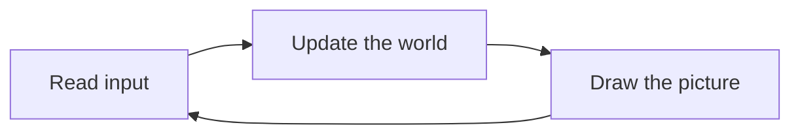

# 12 Your Own Game

> **Your level:** Now you build a whole game – with a player character, obstacles, orbs, danger,
> logic and sound – and send it off as one file. After that you look over the pros' shoulders and
> get to know the most important principle of every game: the game loop.

> **Words you need:**
>
> - *Engine* – the ready-made framework that draws, calculates physics and plays sounds; your game
>   uses it.
> - **Trigger** – an invisible zone that sets something off as soon as someone walks into it.
> - **Frame** – a single picture of the game, like one page of a flip book.
> - **dt** – the time since the last frame, in seconds.
> - **Compiler** – a translator that turns program text into a program for the computer.
> - **Module** – the translated game file that the browser loads and runs.
> - **Web server** – a program that delivers files the way a website does.

Kern offers **three ways** to your own game. All three use the same engine, so the same graphics
and the same physics:

| Way | With what | For whom |
|---|---|---|
| **A** Studio | clicking and dragging, no code | for you – the whole game in this chapter |
| **B** C++ | programming in the language Kern itself is written in | pros with their own game idea |
| **C** JavaScript | programming in the language of web pages | pros with their own website |

You'll rebuild way A completely here. B and C are for a taste: you'll learn how a programmed game
ticks inside, without having to program yourself.

---

## 12.1 Way A: Orb Garden, a Game Without Code

We're building a collecting game: a character runs across an area with obstacles, collects orbs,
dodges a hazard, and wins when everything is collected. Studio's windows are explained in
[Chapter 11](11-studio.md).

### Step 1: A New Level

**File › New Level...**, template **Basic**, then **Create** – with ground (40 × 40 m), sun, sky
and a cube. In the **World Settings** you set **Level name** and **Game title** to "Orb Garden."
Why not the **Empty** template? There isn't even ground there.

### Step 2: The Player Character

Open the **Content Drawer** (key **Ctrl+Space**) and drag a **Character** from **Players** into the
viewport. Studio reports that "Character" is now the player, and in the Outliner the actor wears the
badge **PLAYER**. In **Details › Player Controller** you set how fast the character runs, how
quickly it gets going and how high it jumps. In the **Camera** field you choose the view: **Chase**,
**First person** or **Top down**. Then **Play**, key Alt+P: W A S D runs, Space jumps, **Esc**
takes you back. The player is the character placed last, or the one chosen with right-click ›
**Make Player (control it in Play)**.

> **Mission:** Rebuild steps 1 and 2. Play once with **Top down** and once with **First person**.
> Which view fits a collecting game better?

### Step 3: Obstacles and Physics

Three kinds of things bring a level to life: some stand still, some react to physics, and some move
by themselves.

1. **Fixed:** From **Shapes**, place a few **Cube**s, a **Ramp** and a **Plane**, and adjust them
   with **W**, **E**, **R**; the grid (0.5 m) keeps the edges clean, and **End** drops things onto
   the ground.
2. **With physics:** From **Physics**, a **Crate Stack** and a **Hinged Door** – they react to your
   character.
3. **By themselves:** From **Gameplay**, a **Moving Platform** and a **Spinner**.
4. Check with **Simulate**, key Alt+S, and grab and throw crates. **K** keeps the position of the
   selected crates in the level – handy for a stack that should look like it fell over naturally.
   To do that, select the individual crates while simulating (click, Shift+click for more), not the
   whole stack.

> **Watch out, trap:** A **Cube** from **Shapes** has collision but doesn't fall. Give it a body
> with **Add › Rigid Body** and set **Mobility** to **Dynamic (simulate physics)** – that means: it
> falls and can be pushed. Or just take a **Physics Cube** from **Physics** right away
> ([Chapter 6](06-physics.md)).

### Step 4: Something to Collect

From **Gameplay**, scatter several **Orb**s (1 point) and one **Star** (10 points); with **Alt +
dragging the gizmo** you copy quickly. Select all orbs and put them in a folder with the folder
button in the Outliner. Then set **World Settings › Win condition** to **Collect all pickups**.

### Step 5: Hazard, Checkpoint and Time Limit

Now your game gets exciting. **Gameplay** has two building blocks that harm the character, and
they work differently:

- A **Hazard** ends the round immediately: the game is **lost**. A checkpoint doesn't help there.
- A **Damage Zone** takes health away from the character. That only works on characters that have
  health: give your character some with **Add › Health**. When it runs out, the character reappears
  after a short moment – at the last **checkpoint** if it touched one, otherwise at the start.

You pull both to the size you want with the scale gizmo (**R**). A **Checkpoint** remembers where
the character restarts. That also applies when it falls below the height in **Kill Z (respawn
below)** – below that, a character counts as having fallen off (World Settings). If you like, set
**Time limit (0 = none)**; the HUD counts down. Other win conditions: **Reach a goal trigger** –
which needs a **Goal** –, **Survive the time limit** and **Reach a target score**.

> **Mission:** Build steps 3 to 5 with a 60-second time limit. Too easy? Put the **Star** on the
> **Moving Platform**.

### Step 6: Logic Without Programming

Logic means: "When this happens, do that." Instead of programming it, you plug it together from
ready-made boxes ([Chapter 9](09-logic.md)).

The goal: a zone that does nothing by itself but only tells your logic when someone walks into it –
and does so every time. What happens then is decided by the logic alone.

1. From **Gameplay**, place a **Message Trigger**. In **Details › Trigger** you set three things for
   this: **Action** to **Logic event only** – the trigger does nothing of its own; empty the
   **Message** field – it shows no text; and switch off **Only once** – it reports every time
   someone enters.
2. In **Details**, click **Logic**; the logic editor opens this actor's graph. The logic editor is
   labeled in English even in the German Studio.
3. **Templates › Score zone (overlap +10)**: entering gives 10 points, "+10" and a sound.
4. **Compile** (F7): Studio checks your plan for errors. **Viewport** takes you back.

More templates: a door that opens when the character stands in front of it and presses **F**
(**Interact**), a spawner, a traffic light, and a behavior for the Micro Duck.

> **Watch out, trap:** A graph with errors doesn't stop **Play** – Kern just switches that graph
> off. If nothing happens in your zone, look in the **Output Log**.

### Step 7: Sound

In **World Settings › Audio**, choose a **Music** and an **Ambience**. From **Audio** in the Content
Drawer, place something like **Ambient Wind**, or import your own file in the **Sounds** tab and
drag it into the viewport. Characters, pickups and triggers already bring their own sounds
([Chapter 7](07-audio.md)).

### Steps 8 to 10: Testing, Saving, Exporting

- **Play** tests, **F8** lets go of the character and takes it over again.
  **Play › Number of Players › 2 Players (listen server)** tests with two players. Errors in the
  level, such as a joint to a deleted actor, prevent playing and show up in the **Output Log**.
- **Ctrl+S** saves a level file including textures and sounds, which you can pass on and open in
  any Studio. Studio also keeps anything unsaved in the browser.
- **File › Package Game (HTML)...**, check the title, **Package**: Studio downloads an HTML file
  with your game's name and offers **Play it** in the message.

This one file contains everything: the engine, your level and the program that plays it. It runs
without internet, with a double-click, from any website, and on a phone with touch sticks.


> **Mission:** Export Orb Garden, click **Play it** in the message and play a round. Then open the
> file on a phone or tablet (it's fine to get help with the transfer): the touch sticks appear by
> themselves.

---

## 12.2 Way B: a Game in C++

In way B, you write the game as program text. The engine calls this program at every moment, asks
"What now?", and then draws the result. A little helper, the platform layer, takes care of the
browser (12.3).

> **Picture it like this:** The engine is the field and the scoreboard, your program is the team.
> Every moment it's "your turn" – the team makes its move, and the scoreboard shows it.

### The Game Loop

A game is a flip book. Each single picture is called a **frame**, and it looks smooth from about
30 frames per second. For every frame, the same round runs:



1. **Input:** Which keys are pressed, where's the mouse, where are the fingers?
2. **Calculate:** Move the character, check collisions, count points.
3. **Draw:** The engine draws the new state.

On top of that come two special cases: setting everything up **once at the start** (shapes, light,
camera) and cleaning up **once at the end**. A C++ game fills exactly these spots: setup, the round
for every frame, and cleanup.

One detail is important: Kern knows two questions to ask about a key. "Was it **just now**
pressed?" – that's only true for the one frame in which you press it down, good for a single jump.
And "Is it being **held**?" – that's true in every frame as long as your finger is on it, good for
running or turning. Because both change from frame to frame, the game asks again every round
instead of keeping an old answer.

### The Most Important Principle: dt

Not every computer manages the same number of frames per second. If a character moved a fixed
amount per frame, it would be faster on a fast computer than on a slow one. That's why the game
gets **dt** every round: the time since the last frame, in seconds. Movement is always multiplied
by dt.

That's how it's written in the smallest Kern game, "hello" (64 crates you can circle the camera
around):

```cpp
if (in.down(Key::left)) yaw_ += frame.dt * 1.5f;
if (in.down(Key::right)) yaw_ -= frame.dt * 1.5f;
```

- `in.down(…)` is the question "Is the key being held?"
- `yaw_` is the name of a variable, meaning a box that holds the rotation angle. The underscore is
  simply part of the name.
- `1.5f` is the number 1.5. The `f` just tells the computer: a decimal number.
- Line 1: If you hold ←, the rotation angle grows by dt × 1.5 (`+=` means "increase by").
- Line 2: With →, it shrinks by the same amount (`-=` means "decrease by").

**Do the math:** At 60 frames per second, dt = 1 ÷ 60. Each frame adds 1.5 ÷ 60 = 0.025, so after
60 frames that's 1.5. At 30 frames, dt = 1 ÷ 30, each frame adds 0.05, and after 30 frames it's
30 × 0.05 = 1.5. **Same speed – no matter how quick your computer is.** Here 1.5 is an angle in
radians ([Chapter 3](03-foundations.md)) and means just under a quarter turn per second.

dt has an upper limit: at most 0.1 s. If the computer freezes for a whole second once, the game
still only calculates on with 0.1 s. Without this limit, the character would leap meters ahead
after the freeze – maybe right through a wall.

In hello you can also click a crate, and it turns red. How a game knows what you're clicking on you
know from [Chapter 5](05-scene-and-geometry.md): it shoots a ray through the point under the mouse
and looks at what it hits.

> **Crazy but true:** The 64 crates in hello are **one** shape with 64 copies. Each copy only has
> its own position, rotation, size and color. The graphics card draws them all with **one** draw
> command – much faster than 64 separate ones.

### From Text to Game: Modules

A browser can't read C++ directly. A **compiler** turns the program text into a file that the
browser can run. This file is called a **module** (in WebAssembly format). When compiling, you
choose which parts of the engine go in: graphics is always included; physics, levels or Studio
only come in when you want them – like a building kit where you only take what the game needs.

How to build Kern on your own computer is shown in [Chapter 2](02-building-and-testing.md). The
exact names and values are in the blue book, Chapter 12.

### A Whole Game: orbrun

The second example is called **orbrun** and is a racing game: a hover car collects 24 orbs in a
random city while night falls.

> **Watch out, trap:** That sounds exactly like the **Orb Run** level from Studio – but it's a
> different program. Orb Run in Studio is built from actors and components and uses the physics
> engine. orbrun here is the same game idea, but programmed by hand in C++, with its own driving
> physics and its own collision. So the same idea can be plugged together from building blocks or
> written yourself.

Every round of the game loop, orbrun reads the input, drives, moves the traffic, collects orbs,
sets up light and camera, and sends whatever changed to the graphics card. Two ideas from it are
worth knowing:

- **Collision without a physics engine:** For the calculation, the car is just a circle. If the
  circle is stuck in a building, the game pushes it out and makes the car bounce off the wall.
- **Not slipping through walls:** With boost, the car covers a big distance in one frame. In one
  frame still in front of the wall, in the next already behind it – and the collision would never
  happen. That's why it moves in small sub-steps of at most 0.6 m and checks each one.

**Do the math:** With boost, the car goes at most 60 m/s, which is 60 × 3.6 = **216 km/h**. At 30
frames per second, that's 2 m per frame – more than three times as much as one sub-step.

One more idea: at night, the headlight shines in front of the car, and every orb has its own light.
But the engine can only draw **six** such point lights at once. That's why orbrun collects all the
light requests and gives the engine only the six most important ones – more requests than room, so
priorities decide, like with the priority pot in [Chapter 10](10-networking.md).

> **For pros:** At night the buildings get glowing windows, even though the engine knows nothing
> about windows. For that, the game attaches a small extra program to the graphics card's drawing
> program (a **shader**), without changing the engine ([Chapter 4](04-graphics.md)).

---

## 12.3 The Platform Layer

Between engine and browser sits a little helper in JavaScript, the **platform layer**. It only does
what a browser allows exclusively in JavaScript: it loads the module, keeps the drawing area the
right size, passes on keys, mouse and fingers, and calls the game loop for every frame.

> **Picture it like this:** The game is the cartridge, the platform layer the console with the
> controller port and the TV cable. The same cartridge runs on every console.

It takes care of a few things so the game doesn't have to think about them: arrow keys don't scroll
the page away. If you switch windows, it releases all keys so none gets "stuck." And if the
graphics card crashes for a moment, it rebuilds everything. The exact names and values are in the
blue book, Chapter 12.

---

## 12.4 Way C: from JavaScript

In way C, you write your own web page in JavaScript and let Kern do only certain jobs. There are
three options:

- **Just let it draw:** The game rules are in JavaScript, Kern draws. That's how SpawnCity works,
  for example, a drone game by the author that runs in the browser.
- **Embed a Studio level:** A page of your own plays a level from Studio and can control it – for
  example with your own on-screen buttons that make the character run and jump, or with your own
  victory screen.
- **Logic graphs as C++:** The **C++** button in the logic editor turns your graph into program
  text. Normally, the graph is only read out or translated during play, like a book that an
  interpreter reads aloud sentence by sentence or translates just before. Built in as C++, the
  translation comes ready-made – with exactly the same result ([Chapter 9](09-logic.md)).

The exact names and values are in the blue book, Chapter 12, and in [Chapter 17](17-reference.md).

---

## 12.5 Hosting

An exported Studio game is one single file. A C++ game consists of several: a web page, the module
and the platform layer. The page **loads** the module and the platform layer **afterward**, and for
security reasons a browser only allows that through a **web server** – not when you open the file
with a double-click. A web server is a program that delivers files the way a website does; for your
own computer, a very simple one is enough.

> **Picture it like this:** The exported Studio game is a ready-made packed lunch in a box. The C++
> game is cooking in the school kitchen – you need the kitchen for it.

---

## 12.6 Publishing

**The rules, made simple:** Kern is open source, so it's free to use.

| You may | You may not |
|---|---|
| pass on your own games and even sell them | call your game "Kern" |
| write "Made with Kern" on it | remove the license notices |
| keep your own code secret | sell the duck's look |

With the game you also pass on Kern itself, and that comes with a notice about Kern's license. For
an exported Studio game you don't have to do anything: Studio already writes the notice invisibly
into the file during export, right at the top. You just mustn't delete it. Parts made by others
keep their own rules ([Appendix D](D-licences.md)).

**Micro Duck exception:** The duck's look comes from Pollen Robotics and may **only be used
non-commercially**, so not in a game that earns money. For a game to sell, there's a special build
of Studio without this look (pros build it from the source code). In it, the duck has **no look at
all** – you'd have to give it one of your own. Pollen's networks may come along. If you pass on a
game with the duck for free, the notice about Pollen Robotics and its license is already in the
file – don't delete it, and name Pollen Robotics when you show pictures of your duck.

**Studio games** you put online only together with an adult – on web space or a free project page
– or you simply send the file. With the duck, two folders with its networks belong next to it,
otherwise it can only walk ([Chapter 11](11-studio.md)). How to play together online is in
[Chapter 10](10-networking.md).

**C++ games** go onto a web server with all their files. Kern itself does this automatically: with
every change, an automatic system rebuilds Studio and the examples and puts everything on
https://kernengine.de/. The source code is at https://github.com/ChristianHohlfeld/kernengine.de.

| Checklist | Studio game | C++ game |
|---|---|---|
| no errors | **Output Log** | the browser's error display |
| phone | sticks appear by themselves | handle touch yourself |
| sound | after the first click | up to the game |
| files | one HTML (plus duck folders) | page, module, platform layer |
| delivery | anywhere, even as a file | web server |

Why "sound after the first click"? Browsers only play sound once you've clicked, tapped or pressed
a key – so that no page starts blaring at you without asking.

> **Mission:** Go through the checklist for Orb Garden: log without errors? Does it run on a phone?
> Music after the first tap? Then: publish – together with an adult!

---

## Level complete!

- You know the three ways to a Kern game.
- You built, saved and exported a collecting game in ten steps.
- You know what makes **Hazard**, **Damage Zone** and **Checkpoint** different.
- You know the game loop: input, calculate, draw – in every frame.
- You know why games calculate with dt and why fast things move in sub-steps.
- You know the rules for passing games on and selling them.

## Puzzle corner

1. Why is the **Basic** template a better start than **Empty**?
2. Your cube from **Shapes** doesn't fall. What's missing?
3. Your character walks into a **Damage Zone** and has no health left afterward. Where does it
   reappear? And what happens instead with a **Hazard**?
4. Why does the exported Studio game run with a double-click, but the C++ game doesn't?
5. **Boss puzzle:** A game does "change x by 5 · dt" in every frame. Computer A manages 50 frames
   per second, B 25. How far does the character get in 2 seconds? And with "change x by 0.1"
   without dt?

### Solutions

1. **Empty** has no ground – the character would fall into nothing.
2. A **Rigid Body** with **Mobility** set to **Dynamic (simulate physics)** – or a **Physics Cube**
   right away.
3. At the last **checkpoint** it touched (without a checkpoint, at the start). A **Hazard**, on the
   other hand, ends the round: the game is lost.
4. The Studio game has **everything in one file**. The C++ game loads the module and platform layer
   afterward, and the browser only allows that through a web server.
5. With dt, both get **10 m** (5 m per second times 2 s). Without dt, A gets 100 × 0.1 = 10 m far,
   B only 50 × 0.1 = **5 m**. That's why games calculate with dt.

---

© 2026 Christian Heinrich Hohlfeld · All rights reserved · [Imprint and rights](00-imprint.md)
