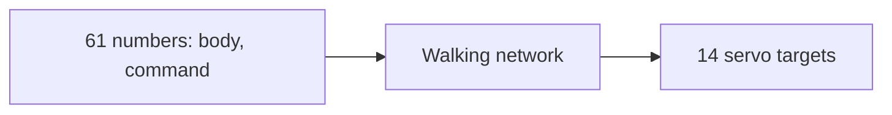

# 13 The Micro Duck – a Real Robot, Servo by Servo

> **Your level:** Now it gets real. The Micro Duck is a walking robot that actually exists, and
> Kern runs, in the browser, exactly the networks that also control the real robot. You'll get to
> know its motors, sensors and networks – and everything the duck can do.

> **Words you need:**
>
> - **Servo** – a small motor that you give an angle, and it then moves there.
> - **Neural network** – a calculation recipe that has learned, through a huge amount of trial and
>   error, to turn measurements into commands, here: motor commands.
> - **Simulation** – a program that calculates a world with its physics instead of building it.
> - **Torque** – how strongly something turns. Like with a wrench: more force or a longer lever
>   turns more strongly.
> - **Inertia** – how hard it is to get something spinning or to stop it again.
> - **Damping** – a brake against fast movement, like honey in a joint.
> - **Noise** – small random errors in a measurement.
> - **World time and robot time** – the clock in Kern's big replica world and the clock of the real
>   robot. They run at different speeds (section 13.3).

The Micro Duck comes from the company **Pollen Robotics**: about 25 cm tall, 0.74 kg heavy, with 14
servos in its legs and neck and a fifteenth for the lower beak.

Pollen didn't teach the duck to walk with rules ("if you tip over, put your foot to the left"), but
with **neural networks**. The networks practiced thousands of times in a physics simulation until
the duck walked. The finished network is a file, and the real robot loads exactly this file too.
What such a network looks like inside is explained in [Appendix A](A-neural-networks.md).

Kern rebuilds the robot on its own physics and runs the same networks. The goal is called
**fidelity**: the same model, the same servos, the same beat. On top of that come three things only
Kern has: the **Lehrer** for training your own networks ([Chapter 14](14-lehrer.md)), a **jump**,
and the **play layer**, which decides what the duck does with the ball and the sock.

> **For pros:** Pollen trains in the MuJoCo simulation; the networks are ONNX files. The servos are
> of the Dynamixel XL330 type. The exact names and values are in the blue book, Chapter 13.

> **Mission:** Open Kern Studio on https://kernengine.de/ and choose
> **File › Example Levels › Micro Duck**. Press **Play** (Alt+P) and watch with the observer camera
> as the duck explores the room. With **F8** you take it over; press F8 again and you're back to
> watching.

## 13.1 Where the Code Lives

In short: **Pollen's files and Kern's own are kept separate**, like two labeled boxes on a shelf.
That way you can always see what comes from whom. The exact folders are in the blue book,
Chapter 13.

## 13.2 The Ground Rule: No Cheating

A trained network only works if the simulation calculates the same physics as in training. That's
why there are fixed rules:

- No helper forces, no holding, no teleporting, no soft cross-fading from one network to another
  (so never two networks each half in control at the same time). The duck stands only through its
  servos and its foot contacts.
- A servo is built only from parts the physics engine already has anyway (section 13.4).
- Time runs in fixed steps. The same inputs give **bit for bit** the same gait, on every device.
  That's called **determinism** ([Chapter 14](14-lehrer.md)).

> **Watch out, trap:** A small invisible support "so it doesn't fall over" sounds harmless. But the
> network would rely on it – and on the real robot there isn't one.

## 13.3 The Model

### Blueprint, Links, Joints

Pollen describes the duck in a blueprint file: which parts there are, how heavy they are and how
they're connected with joints. A tool translates this blueprint into Kern's model and checks along
the way whether everything fits together – names and order of the joints, home pose, structure of
the network. If something doesn't fit, it stops. Better no duck at all than a wrong one.

The duck consists of **16 parts** (links): the body and 15 parts that each hang on a servo joint.
The body has no joint of its own, which is why there are 16 parts but 15 servos:

- **each leg 5 joints:** hip yaw, hip roll, hip pitch, knee, ankle,
- **neck and head 4 joints:** neck pitch, head pitch, head yaw, head roll,
- **the mouth** as the 15th servo.

**Yaw, pitch, roll** are the three directions of turning: shaking your head "no," nodding "yes,"
tilting your head toward your shoulder. The networks control the 14 joints in the legs and neck,
but not the mouth.

Every joint has hard limits and a **home angle** for the home pose. Kern measures angles in
**radians** (rad). Picture a circle and lay its radius as a thread along the edge: the angle that
belongs to this arc is 1 rad, about 57°. A full turn is a little over 6.28 rad.

> **Crazy but true:** The head yaw goes up to almost 3 rad in each direction, about ±170°. The duck
> can almost look backward.

### Masses and Armature

From the blueprint come, for each part, its mass, its **center of mass** (the point where you could
balance the part) and its **inertia**.

Inside the servo, a tiny motor turns through a gearbox: 288 turns of the motor make one turn of the
joint. The fast-spinning motor acts like a little flywheel and makes every movement of the joint
more sluggish. This spinning mass of the motor is called the **armature**. Why does such a tiny
thing matter so much? Because the gear ratio counts twice: if the joint wants to speed up, the
motor has to be accelerated 288 times as hard, and its resistance arrives at the joint amplified
288 times over again through the gearbox. Together that makes 288 × 288 ≈ **83,000**: at the joint,
the motor acts about 83,000 times as sluggish as on its own. That's why it acts much more sluggish
than it looks. Kern's physics knows no gearboxes, so every link gets an imaginary thin disc on its
joint axis that makes it just as sluggish. Not exact, but without it the duck jitters a good three
times as much (section 13.14).

> **For pros:** Why a whole disc and not simply "sluggish only around the axis"? A body that's
> sluggish around just one single axis doesn't exist in reality. The physics engine would gain
> energy out of nothing with it, and the duck would jitter more and more wildly. A thin disc, on the
> other hand, is a real, valid body.

### What Touches the World

For collisions, Kern uses simplified shapes, **convex hulls**: like wrapping paper pulled tight
around a part, with no dents inward. The physics calculates much faster with these than with every
little edge.

Every hull has a **friction**: 0 means slippery as ice, the bigger the grippier. The soles and the
rubber pad in the beak grip well (1), the servo housings are slippery (0, just like in training),
and the shells of body and head are in between (0.5) – so a fallen duck doesn't slide around like
on ice.

The physics normally mixes two materials that touch into one shared value. For some pairs, though,
mixing isn't right. That's why Kern knows **surfaces** with their own measured values: fabric on
fabric, rubber on fabric, and fabric on wood.

**Example from the Micro Duck level:** The wooden floor has friction 1. So the soles (1) grip it
with 1, just like in training. But the sock is made of cotton, and cotton on wood has its own value:
0.4. That's why a sock slides across the same floor the duck stands on safely.

> **For pros:** The physics mixes all other pairs as a geometric mean: the square root of a times
> b. Sole 1 on a floor with 0.6 gives √0.6 ≈ 0.77. The exact values are in the blue book,
> Chapter 13.

### Scale 4

Box3D, Kern's physics engine ([Chapter 6](06-physics.md)), works best with bodies from 10 cm to
10 m. But the duck's links are only 2 to 4 cm in size. That's why Kern builds it **4 times as big**
and converts at exactly one spot. If you let everything grow to match, the big world behaves exactly
like the small one:

- **Length** times 4.
- **Mass** times 64, because a cube with 4 times the edge length holds 4 · 4 · 4 = 64 times as much.
- **Time** times 2. Big things move more leisurely: a ball falls from 1 m high in just under half a
  second, from 4 m in just under a whole one. Four times as high takes only twice as long.

So there are two clocks. **World time** runs in Kern's big world, **robot time** for the real robot.
**1 second of world time is ½ second of robot time.** The network doesn't notice any of this: Kern
converts everything that goes into it into real values first. All figures in this chapter are robot
time and real centimeters too, unless it says "world time."

> **Picture it like this:** When a model house collapses in a movie, it only looks real if it's
> played in slow motion. Kern does it the other way around: it builds big and knows that the big
> world runs slower.

### Look, Roller Skates, Setup

The duck's look comes from Pollen's 3D models and may only be used non-commercially. That's why the
pictures in this book show a design of their own. The catalog also has **Micro Duck (Rollers)**:
runners with two freely spinning wheels each instead of soles.

When you put a duck from the catalog into a level, Studio sets the world's clock to match right
away: a **step rate** of 100 physics steps per second of world time with 16 sub-steps each
([Chapter 6](06-physics.md)), just as the duck's beat requires (section 13.5). It reports what it
changed. From a program of your own it works the same way; the exact names are in the blue book,
Chapter 13.

## 13.4 The Servo Model

For Kern, a servo is a **device model**: a small law that describes how the real device behaves,
plus a **profile** with its measured numbers. The law is simple: the servo pulls the joint toward
the target, the farther away the stronger – but only up to a limit.

> **Picture it like this:** A rubber band between joint and target. The farther away, the stronger
> the pull, up to a limit. The damping is like honey in the joint.

| Number in the profile | what it means |
|---|---|
| **K** stiffness | how strongly it pulls per radian of distance |
| **T** maximum torque | no more torque than this |
| **D** damping | brakes fast movement |
| **F** friction | brakes in the joint |
| **A** armature | flywheel inertia of the motor |
| Delay | commands arrive 20 ms later |

The law in school math: **pull = K · (target − angle)**, but at most T. On top of that, damping D
and friction F brake. Torque is measured in newton meters (N·m). For the duck's servo, K = 0.554 and
T = 0.963 N·m – about as much as a kilogram pushes at the end of a 10 cm lever.

**Worked example:** If the joint is 0.5 rad away from the target, the servo pulls with
0.554 · 0.5 ≈ 0.28 N·m. That's not even a third of its maximum force. It only reaches full force at
0.963 ÷ 0.554 ≈ 1.7 rad of distance, almost 100°. So the duck's servos are **soft**: they give way,
like a rubber band.

Kern builds this law only from parts the physics engine already has: a joint spring for the rubber
band and a joint brake for the friction. There are two reasons for this. First, there's no cheating
(13.2). Second, the physics calculates its built-in spring so that it stays calm at any stiffness.
A homemade spring could start to tremble at very stiff values and build up more and more. One and
the same piece of code does this in every physics step, in Studio, in the Lehrer and on the test
bench from [Chapter 16](16-calibration.md). Every duck, even every single servo, can get a profile
of its own.

> **Watch out, trap:** The software in the real servo can limit the current. Then it only has 0.64
> instead of 0.963 N·m, about two thirds – and the duck can no longer get up off its back. Pollen
> trains without this limit, and so does Kern.

## 13.5 The Beat

Three things run in time, but at different speeds: the physics, the network and the play layer.
The physics calculates in small steps. The network only decides anew every **4 physics steps**;
that's the **control tick**. The play layer only decides on every second control tick.

| What | World time (Kern) | Robot time |
|---|---|---|
| one physics step | 10 ms | 5 ms – as in training |
| control tick = 4 steps | 40 ms | 20 ms, so 50 times per second |
| play layer = 8 steps | 80 ms | 40 ms, so 25 times per second |

Because world time counts twice as fast (section 13.3), 10 ms in Kern's world are exactly the 5 ms
of training. The same clock, counted twice: **100 steps per second of world time** (that's the step
rate in the World Settings) are 200 steps per second of robot time. The **delay** is counted in
steps too: the servos always get the target from 4 steps ago, which is 20 ms of robot time. In
training, the delay was sometimes shorter, sometimes longer; so the network copes well with a fixed
value from that range. If the world's clock doesn't fit the duck, Studio tells you what to set.

How Kern always calculates with steps of the same length despite a wobbly frame rate is explained
in [Chapter 8](08-game-runtime.md): leftover time is saved until it's enough for a whole step.

> **Picture it like this:** The drummer plays in quick beats (physics), the singer comes in on
> every fourth beat (control tick), the choir only on every eighth (play layer).

## 13.6 The Duck's Networks

There's a separate learned network for each movement. Kern loads **the same network files** as the
real robot. The network for walking and standing is built in; Studio loads the others when needed.
Pollen calls this walking and standing network **velstand**. You'll need that name later: Kern's
own jump builds on it ([Chapter 14](14-lehrer.md)).

Kern reads the network files itself. It only accepts exactly the design that Pollen's training
produces and rejects everything else, with a reason. A test compares the built-in walking network
with a precise reference calculation: the results only differ in the fifth decimal place.

| Movement | by whom |
|---|---|
| Walking and standing (velstand, plus an older gait) | Pollen |
| Sit / stand up | Pollen |
| Pick up sock | Pollen |
| Kick left / right | Pollen |
| Roll | Pollen |
| Roller skating, crouching on rollers | Pollen |
| **Jump** | Kern |

The walking network runs all the time. The others are **episodes** with a fixed duration: kick
½ s, roll 1 s (held, it keeps rolling), jump 2 s, sit 2 s, stand up 1 s, pick up just under 3 s.
The beak is a servo without a network.

### Whose Turn It Is

There's only ever one network controlling the legs. Who gets the turn is settled by a fixed **right
of way** – like at an intersection. In every control tick, the same order runs as in Pollen's
control program on the robot:

1. End movements that have run out.
2. Choose a network. Right of way goes to a running movement, then picking up, sitting, roller
   skating, and last walking and standing.
3. Run the network and convert its answer into servo targets.
4. Let the stopwatches keep running: every movement has its own, so Kern knows when it's over.

Every network gets exactly the commands it was trained with. A movement only starts if no other is
running, the duck isn't sitting, and the network is loaded – otherwise Kern says why not. If a
network is missing, **no other one** steps in: the servos hold the home pose, and the duck reports
once which file is missing.

### From Network to Servo Target

The network doesn't answer with finished angles, but with how far each joint should deviate from
its home pose. Servo target = home angle plus the network's answer.

Kern takes the answer **exactly as trained**. Pollen's program on the real robot does it
differently: it weakens the answer to 90% and lets the target follow softly instead of setting it
right away – like a dog on a leash that only slowly catches up. That's fine-tuning for the real
hardware. In the **Details** panel, with **Actions to servo goals** you choose between two entries:

- **As trained (scale 1, no filter)**, the default; in the level it's stored as `training`.
- **As the robot's daemon (scale 0.9, low-pass 0.5 / 0.7)**, so like on the robot; in the level
  it's stored as `robot`. The **daemon** is the control program that runs on the real robot. A
  **low-pass** is a smoother: it only lets the target move up a bit at a time so nothing jerks –
  the leash from the dog picture.

The principle behind it: **A network works best exactly the way it was trained.** Even small
changes can throw it off.

> **Mission:** If the level is running, stop it with **Esc** – nothing can be set while playing.
> Select the actor "Micro Duck" in the Outliner and, in the **Details** panel, set **Actions to
> servo goals** to `robot`, meaning **As the robot's daemon (scale 0.9, low-pass 0.5 / 0.7)**.
> Start **Play**, take over the duck with **F8** and press **3** for the kick. Then the same with
> `training`, meaning **As trained (scale 1, no filter)**. What you should see: with `robot` it
> tips over during the kick, with `training` it stays standing. It can walk with both.

## 13.7 What the Network Sees: 61 In, 14 Out

In every control tick, the walking network gets **61 numbers**, in groups:

- how fast the body is turning,
- where "down" is (that's how it notices whether it's standing crooked),
- the 14 joint angles, measured from the home pose,
- how fast the joints are turning (one tick old, just like in training),
- its own last answer,
- the walk command: forward (up to 0.4 m/s), sideways (up to 0.3 m/s), turning,
- the head command and the body posture (how high the body should be and how tilted).

Out come **14 numbers**: the servo targets for legs and neck. In between, the network calculates
through three layers of hundreds of calculation nodes, the **neurons**
([Appendix A](A-neural-networks.md)).

The walk command doesn't jump to the new value right away, but moves **20%** of the remaining way
closer each tick, just like on the robot. So from 0 to 1 it goes 0.2 – 0.36 – 0.49 … Do the math:
0.2 + 20% of 0.8 = 0.36.

> **For pros:** Why does the network get its last answer back? That way it knows its last command,
> even though the servos only get it 20 ms later. Kern delivers these numbers exactly as in
> training.

## 13.8 Sensors

The duck only sees what the real robot sees, from the same spots.

**Distance sensor (ToF):** "Time of Flight." The sensor sends out light and measures how long it
takes to reach the obstacle and come back – from that follows the distance. It divides its field of
view (45° × 45°) into 8 × 8 zones, reaches 4 m, and measures 15 times per second. In Kern, every
zone is a **ray test**: an imaginary laser pointer that skips the duck's own links and reports what
it hits first. Each zone counts as **floor** (the ray points down and only hits far below), **too
close** (under 10 cm) or **obstacle**. It also reports whether the left or right side is clear.

**Head camera:** mounted on its side, in portrait. "Does it see the ball?" means: the ball's center
is in the picture, and an imaginary ray to it hits the ball first, not something in front of it.

**Motion sensor (IMU):** senses rotation and where down is – like the balance organ in your ear.
"Fallen" means: clearly tilted for 200 ms. A short stumble doesn't count. The walking network gets
back up by itself.

**Mouth encoder:** An encoder measures the angle of the mouth servo. If the mouth is set to "closed"
and still stands more than 2° open, something is inside. Empty, it closes completely; a sock holds
it 3.6–7.8° open.

> **Mission:** While playing, Studio shows **HEAD CAMERA** top right, with the camera image and the
> state, and **TOF 8×8**: red obstacle (brighter the closer), green floor, yellow too close. Take
> over the duck with **F8**, steer it toward a wall and watch the grid change from green to brighter
> and brighter red. You switch the display under **Window › Show › Robot Camera**.

## 13.9 Who's in Control?

Three can give the duck commands. There's a fixed ranking:

1. **Hand:** you, with a stick or one of the duck's keys (13.12). Every input gives you 2 s of
   priority.
2. **Logic:** the logic nodes **Walk** or **Look** ([Chapter 9](09-logic.md)).
3. **Autonomy:** its own behavior, when **Autonomous (camera, ToF)** is on in the **Details**
   panel.

If the duck is standing still and nobody has controlled its head for 2 s, the **idle gaze** from
Pollen's software takes over: soft head movements, slow looking around, and patterns that Pollen
calls "dozing" and "yawning."

### Picked Up

When the real robot is picked up, its legs shouldn't keep walking in the air. For this, Pollen's
small network reads the measurements of the last second in every control tick and answers with a
probability p for "is being held." p = 0.8 means: 80% sure.

- **Pause** when p is above 0.8 for 5 ticks in a row: the legs glide into the standing pose in
  300 ms, and the state is called "Held."
- **Continue** when p is below 0.35 for 4 ticks in a row, at the earliest after 300 ms. The networks
  start fresh.

Why two different limits? If both were at 0.5, then with a value around 0.5 the duck would
constantly flicker back and forth between pausing and walking. With a gap between the limits and
several ticks in a row, it makes a clear decision.

This is only evaluated while the walking or standing network is driving and a full second of
measurements is there. The small network never practiced with a second that's only half full – and
a network works best exactly the way it was trained (13.6). The real robot also measures the
currents of its servos; Kern doesn't have those. That's no problem, because Pollen's network
doesn't use these values at all.

> **Mission:** Start **Simulate** (Alt+S) and pull the duck up **by its body** with the left mouse
> button (it works while playing too, as long as you're watching with the observer camera). The
> grab holds it tight like a hand. The legs stop. Set it down – it walks on.

## 13.10 On Its Own: the Behavior Program

When nobody is in control, a program picks what the duck does. For this, Kern adopts Pollen's own
behavior program with all its states and numbers. A **state** is an activity that lasts a while;
after that, the program picks the next. There are a good dozen, for example **Wander** (walk a bit
toward a goal), **Nap** (sit down and doze) and **Zoomies** (dash around at full speed going
"Wheee"). The full list is in the blue book, Chapter 13.

> **Picture it like this:** Like you on a free afternoon. If you're full of energy, you go out; if
> you're tired, you lie down. And you'd rather go where you haven't been in a long time.

How the program chooses: an **energy** between 0 and 1 makes some states more likely – with lots of
energy more likely Wander or Zoomies, with little more likely Nap. A **novelty grid** remembers
where the duck has already been, so it prefers visiting new places. An **obstacle model** keeps
distance: if it gets close to an obstacle, it brakes and steers around; very close, it turns away
and avoids the spot for a while. On top of that come quack bursts and hearing. Kern has no
microphone or touch sensor; hearing and petting come in through logic commands.

Even **chance** is predictable in Kern: the random numbers come from a calculation method with a
fixed seed for each duck. Same starting situation, same "chance" – that way the determinism from
section 13.2 is preserved. While a movement is running or the duck has fallen, the program doesn't
pick anything new.

### BallPlay

Pollen's earlier software had a BallPlay state. Nobody can read its code; it isn't public; there's
only a short description of what BallPlay does. Kern rebuilt it itself from that description, using
Pollen's kick network. It's **on by default** and runs like a recipe in five steps:

1. **See:** A ball is in the camera image.
2. **Approach:** Head lowered, slower and slower, until about 35 cm. Only the head pitches; the neck
   stays straight: a bent neck would shift the weight forward, and the gait would suffer. If the
   ball is far to the side, it first turns on the spot.
3. **Line up:** small steps until the ball lies in front of the left foot exactly where it lay in
   kick training. If it loses the ball right in front of it, it steps back until it sees it again.
4. **Kick:** head straight, stand still for 3 s, kick, quacks. After that, this ball is
   uninteresting for a few seconds.
5. **Give up:** if it hasn't seen the ball for a long time or doesn't get to kick for a long time;
   then it looks around.

It only kicks left, because in Kern the duck sometimes tips over with the right kick. The "seeing"
is a geometric line-of-sight test, not a network that recognizes images. With **Kern extras (ball
play, sock fetching, beak in the pick)**, the play layer takes over instead of BallPlay.

## 13.11 The Play Layer

Pollen's networks are movements; none of them sees. What the duck does with a ball or a sock –
look at it, go to it, kick it, pick it up, carry it away, spit it out – is decided in Kern by another
learned network, the **play layer**. Around it there's only perception, no handwritten game rules.

The play layer sits in the spot where a human with a gamepad would otherwise sit. 25 times a second
(robot time) it answers with a walk command, head, beak, and which movement should start; the state
is then called "Play." In the **Details** panel it needs **Kern extras (ball play, sock fetching,
beak in the pick)** and **Autonomous (camera, ToF)**, plus a mouth servo, no roller skates, and its
network. It steps in as long as it knows about a thing, something is in the beak, or its movement is
running – and nobody is controlling by hand or through logic.

> **Mission:** Stop the example level with **Esc**, select the actor "Micro Duck" and switch off
> **Kern extras (ball play, sock fetching, beak in the pick)** in the **Details** panel. Start
> **Play**: now it's not the learned network that plays, but BallPlay. What you should see: the duck
> only deliberately takes care of the ball and kicks it. It no longer goes to the socks on purpose –
> going there, picking up and carrying away is something only the play layer can do.

### Detector and Tracker

Like the servo, the **detector** is a device model, here for the camera. For ball and sock it
reports the nearest visible thing of each. As the location it takes the thing's **center**: the
average of the positions of all its parts – for the sock, that's all seven fabric lumps. What gets
reported is the point on the floor exactly below this center. If the center is too high – for the
ball over 8 cm, for the sock over 3 cm – the thing doesn't count – the sock in the beak, for
example.

To make it realistic, the detector can add **noise** (small random errors in the location) and
**dropouts** (every now and then it sees nothing at all). **Worked example:** Let the error be
0.2 cm plus 1% of the distance. At 1 m that's 0.2 cm + 1 cm = 1.2 cm. The farther away, the less
precise – like judging distance with one eye. In Studio the detector is noise-free; in training, the
Lehrer rolls new values for each practice round – so the network also copes with bad eyes.

The **tracker** is the memory. If a thing disappears from the picture, it remembers where it last
was and how long ago that was – just like you know the ball is behind the sofa even though you
can't see it. After a few seconds it forgets, but for things right in front of the duck only much
later: a thing close in front of it lies below the camera, where it can't see it, and it won't run
off by itself. A ball that was just kicked and a sock that was carried away aren't reported for a
while at all, so the duck doesn't immediately run back. From the moment it grabs, the tracker counts
how far and how long it carries.

### 23 In, 9 Out

The play layer gets **23 numbers**, all in real meters from the duck's point of view:

- **Ball and sock:** whether they're known, where they probably are, how old the report is,
- **Beak:** whether something is inside and how far open it is,
- **Body:** where the left foot is, where down is, whether it's walking, picking up or kicking,
- **Clocks:** how far and how long it's been carrying, how long it's been standing or walking.

It **never** gets the true positions, only the detector's estimates – just like a real robot.

One of the clocks is "how long has it been standing still." Kern counts that at the legs, not from
the command: standing means both soles are on the ground and no movement is running. Because with a
tiny walk command, Pollen's gait sometimes doesn't get going at all – the command says "walk," but
the duck is standing. If Kern counted by the command, the play layer would think it was walking.

Out come **9 numbers**: forward, sideways, turn, head yaw, head pitch, beak open, kick left, pick
up, bend neck. The walk commands have a **dead zone** like a gamepad stick: below 20%, the duck
stands. So a network that answers 0.1 instead of 0 doesn't start walking. On top of that, Kern
limits all answers and sets nonsensical values to 0 – that way a crazy network answer can't twist
the duck out of shape.

- A movement only starts if none is running and the beak is empty.
- When picking up, the network controls the beak itself: it has learned when to open and bite.

> **For pros:** Without the play layer, Kern extras opens the beak at a fixed moment when picking up
> and bites shortly after. When backing up, the play layer starts like Pollen's program: briefly
> strong at first, then never very slow, because otherwise the gait won't get going from standing.
> The exact values are in the blue book, Chapter 13.

### Sock, Ball, Example Level

The **sock** consists of seven soft fabric lumps, loosely laid into a little pile 3.4 cm high (four
at the bottom, two on top of those, one on top), 25 g altogether. Soft springs connect neighbors:
whatever the beak grabs pulls the rest along. So that the round lumps don't roll away and the pile
doesn't creep off, a **rolling resistance** brakes them.

The **duck's ball** is 12 cm in size and weighs 50 g. It has a small rolling resistance too –
otherwise it would roll forever.

The **example level** is a room of 2.5 × 2.5 m with a wooden floor, a shoebox, a stack of books, a
crate, a flower pot, a ball and two socks. The duck is autonomous, and Kern extras are on. A level
blueprint makes the duck chirp once when the ball comes into the camera image – a demo of the logic
nodes, not the duck's behavior.

### How Well It Works

It was measured in 32 practice rounds, once with a clean robot and once with **variation** (small
random deviations in build, servos and sensors). This is how it's counted:

- In **11** rounds, there was only a ball. Only these count for the ball.
- In the other **21** rounds there was a sock, sometimes with a ball next to it. If both are there,
  the sock is the task, so these rounds count for the sock. "Done" means: picked up, carried a bit
  and spit out again.
- Falls count in all 32 rounds.

| Result | clean | variation |
|---|---|---|
| Ball kicked away | 9 of 11 | 7 of 11 |
| Sock carried away | 1 of 21 | 0 of 21 |
| Falls | 2 of 32 | 10 of 32 |

Honestly: kicking works well, carrying hardly yet. The duck goes to the sock, lifts and bites, but
the sock usually slips out of the beak again – the grip is what's hard in this physics, not the
decision. With variation the duck falls more often, because with stiffer servos and slipperier soles
Pollen's gait tips over more easily when turning on the spot. The complete table with all the
in-between steps is in the blue book, Chapter 13. Two tests check that only the network decides: the
duck kicks a ball 30 cm in front of it more than 25 cm far; it goes to a sock 30 cm in front of it,
picks it up and bites.

## 13.12 Controlling the Duck

| Movement | Key | Gamepad / touch |
|---|---|---|
| Sit / stand up | 1 | B / SIT |
| Pick up (rollers: crouch) | 2 | Y / PICK |
| Kick left / right | 3 / 4 | – / KICK L, KICK R |
| Roll (keeps going when held) | 5 | X / ROLL |
| Beak open / closed | 6 | – / BEAK |
| Quack | Space | RT / QUACK |
| "Wheee" (held) | V | LT / WHEEE |
| **Jump** | **7** | – / **HOP** |

The touch buttons are named as in Studio's English interface. Walking: W/S forward and back, A/D
turn, otherwise the left stick or the MOVE stick. On a phone, QUACK and PICK sit at the bottom, by
your thumb. Each of these inputs gives you priority for 2 s (section 13.9).

The duck's sounds – greeting, questions, chirps, "Wheee," a peck when sitting down – come from an
exact replica of Pollen's sound generator, with a voice of its own for every duck
([Chapter 7](07-audio.md)).

**The jump:** key 7, HOP, or the logic node **Robot Move** with "jump." Kern switches to the jump
network and back after 2 s. How does the network know how far along the jump is? Kern writes the
time into two of the 61 inputs that Pollen's networks never use. In Studio, 3 of 3 real jumps
succeeded: a small hop of just under 1 cm, after which the duck stands and walks again.

> **Crazy but true:** There's no jump in Pollen's set of networks. This network was trained by
> Kern's own Lehrer, on the same physics you see in Studio ([Chapter 14](14-lehrer.md)).

### Loading Networks

Only the walking network is built in. Studio loads the other networks only when the engine reports
that it needs one: Pollen's networks from one folder, Kern's own (jump and play layer) from a second
one. If loading doesn't work, Studio tries again later, with longer and longer pauses. Until then,
the duck stays put for that movement and reports what's missing.

Whatever you train with the Lehrer in the browser, it saves on your device. Studio loads it from
there too, and an open Studio picks up a new network right away – without copying a file.

In the **Details** panel, in the **Walker** group, you set whether the duck is **Autonomous
(camera, ToF)**, which gait it uses (**Walking network**), how network answers become servo targets
(**Actions to servo goals**) and whether the **Kern extras (ball play, sock fetching, beak in the
pick)** are on. In the logic (the logic editor is always in English) there's a category of its own,
**Robots**, with nodes like **Walk**, **Look**, **Robot Move**, **Robot ToF** or **Robot Holds
Something** ([Chapter 9](09-logic.md)). The exact names and values are in the blue book,
Chapter 13.

## 13.13 Controlling the Duck from C++

Everything you do in Studio with keys and logic nodes also works from a program of your own: give a
walk command for a certain time, turn the head, start a movement, ask whether something is in the
beak, read the sensors or query the state. If a movement doesn't start, Kern answers with the
reason instead of failing silently. The exact names are in the blue book, Chapter 13; what the
Lehrer needs in addition is in [Chapter 14](14-lehrer.md).

## 13.14 Measured

How faithful is Kern's duck? A test gives Kern and Pollen's simulation the same commands and
compares:

| Command | Kern | Pollen (MuJoCo) |
|---|---|---|
| do nothing | stands, slides under 2 mm | stands |
| forward 0.4 m/s | ≈ 0.135 m/s | ≈ 0.17 m/s |
| turn 1 rad/s | ≈ 0.61 rad/s | ≈ 0.97 rad/s |
| on its back | standing after ≤ 12 s | gets up |

A command is a wish, not a promise: even in Pollen's own simulation, the duck walks much slower than
commanded. So what matters is comparing the two columns. It shows: Kern's duck does the same thing,
but still walks and turns a bit slower than the original.

Without armature, Kern's duck jittered a good three times as much. All movements succeed; the left
kick shoots the ball 4 m; the right kick sometimes tips over, and it gets back up. No joint goes
noticeably beyond its limits. BallPlay kicks even without Kern extras, without falling.

## 13.15 What's Still Missing

To be honest, Kern's duck isn't perfect yet:

- **Gear backlash:** In the real servo, the gears wobble a tiny bit (about 1°), like a worn-out bike
  chain. Kern doesn't calculate that.
- The **armature** is just a disc that spins along, not a real gearbox.
- Kern's physics **mixes friction** of two surfaces differently than Pollen's simulation.
- The **right kick** sometimes tips over; why is still an open question.
- **BallPlay** is a rebuild based on a description.
- Kern doesn't measure **servo currents**.

Why does the duck walk anyway? Because it practiced disturbances in training. The gear backlash was
varied randomly there, so the network is robust against that kind of wobble. And the different
friction value on a floor with friction 0.6 would be 0.77 (that's what the For-pros box in 13.3
works out) – right in the range (0.7 to 1.3) that training went through anyway. In the example level
it makes no difference at all. The principle: **If you practice disturbances in training, you can
handle small errors in the simulation.**

In return, only Kern has the play layer, the beak timing when picking up, and the jump. If you work
with the real robot: the safety rules are in [Chapter 16](16-calibration.md) – only together with an
adult.

## Level complete!

- You know the Micro Duck: 25 cm, 0.74 kg, 14 servos plus beak, controlled by learned networks.
- You know why Kern never cheats in the physics.
- You can tell world time and robot time apart and know why Kern builds the duck 4 times as big.
- You understand the servo as a rubber band and can calculate its torque.
- You know what the walking network sees (61 numbers) and commands (14 targets).
- You know the sensors and the ranking hand – logic – autonomy.
- You know that the play layer, like a player with a gamepad, only estimates where ball and sock
  are.

## Puzzle corner

1. What does the duck's fifteenth servo move?
2. Why does Kern build the duck 4 times as big?
3. Servo A is 0.2 rad away from its target, servo B 0.4 rad. Which one pulls harder, and how much
   harder? And why doesn't a servo that's 3 rad off pull 15 times as hard as A?
4. The duck has a sock in its beak. Why doesn't the detector report it?
5. **Boss puzzle:** In Kern, a physics step lasts 10 ms of world time. How much robot time is there
   between two decisions of the play layer? And how much world time?

### Solutions

1. The lower beak. The other 14 sit in the legs and neck.
2. Kern's physics works best with bodies from about 10 cm; the links are only 2–4 cm in size.
3. B pulls **twice** as hard: the pull grows with the distance (K · 0.4 instead of K · 0.2). But
   only up to the maximum torque. It already reaches that at about 1.7 rad – at 3 rad it doesn't pull
   any harder than at 1.7 rad.
4. The detector takes the sock's center, the average of all seven lumps. If this center is higher
   than 3 cm above the floor, the sock doesn't count – and in the beak it's higher.
5. One step is 5 ms of robot time, a control tick is 4 steps, and the play layer decides on every
   second tick: 8 · 5 ms = **40 ms of robot time**. In world time it's twice as much:
   8 · 10 ms = **80 ms**.

---

© 2026 Christian Heinrich Hohlfeld · All rights reserved · [Imprint and rights](00-imprint.md)
