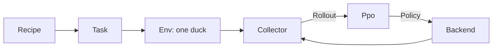

# 14 The Lehrer – a Training Gym for the Duck

> **Your level:** You're looking inside Kern's own training gym. Dozens of ducks practice there at
> the same time, until random numbers have turned into a network that makes the Micro Duck jump.
> You'll find out how the Lehrer is built and why it builds the same network bit for bit on every
> device.

The **Lehrer** (German for "teacher") is Kern's own training system for the Micro Duck. Simulation,
learning and export are written in C++ and run on Kern's engine and the physics engine Box3D –
without Python and PyTorch. It learns on all the processor cores of a computer (even on a server
without a screen) and as WebAssembly in the browser, on computers and phones.

The duck in the Lehrer is **the same** as in Studio: the same game world, the same servos and
sensors, the same controller with 50 ticks per second, the same physics with 16 sub-steps
([Chapter 13](13-micro-duck.md)). That's why a network from here runs unchanged in Studio. It's
saved in the format of Pollen Robotics' networks. It hasn't been tested on the real robot: if you
load a network you trained yourself onto hardware, you do so at your own risk – and only together
with an adult ([Chapter 16](16-calibration.md)).

This is how Kern's networks `jump.onnx` (the jump) and `play.onnx` (the play layer) came about.
What a network is and how imitation and reward work is explained in
[Appendix A](A-neural-networks.md). How to use it is in
[Chapter 15](15-your-own-models.md).

## 14.1 Overview

The code lives in `src/lehrer/` and `include/kern/lehrer/`: environment and tasks, the network with
Adam and normalizer, PPO, threads, recipes, demonstration and CMA-ES, play layer, ONNX export,
calibration, fingerprint and browser interface. On top of that come the tool `kern_lehrer` and the
web page.

| Step | Status |
|---|---|
| Simulation, network, PPO, ONNX export | done |
| Variation, browser, determinism | done |
| Jump: demonstration → imitation → practice | done |
| Digital twin, calibration | done (without real measurement data) |
| Playing with ball and sock | being reworked |

## 14.2 Architecture

The Lehrer splits the work into five roles so they can run in different places.



> **Picture it like this:** a sports school. The **recipe** is the training plan. The **task**
> (`Task`) says what earns points. In the **gym** (`Env`), a duck does its exercises. **Helpers with
> clipboards** (`Collector`) take notes (`Rollout`). The **coach** (`Ppo`) goes through them and
> hands out new instructions (`Policy`). The **building** (`Backend`) decides how many gyms are open.

The environment `DuckEnv` takes 61 observations and gives 14 actions; `PlayEnv` for the play layer
takes 23 and gives 9. The recipe is the same everywhere, in the tool and in the browser. Collectors
and the learner pack their data into flat number buffers that can be sent between threads or web
workers. That's why, at its heart, the whole training loop is just three lines:

```cpp
backend.collect(ppo.policy(), steps, it, rollouts);
ppo.set_parallel(backend.update_parallel());
return ppo.learn(ptrs);
```

Line 1: all collectors run their ducks with the current policy. Line 2: the learner may use the
threads too. Line 3: it learns from all the rollouts. Before that, the backend calls the curricula.

## 14.3 The Duck's Environment

### One Step Is One Control Tick

A `DuckEnv` builds a duck on flat ground in its own world, without drawing anything. The controller
takes the Lehrer's action: home pose plus action, with the bus delay of the servo profile. If a fixed
motion like picking up is running, it takes priority.

One step is **one control tick**, 20 milliseconds:

1. The action goes to the controller, and the world computes 4 world steps.
2. If it's time, the duck gets a little push.
3. A probe reads out the trunk, the direction of gravity, sole contact, foot heights and joints – in
   real robot units, not in the four-times-bigger Studio world.
4. From that, the task computes the **reward** and whether the episode is over.
5. The new observation is built: first what the controller sees, then the commands in slots 48–60.
   The critic gets it **clean**; only the actor gets it **with sensor errors** at the very end.

### The Task

A `Task` defines: start, commands, reward, end, curricula and what the critic gets to see on top.
Each partial reward (a **term**) counts as *weight × term × 0.02 s*, with a name so you can look at
each one separately. Only one-off terms like the fall count without the × 0.02.

Two tasks are built in. **`stand`** is the quick test: stand for 4 s, points for being upright (2),
legs (2) and neck (1) in the home pose, the right height (1, target 0.115 m), a deduction for
twitching (−0.1); a fall costs −4 and ends the episode. **`jump`** is the jump (14.6).

### The Asymmetric Critic

The **actor** sees only what the sensors deliver, with all their errors. Only the actor gets
exported. The **critic** exists only during learning; it sees everything clean, plus values no
sensor measures. For the jump there are 9: trunk height above the start, trunk speed in x, y, z,
both sole contacts, both foot heights and whether the duck has already been in the air. That makes
its judgment more accurate.

> **Picture it like this:** The player on the field only sees what's happening in front of her. The
> coach on the sideline has the slow-motion replay. That makes his tips better – but she's the one
> who has to play.

### Variation

The real robot is never exactly like the simulation. That's why every episode is a little different:

| Area | What varies | How much |
|---|---|---|
| Start | heading, tilt, friction | ±180°, ±3°, × 0.7–1.3 |
| Build | mass, center of mass | ±5 %, ±3 mm (jump up to 15 mm) |
| Servos | friction, delay | ±10 %, 15–30 ms |
| Sensors | noise, offset, lag | actor only |
| Pushes | a push every 3–6 s | up to ±0.3 m/s |

The pushes come in through a curriculum: none until iteration 300, at 27 % strength until 500, then
full. A network that can only stand with **one** mass and **one** friction won't stand on the real
robot. That's why Kern measures every network twice: on the **clean** robot and with **full**
variation.

### Randomness That Repeats Itself

The random number generator is **splitmix64**: with the same starting value, the **seed**, you
always get the same numbers. Each duck has its own stream: with seed s, duck k gets the seed
`s · 1000003 + k`.

## 14.4 Networks: `Mlp`, `Normalizer`, `Adam`

The network is an **MLP** like in the learning library rsl_rl, with ELU between the layers. The jump
actor has the shape 61 → 512 → 256 → 128 → 14. How a neuron computes is in Appendix A.

- **Start:** random weights between −1/√n and +1/√n (n = the layer's inputs), like in PyTorch.
- **Forward:** Kern computes four inputs at once. The weights sit in memory so that the compiler can
  speed things up **without changing the order of the additions** (important for 14.7).
- **Backward:** layer by layer from the back (backpropagation). Results are **added up** so that
  pieces sum up to a whole. A test checks this against a trial calculation.

The **normalizer** brings every input to the same order of magnitude:
*(x − mean) / (spread + 0.01)*. Mean and spread are updated as it goes. It's a fixed part of the
network and sits at the front of the file in the export. During a **warm start**, the Lehrer takes
over a finished network together with its normalizer and **freezes** the normalizer. New inputs (for
the jump, slots 55 and 56) get weight 0 – so at first the new network acts exactly like the old one.

**Adam** uses PyTorch's default values. In front of it sits an emergency brake: if the gradient is
longer than 1.0, it gets cut down to 1.0.

## 14.5 PPO Step by Step

Kern follows the PPO of rsl_rl, which Pollen uses to train the duck's networks. Appendix A explains
the idea; here are the numbers of the jump recipe:

| Setting | Jump | Meaning |
|---|---|---|
| Ticks per duck | 48 | per iteration |
| Epochs × minibatches | 5 × 4 | 20 learning steps |
| Clip | 0.2 | at most 20 % more/less |
| γ, λ | 0.99, 0.95 | looking ahead |
| Learning rate | 10⁻⁴ | starting value |
| Entropy | 0.005 | curiosity bonus |
| Noise at the start | 0.3 | before imitation |

Without a recipe, the values are learning rate 10⁻³, noise 1.0, 24 ticks and entropy 0.01. In all
recipes, the critic has the layers 256 and 128.

1. **Collect:** Each duck runs for 48 ticks. The actor picks its target μ, and noise is added:
   `a = μ + σ · ε`, with ε from the duck's own random stream.
2. **Sort:** The learner puts all the data into **one fixed order**, tick by tick, duck by duck.
   Then the normalizers learn from all the rows.
3. **Re-evaluate:** With the fresh normalizers, it recomputes the old policy. With only a few dozen
   ducks, the normalizers would otherwise shift so much that old and new would be compared unfairly.
4. **Advantage (GAE):** Going backward through time, it estimates whether each action was better or
   worse than expected. A **fall** has no future (value 0). When **time runs out**, it estimates how
   things would have gone on. Then the advantages are brought to mean 0 and spread 1.
5. **Update:** 20 steps. Each minibatch is split into **exactly 8 fixed pieces**.
   - First, the learner measures how far the policy has already changed (the KL divergence). Above
     0.02: learning rate divided by 1.5. Below 0.005: times 1.5.
   - Good actions become more likely, but by 20 % at most. The critic may only shift its estimate by
     0.2.
   - A small entropy bonus keeps σ alive; σ stays at least 0.001.
   - The 8 pieces are added up **in a fixed order**, and then one Adam each takes a step for the
     actor (with σ) and the critic.

> **Crazy but true:** 32 ducks × 48 ticks = 1536 rows per iteration. Each tick is 0.02 s, so per
> iteration the Lehrer collects 1536 × 0.02 s ≈ 31 seconds of duck life.

**Critic first:** After imitation, the actor is good, but the critic has no clue. Its judgments would
wreck the actor. That's why for 30 iterations (play layer: 20) **only the critic** learns.

**Statistics and checkpoint:** Every iteration reports reward, return, episode length, losses,
learning rate, σ and times. A checkpoint (file header `KERNPPO1`) saves the whole learner, Adam
included – a run can pick up exactly where it left off.

## 14.6 Imitation, Demonstrations and CMA-ES

### Why PPO Alone Failed

Pure PPO never found the take-off, no matter which settings:

- For the take-off, **all leg servos at the same time** have to push at full power. The servos are
  soft (full force only at 1.7 rad of deviation), so the network has to set targets far beyond the
  joint limits. Random trying practically never finds that.
- Standing is safe and earns points; a failed attempt costs a fall.
- With few ducks, the gradient is noisy, and the KL limit keeps the learning rate down.

So: **find a demonstration → imitate → practice.** The demonstration (in German, the *Vorbild*, the
"role model") only exists during learning.

### A Jump in 15 Numbers

The demonstration is **15 numbers**: the targets for the hip, knee and ankle of the left leg at five
points in time – crouch, push-off, tuck, landing, absorbing. The right leg mirrors them. Each target
goes through tanh and is multiplied by 2.5 rad so the servo can push with full force. Before 15 % and
from 50 % of the episode on, Pollen's walking network **velstand** keeps the balance.

The 15 numbers are found by **CMA-ES**, a search without a gradient modeled on evolution
(Appendix A), following Hansen's instructions exactly. In each generation, 16 candidates jump 6 times
each: once clean, five times varied, all on the same robots. There are points for rising, flight
time, height, landing on both soles and a real jump; deductions for more than 15° of tilt and for
falls – early ones cost more. What comes back is the **center of the search cloud**, because the best
candidate might just have been lucky. The built-in demonstration came out of **370 generations**.

### Imitation with DAgger

Learning only from the demonstration's runs has a catch: the network then only knows the states the
demonstration gets into. If it makes a small mistake itself, it ends up somewhere it has never been,
makes a bigger mistake – and the mistakes grow. That's called **distribution shift**. So DAgger lets
the network drive itself, and the demonstration only labels:

1. **Round 0:** The demonstration drives; each observation gets its action as the label.
2. **From round 1 on:** The network drives itself (with noise 0.05), and on every tick the
   demonstration says what **it** would have done.
3. After each round, the network learns from **all** examples.

That way, exactly the states the network itself gets into end up in the dataset – with the right
answer. For this, the demonstration must have a sensible answer in each of these states. For the
jump: 8 rounds of 96 episodes each with full variation, learned with its own Adam, 10 epochs,
minibatch 256, learning rate 10⁻³. After that, the network **practices** with PPO: noise 0.1, first
30 iterations of critic only, then the jump reward plus a reward for imitating, with full variation.

### The `jump` Task

As its command, the network gets only a **phase signal**: cosine and sine of the time in slots 55
and 56. No script, no forces from outside – the motion comes only from the 14 servo targets. An
episode lasts 2 s. The most important terms:

| Term | Weight | What for |
|---|---|---|
| `airborne`, `lift` | 20 × upright | fly, push off upward |
| `landed` | 6 × upright | land on both soles |
| `imitate` | 10 | close to the demonstration |
| `upright` / `tilt` | 2 / −30 | stay upright |
| `extra_hop`, `drift` | −4, −2 | no extra hop, no sliding |
| `action_rate` | −0.1 → −0.5 | don't twitch |
| `fall` | −2 → −20 | fall, one-off |

Plus small terms for the home pose, wobbling and self-contact. Without a demonstration,
`track_height` is added. The arrows are curricula: the penalties grow with the iterations. A fall
**and any ground contact by a part other than the soles** end the episode.

> **Watch out, trap:** Without this rule, the network learns to prop itself up on its beak or tail.
> For the reward, that's the safest bet – but it's not a jump.

**A real jump** (measured by the `JumpMeter`) means: all parts in the air for at least 60 ms, the
trunk rises at least 5 mm while in the air, never more than 30° of tilt, and at the end the duck
stands upright on both soles. Just tucking up the feet doesn't count.

## 14.7 Determinism

**Deterministic** means: same input, same result down to the last bit – for Kern on GCC/x86, Apple
clang/ARM and WebAssembly. A simulation error is then fixed and can be tracked down.

> **Crazy but true:** For a computer, (0.1 + 0.2) + 0.3 isn't always the same as
> 0.1 + (0.2 + 0.3). Every addition gets rounded. In a robot simulation, one different bit turns
> into a different gait within seconds.

What Kern does about it:

- **No FMA:** `a*b+c` is never computed in one step with just one rounding.
- **Box3D without SIMD**, like in WebAssembly – this costs nothing, since the joint solver is the
  slow part anyway.
- **Its own math library:** `sin`, `cos`, `exp`, `log` round differently depending on the system.
  Kern uses the same ones from musl everywhere (`kern::dm::sin` and so on).
- **Independent of the number of workers:** each duck's seed comes from its number, the data has a
  fixed order, exactly 8 pieces per minibatch.

The same seed and the same number of ducks give the same network – on 1 core, 16 cores or 4 web
workers. This is checked with a **fingerprint**: the clean duck runs 400 ticks with velstand, and
after each tick a checksum over the exact bits is created. The CI compares it on all three
platforms. A test learns with 1, 2 and 4 workers and compares the networks byte for byte.

> **Watch out, trap:** New simulation code uses `kern::dm::sin` instead of `std::sin`, adds up sums
> in a fixed order and stays away from `-ffast-math`. How Kern is built is in
> [Chapter 2](02-building-and-testing.md).

## 14.8 Learning the Play Layer

The **play layer** ([Chapter 13](13-micro-duck.md)) decides whether the duck goes to the ball or the
sock, kicks, picks up, carries and spits out. It learns like the jump: demonstration, DAgger, PPO.

In `PlayEnv`, the duck runs on its own with Kern extras; the Lehrer only steers its play layer. One
step is one decision (40 ms), an episode at most 60 s. The actor is 23 → 256 → 128 → 9; the critic
also sees 6 extra values: whether the ball and sock are there and where they really are. On the
floor there's randomly a ball (30 %), a sock (30 %) or both (40 %), usually in front of the duck,
sometimes anywhere around it. Balls come in different sizes and weights and roll differently. On
top of that comes variation, including an inaccurate camera detector that sometimes drops out.

**Reward:** −0.01 per decision, +2 × the closeness gained to the target, +3 if the sock stays in the
beak after the pick-up, a little for carrying, +10 for a kick that moves the ball 0.25 m, +10 for
putting it down 0.25 m farther on, −5 for a fall.

**The demonstration** sees **exactly the same as the network** and has no hidden memory (except the
starting spot of the left foot). If a kick is running, it does nothing; if a pick-up is running, it
opens the beak at the right moment. If it's holding something, it sets off and spits it out again
after 0.3 m. Otherwise it heads for the nearer target, turns if it sees nothing, slowly gets closer,
says "stop" at a measured spot, waits until it's really standing (both soles on the ground for
longer than 0.25 s), and then starts the kick or pick-up. If the target is in the wrong place, it
backs off. The request to kick or pick up rises as a **ramp** so the network can read it from the
standing time. The network imitates this demonstration with DAgger (half clean, half varied) and
then practices with PPO, at first 20 iterations with only the critic.

**Measured by itself:** Where the beak grips, the Lehrer measures anew on every run: a sock is placed
at 11 × 9 spots in front of the duck, and it checks where it still holds after 3 s of carrying. No
bite position is in the code as a number. In the same way, it measures how far the duck keeps
walking after "stop".

**Result** (`play.onnx`, round 8 of 12, 32 episodes each):

| Result | clean | variation |
|---|---|---|
| Ball kicked away | 9 of 11 | 7 of 11 |
| Sock picked up | 4 of 21 | 13 of 21 |
| Fully spat out | 1 of 21 | 0 of 21 |
| Falls | 2 of 32 | 10 of 32 |

The **ball is learned**. The network steers toward the sock just the same way, but the bite rarely
holds: the beak slips on cotton. The bottleneck is the grip in the physics, not the decision.

## 14.9 Jump Results

`jump.onnx`: 32 ducks on 2 cores, seed 1, 3000 iterations of practice, checked with 40 episodes each.

| Measurement | clean | full variation |
|---|---|---|
| real jumps | 40 of 40 | 36 of 40 |
| rise in the air | 11.6 mm | 8.2 mm |
| flight time | 120 ms | 109 ms |
| falls | 0 | 0 |

The tilt stayed at 8° and 9° respectively. The way there: search for the demonstration (about
2 million duck steps, 18 min), first real jump after 7 rounds of imitation (43,355 steps), then
2.3 million steps of practice. Because everything is the same bit for bit, these numbers hold on
every device – only the time doesn't:

| Platform | first real jump | practice (steps/s) |
|---|---|---|
| native, 2 threads | 106 s | 1431 |
| browser, 2 collectors + learner | 515 s | 391 |
| browser, 1 core | 539 s | 336 |

The browser learns **the same network** (the same 49,936 examples), just more slowly (about 5 times
slower during imitation, just under 4 times during practice), because WebAssembly computes here
without SIMD and without threads inside the worker. One duck step is 4 world steps with 16 sub-steps
each. With 8, it would be 1.6 times faster, but the motions would change.

> **Mission:** Open Kern Studio at https://kernengine.de/ and load File › Example Levels › Micro Duck
> (if Play or Simulate is running, stop it with Esc first). Start Play, take over the duck with F8
> and press **7**. That's `jump.onnx` from this chapter. On a phone, the button is called **HOP**.

## 14.10 ONNX Export and Metadata

Only the **actor** gets exported, in the shape of Pollen's networks:

```
obs ─ Sub ─ Div ─ Gemm ─ Elu ─ … ─ Gemm ─ actions
```

The normalizer at the front, then the layers. Kern reads the file back in itself (accurate to
0.0001), and ONNX Runtime, the software on the real robot, loads it too. Then there's **metadata**
with Pollen's names: joint names, home pose, observation parts, `task` (for example `jump`) and
`lehrer` ("Kern (C++ PPO on Box3D)"). The play layer has its own, with `task` = `play` and
25 decisions per second.

## 14.11 The Lehrer in the Browser


The home page https://kernengine.de/ links to it. Each web worker is a **collector** with its group
of ducks; one more worker is the **learner** (imitation, PPO, jump measurement every 25 iterations,
export). You set: motion (jump, or standing as a quick test), workers (default: cores minus 1, at
most 8), ducks per worker (8), iterations (1500), seed, action noise at the start and learning rate
(empty means: as in the recipe). You see iteration, duck steps, speed, return, episode length,
noise, real jumps, height and flight time as numbers and as a curve. The page keeps the screen awake.

Every 25 iterations, it saves the network **on your device** for Kern Studio; open Studio tabs pick
it up right away. ".onnx herunterladen" ("download .onnx") gives you the file. The play layer can't
be trained here. On phones: Chrome's throttling test only slows down the main thread, so the
single-core case was measured instead. The page shows you your device's speed itself.

> **Mission:** Open the Lehrer, choose "Stehen (Schnelltest)" ("stand, quick test") and press Start.
> Do the math: workers × ducks per worker = ducks in total. How many steps per second can your
> device manage?

> **Mission:** Start "Stehen (Schnelltest)" with seed 1, write down the mean episode return after a
> few iterations, reload and start again with the same settings. Do the numbers match? That's
> determinism.

> **For pros:** The learner accepts JSON settings that override the recipe, such as
> `learningRate`, `initStd`, `desiredKl`, `steps` or `warmStart`.

## 14.12 Tests

Tests check the backward calculation, Adam, the normalizer, PPO (also with separate collectors),
identical episodes bit for bit, the fingerprint, identical networks with 1, 2 and 4 workers, the
export, the real jump in Studio and the calibration
([Chapter 16](16-calibration.md)).

## Level complete!

- You know the five roles: recipe, task, environment, collector, learner.
- You know why the critic gets to see more than the actor.
- You can explain why every episode builds a slightly different duck.
- You know the road to the jump: CMA-ES, DAgger, PPO.
- You know what a real jump is and why the rules are strict.
- You understand how Kern builds the same network bit for bit everywhere.

## Puzzle corner

1. How long does a control tick last?
2. Why does only the actor get the sensor errors?
3. Why does the demonstration search deliver the center of the search cloud instead of the best
   candidate?
4. 32 ducks on 2 cores versus 32 ducks on 16 cores – same network? And with 16 ducks?
5. **Boss puzzle:** Why does a beak on the ground end the episode instead of just taking away points?

### Solutions

1. 20 milliseconds with 4 world steps – 50 ticks per second.
2. Only the actor will later run with real, inaccurate sensors. The critic is supposed to judge
   accurately.
3. The scoring is noisy. The best candidate may have just been lucky; the center is the average of
   many good ones.
4. Yes: the number of threads only changes the speed. With 16 ducks, you get different data and a
   different network.
5. If propping itself up were only a bit more expensive, it could pay off, because the duck then
   doesn't fall and keeps collecting points. Ending right away takes all later points away from it –
   so it's never the safe bet.

---

© 2026 Christian Heinrich Hohlfeld · All rights reserved · [Imprint and rights](00-imprint.md)
