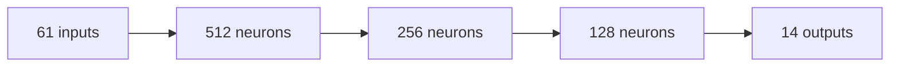
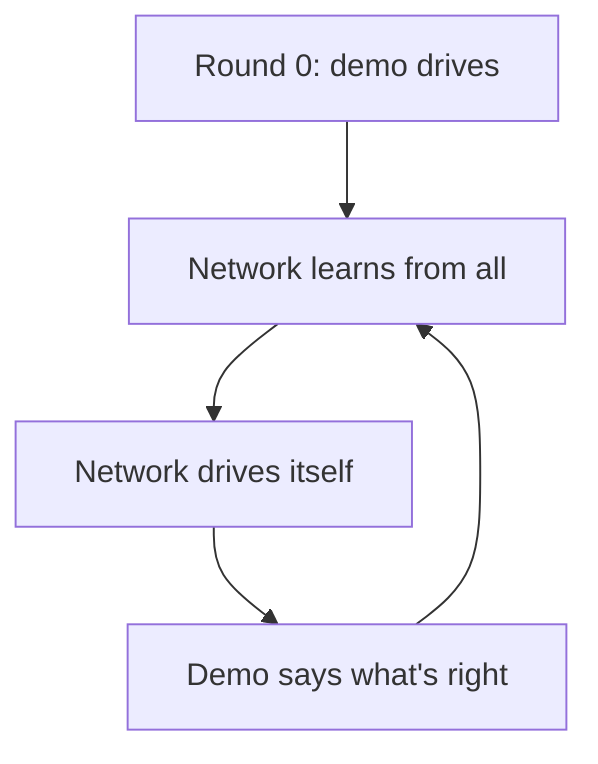
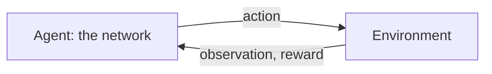
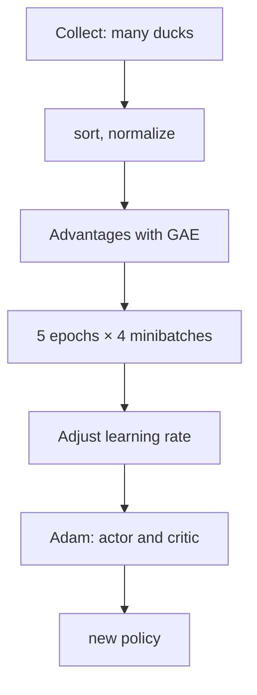
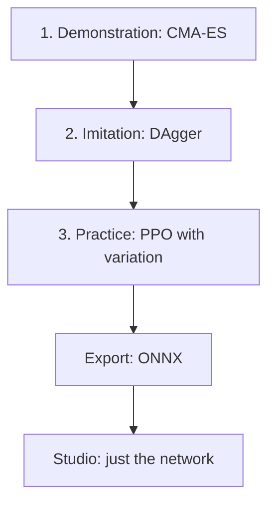

# Appendix A – How Machines Learn: Networks, Imitation, Reward

> **Your level:** The bonus level for everyone who wants to know exactly how it works. You'll
> compute an artificial neuron yourself, walk down a mountain in the fog and train a dog in your
> head. After that, you'll understand how random numbers turn into a jumping duck – with math from
> school.

This appendix explains the Lehrer's toolkit. How Kern puts it into practice is in
[Chapter 14](14-lehrer.md), how to use it in [Chapter 15](15-your-own-models.md). The code lives in
`src/lehrer/`: network and Adam in `nn.cpp`, learning in `ppo.cpp`, environment in `env.h`,
demonstration and CMA-ES in `vorbild.cpp` and `cmaes.cpp`, play layer, export and recipes in files
of their own.

## A.1 What a Neural Network Is

### A Calculating Machine with Lots of Knobs

A neural network is a **function**: numbers in, numbers out. For the Micro Duck, **61 numbers** go
in (the trunk's position, joint angles and speeds, last action, commands) and **14** come out: the
targets for its servos. In between sit a huge number of **parameters** that nobody sets by hand.
They're **learned** – changed over and over until the function does what we want.

> **Picture it like this:** a mixing desk with hundreds of thousands of knobs. At first, it just
> makes noise. Learning means turning each knob a tiny bit in the right direction – again and again.

### The Neuron – Computed Once by Yourself

An artificial **neuron** multiplies each input by a **weight** (how important is it – can be
negative, too), adds everything up, adds a **bias** (a base setting) and sends the result z through
an **activation**.

```
x1 ──w1──┐
          ├──► sum + b ──► z ──► ELU ──► h
x2 ──w2──┘
```

A made-up example: a neuron with **two inputs** is supposed to decide how much a knee gives way.
x1 = 0.5 is the trunk's tilt, x2 = 2 its forward speed. The weights are w1 = 0.8 and w2 = −0.5, the
bias b = 0.1.

| Step | Calculation | Result |
|---|---|---|
| Input 1 weighted | 0.8 · 0.5 | 0.4 |
| Input 2 weighted | −0.5 · 2 | −1.0 |
| Sum plus bias z | 0.4 − 1.0 + 0.1 | −0.5 |
| Activation h | ELU(−0.5) | −0.39 |

With x2 = 0.2, you get z = 0.4 − 0.1 + 0.1 = 0.4 and h = 0.4. Why −0.39 one time and exactly z the
other? That's down to the activation.

### The Activation ELU

Kern uses **ELU**, like the library rsl_rl that Pollen Robotics uses to train the duck's networks. If
z is positive, it stays as it is. If z is negative, ELU computes *e to the power of z minus 1*, with
e ≈ 2.718: for z = −0.5, e to the −0.5 ≈ 0.607, so ELU(−0.5) ≈ −0.39. Going down, ELU gets closer
and closer to −1.

```
ELU(z)
  1 |              /
  0 |---------___/------- z
 -1 |___----
     -4    -2   0   2
```

Without a bend like that, many layers would be no better than one: times 2 and then times 3 is the
same as times 6. Only the bend allows rules like "bend the knee more the faster it tips – but only up
to the stop". tanh goes flat at both ends, and ReLU (everything below 0 becomes 0) has a "dead" zone.
ELU is smooth and has no dead zone.

### Layers and the MLP

Many neurons with the same inputs form a **layer**, several layers one after another a **multilayer
perceptron (MLP)**. The last layer has no activation: servo targets may be any number.



The first layer has 61 · 512 = 31,232 weights plus 512 biases. All four layers together add up to
**197,774 parameters**. The play network is smaller: 23 → 256 → 128 → 9.

### The Start: Random, but Small

If all weights were 0 at the start, all the neurons in a layer would compute and learn the same thing
– twins forever. That's why they're drawn **randomly** and small: between −1/√n and +1/√n with n
inputs, so with 61 inputs about ±0.13. That way the sums don't grow from layer to layer.

## A.2 The Forward Pass

**Forward** means: computing the inputs layer by layer, like with the neuron above, usually for many
inputs at once (a **batch**). Kern computes four inputs at the same time and arranges the weights so
that the computer is fast without changing the order of the additions
([Chapter 14](14-lehrer.md), determinism). For learning, the network remembers all the in-between
results.

## A.3 The Loss: How Bad Am I Right Now?

The **loss** is a number for how wrong the network is. The most common one is the **mean squared
error**: square the distances to the right value and take the average. If the network says 0.7 and
1.4, and the right answers would be 1.0 and 1.0, the errors are −0.3 and 0.4, the squares 0.09 and
0.16, the mean **0.125**. Squaring makes everything positive, and big errors count extra. Imitation
and the critic (A.11) use this loss.

Imagine the loss as a **landscape**: every setting of all the knobs is a place, and the loss is the
height there. We want to get to the deepest valley.

## A.4 Gradient Descent: Downhill in the Fog

### The Basic Idea

You're standing on a mountain in thick **fog**. No map, just the ground under your feet. You feel
which way is downhill and take a step. Then again. That's how a network learns. The slope is called
the **gradient**, the step length the **learning rate**.

With a single knob θ (say "theta") and the landscape *loss = θ²*, the valley is at 0. The start is
θ = 1.

**Feel the slope:** At θ = 0.99 the loss is 0.9801, at 1.01 it's 1.0201. Slope =
(1.0201 − 0.9801) / 0.02 = **2**. In general, it's 2 · θ here.

**Step:** new θ = old θ − learning rate · slope. With learning rate 0.1:

| θ before | Slope | θ after |
|---|---|---|
| 1 | 2 | 1 − 0.1 · 2 = 0.8 |
| 0.8 | 1.6 | 0.8 − 0.16 = 0.64 |
| 0.64 | 1.28 | 0.64 − 0.128 = 0.512 |

The loss falls from 1 to 0.64 and 0.41 to 0.26. With learning rate 1.1, on the other hand, 1 turns
into 1 − 1.1 · 2 = −1.2, then 1.44, then −1.73: you jump over the valley and swing higher and higher.
Here, the learning rate has to stay below 1.

> **Watch out, trap:** Learning rate too small – you barely make progress. Too big – you fly out of
> the valley. That's why Kern adjusts the learning rate by itself along the way.

### Minibatches and Epochs

Computing the slope over **all** examples takes too long. Instead, you estimate it from a random
selection, a **minibatch**, and take many small steps (**stochastic gradient descent**). Small
minibatches wobble more – with only a few dozen ducks, you notice it. One pass through all the data
is called an **epoch**.

### The Emergency Brake

One crazy example can produce a huge slope and wreck the network. That's why the length of the
gradient is limited: if it's above 1.0, it gets cut down to 1.0, and the direction stays the same.

## A.5 Backpropagation: Whose Fault Is It?

### The Idea

Feeling out 197,774 knobs one by one would be way too slow. **Backpropagation** computes all the
slopes at once, backward from the error to the input, with the **chain rule**.

> **Picture it like this:** a gearbox. When gear 1 turns once, gear 2 turns 3 times; when gear 2
> turns once, gear 3 turns 2 times. So gear 3 turns 3 · 2 = 6 times. In the same way, slopes
> **multiply** along the network.

### Worked Through Once by Hand

A mini network: z = w1 · x + b1, h = ELU(z), y = w2 · h + b2, error = (y − target)². Start: x = 1,
target = 1, w1 = 0.5, b1 = −1, w2 = 2, b2 = 0.5.

**Forward:** z = −0.5, h = −0.393, y = 2 · (−0.393) + 0.5 = −0.287, error = (−1.287)² = **1.656**.

**Backward:** Each slope says how much the next thing changes when you turn a tiny bit.

| Gear | Slope | Where from |
|---|---|---|
| y → error | −2.574 | two times (y − target) |
| w2 → y | −0.393 | as big as h |
| h → y | 2 | as big as w2 |
| z → h | 0.607 | ELU: h + 1 |
| w1 → z | 1 | as big as x |

Multiplied: w2 → error = −2.574 · (−0.393) = **1.013**; w1 → error = −2.574 · 2 · 0.607 · 1 =
**−3.122**. For b2 and b1, it's −2.574 and −3.122.

**One step** with learning rate 0.1: w2 = 1.899, b2 = 0.757, w1 = 0.812, b1 = −0.688. **Forward
again:** z = 0.124 (positive now), y = 1.899 · 0.124 + 0.757 ≈ **0.994**. The error has shrunk to
0.00004! Real networks with lots of examples that contradict each other only move forward in tiny
steps.

In Kern, `Mlp::backward` does exactly this, layer by layer, and a test compares it with the slow
feeling-out. For ELU, the stored output plus 1 is enough: 0.607 = −0.393 + 1.

## A.6 Adam: the Clever Hiker

Plain gradient descent takes equally long steps for all knobs, even though some slopes are huge and
others tiny, and it reacts nervously to wobbly estimates. **Adam** keeps two moving averages for
every knob: one for the **direction** (like momentum when rolling) and one for the **size** of the
recent slopes. The step is roughly *learning rate × direction ÷ typical size*. That's why, in the
first step, every knob moves by exactly the learning rate – no matter whether the slope is 0.000001
or 1000.

> **Crazy but true:** Both averages start at 0 and would be way too small at first. Adam corrects
> for that – otherwise the clever hiker would hardly get going.

Kern uses PyTorch's default values. Actor, critic and imitation each have their own Adam. The memory
of the actor's and critic's Adams goes into the checkpoint: a resumed run takes exactly the steps an
uninterrupted one would have taken.

## A.7 Normalization: Everyone on the Same Level

Joint angles are in the tenths, joint speeds can have two digits. Big inputs would dominate the sums.
The **normalizer** converts each input:

```
new = (x − mean) / (spread + 0.01)
```

Mean 2, spread 3, value 8: (8 − 2) / 3.01 ≈ 1.99. The 0.01 prevents dividing by 0. Mean and spread
are updated as it goes (Chan's formula only needs mean, spread and count for this and is exact). The
normalizer **belongs to the network**: without exactly this conversion, the network is worthless,
which is why it's included in the export. During a warm start, Kern takes over the old network's
normalizer and **freezes it**. And because, with only a few dozen ducks, it noticeably drifts between
two iterations, the learner re-evaluates the old policy with the new normalizer.

## A.8 Memorizing Versus Understanding

A big network can **memorize** a small amount of data: perfect on examples it knows, bad on new ones.
That's called **overfitting**.

> **Picture it like this:** You only memorize the answers to the practice problems. The test has
> different numbers – and you're stuck.

Remedies: more and more varied data, checking with data that was never used for learning, the best
network according to the check instead of the last one, smaller networks. For a robot, overfitting
means: the network only knows **this one** simulation. That's why Kern checks clean **and** with
variation (A.12).

## A.9 Learning by Copying

### Supervised Learning and Behavior Cloning

In **supervised learning**, every input comes with the right answer, like an answer key. For robots,
that's an expert's action: you record what the expert does in every situation and train the network
on it. That's called **behavior cloning**. In Kern, the expert is called the **demonstration** (in
German, the *Vorbild*).

### The Trap: Distribution Shift

The network only knows situations the demonstration gets into. A small mistake leads into an unknown
situation, where a bigger mistake follows – and so on. The errors can even grow **quadratically**
with the length of the episode.

```
Demo:   ●──●──●──●──●──●   (always on track)
Clone:  ●──●──●─╲
                 ●─╲       small mistake
                    ●─╲    bigger mistake
                       ●   fall
```

> **Picture it like this:** learning to ride a bike just by watching. The pro rider never wobbles.
> When you wobble yourself, you don't know what to do – you never saw her do that.

### DAgger: the Student Rides, the Demonstration Comments



With **DAgger**, the student drives, and in every situation the demonstration says what **it** would
have done. That way, data is created exactly where the student ends up. Kern adds a bit of extra
noise so that situations just off the track show up too. The demonstration must have an answer
everywhere and mustn't know anything the network can't see. For the jump, it's 8 rounds of 96
episodes each; from round 7 on, the network jumps for real for the first time. The play network
learns the same way.

## A.10 Learning by Reward

Without a demonstration – or to get better than the demonstration – the network learns through
**reward**: **reinforcement learning**.

> **Picture it like this:** You're teaching a dog "sit". When it sits, it gets a treat right away,
> and over time it sits more often. You never showed it **how** to sit – you only rewarded it
> **when** it worked. Same in sports: points for a good serve, no instructions for every muscle.

### The Loop



The **agent** acts, the **environment** answers. In Kern, that's a duck in its own world, and one step
takes 20 ms. Mathematically, this is a **Markov decision process**: states, actions, physics, reward
and a future factor. "Markov" means: what comes next depends only on the **current** state – like in
chess, where only the position on the board counts.

### State and Observation

The **state** is everything: every position, every speed. The duck only gets an **observation** –
what its sensors deliver, with noise and delay. It doesn't know its true height. Experts call this a
**partially observable** MDP (POMDP). The last action is part of the observation, a mini memory.

### Reward and Return

The **reward** is a number per step and the **only** place where you say what you want. The agent
takes it literally: early on, the duck learned to sit on its tail because the reward allowed it.

The **return** is the sum of the future rewards, where later ones count less: each step into the
future gets multiplied by γ = 0.99 (**discounting**).

| Steps ahead | Factor | Still counts |
|---|---|---|
| 1 | 0.99 | 99 % |
| 100 | 0.99¹⁰⁰ | about 37 % |
| 300 | 0.99³⁰⁰ | about 5 % |

So the duck looks about **100 ticks** ahead – 2 seconds, as long as a jump.

> **Picture it like this:** A treat now is worth more to the dog than one in an hour. Still, "sit"
> pays off if something is sure to come afterward.

### Policy, Value and Advantage

- The **policy** is the decision rule. During learning, it's **random** and tries out different
  things; on the robot, you use its mean.
- The **value** of a situation is the return you expect from there on average; the **action value**
  is the same for one particular action.
- The **advantage** is the difference: was the action **better or worse than usual**?

A simple estimate is the **TD error**: *reward + γ · value afterward − value before*. You expected 5,
you get 1 and land at value 4: 1 + 0.99 · 4 − 5 = −0.04, just slightly worse than expected.

### Fall or Time Running Out?

After a **fall**, there's no future, and the value is 0. If only the **time** runs out, the duck could
have kept going. If you treat both the same, you teach the network to stop trying shortly before the
end. That's why, when time runs out, Kern estimates the value as if things went on.

### How Does the Policy Learn?

You can't "take the derivative" of the physics with respect to the knobs. The trick (**policy
gradient**): make actions with a **positive advantage more likely** and those with a negative one
**less likely**. For this, the policy has to be random. In Kern, the action is
*μ + σ · random number*: μ is the network's desired target, σ a learned value per action. With
μ = 0.4, σ = 0.1 and random number −0.5, the action becomes 0.35.

### Entropy: Keeping Curiosity Alive

**Entropy** measures how unpredictable the policy is; for Kern's networks, it depends only on σ. If σ
shrinks too fast, the agent stops trying things out and sticks with the first half-decent solution.
A small **entropy bonus** keeps it curious.

> **Mission:** Start a run in the Lehrer at https://kernengine.de/ and watch "Aktionsrauschen (std)"
> ("action noise"). That's σ. When it gets smaller, the policy is getting surer and tries out less.

## A.11 Actor, Critic and PPO

### Two Networks, One Team

The value is estimated by a second network, the **critic**; the policy network is called the
**actor**. The critic learns to predict the return, and the actor learns from the advantages the
critic computes – like player and coach. If the actor is already good after imitation, in Kern at
first only the critic learns.

### GAE: Estimating the Advantage Well

The TD error of one step is calm but inaccurate; all the rewards up to the end are accurate but
wobbly. **GAE** mixes both with λ = 0.95. You compute **backward**: advantage = TD error +
0.9405 · next advantage (0.99 · 0.95 = 0.9405). Three steps, rewards 1, 0, 2; values 5, 4, 6; value
afterward 3:

| Step | TD error | Advantage |
|---|---|---|
| 2 | 2 + 0.99 · 3 − 6 = −1.03 | −1.03 |
| 1 | 0 + 0.99 · 6 − 4 = 1.94 | 1.94 − 0.9687 = 0.97 |
| 0 | 1 + 0.99 · 4 − 5 = −0.04 | −0.04 + 0.9135 = 0.87 |

On its own, step 0 looked slightly bad, but it led to where things went better than expected. The
critic's target is advantage + value, so 5.87 for step 0. After that, Kern brings all advantages to
mean 0 and spread 1.

### Why Steps That Are Too Big Are Dangerous

The data comes from the **old** policy. After a big step, the advantages no longer fit; a good policy
can break in a single step – and then delivers bad data.

### PPO: Improving with a Seatbelt

**PPO** compares: how likely is the **new** policy to choose an action compared with the **old** one?
That ratio is called ρ (rho); at most 20 % change is allowed, ρ between 0.8 and 1.2.

| Advantage | ρ | What happens |
|---|---|---|
| positive | up to 1.2 | good action becomes more frequent |
| positive | above 1.2 | boosted enough: stop |
| negative | from 0.8 | bad action becomes rarer |
| negative | below 0.8 | weakened enough: stop |

Advantage 1, ρ = 1.3: PPO only counts with 1.2, the gradient is 0 – no further step in that
direction. But if a **bad** action accidentally becomes more frequent (advantage negative, ρ = 1.3),
no brake kicks in: the mistake is corrected right away. Improvements get capped, getting worse never
does.

> **Picture it like this:** The coach says: "Only change your throwing technique a little each
> practice. But whatever's wrong, you fix right away."

On top of that, Kern measures how different the old and new policy already are (the **KL
divergence**) and adjusts the learning rate. The critic, too, may only change its estimate by a
limited amount per update ([Chapter 14](14-lehrer.md)).

### A Whole PPO Update



Collecting and learning are separate: collectors only need the policy, the learner only needs the
data. That's why collectors can be threads or web workers. Because Kern computes everything in a
fixed order, the same network comes out everywhere.

> **Mission:** In the Lehrer, start "Stehen (Schnelltest)" ("stand, quick test") and look at the
> curve (for the jump, it only starts after imitation). The green line is the episode return. If it
> rises, the ducks are collecting more reward – reinforcement learning live on your device.

## A.12 From Simulation to Reality

The real robot is **different** from the simulation: masses are inaccurate, servos vary, friction
fluctuates, sensors are noisy. This **sim-to-real gap** gets closed from two sides: the simulation is
adjusted to measurements ([Chapter 16](16-calibration.md)), and the network is made robust.

With **domain randomization** (variation), every episode draws new values for mass, center of mass,
friction, servos, sensors and pushes. A network that works in all these worlds has learned what they
have in common; the real world is just one more variant. Some things only come in later through a
**curriculum**, because too much chaos at the start prevents the motion from emerging. Whatever can't
be measured gets varied.

The critic only exists during learning, so it may see what the robot doesn't measure, such as its
true height: the **asymmetric critic**. And with a **warm start**, a network begins from a finished
one – Kern's jump as Pollen's walking network **velstand**, which can already balance.

> **Mission:** In Kern Studio at https://kernengine.de/, load the level File › Example Levels ›
> Micro Duck (if Play or Simulate is running, stop it with Esc first) and start Play. The level
> starts with the spectator camera. Drag the duck up by its trunk with the mouse and set it back
> down: it pauses and then walks on. By the way, the lifting is detected by a separate small network
> from Pollen Robotics, not by training with variation.

## A.13 Searching Like Evolution: CMA-ES

Sometimes there's no slope: the jump demonstration is 15 numbers, scored by a whole simulation with
flight, landing or fall. It's similar with calibration. That's when an **evolution strategy** helps:
draw lots of candidates around a center point, try them out, keep the better half and move the center
toward it. **CMA-ES** also learns the **shape** of the search cloud as it goes:

```
Generation 1     Generation 5      Generation 20
  ·  ·  ·          · ·                ·
 ·  ●  ·  ·       ·●··  ↗             ●:
  ·  ·  ·          ·  ·
 (round, big)    (stretched)       (narrow)
```

If the steps keep going in the **same** direction, the cloud gets bigger; if they cancel each other
out, smaller. And it stretches in the direction that goes downhill.

> **Picture it like this:** a hot-and-cold game with lots of players. Whoever hears "warmer" pulls
> the group toward them. A long time in one direction – bigger steps; close to the goal – smaller
> ones.

In Kern, the starting point is scored first, so the result is never worse. With a noisy score, the
**center** of the cloud is better than the best single candidate, which might just have been lucky.

## A.14 ONNX: the Exchange Format

**ONNX** is an open file format for networks, something like PDF for computation graphs: computation
steps and weights in one file. ONNX Runtime runs it – on the robot, in the browser, on the server.
For an MLP, `Sub` and `Div` (normalization), `Gemm` (one layer) and `Elu` are enough. Kern writes the
file with its own tiny writer. Only the actor's **mean** gets exported; σ and the critic stay in the
Lehrer.

## A.15 How It All Comes Together



| Idea | Section | Where in Kern |
|---|---|---|
| Neuron, MLP, backprop | A.1–A.5 | `Mlp` |
| Imitation | A.3, A.9 | `Ppo::imitate` |
| Adam, normalization | A.6, A.7 | `Adam`, `Normalizer` |
| Reward, PPO | A.10, A.11 | `Task`, `Ppo` |
| Variation | A.12 | `Task::Noise` |
| CMA-ES, ONNX | A.13, A.14 | `cmaes_minimise`, `export_onnx` |

Demonstration, critic, noise and variation are **scaffolding**: they help during learning and get
taken down afterward. What's left is a conversion of the inputs and a few layers with ELU – the duck
doesn't need any more than that to jump.

## Level complete!

- You can compute a neuron with two inputs by hand.
- You know how gradient descent leads downhill in the fog and what the learning rate does.
- You understand backpropagation as a gearbox of multiplied slopes.
- You can tell imitation apart from learning by reward.
- You know why DAgger lets the student drive.
- You know return, advantage and the PPO seatbelt.
- You understand why variation makes a network fit for the real world.

## Puzzle corner

1. A neuron has x1 = 1, x2 = 3, w1 = 0.5, w2 = 0.5, b = −1. What comes out?
2. Loss = θ², θ = 2, learning rate 0.1. Where are you after one step?
3. Why can't you set all the weights to 0?
4. With γ = 0.99: how much does a reward 100 steps away still count?
5. **Boss puzzle:** Advantage −2, ρ = 1.3. Does PPO brake here? Why is that smart?

### Solutions

1. z = 0.5 + 1.5 − 1 = 1, positive, so ELU(1) = **1**.
2. Slope 2 · 2 = 4, new θ = 2 − 0.4 = **1.6**. The loss drops from 4 to 2.56.
3. Then all the neurons in a layer compute the same thing, learn the same thing and stay the same –
   as if the layer had only one neuron.
4. About **37 %**.
5. **No.** A bad action has become more frequent, and that gets corrected right away. PPO only caps
   improvements, never corrections – that way good things stay intact and mistakes disappear fast.

---

© 2026 Christian Heinrich Hohlfeld · All rights reserved · [Imprint and rights](00-imprint.md)
