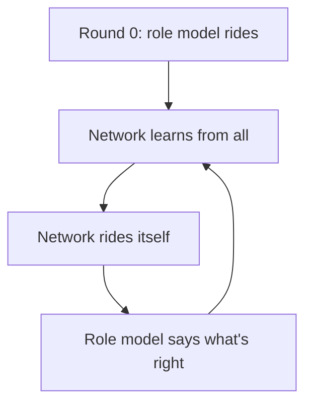
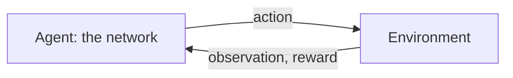
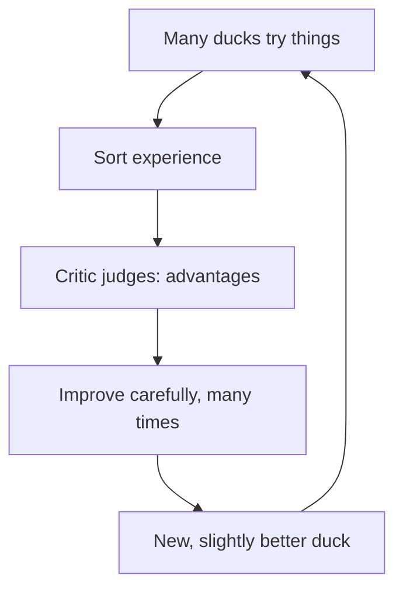
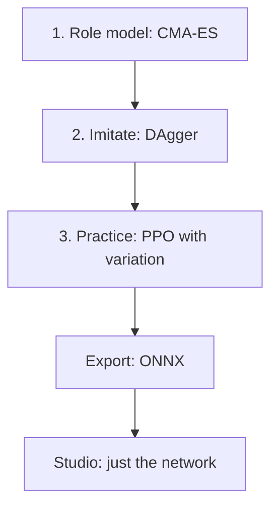

# Appendix A – How Machines Learn: Networks, Imitation, Reward

> **Your level:** The bonus level for everyone who wants to know exactly. You calculate an
> artificial neuron yourself, walk down a mountain in fog, and train a dog in your head. Afterward
> you'll understand how random numbers turn into a jumping duck – with math from school.

> **Words you need:**
> - **Simulation** – the duck as a replica in the computer, calculated by the rules of physics
> - **Servo** – a small motor that turns one of the duck's joints to a certain angle
> - **Sensor** – a part that measures something, such as how a joint is positioned or where down is
> - **Tick** – a short time step; the duck gets 50 commands per second
> - **Episode** – one run from start to finish, such as a single jump
> - **Average** – add up all values and divide by how many there are
> - **Slope** – how much a result changes when you change the input by a tiny bit

This appendix explains the toolkit of the Lehrer, Kern's training system. It's a good idea to read
it **before** [Chapter 14](14-lehrer.md), because everything explained here is used there. How to
operate it is in [Chapter 15](15-your-own-models.md).

## A.1 What a Neural Network Is

### A Calculating Machine with Lots of Sliders

A neural network is a calculating machine: numbers in, numbers out. For the Micro Duck, **61
numbers** go in (position of the body, joint angles and speeds, last action, commands) and **14**
come out: the targets for its servos. In between sit a huge number of sliders, the **parameters**.
Nobody sets them by hand. They're **learned**: changed until the machine does what we want.

> **Picture it like this:** a mixing desk with hundreds of thousands of sliders. At the start, noise
> comes out. Learning means turning each slider a little bit in the right direction – again and
> again.

### The Neuron – Calculated Yourself

An artificial **neuron** multiplies each input by a **weight** (how important it is, negative
too), adds everything up, adds a **bias** (a base setting) and sends the result z through an
**activation**.


A made-up example: a neuron with **three inputs** is supposed to decide how much a knee gives way.
x1 = 0.5 is the body's tilt, x2 = 2 its forward speed, x3 = 0 its rotation (none at the moment).
The weights are w1 = 0.8, w2 = −0.5 and w3 = 0.3, the bias b = 0.1.

| Step | Calculation | Result |
|---|---|---|
| input 1 weighted | 0.8 · 0.5 | 0.4 |
| input 2 weighted | −0.5 · 2 | −1.0 |
| input 3 weighted | 0.3 · 0 | 0 |
| sum plus bias z | 0.4 − 1.0 + 0 + 0.1 | −0.5 |
| activation h | ELU(−0.5) | −0.39 |

With x2 = 0.2 you get z = 0.4 − 0.1 + 0 + 0.1 = 0.4 and h = 0.4. Why −0.39 one time and exactly z
the other? That's because of the activation.

### The ELU Activation

The activation is a **bend** after each neuron. Kern uses **ELU**, like Pollen Robotics did when
training the duck. The rule:

- If z is positive or 0, it stays as it is.
- If z is negative, it gets **squeezed**: the more negative z is, the closer the result moves to −1,
  but it **never goes below −1**.

You don't need to know how to calculate the negative part. Just read it off the table:

| z | ELU(z) |
|---|---|
| 2 | 2 |
| 1 | 1 |
| 0 | 0 |
| −0.5 | −0.39 |
| −1 | −0.63 |
| −2 | −0.86 |
| −4 | −0.98 |


Why the bend? Without it, many layers would be no better than one: times 2 and then times 3 is the
same as times 6. Only a bend allows rules that aren't simply "always twice as much," such as: "Bend
the knee more the faster it's tipping – but only up to the stop."

> **For pros:** For negative z, ELU calculates e^z − 1 with the number e ≈ 2.718 (calculator key
> e^x). Other bends are called tanh (flat at both ends) and ReLU (everything below 0 becomes 0). ELU
> is smooth and has no "dead" area where nothing moves anymore.

### Layers and the MLP

Many neurons with the same inputs form a **layer**, and several layers one after another form a
**multilayer perceptron (MLP)**. The last layer has no bend: servo targets may be any number.


The first layer alone already has 61 · 512 = 31,232 weights plus 512 biases, together over 31,000
sliders. All four layers together have almost **200,000 sliders**.

> **For pros:** Exactly, it's 31,744 + 131,328 + 32,896 + 1,806 = 197,774 parameters. You calculate
> the other layers like the first: inputs times neurons plus one bias per neuron. The play network is
> smaller: 23 → 256 → 128 → 9.

### The Start: Random, but Small

If all weights were 0 at the start, all neurons of a layer would calculate the same thing and learn
the same thing – twins forever. That's why they're chosen **randomly** and small, with 61 inputs
roughly between −0.13 and +0.13. That way the sums don't grow from layer to layer.

> **For pros:** The limit is 1 divided by the **square root** of the number of inputs. The square
> root is the number that, multiplied by itself, gives the original number: √64 = 8, because
> 8 · 8 = 64. So √61 is just under 8 (about 7.8), and 1 / 7.8 ≈ 0.13.

## A.2 The Forward Pass

**Forward** means: calculating the inputs through layer by layer, like with the neuron above. The
network usually calculates many inputs at once, a **batch**. For learning, the network remembers
all the in-between results so it can calculate backward later (A.5).

Kern calculates fast while doing this, but **without changing the order of the additions**. The
computer could be even faster if it were allowed to rearrange sums – but then something different
would come out at the last digit, like with the three-digit calculator in
[Chapter 14](14-lehrer.md) (14.7). That way the network stays the same down to the last digit on
every device.

> **For pros:** So that fast calculation still works, Kern lays out the numbers in memory so the
> computer can work through them in order without rearranging.

## A.3 The Loss: How Bad Am I Right Now?

The **loss** is a number for how wrong the network is. The most common one is the **mean squared
error**: square the distances to the right value and average them. If the network says 0.7 and 1.4
and the right answers would be 1.0 and 1.0, the errors are −0.3 and 0.4, the squares 0.09 and 0.16,
and the average **0.125**. Squaring makes everything positive, and big errors count extra. Imitation
and the critic (A.11) use this loss.

> **Picture it like this:** a **landscape**. Every setting of all the sliders is a place, and the
> loss is the height there. The network is a ball somewhere on the slope. We want to get into the
> deepest valley.

## A.4 Gradient Descent: Downhill in the Fog

### The Basic Idea

You're standing on a mountain in thick **fog**. No map, just the ground under your feet. You feel
where it goes downhill and take a step. Then again. That's how a network learns. The slope for all
sliders together is called the **gradient**, and the step length the **learning rate**.

Take a single slider θ (Greek letter, say "theta"; here it simply stands for the slider's setting)
and the landscape *loss = θ · θ*. The valley is at 0. The start is θ = 1.

**Feel the slope:** At θ = 0.99 the loss is 0.9801, at 1.01 it's 1.0201. Slope =
(1.0201 − 0.9801) / 0.02 = **2**. Try it at other spots: here the slope is always twice as big as θ.

**Step:** new θ = old θ − learning rate · slope. The minus makes sure you go downhill. With learning
rate 0.1:

| θ before | Slope | θ after |
|---|---|---|
| 1 | 2 | 1 − 0.1 · 2 = 0.8 |
| 0.8 | 1.6 | 0.8 − 0.16 = 0.64 |
| 0.64 | 1.28 | 0.64 − 0.128 = 0.512 |

The loss falls from 1 through 0.64 and 0.41 to 0.26. With learning rate 1.1, on the other hand, 1
becomes 1 − 1.1 · 2 = −1.2, then 1.44, then −1.73: you jump over the valley and swing higher and
higher.

> **Watch out, trap:** Learning rate too small – you hardly make progress. Too big – you fly out of
> the valley. That's why Kern adjusts the learning rate itself along the way.

### Minibatches and Epochs

Calculating the slope over **all** examples takes too long. You estimate it from a random selection,
a **minibatch**, and take lots of small steps instead. One pass through all the data is called an
**epoch**.

> **Picture it like this:** a poll at your school. Instead of asking all 800 students, you ask 30.
> The result is roughly right, but it wobbles a bit: ask a different 30 and something else comes out.
> The smaller the selection, the more it wobbles.

### The Emergency Brake

One crazy example can produce a huge slope and destroy the network with a single step. With many
sliders, the gradient is like an **arrow** pointing in the direction where it goes uphill most
steeply. If this arrow is longer than 1, Kern shortens it to length 1. The direction stays the same;
only the step gets shorter.

> **Picture it like this:** In the fog the rule is: no step is longer than one meter, no matter how
> steep it looks.

## A.5 Backpropagation: Who's to Blame?

### The Idea

Nudging almost 200,000 sliders one at a time would be far too slow. **Backpropagation** calculates
all the slopes at once, backward from the error to the input. You ask: how much is each slider to
blame for the error? The rule for this is called the **chain rule**.

> **Picture it like this:** a set of gears. If gear 1 turns once, gear 2 turns 3 times; if gear 2
> turns once, gear 3 turns 2 times. So gear 3 turns 3 · 2 = 6 times. Slopes **multiply** along the
> network in exactly the same way.

### Worked Through Once by Hand

A mini network with one neuron in the middle: z = w1 · x + b1, h = ELU(z), y = w2 · h + b2,
error = (y − target) · (y − target). Start: x = 1, target = 1, w1 = 0.5, b1 = −1, w2 = 2, b2 = 0.5.

**Forward:** z = 0.5 − 1 = −0.5, from the table h = −0.393, y = 2 · (−0.393) + 0.5 = −0.287.
Error = (−1.287) · (−1.287) = **1.656**.

**Backward:** Each gear has a slope: how much does the next one change if you turn a tiny bit? You
can check each one by **feeling** as in A.4. Let's start at the back.

**The path from w2 – two gears:**

```
w2 ──(−0.393)──► y ──(−2.574)──► error
```

- **y → error:** −2.574. Felt: with y = −0.287 + 0.01 = −0.277 the error is
  (−0.277 − 1) · (−0.277 − 1) = 1.277 · 1.277 ≈ 1.631 instead of 1.656. So it drops by about 0.026,
  and the slope is −0.026 ÷ 0.01 ≈ −2.6. (Calculated exactly: 2 · (y − target) = 2 · (−1.287) =
  −2.574.)
- **w2 → y:** −0.393. If you turn w2 by 0.01, y changes by 0.01 · h, and h is −0.393.
- Multiplied: w2 → error = (−0.393) · (−2.574) = **1.013**.

**The path from w1 – four gears:**

```
w1 ──(1)──► z ──(0.607)──► h ──(2)──► y ──(−2.574)──► error
```

- **w1 → z:** 1, because z = w1 · x, and x is 1.
- **z → h:** 0.607, read off the ELU curve: at z = −0.5 it's about 0.6 steep; z + 0.01 changes h by
  about 0.006. (The table is too coarse for this; how to feel it with a calculator is in the box
  below.)
- **h → y:** 2, because y = w2 · h, and w2 is 2.
- **y → error:** −2.574 as above.
- Multiplied: w1 → error = 1 · 0.607 · 2 · (−2.574) = **−3.122**.

You calculate the two biases b1 and b2 the same way; their slopes are −3.122 and −2.574.

**One step** with learning rate 0.1, each time new value = old value − 0.1 · slope:

- w2 = 2 − 0.1 · 1.013 = 1.899
- b2 = 0.5 − 0.1 · (−2.574) = 0.757
- w1 = 0.5 − 0.1 · (−3.122) = 0.812
- b1 = −1 − 0.1 · (−3.122) = −0.688

**Forward again:** z = 0.812 − 0.688 = 0.124 (positive now, so h = 0.124),
y = 1.899 · 0.124 + 0.757 ≈ **0.99**. The target was 1: the error has almost disappeared! Real
networks with lots of examples that contradict each other only make progress in tiny steps.

In Kern, the network calculates exactly like this, layer by layer, and a test compares the result
with the slow feeling method.

> **For pros:** A bias works like an extra input that is always 1. That's why b2 has the same slope
> as the path y → error (−2.574), and b1 the same as w1 (−3.122), because x is also 1 here. And
> z → h felt with a calculator: ELU(z) = e^z − 1, so
> ELU(−0.49) − ELU(−0.5) = e^(−0.49) − e^(−0.5) ≈ 0.6126 − 0.6065 = 0.0061. Divided by 0.01 that
> gives ≈ 0.61.

## A.6 Adam: the Clever Hiker

Simple gradient descent makes steps for all sliders that are equally big relative to their slope.
But some slopes are huge, others tiny, and some estimates wobble a lot. **Adam** is a cleverer
method.

> **Picture it like this:** A hiker in the fog remembers which direction mostly went downhill
> lately, and keeps this **momentum**, like a rolling ball. The hiker also remembers how steep it
> typically was lately. On steep, wobbly spots the hiker steps more carefully, on flat ones more
> boldly.

For each slider, roughly: step = learning rate × direction ÷ typical size of the slope. At the start,
direction and typical size are equally big. That's why in the first step every slider moves by
exactly the learning rate:

- Slope 1000: 1000 ÷ 1000 = 1, so step = learning rate.
- Slope 0.000001: 0.000001 ÷ 0.000001 = 1, so again step = learning rate.

That way sliders with tiny slopes make progress just like those with huge ones.

> **For pros:** Adam's two memories start at 0 and would be too small at first; Adam corrects for
> that. In Kern, actor, critic and imitation each have their own Adam. Its memory is saved with the
> in-between state, so a continued run takes exactly the same steps as an uninterrupted one.

## A.7 Normalization: Everyone at Eye Level

The network's inputs come in very different sizes: joint angles are around tenths, joint speed can
be two digits. Big numbers would dominate the sums and drown out small ones. So the **normalizer**
converts each input to a similar size.

> **Picture it like this:** You want to compare distances, but one is in centimeters and one in
> kilometers. First you convert everything into the same unit, then you compare.

For this you need two numbers per input: the **average** and the **spread**. The spread says how far
the values typically lie from the average. Example: the values 1 and 5 have the average 3, and both
are 2 away from it – the spread is 2. The values 2.9 and 3.1 also have the average 3, but the spread
is only 0.1.

The conversion: new = (value − average) / (spread + 0.01).

**Example:** average 2, spread 3, value 8: (8 − 2) / 3.01 ≈ 1.99. That means: this value is about
two spreads above the average. The 0.01 prevents dividing by 0 if an input never changes.

Average and spread keep getting updated during training. Why? A better duck experiences different
situations: one that's learning to jump turns faster and takes off, which a standing duck never does.
So the values drift, and the converter has to drift along – like a scale you recalibrate when
suddenly heavier things land on it. The normalizer **belongs to the network**: without exactly this
conversion the network is worthless, which is why it's included in the network file.

> **For pros:** With a **warm start**, training begins with a finished network. Then Kern takes over
> its normalizer and leaves it unchanged, because the finished network is used to exactly this
> conversion. The exact calculations are in the blue book, Appendix A.

## A.8 Memorizing Versus Understanding

A big network can **memorize** a small amount of data: perfect on known examples, bad on new ones.
That's called **overfitting**.

> **Picture it like this:** You only memorize the answers to the practice problems. On the test
> there are different numbers – and you're stuck.

Remedies: more and more varied data, checking with data that was never used for learning, the best
network after the check instead of the last one, smaller networks. For the robot, overfitting means:
the network only knows **this one** simulation. That's why Kern checks clean **and** with variation
(A.12).

## A.9 Learning by Imitation

### Supervised Learning and Behavior Cloning

In **supervised learning**, there's a right answer for every input, like in an answer key. For
robots, that's the action of an expert: you record what it does in every situation and train the
network on it. That's called **behavior cloning**. In Kern, the expert is called the **role
model**.

### The Trap: Distribution Shift

The network only knows situations the role model gets into. A small mistake leads into an unknown
situation, where a bigger mistake follows – and so on. The mistakes can even grow **quadratically**
with the length of the episode: twice as long, four times as much error.


> **Picture it like this:** Learning to ride a bike just by watching. The pro rider never wobbles.
> When you wobble yourself, you don't know what to do – you never saw her do that.

### DAgger: the Student Rides, the Role Model Comments



With **DAgger**, the student rides, and the role model says in every situation what **it** would
have done. That way, data comes about exactly where the student ends up. Kern adds a bit of extra
noise so that situations just off the track show up too.

The role model has to have an answer everywhere. And it mustn't know anything the network doesn't
see – otherwise it demands answers the network can't figure out from its sensors at all. For the
jump it's 8 rounds; from round 7 on, the network makes a real jump for the first time. The play
network learns the same way.

## A.10 Learning Through Reward

Without a role model – or to get better than the role model – the network learns through
**reward**: **reinforcement learning**.

> **Picture it like this:** You're teaching a dog "sit." When it sits, it gets a treat right away,
> and over time it sits more often. You never showed it **how** to sit – you just rewarded it
> **when** it worked. Same in sports: points for a good serve, no instructions for every muscle.

### The Cycle



The **agent** acts, the **environment** responds. In Kern, that's one duck in its own world, and one
step lasts 20 ms (thousandths of a second). Important: what happens next depends only on how things
look **now** – like in chess, where only the position on the board counts, not how it came about.
Experts call this a **Markov process**.

### State and Observation

The **state** is everything: every position, every speed. The duck only gets an **observation** –
what its sensors deliver, with noise and delay. For example, it doesn't know its true height.

It gets its last action as part of the observation. That's a **mini memory**: that way it knows what
it just commanded itself, even if the sensors don't show it yet.

### Reward and Return

The **reward** is a number per step and the **only** place where you say what's wanted. The agent
takes it literally: early on, the duck learned to sit on its tail because the reward allowed it.

The **return** is the sum of all future rewards. Later ones count less: each step into the future
gets multiplied by the **future factor** γ = 0.99 (γ is the Greek letter "gamma"). So two steps ahead
0.99 · 0.99 = 0.98, three steps ahead 0.98 · 0.99 ≈ 0.97, and so on.

| Steps ahead | still counts |
|---|---|
| 1 | 99% |
| 10 | about 90% |
| 50 | about 60% |
| 100 | about 37% |
| 300 | about 5% |

So a reward 100 ticks away only counts a little over a third, and after that it quickly becomes
unimportant. That's why the duck plans about **100 ticks** ahead – 2 seconds, as long as a jump.

Why discount at all? Without discounting, the sum would keep growing with long attempts: a duck that
stands for 1000 ticks would have ten times as much as one that stands for 100 ticks, and with even
longer attempts there would be no limit. With the future factor, the sum stays limited, and the near
consequences of a movement count the most.

> **Picture it like this:** A treat now is worth more to the dog than one in an hour. Still, "sit"
> pays off if something is sure to come afterward.

### Policy, Value and Advantage

- The **policy** is the duck's decision rule: observation in, action out. While learning it wobbles
  a bit on purpose and tries out different things; on the robot it doesn't wobble.
- The **value** of a situation says how much return you expect on average from there.
- The **advantage** says: was an action **better or worse than expected**?

> **Picture it like this:** You expect a C on a math test. You get a B – better than expected, the
> advantage is positive. If you get a D, it's negative.

A simple estimate of the advantage is the **surprise** of one step (technical term: TD error): the
reward now plus the value afterward (times the future factor), minus the value you expected before.
**Example:** 5 was expected. You get 1 point and land in a situation with value 4. Then the surprise
is 1 + 0.99 · 4 − 5 = −0.04: just slightly worse than expected.

### Fall or Time Running Out?

After a **fall** there's no future; the value is 0. If only the **time** runs out, the duck could
have kept going. Treating both the same teaches the network to stop trying just before the end. So
when time runs out, Kern estimates the value as if things went on.

### How Does the Policy Learn?

You can't calculate how a single slider affects a jump: the whole physics with contacts, falls and
landings lies in between. So you **try things**. The trick: actions with a **positive advantage** are
made **more likely**, actions with a negative one **less likely**.

For this, the duck needs some chance in its movements. In Kern, every action is: **wished-for target
+ wobble strength · random number**. The wished-for target is called μ ("mu") and comes from the
network. The wobble strength is called σ ("sigma") and is learned along with it.

**Example:** wished-for target 0.4, wobble strength 0.1, random number −0.5: 0.4 + 0.1 · (−0.5) =
0.35.

### Entropy: Keeping Curiosity Alive

**Entropy** measures how unpredictable the policy is; for Kern's networks it depends only on the
wobble strength σ. If σ shrinks too fast, the agent stops trying things out and sticks with the first
halfway good solution. A small **entropy bonus** keeps it curious.

> **Mission:** In the Lehrer on https://kernengine.de/, start a run and watch "Aktionsrauschen
> (std)" (action noise). That's σ. If it gets smaller, the policy is getting surer and tries out
> less.

## A.11 Actor, Critic and PPO

### Two Networks, One Team

The value is estimated by a second network, the **critic**; the policy network is called the
**actor**. The critic learns to predict the return, and the actor learns from the advantages the
critic calculates – like player and coach.

If the actor is already good after imitation, in Kern only the critic learns at first. Otherwise its
initially random judgments would spoil the good actor.

### GAE: Estimating the Advantage Well

A step can look bad on its own and still have been good, because it led to something good. **GAE**
is the way of calculating that takes this into account.

> **Picture it like this:** In soccer, a pass by itself isn't a goal yet. But if a goal is scored
> right after it, the pass was good. And so was the pass before it, just a bit less. Tracing the
> goal back, you go **backward**: first the shot, then the pass before it, then the one before that.

GAE calculates exactly like that: you start at the last step and work toward the front. Each step
gets its own surprise plus a large part (about 94%) of the advantage of the step after it.

**To confirm it in numbers:** three steps, calculated backward. The surprises are made up for the
example (how to calculate one is in A.10). Kern uses the 94%; why exactly this number is explained in
the box below.

| Step | own surprise | Advantage |
|---|---|---|
| 3 (last) | −1.03 | −1.03 |
| 2 | +1.94 | 1.94 − 0.97 = 0.97 |
| 1 (first) | −0.04 | −0.04 + 0.91 = 0.87 |

On its own, step 1 looked slightly bad (−0.04). But it led to step 2, which went much better than
expected. That's why its advantage is positive overall – like the pass before the goal.

The critic learns with the advantage too: what it expected, plus how much better things turned out,
is what it should have expected. That's exactly what it trains on.

> **For pros:** The 94% is the future factor times a second factor λ ("lambda," 0.95) that says how
> much you trust the later steps: 0.99 · 0.95 = 0.9405. λ is a trade-off. If you only trust the next
> step (λ = 0), the advantage is calm but depends entirely on whether the critic estimates correctly.
> If you count everything to the end (λ = 1), it's honest but very jittery. After that, Kern
> normalizes all advantages as in A.7 to average 0 and spread 1. That way the size of a learning step
> doesn't depend on whether a task hands out tenths of a point or hundreds of points.

### Why Steps That Are Too Big Are Dangerous

The collected data comes from the **old** duck. If you change the network too much at once, this data
no longer fits the new duck. A good policy can break this way in a single step – and afterward only
delivers bad attempts that it can hardly get out of again.

It gets even worse if you learn from the same data **several times**. But that's exactly what you
want: collecting experience is expensive, and learning from it several times saves a lot of
computing time. With each pass, the duck moves further away from the one that collected the data.
Without a brake, that goes wrong. The brake is called PPO.

### PPO: Improving with a Seat Belt

**PPO** is the Lehrer's learning method. It only allows a small change per learning step.

**Example:** The old duck chose a certain movement in 10 out of 100 cases. If this movement has a
positive advantage, the new duck may choose it more often – but at most in 12 out of 100 cases, so
20% more. If it's bad, the new duck may choose it less often – but only down to 8 out of 100 at most.
Once the limit is reached, PPO stops pushing in that direction.

| Advantage | Change | What happens |
|---|---|---|
| positive | up to 20% more often | good action becomes more frequent |
| positive | more than 20% more often | strengthened enough: stop |
| negative | up to 20% less often | bad action becomes rarer |
| negative | more than 20% less often | weakened enough: stop |

What matters is what's **not** in the table: if a **bad** action accidentally becomes more frequent
(for example 30% more often), no brake kicks in. The mistake gets corrected right away. Improvements
are capped, worsening never.

> **Picture it like this:** The coach says: "Change your throwing technique only a little per
> practice. But whatever's wrong, you fix right away."

The ratio "new divided by old" is called ρ ("rho"): 12 out of 100 instead of 10 out of 100 gives
ρ = 12 / 10 = 1.2. ρ is allowed between 0.8 and 1.2. The critic, too, may only change its estimate by
a limited amount per learning step, by the same rule with 0.2.

> **For pros:** On top of that, Kern measures how different the old and new policy already are
> overall (the **KL divergence**). If too much changes, Kern lowers the learning rate; if too little
> changes, it raises it.

### A Whole PPO Update



Per round, Kern learns several times from the same data. That saves computing time, and because it
pushes the duck a bit further away from the collecting duck each time, it needs exactly the seat
belt from above.

Collecting and learning are separate: the collectors only need the policy, the learner only the
data. That's why many helpers can collect at the same time, on a computer as **threads** (strands of
calculation) or in the browser as **Web Workers**. Because Kern then always puts the data into the
same fixed order, the same network comes out everywhere, no matter how many helpers collect. Why the
order matters so much is explained in [Chapter 14](14-lehrer.md) in section 14.7; the rule for
checking it is in [Chapter 17](17-reference.md), section 17.3.

> **Mission:** Start "Stehen (Schnelltest)" (stand, quick test) in the Lehrer and look at the curve
> (for the jump, it only starts after imitation). The green line is the episode return. If it rises,
> the ducks are collecting more reward – reinforcement learning live on your device.

## A.12 From Simulation to Reality

The real robot is **different** from the simulation: masses imprecise, servos vary, friction
fluctuates, sensors are noisy. Experts call this difference the **sim-to-real gap**. You close it
from two sides: the simulation gets adjusted to measurements ([Chapter 16](16-calibration.md)), and
the network gets made robust.

**Variation** (domain randomization) takes care of that: every episode gets new values for mass,
center of mass, friction, servos, sensors and shoves. A network that works in all these worlds has
learned what they have in common; the real world is just one more variant. Whatever can't be
measured gets varied.

> **Picture it like this:** If you only practice soccer on perfect grass, you'll stumble on a dirt
> lot. If you've practiced on grass, asphalt and mud, you can handle anything.

Some things only get added later through a **curriculum**, such as the shoves. Too much chaos at the
start would prevent the movement from coming about at all.

The critic only exists while learning. So it's allowed to see what the robot doesn't measure, such
as its true height: the **asymmetric critic**. And with a **warm start**, training doesn't begin from
zero but with a finished network – Kern's jump with Pollen's walking network **velstand**, which can
already balance.

> **Mission:** In Kern Studio on https://kernengine.de/, load the level
> **File › Example Levels › Micro Duck** – if **Play** or **Simulate** is running, first stop it
> with Esc – and start **Simulate** (Alt+S). Drag the duck sideways by its head with the mouse until
> it tips over, and then let go. It gets back up by itself. velstand learned that because it was
> constantly pushed in training and practiced with lots of different ducks.

## A.13 Searching Like Evolution: CMA-ES

Sometimes there's no slope: the jump role model consists of 15 numbers, and whether they're good is
only shown by a whole simulation with flight, landing or a fall. Calibrating the servos is similar.
Then an **evolution strategy** helps.

> **Picture it like this:** like in nature. A generation has lots of slightly different children.
> The ones that cope best become the parents of the next generation. Over many generations, the group
> keeps getting better.

This is how a round goes: come up with lots of candidates around a center point, try them all out,
keep the better half and push the center point toward it. **CMA-ES** also learns the **shape** of
the search cloud along the way:


The rings in the picture are like **contour lines** on a hiking map: each ring connects spots with an
equally good result, and the × in the middle is the lowest point of the valley – the goal.

If it keeps going in the **same** direction for a long time, the cloud gets bigger and stretches in
that direction. If you're close and the steps cancel each other out, it gets smaller.

> **Picture it like this:** A "hot and cold" search game with lots of players. Whoever hears
> "hotter!" pulls the group toward themselves. A long time in one direction – bigger steps; close to
> the goal – smaller ones.

With a wobbly rating, the **center** of the cloud is better than the best single candidate, because
that one might just have been lucky.

So that the comparison is fair, Kern tries out **all candidates on the same** random robots in one
generation; every new generation gets different ones. Like a class test: everyone gets the same
questions, otherwise you can't compare the grades. And because the questions are new every week,
whoever really knows the material wins in the end – not whoever happened to get the easy ones.

## A.14 ONNX: the Exchange Format

**ONNX** is an open file format for networks, something like PDF for text: calculation steps and
sliders in one file that many programs can read – on the robot, in the browser, on the server. Kern
writes these files with its own tiny writer.

Only the player without wobble goes onto the robot: the actor's wished-for target. The wobble
strength σ and the critic are only needed while learning and stay in the Lehrer.

> **For pros:** For an MLP, four kinds of calculation steps are enough in ONNX: subtracting and
> dividing for the normalizer, a layer, and the ELU bend. The exact names are in the blue book,
> Appendix A.

## A.15 How It All Comes Together



| Idea | Section |
|---|---|
| neuron, layers, backpropagation | A.1–A.5 |
| imitation | A.3, A.9 |
| Adam, normalization | A.6, A.7 |
| reward, PPO | A.10, A.11 |
| variation | A.12 |
| CMA-ES, ONNX | A.13, A.14 |

Role model, critic, wobble and variation are **scaffolding**: it helps with learning and gets taken
down afterward. What's left is a conversion of the inputs and a few layers with ELU – the duck
doesn't need any more to jump.

## Level complete!

- You calculate a neuron with three inputs by hand.
- You know how gradient descent leads downhill in the fog and what the learning rate does.
- You understand backpropagation as a set of gears made of multiplied slopes.
- You can tell imitation and learning through reward apart.
- You know why DAgger lets the student ride.
- You know return, advantage and the PPO seat belt.
- You understand why variation makes a network fit for the real world.

## Puzzle corner

1. A neuron has x1 = 1, x2 = 3, w1 = 0.5, w2 = 0.5, b = −1. What comes out?
2. Loss = θ · θ, θ = 2, learning rate 0.1. Where are you after one step?
3. Why mustn't you set all weights to 0?
4. With the future factor 0.99: how much does a reward 100 steps away still count?
5. **Boss puzzle:** A movement has a negative advantage (it was worse than expected). But after a
   learning step, the new duck chooses it 30% **more often** than the old one. Does PPO brake here?
   Why is that smart?

### Solutions

1. z = 0.5 + 1.5 − 1 = 1, positive, so ELU(1) = **1**.
2. Slope 2 · 2 = 4, new θ = 2 − 0.1 · 4 = **1.6**. The loss drops from 4 to 2.56.
3. Then all neurons of a layer calculate the same thing, learn the same thing and stay the same – as
   if the layer had only one neuron.
4. About **37%**, so a little over a third.
5. **No.** A bad action has become more frequent; that gets corrected right away. PPO only caps
   improvements, never corrections – that way good things stay intact, and mistakes disappear fast.

---

© 2026 Christian Heinrich Hohlfeld · All rights reserved · [Imprint and rights](00-imprint.md)
