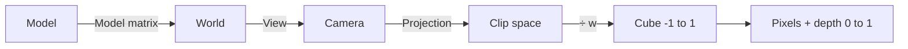
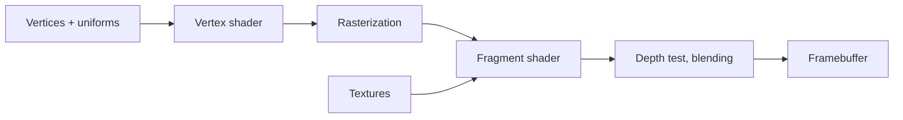
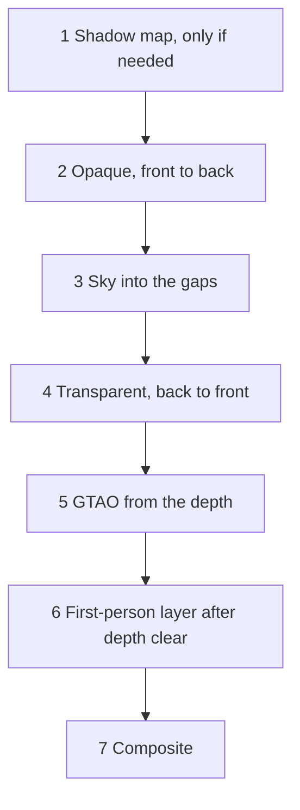

# Appendix B – Foundations: How Triangles Become Pictures

> **Your level:** Here you'll learn the math and physics behind every 3D game – with what you know
> from school, pictures and numbers you can check with a calculator. Afterward, you'll know how a
> graphics card computes light, shadow and shine 60 times per second.

This is where the **ideas** are; what Kern does with them is shown in [Chapter 4](04-graphics.md)
and [Chapter 5](05-scene-and-geometry.md).

## B.1 Coordinate spaces

### Why there are several spaces

The Micro Duck's body is built once in its own coordinate system. Then it stands somewhere in the
world, a camera sees it, and in the end it lands on pixels. Every step switches the coordinate
system:



### Matrices without fear

A **matrix** is a table of numbers that turns one point into another. You calculate **row times
column**: multiply each row with the point number by number, then add. A 90° rotation around the
z-axis, applied to the point (2, 1, 0):

| Row | Calculation | Result |
|---|---|---|
| (0, −1, 0) | 0·2 − 1·1 + 0 | −1 |
| (1, 0, 0) | 1·2 + 0 + 0 | 2 |
| (0, 0, 1) | 0 + 0 + 0 | 0 |

(2, 1) becomes (−1, 2). Draw both arrows in your notebook: rotated by exactly 90°.

### The trick with the fourth number

**Moving** ("plus 10") doesn't fit into a 3 × 3 table. The trick: a fourth number, w. A **point**
gets w = 1, a **direction** gets w = 0, and the move goes in the fourth column:

| Row | Point (1, 2, 3, **1**) | Direction (1, 2, 3, **0**) |
|---|---|---|
| (1, 0, 0, 10) | 1 + 10·1 = 11 | 1 + 10·0 = 1 |
| (0, 1, 0, 0) | 2 | 2 |
| (0, 0, 1, 0) | 3 | 3 |

The point moves, the direction stays – an arrow pointing "forward" still points forward after the
move. Now all transformations are 4 × 4 matrices that you can chain one after another.

### Kern's rules

Everything is in **meters**, **Z points up**, right-handed. Matrices are stored **column by column**,
the way WebGL wants it. With "A times B," B acts first: an object matrix "move · rotate · scale"
scales first, then rotates and moves last. Kern stores rotations as **quaternions**, four numbers
without tipping errors.

> **Watch out, trap:** Order matters! Moving 10 m first and then rotating by 90° lands somewhere
> completely different from the other way around. Try it with an eraser on your desk.

### View and perspective

The **view matrix** shifts the world so that the camera sits at the origin and looks along −z. If the
view direction and "up" point the same way, the sideways axis is missing, and Kern doesn't paint.

**Perspective** means: twice as far away, half as big. A matrix can't divide, but it writes the
distance into w, and the graphics card then divides by w. The magnification is
f = 1 ÷ tan(half the field of view); Kern's default camera uses 60°, so f ≈ 1.732 (the editor
viewports in Studio start at 70°). For the width, it's also divided by the aspect ratio. Kern cuts off
at 0.05 m and 1800 m.

**Worked through:** picture 960 × 540, a point 1 m to the right, 0.5 m up, 10 m in front of the
camera.

| Step | Calculation | Result |
|---|---|---|
| magnify | 1.732 ÷ 1.778 · 1; 1.732 · 0.5 | 0.974; 0.866 |
| divide by w = 10 | ÷ 10 | 0.0974; 0.0866 |
| into pixels | (value + 1) ÷ 2 · (960, 540) | 526.8; 293.4 |

Just to the right of and above the center of the picture (480, 270) – checks out. Views from the top,
front or side are **orthographic**: no dividing, everything stays the same size.

> **Mission:** Open Kern Studio at https://kernengine.de/. In the viewport menu **≡**, set the
> **Field of View** to 50° and then to 110° – at 110°, everything looks farther away and distorted at
> the edges. Then switch to the **Top** view with Alt+J: orthographic, nothing gets smaller in the
> back.

### Depth is spread unevenly

The depth value depends on **1 ÷ distance**, and far-away values crowd up against 1. With Kern's
limits and 24 bits:

| Distance | Depth value | smallest difference |
|---|---|---|
| 10 m | 0.995028 | ≈ 0.1 mm |
| 100 m | 0.999528 | ≈ 1.2 cm |
| 1000 m | 0.999978 | ≈ 1.2 m |

Ten times as far, a hundred times less precise: **quadratic**. Doubling the near limit doubles the
precision everywhere. Kern's GTAO turns the depth value back into meters.

### Normals need special treatment

A **normal** stands perpendicular to a surface. A 45° ramp has the direction (1, −1) and the normal
(1, 1). Now the object is made twice as wide in x:

| | like a point | correct |
|---|---|---|
| normal | (2, 1) | (0.5, 1) |
| times ramp (2, −1) | 4 − 1 = 3 ✗ | 1 − 1 = 0 ✓ |

Perpendicular means the dot product is 0. The correct thing is to **undo** the stretching (divide by
2 instead of multiplying by 2) – the "inverse transpose," which Kern computes per instance
([Chapter 4](04-graphics.md)).

## B.2 Rasterization and the depth buffer

### From triangle to pixels

**Rasterization** checks which pixel centers lie inside a triangle. Each one becomes a
**fragment**.

```
     v2
     /\
    / ■\       ■ = pixel center in triangle
   / ■■ \
  / ■■■■ \
 /________\
v0        v1
```

The values at the vertices are blended with three weights (adding up to 1), **perspective-correct**.
In the middle, each vertex gets one third: vertices red, red, black give ⅔ red.

### The depth buffer

If several triangles hit the same pixel, the **depth buffer** remembers the smallest depth so far.
Only what's nearer or equally near gets painted. For opaque things, the order doesn't matter. Kern
uses this cleverly: opaque things front to back, transparent things back to front, the sky into the
gaps, the first-person layer after clearing ([Chapter 4](04-graphics.md)).

### Back faces

The graphics card recognizes triangles that face away from you by the **winding order** of their
vertices on the screen and throws them away (*backface culling*). A mirror image flips the winding
order.

> **Mission:** In Kern Studio, switch the **View Mode** to **Wireframe** (Alt+2): now you can see
> the triangles. Go back with **Lit** (Alt+4).

## B.3 The GPU pipeline and shaders



The **vertex shader** runs for every vertex and delivers its screen position; the **fragment
shader** runs for every fragment and computes the color. Their ingredients:

| Term | changes | Example |
|---|---|---|
| attribute | per vertex / instance | position, normal |
| uniform | per draw command | sun direction |
| varying | blended per fragment | world position |
| texture | picture to look things up in | shadow map |

**Instancing:** a hundred identical trees are **one** command; attributes like the matrix advance per
instance instead of per vertex. **Skinning:** a vertex follows up to four bones, weighted like grades
on a report card. If bone A would bring it to height 1 and B to height 2, with weights 0.75 and 0.25:
0.75 · 1 + 0.25 · 2 = 1.25. **Multiple outputs:** a fragment shader can write into several pictures
at the same time – Kern writes three and saves a second pass that way.

## B.4 Lighting

### What makes a pixel bright

A pixel shows all incoming light, each times the share the surface throws back toward you (the
**BRDF**), plus its own glow. This rendering equation (Kajiya) is too expensive; games compute
**direct** light precisely and **indirect** light in a simplified way.

### Lambert: matte surfaces

A matte surface scatters evenly. It's bright when light hits it **steeply**; that's measured by the
dot product of the normal n and the light direction l:

> Brightness = albedo × light × max(0, n · l) ÷ π

**Worked through:** ground n = (0, 0, 1), sun at 45°: l = (0, 0.707, 0.707) (Pythagoras: 0.707² +
0.707² = 1). n · l = 0.707. Gray (albedo 0.5), Kern's sun in the red channel 2.8:
0.5 × 2.8 × 0.707 ÷ 3.1416 ≈ **0.315**. If the sun is behind the surface, n · l is negative – the
max turns it into 0. The ÷ π makes sure a white surface doesn't give off more than it receives.

### Point lights

Physically, lamp light falls off with 1 ÷ distance², but never reaches 0. Kern uses a curve that is
**exactly** 0 at the range r: with q = distance² ÷ r², the factor is (1 − q)² ÷ (1 + q).

| Distance at r = 10 m | q | Factor |
|---|---|---|
| 2 m | 0.04 | 0.96² ÷ 1.04 ≈ 0.89 |
| 5 m | 0.25 | 0.75² ÷ 1.25 = 0.45 |
| 10 m | 1 | 0 |

The distance² counts as at least 0.04; otherwise a lamp sitting on a surface would be infinitely
bright.

### Shine: from Blinn–Phong to microfacets

The **half vector** h lies exactly between the light direction and the view direction. If h points
the same way as the normal, you see the highlight; **Blinn–Phong** uses (n · h) to the power of a
shininess number for that. **PBR** (*physically based rendering*) is more precise: a rough surface
is made of tiny mirrors (**microfacets**). The questions are: how many of them point toward h
(**D**)? How much gets reflected (**F**, Fresnel)? How much do they block each other (**G**)?

**D following GGX**, with a2 = roughness⁴:

| Roughness | exactly in the highlight (n · h = 1) | next to it (0.9) |
|---|---|---|
| 1 | 0.32 | 0.32 |
| 0.5 | 5.1 | 0.34 |
| 0.2 | 199 | almost 0 |

Rough surfaces spread the shine out; smooth ones focus it into a tiny, blinding point – that's why
Kern caps D at 40.

**Fresnel following Schlick:** looked at straight on, a non-metal reflects the share F0 = 0.04
(metals: their color). Looked at very flat, it reflects the share F90; in Kern, F90 = 1 − roughness
(at least F0), so rough surfaces also shine less at the edge. In between, (1 − cos of the viewing
angle) to the power of 5 decides. Example for the smoothest surface Kern knows (roughness 0.04, so
F90 = 0.96):

| View | cos | F |
|---|---|---|
| straight on | 1 | 0.04 |
| at an angle | 0.5 | ≈ 0.07 |
| flat | 0.2 | ≈ 0.34 |

> **Crazy but true:** A mirror-smooth non-metal surface reflects only 4% when you look at it straight
> on, but more than a third when you look at it flat. That's why a wet street shines when you look
> across it at a low angle.

**Kern** uses roughness and metal: Lambert for matte, GGX and Schlick for the sun's shine, and the
sky as a Fresnel reflection. It skips the G term; with a simple assumption it cancels out down to the
factor ¼. A **simplified PBR model** ([Chapter 4](04-graphics.md)).

### Indirect light

Light from the sky and the ground is made from just a few colors: **hemisphere light** (sky above,
ground below) and a **gradient** of zenith, horizon and ground – kept separate so that B.8 darkens
only that.

## B.5 Shadow maps

### The idea

You "photograph" the scene as seen from the sun and store, for each texel, only **how far away the
nearest thing is** – the **shadow map**. When painting, every point asks: am I farther away than what
the sun saw? Then something is in front of me.

```
   Sun ═══╗  (parallel rays)
          ║  ↓   ↓   ↓   ↓
          ║     ███          stored: roof
          ║  ↓  ███  ↓   ↓
          ║  ── ─── ─────    ground behind → shadow
```

The sun's rays are parallel, so you use an orthographic projection. If a map with 512 texels covers
240 m, one texel is 240 ÷ 512 ≈ 47 cm – shadows like Minecraft blocks.

### Problems and remedies

| Problem | Cause | Remedy |
|---|---|---|
| acne (stripes) | surface hides itself | small bias |
| Peter Panning | too much bias | keep the bias small |
| jagged edges | one texel, many pixels | filtering (PCF) |
| flickering | map slides | snap to texels |
| blurry up close | map too big | fit it to the view |

**Acne:** a texel stores one depth for a whole patch of surface; on slanted surfaces, half the points
lie just "behind" it. Kern uses three small biases: one depending on the slope, a fixed one (0.0012)
and a **normal offset** (Holbert 2011) – it looks up about one texel in front of the surface, along
the normal.

**PCF** compares several neighboring texels and takes the lit share: if 3 out of 4 are bright, the
point is 75% bright, and the edge gets soft. Graphics cards manage 4 texels in one go; Kern builds
filters up to 5 × 5 out of that. Snapping, shadow distance and reusing, with numbers:
[Chapter 4](04-graphics.md).

## B.6 HDR, tone mapping and gamma

### HDR and tone mapping

Kern's sun has the strength 2.8, but the screen only shows 0 to 1. You compute in **HDR** (*high
dynamic range*) and squeeze it at the end with **tone mapping**: almost straight in the middle,
gentle at the top.

```
 Output
  1 |            ____________
    |        _--
    |    /
  0 |/________________________ Input
    0    1    2    3    4
```

Kern uses the ACES filmic curve (three.js's version), with the exposure before it and a color
correction after it.

### Gamma and sRGB

Pictures store colors in **sRGB**: dark tones get more of the 256 steps, because the eye tells them
apart more finely. But light adds up **linearly**. So: make the colors linear, compute, go back to
sRGB. Linear middle gray 0.18 becomes 1.055 · 0.18^(1/2.4) − 0.055 ≈ **0.461** – almost half the
scale, even though it's only 18% of the light.

> **Picture it like this:** Volume. Going from 1 to 2 speakers, you hear a clear difference; from 10
> to 11, barely any. With light, too, the eye notices differences in the dark more strongly.

### Fog

Kern uses three.js's fog curve, in which density times distance is **squared**. With Kern's density
of 0.00085, there's 0.7% fog at 100 m and 51% at 1000 m – nearby stays clear, the distance sinks
away. Kern's extras are in [Chapter 4](04-graphics.md).

> **Mission:** In **World Settings**, set the **Exposure** to 0.5 and then to 2 – that's the exposure
> before tone mapping. After that, turn **Fog density** up and watch the distance disappear.

## B.7 Bloom

Something very bright outshines its surroundings; this halo of light is called **bloom**. You cut out
the bright parts, blur them and add them back.

A **Gaussian filter** blends every pixel with its neighbors. Instead of 9 × 9 = 81 reads, you first
take 9 horizontally, then 9 vertically: 18. And if you read exactly **between** two pixels, you get
both blended for free – 5 reads replace 9 weights. Kern's weights: center 0.2270, at ±1.3846 pixels
0.3162 each, at ±3.2308 pixels 0.0703 each. Check: 0.2270 + 2 · 0.3162 + 2 · 0.0703 = 1 – the
brightness stays the same.

Kern's soft threshold: brightness 1.0 gives about 27% glow, 1.1 about 69%, from 1.23 on all of it
([Chapter 4](04-graphics.md)).

## B.8 Ambient occlusion: SSAO and GTAO

In corners and cracks, part of the sky is blocked. **Ambient occlusion** (AO) measures the visible
share of the sky; directions close to the normal count more.

**SSAO** (*screen space*) uses only the depth buffer instead of expensive rays and counts samples in
a sphere – rough. **GTAO** (Jimenez and others, 2016) searches for the **horizon** in a few
directions, left and right: how far the sky is open, measured as an angle h from the normal (90°
means: open all the way down to the ground). For the open arc in between there's a ready-made
formula; on flat ground, each side gives (1 − cos(2h)) ÷ 4.

```
            horizon h1
                ╲   │n   ╱  horizon h0
                 ╲  │   ╱
   ████████       ╲ │  ╱      ████
   ████████████────●────────████████
```

| Situation | Horizons | Visibility |
|---|---|---|
| open ground | 90° and 90° | (1 + 1) ÷ 4 + (1 + 1) ÷ 4 = 1 |
| wall on one side | 90° and 45° | 0.5 + (1 − 0) ÷ 4 = 0.75 |

(cos 180° = −1, cos 90° = 0.) Next to the wall, a quarter of the sky is missing.

Kern follows Intel's XeGTAO, with the radius in meters, a bonus for bright surfaces
(**multi-bounce**) and applied only to indirect light ([Chapter 4](04-graphics.md)).

## B.9 Sky and atmosphere

The sky is blue because air scatters short-wavelength light much more strongly (**Rayleigh
scattering**): half the wavelength means 2⁴ = 16 times as much. At the horizon, the path through the
air is longer; with a low sun, red is what's left. Bigger particles scatter forward and make the
halo around the sun (**Mie scattering**). Real models compute this along every line of sight.

Kern computes **no** such integral, but a fast model that looks like it – painted at depth 1, only
into the gaps ([Chapter 4](04-graphics.md)).

## B.10 Culling and scene structures

### The view frustum

What isn't in the picture doesn't get painted. What's visible is a truncated pyramid (*frustum*) made
of six planes, which, according to Gribb and Hartmann, you can read directly from the camera matrix.
Every object gets a **bounding sphere**. It's definitely invisible if its center lies more than its
radius **behind** a plane.

```
       \         /
        \  ●    /     ● visible
   ○     \     /      ○ gone: more than r behind the plane
          \   /
          camera
```

A sphere with a 2 m radius, center 3 m behind the plane: gone. Only 1.5 m behind it: it still sticks
into the picture. The test **never** throws away anything visible, but at the corners it sometimes
lets something invisible through.

### Bounding volume hierarchies (BVH)

A **BVH** (*bounding volume hierarchy*) sorts many triangles into a tree of boxes. If a ray misses a
box, the whole branch drops out.

```
          [ all ]
         /       \
    [left]       [right]
    /    \        /    \
 [△△]  [△△]   [△△]  [△△]
```

For a million triangles, about 20 levels are enough, because 2²⁰ ≈ 1,000,000. Kern uses the BVH for
**clicking** (from 36 triangles on), not for painting ([Chapter 5](05-scene-and-geometry.md)); the
physics has its own ([Appendix C](C-physics.md)).

> **Mission:** In the viewport, turn on **Bounds** under **Show** and take a look at the bounding
> volumes.

## B.11 Draw commands and state changes

Every **draw command** costs processor time: the driver checks things, binds buffers, loads uniforms
– and in the browser, there's also the trip through JavaScript. Thousands of small commands often take
longer than the painting itself. **Changes** (a different program, a different texture) cost too.

Kern fights back: one program, one command per mesh, uniforms and textures only when they change,
shadows only when needed, culling before painting. This is how a frame runs (details in
[Chapter 4](04-graphics.md)):



## B.12 Why WebAssembly and WebGL2 are connected this way

Kern is C++, but the browser only offers graphics to JavaScript. **WebAssembly** is a compact format
that the browser translates into machine code; a module has one big block of memory and may only call
functions it's handed when it loads (**imports**). **WebGL2** is the browser's graphics, almost like
OpenGL ES 3.0. Kern compiles with wasi-sdk for `wasm32-wasip1`. How the bridge works – numbers
instead of objects, data without copying – is shown in [Chapter 4](04-graphics.md).

**Why this way?** C++ everywhere: one codebase for the browser, tests and the Lehrer, and physics
computes the same everywhere ([Appendix C](C-physics.md)). Thin JavaScript: logic there would exist
twice. Numbers: WebAssembly only holds numbers. Own copies: the browser can take the graphics away.
Few commands: every one has to cross the border. Without graphics, the Lehrer computes the same
world; parallelism comes through Web Workers, and inside the module one thread runs.

## B.13 Summary

Matrices, depth, shaders, light, shadow, color, bloom, occlusion, sky, culling and the bridge to the
browser: how Kern uses them is shown in [Chapter 4](04-graphics.md) and
[Chapter 5](05-scene-and-geometry.md).

## Level complete!

- You can apply a matrix "row times column" and know why points have w = 1.
- You can calculate matte brightness with the dot product.
- You know what Fresnel, GGX and PBR mean.
- You know the tricks against shadow acne and jagged edges.
- You understand why you compute linearly and store in sRGB.

## Puzzle corner

1. What does a move by (5, 5, 5) do to the direction (0, 1, 0, 0)?
2. The sun is straight above a white surface (albedo 1), light 3.1416. How bright is it?
3. Why does depth get imprecise in the distance – and what helps the most?
4. **Boss puzzle:** A point in a gutter has a horizon of 45° on both the left and the right. What's
   its visibility according to GTAO?

### Solutions

1. Nothing: w = 0, so the move gets multiplied by 0.
2. 1 × 3.1416 × 1 ÷ 3.1416 = **1** – exactly as much as arrives.
3. The precision drops quadratically (1 ÷ distance). What helps most is a larger near limit.
4. Each side: (1 − cos 90°) ÷ 4 = 0.25. Together **0.5** – half the sky is blocked.

---

© 2026 Christian Heinrich Hohlfeld · All rights reserved · [Imprint and rights](00-imprint.md)
