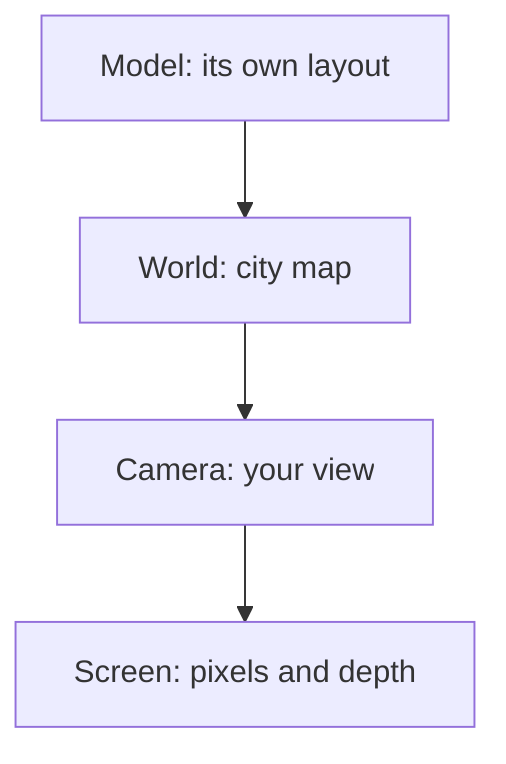
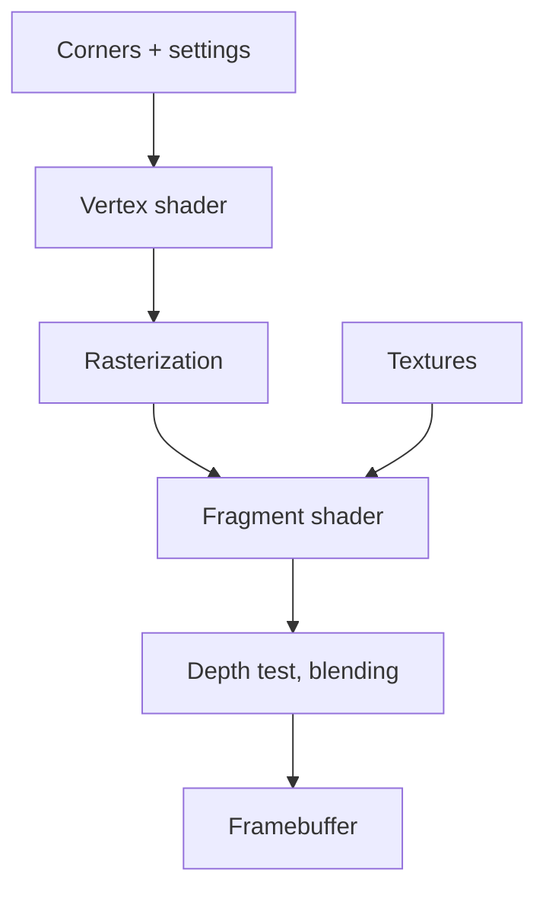
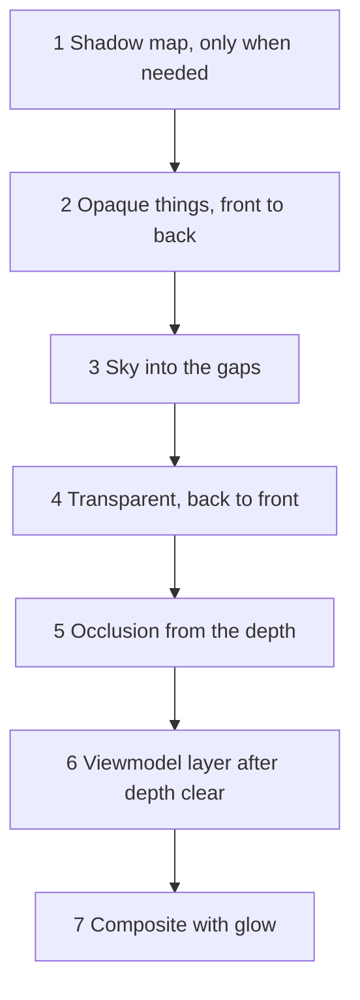

# Appendix B – Foundations: How Triangles Become Pictures

> **Your level:** Here you learn the math and physics behind every 3D game – with pictures and
> numbers you can check with a calculator. Almost everything works with school knowledge; whatever
> goes beyond that is in the "For pros" boxes. Afterward you'll know how a graphics card calculates
> light, shadow and shine 60 times a second.

> **Words you need:**
>
> - **Graphics card** (GPU) – the chip that draws pictures. It calculates thousands of small tasks
>   at the same time.
> - **Mesh** – the wire frame of triangles that a 3D thing is made of.
> - **Corner** (technical term: *vertex*) – a corner point of a triangle, with its position in
>   space.
> - **Instance** – a copy of the same mesh at a different spot, like the 50th tree along an avenue.
> - **Arrow** (vector) – a direction with a length, written as numbers like (3; 4).
> - **Texture** – an image stuck onto a shape. Its pixels are called **texels**.
> - **Framebuffer** – an invisible image the graphics card draws into before anything reaches the
>   screen.
> - **Bit** – a single yes-or-no place. With 8 bits you can write 2⁸ = 256 different values.

Here are the **ideas**; what Kern makes of them is shown in [Chapter 4](04-graphics.md) and
[Chapter 5](05-scene-and-geometry.md).

## B.1 Coordinate Spaces

### Why There Are Several Spaces

A 3D thing is built once in its **own** coordinate system. The Micro Duck's body has its zero point
in its own center, no matter where the duck happens to be standing. Then it's placed in the world, a
camera sees it, and in the end it lands on pixels. Every step changes the coordinate system.

> **Picture it like this:** Your room has its own layout ("desk to the left of the window"). On the
> city map it's a point on a street. From the street you see it as a window on the third floor. In a
> photo it's a few pixels big. Always the same room, described four different ways.

Between "camera" and "screen" sits the perspective; how it works comes in a moment.

### Matrices Without Fear

A **matrix** is a table of numbers that turns one point into another. You calculate **row times
point**: multiply each row number by number with the point, then add. A rotation by 90° around the
z axis, applied to the point (2; 1; 0):

| Row | Calculation | Result |
|---|---|---|
| (0; −1; 0) | 0·2 − 1·1 + 0 | −1 |
| (1; 0; 0) | 1·2 + 0 + 0 | 2 |
| (0; 0; 1) | 0 + 0 + 0 | 0 |

(2; 1; 0) becomes (−1; 2; 0). The third number stays 0, so x and y are enough for your notebook:
draw the arrows (2; 1) and (−1; 2) – rotated by exactly 90°.

### The Trick with the Fourth Number

**Moving** ("plus 10") doesn't fit into a 3 × 3 table. The trick: a fourth number w. A **point**
gets w = 1, a **direction** w = 0, and the move goes in the fourth column:

| Row | Point (1; 2; 3; **1**) | Direction (1; 2; 3; **0**) |
|---|---|---|
| (1; 0; 0; 10) | 1 + 10·1 = 11 | 1 + 10·0 = 1 |
| (0; 1; 0; 0) | 2 | 2 |
| (0; 0; 1; 0) | 3 | 3 |

The point moves, the direction stays – an arrow pointing "forward" still points forward after
moving. Now all conversions are 4 × 4 matrices that can be chained one after another.

### Kern's Rules

Everything in **meters**, and **Z points up**. The axes follow the **right hand**: hold it palm up.
Then your thumb points right (x), your index finger forward (y), and your middle finger, bent
upward, points up (z).

**The order matters.** For every object, Kern always does it in this order: first bring it to the
right size, then rotate it, and last push it to its place.

> **Watch out, trap:** Moving 10 cm first and then rotating by 90° lands somewhere completely
> different from the other way around. Try it with an eraser on the table.

Kern stores rotations as **quaternions**: four numbers that describe "around this axis, by this
much" – like a skewer through an apple that you turn it around. With these four numbers, rotations
can be chained cleanly one after another.

> **For pros:** Why not just three angles? With three angles one after another, a direction of
> rotation can get lost: if an airplane first tips steeply upward, "turn left" and "roll to the
> side" suddenly mean the same thing. That's called "gimbal lock"; quaternions don't have this
> problem.

### View and Perspective

The **view** moves and rotates the whole world so that the camera sits at the zero point and looks
straight ahead. For that, Kern has to know where "right" is: that's the direction at a right angle
to both the viewing direction and "up." If the camera looks exactly straight up or down, the two lie
on one line – then there's no clear "right," and Kern would rather draw nothing.

**Perspective** means: twice as far away, half as big. So you have to **divide** by the distance. A
matrix can only multiply and add. That's why it writes the distance into the fourth number w, and
the graphics card divides everything by w afterward.

Before that, the matrix enlarges with a **zoom factor**. The narrower the camera's viewing angle,
the stronger the zoom, like with binoculars.

**Example of dividing:** A point 1 m to the right of the viewing direction. If it's 10 m in front of
the camera, w = 10, and after dividing 1 ÷ 10 = 0.1 is left. If it's 20 m away, 1 ÷ 20 = 0.05 is
left – half as far from the center of the picture. Twice as far away, half as big.

> **For pros:** The whole calculation down to the pixel. Picture 960 × 540, camera 60° (zoom factor
> 1.732), point 1 m to the right, 0.5 m up, 10 m in front of the camera. Horizontally it's also
> divided by the aspect ratio 960 ÷ 540 = 1.778. Enlarge: x = 1.732 ÷ 1.778 = 0.974, y = 1.732 ·
> 0.5 = 0.866. Divide by w = 10: 0.0974 and 0.0866. The visible range now goes from −1 to +1; plus
> 1, divided by 2, times the picture size gives pixels: 1.0974 ÷ 2 · 960 ≈ 527 and 1.0866 ÷ 2 · 540
> ≈ 293, counted from the bottom left – just to the right of and above the center of the picture
> (480; 270).

Views from the top, front or side are **orthographic**: they don't divide, and everything stays the
same size, no matter how far away.

> **Mission:** Open Kern Studio at https://kernengine.de/. In the viewport menu **≡**, meaning
> **Viewport options**, set the **Field of View** to 50° and then to 110° – at 110° everything looks
> farther away and distorted at the edges. Then switch to the **Top** view with Alt+J:
> orthographic, nothing gets smaller in the back.

### Tool: How Much Do Two Arrows Point the Same Way?

For light and normals you need one question again and again: **How much do two arrows point in the
same direction?** The answer is a single number, the **dot product**. For two arrows of length 1
you calculate: multiply the numbers in pairs, then add.

| Arrows | Calculation | Meaning |
|---|---|---|
| (1; 0) and (1; 0) | 1·1 + 0·0 = 1 | exactly the same |
| (1; 0) and (0.707; 0.707) | 0.707 + 0 = 0.707 | half slanted (45°) |
| (1; 0) and (0; 1) | 0 + 0 = 0 | at a right angle |
| (1; 0) and (−1; 0) | −1 + 0 = −1 | exactly opposite |

Do the math: 0.707 · 0.707 ≈ 0.5, and 0.5 + 0.5 = 1. That's why the arrow (0.707; 0.707) has length
1; the Pythagorean theorem, which you'll learn soon, shows that.

> **Picture it like this:** Hold a pen over a ruler and shine a lamp straight down from above. The
> pen's shadow on the ruler is the dot product. If the pen lies parallel to the ruler, its shadow is
> full length (1). If it stands straight up, its shadow is just a dot (0).

Remember: **1 = same direction, 0 = right angle, negative = pointing away from each other.** With
arrows of a different length the number is bigger or smaller, but 0 still means a right angle.

### Normals Need Special Treatment

A **normal** is an arrow that points straight out of a surface. You can check that with the dot
product: normal and surface must give **0**.

A 45° ramp has the direction (1; −1) and the normal (1; 1). Check: 1 − 1 = 0, a right angle. Now the
object gets stretched to twice its width in x. The ramp gets flatter; its direction is now (2; −1).
What happens to the normal?

| | stretched like the ramp | correct |
|---|---|---|
| Normal | (2; 1) | (0.5; 1) |
| Dot product with (2; −1) | 4 − 1 = 3 ✗ | 1 − 1 = 0 ✓ |

Draw both ramps and the three arrows in your notebook, each from the same point: only (0.5; 1) stands
at a right angle to the flat ramp; (2; 1) tips much too far to the side. So if you stretch the normal
sideways just like the ramp, it stands crooked. The right way is to **reverse** the stretching:
divide by 2 instead of multiplying by 2. Kern calculates this reversed matrix for every instance
([Chapter 4](04-graphics.md)).

> **For pros:** The zoom factor is 1 ÷ tan(half the opening angle); with a calculator, about
> 1 ÷ tan(30°) = 1.732; you'll learn tan in 9th or 10th grade. The normal matrix is called the
> "inverse transpose." And Kern stores its 4 × 4 matrices column by column, because WebGL expects
> that. The exact formulas are in the blue book, Appendix B.

## B.2 Rasterization and Depth Buffer

### From Triangle to Pixels

**Rasterization** checks which pixel centers lie inside a triangle. Each of them becomes a
**fragment** – a pixel candidate whose color is about to be calculated.

The values of the three corners (color, normal, texture position) are mixed for each fragment, with
three shares that add up to 1. Exactly in the middle, each corner gets a third: corners red, red,
black give ⅔ red. The closer a pixel is to a corner, the bigger that corner's share: right next to
the black corner, the pixel is almost black.

Because everything in the back moves closer together, the graphics card mixes **with correct
perspective**: the back half of a triangle is smaller on the screen but still gets its full share.
Otherwise tiles on a floor running into the distance would look bent.

> **Mission:** In Kern Studio, switch the **View Mode** to **Wireframe** (Alt+2): now you see the
> triangles everything is made of. Go back with **Lit** (Alt+4).

### The Depth Buffer

If several triangles hit the same pixel – which one is in front? That's what the **depth buffer** is
for: an invisible image that stores, for every pixel, how far away the frontmost thing so far is.
Only what's closer or equally close gets drawn; then the new depth is written down.

> **Picture it like this:** A painter with a notepad. For every pixel he writes down: "Here I've
> already painted something 12 m away." If something comes at 20 m, he doesn't paint over it. If
> something comes at 5 m, he paints and writes "5 m."

For opaque things, the order then doesn't matter. Transparent things, on the other hand, only check
the notepad and don't write anything into it: a pane of glass mustn't lock out anything that lies
behind it and gets drawn later. Kern uses all of this cleverly: opaque things from front to back,
transparent ones from back to front, the sky into the gaps. At the very end, Kern clears the notepad
and draws the **viewmodel layer**, such as the weapon in your hand in first-person view – that way it
can never disappear into a wall ([Chapter 4](04-graphics.md)).

### Depth Is Unevenly Spread

The depth buffer has only a limited number of steps: in Kern it's 24 bits, so 2²⁴, about 16 million
steps. And it doesn't store the distance itself, but something that behaves like **1 ÷ distance**.
Do the math:

| Neighbors | 1 ÷ distance | Difference |
|---|---|---|
| 10 m and 11 m | 0.1 and 0.0909 | 0.0091 |
| 100 m and 101 m | 0.01 and 0.0099 | 0.0001 |

At 100 m, a meter of distance only makes a hundredth of the difference it makes at 10 m. Ten times
as far, a hundred times less difference: far away, many more meters share one step. With Kern's
settings, the smallest step is:

| Distance | smallest depth that can be told apart |
|---|---|
| 10 m | about 0.1 mm |
| 100 m | about 1.2 cm |
| 1000 m | about 1.2 m |

> **Picture it like this:** A ruler whose marks get farther and farther apart toward the back. In
> front you measure to the millimeter, in the back only to the meter.

The precision depends most on the **near limit**. The camera doesn't draw anything closer than 5 cm;
that's the zero point of the ruler. The rule is simple: **Double the near limit means double the
precision everywhere** – in front and in back. That's why you pick it as big as you can. But it
mustn't be too big, or whatever is right in front of the camera gets cut off.

> **For pros:** More precisely, the depth buffer stores about 1 − near limit ÷ distance; the near
> limit is in the numerator. Between 10 m and 11 m, with 5 cm that gives a difference of
> 0.05 ÷ 10 − 0.05 ÷ 11 ≈ 0.00045, with 10 cm ≈ 0.00091 – twice as much.

### Back Faces

With closed bodies, you never see the triangles that face away from you – there are always others in
front of them. The graphics card throws them away without drawing them. How does it recognize them?
By the **winding order**: every triangle has its corners in a fixed order 1, 2, 3. Seen from the
front, they run counterclockwise; from the back, clockwise.

Try it: draw a triangle on paper, number the corners counterclockwise, and hold the sheet up to the
light from behind. Now the numbers run the other way. A mirror image also flips the winding order –
that's why Kern adjusts the rule for mirrored objects ([Chapter 4](04-graphics.md)).

## B.3 The Graphics Card's Assembly Line and Shaders

A **shader** is a small program that the graphics card runs for every corner or every pixel at the
same time – like a thousand students all doing the same problem with different numbers. There are
two kinds:

- The **vertex shader** runs for every corner and calculates where it lands on the screen.
- The **fragment shader** runs for every fragment and calculates its color.

The graphics card works like an **assembly line** (technical term: *pipeline*): every station does
one step and passes it on. "Blending" at the end means: transparent colors get mixed with what's
already drawn behind them.

Shaders get their ingredients in three ways: some for each corner separately (such as its
position), some the same for all (such as the direction of the sun), and images to look things up
in (such as the shadow map).

> **For pros:** The three ways are called **attribute** (per corner), **uniform** (the same for
> all) and **texture** (an image to look things up in).

**Instances:** A hundred identical trees are **one** draw call. Each tree only gets its own matrix –
which then applies not per corner but per tree.

**Bones (skinning):** A corner of a character follows up to four bones, weighted like a report-card
grade. If bone A would bring it to height 1 and B to height 2, with weights 0.75 and 0.25:
0.75 · 1 + 0.25 · 2 = 1.25. The drawing program for the shadow map calculates this too: the sun sees
the moving arms just the same, and the shadow moves along.

**Several outputs:** A fragment shader can write into several images at the same time. Kern writes
three: the finished color, the bright light for the glow (B.7) and the indirect light for ambient
occlusion (B.8). That way it doesn't have to draw the scene again for these two effects.

> **For pros:** Values that the vertex shader calculates and that arrive at the fragment shader
> mixed between the corners are called **varyings** – for example each pixel's position in the
> world.

## B.4 Lighting

### Direct and Indirect Light

A pixel shows all the light that falls on the surface, times the share the surface reflects in your
direction – plus whatever it glows by itself. Light arrives in two ways:

- **Direct:** a sunbeam or a lamp hits the surface on a straight path.
- **Indirect:** light that has already bounced off something before – off the blue sky, a house
  wall, the ground.

> **Picture it like this:** In the shadow of a house it isn't pitch dark. The sun doesn't reach you
> there, but the whole bright sky and the wall across from you light you up. That's indirect light.

Calculating all light exactly, including every bounce, would be far too expensive. So games calculate
the **direct** light exactly and the **indirect** light in a simplified way.

### Lambert: Matte Surfaces

A matte surface (paper, wood, rubber) scatters light evenly in all directions. It's bright when the
light hits it **steeply**.

> **Picture it like this:** Shine a flashlight straight onto a sheet of paper: a small, bright spot.
> Hold it at an angle: the same light spreads over a big spot, and each place gets less light.

How steep is measured by the dot product from B.1: the surface's normal and the direction to the
light. Straight from above gives 1, at an angle less, from behind something negative – that becomes
0, because light from behind doesn't make anything bright. The rule:

> Brightness = albedo × light × dot product ÷ π

The **albedo** says how much light the color reflects: white 1, medium gray 0.5, black 0. The ÷ π is
a fixed conversion factor. It makes sure that even a white surface never gives off more light than
arrives at it. π comes in because the surface spreads its light over a whole half sphere, and with
circles and spheres π is always involved.

Every color and every light consists of three numbers: red, green and blue. Kern calculates
everything three times, once for each part. In the example we only calculate red.

**Worked through:** Ground, normal (0; 0; 1). The sun is 45° high: direction (0; 0.707; 0.707). Dot
product: 0·0 + 0·0.707 + 1·0.707 = 0.707. Gray ground (albedo 0.5), Kern's sun at 2.8 in the red
part:

> 0.5 × 2.8 × 0.707 ÷ 3.1416 ≈ **0.315**

### Point Lights

A lamp gets weaker with distance, and fast: twice the distance, a quarter of the light.

> **Picture it like this:** A spray can of paint. From twice the distance, the same paint spreads
> over an area twice as wide and twice as high, so four times as big. Each spot only gets a quarter.

In physics, the light gets weaker and weaker this way but never quite 0. Kern takes a curve instead
that reaches exactly 0 at the lamp's **range**, and does so smoothly. That way every lamp has a clear
limit, and its light fades out softly instead of with a hard edge:

| Distance with a 10 m range | Share of the light |
|---|---|
| 0 m | 100% |
| 2 m | about 89% |
| 5 m | about 45% |
| 10 m | 0% |

> **For pros:** With q = distance² ÷ range², the share is (1 − q)² ÷ (1 + q). At 5 m:
> q = 25 ÷ 100 = 0.25, so 0.75² ÷ 1.25 = 0.45.

And very close up? The rule from physics divides by distance times distance. At a distance of almost
0 that would give huge numbers: a lamp right on a wall would be infinitely bright. Kern's curve
doesn't divide by the distance. Right at the lamp, the factor is exactly 1, its full strength, and
never more.

### Shine: Tiny Mirrors

Shiny things have a bright spot where the sun is reflected. Modern games explain that with one idea:
every surface consists of **tiny little mirrors** (microfacets).

> **Picture it like this:** A piece of smooth aluminum foil reflects your face. Crumple it up and
> smooth it out again: now it only glitters broadly and dully. The little mirrors now point every
> which way.

Three rules follow from this:

1. **Roughness** means: how jumbled are the little mirrors?
2. **Smooth** gives a small, glaring highlight; **rough** a broad, weak sheen.
3. **Looking at it at a flat angle reflects more.** This effect is called **Fresnel**. Metals reflect
   in their own color – gold shines golden.

There's one more small thing: on rough surfaces, the little mirrors also get in each other's light
and cast tiny shadows on each other. Kern only calculates that in a simplified way.

> **Crazy but true:** A perfectly smooth surface that isn't metal reflects only 4% of the light
> straight on, but almost all of it when viewed at a very flat angle. That's why a wet road shines
> when you look across it at a flat angle, and a lake reflects the sky at the horizon.

This approach is called **PBR** (*physically based rendering*). Kern calculates a **simplified
PBR**: Lambert for the matte part, a highlight for the sun, and the sky as a reflection that gets
stronger at the edges with Fresnel. Smooth surfaces reflect the sky sharply, rough ones only blurrily
– like the crumpled aluminum foil. Metal has no matte part. Kern limits the highlight of very smooth
surfaces so that no single pixels flicker glaringly.

> **For pros:** For the little mirrors, Kern uses the **GGX** formula; for Fresnel, **Schlick's**
> approximation. The whole calculation starts with James Kajiya's "rendering equation," which adds up
> all light over all directions. Formulas and number tables are in the blue book, Appendix B.

### Indirect Light in Kern

Kern builds the indirect light from a few colors, without tracing a single ray of light:

- **Hemisphere light:** Imagine you're standing under a gigantic glass dome. At the top it's sky
  blue, at the bottom earth brown. A surface pointing up gets the sky color, one pointing down the
  ground color, a wall half and half.
- **Sky gradient:** a gradient of three colors – zenith (straight above you), horizon and ground. So
  it has a horizon of its own, and the reflection of the sky comes from it too.

Both are domes, just calculated with different precision. In the game, the sky gradient delivers the
daylight; the simpler hemisphere light only brightens the night a little
([Chapter 4](04-graphics.md)).

Kern keeps this indirect light separate so that the occlusion in corners (B.8) can darken only it.

## B.5 Shadow Maps

### The Idea

You "photograph" the scene from the sun's point of view and store for each little square (texel)
only **how far away the nearest thing is** – that's the **shadow map**. When drawing, every point
asks: am I farther from the sun than what it saw at this spot? Then something is in front of me, and
I'm in shadow.

The sunbeams are parallel, so you take an orthographic view. If a map with 512 squares covers 240 m,
one square is 240 ÷ 512 ≈ 47 cm in size – shadows made of coarse blocks.

### Problems and Fixes

| Problem | Cause | Fix |
|---|---|---|
| acne (stripes) | surface hides itself | small offset |
| Peter Panning | too much offset | keep the offset small |
| jagged edges | one square, many pixels | average the neighbors |
| shimmering | map slides | snap to squares |
| blurry up close | map too big | fit it to the view |

**Acne:** A square stores only **one** depth for a whole piece of surface, like a stair step. If the
real surface is slanted, it's sometimes above the step, sometimes below. The points below think
they're hidden – by themselves! Stripes appear.

The fix: add a small **offset** when comparing, so look a little in front of the surface instead. But
if you add too much offset, the shadow only starts a bit beside the object – it seems to come loose.
That's called **Peter Panning**, after Peter Pan, whose shadow runs away in the story and has to be
sewn back on by Wendy.

**Jagged edges:** A square is bigger than a pixel, so the shadow edge looks blocky. The fix is called
**PCF** (*percentage-closer filtering*): Kern asks several neighboring squares and takes the bright
share. If 3 of 4 are bright, the point is 75% bright, and the edge gets soft. Snapping, shadow
distance and reuse are shown with numbers in [Chapter 4](04-graphics.md).

> **For pros:** Kern uses three small offsets: one that grows with the slant, a fixed one and a
> "normal offset" – the lookup happens about one square in front of the surface, along its normal.
> Graphics cards compare 4 squares in one go; Kern builds filters up to 5 × 5 from that.

## B.6 HDR, Tone Mapping and Gamma

### HDR and Tone Mapping

Kern's sun has a strength of 2.8, but a screen only shows 0 to 1. So you calculate with values of
any brightness (**HDR**, *high dynamic range*) and only squeeze everything into 0 to 1 at the very
end. That's called **tone mapping**. A good curve is almost straight in the middle and only gently
squeezes the very bright parts. That way you can still see shapes in a bright cloud instead of it
just turning white.

For this, Kern takes a curve from the film industry (it's called ACES), with the **exposure** before
it, like on a camera, and a color mood after it.

### Gamma and sRGB

A screen has 256 steps per color (8 bits). Images spread these steps in **sRGB** so that dark tones
get more of them, because the eye tells them apart more finely there.

> **Picture it like this:** Volume. Going from 1 to 2 speakers you hear clearly; from 10 to 11,
> hardly. With light, too, the eye notices differences in the dark more strongly.

But light adds up **linearly**: twice as much light means a number twice as big, and two lamps
together are the sum. So: make colors linear first, then calculate, and at the end go back to sRGB.
This conversion between "this much light" and "the way the eye sees it" is called **gamma**.

An example shows how big the difference is: linear medium gray 0.18 – that is, 18% of the light –
becomes **0.46** in sRGB, almost half the scale. So the darkest 18% of the light get almost half of
all the steps. What looks half bright to your eye is in reality less than a fifth of the light.

> **For pros:** The conversion is 1.055 · 0.18^(1 ÷ 2.4) − 0.055 ≈ 0.461 – an exponent that's a
> fraction. For very dark values, a straight piece applies. Both formulas are in the blue book,
> Appendix B.

### Fog

Fog gets stronger with distance – but not evenly: in Kern's calculation, the distance is
**squared**. That keeps things close up completely clear, while the distance disappears quickly.
With Kern's default fog, at 100 m there's hardly any fog to see (0.7%), while at 1000 m a good half
already disappears (51%). Kern's extras, like height fog, are in [Chapter 4](04-graphics.md).

> **Mission:** In the **World Settings**, set the **Exposure** to 0.5 and then to 2 – that's the
> exposure before tone mapping. **What you see:** at 0.5 everything gets darker, at 2 brighter. But
> even at 2, bright spots don't just turn flat white; they only get brighter slowly: the curve
> squeezes them gently. Then turn up **Fog density**: things close up stay clear, the distance
> disappears quickly.

## B.7 Bloom

Very bright things outshine their surroundings, in the eye just like in a camera – a streetlight at
night has a halo. This halo is called **bloom**. The recipe: cut out the bright parts, blur them,
add them back onto the picture.

**Blurring** means: each pixel takes the average of itself and its neighbors. A row with a single
bright pixel:

| | Pixel row |
|---|---|
| before | 0 · 0 · 9 · 0 · 0 |
| after (3 averaged each) | 0 · 3 · 3 · 3 · 0 |

The light has spread to the neighbors – the beginning of a halo.

Three tricks make this fast. First: you blur on a **shrunken** image. That's cheaper because there
are fewer pixels, and the glow gets wider by itself because one small pixel covers many big ones.
Second: instead of mixing each pixel with all 9 × 9 = 81 neighbors in the square, you first mix 9
horizontally, then 9 vertically – 18 instead of 81 reads. That gives the same result, because the
light first moves sideways and then up and down, and so arrives everywhere in the square. Third: if
you read exactly **between** two pixels, the graphics card delivers their average for free. So 5
reads are enough for 9 pixels in a row: one for the middle, and two each on the left and right that
each read a pair of pixels at once.

In Kern, the glow sets in gently just below brightness 1 and is fully there from a little over 1.2 –
so it hits whatever is brighter than the screen can show. How Kern brings the glow into the finished
picture without losing the fog is shown in [Chapter 4](04-graphics.md) (4.8.3): it only adds the
difference the glow makes. Pixels without glow stay exactly as they were.

> **For pros:** Kern's weights: middle 0.2270, at ±1.3846 pixels 0.3162 each, at ±3.2308 0.0703
> each. Check: 0.2270 + 2 · 0.3162 + 2 · 0.0703 = 1 – the total brightness stays the same.

## B.8 Ambient Occlusion

In corners, cracks and under things, part of the sky is hidden, so less indirect light arrives
there. That's called **ambient occlusion** (AO for short). It makes pictures look much more
three-dimensional.

> **Picture it like this:** Stand in the middle of your room and see how much ceiling you can see.
> Then squeeze into a corner: two walls hide a big part. That's why it's always a bit darker in the
> corners of a room.

How much sky does a point see? Look at the half circle above it: 180° from one horizon to the other.
Open ground sees all of it, **100%**. If there's a wall on one side whose top edge you see at 45°,
45° of 180° are missing: **75%**. In a gutter with such walls on both sides, twice 45° are missing:
**50%**.

Shooting rays through the whole scene would be too expensive. So you only look into the **depth
buffer**: for each pixel, you look in a few directions at how high the neighbors around it rise. The
**GTAO** method searches this way for the highest point on the left and right – the **horizon** – and
calculates how much sky is free in between. In our examples it arrives at exactly the same values. At
other angles, GTAO counts sky from diagonally above a bit more than sky right at the flat edge,
because light from above hits a surface more steeply – just like with Lambert.

Kern uses the result to darken **only the indirect light**. The sun already has its own shadow.
Bright surfaces get a bonus because they bounce light back and forth between the walls
(**multi-bounce**, [Chapter 4](04-graphics.md)).

> **For pros:** GTAO comes from Jorge Jimenez and others (2016). For each side there's a ready-made
> formula with the cosine; for flat ground it's (1 − cos(2h)) ÷ 4, where h is the angle between the
> normal and the horizon. The older, coarser method is called SSAO.

## B.9 Sky and Atmosphere

The sky is blue because air scatters blue light around much more strongly than red. Light is a
wave; blue has short waves, red long ones. And shorter waves get deflected by the tiny air particles
much more often (**Rayleigh scattering**). This scattered blue comes to you from all directions – the
whole sky glows blue.

At the horizon and in the evening, the light's path through the air is much longer. At the horizon,
the light therefore gets scattered more often, and the sky is brighter there than overhead. When the
sun is low, almost all the blue gets scattered out along the way, and red and orange are left:
sunset glow. Bigger particles like dust or tiny droplets scatter mostly forward and create the
bright halo around the sun (**Mie scattering**).

Real sky models calculate hundreds of steps through the air for every view. Kern does **not**
calculate that, but draws a fast model that looks like it – all the way in the back and only into
the gaps where nothing else is yet ([Chapter 4](04-graphics.md)).

> **For pros:** Half the wavelength means 2 · 2 · 2 · 2 = 16 times as much scattering. So the
> scattering depends on the fourth power of the wavelength.

## B.10 Culling and Scene Structures

### The Viewing Pyramid

What isn't in the picture doesn't get drawn – sorting it out is called **culling**. What's visible is
a truncated pyramid (*frustum*) with six walls: left, right, top, bottom, near and far. Every object
gets a **bounding sphere** that completely encloses it. If the center of the sphere is more than its
radius **behind** one of these walls, the object is definitely invisible.

Sphere with a 2 m radius, center 3 m behind the wall: gone. Only 1.5 m behind: it still reaches into
the picture. The test **never** throws away anything visible, but at the corners of the pyramid it
sometimes lets something invisible through. Better to draw once too often than once too little.

With instances, **one** sphere encloses all copies together. So a forest as one mesh is sorted out
only as a whole or not at all: if even one tree is in the picture, the whole forest gets drawn. It's
only one draw call anyway.

### Bounding Volume Trees (BVH)

When you click, Kern shoots an invisible ray from the camera through the mouse into the scene. Which
triangle does it hit first? Checking every triangle one by one takes too long with millions. So you
sort them into a tree of boxes in boxes, a **BVH** (*bounding volume hierarchy*). If the ray misses a
box, everything in it drops out at once.

> **Picture it like this:** "Who am I?" with yes-or-no questions. Each question halves the
> possibilities. With 20 questions you can find one person among a million.

With a million triangles, about 20 levels are enough, because 2²⁰ ≈ 1,000,000. Kern uses the BVH for
**clicking on** big, still objects, not for drawing ([Chapter 5](05-scene-and-geometry.md)); the
physics has its own ([Appendix C](C-physics.md)). Kern checks moving things triangle by triangle. A
tree of boxes only pays off if you build it once and use it often – for something that's constantly
moving, you'd have to rebuild it again and again.

> **Mission:** Create a level with **File › New Level...** › **Basic** and, through **Add** ›
> **Shapes**, put in a few shapes, such as **Cube**, **Sphere** and **Cylinder**. Then, in the
> viewport, switch on **Bounds** under **Show**. (Bounds come as a sphere or as a box; Studio shows
> you the box.) **What you see:** around each object appears a yellow box made of lines, with its
> edges lined up exactly with the axes – that's its bound, the topmost box. Lights and empty actors
> get a tiny cube. Now rotate the cube 45° with the **Rotate (E)** tool: the yellow box does **not**
> rotate with it but gets bigger, so the slanted cube still fits completely inside. **What you
> learn:** a bound doesn't have to fit exactly – it just has to be sure to enclose everything, so
> tests are fast and still correct.

## B.11 Draw Calls and State Changes

Every **draw call** costs the processor time: before the graphics card draws anything, the driver
(the graphics card's control program) checks the command and prepares everything. In the browser,
the trip through JavaScript comes on top. Thousands of small commands often take longer than the
drawing itself. Every **change** – a different drawing program, a different texture – costs too.

> **Picture it like this:** Shopping. Running to the store 100 times and getting one item each time
> takes forever. Going once with a list and a big basket is quick – even if you buy the same things.

Kern fights back: one drawing program for everything, one command per mesh (with all its instances),
settings and textures only when they change, shadows only when needed, and invisible things sorted
out beforehand. This is how a frame goes (details in [Chapter 4](04-graphics.md)):

## B.12 Why WebAssembly and WebGL2 Are Connected Like This

**C++** and **JavaScript** are two programming languages. Kern is written in C++, but the browser
only offers graphics to JavaScript. **WebAssembly** is like a translator's suitcase: Kern's C++ gets
packed into it, and the browser can open the suitcase and run it fast. To do that, it translates it
into **machine language**, the language the processor understands directly. Inside the suitcase,
Kern has a big block of memory to itself. It may only call outside through a hatch: it may only use
the commands handed to it when loading (**imports**), and only numbers fit through the hatch.
**WebGL2** is the browser's graphics. What the bridge between the two looks like exactly – numbers
instead of things, data without copying – is shown in [Chapter 4](04-graphics.md).

Why did Kern build it this way?

| Why … | Because … |
|---|---|
| everything in C++? | the same code calculates the same in the browser, in tests and in the Lehrer – the Lehrer practices exactly your world. |
| so little JavaScript? | you'd have to maintain everything twice there. |
| numbers instead of graphics objects? | WebAssembly can only hold on to numbers. |
| its own copies of everything? | the browser can take the graphics card away at any time (context loss, [Chapter 4](04-graphics.md)). |
| so few draw calls? | each one has to cross the border to JavaScript. |
| does it work without graphics? | the copies are enough – that's how the Lehrer calculates the same world without drawing. |

> **For pros:** WebGL2 largely corresponds to OpenGL ES 3.0, the graphics in phones. Only a single
> strand of calculation runs in a Kern module; anyone who wants to use several processor cores (the
> Lehrer) starts several modules side by side. The exact names are in the blue book, Appendix B.

## B.13 Summary

Matrices and perspective, depth, shaders, light, shadow, color, glow, occlusion, sky, culling and the
bridge to the browser: these are the building blocks of every 3D game. How Kern uses them is shown
in [Chapter 4](04-graphics.md) and [Chapter 5](05-scene-and-geometry.md).

## Level complete!

- You apply a matrix "row times point" and know why points have w = 1 and directions w = 0.
- You know how perspective works: divide by the distance.
- You measure with the dot product how much two arrows point in the same direction – and use it to
  calculate how bright a matte surface is.
- You know why the depth buffer gets coarse in the distance.
- You know direct and indirect light, the tiny mirrors behind the shine, and the wet-road effect.
- You know the tricks against shadow acne and jagged edges.
- You understand why you calculate linearly and store in sRGB.

## Puzzle corner

1. What does a move by (5; 5; 5) do to the direction (0; 1; 0; 0)?
2. The sun is straight above a white surface (albedo 1), light 3.1416. How bright is it?
3. The depth buffer stores something like 1 ÷ distance. Calculate 1 ÷ 10 − 1 ÷ 11 and
   1 ÷ 100 − 1 ÷ 101. What does that say about precision in the distance – and what helps most?
4. **Boss puzzle:** Noon. A point lies at the bottom of a gutter whose walls it sees at 45° on the
   left and right. The sun shines straight down into it. Without occlusion it gets 2.0 direct light
   from the sun and 1.0 indirect light from the sky. How much light is left after occlusion? And why
   would it be wrong to darken the sunlight too?

### Solutions

1. Nothing: w = 0, so the move gets multiplied by 0. A direction has no location.
2. The normal and the direction to the sun point exactly the same way; the dot product is 1. So
   1 × 3.1416 × 1 ÷ 3.1416 = **1** – exactly as much as arrives.
3. 0.1 − 0.0909 ≈ 0.0091 and 0.01 − 0.0099 ≈ 0.0001: at 100 m away, a meter makes almost a hundred
   times less difference than at 10 m. So far away, many more meters share one step of the depth
   buffer – ten times as far, a hundred times coarser. What helps most is moving the near limit
   farther out: double the near limit means double the precision everywhere.
4. The walls hide twice 45° of 180°; the point sees only half the sky: visibility 0.5. Only the
   indirect light gets darkened: 1.0 × 0.5 = 0.5. The sun stays at 2.0. Together **2.5** instead of
   3.0. Darkening the sunlight would be wrong, because the sun really does reach the point – whether
   it's blocked is already decided by the shadow map. Occlusion only measures how much **sky** the
   point sees.

---

© 2026 Christian Heinrich Hohlfeld · All rights reserved · [Imprint and rights](00-imprint.md)
