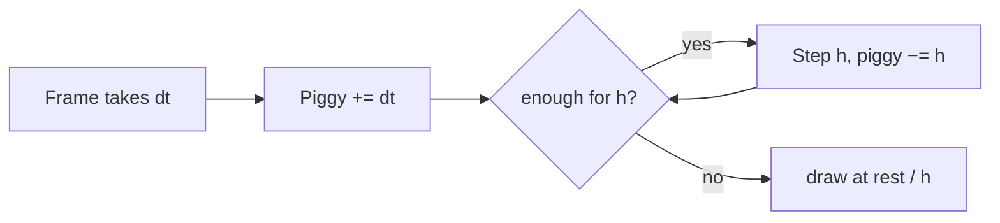
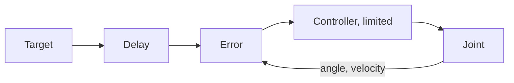

# Appendix C – Foundations: How a Physics Simulation Thinks

> **Your level:** A bonus level under the hood: how a computer calculates motion ahead step by step,
> finds collisions, computes friction, controls a servo – and why everything comes out the same on
> every device, down to the very last bit.

How Kern uses **Box3D** is in [Chapter 6](06-physics.md); here it's about the ideas behind it. All
you need is force, mass, velocity and friction – pictures and numbers show the rest.

## C.1 Rigid Bodies and Their State

A **rigid body** never deforms. Real things give a little, but for robot limbs, crates and cars,
this fits very well – and a few numbers describe the whole motion: **position** (of the center of
mass), **rotation** (as a quaternion, four numbers, see [Appendix B](B-rendering.md)), **velocity**
and **angular velocity**. What stays fixed is the **mass**, the **center of mass** and the **inertia
against rotation**.

> **Picture it like this:** Spin around on an office chair and pull your arms in – you get faster.
> How the mass is distributed decides how easily something turns. A rod turns easily along its
> length and hard across it; that's why inertia needs six numbers instead of one.

Newton's rule applies: **force = mass · acceleration** – 10 N make a 2 kg ball 5 m/s faster every
second. Rotations follow torque and inertia, plus a **gyroscopic effect** that makes long, thin
bodies tumble.

## C.2 Integration: The Flip Book

A computer calculates motion like a **flip book**: from the picture now to the picture one step
length h later. That's called **integration**. Because forces change *during* the step, every method
has to guess. A falling ball, h = 0.1 s, g ≈ 10 m/s²:

- **explicit:** move on with the *old* velocity, then speed up;
- **semi-implicit:** speed up first, then move on with the *new* velocity.

After 0.3 s, the ball has fallen 0.3 m explicitly, 0.6 m semi-implicitly, and 0.45 m in reality.
Both are off – but with **springs**, this decides everything. A spring at 2 Hz with a 60 Hz beat:

| Method | per step | after 1 second |
|---|---|---|
| explicit | +2.2% | 3.6 times as far |
| semi-implicit | stays | stays |
| implicit (force at the end of the step) | −2.1% | only 28% left |

Explicitly, the spring swings itself up higher and higher. Implicitly, it gets slowed down
artificially, but it's **always stable**. Semi-implicit keeps the swing – at 60 Hz up to a spring
frequency of about 19 Hz.

> **Crazy but true:** A 30 Hz spring with a 60 Hz beat grows 3.3-fold per step when computed
> explicitly. After ten steps – one sixth of a second – it's **150,000 times** as big.

**Box3D** computes semi-implicitly: in every sub-step, first the velocities, then the **solver**
(C.6), then the positions with the new velocity. Damping divides the velocity by (1 + h · c) each
step: at c = 2/s and 60 Hz by 1.033, so 3.2% less – it can never tip over. Box3D computes the
gyroscopic effect implicitly too. Speed limits: 400 m/s and one eighth of a turn (45°) per step.

> **Watch out, trap:** Why does Kern forbid a homemade braking force "force = −c · velocity"? An
> example: a 10 g limb, c = 10, 60 Hz: per step, the velocity changes by 10 ÷ 0.01 ÷ 60 ≈ 16.7 times
> the velocity itself. 1 m/s forward turns into −15.7 m/s backward. The "brake" catapults.

### Fixed Time Step

If you computed with the wobbling frame time, a slow frame would mean a big, unstable step – and
every computer would end up somewhere else. Glenn Fiedler's **accumulator** is a time piggy bank:



An example with h = 16.7 ms: a frame takes 25 ms – one step, 8.3 ms left over, drawn at 50% between
the old and the new state. The next frame takes 25 ms again: now there are 33.3 ms in the piggy
bank, so two steps, 0 left over. Kern's limits: [Chapter 6](06-physics.md), 6.13.

**Sub-steps** split each step further: for the Micro Duck, 100 Hz × 16 = 1600 per second, 0.625 ms
each. Smaller steps make chains of joints stiffer.

## C.3 Collision Detection

With n bodies, there are n · (n − 1) ÷ 2 pairs; with 1000, that's 499,500. That's why there are two
phases:

**Broad phase:** Every shape sits inside an axis-aligned box; only overlapping boxes (six
comparisons) move on. The boxes live in a tree like the BVH from
[Chapter 5](05-scene-and-geometry.md), a little too big (up to 50 mm), so the tree doesn't have to be
rebuilt all the time. Fixed bodies have their own tree.

**Narrow phase:** What counts here is **convex**: the line between any two points of the shape lies
completely inside it. Sphere, capsule, box and convex hulls are convex; an L is not.

- **GJK:** Subtract every point of B from every point of A – what comes out is the **Minkowski
  difference**. If it contains the origin, A and B touch. GJK feels its way there with a point, a
  segment, a triangle and a tetrahedron, and only ever asks each shape: "What's your outermost point
  in direction d?"
- **SAT:** Shine a flashlight on two shapes. If there's a direction in which the shadows don't
  overlap, they're separated. It tries face normals and edge combinations; Box3D remembers the last
  separating axis.

The result is a **manifold**: a normal and contact points with their distances. **Convex hulls**
stretch around points like a rubber band around nails, in 3D (up to 128 vertices, not flat). You
build anything non-convex out of several hulls; triangle meshes exist only for fixed bodies.

**Tunneling:** A sphere at 300 m/s flies 5 m per step at 60 Hz – straight through a 10 cm wall.
That's why Box3D creates contacts **before** things even touch, from a distance of 20 mm (the
speculative distance, four times the allowed overlap of 5 mm), and only allows as much approach as
there's distance left. For very fast things, there's **continuous collision**. Because these
tolerances are fixed in meters, Kern simulates the small Micro Duck four times as big
([Chapter 6](06-physics.md)).

## C.4 Contacts, Friction, Bounciness

**The contact rule:** Bodies may not pass through each other; a contact can only **push**, never
pull; and it only pushes when they touch. Either-or rules like these are called **complementarity
conditions**. The solver fulfills them very well, but not perfectly.

**Coulomb friction:** It's at most **friction coefficient μ times pressing force**. A 300 kg crate
presses down with about 2943 N; at μ = 0.6, it holds up to 1766 N. If you push with 1000 N, it
**sticks**; with 2000 N, it **slides**. On a ramp, it stays put as long as the **slope** isn't
bigger than μ – μ = 0.6 means up to 60% (about 31°). All allowed forces form a **friction cone**:

```
     ╲    │ n  ╱   force inside → sticking
      ╲   │   ╱    force on edge → sliding
   ──────●──────   contact surface
```

Actually, static friction is stronger than sliding friction; Box3D only knows one value. It computes
friction once at the **center** of the manifold and keeps the cone **round**: if (3 | 4) is needed,
that's 5 by Pythagoras, and if (for example) 2.5 is allowed, the arrow gets halved to (1.5 | 2)
instead of capping each number at 2.5. On top of that comes **twisting friction** around the normal.

> **Mission:** Use **+ Add › Shapes** to place a **Ramp** (6 m long, 1.5 m high: 25% slope) and
> **+ Add › Physics** to place a **Physics Cube**; push it onto the slope. In Simulate, it stays put
> (both have friction 0.6). Stop with Esc, set its **Friction** in Details › Static Mesh › Physics to
> 0.02 and start Simulate again: it slides, because √(0.02 · 0.6) ≈ 0.11 is smaller than 0.25.

**Two friction values, one contact:** Box3D takes √(μA · μB). With 0.6 and 1.0, that's 0.775
(average 0.8); with ice at 0.05 and rubber at 1.0, only 0.224 (average 0.525); and with 0 and 1.0,
exactly 0. So whatever is frictionless stays frictionless. Still, it's only a rule of thumb – that's
why Kern knows measured **pair values** ([Chapter 6](06-physics.md), 6.6). The Micro Duck picks up a
sock with its beak: the pad has to **grip** the sock, and the sock has to **slide** on the floor. One
value per shape can't do both.

**Bounciness (restitution):** With e = 0.5, a ball that hits the ground at 4 m/s bounces back at
2 m/s; with e = 0, it stays put; with e = 1, it bounces perfectly. Box3D takes the **larger** value
of the two shapes – a rubber ball bounces on concrete too. Below 1 m/s, nothing bounces; otherwise
resting things would jitter forever. Bounciness is applied **after** solving, using the velocity from
before the impact.

> **Mission:** Put a **Physics Sphere** into the scene, set its **Restitution** in Details › Static
> Mesh › Physics to 0.9, lift it up in Simulate and let it drop. Stop with Esc, set it to 0 and try
> again: now it stays put.

**Rolling resistance:** A perfect sphere rolls forever. Real balls and floors give a little – that
brakes with **rolling resistance times pressing force**, so at 0.03, 3% of the weight. Box3D takes
the larger value times the radius. Kern's notes: "The ball rolled forever" – until it got rolling
resistance.

## C.5 Joints as Rules

A **joint** is a rule, such as: "Point A and point B stay on top of each other" – so both have to
move equally fast. If that's off, the solver looks for a repairing **impulse**. How strongly it acts
depends on the **effective mass**:

In the simplest case – two spheres that only pull or push straight along a line, without rotating –
this holds:

**effective mass = 1 ÷ (1/mA + 1/mB)**

Two 2 kg spheres: 1 ÷ (0.5 + 0.5) = 1 kg. A 2 kg sphere attached to a fixed wall (1/m = 0): 2 kg. For
a hinge, the same goes with the inertia around the axis – that's exactly how Kern translates servo
springs ([Chapter 6](06-physics.md), 6.8, which also has all nine joint types). Joints are always
built in the **rest pose**: that's where the angle is 0.

## C.6 The Solver

A robot has 15 joints and dozens of contacts. Real-time engines solve them **one after another**,
over and over (**Gauss-Seidel**, in games called **sequential impulses**).

> **Picture it like this:** Four people hold a picture against the wall. Each one adjusts their own
> corner and shifts the others a little in the process. After a few rounds, it hangs straight.

The solver checks "only push" against the **sum** of all impulses: round 1 pushes 5, round 2 takes 2
back – sum 3, allowed. If it wanted to take 6 back, the sum would be −1; then it gets capped at 0.
**Warm starting:** A resting stack needs almost the same impulses every step, so the solver starts
with the last ones.

**Soft rules:** Hard rules correct instantly and cause jitter. Box3D treats **every** rule as a
stiff, damped spring, computed implicitly (stable, see C.2). With Kern's contact values (30 Hz,
damping 10) at 1600 sub-steps per second, 1 mm of overlap between moving bodies gets resolved at only
about **6.6 mm/s** – gently instead of with a jerk. Box3D computes contacts with fixed bodies at
60 Hz and damping 5: about 26 mm/s. The upper limit is the push-out speed (Kern: 3 m/s).

A fixed step in Box3D is called a **soft step**: prepare the rules; then, per sub-step, compute
velocities, warm start, solve with error correction, compute positions and **relax** (solve without
error correction – that takes the extra momentum of the correction back out); at the end, apply
bounciness and remember the impulses for the next warm start.

**Limits:** A spring has to oscillate more slowly than the sub-steps "look." Box3D limits joints to
a quarter and contacts to an eighth of the sub-step rate – at 1600, that's 400 and 200 Hz; Kern's
servo joints use 240 Hz. **Mass ratios:** If something heavy hangs from something light (5 kg on
10 g is 500 : 1), joints stretch until the solver has passed the impulses through. Rule of thumb: at
most about 10 : 1.

## C.7 Servos as a Control Loop

A servo like the Micro Duck's Dynamixel XL330 gets a **target angle**, measures, compares and
counters – over and over:



**PD controller:** torque = K · error − D · angular velocity. K acts like a torsion spring, D like a
shock absorber. One newton meter is 1 N (about the weight of 100 g) on a 1 m lever. With the XL330
(K = 0.554, D = 0.053), at an error of 0.5 rad (just under 29°), the servo pushes with
0.554 · 0.5 ≈ 0.28 N·m; if it's currently turning at 2 rad/s, the damping takes 0.11 N·m off that.

With its rotor inertia, it oscillates about **2.8 times per second**, with a damping ratio of
**0.84**. Below 1, a controller overshoots the target (a worn-out shock absorber); exactly 1 arrives
without overshooting (a good door closer); above 1, it crawls (a door in honey). So 0.84 is soft and
well damped.

**Saturation:** The motor can't manage more than T = 0.963 N·m – reached at
0.963 ÷ 0.554 ≈ 1.74 rad, around 100°. That's why the network has to set targets far beyond the
joint limits. **Friction** in the gearbox: 0.0048 N·m of counter-torque. **Delay:** about 20 ms. One
oscillation at 2.8 Hz lasts 357 ms; 20 ms of that is 5.6%, and 5.6% of 360° is **about 20°** that
the controller lags behind. That can make a stable controller start oscillating.

> **Watch out, trap:** A network that never trained with delay fails on the real robot. That's why
> Kern simulates it too, as a queue of 4 world steps.

**In Kern,** the PD controller is the hinge's spring (implicit, so stable), saturation is a limited
target, friction is a motor with speed 0 and rotor inertia is a disc on the axis, all in one
**device profile** ([Chapter 6](06-physics.md), 6.17; [Chapter 16](16-calibration.md)).

## C.8 What Not to Do

Continuous loads as a **force** every step (forces get cleared). Jumps as an **impulse** = mass ·
change in velocity: 30 kg that should get 5 m/s faster need 150 N·s. **Don't set velocities** on
bodies with joints or contacts – a "gyro" at the velocity level made the duck jump. **No helper
forces** for robots; they don't exist in reality either. All the rules: [Chapter 6](06-physics.md),
6.15.

## C.9 Determinism

**Deterministic** means: same start, same inputs, **bit-for-bit identical** result. Then a training
run produces the same network everywhere, bugs can be reproduced, and robot logs play back the same
everywhere. But physics is **chaotic**; Kern's notes say: "In a robot simulation, one bit turns into
a different gait within seconds."

Computers round after every calculation, and the **order** matters:

```
(0.1 + 0.2) + 0.3  =  0.6000000000000001
0.1 + (0.2 + 0.3)  =  0.6
```

The traps and Kern's countermeasures:

- **Reordering by the compiler** (`-ffast-math`): forbidden.
- **Parallel sums** depend on the number of threads: Kern sums in a fixed order
  ([Appendix A](A-neural-networks.md)); Box3D runs on one thread.
- **FMA** computes a · b + c with one rounding instead of two – both are correct, but different, and
  WebAssembly doesn't do it. Kern compiles everything with `-ffp-contract=off`, Box3D without vector
  instructions.
- **sin, cos, exp, log, pow, atan2** round differently on Linux, Apple, Android and in the browser.
  Kern brings its own (from **musl**, MIT license) under `kern::dm::`. `sqrt`, `fabs` and `floor`
  are exact everywhere.
- **Wobbling time, randomness, clock time:** a fixed beat, its own random number generator with
  fixed seeds, simulation time as a step counter.

**Checking:** Pollen's network controls the duck for 400 control ticks; after each one, the exact
state is turned into a check number. Two builds are identical if all 400 numbers are identical –
checked with GCC on x86, WebAssembly in Node and Apple clang on ARM.

> **Crazy but true:** A hanging servo leg runs **bit for bit identically** at normal and four times
> its size. At S = 4, all the factors are powers of two (2, 4, 64, 256 …). In a computer, a decimal
> number times a power of two only shifts the exponent; the digits stay the same. If every quantity
> is scaled along correctly, every calculation rounds exactly the same way. On the ground, that no
> longer works: Box3D's fixed tolerances don't scale along.

> **Mission:** In Physics Lab, under World Settings › Physics (Box3D), set the **Sub-steps** from 4
> to 1, start Simulate and watch the rope bridge. Stop with Esc, set 16 and compare: with 1 sub-step,
> the middle hangs about a meter lower – long chains of joints stretch more with few sub-steps.

## C.10 At a Glance

Where you'll find each topic again in [Chapter 6](06-physics.md): state and mass in 6.4, beat and
sub-steps in 6.13, shapes and hulls in 6.5, friction and bounciness in 6.6 and 6.7, joints in 6.8,
servos in 6.17, determinism in 6.14.

## Level complete!

- You know how a computer calculates motion as a flip book and why Box3D is semi-implicit.
- You know the broad and narrow phase and what convex means.
- You can calculate with μ and combine two friction values.
- You understand how a solver resolves soft rules and why Kern stays bit-for-bit identical.
- You can describe a PD servo with numbers.

## Puzzle corner

1. How many pairs are there with 10 bodies?
2. A ball (restitution 0.8) hits a floor (restitution 0) at 5 m/s. How fast does it bounce back?
3. Crate and ramp have μ = 0.5, and the ramp has a 40% slope. Does the crate stay put?
4. **Boss puzzle:** A servo has K = 2 N·m/rad and T = 1 N·m. From what error on is it saturated? How
   many degrees of lag do 25 ms of delay cause at 2 Hz?

### Solutions

1. 10 · 9 ÷ 2 = **45**.
2. The larger one counts: 0.8 · 5 = **4 m/s** (5 m/s is above the threshold of 1 m/s).
3. √(0.5 · 0.5) = 0.5, so it holds up to 50% – **it stays put**.
4. From 1 ÷ 2 = **0.5 rad** (just under 29°). One oscillation lasts 500 ms, 25 ms is 5%, and 5% of
   360° is **18°**.

---

© 2026 Christian Heinrich Hohlfeld · All rights reserved · [Imprint and rights](00-imprint.md)
