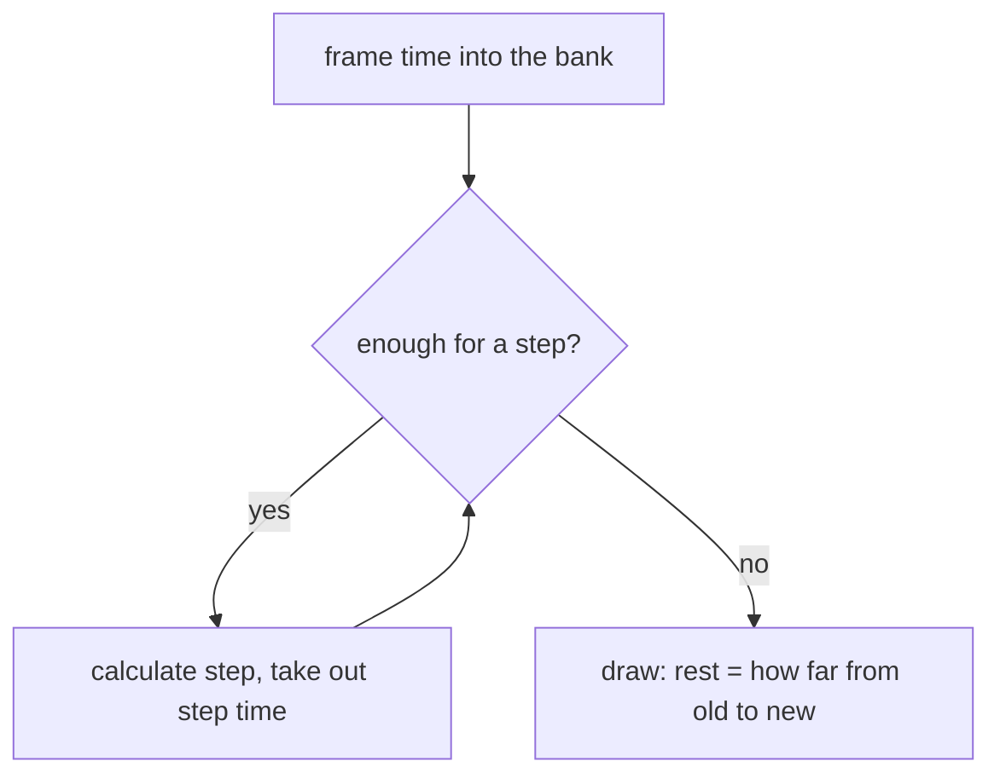
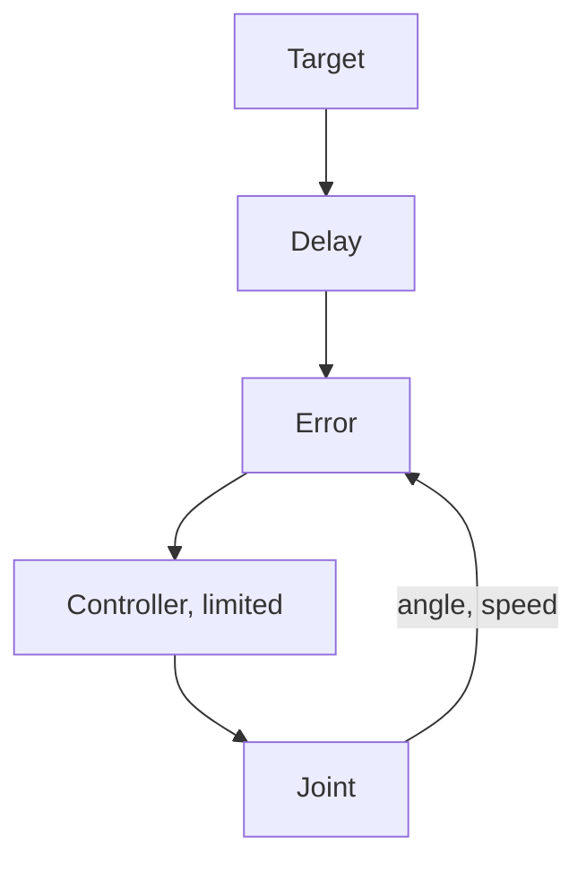

# Appendix C – Foundations: How a Physics Simulation Thinks

> **Your level:** A bonus level under the hood: how a computer calculates motion ahead step by
> step, finds collisions, calculates with friction, controls a servo – and why everything comes out
> the same down to the last bit on every device.

> **Words you need:**
>
> - **Newton (N)** and **weight force** – the newton is the unit of force. The Earth pulls on every
>   kilogram with 9.81 N, so the weight force is **mass · 9.81**. 100 g presses with just under
>   1 N.
> - **Torque** – force times lever, measured in newton meters (N·m). 1 N at the end of a 1 m long
>   wrench is 1 N·m.
> - **Impulse** – a single short push that changes the speed in one go: mass times change in speed,
>   measured in N·s.
> - **Radian (rad)** – a way of measuring angles: 1 rad is about 57°, a whole circle a good
>   6.28 rad.
> - **Hertz (Hz)** – how often per second. A spring at 2 Hz bounces back and forth twice per second.
> - **Sub-step** – a part step: every calculation step of the physics is split once more into
>   several small steps.
> - **Solver** – the part of the physics engine that tries to keep all the rules (contacts, joints)
>   at the same time.

How Kern uses **Box3D** is in [Chapter 6](06-physics.md); here it's about the ideas behind it. You
only need force, mass, speed and friction. Pictures and numbers show the rest.

## C.1 Rigid Bodies and Their State

A **rigid body** never deforms. Real things give a little, but for robot limbs, crates and cars
this fits very well. The big advantage: a few numbers describe the whole motion.

- **What changes:** where the body is (the **position** of its center of mass), how it's turned
  (**rotation**), how fast it flies (**velocity**) and how fast it spins (**angular velocity**).
- **What stays the same:** its **mass**, its **center of mass** and its **inertia against
  turning**.

The **center of mass** is the point where you could balance a thing on a fingertip. For a ruler,
it's in the middle; for a hammer, close to the heavy head.

> **Picture it like this:** Spin on an office chair and pull your arms in: you get faster. How the
> mass is distributed determines how easily something turns. A broomstick turns very easily around
> its long axis, but hard across it. That's why inertia needs several numbers, one for each
> direction.

For flying, Newton's law applies: **force = mass · acceleration**. **Acceleration** means how much
faster something gets per second. 10 N make a 2 kg ball 5 m/s faster per second, because
10 ÷ 2 = 5. For turning, the same applies with torque and inertia.

On top of that comes a **gyroscopic effect**: a spinning body "wants" to keep its axis of rotation.
That's why a fast-spinning top doesn't fall over. Box3D calculates this effect particularly
carefully; otherwise long, thin limbs like a robot leg would spin more and more wildly.

## C.2 Integration: the Flip Book

A computer calculates motion like a **flip book**: from the picture now to the picture one step
length h later. That's called **integration**. The problem: during the step, forces and speed
change, but the computer only knows the beginning. So every method has to guess. Three
possibilities:

- **explicit:** first move on with the *old* speed, then get faster;
- **semi-implicit:** first get faster, then move on with the *new* speed;
- **implicit:** take the force that will act *at the end* of the step. For this, the computer has
  to calculate the end beforehand, which is more work.

For the falling ball, comparing the first two is enough.

A falling ball, h = 0.1 s, gravity makes it 1 m/s faster per step (g ≈ 10 m/s²):

| Time | explicit: speed / fallen | semi-implicit: speed / fallen |
|---|---|---|
| 0.1 s | 1 m/s / 0 m | 1 m/s / 0.1 m |
| 0.2 s | 2 m/s / 0.1 m | 2 m/s / 0.3 m |
| 0.3 s | 3 m/s / 0.3 m | 3 m/s / 0.6 m |

With explicit, the ball doesn't move at all in the first step, because its old speed was 0. In
reality, after 0.3 s it has fallen 0.45 m. Both are off, one too short, one too far.

For the ball that doesn't matter; for **springs** it decides everything. A spring at 2 Hz with 60
calculation steps per second:

| Method | per step | after 1 second |
|---|---|---|
| explicit | +2.2% | 3.6 times as far |
| semi-implicit | stays | stays |
| implicit (force at end of step) | −2.1% | only 28% left |

You can calculate the percentages exactly with high-school math; here we only show the result. With
explicit, the spring rocks itself up on its own, like a swing that someone secretly keeps pushing.
Implicit brakes it artificially but is **always stable**. Semi-implicit keeps the swing, but **only
as long as the spring isn't too fast for the beat**. If it swings too fast, semi-implicit becomes
unstable too.

> **Crazy but true:** A 30 Hz spring at a 60 Hz beat grows 3.3-fold per step with explicit. After
> ten steps, a sixth of a second, it swings out **150,000 times** as far. And this spring is so fast
> that even semi-implicit fails here. That's why you limit how fast springs may swing and split
> steps into sub-steps (below and [Chapter 6](06-physics.md), 6.13).

**Box3D** calculates semi-implicitly: in every sub-step, it first calculates the new velocities,
then the **solver** (C.6) makes sure contacts and joints are kept, then it moves everything with the
new speed. Its built-in **damping** (brake) is built so that it only ever makes the speed smaller,
never reverses it. And Box3D limits how fast something may fly and spin.

> **Watch out, trap:** Why does Kern's physics rule say: use the built-in damping, not a home-made
> braking force "the faster, the harder it brakes"? This brake calculates with the *old* speed from
> the beginning of the step and lets this force act for the whole step, even when the limb should
> long since have stopped. For a very light limb, that's much more brake in one step than would be
> needed to stop it. Work through an example: the limb weighs 10 g = 0.01 kg, the brake pushes with
> 10 N per 1 m/s of speed, and Kern calculates 60 steps per second. At 1 m/s forward, it brakes with
> 10 N. That changes the speed in one step by 10 ÷ 0.01 ÷ 60 ≈ 16.7 m/s. 1 m/s forward becomes
> 1 − 16.7 ≈ −15.7, so **15.7 m/s backward**. The "brake" catapults. Box3D's built-in damping can't
> do that: it only makes the speed smaller in every step, never reversed.


### Fixed Time Step

If you calculated with the varying picture time, a slow picture would mean a big, unreliable step,
and every computer would end up somewhere else. Glenn Fiedler's solution is a time piggy bank (his
technical term for it is *accumulator*, "collector"). You already know it from
[Chapter 6](06-physics.md), 6.13:



An example at 60 steps per second, so h = 1/60 s ≈ 16.7 ms: a picture takes 25 ms. That's enough
for one step; 8.3 ms are left over. The drawing happens at 8.3 ÷ 16.7 ≈ 50%, so halfway between the
old and new state. The next picture takes 25 ms again: there are now 33.3 ms in the piggy bank, so
two steps, rest 0. Kern's safeguards for this are in [Chapter 6](06-physics.md), 6.13.

### Sub-Steps

**Sub-steps** split every step further. For the Micro Duck there are 100 steps per second with 16
sub-steps each, so 100 · 16 = 1600 small steps per second, each only 1/1600 s long.

Why does that help? If many limbs hang in a **chain** (a bridge of planks, a robot leg), the solver
corrects every joint a little, and the correction has to be passed on through the whole chain, like
in the game of telephone. With many small steps it gets through more often, and the chain hangs
together more tightly.

> **Mission:** In the Physics Lab, under **World Settings** › **Physics (Box3D)**, set the
> **Sub-steps** from 4 to 1, start **Simulate** and look at the middle of the rope bridge from the
> side. Stop with Esc, set 16 and compare: with 1 sub-step, the middle hangs about a meter lower.
> Tip: take a screenshot of both, then you can see the difference right next to each other. Long
> joint chains stretch more with few sub-steps.

## C.3 Collision Detection

Which things touch each other? With n bodies there are n · (n − 1) ÷ 2 pairs. Why? Think of n
people who all shake hands. Each one shakes hands with n − 1 others; that's n · (n − 1) hands. But
every handshake was counted twice, once from each side, so you divide by 2. With 4 people:
4 · 3 ÷ 2 = 6 handshakes. With 1000 bodies, it's already 499,500 pairs. Checking every pair exactly
would be much too slow. That's why the physics works in two phases: first rough, then exact.

**Broad phase:** Every shape sits in an invisible box whose edges run exactly along the x, y and z
axes. Whether two such boxes overlap is quick to check: for each of the three axes, you look at
whether the ranges overlap; that's two comparisons each, six in all. Only pairs with overlapping
boxes go into the exact phase.


The boxes sit in a tree like the BVH from [Chapter 5](05-scene-and-geometry.md). They're a bit
bigger than necessary, so that the tree doesn't have to be rebuilt at every small movement. Fixed
bodies have a tree of their own.

**Narrow phase:** Here what matters is whether a shape is **convex**: the connecting line between
any two points of the shape lies completely inside it. Sphere, capsule, box and hulls are convex;
an L isn't. For convex shapes there are fast, reliable tests. One of them goes like this:

> **Picture it like this:** Shine a flashlight from the side at two shapes and look at their
> shadows on the wall. If you find a direction in which the shadows don't overlap, the shapes
> definitely don't touch (picture below). For convex shapes, it's enough to try a handful of
> directions.


The result is a contact report, the **manifold**: which direction the touch points in and at which
points, each with a distance.

A **convex hull** stretches around points like a rubber band around nails, only in 3D. Things that
aren't convex are built from several hulls. Any triangle meshes are only allowed for fixed bodies.

> **For pros:** The second test is called GJK. In your head, it subtracts every point of one shape
> from every point of the other and checks whether the origin comes out. The blue book explains it
> in Appendix C.

**Tunneling:** A bullet at 300 m/s flies 300 ÷ 60 = 5 m per step at 60 steps per second. In front
of a 10 cm thick wall, it's still in front of it in one step and already behind it in the next, and
it has never touched the wall. That's why Box3D reports contacts **shortly before** the touch and
only allows as much approach as there's still distance left. For very fast things, there's also a
particularly careful check along the whole path (**continuous collision**).

This "shortly before" is a fixed distance of a few centimeters, just like the millimeters of
overlap Box3D tolerates. For a crate that's tiny; for a 2 cm leg it's huge. That's why Kern
simulates the small Micro Duck four times as big ([Chapter 6](06-physics.md), 6.2).

## C.4 Contacts, Friction, Bounciness

**The contact rule:** bodies must not pass through each other. A contact can only **push**, never
pull, and it only pushes as long as the bodies touch. The solver keeps this rule very well, but not
perfectly.

### Friction

Friction is at most **friction coefficient μ times pressing force** (μ is pronounced "mew"). An
example: a 300 kg crate lies on the ground. Its weight force is 300 · 9.81 ≈ 2943 N, and it presses
on the ground with exactly this force. At μ = 0.6, friction holds up to 0.6 · 2943 ≈ 1766 N. If you
push with 1000 N, the crate **sticks**. With 2000 N it **slides**.

On a ramp, a **rule of thumb** applies: a thing stays put as long as the **slope** isn't greater
than μ. Slope means: height divided by length, like with a line in a coordinate system. So μ = 0.6
holds up to a 60% slope. You can prove this rule with high-school physics; here you may simply use
it.

All the forces at which something sticks together form a **friction cone**. Imagine an ice-cream
cone standing with its tip on the point of contact. The picture shows a cut through it:


n is the direction in which the ground pushes. How wide the cone opens depends on μ: its edge is
slanted so that for every meter up, it goes exactly μ meters to the side. The bigger μ, the wider
the cone. (The label "arctan μ" in the picture means exactly this angle; you don't need to know the
word.) A force that comes steeply from above lies inside the cone: sticking. A force that pushes
flat lies outside: sliding. Actually, a thing at rest sticks a bit more strongly than a sliding
thing is braked. But Box3D knows only one friction coefficient for both.

> **For pros:** Box3D calculates the friction once for the middle of the whole contact area, not
> for every point separately, plus a turning friction that brakes spinning on the spot.

### Two Friction Values, One Contact

Box3D takes the square root of the product, √(μA · μB). A few examples compared with the ordinary
average:

| Pair | √(μA · μB) | Average |
|---|---|---|
| 0.6 and 1.0 | 0.775 | 0.8 |
| ice 0.05 and rubber 1.0 | 0.224 | 0.525 |
| 0 and 1.0 | 0 | 0.5 |

The advantage: whatever is frictionless stays that way, no matter what it's paired with. Ice stays
pretty slippery even under a rubber boot. Still, it's only a rule of thumb. That's why, for real
material pairs like beak on sock, Kern knows **pair values** of its own
([Chapter 6](06-physics.md), 6.6).

> **Mission:** From **Place Actors**, group **Shapes**, get a **Ramp**. It's already 6 m long, 3 m
> wide and 1.5 m high; you can see that in **Details › Static Mesh › Size**. Its slope is
> 1.5 ÷ 6 = 0.25, so 25%. You can type in other dimensions there. Then get a **Physics Cube** from
> the group **Physics** and give it, in **Details › Transform › Location**, the same X and Y values
> as the ramp and a Z that's 2 m higher. During **Simulate**, it falls onto the slope and stays put
> (both have friction 0.6). Stop with Esc, set the value in **Details › Static Mesh › Physics ›
> Friction** to 0.02 for the cube and start **Simulate** again: now it slides. With the rule from
> just now, the friction between cube and ramp is √(0.02 · 0.6) = √0.012 ≈ 0.11 (best done with a
> calculator), and that's less than the slope of 0.25.

### Bounciness

The **bounciness** (restitution) e says what share of the speed remains after the impact. With
e = 0.5, a ball that hits at 4 m/s bounces back at 0.5 · 4 = 2 m/s. e = 0 stays put, e = 1 bounces
perfectly. Box3D takes the **larger** value of the two shapes (why is in
[Chapter 6](06-physics.md), 6.7). Below 1 m/s nothing bounces. The bounciness is only applied
**after** the physics has kept all the rules (the solver does that, C.6), and with the speed from
before the impact.

> **Mission:** From **Place Actors**, group **Physics**, get a **Physics Sphere**, set the value in
> **Details › Static Mesh › Physics › Restitution (bounce)** to 0.9, lift it up during
> **Simulate** and let it drop. Stop with Esc, set 0 and try again: now it stays put.

### Rolling Resistance

A perfect ball rolls forever. Real balls and floors give a little, and that brakes with **rolling
resistance times pressing force**, so at 0.03 it's 3% of the weight force. Box3D takes the larger
value of the two shapes. Kern's notes say: "The ball rolled forever," until it got rolling
resistance.

This braking force acts at the bottom, at the point of contact, so on the lever "radius." That's why
the braking effect on the turning grows with the **radius**: torque = rolling resistance · radius ·
pressing force. With the same coefficient and the same weight, a big ball gets a bigger braking
torque than a small one.

## C.5 Joints as Rules

For the physics, a **joint** is a **rule**, for example: "Point A and point B stay on top of each
other." Then both points also have to move at the same speed. If they drift apart, the solver gives
both a small **correction push** that brings them back together.

How strong this push has to be depends on how heavy the pair "feels." That's called the
**effective mass**. In the simplest case, two balls that only pull or push each other in a straight
line:

**effective mass = 1 ÷ (1/mA + 1/mB)**

- Two 2 kg balls: 1 ÷ (0.5 + 0.5) = **1 kg**. Both give way, so the pair feels lighter than each
  single ball.
- A 2 kg ball on a fixed wall: the wall doesn't give way at all; it's as if infinitely heavy. 1
  divided by a huge number is almost 0, so for it 1/m = 0 counts. So 1 ÷ (0.5 + 0) = **2 kg**. Only
  the ball counts.

For a hinge, the same applies to turning, with the inertia around the axis
([Chapter 6](06-physics.md), 6.8, which also has all nine kinds of joints). A joint is always built
in the **rest position**: that's where the angle 0 is, and limits and springs count from this 0. A
hinge built in half open would think "half open" is closed.

A hinge's effective mass depends on how the limbs are positioned right now: an outstretched leg is
harder to turn than a bent one, like you on the office chair with your arms stretched out. You'll
need this in a moment with the servos (C.7).

## C.6 The Solver

A robot has 15 joints and dozens of contacts, and all the rules should apply at the same time. But
every correction push in one place shifts the others. Real-time engines solve this by correcting
the rules **one after another**, and doing that several times in a row.

> **Picture it like this:** Four people hold a picture against the wall. Each one corrects their
> corner and shifts the others a little in the process. After a few rounds, it hangs straight.

The solver checks "contacts may only push" on the **sum** of all pushes, not on each one
separately: round 1 pushes 5, round 2 takes back 2. The sum is 3, so it's allowed. But if round 2
wanted to take back 6, the sum would be −1, that is, a pull. Then the solver sets the sum to 0.

**Warm start:** A resting stack of crates needs almost the same pushes every step. So the solver
starts with the pushes from last time instead of at zero, and finishes much faster.

**Soft rules:** A hard rule corrects every error immediately and completely, with a jolt. That
causes jitter. That's why Box3D treats **every** rule like a very stiff, well-damped **spring**: a
small overlap is pushed out gently instead of with a jolt. Box3D calculates these springs so that
they never rock themselves up (C.2). Contacts with **fixed** bodies, for example feet on the
ground, are made stiffer by Box3D than contacts between two moving bodies: an overlap with the
ground is pushed out about four times as fast. That way a robot stands more firmly on the ground.

> **For pros:** Box3D calls one fixed step a **soft step**: prepare the rules, then in every
> sub-step calculate velocities, solve with warm start, reduce errors, calculate positions, and
> finally solve once more without error reduction ("relax"). The last pass takes the extra momentum
> of the correction back out. The formulas are in the blue book, Appendix C.

A spring can only be calculated if it swings more slowly than the sub-steps look. That's why Box3D
and Kern set limits on how stiff springs may be ([Chapter 6](06-physics.md), 6.13). Whoever needs
stiffer joints needs more sub-steps.

**Mass ratios:** If something heavy hangs on something light, such as 5 kg on 10 g (500 : 1), the
solver needs a great many rounds until the pushes are passed through, like the game of telephone
from C.2. The light part gives way to every correction immediately and passes on hardly anything.
In the meantime, the joints stretch. Rule of thumb: neighbors at most about **10 : 1**. The
remedies: very light limbs get a **minimum mass** (the duck's 5 g hip brackets weigh at least 20 g
in Kern), and a rigid part is **one** body with several shapes instead of several bodies welded
together ([Chapter 6](06-physics.md), 6.15).

## C.7 Servos as a Control Loop

A servo like the one in the Micro Duck (a Dynamixel XL330) gets a **target angle**, measures the
actual angle, compares and steers against it, again and again. That's a **control loop**:



**PD controller:** The controller in the servo is named after its two parts. **P** stands for
*proportional*: it pulls in proportion to the distance; twice as far away means twice as strong.
**D** stands for *derivative*, that is, the change of the angle: this part brakes the faster the
joint turns, like damping. Together:

**torque = K · error − D · turning speed**

The **error** is how far the joint is from the target. K acts like a torsion spring: the farther
away, the stronger. D acts like a shock absorber: the faster it turns, the more it brakes. For the
duck's servo, K = 0.554 and D = 0.053. At 0.5 rad of error (just under 29°), it pushes with
0.554 · 0.5 ≈ 0.28 N·m. If the joint is turning at 2 rad per second at that moment, the damping
brakes 0.053 · 2 ≈ 0.11 N·m of that off.

Together with the inertia of the small motor in the servo, this makes a damped oscillator. If you
calculate it with the servo's values, it has a **natural frequency** of about **2.8 Hz** (that's how
often per second it would swing back and forth without damping) and a **damping ratio** of
**0.84**. This calculation needs square roots and high-school math, so we only take the result here
(the formulas are in the blue book, Appendix C). What this number means is shown by a door:

- **below 1:** the door swings past its target (worn-out door closer);
- **exactly 1:** it arrives as fast as possible without overshooting (good door closer);
- **above 1:** it crawls into its target (door in honey).

So 0.84 is soft and well damped.

**Saturation:** The motor can't manage more than T = 0.963 N·m. This limit is reached at an error
of 0.963 ÷ 0.554 ≈ 1.74 rad, about 100°. Beyond that, it doesn't pull harder. That has a surprising
consequence: full force only comes when the target is about 100° away from the current angle. Some
joints can't even turn that far. So if the network wants to pull hard, it has to put its target
far **beyond** the joint limit, as if you pulled the rubber band far past the point where the leg
bumps into something. On top of that there's **friction** in the gearbox: a small counter-torque
that holds the joint in place until enough force is applied.

**Delay:** A command only arrives about 20 ms after it was sent. That doesn't sound like much, but
it can make a controller oscillate.

> **Picture it like this:** If you push a swing at the right moment, you make it faster. If you
> always push a bit too late, at some point you push against the motion, and the swing gets out of
> rhythm.

How late is "too late"? At the natural frequency of 2.8 Hz, one swing there and back takes
1000 ÷ 2.8 ≈ 357 ms. You count a whole swing like one lap of a circle, so as 360° – like the second
hand of a clock that goes all the way around once for every there-and-back and is then at the top
again. 20 ms is 20 ÷ 357 ≈ 5.6% of that, and 5.6% of 360° is **about 20°**. That's how far the
controller lags behind.

> **Watch out, trap:** A network that never practiced with a delay fails on the real robot. That's
> why Kern simulates it too, as a queue of 4 steps in the world.

**In Kern**, the servo is made only of Box3D's own parts:

- **PD controller** = the hinge's spring. Box3D calculates it stably; it never rocks itself up.
- **Maximum force** = a limited target: the target is never farther away than the motor can pull.
- **Friction** = a joint motor that wants to stand still but has only a little force.
- **Motor inertia** = a real thin disk on the joint axis that turns along.

Box3D doesn't want the spring strength in N·m per radian but as "how often per second does it
swing." But how often a spring swings depends on how heavy the limb on it is, that is, on the
effective mass from C.5. And that changes as soon as the leg moves. That's why Kern converts the
spring **anew every step**. Kern Studio, the training and the test bench use the same calculation:
one law for all three. All values are in a **profile** ([Chapter 6](06-physics.md), 6.17;
[Chapter 16](16-calibration.md)).

## C.8 What Not to Do

- **Give continuous loads anew as a force every step.** A force only applies for one step; after
  that it's gone.
- **Give jumps as an impulse:** mass times change in speed. 30 kg that should get 5 m/s faster in
  one go need 30 · 5 = 150 N·s. That's as much as 150 N for one second.
- **Don't set the speed directly** on bodies with joints or contacts. That bypasses the solver and
  fights against the joints. Once, a "gyroscope" was supposed to keep the duck upright by setting
  its turning speed directly. That pumped momentum in, and the body jumped.
- **No helper forces** for robots. They don't exist in reality either, and whatever a network
  learns with them doesn't work on the real robot.

All the rules: [Chapter 6](06-physics.md), 6.15.

## C.9 Determinism

**Deterministic** means: same start, same inputs, a **bit-identical** result. Then a training gives
the same network everywhere, bugs can be reproduced, and robot logs play back the same everywhere.
But physics is **chaotic**. Kern's notes say: "In a robot simulation, one bit turns into a
different gait within seconds."

Computers round after every calculation, and the **order** matters:

```
(0.1 + 0.2) + 0.3  =  0.6000000000000001
0.1 + (0.2 + 0.3)  =  0.6
```

That's why Kern fixes everything that could change the order or the rounding:

- **Fix the order:** Kern is written as text, and before a computer can run it, the text is
  **translated** into computer commands. Nothing may be reordered in the process. And sums are
  always formed in the same order, no matter how many **processor cores** (parts of the processor
  that can calculate at the same time) are helping ([Appendix A](A-neural-networks.md)). Box3D runs
  on a single one.
- **Own calculating rules:** Sine, cosine and co. are kinds of calculations for angles that you'll
  learn later in math. Every operating system calculates them a little differently in the last
  bit. Kern brings its own that calculate the same everywhere.
- **Fixed beat:** steps of the same length; the game time counts steps.
- **Fixed randomness:** a random generator of its own with fixed starting numbers, just like the
  city's seed in [Chapter 5](05-scene-and-geometry.md): same starting number, same "coincidences."

**Checking:** Pollen Robotics' network controls the duck for 400 control ticks. After every tick,
the duck's whole state is calculated into a long **check number**. If even one bit changes, the
number changes. Two versions of Kern calculate the same if all 400 numbers are the same. If they
aren't, the **first** differing number gives away in which tick the two drift apart. That way you
know where to start looking for the bug. This is checked on a PC, on a Mac and as WebAssembly, the
form in which Kern also runs in the browser.

> **Crazy but true:** A hanging servo leg runs **bit for bit the same** at single and four-times
> size. At S = 4, all conversion factors are powers of two (2, 4, 64, 256 …), and with powers of
> two the computer rounds exactly the same. The reason: it calculates in the binary system. Times 2
> there just means shifting the digits by one place, like times 10 for us. The digits themselves
> don't change in the process, so nothing gets rounded differently either. On the ground this no
> longer works, because Box3D's fixed tolerances don't grow along.

> **For pros:** The traps have names: compiler options like "fast math" reorder things, and FMA
> calculates a · b + c with one rounding instead of two. How Kern switches this off and where its
> own math functions come from is in the blue book, Appendix C.

## C.10 At a Glance

Where you'll find every topic again in [Chapter 6](06-physics.md): state and mass in 6.4, beat and
sub-steps in 6.13, shapes and hulls in 6.5, friction and bounciness in 6.6 and 6.7, joints in 6.8,
servos in 6.17, determinism in 6.14.

## Level complete!

- You know how a computer calculates motion as a flip book and why Box3D is semi-implicit.
- You know why sub-steps make joint chains tighter.
- You know the broad and narrow phase and what convex means.
- You can calculate with μ and combine two friction values.
- You understand how a solver solves soft rules and why Kern stays bit-identical.
- You can explain how a servo pulls, where it reaches its limit and why delay is a problem.

## Puzzle corner

1. How many pairs are there with 10 bodies?
2. A ball (restitution 0.8) hits a floor (restitution 0) at 5 m/s. How fast does it bounce back?
3. Crate and ramp have μ = 0.5, the ramp a 40% slope. Does the crate stay put?
4. **Boss puzzle:** A servo has K = 2 N·m/rad and manages at most T = 1 N·m. From which error on
   does it stop pulling harder? And by how many degrees does it lag behind if a command is on the
   way for 25 ms and it swings 2 times per second?

### Solutions

1. 10 · 9 ÷ 2 = **45**.
2. The larger one counts: 0.8 · 5 = **4 m/s** (5 m/s is above the threshold of 1 m/s).
3. √(0.5 · 0.5) = 0.5, so it holds up to a 50% slope, and 40% is less: **it stays put.**
4. From 1 ÷ 2 = **0.5 rad** (just under 29°). One swing takes 1000 ÷ 2 = 500 ms; 25 ms is 5% of
   that, and 5% of 360° is **18°**.

---

© 2026 Christian Heinrich Hohlfeld · All rights reserved · [Imprint and rights](00-imprint.md)
