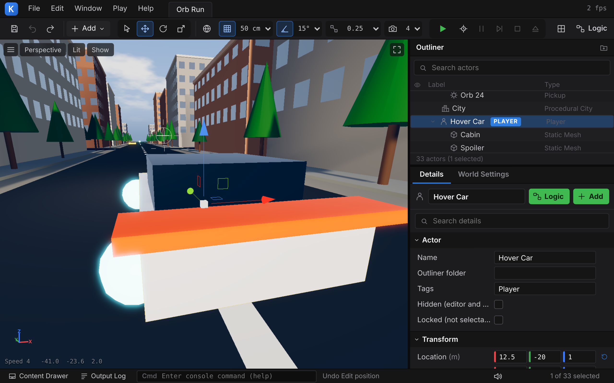

# 12 Writing your own games

Kern offers three paths to a game of your own. They are not mutually exclusive; they share the same
engine: the same renderer, the same physics, the same platform layer.

| Path | Tool | Result | Suitable for |
|---|---|---|---|
| **A** In Studio without code | Kern Studio, logic graphs | a single HTML file | levels with players, physics, pickups, triggers, sound, logic; quick prototypes; teaching |
| **B** In C++ with the app API | `kern::App`, `kern/build.sh --app`, `kern/web/app.mjs` | a `.wasm` plus a small HTML page | games with their own simulation, their own rendering, their own shaders |
| **C** From JavaScript via the C ABI | `kern/web/kern.mjs`, `kern/web/studio/game.mjs` | your own page that drives the module | existing JavaScript projects (like SpawnCity), embedding Studio levels in your own pages |

There is also a hybrid: logic graphs from Studio can be exported as C++ and built into a module
(Section 12.4.3).

Paths are relative to the root directory of the repository; the engine lives there in the `kern/` folder.

---

## 12.1 Path A: a game in Studio, without code

This section builds a small collecting game step by step: a player character runs across an area with
obstacles, collects orbs, has to avoid a hazard zone and wins once everything has been collected. How to
operate the individual panels is described in [Chapter 11](11-studio.md).

### Step 1: A new level

1. Open Studio (at https://kernengine.de/ under `/editor/`, or `generated/studio.html`).
2. **File › New Level...**, template **Basic**, **Create**. The level has a ground (40 × 40 m), sun, sky
   and a cube.
3. In **World Settings**, set the **Level name** and the **Game title**, for example "Orb Garden".

Why Basic and not Empty: Empty has nothing at all, so not even a ground for a character to stand on.
World Settings does have an **Endless ground**, but a visible ground with its own color and collision is
more tangible to start with.

### Step 2: The player character

1. Open the Content Drawer (**Ctrl+Space**), group **Players**, and drag **Character** into the viewport.
2. The log reports "Character is the player now". In the Outliner the actor carries the **PLAYER** badge.
3. In **Details › Player Controller** you can set speed (**Max speed**), **Acceleration**, **Jump speed**
   and the camera (**Chase**, **First person**, **Top down**).

Pressing **Play** (Alt+P) tests it immediately: W A S D walks, the mouse looks, Space jumps, **Esc**
returns. Every other entry from **Players** works the same way; the one placed last is the player, or
you choose it with right-click › **Make Player**.

### Step 3: Obstacles and physics

1. From **Shapes**, place a few **Cube**s, a **Ramp** and a **Plane**. Position them with **W** (Move),
   **E** (Rotate), **R** (Scale) and the gizmo; grid snapping (0.5 m) keeps the edges clean. **End** puts
   the selection down on the ground.
2. Add a **Crate Stack** and a **Hinged Door** from **Physics**. These actors are dynamic or hang on
   joints, and they react to the player character.
3. From **Gameplay**, a **Moving Platform** and a **Spinner**: both move kinematically.
4. Use **Simulate** (Alt+S) to check that everything stands as intended. In the simulation you can grab
   and throw bodies with the mouse. **K** applies the simulated poses of the selected actors to the
   level, for example for a crate stack that should look naturally collapsed.



A cube from **Shapes** has collision but does not move. If it should fall, give it Box3D physics in
Details with **+ Add › Rigid Body** and **Mobility = Dynamic**; or use a **Physics Cube** right away. What
the physics fields mean is explained in [Chapter 6](06-physics.md).

### Step 4: Something to collect

1. From **Gameplay**, scatter several **Orb**s (1 point) and a **Star** (10 points). An orb can be
   multiplied quickly with **Alt + drag gizmo**: every drag pulls out a copy.
2. Select all orbs (marquee selection or Ctrl+click in the Outliner) and put them into a folder with the
   folder button in the Outliner. This keeps the Outliner tidy.
3. In **World Settings › Win condition**, choose **Collect all pickups**. Whoever has all the pickups
   wins.

### Step 5: Hazard, checkpoint and time limit

1. Place a **Hazard** (a trigger that loses the game) or a **Damage Zone** and drag it to the desired size
   with Scale.
2. Set a **Checkpoint**: if the character falls below **Kill Z** (World Settings) or loses, it restarts
   here.
3. Optionally a **Time limit** in World Settings: the HUD counts down.

Other goals: **Reach a goal trigger** (with a **Goal**), **Survive the time limit** or **Reach a
target score** (with **Target score**).

### Step 6: Logic without programming

Many games need nothing beyond the building blocks above. For custom behavior there are logic graphs:

1. Place a **Message Trigger** and in Details › Trigger set the **Action** to
   **Logic event only**.
2. Click **Logic** in Details. The logic editor opens this actor's graph.
3. **Templates › Score zone (overlap +10)**: when someone enters the zone, they get 10 points, a "+10"
   message and a sound.
4. **Compile** (F7) checks the graph; **Viewport** takes you back.

More templates: a door that opens on **Interact** (key F), a spawner, a traffic light as a state machine
and a behavior for the Micro Duck. All nodes are explained in [Chapter 9](09-logic.md).

### Step 7: Sound

1. In **World Settings › Audio**, choose a **Music** and an **Ambience**.
2. From the **Audio** group of the Content Drawer, place for example **Ambient Wind**, or import your own
   file in the **Sounds** tab and drag it into the viewport: an Audio Source is created at that spot.

The player controllers, pickups and triggers already bring their own sounds ([Chapter 7](07-audio.md)).

### Step 8: Testing

- **Play** (Alt+P): play. **F8** leaves the character, the world keeps running and you can look around;
  F8 again takes over the character again.
- **Play › Number of Players › 2 Players** tests the level with two players in two viewports.
- Errors in the level (such as a joint pointing to a deleted actor) prevent Play and are listed in the
  **Output Log**.


### Step 9: Saving

**Ctrl+S** saves the level as `.klevel`. The file is JSON and also contains textures and imported sounds;
you can pass it on and open it again in any Studio (Ctrl+O or drag it onto the page). Studio additionally
backs up unsaved work in the browser and offers it on the next start.

### Step 10: Exporting

1. **File › Package Game (HTML)...**
2. Check the title, **Package**.
3. Studio downloads `Orb_Garden.html` and offers **Play it**.

The file contains the engine, the level and the game host. It runs offline, from `file://`, from any web
server and on phones with touch sticks. How to publish it is described in Section 12.6.


---

## 12.2 Path B: a game in C++ with the app API

For games that want more than actors and components, you write the game yourself in C++ against the
engine API. The game is a class that inherits from `kern::App`; the engine calls it every frame and
renders afterwards. Everything browser-specific is handled by the platform layer `kern/web/app.mjs`.

### 12.2.1 The building blocks

The API lives in `kern/include/kern/app/app.h` and is included with `#include "kern/kern.h"` (together with
the renderer, geometry, particles and math).

**`App`** – the game:

| Method | When | Purpose |
|---|---|---|
| `RendererOptions configure()` | once, before `start` | shadows, bloom and other renderer options (the engine sets width and height) |
| `Span<ShaderExtension* const> extensions()` | once, before `start` | custom shader extensions; they must outlive the app |
| `bool start(Engine&)` | once | create meshes, prepare state; `false` aborts |
| `void update(Engine&, const Frame&)` | every display frame | read input, advance the game, update the scene |
| `void resized(Engine&)` | after a resize | e.g. adapt the layout to the new width |
| `void stop(Engine&)` | on shutdown | clean up |

**`Engine`** – what the game gets:

| Member | Purpose |
|---|---|
| `renderer` | the renderer ([Chapter 4](04-graphics.md)): meshes, camera, light, sky, picking |
| `input` | keyboard, mouse, touch for this frame |
| `set_status(text)` | text to the page (which displays it); identical texts are not sent again |
| `request_pointer_lock(bool)` | the page captures or releases the mouse |
| `arg(key, fallback)`, `arg_number(key, fallback)` | start parameters, by default from the page's query (`?time=0.6`) |
| `width()`, `height()`, `aspect()` | size of the drawing buffer |
| `stats()` | statistics of the last frame (draw calls, triangles …) |
| `clear_color` | clear color where no sky is drawn |

**`Input`** – input state:

| Method | Meaning |
|---|---|
| `down(Key)` | key held |
| `pressed(Key)` / `released(Key)` | pressed / released in this frame |
| `pointer()`, `pointer_delta()` | pointer position and movement since the last frame, in drawing-buffer pixels (also under pointer lock) |
| `button(b)`, `button_pressed(b)` | mouse button held / pressed in this frame (bit 0 = left) |
| `wheel()` | mouse wheel in this frame |
| `touches()`, `touch_count()` | up to 10 fingers with `id` (< 0 = free), `start`, `position`, `previous` |
| `focused()` | the page has focus; on focus loss the engine releases all keys |

`Key` knows the letters `a` to `z`, `digit0` to `digit9`, the arrows `left`, `right`, `up`, `down`, and
`space`, `enter`, `escape`, `tab`, `backspace`, `shift_left`/`_right`, `control_left`/`_right`,
`alt_left`/`_right`. The page maps them via `KeyboardEvent.code`, i.e. by key position.

**`Frame`**: `time` (seconds since start), `dt` (seconds since the last frame, at most 0.1) and `index`.

### 12.2.2 Anatomy of a frame

```
Page (app.mjs)                        Module (src/app/app.cpp)
---------------------------------------------------------------------------
kern_app_set_args("?time=0.6")   ->   Engine::set_args
kern_app_start(w, h)             ->   kern_create_app(), configure(), Renderer::init, start()
keyboard / mouse / touch         ->   kern_app_key / _pointer / _wheel / _touch / _focus
requestAnimationFrame:
  kern_app_frame(now, hidden)    ->   update(engine, frame); input.end_frame(); render()
ResizeObserver                   ->   kern_app_resize(w, h) -> resized()
context loss                     ->   kern_context_lost / kern_context_restored
runKernApp(...).stop()           ->   kern_app_stop() -> stop(), Renderer::shutdown
```

`update` runs exactly once per display frame, after which the engine renders. `pressed`, `released`,
`pointer_delta` and `wheel` apply only to that one frame; `end_frame` resets them. That is why you read
them in `update` rather than caching them.

### 12.2.3 `examples/hello` line by line

The smallest Kern game (`kern/examples/hello/hello.cpp`, 83 lines): a field of 64 instanced,
shadow-casting crates that rotate, a camera you can orbit around them with the mouse or the arrow keys,
and picking by click.

```cpp
#include <cstdio>
#include <vector>

#include "kern/kern.h"

using namespace kern;
```

`kern/kern.h` includes the entire public API, including `kern/app/app.h`.

```cpp
class Hello final : public App {
 public:
  RendererOptions configure() override {
    RendererOptions o;
    o.shadows = true;
    o.shadow.resolution = 1024;
    o.shadow.extent = 40;
    return o;
  }
```

`configure` defines the renderer before it exists: sun shadows with a 1024 map covering 40 m. The engine
fills in width and height itself.

```cpp
  bool start(Engine& engine) override {
    Renderer& r = engine.renderer;
    ground_ = r.allocate_id();
    MeshInput g = ground_mesh_.as_input();
    g.material.color = {0.42f, 0.47f, 0.40f, 1};
    if (!r.upsert(ground_, g)) return false;
```

Every mesh needs an id, obtained with `allocate_id()`; it then belongs to this game. `ground_mesh_` is a
`MeshData` (positions, normals, colors, UVs, indices); `as_input()` turns it into a borrowed view
`MeshInput` on which you set the material. `upsert` creates the mesh or replaces it. An invalid `upsert`
leaves an existing mesh untouched and returns `false`; that is why `start` aborts in that case.

```cpp
    boxes_ = r.allocate_id();
    layout(0);
    MeshInput b = box_mesh_.as_input();
    b.material.roughness = 0.45f;
    b.transforms = Span<const f32>(transforms_.data(), transforms_.size());
    b.tints = Span<const f32>(tints_.data(), tints_.size());
    return r.upsert(boxes_, b);
  }
```

The 64 crates are **one** mesh with 64 instances: `transforms` contains 16 floats (a 4×4 matrix) per
instance, `tints` 4 floats (RGBA) per instance. One draw call draws them all. `layout(0)` fills the
matrices beforehand.

```cpp
  void update(Engine& engine, const Frame& frame) override {
    Input& in = engine.input;
    if (in.button(0)) yaw_ -= in.pointer_delta().x * 0.005f;
    if (in.down(Key::left)) yaw_ += frame.dt * 1.5f;
    if (in.down(Key::right)) yaw_ -= frame.dt * 1.5f;
    distance_ = clamp(distance_ * (1 + in.wheel() * 0.001f), 8.0f, 80.0f);
```

Holding the left mouse button rotates by the pointer's movement, the arrow keys rotate at 1.5 rad/s
(independent of the frame rate thanks to `frame.dt`), and the mouse wheel changes the distance between
8 and 80 m.

```cpp
    Camera& c = engine.renderer.camera;
    c.target = {0, 0, 1};
    c.eye = {std::cos(yaw_) * distance_, std::sin(yaw_) * distance_, distance_ * 0.6f};
```

The camera is a field of the renderer: eye point, target (and field of view, near, far). Z points up.

```cpp
    layout(static_cast<f32>(frame.time));
    engine.renderer.update_instances(boxes_, Span<const f32>(transforms_.data(), transforms_.size()),
                                     Span<const f32>(tints_.data(), tints_.size()));
```

Each crate rotates at its own speed; `update_instances` uploads the new matrices in one go. The renderer
detects unchanged instances and does not upload them again.

```cpp
    if (in.button_pressed(0)) {
      PickHit hit;
      if (engine.renderer.pick(in.pointer().x, in.pointer().y, {}, hit) && hit.mesh == boxes_) {
        tints_[hit.instance * 4 + 0] = 1.0f; tints_[hit.instance * 4 + 1] = 0.25f; tints_[hit.instance * 4 + 2] = 0.2f;
      }
    }
```

A click casts a ray through the pixel (`pick` works in drawing-buffer pixels, exactly like `pointer()`).
If it hits the crate mesh, `hit.instance` names the crate that was hit, and its tint turns red.

```cpp
    char text[96];
    std::snprintf(text, sizeof text, "Kern hello - %u draws, %.0f triangles", engine.stats().draw_calls, engine.stats().triangles);
    engine.set_status(text);
  }
```

The status channel brings text to the page; `hello/index.html` shows it at the bottom left.

```cpp
 private:
  void layout(f32 time) {
    for (u32 i = 0; i < kCount; ++i) {
      const f32 angle = time * (0.5f + (i % 7) * 0.15f);
      const Vec3 p{(static_cast<f32>(i % kSide) - kSide * 0.5f) * 3, (static_cast<f32>(i / kSide) - kSide * 0.5f) * 3, 0};
      const Mat4 m = Mat4::trs(p, Quat::axis_angle({0, 0, 1}, angle), {1, 1, 1 + (i % 3) * 0.6f});
      std::memcpy(&transforms_[i * 16], m.m, sizeof m.m);
    }
  }
```

An 8×8 grid with 3 m spacing. `Mat4::trs` builds the matrix from translation, rotation (a quaternion
around Z) and scale; every third crate is taller. The matrix is stored column-major and copied directly
into the instance buffer.

```cpp
  static constexpr u32 kSide = 8, kCount = kSide * kSide;
  MeshData ground_mesh_ = primitives::plane(60, 60);
  MeshData box_mesh_ = primitives::box_on_ground({1.4f, 1.4f, 1.4f}, {0.95f, 0.62f, 0.32f});
  std::vector<f32> transforms_ = std::vector<f32>(kCount * 16, 0.0f);
  std::vector<f32> tints_ = std::vector<f32>(kCount * 4, 1.0f);
  u32 ground_ = 0, boxes_ = 0;
  f32 yaw_ = 0.6f, distance_ = 30;
};
```

`primitives::plane` and `primitives::box_on_ground` generate geometry (the crate stands with its bottom
on z = 0, and its vertex color is orange). White tints leave this color unchanged.

```cpp
App* kern_create_app() {
  static Hello app;
  return &app;
}
```

Every game must define this one free function. The runtime calls it exactly once at startup. The static
object lives as long as the module.

The accompanying page (`kern/examples/hello/index.html`) is short:

```html
<canvas id="game"></canvas>
<div id="status">loading...</div>
<script type="module">
  import {runKernApp} from "../../web/app.mjs";
  const status = document.getElementById("status");
  runKernApp({canvas: document.getElementById("game"), url: "./hello.wasm", onStatus: text => (status.textContent = text)})
    .then(app => (window.__kernApp = app))
    .catch(error => { status.textContent = String(error); window.__kernError = String(error); });
</script>
```

### 12.2.4 Building

You need wasi-sdk (GitHub project WebAssembly/wasi-sdk) release 25; the CI downloads it from GitHub.

```sh
export WASI_SDK=/opt/wasi-sdk-25.0-x86_64-linux
kern/build.sh --app kern/examples/hello/hello.wasm kern/examples/hello/hello.cpp
```

`kern/build.sh [components] <out.wasm> [sources and compiler flags]`:

| Option | What is added |
|---|---|
| (always) | renderer, geometry, JSON, core math |
| `--app` | the app runtime (`kern/src/app`) for games against `kern::App` |
| `--physics` | Box3D and the `kern/src/physics` layer |
| `--game` | levels, components, game runtime, procedural city; includes `--physics` |
| `--studio` | Kern Studio and its C ABI; includes `--game` |
| `--lehrer` | the Lehrer for the browser; includes `--game` |

Arguments ending in `.cpp` or `.cc` are the game's sources; all others are passed to the compiler as
flags (such as `-DMY_SWITCH` or `-Imy/include`). Multiple source files are allowed.

| Environment variable | Meaning |
|---|---|
| `WASI_SDK` | installation folder of wasi-sdk (default `/opt/wasi-sdk`) |
| `KERN_BUILD=debug` | `-O1 -g` instead of `-O3` with ThinLTO |
| `KERN_JOBS` | parallel compiler invocations (default: all cores) |
| `KERN_OBJ_CACHE` | object cache (default `$TMPDIR/kern-obj`) |

Each source is compiled into its own object and cached under a hash of the flags, the source and all
headers. A rebuild only recompiles what has changed, and Studio and the example games share the
engine's objects. The module is a WASI "reactor" with a conservative feature set, so that it runs in
every WebGL2-capable browser from Safari 15 onward. In detail:
[Chapter 2](02-building-and-testing.md).

### 12.2.5 `examples/orbrun`: a complete game

`kern/examples/orbrun/orbrun.cpp` (726 lines) is a complete racing game written only against the engine
API: a hover car races through a procedural city and collects 24 energy orbs while day turns into night.
It demonstrates the building and road builders, instancing, shadows, sky, bloom, point lights,
particles, a custom shader extension, keyboard and touch input and the status channel.

Not to be confused: the **Orb Run** level in Studio is a different program with the same idea. It
consists of actors and components (Procedural City, Box3D hover car, pickups) and runs on the game
runtime. The C++ example does everything itself, including driving physics and collision.

**Controls:** W/S or arrows drive, A/D steer, Space boosts, N fast time, Enter new city. Touch: the left
half of the screen steers and accelerates (deflection from the touch-down point), the right half boosts.
`?time=0.6` in the address starts at night.

**Structure of the `OrbRun` class:**

```cpp
  void update(Engine& engine, const Frame& frame) override {
    Renderer& r = engine.renderer;
    Input& in = engine.input;
    const f32 dt = frame.dt;
    if (in.pressed(Key::enter)) new_run(engine, rng_.next());
    if (in.pressed(Key::n)) fast_time_ = !fast_time_;
    elapsed_ += dt;
    now_ms_ = frame.time * 1000.0;
    if (!finished_) run_time_ += dt;

    drive(in, dt);
    update_traffic(dt);
    collect(engine);
    update_daylight(r, dt);
    update_camera(r, in, dt);
    upload_dynamic(r);
    update_status(engine);
  }
```

Each frame reads the input, advances the simulation and then uploads the changing data to the GPU. The
parts in detail:

**The city** (`class City`, `new_run`). A grid of 7 × 7 blocks with 80 m spacing and 16 m wide streets.
Each block randomly (from a seed; `Rng` is a xorshift) receives one of four layouts: a block-sized
building (in 60 % of cases with a courtyard as a second ring), four plots, an L-shaped building with an
annex, or three slab buildings. The buildings get taller toward the center. The footprints go to the
engine's `BuildingBuilder` as a `FootprintStream`, the streets to the `RoadBuilder` as a `RoadStream`.
Both deliver chunks, which `weld` indexes and `upload_static` creates as meshes:

```cpp
    BuildingBuilder buildings;
    if (!buildings.begin(footprints.data(), footprints.size(), bo)) return false;
    while (!buildings.step(1e9)) {}
    for (GeoChunk& chunk : buildings.chunks()) {
      weld(chunk.mesh);
      if (!upload_static(r, chunk.mesh, Material{}, 0)) return false;
    }
```

`step(budget)` actually works in time slices; with `1e9` the example builds everything at once. The trees
are two instanced meshes (trunk and crown) with one matrix per tree. How the builders work is described in
[Chapter 5](05-scene-and-geometry.md).

**Collision without a physics engine.** The example deliberately does not use Box3D. Each building is a
polygon in a 40 m grid; `City::collide` pushes the car's circle (radius 1.7 m) out of all polygons of the
neighboring cells and reflects the velocity off the wall. The city edge is a hard boundary.

**Driving physics** (`drive`). Throttle accelerates forward at 24 m/s², reverse (key S: 0.7 × 30) at
21 m/s², boost by an additional 42 m/s²; top speed is 36 m/s, 60 m/s with boost. Lateral velocity decays
with `exp(-7.5 dt)`: the car slides briefly and then catches itself. Steering only takes effect with
speed ("grip" rises to full by 9 m/s) and reverses when driving backward. Boost drains at 0.45 per second
and recharges at 0.12. So that the car does not tunnel through walls when boosting, it moves in substeps
of at most 0.6 m and checks each of them.

**Traffic** (`update_traffic`). 22 cars drive along the street center lines in lanes 2.8 m beside the
center, at 9 to 15 m/s. If the player is less than 10 m in front of a car in its lane, the car stops. At
the city edge the cars reappear on the other side. All cars are one instanced mesh with one color per
instance.

**Orbs and particles** (`collect`). When the car comes closer than 3.2 m to an orb, the orb disappears
and sprays 28 sparks via the engine's particle system (`Particles`, sorted, camera-facing, one draw
call). The run ends with the last orb, and the best time is recorded.

**Day and night** (`update_daylight`). The time of day cycles once in 480 s, with **N** in 40 s. From it
follow the sun direction, the moon direction and a night factor; the code blends between daylight, dusk
and moonlight, as well as sky, ground and fog color, ambient light and exposure:

```cpp
    const f32 phase = time_of_day_ * 2 * kPi;
    const Vec3 sun = normalize({std::cos(phase) * 0.62f, -0.38f, std::sin(phase)});
    const Vec3 moon = normalize({-sun.x, 0.3f, max_of(0.35f, -sun.z)});
    const f32 night = smoothstep(0.06f, -0.16f, sun.z);
    ...
    l.sun_direction = sun.z > -0.04f ? sun : moon;
    l.sun_color = mix3(mix3(day_sun, dusk_sun, dusk), moon_light, night);
    ...
    r.sky.sun = sun;
    r.sky.moon = moon;
    r.sky.night = night;
    windows_.night = night;
```

**Lights.** Headlight glow in front of the car and one light per orb, stronger at night. The `LightPool`
accepts all requests and gives the renderer the six most important ones; the standard shader supports
six point lights.

**Camera** (`update_camera`). A chase camera that pulls back with speed, follows smoothly (`damp3`) and
shakes briefly on collisions; the field of view widens above 30 m/s. The mouse wheel changes the
distance.

**The `NightWindows` shader extension.** This is the example's centerpiece: a game adds its own look to
the standard shader without touching the engine. For every wall vertex, the building builder writes a
record of four values (wall length, height, seed, story height). The extension declares a vertex stream
for it and builds a window grid from it whose windows light up at night:

```cpp
class NightWindows final : public ShaderExtension {
 public:
  f32 night = 0;
  const char* name() const override { return "orbrun-night-windows"; }
  Span<const ExtensionAttribute> attributes() const override { return {kAttributes, 1}; }
  const char* vertex_declarations() const override { return "flat out vec4 vWall;\n"; }
  const char* vertex() const override { return "  vWall = aWall;\n"; }
  const char* fragment_declarations() const override { ... "uniform float uNight;" ... }
  const char* fragment_surface() const override { ... window grid, emissive += ... * uNight ... }
  void bind(const Program& p) override { u_night_ = p.location("uNight"); }
  void frame_uniforms(UniformCache& cache, const Renderer&) override { cache.set_float(u_night_, night); }

 private:
  static constexpr ExtensionAttribute kAttributes[] = {{"wall", 4, "aWall"}};
  u32 u_night_ = 0;
};
```

| Part | Task |
|---|---|
| `attributes()` | an additional vertex stream `aWall` with 4 floats |
| `vertex_declarations()` / `vertex()` | passes the record on as a `flat` varying; `flat` because it is constant per wall and interpolation would destroy the window hash |
| `fragment_declarations()` | the varying, the `uNight` uniform and a hash function |
| `fragment_surface()` | on vertical walls (`abs(n.z) < 0.5`): window grid from UV and story height, dark glass, hash-selected lit windows as `emissive`, times `uNight`; in the distance the grid fades into an average shimmer so that nothing flickers |
| `bind()` | fetches the uniform location after the program is linked |
| `frame_uniforms()` | sets `uNight` once per frame; the `UniformCache` only sends changes |

The extension is registered via `extensions()`:

```cpp
  Span<ShaderExtension* const> extensions() override { return {extensions_, 1}; }
  ...
  NightWindows windows_;
  ShaderExtension* extensions_[1] = {&windows_};
```

Which meshes get the stream is decided by `MeshData::as_input(extra_slot)`: buildings pass their extra
data in slot 0 (the `aWall` stream), while streets and base plates pass `kMaxExtensionAttributes` and
thus none. All hook points and rules for extensions are described in [Chapter 4](04-graphics.md).

**Status.** `update_status` writes a line every frame such as
`ORBS 5/24 | 01:12.4 | BOOST [######----] | 87 km/h | best --:--.-`; after the last orb
`RUN COMPLETE … | Enter: new city`. `set_status` only sends when the text has changed.

**Start parameters.** `engine.arg_number("time", 0.455)` reads `?time=` from the address; that is how
`index.html?time=0.6` starts at night.

It is built like hello:

```sh
kern/build.sh --app kern/examples/orbrun/orbrun.wasm kern/examples/orbrun/orbrun.cpp
```

### 12.2.6 Creating your own game

1. Create a folder, for example `mygame/`, with `mygame.cpp` (a class that inherits from `App`, and
   `kern_create_app()`) and `index.html` (as for hello, with the path to `app.mjs`).
2. Build: `kern/build.sh --app mygame/mygame.wasm mygame/mygame.cpp`. If you want to use Box3D directly,
   add `--physics` ([Chapter 6](06-physics.md)); if you need levels and the game runtime, `--game`
   ([Chapter 8](08-game-runtime.md)).
3. Serve the folder together with `kern/web/kern.mjs` and `kern/web/app.mjs` from a web server
   (Section 12.5).

---

## 12.3 The platform layer `web/app.mjs`

`kern/web/app.mjs` is the host for C++ games. It owns only what the browser forces into JavaScript: the
WebGL2 context, the frame callback, the size of the drawing buffer, and the input events, which it
passes on to the module.

```js
import {runKernApp} from "./kern/web/app.mjs";
const app = await runKernApp({
  canvas: document.getElementById("game"),
  url: "./mygame.wasm",
  onStatus: text => (status.textContent = text),
  onError: error => console.error(error),
});
// later: app.stop();
```

| Option | Meaning |
|---|---|
| `canvas` | the canvas (required) |
| `url`, `bytes`, `base64`, `module` | source of the module, one of these |
| `onStatus(text)` | receives the text from `Engine::set_status` |
| `onError(error)` | errors during rendering or when restoring the context |
| `maxPixelRatio` | limits the density of the drawing buffer (default: full device resolution) |
| `contextAttributes` | additional attributes for `getContext("webgl2", …)` |
| `args` | start parameters for `Engine::arg` (default: `location.search`) |

It returns `{kern, stop()}`. What the host takes care of:

- **Size:** a `ResizeObserver` keeps the drawing buffer at CSS size × pixel ratio and calls
  `kern_app_resize`.
- **Keyboard:** `keydown`/`keyup` via `KeyboardEvent.code` (table `KEY_CODES` in the same order as
  `kern::Key`); arrows, Space and Tab lose their default behavior (no scrolling). Repeated key events do
  not count.
- **Mouse:** position and movement in drawing-buffer pixels, buttons, wheel (the page does not scroll);
  no context menu on the canvas.
- **Touch:** fingers as `kern_app_touch` with phase 0 (start), 1 (move), 2 (end); the canvas has
  `touch-action: none`.
- **Focus:** if the window loses focus, the engine releases all keys. That way no key stays stuck after
  Alt+Tab.
- **Pointer lock:** at the game's request (`request_pointer_lock`).
- **Context loss:** on `webglcontextlost` the renderer pauses; on restoration it rebuilds programs and
  re-uploads meshes and textures from its CPU copies.
- **Background:** when the page is hidden, the renderer learns of it every frame (`page_hidden`).

`runKernApp` rejects a module that was not built with `--app` with "module was not built with --app".

---

## 12.4 Path C: from JavaScript and via the C ABI

The module exports its functions as a flat C ABI. JavaScript calls them directly; data goes through
linear memory (pointers and lengths). There are two ready-made facades for this.

### 12.4.1 Using the renderer from JavaScript (like SpawnCity)

`kern/web/kern.mjs` contains `loadKern` and `KernRenderer`, a JavaScript facade over the renderer ABI in
`kern/include/kern/api/c_api.h`. This is how SpawnCity uses the engine: game logic in JavaScript,
rendering in C++.

```js
import {loadKern, KernRenderer} from "./kern/web/kern.mjs";
const kern = await loadKern({url: "./module.wasm"});        // or {base64}, {bytes}
const r = new KernRenderer(canvas, {shadows: {resolution: 512, extent: 96}}, kern);
r.upsert("car", {positions, normals, colors, uvs, indices, instances: {transforms, tints}, material: {roughness: .4}});
r.updateInstances("car", {transforms});   // false = unchanged, no upload
r.setCamera({eye, target, fov});
const stats = r.render();                 // drawCalls, triangles, culledMeshes, shadowReused, cpuMs, gpuMs, bloom
const hit = r.pick(x, y).hit;             // exact triangle picking (BVH for static meshes)
```

- Here meshes have strings as ids; the arrays are `Float32Array` (indices `Uint16Array` or
  `Uint32Array`).
- The facade copies typed arrays into a reused staging area in WebAssembly memory and calls the C ABI.
  No allocations happen within the frame itself.
- There is one `KernRenderer` per module.
- The word offsets of the descriptors are defined in `c_api.h` and must match `kern.mjs`.

Further methods: `resize`, `setLighting`, `setAmbientOcclusion`, `setPointLights`, `setShadows`,
`createTexture`, `deleteTexture`, `updateBones`, `setVisible`, `remove`, `getScreenRay`, `pickRay`,
`upsertTerrainTile` and the geometry jobs (`KernGeoJob`). The reference is in
[Chapter 17](17-reference.md), the renderer concepts in [Chapter 4](04-graphics.md).

### 12.4.2 Embedding Studio levels in your own page

A level from Studio also runs in a page of your own without exporting. `kern/web/studio/game.mjs` exports
`startGame`, the same game host that exported HTML files contain. The module is Studio's
(`generated/kern_studio.wasm`, built with `--studio`).

`kern/web/studio/play.html` shows this in a few lines; it plays a built-in level, chosen with
`?level=orbRun` (default), `physicsLab`, `shootingRange`, `microDuck` or `basic`:

```js
import {startGame, PLAYER_STYLE, PLAYER_BODY} from "./game.mjs";
document.getElementById("style").textContent = PLAYER_STYLE;
document.body.insertAdjacentHTML("afterbegin", PLAYER_BODY);
const level = new URLSearchParams(location.search).get("level") || "orbRun";
startGame({template: level, url: new URL("../../../generated/kern_studio.wasm", import.meta.url)});
```

You pass your own level as the text of the `.klevel` file:

```js
const levelText = await (await fetch("./my-level.klevel")).text();
const game = await startGame({levelText, url: "./kern_studio.wasm"});
```

`startGame` expects a canvas with the id `gl` (or `canvas:`) as well as the elements from `PLAYER_BODY`
(HUD, loading indicator, hint, restart button, error field). It starts the module in player mode, opens
the level, loads the Micro Duck networks if needed, starts Play and returns an object that is also
available as `window.KernGame`:

| Member | Purpose |
|---|---|
| `command(c)` | a Studio command as an object, e.g. `{cmd: "restart"}` or `{cmd: "pause", value: true}` |
| `status` | values of the current frame: HUD (`status`, `score`, `pickups`, `remaining` …), simulation, input device |
| `engine` | the `StudioEngine` with all `kern_studio_*` functions |
| `audio`, `net` | audio output and network transport |

This is how you control a game from your own code, for example with your own on-screen buttons:

```js
game.command({cmd: "gameInput", moveY: 1, jump: true});   // values -1..1 or true/false
game.command({cmd: "gameInput", moveY: 0, jump: false});
if (game.status.hud?.status === "won") showMyWinScreen();
```

`gameInput` knows `moveX`, `moveY`, `up`, `jump`, `boost`, `fire`, `aim`, `reload`, `crouch`, `interact`,
`lookX` and `lookY`. The values add to keyboard, touch and gamepad input. All commands are listed in
Section 11.19.2 in [Chapter 11](11-studio.md) and [Chapter 17](17-reference.md).

The Studio C ABI is the same one Studio itself works with. If you do not want the facade, call
`kern_studio_init`, `kern_studio_command`, `kern_studio_frame` and so on directly; `StudioEngine` in
`game.mjs` shows how strings get into memory (`kern_alloc`, `kern_free`) and how JSON responses are read
(`kern_studio_result_length`).

### 12.4.3 Logic graphs as C++

The logic editor in Studio downloads a graph as readable C++ source code via the **C++** button. The
source registers itself with the graph via a hash. If you build it into a Studio module, the graph runs
as native code instead of through the interpreter or the JIT:

```sh
kern/build.sh --studio out.wasm logic.cpp
```

The file name comes from the download. The three execution tiers (interpreter, JIT, C++) produce the
same result; details in [Chapter 9](09-logic.md).

---

## 12.5 Hosting with `web/app.mjs`

A C++ game consists of static files:

```
mygame/
  index.html          imports ../kern/web/app.mjs (relative path as in the example)
  mygame.wasm
kern/web/
  app.mjs
  kern.mjs            imported by app.mjs
```

`app.mjs` imports `./kern.mjs` from the same folder, so both must sit side by side. The examples in the
repository expect exactly this layout (`kern/examples/hello/index.html` imports `../../web/app.mjs`). The
page loads the module via `fetch` and as an ES module; that is why you serve it from a web server rather
than opening it as a local file. On your own computer, any static server in the repository's root
directory will do; then open `/kern/examples/hello/index.html`.

An exported Studio game needs none of this: it is a single file that also runs from `file://`.

---

## 12.6 Publishing

> **Rights:** Kern is open source under the Apache License 2.0 (`LICENSE`, `LICENSING.md`). Your own
> games and networks may be used, shared and sold, also as closed products. An exported game contains
> the engine; whoever passes it on includes the license and `NOTICE` (in the exported HTML a notice
> with a link is enough) and keeps the copyright notices. The names "Kern" and "Kern Studio" and the
> logo are not part of the license: "Made with Kern" is fine, calling your own product "Kern" is not
> (`TRADEMARKS.md`). Third-party components keep their own licenses (`kern/LICENSES.md`,
> [Appendix D](D-licences.md)).
>
> **Exception:** the Studio module and every game exported from it contain Pollen Robotics' Micro
> Duck 3D models (CC BY-NC-SA 4.0, non-commercial). For a game that is sold or used commercially,
> build with `KERN_COMMERCIAL=1 tools/build_studio.sh` (or `kern/build.sh --commercial`), which leaves
> them out; the Micro Duck then has no look. Pollen's networks (Apache 2.0) may be shipped with their
> license and `NOTICE`.
>
> The following sections describe the technical side.

### Studio games

Upload the exported HTML file to any web space, put it into a repository with GitHub Pages, or send it
directly. It runs offline, in full screen, with keyboard, mouse, gamepad and on phones with touch
controls.

- **With the Micro Duck:** put the folders `microduck/` (Pollen's networks from
  `kern/third_party/microduck/*.onnx`) and `policies/` (`kern/policies/*.onnx`) next to the HTML file;
  otherwise every movement except walking is missing
  (Section 11.14 in [Chapter 11](11-studio.md)). The license of `microduck/`
  (`kern/third_party/microduck/LICENSE`) and the `NOTICE` go with it. A game with the duck's look is
  non-commercial (see the rights note in 12.6).
- **Online game:** the address with `?host=<room>` opens the game as host, `?join=<room>` joins. For
  players on different computers, `node tools/net_relay.mjs` runs on a reachable server (port 8790,
  package `ws`), and everyone appends `&relay=ws://server:8790`. Without a relay, only tabs of the same
  browser find each other.

### C++ games

Upload what Section 12.5 shows: the HTML page, the `.wasm`, and `kern/web/kern.mjs`
as well as `kern/web/app.mjs` with the same relative paths. Kern itself publishes to GitHub Pages this
way; the CI (`.github/workflows/ci.yml`) shows the complete process:

```sh
tools/build_studio.sh
kern/build.sh --app kern/examples/hello/hello.wasm kern/examples/hello/hello.cpp
kern/build.sh --app kern/examples/orbrun/orbrun.wasm kern/examples/orbrun/orbrun.cpp
...
cp kern/web/kern.mjs kern/web/app.mjs _site/kern/web/
for g in hello orbrun; do
  mkdir -p _site/kern/examples/$g
  cp kern/examples/$g/index.html kern/examples/$g/$g.wasm _site/kern/examples/$g/
done
```

In the process, Studio ends up as `_site/editor/index.html` with a manifest, service worker, icons,
`build.json` and the network folders `microduck/` and `policies/`; `kern/web/studio/` with `play.html`
and `generated/kern_studio.wasm` are also put on the site. The published version is at
https://kernengine.de/.

### Pre-publishing checklist

| Item | Studio game | C++ game |
|---|---|---|
| Runs without errors in the log or console | Output Log, Play | browser console, `onError` |
| Starts on a phone | open the export on the phone; touch sticks appear automatically | evaluate touch input via `input.touches()` yourself |
| Sound | the first click or tap starts it (browser rule) | up to the game |
| Files complete | one HTML file (plus network folders for the duck) | HTML, `.wasm`, `kern.mjs`, `app.mjs` |
| Delivery | anywhere, including `file://` | web server or GitHub Pages |

---

© 2026 Christian Heinrich Hohlfeld · All rights reserved · [Imprint and rights](00-imprint.md)
