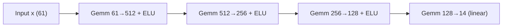
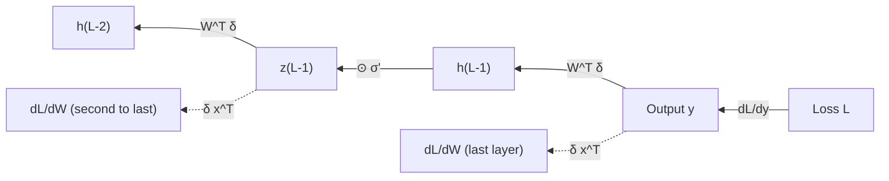
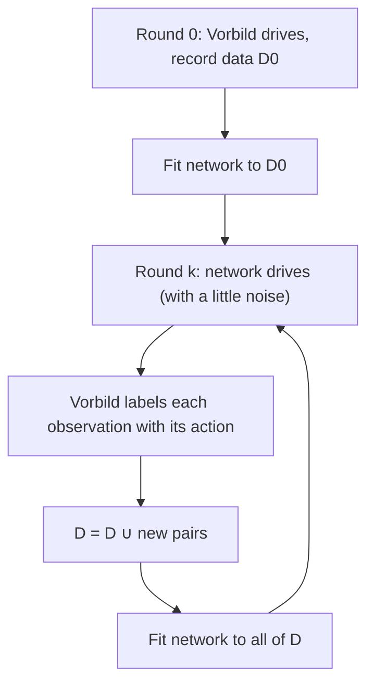
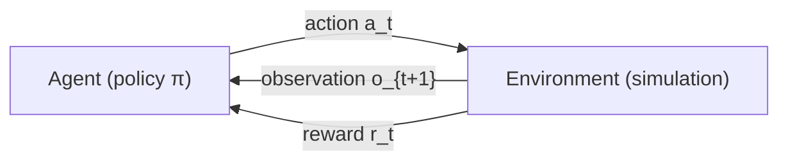
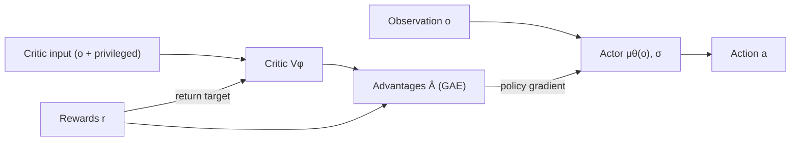
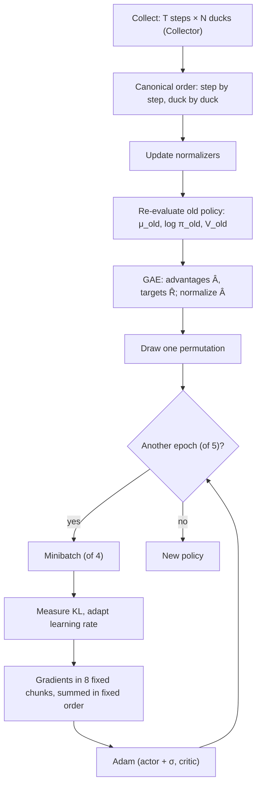
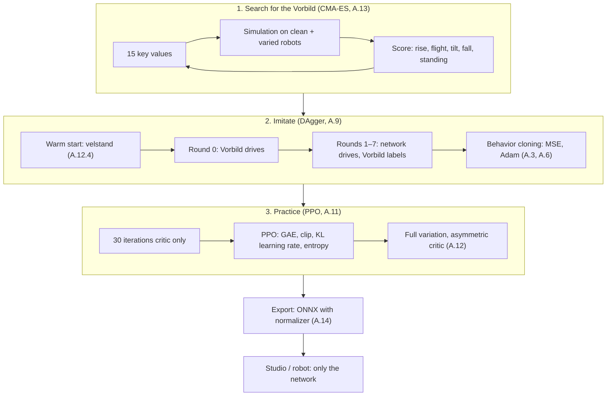

# Appendix A – Foundations: Neural Networks, Imitation and Reinforcement Learning

This appendix explains the toolkit with which Kern's Lehrer ("teacher", Kern's training module)
trains networks for the Micro Duck. It assumes only school mathematics: derivatives, sums, a little
probability. Each concept is first introduced in general terms and then shown at the place in Kern
where it is implemented. The topical chapters [Chapter 14](14-lehrer.md) (the Lehrer) and
[Chapter 15](15-your-own-models.md) (your own models) refer back here.

The code in question lives in `src/lehrer/` and `include/kern/lehrer/`:

| File | Contents |
|---|---|
| `nn.h`, `nn.cpp` | `Mlp` (the network), forward and backward pass, `Adam`, `Normalizer` |
| `ppo.h`, `ppo.cpp` | `Policy`, `Collector`, `Rollout`, `Ppo` (learning algorithm), `imitate` (behavior cloning) |
| `env.h` | `Env`, `Task`, `DuckEnv`, `Rng`, the sizes 61 observations and 14 actions |
| `vorbild.h`, `vorbild.cpp` | jump Vorbild ("role model", the demonstrator), its search with CMA-ES, DAgger |
| `cmaes.h`, `cmaes.cpp` | CMA-ES |
| `spielen.h`, `spielen.cpp` | the play network (ball, sock) with its own Vorbild and DAgger |
| `onnx_export.cpp` | export to the ONNX format |
| `recipe.h`, `recipe.cpp` | the training recipes (which settings for which task) |

---

## A.1 What a neural network is

### A.1.1 A function with many adjustable knobs

At first sight a neural network is nothing mysterious: a function $f_\theta$ that maps an input
vector $x$ to an output vector $y$,

$$y = f_\theta(x).$$

- $x \in \mathbb{R}^n$: the input. For the Micro Duck these are 61 numbers (orientation of the torso,
  joint angles, joint velocities, the last action, commands) – `kObs = 61` in `env.h`.
- $y \in \mathbb{R}^m$: the output. For the Micro Duck, 14 servo targets – `kActions = 14`.
- $\theta$: the **parameters** (weights and biases), often tens or hundreds of thousands of numbers.
  They are not set by hand but learned.

"Learning" means changing $\theta$ so that $f_\theta$ does what we want. What "want" means is fixed
by a number that we minimize – the loss function (Section A.3).

### A.1.2 The neuron

The building block is the artificial neuron. It forms a weighted sum of its inputs, adds an offset
and passes the result through a non-linear function:

$$z = \sum_{i=1}^{n} w_i\, x_i + b, \qquad h = \sigma(z).$$

- $x_i$: the inputs,
- $w_i$: the weights (how strongly an input counts, possibly negatively),
- $b$: the bias (the threshold),
- $z$: the **pre-activation**,
- $\sigma$: the **activation function**,
- $h$: the output of the neuron.

```
 x1 ──w1──┐
 x2 ──w2──┼──► Σ + b ──► z ──► σ(z) ──► h
 x3 ──w3──┘
```

### A.1.3 The layer and the multilayer perceptron

Many neurons side by side that see the same inputs form a **layer**. In matrix notation:

$$z = W x + b, \qquad h = \sigma(z),$$

with $W \in \mathbb{R}^{m \times n}$ (one row per neuron), $b \in \mathbb{R}^m$, and $\sigma$ applied
element-wise. Layers in sequence give a **multilayer perceptron** (MLP):

$$h^{(0)} = x,\qquad h^{(l)} = \sigma\!\left(W^{(l)} h^{(l-1)} + b^{(l)}\right),\qquad y = W^{(L)} h^{(L-1)} + b^{(L)}.$$

In Kern the last layer is **linear** (without $\sigma$): servo targets and values may be any real
number.



**In Kern:** `Mlp` in `nn.h`. The shape is given as a list `dims`: inputs, hidden layers, outputs.
`PpoConfig` (in `ppo.h`) sets `actor_hidden{512, 256, 128}` by default; the recipes give the critic
`{256, 128}` (`recipe_for` in `recipe.cpp`). The play network is `23 → 256 → 128 → 9`
(`make_play_learner` in `spielen.h`).

How many parameters is that? A layer $n \to m$ has $n\cdot m$ weights and $m$ biases. For the actor
$61 \to 512 \to 256 \to 128 \to 14$:

| Layer | Weights | Biases |
|---|---|---|
| 61 → 512 | 31,232 | 512 |
| 512 → 256 | 131,072 | 256 |
| 256 → 128 | 32,768 | 128 |
| 128 → 14 | 1,792 | 14 |
| **Total** | **196,864** | **910** |

Together that makes **197,774** parameters.

Kern stores all parameters in **one** contiguous vector `params_`; `w_[l]` and `b_[l]` are offsets
into this vector. The weights are stored **input-major** (`w[i * out + o]`): for a fixed input $i$,
the weights to all outputs lie one after the other. Why that is so is explained in A.2.2.

### A.1.4 Activation functions, in particular ELU

Without a non-linearity an MLP would be uselessly deep: linear maps in sequence are again a linear
map, $W_2(W_1 x) = (W_2W_1)x$. Only $\sigma$ makes it possible to represent curved relationships
(such as "bend the knee more the faster the torso tips forward, but only up to the end stop").

Common activations:

| Name | Formula | Derivative | Property |
|---|---|---|---|
| tanh | $\tanh z$ | $1-\tanh^2 z$ | bounded, saturates at both ends |
| ReLU | $\max(0,z)$ | $0$ or $1$ | simple, but "dead" neurons for $z<0$ |
| **ELU** | $z$ for $z>0$, otherwise $e^{z}-1$ | $1$ for $z>0$, otherwise $e^{z}$ | smooth, negative down to $-1$, no dead region |

```
 ELU(z)
   2 |                    /
   1 |                 /
   0 |-------------__/------------ z
  -1 |_______----
      -4   -2    0    2
```

Kern uses **ELU** with $\alpha = 1$ – like rsl_rl, the library with which Pollen Robotics trains the
Micro Duck's networks. In the code (`Mlp::forward`):

```cpp
y[k] = y[k] > 0 ? y[k] : kern::dm::expm1(y[k]);  // ELU
```

Two details are worth a closer look:

- `expm1(z)` computes $e^z - 1$ accurately, even for small $|z|$, where `exp(z) - 1` loses digits.
- It is `kern::dm::expm1`, not `std::expm1`: Kern's deterministic maths library (musl, see A.11.10
  and [Appendix C](C-physics.md)), so that the result is bit-identical on all platforms checked in CI.

The backward pass needs the derivative. For $z \le 0$, $\text{ELU}'(z) = e^z$, and because
$h = e^z - 1$, we have $e^z = h + 1$. So there is no need to store $z$ at all; the output is enough.
That is exactly what `Mlp::backward` exploits:

```cpp
// Through the ELU of the layer below: y > 0 passes, else dy/dx = y + 1.
if (y <= 0) prev[k] *= y + 1;
```

### A.1.5 Initialization

Before learning, the weights must have some values. Setting them all to 0 would be fatal: every
neuron in a layer would compute the same thing and receive the same gradient; they would remain
twins forever. They are therefore drawn at random, and small enough that the pre-activations do not
grow with every layer. Kern does it like PyTorch's `nn.Linear`:

$$w, b \sim \mathcal{U}\!\left(-\tfrac{1}{\sqrt{n_\text{in}}},\ \tfrac{1}{\sqrt{n_\text{in}}}\right).$$

Rationale: a sum of $n_\text{in}$ independent terms has a variance proportional to $n_\text{in}$;
scaling by $1/\sqrt{n_\text{in}}$ keeps it of order 1.

`Mlp::init` additionally has a factor `output_gain` for the last layer, which can be used to make the
initial outputs small.

---

## A.2 The forward pass

### A.2.1 What "forward" means

The forward pass is simply the evaluation of the formula from A.1.3, layer by layer. In practice one
does not compute a single input but a **batch** of $B$ inputs at once. The inputs are the rows of a
matrix $X \in \mathbb{R}^{B \times n}$, and a layer computes

$$Y = X W^\top + \mathbf{1} b^\top.$$

### A.2.2 How Kern makes it fast

`dense` in `nn.cpp` computes $y_{r,o} = b_o + \sum_i x_{r,i}\, w_{i,o}$, processing four rows $r$ at
a time:

```cpp
for (i32 i = 0; i < in; ++i) {
  const f32 a0 = x0[i], a1 = x1[i], a2 = x2[i], a3 = x3[i];
  const f32* wi = w + i * out;             // all weights of input i
  for (i32 o = 0; o < out; ++o) {
    y0[o] += wi[o] * a0;  y1[o] += wi[o] * a1;  ...
  }
}
```

The innermost loop runs over consecutive memory locations of `wi` and `y` – an "axpy" operation
($y \leftarrow y + a\,x$) that the compiler can vectorize **without changing the order of the
additions**. That is the reason for the input-major memory layout: with row-major weights the inner
loop would be a dot product, which the compiler only vectorizes if it is allowed to reorder sums –
and reordered floating-point sums are no longer bit-identical (A.11.10).

The header of `nn.cpp` says exactly this: "Weights are stored input-major so that both passes run as
contiguous axpy loops the compiler vectorizes without reassociating sums."

### A.2.3 The cache

Learning later needs the intermediate results. For this, `Mlp::forward` optionally receives a
`Cache`: `act[0]` is the input, `act[l+1]` the output of layer $l$ (after ELU). Without a cache (when
merely acting) the function alternates between two buffers and keeps nothing.

---

## A.3 Loss functions

The loss function $\mathcal{L}(\theta)$ measures how bad the network currently is. Learning means
minimizing it.

### A.3.1 Mean squared error

For regression tasks (the output is a number, not a label) the **mean squared error** (MSE) is
customary:

$$\mathcal{L}_\text{MSE} = \frac{1}{N\,m}\sum_{r=1}^{N}\sum_{j=1}^{m}\left(y_{r,j} - t_{r,j}\right)^2.$$

- $N$: number of examples in the batch,
- $m$: number of outputs,
- $y_{r,j}$: output of the network,
- $t_{r,j}$: target value.

Its derivative with respect to an output is particularly simple:

$$\frac{\partial \mathcal{L}}{\partial y_{r,j}} = \frac{2\,(y_{r,j} - t_{r,j})}{N\,m}.$$

**In Kern:** behavior cloning (`Ppo::imitate`) uses exactly this loss; the line

```cpp
p.dout[...] = 2 * d / static_cast<f32>(m * act_);
```

is the formula above ($d = y - t$, `m` the minibatch size, `act_` the number of actions). The
critic's value loss in PPO is also a squared error (A.11.7).

### A.3.2 The loss as a landscape

One can picture $\mathcal{L}$ as a landscape over the space of all parameters: every point $\theta$
has a height. We stand somewhere (after initialization) and want to get down into the valley. With
hundreds of thousands of dimensions the landscape has no map – we only feel the slope under our feet.
That slope is the gradient.

---

## A.4 Gradient descent

### A.4.1 The basic idea

The **gradient** $\nabla_\theta \mathcal{L}$ is the vector of all partial derivatives
$\partial \mathcal{L}/\partial \theta_k$. It points in the direction of steepest ascent. So one takes
a step in the opposite direction:

$$\theta \leftarrow \theta - \eta\, \nabla_\theta \mathcal{L}.$$

- $\eta$: the **learning rate** (step size).

If $\eta$ is too small, progress is barely made; if it is too large, one jumps over the valley and
oscillates ever more strongly. A one-dimensional example: $\mathcal{L}(\theta) = \theta^2$, gradient
$2\theta$. With $\eta = 0.1$, $\theta = 1$ becomes $0.8$, then $0.64$ – steady convergence. With
$\eta = 1.1$, $1$ becomes $-1.2$, then $1.44$ – divergence. Here the limit is $\eta < 1$ (factor
$|1 - 2\eta| < 1$).

### A.4.2 Stochastic gradient descent and minibatches

Computing the exact gradient over *all* examples is expensive. It is therefore estimated on a random
subset, a **minibatch**, and many small steps are taken. This is called stochastic gradient descent
(SGD). The estimation error acts like noise; small minibatches are noisier. This is a tangible issue
in Kern: with only a few dozen ducks the PPO minibatches are small and the gradient is noisy
(`docs/lehrer.md`, section "Warum PPO allein nicht reicht" – "Why PPO alone is not enough").

An **epoch** is one pass through all the data. `Ppo::imitate` reshuffles the examples every epoch
(Fisher–Yates with Kern's own `Rng`); the PPO learner draws one permutation per iteration ("One
permutation for all epochs, as rsl_rl's mini_batch_generator").

### A.4.3 Gradient clipping

A single outlier in the batch can produce a huge gradient and destroy the network in one step. To
prevent this, the **norm** of the entire gradient is limited:

$$g \leftarrow g \cdot \min\!\left(1,\ \frac{c}{\lVert g \rVert_2}\right).$$

The direction is preserved; only the length is capped. **In Kern:** `Adam::max_norm` (default 1.0,
as in rsl_rl). `Adam::step` computes the norm over all the blocks passed to it together (in `f64`, to
keep rounding errors small over hundreds of thousands of squares) – for the actor, that is over the
network weights **and** the standard deviations of the actions jointly.

---

## A.5 Backpropagation

### A.5.1 The chain rule, applied systematically

How does one obtain $\partial\mathcal{L}/\partial\theta_k$ for 200,000 parameters without
recomputing 200,000 times? By the chain rule, backwards from the output to the input. For a layer
$z = Wx + b$, $h = \sigma(z)$, if $\delta^{h} = \partial\mathcal{L}/\partial h$ (the "error at the
layer's output") is already known:

$$\delta^{z} = \delta^{h} \odot \sigma'(z),$$
$$\frac{\partial\mathcal{L}}{\partial W} = \delta^{z}\, x^\top,\qquad
  \frac{\partial\mathcal{L}}{\partial b} = \delta^{z},\qquad
  \frac{\partial\mathcal{L}}{\partial x} = W^\top \delta^{z}.$$

- $\odot$: element-wise product,
- $\partial\mathcal{L}/\partial x$ is the $\delta^h$ of the layer below – this is how the error
  travels downwards.

Over a batch, the weight gradients are summed: $\partial\mathcal{L}/\partial w_{i,o} =
\sum_r x_{r,i}\,\delta_{r,o}$.



### A.5.2 A worked example by hand

A network with one input, one hidden ELU neuron and one linear output:

$$z = w_1 x + b_1,\quad h = \text{ELU}(z),\quad y = w_2 h + b_2,\quad \mathcal{L} = (y - t)^2.$$

Initial values: $x = 1$, $t = 1$, $w_1 = 0.5$, $b_1 = -1$, $w_2 = 2$, $b_2 = 0.5$.

**Forward:**

| Quantity | Computation | Value |
|---|---|---|
| $z$ | $0.5 \cdot 1 - 1$ | $-0.5$ |
| $h$ | $e^{-0.5} - 1$ | $-0.39347$ |
| $y$ | $2 \cdot (-0.39347) + 0.5$ | $-0.28694$ |
| $\mathcal{L}$ | $(-0.28694 - 1)^2$ | $1.65621$ |

**Backward:**

| Quantity | Computation | Value |
|---|---|---|
| $\partial\mathcal{L}/\partial y$ | $2(y - t)$ | $-2.57388$ |
| $\partial\mathcal{L}/\partial w_2$ | $\partial\mathcal{L}/\partial y \cdot h$ | $1.01274$ |
| $\partial\mathcal{L}/\partial b_2$ | $\partial\mathcal{L}/\partial y$ | $-2.57388$ |
| $\partial\mathcal{L}/\partial h$ | $\partial\mathcal{L}/\partial y \cdot w_2$ | $-5.14776$ |
| $\text{ELU}'(z)$ | $h + 1$ (because $z \le 0$) | $0.60653$ |
| $\partial\mathcal{L}/\partial z$ | $-5.14776 \cdot 0.60653$ | $-3.12227$ |
| $\partial\mathcal{L}/\partial w_1$ | $\partial\mathcal{L}/\partial z \cdot x$ | $-3.12227$ |
| $\partial\mathcal{L}/\partial b_1$ | $\partial\mathcal{L}/\partial z$ | $-3.12227$ |

**One step of gradient descent** with $\eta = 0.1$:
$w_2 = 1.89873$, $b_2 = 0.75739$, $w_1 = 0.81223$, $b_1 = -0.68777$.

**Forward again:** $z = 0.12445$ (now positive, ELU passes it through), $h = 0.12445$,
$y = 1.89873 \cdot 0.12445 + 0.75739 = 0.99369$, $\mathcal{L} \approx 4 \cdot 10^{-5}$.
A single step has almost eliminated the error here – with real networks and many mutually
contradicting examples, progress comes in tiny steps.

### A.5.3 In Kern

`Mlp::backward(cache, dout, grad, dx)` implements A.5.1 layer by layer from top to bottom:

1. Bias gradient: $\sum_r \delta_{r,o}$.
2. Weight gradient: $\sum_r x_{r,i}\,\delta_{r,o}$, again four rows per pass.
3. Input gradient $\delta W^\top$: Kern transposes $W$ once into a buffer `wt` and then uses **the
   same** function `dense` as in the forward pass.
4. Through the ELU of the layer below: multiply by $(y+1)$ where $y \le 0$.

The gradients are **added** to `grad` (not overwritten). This allows partial batches to be computed
on several threads and summed afterwards (A.11.10). With `dx` one can also obtain
$\partial\mathcal{L}/\partial x$ on request.

How do we know this is correct? By comparison with **finite differences**:
$\partial\mathcal{L}/\partial\theta_k \approx (\mathcal{L}(\theta + \varepsilon e_k) - \mathcal{L}(\theta - \varepsilon e_k)) / (2\varepsilon)$.
`docs/lehrer.md` names the corresponding test ("Gradient gegen finite Differenzen" – "gradient
against finite differences").

---

## A.6 Adam

### A.6.1 Why not just SGD?

Plain gradient descent has two weaknesses: it uses the same step size for all parameters, even
though some gradients are large and others tiny, and it reacts nervously to noisy gradients.
**Adam** (Kingma and Ba, 2015) fixes both with two moving averages per parameter:

$$m_t = \beta_1 m_{t-1} + (1-\beta_1)\, g_t, \qquad v_t = \beta_2 v_{t-1} + (1-\beta_2)\, g_t^2,$$
$$\hat m_t = \frac{m_t}{1-\beta_1^t},\qquad \hat v_t = \frac{v_t}{1-\beta_2^t},\qquad
  \theta_t = \theta_{t-1} - \eta\,\frac{\hat m_t}{\sqrt{\hat v_t} + \epsilon}.$$

- $g_t$: the gradient at step $t$,
- $m_t$: the "momentum", a smoothed gradient (direction),
- $v_t$: the smoothed squared gradient (typical magnitude),
- $\beta_1 = 0.9$, $\beta_2 = 0.999$: smoothing factors,
- $\hat m_t, \hat v_t$: **bias correction** – both start at 0 and would be too small at the
  beginning,
- $\epsilon = 10^{-8}$: prevents division by 0.

The step per parameter is roughly $\eta \cdot (\text{direction} / \text{typical magnitude})$, i.e.
dimensionless and of similar size for all parameters.

**Example:** in the very first step $m_1 = 0.1\,g$, $v_1 = 0.001\,g^2$; after correction
$\hat m_1 = g$, $\hat v_1 = g^2$ – the step is $\eta \cdot g/|g| = \pm\eta$, **independent of the
size of the gradient**. Whether $g = 10^{-6}$ or $g = 10^{3}$: the parameter moves by the learning
rate.

### A.6.2 In Kern

`Adam` in `nn.h` has PyTorch's default values (`lr = 1e-3`, `beta1 = 0.9`, `beta2 = 0.999`,
`eps = 1e-8`) and, before that, norm clipping (A.4.3). `Adam::step` writes the bias correction the
way PyTorch computes it:

```cpp
const f32 step = lr / c1, root_c2 = std::sqrt(c2);          // c1 = 1 - β1^t, c2 = 1 - β2^t
b.params[k] -= step * m_[at] / (std::sqrt(v_[at]) / root_c2 + eps);
```

Mathematically this is $\eta\,\hat m/(\sqrt{\hat v} + \epsilon)$. The powers $\beta^t$ come from
`kern::dm::pow` (deterministic). The moments `m()`, `v()` and the counter `t()` are part of the
checkpoint (`Ppo::save`): a resumed run takes exactly the steps that the uninterrupted one would
have taken.

Actor and critic have **separate** Adam instances (`actor_adam_`, `critic_adam_`), and
`Ppo::imitate` creates a third, fresh one for behavior cloning – so that the moments from cloning do
not carry over into the subsequent PPO.

---

## A.7 Input normalization

### A.7.1 The problem

The 61 observations have very different orders of magnitude: joint angles in radians (tenths), joint
velocities in rad/s (up to two digits), the gravity vector between −1 and 1. A network can cope with
that, but it learns more slowly: with the same initialization the large inputs dominate the sums, and
the gradients of the weights attached to large inputs are correspondingly large.

### A.7.2 The solution: running standardization

Each input is rescaled to mean 0 and standard deviation 1:

$$\tilde x_i = \frac{x_i - \mu_i}{\sigma_i + 0.01}.$$

- $\mu_i$, $\sigma_i$: mean and standard deviation of input $i$ over everything observed so far,
- $0.01$: prevents division by 0 for inputs that are (almost) constant.

Because the distribution shifts during learning (a better policy experiences different states),
$\mu$ and $\sigma^2$ are updated continuously. For a new batch with $n_B$ examples, mean $\mu_B$ and
variance $\sigma_B^2$, and $n$ examples so far, **Chan's parallel algorithm** gives:

$$\delta = \mu_B - \mu,\qquad n' = n + n_B,\qquad \mu' = \mu + \delta\,\frac{n_B}{n'},$$
$$\sigma'^2 = \frac{\sigma^2 n + \sigma_B^2 n_B + \delta^2\,\frac{n\,n_B}{n'}}{n'}.$$

The formula is exact: it yields the same result as if all the data had been seen at once, and needs
only the three numbers $(\mu, \sigma^2, n)$ to do so.

### A.7.3 In Kern

`Normalizer` in `nn.h` ("rsl_rl's EmpiricalNormalization") implements this (`update`, computed in
`f64`). Two points matter:

- **It belongs to the network.** A network that learned with normalized inputs is worthless without
  exactly that normalization. That is why the ONNX export writes it as `Sub` (mean) and `Div`
  ($\sigma + 0.01$) at the start of the graph (A.14), and `Policy::serialize` includes it.
- **It can be frozen.** When warm-starting from Pollen's velstand network, Kern adopts its normalizer
  and freezes it (`freeze_actor_normalizer`, `Ppo::warm_start`). For new inputs the old network never
  saw (the jump phase in slots 55 and 56), it sets mean 0 and divisor 1 and the associated weights
  to 0 – the warm-started network then behaves **exactly** like the original until it learns to use
  the new inputs.

The learner updates the normalizers once per iteration with all collected observations and then
re-evaluates the old policy **with the new normalizers** (`Ppo::learn`). The reason is given in
`docs/lehrer.md`: "bei einigen Dutzend Umgebungen wandern die Normalisierer sonst merklich" ("with a
few dozen environments the normalizers would otherwise drift noticeably"), and PPO's probability
ratios (A.11.4) would be distorted.

---

## A.8 Overfitting and generalization

A network with 200,000 parameters can memorize a small dataset: the error on the training examples
is tiny, on new examples it is large. This is **overfitting**. The usual remedies:

| Remedy | Idea |
|---|---|
| more and more varied data | less to memorize |
| validation data | check on data that were never used for learning |
| early stopping | take the best network according to validation, not the last one |
| smaller networks, regularization | less capacity for memorizing |

In robotics, overfitting usually means: the network has adapted itself to **exactly this
simulation** – to this mass, this friction, this servo. In the real world everything is a little
different. The remedy is variation (domain randomization, A.12). Kern therefore evaluates every
network twice: on the **clean** robot and under **full variation** (`kern_lehrer --eval`,
`JumpReport`, `PlayReport`). The choice of round for the play network
(`docs/lehrer.md`, Section 8; Section 14.8) is likewise early stopping after an evaluation.

---

## A.9 Supervised learning and imitation learning

### A.9.1 Supervised learning

In **supervised learning** there are pairs $(x, t)$: the correct answer for each input. The network
learns the mapping by minimizing a loss such as the MSE. This is the simplest form of learning –
provided someone supplies the correct answers.

### A.9.2 Behavior cloning

In robot learning, the "correct answer" is the action of an expert. If one has an expert who
demonstrates a task, and records pairs (observation, expert action), a network can be trained on
them in a supervised manner. This is called **behavior cloning** (BC).

**In Kern:** `Ppo::imitate(observations, target, epochs, batch, learning_rate, seed)` fits the
actor's mean to the target actions via MSE – Adam with its own moments, minibatches in a fixed
order. In Kern the expert is called the **Vorbild** ("role model"): for the jump it is `JumpTeacher`
(`vorbild.h`), for play `PlayEnv::teacher` (`spielen.h`).

### A.9.3 Distribution shift

Behavior cloning has an insidious flaw. The network only learns states the expert visited. If it
makes a small mistake, it ends up in a state the expert would never have reached – there it has no
data and makes a larger mistake, and so on. The errors compound. This is called **distribution
shift** (or *covariate shift*): the distribution of states at test time differs from that during
learning because the network generates the states itself.

```
 Expert:   ●──●──●──●──●──●──●   (always in the middle)
 Clone:    ●──●──●─╲
                    ●─╲          small error → unknown state
                       ●──╲      → larger error → ...
                           ●  fall
```

Quantitatively (Ross and Bagnell): if the clone makes a mistake with probability $\varepsilon$ at
every step, the total error over $T$ steps can grow like $\varepsilon T^2$ instead of
$\varepsilon T$.

### A.9.4 DAgger

**DAgger** (*Dataset Aggregation*, Ross, Gordon and Bagnell, 2011) turns the tables: it is not the
expert who drives but the student – and in every state the expert says what **it** would have done.



This produces data precisely in the states the student gets into, and the distribution shift
gradually disappears.

**In Kern:** `dagger_episodes` in `vorbild.cpp`:

- Round 0: the Vorbild drives (`round == 0 || !student`).
- Later: the student drives (`student->act`), with noise $0.05 \cdot \mathcal{N}(0,1)$ per action
  "for coverage" – so that states just beside its own trajectory also occur.
- At every tick the Vorbild's action is stored as the label.
- `JumpImitation::round_from` appends the new data to all previous data and fits the network to
  **everything** (`imitate(..., 10, 256, 1e-3f, ...)`: 10 epochs, minibatch 256, learning rate
  $10^{-3}$).

The jump recipe has 8 rounds of 96 episodes each; according to `docs/lehrer.md` the network jumps
properly for the first time from round 7. The play network learns the same way (`imitate_play`).

One detail that makes DAgger possible in the first place: the play network's Vorbild sees **the
same** as the network and has "kein verstecktes Gedächtnis" ("no hidden memory"; `docs/lehrer.md`,
Section 8). A network can learn a function of observations exactly; a function that depends on
hidden quantities, it cannot.

---

## A.10 Reinforcement learning from the ground up

Behavior cloning needs an expert. If there is none – or if the network is to become better than the
expert – one needs **reinforcement learning** (RL): the network tries things out, the environment
rewards or punishes, and the network learns to obtain more reward.

### A.10.1 The loop



**In Kern** the environment is an `Env` (`env.h`): `reset()`, then at every tick `observation()` and
`step(action)`, which returns a `Step{reward, terminal, timeout}`. `DuckEnv` is a duck in its own
GameWorld, headless; one step is a control tick of 20 ms (`kControlDt = 0.02`, 50 Hz).

### A.10.2 Markov decision process

Mathematically this is described as a **Markov decision process** (MDP) $(S, A, P, R, \gamma)$:

- $S$: the set of states $s$ (the complete physical state of the duck: all poses and velocities),
- $A$: the set of actions $a$ (here $\mathbb{R}^{14}$),
- $P(s' \mid s, a)$: the transition probability (here: the physics, plus randomness such as pushes),
- $R(s, a)$: the reward,
- $\gamma \in [0,1)$: the discount factor (A.10.5).

"Markov" means: the next state depends only on the current state and the action, not on the history.

### A.10.3 State and observation

The agent usually does **not** see the full state, only an **observation** $o$: what its sensors
deliver, noisy and delayed. One then speaks of a partially observable MDP (POMDP). The duck sees its
joint angles (with noise and encoder offset), its gyro, the gravity vector, its last action and the
commands – but not its true height above the ground or its velocity in space.

**In Kern:** `Task::Noise` (`env.h`) specifies how the observation deviates from the state: gyro
$\pm 0.03$, gravity $\pm 0.01$, joint angles $\pm 0.001$ plus encoder offset $\pm 0.015$ per
episode, joint velocity $\pm 0.25$, IMU delayed by 0–1 ticks. The last action is part of the
observation – a simple memory that alleviates the POMDP problem.

### A.10.4 Reward and return

The **reward** $r_t$ is a number per step. It is the only place where one tells the agent what it
should do – and the agent takes it literally. `docs/lehrer.md` reports runs in which the duck learned
"auf dem Schwanz sitzen, Hechtsprung, sich abstützen" ("sitting on its tail, diving forward, propping
itself up") because the reward allowed it. Each of these loopholes was closed with a stricter rule.

**In Kern:** `Task::reward(tick, terminal)` returns the reward; following mjlab's convention it is
the sum $\sum_k w_k \cdot \text{Term}_k \cdot \Delta t$ (weight times term times tick duration). The
table of the jump's terms (airborne, lift, landed, imitate, upright, fall …) is in `docs/lehrer.md`.
`Task::terms` keeps the individual terms of the last tick for reports.

The **return** is the sum of future rewards. Without weighting it would be unbounded for long
episodes; therefore one discounts.

### A.10.5 Discounting

$$G_t = r_t + \gamma\, r_{t+1} + \gamma^2 r_{t+2} + \dots = \sum_{k=0}^{\infty} \gamma^k\, r_{t+k}.$$

- $G_t$: the discounted return from step $t$,
- $\gamma$: the discount factor.

Intuition: a reward $k$ steps away counts only $\gamma^k$ times as much as one now. The **effective
horizon** is roughly $1/(1-\gamma)$ steps. Kern uses $\gamma = 0.99$ (`PpoConfig::gamma`): around
100 ticks, i.e. 2 s at 50 Hz – as long as a whole jump (`kJumpSeconds = 2`, the phase runs as
$t/2\,\text{s}$ from 0 to 1). After 100 steps $0.99^{100} \approx 0.37$, after 300 only
$\approx 0.05$.

What matters is the recursion

$$G_t = r_t + \gamma\, G_{t+1},$$

on which everything else builds.

### A.10.6 Policy

The **policy** $\pi$ is the agent's decision rule. A **deterministic** policy gives one action for
every observation, $a = \mu_\theta(o)$. A **stochastic** policy gives a probability distribution,
$a \sim \pi_\theta(\cdot \mid o)$. Learning needs the stochastic form (A.10.10); when acting on the
robot, one takes the mean.

**In Kern:** `Policy` (`ppo.h`) consists of `actor` (the MLP), `normalizer` and `stddev` (the spread
per action). `Policy::act` returns the **mean** – "what the exported network computes".

### A.10.7 Value functions

The **state-value function** of a policy is the expected return from a state:

$$V^\pi(s) = \mathbb{E}_\pi\left[G_t \mid s_t = s\right].$$

The **action-value function** is the expected return if one first does $a$ and then follows $\pi$:

$$Q^\pi(s, a) = \mathbb{E}\left[r_t + \gamma V^\pi(s_{t+1}) \mid s_t = s, a_t = a\right].$$

$V$ says how good a situation is; $Q$ says how good a particular action is in that situation.

### A.10.8 Advantage

The **advantage** is the difference:

$$A^\pi(s,a) = Q^\pi(s,a) - V^\pi(s).$$

$A > 0$: the action was better than what the policy does on average. $A < 0$: worse. This is exactly
the information learning needs: "Do more of what was better than usual."

A simple estimate of the advantage from a single step is the **TD error** (*temporal difference*):

$$\delta_t = r_t + \gamma\, V(s_{t+1}) - V(s_t).$$

It says: what happened ($r_t$ plus the value of where we arrived), compared with what we had expected
($V(s_t)$).

### A.10.9 Episodes: termination and time limit

An episode ends in two fundamentally different ways:

- **terminal**: the duck has fallen. There is no future after that; $V(s_{\text{after}}) = 0$.
- **timeout**: time is up. But the duck would still be standing and would have a future – the time
  limit is a property of the training, not of the world.

Treating both the same teaches the network that it is pointless to make an effort shortly before the
end of an episode. **In Kern** `Env::Step` distinguishes the two (`terminal`, `timeout`), and GAE
handles a time limit with a **bootstrap**: the reward of the last step gets $\gamma V(s_t)$ added, as
if things continued (`ppo.cpp`: "a time-out is bootstrapped with the value where it stood
(rsl_rl)"):

```cpp
const f32 reward = reward_[row] + (timeout_[row] ? cfg_.gamma * v : 0.0f);
```

### A.10.10 Policy gradient

How does one change $\theta$ so that the expected return $J(\theta) = \mathbb{E}_{\pi_\theta}[G_0]$
increases? The reward depends on the action via the physics, and the physics is not differentiable.
The trick is the **policy gradient theorem**:

$$\nabla_\theta J(\theta) = \mathbb{E}_{\pi_\theta}\left[\sum_t \nabla_\theta \log \pi_\theta(a_t \mid o_t)\; A_t\right].$$

- $\log \pi_\theta(a_t \mid o_t)$: the log-probability that the policy chooses exactly the chosen
  action,
- $A_t$: the advantage of this action.

Only the policy is differentiated, never the physics. Intuition: if an action has a positive
advantage, make it more likely; with a negative advantage, less likely. That is why a **stochastic**
policy is needed – only it tries out different actions and has a differentiable probability.

### A.10.11 The Gaussian policy

For continuous actions the usual choice is a normal distribution whose mean is supplied by the
network and whose spread is a separate learnable parameter per action:

$$a_j = \mu_{\theta,j}(o) + \sigma_j\,\xi_j,\qquad \xi_j \sim \mathcal{N}(0,1).$$

The log-probability of the whole action vector is the sum over the dimensions:

$$\log \pi_\theta(a \mid o) = \sum_{j=1}^{m}\left[-\frac{(a_j - \mu_j)^2}{2\sigma_j^2} - \log\sigma_j - \tfrac12\log 2\pi\right].$$

Its derivatives, which learning requires:

$$\frac{\partial \log\pi}{\partial \mu_j} = \frac{a_j - \mu_j}{\sigma_j^2},\qquad
  \frac{\partial \log\pi}{\partial \sigma_j} = \frac{(a_j - \mu_j)^2}{\sigma_j^3} - \frac{1}{\sigma_j}.$$

**In Kern:**

- Sampling (`Collector::collect`):
  `a[j] = mu[j] + policy.stddev[j] * r.normal();`
  with `Rng::normal` (Box–Muller, built from `kern::dm::log` and `kern::dm::cos`).
- Log-probability (`Ppo::learn`, `Ppo::update`):
  `logp += -0.5f * d * d / (sd * sd) - kern::dm::log(sd) - 0.5f * kLog2Pi;`
  with `kLog2Pi` $= \log 2\pi = 1.83787706641$.
- Derivatives (`Ppo::update`):
  `k.dmu[...] = g * d / (sd * sd);` and `k.dstd[j] += g * (d * d / (sd * sd * sd) - 1 / sd);`
- Initial spread `init_std` (default 1.0; the jump recipe 0.3), lower bound `kMinStd = 1e-3`.
- After imitation, `begin_practice` sets the spread to `practice_std` (jump: 0.1): a network that
  already jumps well should not unlearn everything again because of large noise.

Each duck has its **own** random stream, derived from the seed and the global index (`Collector`,
`env_rng_`): "what an environment does depends on its global index only, never on which worker steps
it."

### A.10.12 Entropy

The **entropy** of a distribution measures its uncertainty. For a normal distribution it depends
only on $\sigma$:

$$H = \sum_{j}\left(\tfrac12 + \tfrac12\log 2\pi + \log\sigma_j\right).$$

Example: $\sigma = 1$ gives $1.419$ per dimension; $\sigma = 0.1$ gives $-0.884$ (differential
entropy can be negative). Without a countermeasure, $\sigma$ often shrinks too quickly during
learning; the agent stops exploring and gets stuck at the first usable solution. An **entropy bonus**
in the loss, $-c_H H$, keeps it open.

**In Kern:** `entropy_coef` (default 0.01; jump 0.005). Because $H$ does not depend on the
observation, it is "the same for every sample" and is computed once per minibatch; its gradient with
respect to $\sigma_j$ is $-c_H/\sigma_j$:

```cpp
first.dstd[j] += -cfg_.entropy_coef / policy_.stddev[j];
```

---

## A.11 Actor-critic, GAE and PPO

### A.11.1 Actor-critic

The policy gradient requires the advantage, and hence an estimate of $V$. This is supplied by a
second network, the **critic** $V_\phi(s)$. The policy network is called the **actor**. Both learn
simultaneously: the critic learns to predict returns; the actor learns from the advantages the critic
computes.



**In Kern:** `Ppo` has `policy_.actor` and `critic_`, each with its own normalizer
(`policy_.normalizer`, `critic_norm_`) and its own Adam. The critic has one output
(`c.push_back(1)` in the constructor).

An important practical detail: after imitation the actor is already good, but the critic knows
nothing. Its advantages would be random and would destroy the good actor. Kern therefore first lets
**only the critic** learn (`set_actor_frozen`, `Recipe::critic_warmup = 30` iterations).

### A.11.2 Generalized advantage estimation

Between the TD error $\delta_t$ (little noise, but biased if $V$ is wrong) and the full return
$G_t - V(s_t)$ (unbiased, but very noisy) lies a continuum. **GAE** (Schulman et al., 2016) blends
all the intermediate stages with a second factor $\lambda$:

$$\hat A_t = \sum_{k=0}^{\infty} (\gamma\lambda)^k\, \delta_{t+k},$$

or recursively, computed backwards in time:

$$\hat A_t = \delta_t + \gamma\lambda\, \hat A_{t+1}.$$

- $\lambda = 0$: only the TD error,
- $\lambda = 1$: the full Monte Carlo advantage,
- Kern: $\lambda = 0.95$ (`PpoConfig::lam`).

The **critic's target** is then $\hat R_t = \hat A_t + V(s_t)$.

**Worked example** with $\gamma = 0.99$, $\lambda = 0.95$ ($\gamma\lambda = 0.9405$), three steps
without the episode ending, rewards $r = (1, 0, 2)$, values $V = (5, 4, 6)$ and the value after the
last step $V_3 = 3$:

| $t$ | $\delta_t = r_t + \gamma V_{t+1} - V_t$ | $\hat A_t = \delta_t + 0.9405\,\hat A_{t+1}$ | $\hat R_t = \hat A_t + V_t$ |
|---|---|---|---|
| 2 | $2 + 2.97 - 6 = -1.03$ | $-1.03$ | $4.97$ |
| 1 | $0 + 5.94 - 4 = 1.94$ | $1.94 - 0.9687 = 0.9713$ | $4.9713$ |
| 0 | $1 + 3.96 - 5 = -0.04$ | $-0.04 + 0.9135 = 0.8735$ | $5.8735$ |

Step 0 itself had a slightly negative TD error, but is advantageous overall because it led to a
state from which things went better than expected.

**In Kern** (`Ppo::learn`) this is exactly that loop, for each duck backwards over the $T$ steps of a
rollout:

```cpp
const f32 delta = reward + live * cfg_.gamma * next - v;
adv = delta + live * cfg_.gamma * cfg_.lam * adv;
return_buf_[row] = adv + v;
```

`live` is 0 after an episode end (terminal or timeout): then there is neither $\gamma V(s_{t+1})$
nor a continuation of the recursion. For the last step of the rollout, $V(s_{T})$ comes from
`last_critic`, the critic observation of where each duck stood at the end. Afterwards the advantages
are normalized over the whole batch to mean 0 and standard deviation 1 – this makes the size of the
policy gradient independent of the scale of the reward.

### A.11.3 Why a naive policy gradient is unstable

One could now simply maximize $\sum_t \log\pi_\theta(a_t|o_t)\hat A_t$. The problem: the data come
from the **old** policy. If one takes a large step, the new policy is far away, the advantages no
longer apply to it, and a good policy can be destroyed in a single step – with bad data in the next
round from which recovery is hardly possible. Several epochs on the same data (which would be
efficient) make this worse.

### A.11.4 PPO: the clipped surrogate objective

**Proximal Policy Optimization** (Schulman et al., 2017) limits how far the policy may move per
update. Central to it is the **probability ratio**

$$\rho_t(\theta) = \frac{\pi_\theta(a_t \mid o_t)}{\pi_{\theta_\text{old}}(a_t \mid o_t)} = \exp\left(\log\pi_\theta - \log\pi_{\theta_\text{old}}\right).$$

$\rho = 1$: the new policy chooses the action with the same probability as the old one. The clipped
surrogate objective is

$$L^\text{CLIP}(\theta) = \mathbb{E}_t\left[\min\left(\rho_t \hat A_t,\ \operatorname{clip}(\rho_t, 1-\varepsilon, 1+\varepsilon)\,\hat A_t\right)\right],$$

with $\varepsilon = 0.2$ (`PpoConfig::clip`). It is **maximized**; Kern minimizes its negative and
therefore writes the minimum as the maximum of the negated terms:

```cpp
const f32 ratio = kern::dm::exp(clamp(logp - logp_buf_[row], -20.0f, 20.0f));
const f32 s1 = -adv * ratio, s2 = -adv * clamp(ratio, 1 - cfg_.clip, 1 + cfg_.clip);
k.sloss += max_of(s1, s2);
const f32 g = s1 >= s2 ? -adv * ratio * inv : 0.0f;  // d(loss)/d(logp)
```

The derivative with respect to $\log\pi$ is $-\hat A\rho$ (since $\partial\rho/\partial\log\pi =
\rho$), but only when the unclipped term is decisive; otherwise 0.

### A.11.5 Why clipping is stable

The four cases:

| Advantage | Ratio | Active term | Gradient | Meaning |
|---|---|---|---|---|
| $\hat A > 0$ | $\rho \le 1.2$ | unclipped | flows | make the good action more likely |
| $\hat A > 0$ | $\rho > 1.2$ | clipped | **0** | already reinforced enough: stop |
| $\hat A < 0$ | $\rho \ge 0.8$ | unclipped | flows | make the bad action less likely |
| $\hat A < 0$ | $\rho < 0.8$ | clipped | **0** | already weakened enough: stop |

Example: $\hat A = 1$, $\rho = 1.3$: $s_1 = -1.3$, $s_2 = -1.2$, $\max = -1.2$ is the clipped term,
and the gradient is 0. The step that would push the policy even further in this direction does not
take place.

The **asymmetry** is important: if an action with $\hat A < 0$ already has $\rho = 1.3$ (the new
policy chooses the bad action *more often*), then $s_1 = 1.3 > s_2 = 1.2$ – the unclipped term
applies, and the gradient corrects the mistake. PPO is pessimistic: improvements are capped,
deteriorations never. The objective is a lower bound on the true gain.

```
 L(ρ) for  > 0                L(ρ) for  < 0
   │        ____________          │‾‾‾‾‾‾‾‾╲
   │      ╱                       │          ╲
   │    ╱                         │            ╲
   └───┴────┴──── ρ               └───┴────┴─── ρ
      0.8  1.2                       0.8  1.2
```

### A.11.6 Adaptive learning rate via the KL divergence

In addition to clipping, Kern (like rsl_rl) adjusts the learning rate according to the
**KL divergence** between the old and new policy – a measure of how different two distributions are.
For two normal distributions, per dimension:

$$D_\text{KL}\left(\mathcal N(\mu_0,\sigma_0^2)\,\Vert\,\mathcal N(\mu_1,\sigma_1^2)\right) = \log\frac{\sigma_1}{\sigma_0} + \frac{\sigma_0^2 + (\mu_0 - \mu_1)^2}{2\sigma_1^2} - \frac12.$$

Kern sums this over the actions, averages over the minibatch and adjusts:

- $D_\text{KL} > 2 \cdot 0.01$: learning rate divided by 1.5 (at least $10^{-5}$),
- $D_\text{KL} < 0.01 / 2$: learning rate multiplied by 1.5 (at most $10^{-2}$).

(`PpoConfig::desired_kl = 0.01`, `adaptive_lr = true`.) This is a simple controller that keeps the
policy change per step within a band – large steps when things are calm, small ones when the policy
jumps.

### A.11.7 Value loss

The critic minimizes $(V_\phi(s_t) - \hat R_t)^2$. Here, too, Kern clips (`clipped_value_loss`):
the new value estimate may move at most $\varepsilon$ away from the estimate at collection time, and
the larger of the two errors counts:

$$L^V = \max\left((V - \hat R)^2,\ (V_\text{old} + \operatorname{clip}(V - V_\text{old}, -\varepsilon, \varepsilon) - \hat R)^2\right),$$

with weight `value_coef = 1`.

### A.11.8 A complete PPO update



The values of Kern's `PpoConfig`: `steps_per_env = 24` (jump: 48), `epochs = 5`, `minibatches = 4`,
`clip = 0.2`, `gamma = 0.99`, `lam = 0.95`, `learning_rate = 1e-3` (jump: $10^{-4}$).

### A.11.9 Collecting and learning kept separate

Kern deliberately separates the two halves: a `Collector` needs only the `Policy` (actor, normalizer,
spread) and returns a `Rollout`; the learner (`Ppo::learn`) takes the rollouts of all collectors.
Both can be serialized into flat buffers. This way the collectors can be native threads or web
workers in the browser (`docs/lehrer.md`, Section 6).

### A.11.10 Determinism in learning

Floating-point addition is not associative: $(a + b) + c$ and $a + (b + c)$ can differ in the last
bit. If gradients are summed in an order that depends on the number of threads, one gets different
networks on 2 and on 16 cores. Kern prevents this:

- Each duck has its seed from (seed, global index).
- The learner puts the rollouts into canonical order before computing ("One canonical order,
  whatever the split into rollouts").
- Each minibatch is cut into **exactly 8** chunks (`kLearnChunks = 8`), whose gradients are added in
  a fixed order – regardless of whether 1, 2 or 16 threads compute them.
- All transcendental functions come from `kern::dm` (musl), and everything is compiled without FMA
  contraction.

The result: the same seed and the same number of ducks yield the same network, natively as well as in
the browser (test `lehrer_runs_the_same_on_any_number_of_workers`). The background on floating point,
FMA and libm is in [Appendix C](C-physics.md), Section C.9.

---

## A.12 From simulation to reality

### A.12.1 The reality gap

A network learned in simulation meets a robot that is different: masses are measured imprecisely,
servos vary, friction depends on the floor, sensors are noisy and delayed. A network that has adapted
itself to the exact simulation fails there. Bridging this **sim-to-real gap** is the heart of robot
learning.

Two strategies complement each other:

1. **Bring the simulation closer to reality:** accurate models, calibrated against measurements
   (Kern: device models and calibration, [Chapter 16](16-calibration.md)).
2. **Make the network insensitive:** it learns in many slightly different worlds, so that the real
   one is just one more.

### A.12.2 Domain randomization

In **domain randomization**, every episode draws its physical and sensory parameters afresh from
distributions. A network that works in all these worlds has learned what they have in common.

**In Kern** (`docs/lehrer.md`, Section 5; `Task::Start`, `Task::Noise`, `DuckEnv::servo`):

| What | Variation |
|---|---|
| Start | random yaw, ±3° tilt, sole friction 0.7–1.3 |
| Build | torso mass and inertia ±5%, center of mass of torso and head (curriculum 3 → 15 mm and 3 → 10 mm respectively) |
| Servos | from the profile's spreads (XL330: friction, rotor inertia ±10%), dead time 15–30 ms |
| Sensors | noise on gyro, gravity, joint angles, joint velocities; encoder offset; IMU delay |
| Pushes | every 3–6 s ±0.3 m/s, from iteration 300 (until 500 at 27% strength) |

Two subtleties:

- **Curricula**: some variations are introduced only gradually. `Task::progress(iteration)` widens
  the center-of-mass spread from iteration 200 over 600 iterations; `Recipe::push_scale` switches the
  pushes on only from iteration 300. Too much variation at the start prevents the motion from
  emerging at all.
- **What cannot be measured is varied.** Besides the values, `ServoProfile` has the spreads
  `spread_*` and `delay_min`/`delay_max`: "training draws each servo's values within these, so that
  the policy does not depend on what the measurement could not pin down."

### A.12.3 The asymmetric critic

The critic is needed only during learning; on the robot only the actor runs. So the critic may see
things the robot cannot measure – this makes its value estimate more accurate and the advantages less
noisy. This is the **asymmetric actor-critic**.

**In Kern** (`DuckEnv::observe` in `duck_env.cpp`):

> "The critic sees the clean state; the actor what the robot's sensors give (noise, bias)."

- The critic receives the 61 observations **without noise**, followed by `Task::privileged()`
  additional values.
- For the jump there are 9 (`tasks.cpp`): height of the torso relative to the start, its velocity in
  x, y, z, both sole contacts, both foot heights, and whether the duck has already been airborne.
- The play network has `PlayEnv::kPrivileged = 6`.
- `Env::critic_size()` is accordingly `kObs + privileged()`.

### A.12.4 Warm start

Instead of starting from random weights, a network can start from a trained one. Kern's jump starts
out as Pollen's **velstand** network (`Recipe::warm_start = "velstand"`, `Ppo::warm_start`): it can
already stand and balance and only has to learn the jump in addition. In the process the weights are
reordered from the ONNX layout (`[out][in]`, Gemm with `transB`) into Kern's input-major layout.

---

## A.13 Evolutionary methods: CMA-ES

### A.13.1 When there is no gradient

Some optimization problems have no usable gradient. Examples in Kern:

- **The jump Vorbild:** 15 numbers (servo targets of the left leg at five points in time), evaluated
  by an entire simulation with falling, flight and landing. The evaluation is noisy (different robots
  in each generation) and piecewise flat.
- **Calibration:** choose the parameters of a servo profile so that the simulation reproduces
  measurements (`kalibrierung.cpp` optimizes 6 parameters).

**Evolution strategies** are suited to such cases: candidates are drawn around a center, evaluated,
and the center is shifted toward the better ones.

### A.13.2 The idea of CMA-ES

**CMA-ES** (*Covariance Matrix Adaptation Evolution Strategy*, Hansen) draws the candidates from a
multivariate normal distribution and learns not only its center but also its shape:

$$x_k = m + \sigma\, y_k,\qquad y_k = B D z_k,\qquad z_k \sim \mathcal N(0, I).$$

- $m$: the center of the search,
- $\sigma$: the global step size,
- $C = B D^2 B^\top$: the covariance matrix (shape and orientation of the search cloud); $B$ its
  eigenvectors, $D$ the square roots of its eigenvalues,
- $\lambda$ candidates per generation, of which the best $\mu = \lambda/2$ count.

```
 Generation 1          Generation 5            Generation 20
   ·  ·   ·              · ·                      ·
  ·  ●  ·  ·            ·●··                     ●:
   · ·  ·               ·  ·  ↗                  (narrow, along
  (round, large)       (stretched toward valley) the valley)
```

The update per generation (after sorting the candidates by cost):

1. **Weights** for the $\mu$ best: $w_i \propto \ln(\mu + \tfrac12) - \ln i$, normalized to sum 1.
   The effective number $\mu_\text{eff} = 1/\sum w_i^2$.
2. **Center:** $m \leftarrow m + \sigma \sum_i w_i\, y_{i:\lambda}$.
3. **Evolution path for the step size:**
   $p_\sigma \leftarrow (1 - c_\sigma) p_\sigma + \sqrt{c_\sigma(2-c_\sigma)\mu_\text{eff}}\; B \sum_i w_i z_{i:\lambda}$.
4. **Step size:**
   $\sigma \leftarrow \sigma \exp\left(\frac{c_\sigma}{d_\sigma}\left(\frac{\lVert p_\sigma\rVert}{\chi_n} - 1\right)\right)$,
   with $\chi_n = \mathbb E\lVert\mathcal N(0,I)\rVert \approx \sqrt n\left(1 - \frac{1}{4n} + \frac{1}{21n^2}\right)$.
   If successive steps go in the same direction (long path), $\sigma$ grows; if they cancel out
   (short path), it shrinks.
5. **Covariance:** rank-one update from the evolution path $p_c$ and rank-$\mu$ update from the best
   steps:
   $C \leftarrow (1 - c_1 - c_\mu) C + c_1 p_c p_c^\top + c_\mu \sum_i w_i\, y_{i:\lambda} y_{i:\lambda}^\top$.

The learning rates $c_\sigma, d_\sigma, c_c, c_1, c_\mu$ depend only on $n$ and $\mu_\text{eff}$ and
are specified in Hansen's tutorial; Kern adopts the formulas verbatim.

### A.13.3 In Kern

`cmaes_minimise` in `cmaes.cpp`, following Hansen's tutorial (2016):

- Population size $\lambda = 4 + \lfloor 3 \ln n\rfloor$ if not specified (for 6 parameters that
  would be 9). The servo calibration specifies 12, the Vorbild search 16.
- The eigendecomposition of $C$ is done by a Jacobi method ("n is small").
- Normally distributed numbers in double precision from Kern's own `Rng` and `kern::dm` –
  deterministic; a calibration is reproducible.
- The starting point is evaluated first: "the result is never worse than where it began."
- All candidates of a generation are passed together to `evaluate_all`, which can evaluate them in
  parallel.
- The result contains `best` (the best evaluated point) **and** `mean` (the center at the end). With
  noisy costs, `mean` is the better answer: the best point may just have been lucky.
  `search_jump_demo` therefore returns `demo_of(r.mean)`.

The Vorbild search (`search_jump_demo`) evaluates each candidate with `score_jump_demo` over 6
episodes: the first on the clean robot, the rest under full variation. "All candidates of a
generation meet the same ones" – within a generation the candidates are compared fairly; between
generations the robots change.

The Vorbild's key values are mapped to servo targets via $\text{amplitude} \cdot \tanh(\cdot)$
(`demo_targets`): CMA-ES searches in the unbounded space, yet the targets stay within
$\pm 2.5$ rad. This $\tanh$, too, is built from `kern::dm::expm1`.

---

## A.14 ONNX as an exchange format

### A.14.1 What ONNX is

**ONNX** (*Open Neural Network Exchange*) is an open file format for computation graphs. A model is
a graph of nodes (operators such as `Gemm`, `Elu`, `Sub`) with named tensors between them; the
weights are stored as constants (*initializers*) in the same file. It is saved as a Protocol Buffers
message. Runtimes such as ONNX Runtime execute it – on the robot, in the browser or on the server –
without knowing the software that trained it.

An MLP needs only a few operators:

| Operator | Effect |
|---|---|
| `Sub`, `Div` | element-wise; here the normalization $(x - \mu)/(\sigma + 0.01)$ |
| `Gemm` | $Y = X W^\top + b$ (with attribute `transB = 1`) |
| `Elu` | the activation |

### A.14.2 In Kern

`export_onnx` in `onnx_export.cpp` writes the graph with its **own tiny protobuf writer**
(`class Pb`: varints, keys, blobs) – no library required:

```
obs [1,61] ─► Sub(obs_mean) ─► Div(obs_div) ─► Gemm ─► Elu ─► … ─► Gemm ─► actions [1,14]
```

- Opset 17, input `obs` $[1, 61]$, output `actions` $[1, 14]$ – like Pollen's networks.
- The weights are written as `[out][in]` (`transB`), i.e. reordered from Kern's input-major layout.
- Metadata with the same keys as Pollen's, plus `task` and `lehrer`; the play network has its own
  (`play_metadata`).
- The test `lehrer_exports_onnx_like_pollens_networks` reads the file with Kern and compares it with
  the actor to within $10^{-4}$; ONNX Runtime loads it as well (`docs/lehrer.md`, Section 4).

Only the policy's **mean** is exported: on the robot there is no more exploration; the spread
$\sigma$ and the critic stay in the learner.

---

## A.15 How it all comes together in the Lehrer

Now the path from the empty network to the jumping robot can be read as a whole. The details are in
[Chapter 14](14-lehrer.md); how to build your own tasks and networks is in
[Chapter 15](15-your-own-models.md).



| Concept | Section | Where in Kern |
|---|---|---|
| MLP, ELU | A.1 | `Mlp` (`nn.h`), `Mlp::forward` |
| Backpropagation | A.5 | `Mlp::backward` |
| MSE, behavior cloning | A.3, A.9 | `Ppo::imitate` |
| Adam, gradient clipping | A.4, A.6 | `Adam` (`nn.h`) |
| Normalization | A.7 | `Normalizer`; in ONNX as Sub/Div |
| MDP, observation, reward | A.10 | `Env`, `Task`, `DuckEnv` (`env.h`) |
| Gaussian policy, entropy | A.10 | `Policy`, `Collector`, `Ppo::update` |
| Actor-critic, GAE, PPO | A.11 | `Ppo::learn`, `Ppo::update`, `PpoConfig` |
| Domain randomization | A.12 | `Task::Noise`, `Task::Start`, `ServoProfile::spread_*` |
| Asymmetric critic | A.12 | `Task::privileged`, `DuckEnv::critic()` |
| DAgger | A.9 | `dagger_episodes`, `JumpImitation`, `imitate_play` |
| CMA-ES | A.13 | `cmaes_minimise`; Vorbild search, calibration |
| ONNX | A.14 | `export_onnx` |
| Determinism | A.11.10 | fixed chunks, canonical order, `kern::dm` |

The guiding principle behind it is stated at the end of `vorbild.h`: "At run time there is only the
network: the demonstration exists only while it learns." Everything in this appendix – Vorbild,
critic, spread, variation – is scaffolding that helps during learning and is taken down afterwards.
What remains is a normalization and a handful of matrix multiplications with ELU in between.

---

© 2026 Christian Heinrich Hohlfeld · All rights reserved · [Imprint and rights](00-imprint.md)
