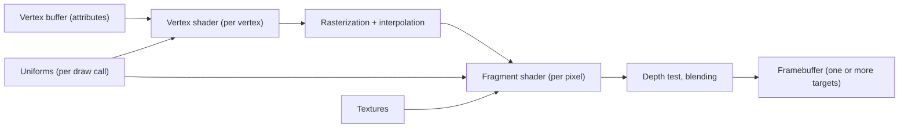
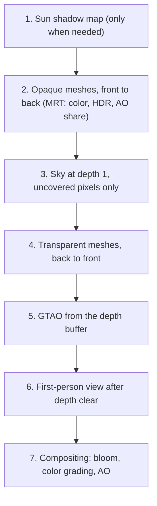
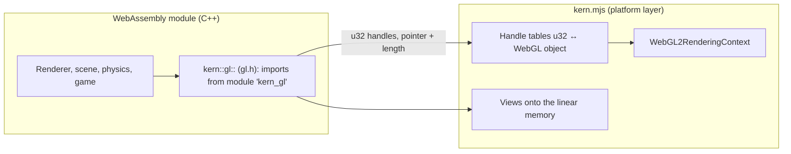

# Appendix B – Foundations: Real-Time Rendering

This appendix explains how triangles in memory become an image on the screen – fast enough for 60
frames per second in the browser. It starts with coordinates and matrices, proceeds through the
graphics pipeline and shaders to lighting, shadows, ambient occlusion and color space, and ends with
the question of why Kern connects WebAssembly and WebGL2 exactly the way it does. The topical
chapters [Chapter 4](04-graphics.md) (graphics) and [Chapter 5](05-scene-and-geometry.md) (scene and
geometry) refer back here.

The code lives in:

| File | Contents |
|---|---|
| `include/kern/math/math.h` | `Vec3`, `Quat`, `Mat4` (column-major), `Camera`, projection |
| `include/kern/scene/frustum.h`, `bvh.h` | view frustum, BVH for ray tests |
| `include/kern/gfx/renderer.h`, `src/gfx/renderer.cpp` | the renderer and the sequence of a frame |
| `src/gfx/standard_shader.cpp` | the standard shader (lighting, tone mapping, fog) |
| `src/gfx/shadow.cpp` | sun shadow map |
| `src/gfx/gtao.cpp` | ground-truth ambient occlusion |
| `src/gfx/bloom.cpp` | HDR copy, bloom, compositing |
| `src/gfx/sky.cpp` | procedural sky |
| `include/kern/gfx/gl.h`, `web/kern.mjs` | the WebGL2 bridge between WebAssembly and the browser |

---

## B.1 Coordinate spaces

### B.1.1 Why there are several spaces

A model – say the torso of the Micro Duck – is described once in its own coordinate system. But it
stands at a particular place in the world, is seen by a camera and finally ends up on particular
pixels. Each of these steps is a change of coordinate system:


| Space | What it describes |
|---|---|
| Model space | vertices relative to the model's origin, as stored in the mesh |
| World space | all objects in one common system (meters, Z up) |
| Camera space | relative to the camera: camera at the origin, looking along $-z$ |
| Clip space | after projection, four-dimensional (homogeneous) |
| NDC | normalized device coordinates; the visible region is the cube $[-1,1]^3$ |
| Screen | pixels and depth value $[0,1]$ |

### B.1.2 Homogeneous coordinates

A rotation or scaling is a $3\times 3$ matrix; a translation, however, is not, because
$x \mapsto x + t$ is not linear. The trick: append a fourth component. A **point** gets $w = 1$, a
**direction** $w = 0$:

$$\begin{pmatrix} R & t \\ 0 & 1 \end{pmatrix}\begin{pmatrix} p \\ 1 \end{pmatrix} = \begin{pmatrix} Rp + t \\ 1\end{pmatrix},\qquad
\begin{pmatrix} R & t \\ 0 & 1 \end{pmatrix}\begin{pmatrix} v \\ 0 \end{pmatrix} = \begin{pmatrix} Rv \\ 0\end{pmatrix}.$$

Points are translated, directions are not – exactly right. And all transformations are now
$4\times 4$ matrices that can be multiplied in sequence:

$$p_\text{clip} = P \cdot V \cdot M \cdot p_\text{model}.$$

**In Kern:** `Mat4::transform_point` computes with $w = 1$, `Mat4::transform_vector` with $w = 0$,
`Mat4::transform(Vec4)` in general.

### B.1.3 Kern's conventions

The header of `math.h` says it in one sentence: "column-major 4x4 matrices (OpenGL layout). World
convention: meters, right-handed, Z up."

- **Meters**: all lengths.
- **Right-handed, Z up**: $x$ and $y$ span the ground, $z$ points up. The default camera (`Camera` in
  `math.h`) stands at `eye{0, -18, 8}`, looks at `target{0, 0, 2}` with `up{0, 0, 1}`. The physics
  also uses Z up ([Appendix C](C-physics.md)), and the sky computes with `d.z` as the height above
  the horizon.
- **Column-major**: element (row $r$, column $c$) is stored in `m[c * 4 + r]`. The translation of a
  transformation matrix is therefore in `m[12]`, `m[13]`, `m[14]` (`Mat4::translation`). WebGL
  expects exactly this layout, which is why `kern.mjs` passes `uniformMatrix4fv(…, false, …)` –
  "do not transpose".
- **Column vectors**: a matrix acts from the left, $p' = Mp$. In a product $A \cdot B$, $B$ acts
  first. `Mat4::trs` therefore builds "Translation * rotation * scale": first scale, then rotate,
  then translate.
- **Quaternions** $(x, y, z, w)$ for rotations (`Quat`), with `Quat::rotate` as
  $v + 2w(q\times v) + q \times (2\, q \times v)$.

### B.1.4 The view matrix

The view matrix brings the world into camera space. `Mat4::look_at(eye, target, up)` builds an
orthonormal basis:

$$z_c = \frac{\text{eye} - \text{target}}{\lVert\cdot\rVert},\quad x_c = \frac{\text{up} \times z_c}{\lVert\cdot\rVert},\quad y_c = z_c \times x_c.$$

The camera thus looks along $-z_c$ (OpenGL convention). The matrix is the inverse of the camera
pose: rotation transposed, translation $-(x_c\cdot\text{eye}, y_c\cdot\text{eye}, z_c\cdot\text{eye})$.
If the viewing direction and `up` are parallel, the basis is degenerate; Kern reports this
(`ok = false`), and the renderer refuses to draw the frame ("degenerate camera direction/up").

### B.1.5 The perspective projection

Perspective means: what is twice as far away appears half as large. The screen position is therefore
proportional to $x/(-z)$. A matrix cannot divide by depth – but it can write the depth into the
fourth component $w$, and the hardware then divides by $w$ (**perspective division**).

`Mat4::perspective(fov, aspect, near, far)` builds the OpenGL matrix

$$P = \begin{pmatrix} f/a & 0 & 0 & 0\\ 0 & f & 0 & 0 \\ 0 & 0 & \frac{f_\text{ar}+n}{n - f_\text{ar}} & \frac{2 f_\text{ar} n}{n - f_\text{ar}} \\ 0 & 0 & -1 & 0\end{pmatrix},\qquad f = \frac{1}{\tan(\text{fov}/2)}.$$

- fov: vertical field of view (Kern: $\pi/3$, i.e. 60°; Kern Studio's viewports use 70°),
- $a$: aspect ratio width/height,
- $n$, $f_\text{ar}$: near and far clipping planes (Kern: 0.05 m and 1800 m).

The row $(0, 0, -1, 0)$ writes $w_\text{clip} = -z_\text{camera}$, the positive distance in front of
the camera.

**Example.** Image $960 \times 540$ ($a = 1.778$), fov 60°, so $f = 1.732$ and $f/a = 0.974$. A point
in camera space $(1,\ 0.5,\ -10)$:

| Step | Computation | Result |
|---|---|---|
| Clip $x, y, w$ | $0.974 \cdot 1$, $1.732 \cdot 0.5$, $10$ | $0.974$, $0.866$, $10$ |
| NDC | $\div w$ | $0.0974$, $0.0866$ |
| Pixel | $(\text{ndc}+1)/2 \cdot (960, 540)$ | $(526.8,\ 293.4)$ from bottom left |

For parallel projection (editor views from top, front, side) there is `Mat4::ortho`;
`projection_matrix(camera, aspect)` chooses according to `Camera::orthographic`.

### B.1.6 Depth is not linear

The indices here follow GLSL and Kern's column-major layout, `P[column][row]`: $P_{22}$ is the
element $\frac{f_\text{ar}+n}{n-f_\text{ar}}$ (`m[10]`), $P_{32}$ the element $\frac{2 f_\text{ar} n}{n-f_\text{ar}}$
in column 3, row 2 of the matrix above (counting from 0; `m[14]`). The depth in NDC is
$z_\text{ndc} = -P_{22} + P_{32}/w$, i.e. **proportional to $1/w$** up to a constant. The depth
buffer values $d = (z_\text{ndc}+1)/2$ therefore crowd toward 1 in the distance. With Kern's
$n = 0.05$, $f_\text{ar} = 1800$ ($P_{22} \approx -1.0000556$, $P_{32} \approx -0.1000028$):

| Distance $w$ | Depth value $d$ | Resolution at 24 bits ($\Delta d = 2^{-24}$) |
|---|---|---|
| 1 m | 0.950026 | |
| 10 m | 0.995028 | ≈ 0.1 mm |
| 100 m | 0.999528 | ≈ 1.2 cm |
| 1000 m | 0.999978 | ≈ 1.2 m |

The resolution follows from $\Delta w \approx \Delta d \cdot 2w^2/|P_{32}|$: it worsens
quadratically with distance and depends almost only on $n$. That is why the near plane is so
important: doubling it doubles the precision everywhere.

Kern's GTAO needs the true distance back from the depth buffer and computes the formula in reverse,
with exactly the matrix elements $P_{22}$ and $P_{32}$ as the uniform `uProj`:

```glsl
float viewDepth(float d) { return uProj.w / ((d * 2.0 - 1.0) + uProj.z); }
```

### B.1.7 Transforming normals

Normals are not ordinary directions: under non-uniform scaling they would become skewed by the model
matrix. The correct transform is the **inverse transpose** of the $3\times3$ part:

$$n' = \left(M_{3\times3}^{-1}\right)^\top n.$$

**In Kern:** `normal_matrix3` in `math.h` computes it (via the adjugate) – on the CPU, once per
instance, when the transformation changes (`Renderer::build_instances`). The vertex shader receives
it as three attributes `iNormal0..2`. A singular matrix (scale 0) is rejected.

---

## B.2 Rasterization and the depth buffer

### B.2.1 From triangle to pixels

After projection, the three corners of a triangle are available as screen points. **Rasterization**
determines which pixels (more precisely: which pixel centers) lie inside. For each such pixel a
**fragment** is produced. The vertex values (color, normal, world position, texture coordinates)
are interpolated in between, with barycentric weights $\lambda_0 + \lambda_1 + \lambda_2 = 1$:

$$v = \lambda_0 v_0 + \lambda_1 v_1 + \lambda_2 v_2.$$

Because perspective is not linear, the GPU interpolates in a **perspective-correct** way (it
interpolates $v/w$ and $1/w$ linearly and divides).

```
     v2
     /\
    /  \       ■ = pixel center inside the triangle → fragment
   / ■■ \
  / ■■■■ \
 /________\
v0        v1
```

### B.2.2 The depth buffer

Several triangles can hit the same pixel. Which one is in front? The **depth buffer** (Z-buffer)
stores the smallest depth so far for each pixel. A new fragment is written only if its depth passes
the test (for instance "less than or equal"). This makes the drawing order irrelevant – for opaque
objects.

**In Kern:**

- The scene runs with `depthFunc(LEQUAL)`.
- Opaque meshes are sorted **front to back** (`opaque_` by ascending `sort_distance`): whatever is
  hidden already fails the depth test before the expensive fragment shader runs (*early depth
  rejection*).
- Transparent meshes are drawn **back to front**, with blending `SRC_ALPHA, ONE_MINUS_SRC_ALPHA` and
  depth writes disabled (`depthMask(0)`): for transparency, order matters.
- The sky is drawn at depth 1 (far plane) **after** the opaque objects
  (`gl_Position = vec4(ndc, 1.0, 1.0)`): only pixels on which nothing lies yet pass `LEQUAL` and run
  the sky shader.
- The first-person view (items in the hand, `viewmodel`) comes last, after clearing the depth buffer,
  "so a wall in front of the camera cannot cut it".

### B.2.3 Back faces

For closed bodies, triangles facing away from the camera are always hidden. The GPU recognizes them
by the winding order of their corners on the screen and discards them (**backface culling**).
`Mesh::cull_mode()` chooses: double-sided materials and lines without culling; mirrored instances
(negative determinant) with the side swapped; a mesh whose instances are partly mirrored and partly
not, likewise without culling.

---

## B.3 The GPU pipeline and shaders in WebGL2

### B.3.1 The pipeline



Two stages are programmable:

- The **vertex shader** runs once per vertex. It must produce `gl_Position` (clip coordinates) and
  can pass further values on to the fragment shader (`out`).
- The **fragment shader** runs once per fragment. It receives the interpolated values (`in`) and
  writes one or more colors.

### B.3.2 Attributes, uniforms, varyings, textures

| Term | Changes | Example in Kern's standard shader |
|---|---|---|
| **Attribute** | per vertex (or per instance) | `aPosition`, `aNormal`, `aColor`, `aUV`; per instance `iModel0..3`, `iTint`, `iNormal0..2` |
| **Uniform** | per draw call | `uViewProjection`, `uSunDirection`, `uMaterial`, `uExposure` |
| **Varying** (`out`/`in`) | interpolated per fragment | `vWorld`, `vNormal`, `vColor`, `vUV` |
| **Texture** | image data, sampled | `uTexture`, `uSunShadowMap` |

The attributes have fixed locations (`layout(location=…)`) that match between `standard_shader.cpp`
and the shadow shader. Extensions (`ShaderExtension`) hook their own attributes, uniforms and code
snippets in at defined points (`build_standard_shader`) without copying the standard shader.

### B.3.3 Instancing

Many identical objects (trees, crates, limbs of the same shape) share their geometry. Instead of
issuing a draw call for each, one draws them all with **one** call and gives each instance its own
attributes. An attribute with `vertexAttribDivisor(i, 1)` advances not per vertex but per instance.

**In Kern** every mesh is instanced: the model matrix comes as four `vec4` attributes
(`iModel0..3`), the tint as `iTint`, the normal matrix as `iNormal0..2`. Drawing always uses
`drawElementsInstanced` or `drawArraysInstanced`. When something moves, `Renderer::update_instances`
changes only these streams; the geometry stays on the GPU ("per-frame CPU cost follows what moves").

### B.3.4 Skinning

Soft figures (a character whose skin follows the bones) deform each vertex with up to four bone
matrices:

$$p' = \sum_{k=1}^{4} w_k\, B_{j_k}\, p,\qquad \sum w_k = 1.$$

The vertex shader does this with `aJoints`, `aWeights` and `uniform mat4 uBones[32]`, in both the
standard and the shadow shader.

### B.3.5 Several outputs at once

A fragment shader can write to several images simultaneously (*multiple render targets*, MRT).
Kern's standard shader has three outputs:

```glsl
layout(location=0) out vec4 outColor;  // final color (sRGB, 8 bits)
layout(location=1) out vec4 outHdr;    // linear HDR light (16-bit floating point) for bloom
layout(location=2) out vec4 outAo;     // share of indirect light for ambient occlusion
```

This way Kern needs **no second geometry pass** for bloom and ambient occlusion (B.7, B.8).

---

## B.4 Lighting

### B.4.1 What makes a pixel bright

Physically, a pixel measures the **radiance** $L_o$ leaving the surface toward the eye. The
rendering equation (Kajiya) describes it as a sum over all incident light:

$$L_o(\omega_o) = L_e + \int_{\Omega} f_r(\omega_i, \omega_o)\, L_i(\omega_i)\, (n\cdot\omega_i)\, d\omega_i.$$

- $L_e$: emitted light,
- $f_r$: the **BRDF** – how much light from direction $\omega_i$ is reflected in direction
  $\omega_o$,
- $L_i$: incident light,
- $n \cdot \omega_i$: the cosine of the angle of incidence (oblique light spreads over more area).

Real-time rendering splits the integral into manageable parts: direct light from a few sources (sun,
point lights) and indirect light from the surroundings, which is heavily simplified.

### B.4.2 Lambert: diffuse reflection

A matte surface scatters uniformly in all directions. Its BRDF is constant: $f_r = \rho/\pi$ with
the albedo $\rho$ (the fraction of light reflected). For a light source with irradiance $E$
perpendicular to the light:

$$L_o = \frac{\rho}{\pi}\, E\, \max(0, n \cdot l).$$

- $l$: direction to the light source (normalized),
- $n$: surface normal.

The factor $1/\pi$ ensures energy conservation: a white surface ($\rho = 1$) does not reflect more
light than it receives.

**In Kern:**

```glsl
float ndl = max(dot(n, sun), 0.0);
vec3 rgb = base * (1.0 - metal) * (uSunColor * ndl * shadow + point * PI) / PI + indirect;
```

`base` is the albedo (vertex color × material × texture, converted into linear color space),
`uSunColor` the sun as a linear color times intensity (default `{2.8, 2.47, 2.11}`), `shadow` the
factor from the shadow map (B.5). Metals have no diffuse component (`1 - metal`).

**Example:** gray surface $\rho = 0.5$, sun at 45° ($n\cdot l = 0.707$), red channel $E = 2.8$:
$L = 0.5 \cdot 2.8 \cdot 0.707 / \pi = 0.315$.

### B.4.3 Point lights

A point light falls off with distance. Physically with $1/d^2$, which however never reaches zero.
Kern uses an attenuation that goes smoothly to 0 at the range $r$:

$$\text{att} = \frac{\left(\max\left(0,\ 1 - d^2/r^2\right)\right)^2}{1 + d^2/r^2}.$$

Up to 6 point lights (`kMaxPointLights = 6`), each with position, range, color and intensity
(`uPointPosRange`, `uPointColorIntensity`); $d^2$ is clamped below at 0.04 so that a light sitting
directly on a surface does not become infinitely bright.

### B.4.4 Specular reflection: from Blinn–Phong to microfacets

Glossy surfaces reflect directionally. The classic **Blinn–Phong** model takes the **half vector**
$h = \text{normalize}(l + v)$ between the light and view directions and sets
$L_\text{spec} \propto (n\cdot h)^s$ with a shininess exponent $s$: if $h$ is close to $n$, one sees
the reflection of the light source.

Modern renderers (*physically based rendering*, PBR) justify this physically with **microfacet
theory**: a rough surface consists of tiny mirrors with distributed normals. The Cook–Torrance BRDF
is

$$f_\text{spec} = \frac{D(h)\, F(v,h)\, G(l,v)}{4\,(n\cdot l)(n\cdot v)}.$$

- $D$: **normal distribution** – what fraction of the micromirrors points in direction $h$?
- $F$: **Fresnel** – how much is reflected at all? (more at grazing angles)
- $G$: **geometry** – how much light do the micromirrors block for one another?

Commonly used are:

- **GGX/Trowbridge–Reitz:** $D = \dfrac{\alpha^2}{\pi\left((n\cdot h)^2(\alpha^2 - 1) + 1\right)^2}$
  with $\alpha = \text{roughness}^2$.
- **Schlick Fresnel:** $F = F_0 + (F_{90} - F_0)(1 - \cos\theta)^5$, with $F_0 \approx 0.04$ for
  non-metals and $F_0 = $ base color for metals.

### B.4.5 What Kern's standard shader actually computes

Kern has two material parameters, `uPbr = (roughness, metalness)`. The specular component is
computed only if `metal > 0` or `rough < 0.95`:

```glsl
vec3 F0 = mix(vec3(0.04), base, metal);
vec3 F = F0 + (max(vec3(1.0 - rough), F0) - F0) * pow(1.0 - NdV, 5.0);
...
float a2 = rough * rough * rough * rough;                       // α² with α = rough²
float d = a2 / (PI * pow(NdH * NdH * (a2 - 1.0) + 1.0, 2.0));   // GGX
rgb += F * uSunColor * ndl * shadow * min(d, 40.0) * 0.25;
```

In detail:

- $D$ is GGX with $\alpha = r^2$.
- $F$ is Schlick with a roughness-dependent $F_{90} = \max(1 - r, F_0)$: rough surfaces shine less
  at the edges (a common approximation for environment reflection).
- There is no separate geometry term. The factor $0.25$ is the $1/4$ of the Cook–Torrance formula
  if one sets $G = (n\cdot l)(n\cdot v)$ (the "implicit" geometry function) – the denominator then
  cancels except for the 4. Multiplied by $E\,(n\cdot l)$ this gives exactly the line above.
- $D$ is capped at 40 so that very smooth surfaces do not produce individual pixels with huge values.

On top of this comes an environment reflection: the sky in the mirror direction
$R = \text{reflect}(-V, n)$, blended according to roughness between diffuse sky lighting and a
sharper sky gradient, times $F$.

Kern's standard shader is thus a **simplified PBR model**: Lambert for diffuse light, GGX + Schlick
for the sun's specular highlights, a Fresnel-weighted sky as reflection. Glass (`surfaceGlass`, set
by extensions) additionally reflects the sky so that panes do not look black.

### B.4.6 Indirect light

Kern computes light coming from the sky and the ground without ray tracing, from a few colors:

- **Hemisphere light:** between `uGroundColor` (below) and `uSkyColor` (above), blended according to
  $n_z$ – an upward-facing surface receives sky light, a downward-facing one ground light.
- **Environment irradiance** `envIrradiance(n)`: a gradient of zenith, horizon and ground
  (`uEnvZenith`, `uEnvHorizon`, `uEnvGround`), times `uEnvIntensity`.

This indirect component is carried along in a separate variable `indirect`. The reason: ambient
occlusion (B.8) should darken only this component; "sun and point lights keep their own shadowing".

---

## B.5 Shadow maps

### B.5.1 The idea

A point lies in shadow if something is between it and the light source. For a directional light such
as the sun, one renders the scene **from the sun's point of view** and stores, per texel, only the
depth of the nearest object – the **shadow map**. During normal rendering every point is transformed
into the sun's space and compared: if its depth is greater than the stored one, something lies in
front of it.

```
   Sun ═════╗  (orthographic projection)
            ║  ↓   ↓   ↓   ↓
            ║     ███          stored depth: roof
            ║  ↓  ███  ↓   ↓
            ║  ── ─── ─────    ground behind the roof: depth greater → shadow
```

### B.5.2 The problems and their solutions

| Problem | Cause | Remedy |
|---|---|---|
| **Shadow acne** (stripes on lit surfaces) | the surface shadows itself because of limited resolution | depth bias, polygon offset |
| **Peter Panning** (shadow detaches from the object) | too much bias | keep the bias small |
| **hard, jagged edges** | one texel covers many pixels | filtering (PCF) |
| **shimmering** when the camera moves | the map shifts by fractions of a texel or changes its size | snapping to the texel grid, a map of fixed size |
| **blurry shadows close up** | the map covers much more than you see | fit the map to the view (shadow distance) |

### B.5.3 In Kern

`SunShadowMap` in `passes.h` and `shadow.cpp`:

- **Orthographic:** the sun is infinitely far away; its rays are parallel.
  `Mat4::ortho(-e, e, -e, e, 0.2f, e * 4) * Mat4::look_at(...)` with the half side length `extent`
  (default 120 m) and a resolution of 512 texels (power of two, 128–4096). One texel thus covers
  $2 \cdot 120 / 512 \approx 0.47$ m.
- **Fitted to the view:** with a shadow distance (`set_shadow_distance`, in levels
  `WorldSettings::shadow_distance`, default 80 m), the map covers, instead of the fixed square, the
  bounding sphere of the view frustum up to that distance (stable shadow maps after Valient 2008).
  The sphere does not change its size when the camera turns; its radius is the half side length. A
  smaller shadow distance means smaller texels, i.e. sharper shadows. At the edge the shadow fades
  out over the last tenth of the distance.
- **Snapped to the texel grid:** `focus_key` rounds the focus (the camera target or the sphere's
  center) in the plane perpendicular to the sun to whole texels. The map then only jumps by whole texels and does not
  shimmer. Together with the extent, the rounded focus also yields a **cache key**: as long as it, the sun and the
  shadow casters stay the same, the map is reused (`RenderStats::shadow_reused`).
- **Depth only:** `colorMask(0, 0, 0, 0)`, an empty fragment shader, target `DEPTH_COMPONENT24`.
- **Triple bias:** when generating, `polygonOffset(2, 3)` (shifts the depth depending on the slope of
  the triangle); when sampling, `uSunShadowBias` (default 0.0012, in Studio and exported games 0.0014) and a **normal offset** (Holbert
  2011): the lookup happens one texel off the surface along its normal, more where the light grazes
  it. This avoids acne without a large constant bias detaching the shadow from the object.
- **Hardware PCF:** the depth texture has `TEXTURE_COMPARE_MODE = COMPARE_REF_TO_TEXTURE` and
  `LINEAR` filtering. A lookup through `sampler2DShadow` then compares the four nearest texels and
  interpolates the results – soft edges from a single `texture()` call.
- **Optimized PCF** (Castaño 2013, "The Witness"): 4 or 9 such hardware taps form a tent-filtered
  3 × 3 or 5 × 5 kernel. Each tap sits between the texels so that the hardware's bilinear weighting
  yields exactly the tent weights. `ShadowOptions::filter` selects 1, 4 or 9 taps; Studio uses 4 on
  phones and 9 on desktop.
- Only meshes with `casts_shadow()` and inside the sun's frustum are drawn.

In the standard shader:

```glsl
vec3 lookup = vWorld + n * (uSunShadowTexel.z * (0.6 + 1.4 * (1.0 - ndl)));  // normal offset
vec4 clip = uSunShadowProjection * vec4(lookup, 1.0);
vec3 uvz = clip.xyz / clip.w * 0.5 + 0.5;                  // NDC → [0,1]
shadow = sunShadow(uvz);                                   // 1, 4 or 9 taps
```

The map is sampled only if the surface faces the sun (`ndl > 0.0`) – otherwise it is dark anyway.

---

## B.6 HDR, tone mapping and gamma

### B.6.1 High dynamic range

Real light covers an enormous range: the sun's disc is orders of magnitude brighter than a shadow.
Kern's sun has an intensity of up to 2.8 – linear values above 1 are normal. A screen, however, can
only display 0 to 1. If one computes in **linear HDR space** (*high dynamic range*) and maps to the
screen range only at the end, bright regions remain differentiated instead of being clipped hard.

### B.6.2 Tone mapping

The mapping from $[0, \infty)$ to $[0, 1]$ is called **tone mapping**. A good curve is almost linear
in the mid-range, compresses the highlights softly and never saturates hard:

```
 Output
  1 |            ____________
    |        _--
    |      /
    |    /
    |  /
  0 |/________________________ Input (linear)
    0    1    2    3    4
```

**In Kern** it is the ACES filmic curve in the three.js version (MIT, see Appendix D) (`acesFilmic` in `kGlslToneMap`):

1. Exposure: `c *= uExposure / 0.6`.
2. A matrix into the curve's working color space (`inM`).
3. The rational approximation of RRT+ODT:
   $\text{rrtOdt}(v) = \dfrac{v(v + 0.0245786) - 0.000090537}{v(0.983729 v + 0.4329510) + 0.238081}$.
4. Back (`outM`), clamp to $[0,1]$.

Then optionally a color grade (`gradeColor`: a little more saturation, a gentle S-curve, warm
highlights and cool shadows).

### B.6.3 Gamma and sRGB

Screens and image files do not store colors linearly but in **sRGB**: dark tones get more of the
256 levels because the eye distinguishes more finely there. Computation, however, must be
**linear** – light adds linearly. Hence:

1. convert input colors (textures, vertex colors from sRGB sources) **to linear**,
2. compute linearly,
3. convert **to sRGB** at the end.

The exact sRGB formulas (in `kGlslToneMap`):

$$c_\text{lin} = \begin{cases} c/12.92 & c \le 0.04045 \\ \left(\frac{c + 0.055}{1.055}\right)^{2.4} & \text{otherwise}\end{cases}\qquad
c_\text{sRGB} = \begin{cases} 12.92\,c & c \le 0.0031308 \\ 1.055\, c^{1/2.4} - 0.055 & \text{otherwise}\end{cases}$$

**Example:** linear middle gray 0.18 becomes sRGB $1.055 \cdot 0.18^{1/2.4} - 0.055 = 0.461$ – almost
half the scale, although it is only 18% of the light.

Vertex colors that are already linear skip the conversion (`uLinearColor`; in the browser marked via
`markLinearColors` in `kern.mjs`).

### B.6.4 Fog

After tone mapping, Kern mixes in fog, like three.js ("FogExp2 after the color-space conversion"):

$$\text{fog} = 1 - e^{-(\rho_f\, d)^2}.$$

- $\rho_f$: fog density (default 0.00085),
- $d$: distance from the eye.

At 100 m that is 0.7%, at 1000 m 51%. With `fog_height_falloff` the fog thins out with height: Kern
averages $e^{-k z}$ analytically along the view ray,
$\frac{e^{-kz_0} - e^{-kz_1}}{k (z_1 - z_0)}$. With `fog_sun_scatter` the haze glows in the
direction of the sun (factor $\mu^8$ with $\mu = \cos$ of the angle to the sun).

---

## B.7 Bloom

### B.7.1 What bloom is

In cameras and in the eye, very bright spots outshine their surroundings. This halo is called
**bloom**. It is computed from the HDR image:

1. **extract the bright parts** (above a threshold),
2. **blur them** (Gaussian filter, often on downscaled images – cheaper and wider),
3. **add them back**.

### B.7.2 The Gaussian filter with linear sampling

A Gaussian filter is **separable**: a 2D $9\times 9$ filter (81 lookups) is the same as a horizontal
and a vertical $9\times1$ filter (18 lookups). Using the hardware's bilinear filtering makes it even
cheaper: a lookup **between** two texels returns their weighted average. Five lookups thus replace
nine weights.

**In Kern** (`kBlur` in `bloom.cpp`):

| Offset (texels) | Weight |
|---|---|
| 0 | 0.2270 |
| ±1.3846 | 0.3162 |
| ±3.2308 | 0.0703 |

The weights sum to $0.2270 + 2\cdot0.3162 + 2\cdot0.0703 = 1$.

### B.7.3 Kern's bloom pass

- The scene writes simultaneously to an RGBA8 target (final color) and to a linear **RGBA16F** copy
  (`outHdr`).
- Bright parts with a soft threshold: `c * smoothstep(0.88, 0.88 + 0.35, max(c.r, c.g, c.b))`, at a
  quarter of the resolution.
- Blur on two levels: $1/4$ and $1/8$ of the resolution; strengths 0.13 and 0.08.
- Compositing: `scene + present(hdr + bloom) - present(hdr)`. `present` is tone mapping + color
  grading + sRGB. So only the **difference** that bloom makes after tone mapping is added – pixels
  without bloom remain bit-exact as the scene rendered them.
- A frame-time watchdog switches the halo off for the session if the device needs more than 27 ms per
  frame on average (for 3.5 s), unless it is forced (`BloomOptions::forced`).

---

## B.8 Ambient occlusion: SSAO and GTAO

### B.8.1 What is occluded

In corners, joints and underneath objects less ambient light arrives, because part of the sky is
blocked. This **ambient occlusion** (AO) is very important for the sense of depth in an image. It
affects only indirect light; the sun has its own shadows.

The exact quantity is the cosine-weighted visibility over the hemisphere:

$$\text{AO}(p) = \frac{1}{\pi}\int_{\Omega} V(p, \omega)\,(n\cdot\omega)\,d\omega.$$

- $V(p,\omega) = 1$ if nothing is in the way from $p$ in direction $\omega$, otherwise 0.

### B.8.2 Computing in screen space

Tracing rays through the entire scene is too expensive. **Screen-space ambient occlusion** (SSAO)
uses the depth buffer instead: for each pixel one reconstructs the position in camera space and
checks whether neighboring pixels lie "above" the point. Classic SSAO counts samples in a sphere and
is a rough estimate.

**GTAO** (*ground-truth ambient occlusion*, Jimenez et al. 2016) evaluates the integral
systematically in slices:

1. Per pixel, a few directions $\phi$ in the image plane (slices).
2. In each slice, one searches on both sides for the **horizon**: the highest angle at which a
   neighboring surface blocks the sky.
3. Between the two horizon angles $h_0$, $h_1$ the sky is visible. The integral of the
   cosine-weighted visibility over this arc has a closed form. With $\gamma$, the angle of the normal
   projected into the slice:

$$\hat a(h, \gamma) = \tfrac14\left(\cos\gamma + 2h\sin\gamma - \cos(2h - \gamma)\right),$$

   and the visibility of the slice is $\lVert n_\text{proj}\rVert\left(\hat a(h_0,\gamma) + \hat a(h_1,\gamma)\right)$.
4. Average over the slices.

```
             horizon h1
   view ↓       ╲   │n   ╱  horizon h0
                 ╲  │   ╱
   ████████       ╲ │  ╱      ████
   ████████████────●────────████████
                  pixel
   visible sky: arc between h0 and h1
```

### B.8.3 In Kern

`AmbientOcclusionPass` (`passes.h`, `gtao.cpp`) follows Intel's XeGTAO (MIT, see Appendix D):

- The normal is reconstructed **from depth** (per axis, the neighbor with the smaller depth jump);
  there is no normal buffer.
- The effect radius is in world meters (`AoOptions::radius`, default 1.6) and is converted to screen
  pixels per pixel; near surfaces are capped.
- `fastAcos` (Lagarde's approximation, max. error 0.0068 rad) instead of `acos`.
- A $4\times4$ ordered pattern rotates the slices from pixel to pixel; a depth-aware $4\times4$
  filter integrates exactly this pattern away again without blurring across edges.
- Quality levels as in XeGTAO: low $1\times2$, medium $2\times2$, high $3\times3$, ultra $9\times3$
  (slices × steps per side), half resolution on mobile devices. A frame-time watchdog steps down on
  slow devices (`adaptive`).
- The result is an RG16F image: (visibility, camera depth). The depth is used during upscaling:
  texels of other surfaces receive no weight.

**It is applied only to indirect light.** The standard shader writes into its third output `outAo`
the share of indirect light per color channel (already reduced by the fog) and the brightness of the
albedo. During compositing (`kCombine` in `bloom.cpp`) the following is then computed:

$$h' = h \cdot \left(1 - s \cdot \left(1 - \text{mb}(v, \rho)\right)\right)$$

with $h$ the HDR light, $s$ the indirect share, $v$ the GTAO visibility, and $\text{mb}$ the
**multi-bounce approximation** from the GTAO paper – a bright albedo wins back light that bounces
back and forth between the occluders:

```glsl
vec3 a = 2.0404 * albedo - 0.3324, b = -4.7951 * albedo + 0.6417, c = 2.7552 * albedo + 0.6903;
return max(vec3(v), ((v * a + b) * v + c) * v);
```

Because the standard shader knows the indirect share anyway, Kern needs no G-buffer pass for this:
"Ambient occlusion without a second geometry pass" (`renderer.cpp`).

---

## B.9 Sky and atmosphere

### B.9.1 The physics

The sky is blue because air molecules scatter short-wavelength light more strongly (**Rayleigh
scattering**, $\propto \lambda^{-4}$). Near the horizon the path through the atmosphere is longer;
the light is scattered multiple times and becomes brighter, and reddish when the sun is low. Around
the sun, larger particles (aerosols) scatter forwards – **Mie scattering** produces the bright halo.
Physical sky models integrate this scattering along the view ray.

### B.9.2 What Kern does

Kern's `SkyPass` is deliberately **not** a scattering integral but an analytic model ("Rayleigh-like
gradient", `passes.h`) that is cheap to evaluate per pixel:

- **Gradient** between horizon and zenith color according to the height above the horizon,
  $\text{mix}(\text{hor}, \text{zen}, h^{0.45})$.
- **Golden hour:** the closer the sun is to the horizon, the more orange the horizon becomes
  (`dusk`), with a band that is brighter toward the sun's side.
- **Sun disc and Mie halo:** $\mu = \cos(\angle(\text{view}, \text{sun}))$; the halo as
  $0.22\mu^8 + 0.5\mu^{64}$, the disc as a steep `smoothstep` at $\mu \approx 0.9993$.
- **Night:** moon (same principle) and stars from a cell hash, with a slight twinkle.
- **Clouds:** 5 octaves of value noise (*fBm*), projected onto a plane above the viewer
  (`d.xy / (d.z + 0.12)`), shifted by the wind, brightened toward the sun.
- **Atmosphere:** `SkyAtmosphere` passes the fog color and sun scattering to the scene so that the
  horizon and distant geometry blend into each other.

A full-screen triangle is drawn. The vertex shader builds the view direction from the NDC corners
(`uForward + ndc.x * tanHalf.x * uRight + ndc.y * tanHalf.y * uUp`) and sets the depth to 1 – see
B.2.2.

---

## B.10 Culling and scene structures

### B.10.1 The view frustum

What lies outside the image need not be drawn. The visible region of a perspective camera is a
truncated pyramid (*frustum*) bounded by six planes. Gribb and Hartmann showed that these planes can
be read directly from the combined matrix $PV$: they are sums and differences of the fourth row with
the first three,

$$\text{plane}_{\pm x} = r_4 \pm r_1,\quad \text{plane}_{\pm y} = r_4 \pm r_2,\quad \text{plane}_{\pm z} = r_4 \pm r_3,$$

where $r_i$ are the rows of $PV$, and a point $p$ lies inside if $a x + b y + c z + d \ge 0$ holds
for all six planes.

**In Kern:** `Frustum::from_matrix` in `frustum.h` (with column-major access `m[3] + sign * m[axis]`
etc.) normalizes the planes, and `sphere_visible` tests a **bounding sphere**: it is certainly
outside if its center lies further than its radius behind a plane.

```
       \         /
        \  ●    /     ● visible
   ○     \     /      ○ rejected: distance to left plane < -r
          \   /
           \ /
          camera
```

The test is **conservative**: it never rejects anything visible but sometimes lets invisible things
through (spheres near a corner of the frustum). The renderer applies it to every mesh that is not
skinned (its bones can leave the bounding sphere) and whose material has `frustum_culled` set
(`stats.culled_meshes`); the shadow map applies it to its own frustum. The bounding sphere of an
instanced mesh encloses all instances (`instanced_bounds`).

### B.10.2 Bounding volume hierarchies (BVH)

With many objects or large meshes one does not want to test each individually. A **bounding volume
hierarchy** (BVH) arranges them in a tree: each node has a bounding box that encloses all its
children. If a ray or a frustum misses a node, the entire subtree can be skipped – instead of $O(n)$
tests one typically needs $O(\log n)$.

```
            [  all  ]
           /        \
     [ left ]     [ right ]
      /    \        /    \
   [△△]  [△△]   [△△]  [△△]   leaves: triangles
```

**In Kern** the BVH (`Bvh` in `bvh.h`) serves **picking**, not drawing: static world meshes with 36
triangles or more (`kBvhMinTriangles`) get a tree over their triangles, built with median splits
(`nth_element`) in flat arrays. Ray tests use the slab test for boxes (`intersect_aabb`) and
Möller–Trumbore for triangles (`intersect_triangle`). Moving meshes take the exact brute-force path.
Box3D has its own BVH for the physics ([Appendix C](C-physics.md), C.3).

---

## B.11 Draw calls and state changes

### B.11.1 Why the CPU can be the bottleneck

Every **draw call** (`drawElementsInstanced` etc.) costs CPU time in the driver: it checks the GL
state, binds buffers, uploads uniforms. In WebGL there is additionally the path from WebAssembly via
JavaScript into the browser and its validation. Thousands of small draw calls can make a frame take
longer than the actual GPU work. **State changes** cost as well: a different program, a different
texture, a different cull mode.

### B.11.2 What Kern does about it

| Measure | Where |
|---|---|
| **One** standard program for all meshes; variants via uniforms and extensions | `Renderer::program_`, `build_standard_shader` |
| Instancing: one draw call per mesh, no matter how many instances | `draw_mesh` |
| Upload uniforms only when the value changes (matrices and arrays too, compared by content) | `UniformCache` (`program.h`) |
| Set per-frame uniforms once | `set_frame_uniforms` |
| Remember the bound texture and cull mode | `bound_texture_`, `cull_state_` |
| Redraw the shadow map only when something changes | cache key in `render` |
| Frustum culling before drawing | `Frustum::sphere_visible` |
| Upload geometry once, afterwards only instance streams | `upsert`, `update_instances` |

`RenderStats` reports the number of draw calls, triangles and instances, culled meshes, CPU time and
(if the browser offers `EXT_disjoint_timer_query_webgl2`) GPU time.

### B.11.3 The sequence of a frame

From the header of `renderer.h`:



---

## B.12 Why WebAssembly and WebGL2 are connected this way

### B.12.1 The starting point

Kern is C++. In the browser, however, there is no graphics driver API for native code, only
JavaScript APIs. **WebAssembly** (WASM) is a compact bytecode format that the browser compiles into
machine code; a WASM module has a linear memory (one large byte array) and can call only functions
passed to it as **imports** when it is loaded. **WebGL2** is the browser's graphics API, largely
OpenGL ES 3.0.

### B.12.2 Kern's structure

Kern compiles with wasi-sdk for `wasm32-wasip1` (`build.sh`). The boundary to the browser is narrow
and clear:



- **`gl.h`** declares exactly the WebGL2 functions the engine uses, with `import_module("kern_gl")`.
  GPU objects are "opaque u32 handles (0 = null) managed by the host"; data are passed as "pointers
  into the module's linear memory plus a byte count".
- **`kern.mjs`**, according to its own header, does "exactly three things and contains no engine
  logic": instantiate the module with the imports `kern_gl` and `kern_env` and a minimal WASI, manage
  the handle tables and context loss, and offer `KernRenderer` as a thin facade.
- Data flow **without being copied into JavaScript objects**: `bufferData` passes `self.u8` (a view
  onto the WASM memory) with offset and length; `uniformMatrix4fv` reads directly from `self.f32`.
  After the memory grows, the views are renewed (`refresh`).
- `KernRenderer` creates the WebGL2 context without antialiasing and without alpha (`antialias: false,
  alpha: false`) – Kern renders into its own targets and composites itself. Exception: Kern Studio
  and exported games create their context themselves and request `antialias: true`
  (`web/studio/studio.mjs`, `web/studio/game.mjs`).

### B.12.3 Why this way

| Decision | Reason |
|---|---|
| Engine entirely in C++/WASM | one code base for the browser and native (tests, Lehrer, server); deterministic physics and mathematics ([Appendix C](C-physics.md), C.9) |
| JavaScript only as a thin layer | any logic in JS would have to be maintained twice and could not be tested like the C++ core |
| fixed, small import list | what the engine needs is in one place (`gl.h`) and in one object (`kern_gl`) |
| handles instead of JS objects | WASM cannot hold JS objects; it can hold integers |
| own CPU copies of all meshes and textures | **context loss**: the browser can take away the WebGL context at any time. `context_restored()` rebuilds all programs and re-uploads everything from the CPU copies |
| few, large draw calls, uniform cache | every GL call crosses the WASM–JS boundary and the browser's validation |
| headless mode | without a GPU, meshes stay on the CPU, "nothing touches GL" (`set_headless`) – this is how the Lehrer runs the same world without graphics |
| one thread in WASM | Box3D runs with `workerCount = 1` ("single-threaded WebAssembly"); parallelism in the browser comes from web workers with their own modules (Lehrer) |

---

## B.13 Summary: concepts and Kern

| Concept | Section | Where in Kern |
|---|---|---|
| homogeneous coordinates, column-major matrices | B.1 | `Mat4` (`math.h`) |
| Z up, right-handed, meters | B.1.3 | `math.h`, `Camera` |
| view, perspective, depth | B.1.4–B.1.6 | `look_at`, `perspective`, `viewDepth` in `gtao.cpp` |
| normal matrix | B.1.7 | `normal_matrix3`, `iNormal0..2` |
| depth test, sorting, transparency | B.2 | `Renderer::render` |
| vertex/fragment shaders, attributes, uniforms, MRT | B.3 | `standard_shader.cpp` |
| Lambert, GGX, Schlick, hemisphere light | B.4 | `kFragmentLighting` |
| shadow map, PCF, texel snapping, shadow distance, normal offset | B.5 | `SunShadowMap`, `Renderer::set_shadow_distance` |
| HDR, ACES, sRGB, fog | B.6 | `kGlslToneMap`, fog in the standard shader |
| bloom | B.7 | `BloomPass` |
| GTAO | B.8 | `AmbientOcclusionPass`, `kCombine` |
| sky | B.9 | `SkyPass` |
| view frustum, BVH | B.10 | `Frustum`, `Bvh` |
| draw calls, state changes | B.11 | `UniformCache`, instancing, caches |
| WASM + WebGL2 | B.12 | `gl.h`, `kern.mjs` |

How to use these building blocks in your own game – materials, lights, camera, meshes and
instances – is shown in [Chapter 4](04-graphics.md) and [Chapter 5](05-scene-and-geometry.md).

---

© 2026 Christian Heinrich Hohlfeld · All rights reserved · [Imprint and rights](00-imprint.md)
