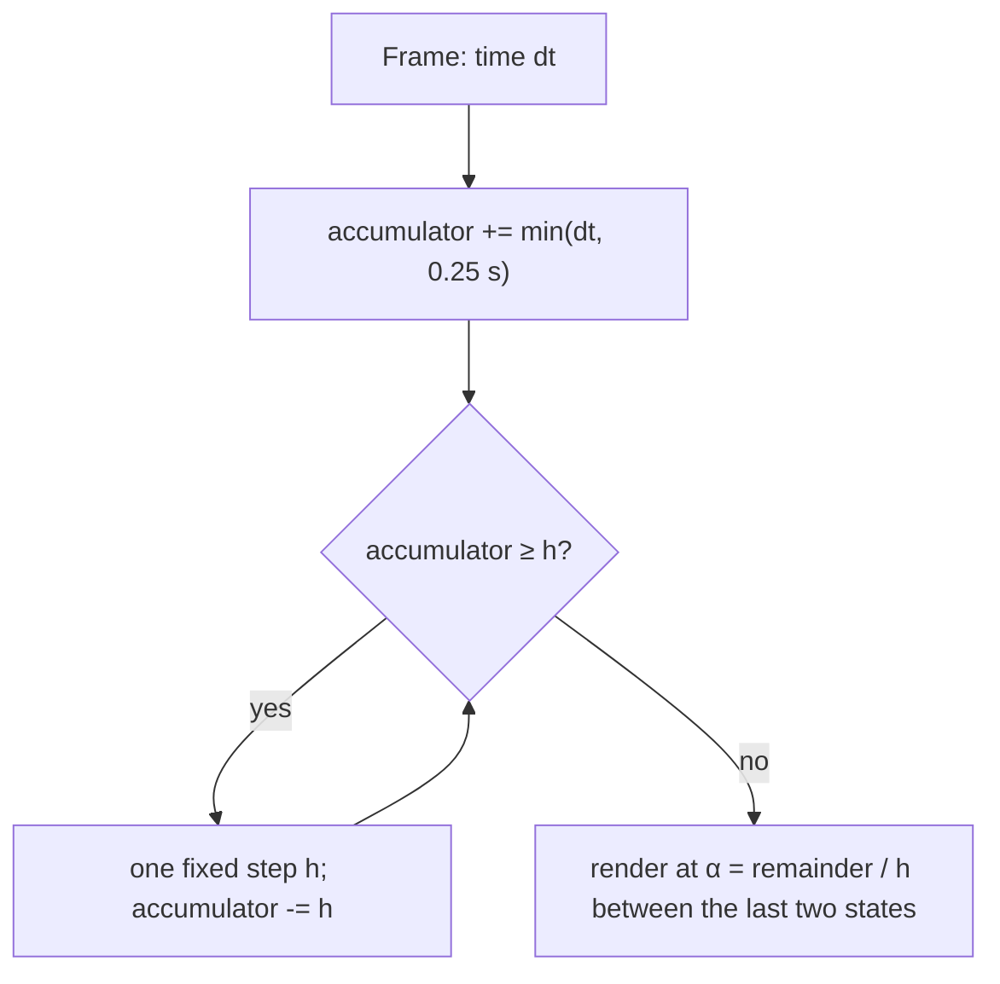
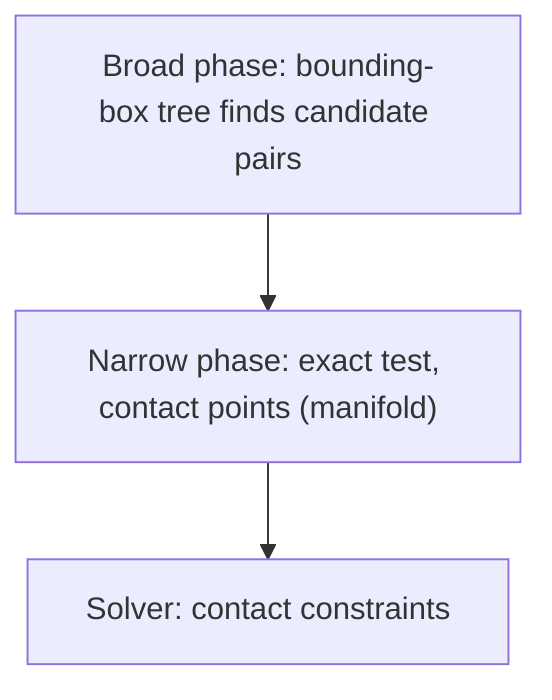
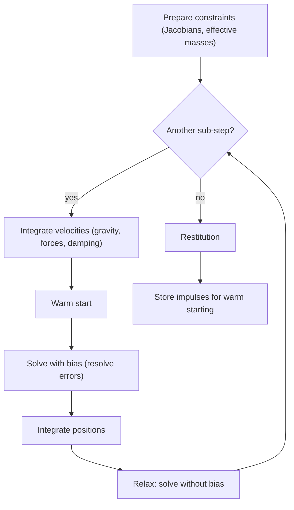
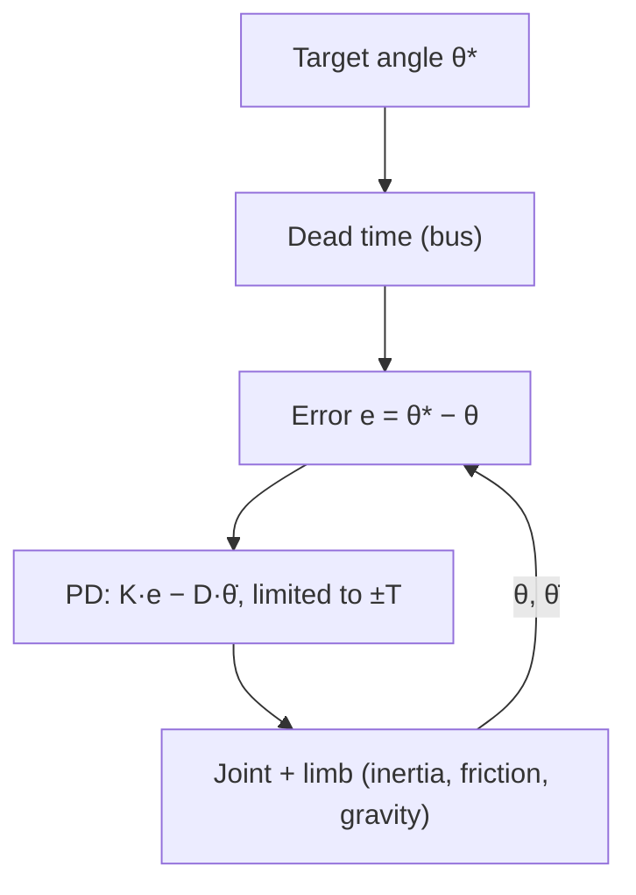

# Appendix C – Foundations: Physics Simulation

This appendix explains how a rigid-body simulation works: what a body "is", how it is advanced in
time, how collisions are detected and resolved, what friction and elasticity mean, how joints and
servos work, and why a simulation can come out bit for bit the same on different computers. Kern simulates
with **Box3D**, Erin Catto's 3D successor to Box2D v3 (`third_party/box3d`), and puts a thin C++
layer on top (`include/kern/physics/physics.h`, `src/physics/physics.cpp`). The topical chapter is
[Chapter 6](06-physics.md); the binding rules for Kern's physics code are in `docs/physics.md`.

Quotations from Box3D are given with their file (`box3d:src/solver.c` etc.); they refer to the
bundled version.

---

## C.1 Rigid bodies and their state

### C.1.1 What a rigid body is

A **rigid body** does not deform: the distance between any two of its points always stays the same.
This is an approximation – every real body gives a little – but for robot limbs, crates and cars it
is a very good one. Its great advantage: the motion of a rigid body is completely described by a few
numbers.

### C.1.2 The state

| Quantity | Symbol | Meaning | Unit |
|---|---|---|---|
| Position | $x$ | location of the center of mass in the world | m |
| Orientation | $q$ | rotation as a unit quaternion | – |
| Linear velocity | $v$ | velocity of the center of mass | m/s |
| Angular velocity | $\omega$ | rotation axis × rotation rate | rad/s |

In addition, the **mass properties**, which do not change:

| Quantity | Symbol | Meaning | Unit |
|---|---|---|---|
| Mass | $m$ | inertia against acceleration | kg |
| Center of mass | $c$ | in the body's own frame | m |
| Inertia tensor | $I$ | inertia against rotation, $3\times3$, symmetric | kg·m² |

The inertia tensor is constant in the body frame; in world coordinates it rotates along:
$I_\text{world} = R\, I\, R^\top$ with the rotation matrix $R$ of $q$.

**In Kern:** `BodySettings` (`physics.h`) sets position, rotation and initial velocities;
`World::pose`, `linear_velocity`, `angular_velocity` read them. Mass and inertia arise from the
shapes and their density (`ShapeMaterial::density`) or are specified explicitly:
`World::set_mass_data(body, mass, center, inertia[6])` with the six entries
$I_{xx}, I_{yy}, I_{zz}, I_{xy}, I_{xz}, I_{yz}$ – this is how imported robots (MJCF, URDF) get their
measured values. Conventions as in the renderer: meters, seconds, kilograms, **Z up**, quaternions
$(x, y, z, w)$, gravity $(0, 0, -9.80665)$ m/s² by default.

### C.1.3 The equations of motion

Newton for translation, Euler for rotation:

$$m\,\dot v = F,\qquad \dot x = v,$$
$$I\,\dot\omega + \omega \times (I\omega) = \tau,\qquad \dot q = \tfrac12\, \omega \otimes q.$$

- $F$: sum of the forces (gravity $m g$, springs, contacts, motors),
- $\tau$: sum of the torques,
- $\omega \times (I\omega)$: the **gyroscopic term**. It is zero when $\omega$ is a principal axis,
  and otherwise causes precession and the tumbling of long, thin bodies,
- $\omega \otimes q$: quaternion product with $\omega$ as a pure quaternion $(\omega, 0)$.

A simulation must solve these differential equations in discrete time steps. This is
**integration**.

---

## C.2 Integration

### C.2.1 The basic problem

One knows the state at time $t$ and wants it at time $t + h$. The derivatives are known, but they
change during the step. Every integration method is an assumption about *which* derivative to use
for the whole step.

### C.2.2 Three methods on the spring–mass oscillator

The best test object is the undamped harmonic oscillator $\ddot x = -\omega^2 x$ (a mass on a
spring, angular frequency $\omega = \sqrt{k/m}$). Its energy is constant; a good method should
neither inflate nor destroy it.

**Explicit Euler method** – everything with the old values:

$$v_{n+1} = v_n - h\,\omega^2 x_n,\qquad x_{n+1} = x_n + h\,v_n.$$

**Semi-implicit (symplectic) Euler method** – first the velocity, then the position **with the new
velocity**:

$$v_{n+1} = v_n - h\,\omega^2 x_n,\qquad x_{n+1} = x_n + h\,v_{n+1}.$$

**Implicit Euler method** – the force at the **end** of the step:

$$v_{n+1} = v_n - h\,\omega^2 x_{n+1},\qquad x_{n+1} = x_n + h\,v_{n+1}.$$

This is a system of equations in $x_{n+1}, v_{n+1}$, still easy to solve here.

What happens over many steps? For each method one can compute an amplification factor per step:

| Method | Amplification per step | Behavior |
|---|---|---|
| explicit | $\sqrt{1 + (h\omega)^2} > 1$ | energy always **grows**, explodes |
| semi-implicit | $= 1$ for $h\omega < 2$ | energy fluctuates but stays bounded; unstable for $h\omega \ge 2$ |
| implicit | $1/\sqrt{1 + (h\omega)^2} < 1$ | energy **decreases**, always stable (artificial damping) |

**Example:** a spring at 30 Hz ($\omega = 188.5$ rad/s) with a step of 1/60 s: $h\omega = 3.14$.
Explicitly, the amplitude grows by a factor of 3.3 per step – after ten steps by a factor of 150,000.
Semi-implicitly, $h\omega$ is above 2: likewise unstable. Implicitly, the oscillation is heavily
damped but remains stable.

With a small step ($h\omega = 0.25$) the behaviour of the three methods is easy to see:


### C.2.3 What Box3D does

Box3D integrates **semi-implicitly**, in two separate phases per sub-step (`box3d:src/solver.c`):

1. **Velocities** (`b3IntegrateVelocitiesTask`):
   $v \leftarrow h\,(m^{-1} F + g) + \dfrac{v}{1 + h\,c}$, likewise $\omega$ with $I^{-1}\tau$. The
   damping $c$ (`linear_damping`, `angular_damping`) enters as the Padé approximation $1/(1 + hc)$ of
   $e^{-hc}$ – the factor always lies between 0 and 1, so the damping is stable.
2. In between, the **solver** solves the constraints (contacts, joints), which correct the velocities
   (C.6).
3. **Positions** (`b3IntegratePositionsTask`): $x \leftarrow x + h\,v$ with the **new** velocity;
   rotation via `b3IntegrateRotation`:
   $q \leftarrow \text{normalize}\left(q + \tfrac12 (h\omega, 0) \otimes q\right)$.

Two subtleties from the code:

- Box3D solves the **gyroscopic term** implicitly with one Newton step
  (`B3_GYROSCOPIC_ITERATIONS = 1`): "This improves the simulation of long skinny bodies." Computed
  explicitly, it would pump energy into the system.
- Velocities are capped: linear velocity at `maximum_linear_speed` (Kern: 400 m/s), angular velocity
  at $\pi/4$ per fixed time step (`B3_MAX_ROTATION * inv_dt`, with $dt$ the whole step, not the
  sub-step).

Kern's own damping rule follows from this: "Use the built-in damping (implicit). A home-made
$F = -c\,v$ with a large $c$ is explicit and becomes unstable on light bodies" (`docs/physics.md`,
Section 6).

### C.2.4 Fixed time step

A simulation should **never** compute with the fluctuating frame time: a slow frame would mean a
large step, and large steps make springs unstable (C.2.2) and the result machine-dependent. The
solution is Glenn Fiedler's **accumulator** ("Fix Your Timestep"):



**In Kern:** `GameWorld::step` (`src/game/runtime.cpp`):

- $h = 1/\text{step\_hz}$, 60 Hz by default, 100 Hz for the Micro Duck (`kWalkerStepHz`).
- A frame is limited to 0.25 s, with at most 0.1 s of simulation per frame ("spiral of death": a step
  that takes longer than $h$ would otherwise never catch up). If the simulation still falls behind,
  whole steps are dropped; the phase is preserved.
- Before each step the pose is remembered (`prev`); rendering interpolates between `prev` and the
  current pose with $\alpha$ (`compute_world_matrices`). This makes motion look smooth with a 144 Hz
  screen and 60 Hz physics.
- Simulation time counts steps instead of summing floating-point time.

### C.2.5 Sub-steps

Box3D internally divides every fixed step into **sub-steps** (`World::step(dt, substeps)`, Kern
default 4, for robots 16, `kWalkerSubsteps`). Each sub-step integrates and solves anew (C.6.4).
Smaller steps make joint chains stiffer: according to `docs/physics.md`, the joint gap at the duck's
hip grew to 5 cm under load with 4 sub-steps; with 16 it stays below 1 mm.

For the Micro Duck: 100 Hz step, 16 sub-steps, hence a sub-step of
$h = 1/1600\,\text{s} = 0.625$ ms.

---

## C.3 Collision detection

### C.3.1 Two phases

With $n$ bodies there are $n(n-1)/2$ pairs – with 1000 bodies almost 500,000. Checking every pair
exactly is too expensive. The work is therefore done in two phases:



### C.3.2 Broad phase

Every shape gets an axis-aligned **bounding box** (AABB). Two shapes can only touch if their boxes
overlap – a test of six comparisons. The boxes live in a **dynamic AABB tree** (a BVH, see
[Appendix B](B-rendering.md), B.10.2), so the overlaps of a box are found in $O(\log n)$.

So that the tree does not have to change every step, the boxes are **enlarged** (Box3D:
`B3_AABB_MARGIN_FRACTION`, up to 50 mm according to `docs/physics.md`): only when a body leaves its
enlarged box is the tree updated. Static bodies have their own tree (`box3d:src/broad_phase.c`,
`bp->trees[b3_staticBody]`).

### C.3.3 Narrow phase: convex shapes

For the exact tests, **convex** shapes are crucial: between any two points of the shape, the entire
connecting segment lies inside it. Spheres, capsules, boxes and **convex hulls** are convex. For them
there are efficient, robust methods:

- **GJK** (Gilbert–Johnson–Keerthi): distance between two convex shapes via their Minkowski
  difference $A - B = \{a - b\}$. The shapes touch exactly when $A - B$ contains the origin; GJK
  approaches it with simple simplices (point, segment, triangle, tetrahedron) and needs only a
  **support function** $s(d) = \arg\max_{p} p\cdot d$ of each shape (the outermost point in direction
  $d$). Box3D: `b3ShapeDistance` in `box3d:src/distance.c`.
- **SAT** (*separating axis theorem*): two convex polyhedra do not overlap exactly when there is a
  separating axis – a face normal of one of the two, or the cross product of two edges. Box3D
  generates contacts between hulls this way (`box3d:src/convex_manifold.c`, "We found a separating
  axis"), with a cache of the most recent separating axis.

The result is a **manifold**: a contact normal and up to a few contact points, each with a distance
(negative when penetrating).


### C.3.4 Convex hulls

A **convex hull** is the smallest convex shape enclosing a set of points – like a rubber sheet
stretched around the points. Non-convex parts (a foot with a recess, a car) are assembled from
several hulls.

**In Kern:** `ShapeKind::hull`. `World::create_shape` passes the points to `b3CreateHull` (at most
`B3_MAX_HULL_VERTICES = 128`); Box3D rejects flat or degenerate point sets ("Box3D rejected the hull
(flat, degenerate or too many features)"). Arbitrary triangle meshes (`ShapeKind::mesh`) are allowed
only for **static** bodies; `hull_mesh` generates the triangles of a hull for display.

### C.3.5 Speculative contacts and tolerances

A fast object can fly through a thin wall in a single step (*tunnelling*). Box3D therefore creates
contact points **before** contact, as long as the distance is smaller than the **speculative
distance** (`B3_SPECULATIVE_DISTANCE` = 4 × linear slop = 20 mm). For such a point with distance
$s > 0$, the solver allows an approach of at most $s$ in this step ("speculative bias",
`velocityBias = s * inv_h` in `box3d:src/contact_solver.c`). For very fast bodies there is
additionally **continuous collision** detection (Kern leaves it on, `enable_continuous`; fast player
vehicles become `bullet`).

The tolerances are fixed in meters (`box3d:include/box3d/constants.h`):

| Tolerance | Value |
|---|---|
| Linear slop (permitted penetration) | 5 mm |
| Speculative distance | 20 mm |
| Contact recycling | 50 mm |

That is why moving bodies should be between 0.1 m and 10 m in size. The Micro Duck, with limbs of
2–4 cm, is simulated in Kern **scaled up by a factor of 4** (`kWalkerScale = 4`), with Froude
similarity: lengths ×4, masses ×64, times ×2 (`docs/physics.md`, Section 1). Real units are used
toward the outside (the networks' observations, logs).

---

## C.4 Contacts, friction and restitution

### C.4.1 The contact condition

Two bodies must not interpenetrate. For a contact point with normal $n$ (from A to B), distance $s$
and relative normal velocity $v_n = (v_B + \omega_B \times r_B - v_A - \omega_A \times r_A)\cdot n$,
the condition reads:

$$s \ge 0,\qquad \lambda_n \ge 0,\qquad s\,\lambda_n = 0.$$

- $\lambda_n$: the **normal impulse** (force × time) at the contact,
- $\lambda_n \ge 0$: contacts can only push, never pull,
- $s\lambda_n = 0$: either the bodies touch ($s = 0$) and push, or they are separated and there is no
  force.

Such conditions are called **complementarity conditions**. A solver does not satisfy them exactly but
approximately (C.6).

### C.4.2 Coulomb friction

Friction acts in the contact plane against sliding. **Coulomb's law** bounds it by the normal force:

$$\lVert \lambda_t \rVert \le \mu\, \lambda_n.$$

- $\lambda_t$: friction impulse (two-dimensional, in the tangent plane),
- $\mu$: coefficient of friction.

As long as the required static force is below the limit, the contact **sticks** (no sliding); if it
is exceeded, the contact **slides** with friction $\mu\lambda_n$ opposite to the sliding direction.
The permitted forces form a **friction cone** around the normal with half-angle $\arctan\mu$:


Physically one distinguishes static and kinetic friction ($\mu_s > \mu_k$). Box3D knows only **one**
coefficient.

**In Box3D** (`box3d:src/contact_solver.c`, "Central friction"): friction is solved not per contact
point but once **at the center of the manifold**, with the sum of the normal impulses of all points
as the limit. The friction cone is **round**: if $\lVert\lambda_t\rVert$ is too large, the vector is
shortened to length $\mu\sum\lambda_n$, rather than clamping each component individually. In
addition there is **torsional friction** about the normal ("twist friction"), bounded by $\mu$ times
lever arms times normal impulses.

### C.4.3 Combining friction coefficients

Each shape has its own friction coefficient (`ShapeMaterial::friction`, default 0.6). When two shapes
touch, the contact needs **one** value. By default Box3D takes the **geometric mean**
(`box3d:src/physics_world.c`, `b3DefaultFrictionCallback`):

$$\mu = \sqrt{\mu_A\, \mu_B}.$$

Examples:

| $\mu_A$ | $\mu_B$ | $\sqrt{\mu_A\mu_B}$ | arithmetic mean |
|---|---|---|---|
| 0.6 | 0.6 | 0.6 | 0.6 |
| 0.6 | 1.0 | 0.775 | 0.8 |
| 0.05 (ice) | 1.0 (rubber) | 0.224 | 0.525 |
| 0 | 1.0 | 0 | 0.5 |

The geometric mean has a useful property: a frictionless surface ($\mu = 0$) stays frictionless,
whatever it is paired with. But it remains a **rule of thumb** – real material pairs have their own
values.

### C.4.4 Kern's pairwise friction: `physics::Surface`

This is exactly where Kern goes one step further. `physics.h`:

> "What a surface is made of, where a pair of materials has its own measured friction (two materials
> do not simply combine: TPU on cotton has its own measured value, not the mean of
> TPU on TPU and cotton on cotton). Any pair not in
> surface_friction() combines the shapes' friction as Box3D does, sqrt(a x b)."

- `enum class Surface : u8 { none, cloth, tpu, floor }` – what a surface is made of.
- `ShapeMaterial::surface` is passed to Box3D as `userMaterialId`.
- Kern replaces Box3D's friction function (`def.frictionCallback = pair_friction`):

```cpp
float pair_friction(float fa, uint64_t ma, float fb, uint64_t mb) {
  const f32 f = ma && mb && ma <= 3 && mb <= 3 ? surface_friction(Surface(ma), Surface(mb)) : -1.0f;
  return f >= 0 ? f : sqrtf(fa * fb);
}
```

- `surface_friction` (static friction of dry pairs, with ranges from the literature in the comment):

| Pair | $\mu$ | Rationale in the code |
|---|---|---|
| cotton knit on cotton knit | 0.5 | yarn on yarn 0.3, knit on itself 0.4–0.6 |
| TPU (soft beak pads) on cotton | 0.8 | elastomers on textile 0.6–1.0 |
| cotton on wood/laminate floor | 0.4 | fabric on wood 0.3–0.5 |

All other pairs fall back to
$\sqrt{\mu_A\mu_B}$. What for? The Micro Duck picks up a sock with its beak (`spielen.cpp`): whether
the grip holds depends precisely on these pairs – pad on sock must grip, sock on floor must slide. A
single friction coefficient per shape cannot represent both at the same time.

### C.4.5 Restitution

The **restitution** $e$ (coefficient of restitution) states how much of the approach velocity remains
as separation velocity after an impact:

$$v_n^+ = -e\, v_n^-.$$

$e = 0$: perfectly inelastic (the body stays put); $e = 1$: perfectly elastic.

**In Box3D and Kern:**

- `ShapeMaterial::restitution` (0–1, default 0). Values are combined with the **maximum**
  (`b3DefaultRestitutionCallback`): a rubber ball bounces on concrete too.
- **Threshold:** impacts slower than `restitution_threshold` (Kern: 1 m/s) do not bounce. Otherwise a
  resting body would jitter forever because of small residual velocities.
- Restitution is applied **after** the actual solve, using the normal velocity from before the step
  (`b3_stageRestitution` after the sub-steps, `restitution_iterations`, Kern: 2).

### C.4.6 Rolling resistance

An ideal sphere on an ideal plane rolls forever: the contact is a point, and friction does not brake
rolling. Real spheres and surfaces deform a little; this produces a braking torque, the **rolling
resistance**. With a rolling resistance coefficient $c_{rr}$ the braking force is
$F = c_{rr}\, F_n$, and so the torque is $\tau = c_{rr}\, r\, F_n$.

**In Box3D** (`box3d:src/contact.c`, `contact_solver.c`): the contact gets
$c = \max(c_A, c_B) \cdot r_\text{max}$ ($r$ the radius of the sphere or capsule; for hulls, in the
bundled version, a quarter of the inner radius), and the solver limits the angular impulse that brakes
rolling to $c \cdot \sum\lambda_n$ – exactly the form $\tau \le c_{rr}\,r\,F_n$.

**In Kern:** `ShapeMaterial::rolling_resistance`. The comments in the code give the reason: the ball
in the Micro Duck level has 0.03 ("a rubber ball on a wooden floor rolls out", `src/game/demos.cpp`),
the sock lumps 0.5 ("a lump of cloth does not roll (round lumps would, and the heap crawls)",
`src/game/walker.cpp`).

---

## C.5 Joints and constraints

### C.5.1 Constraints as equations

A **joint** restricts the relative motion of two bodies. Mathematically this is a **constraint
function** $C(x) = 0$ of the poses, for instance "point $p_A$ of body A and point $p_B$ of body B
coincide": $C = p_B - p_A = 0$. Differentiating it yields a condition on the velocities:

$$\dot C = J\, u = 0.$$

- $u$: the velocities of both bodies $(v_A, \omega_A, v_B, \omega_B)$,
- $J$: the constraint's **Jacobian** – how $C$ changes with the velocities.

The solver looks for an impulse $\lambda$ along $J^\top$ that satisfies the condition:

$$u \leftarrow u + M^{-1}J^\top\lambda,\qquad \lambda = -m_\text{eff}\,(J u + b),\qquad m_\text{eff} = \left(J M^{-1} J^\top\right)^{-1}.$$

- $M$: the mass matrix (masses and inertias of both bodies),
- $m_\text{eff}$: the **effective mass** – how heavy the constraint "feels",
- $b$: a correction term for errors already present (drift).

For a revolute joint about the axis $a$, the effective mass of the rotation about the axis is
particularly simple:

$$m_\text{eff} = \frac{1}{a^\top\left(I_A^{-1} + I_B^{-1}\right)a}.$$

### C.5.2 Box3D's joints

| Type (`JointType`) | What it constrains |
|---|---|
| `revolute` | revolute joint (hinge) about the z-axis of the joint frame |
| `prismatic` | prismatic (sliding) joint along the x-axis |
| `spherical` | ball joint, optionally with a cone limit |
| `distance` | distance (also as a rope with min/max) |
| `weld` | rigid connection (optionally soft) |
| `wheel` | wheel with suspension and steering |
| `motor` | drives the relative pose via velocity and spring |
| `parallel` | keeps axes parallel (keeping something softly upright) |
| `filter` | collision filter between two bodies only |

`JointSettings` (in `physics.h`) is a shared description from which each type reads what it needs:
springs (`hertz`, `damping_ratio`), limits (`lower`, `upper`), motors (`motor_speed`,
`max_motor_torque`). Revolute joints rotate about the **z-axis** of their frame;
`physics::frame_from_axis` builds a suitable frame from an axis. A preset is built in its **rest
pose**: that is where the zero angle lies, and limits must contain it (`docs/physics.md`,
Section 4).

---

## C.6 The solver

### C.6.1 Many constraints at once

A robot has 15 joints and dozens of contact points, all of which should hold at the same time, and
every impulse on one changes the others. Solved exactly, this would be a large linear
complementarity problem. Real-time engines solve it **iteratively**: they go through the constraints
one after another, solve each on its own with the current velocities, and repeat. This is a
**projected Gauss–Seidel method**, known in game physics as **sequential impulses**.

### C.6.2 Accumulated impulses and clamping

Inequalities such as $\lambda_n \ge 0$ are applied to the **accumulated** impulse, not to the
individual steps. From Box3D's contact solver:

```c
float deltaImpulse = -cp->normalMass * ( vn + velocityBias );
float newImpulse = b3MaxFloat( cp->normalImpulse + deltaImpulse, 0.0f );   // λ ≥ 0
deltaImpulse = newImpulse - cp->normalImpulse;
cp->normalImpulse = newImpulse;
```

A single step may therefore be negative (pushing too much is taken back); only the sum may not. For
friction, the impulse is projected onto the cone accordingly (C.4.2).

### C.6.3 Warm starting

Resting stacks need almost the same impulses every step. If one starts with the impulses of the
previous step instead of 0 (**warm starting**), the solver converges in a few iterations. Box3D has a
dedicated stage for this, `b3_stageWarmStart`.

### C.6.4 Soft constraints and the soft step

A hard constraint corrects errors immediately and completely – this produces jitter and can add
energy. Box3D makes all constraints **soft**: each behaves like a very stiff, damped spring with
frequency $f$ (hertz) and damping ratio $\zeta$ that is solved **implicitly** – that is, with the
stability from C.2.2. From frequency, damping and sub-step $h$, three numbers arise (`b3MakeSoft` in
`box3d:src/solver.h`):

$$\omega = 2\pi f,\qquad
\text{biasRate} = \frac{\omega}{2\zeta + h\omega},\qquad
\text{massScale} = \frac{h\omega(2\zeta + h\omega)}{1 + h\omega(2\zeta + h\omega)},\qquad
\text{impulseScale} = \frac{1}{1 + h\omega(2\zeta + h\omega)}.$$

The impulse of a contact with penetration $s < 0$ is then (`box3d:src/contact_solver.c`):

$$\Delta\lambda = -m_\text{eff}\left(\text{massScale}\cdot v_n + \text{bias}\right) - \text{impulseScale}\cdot\lambda,\qquad
\text{bias} = \max\left(\text{massScale}\cdot\text{biasRate}\cdot s,\ -v_\text{max}\right).$$

- $\text{biasRate}\cdot s$: how fast the penetration is resolved,
- $v_\text{max}$: upper limit of this push-out velocity (`contact_speed`, Kern: 3 m/s),
- massScale + impulseScale = 1: between "hard" (massScale 1) and "not at all" (impulseScale 1).

**Example** with Kern's contact values ($f = 30$ Hz, $\zeta = 10$) for the Micro Duck
($h = 1/1600$ s): $h\omega = 0.1178$, $2\zeta + h\omega = 20.118$, hence biasRate
$= 9.37\,\text{s}^{-1}$, massScale $= 0.703$, impulseScale $= 0.297$. A penetration of 1 mm is
pushed out at $0.703 \cdot 9.37 \cdot 0.001 \approx 6.6$ mm/s – gently rather than abruptly. This
applies to contacts between two moving bodies. Box3D computes contacts with static bodies – which
includes feet on the ground – with double the frequency and half the damping (`staticSoftness` in
`box3d:src/physics_world.c`: 60 Hz, $\zeta = 5$); there biasRate $= 36.8\,\text{s}^{-1}$, massScale
$= 0.707$, and 1 mm is resolved at about 26 mm/s.

The sequence of a fixed step, which Box3D calls the **soft step** (`box3d:src/solver.c`):



The **relax** pass (`useBias = false`) removes the velocity that resolving the errors produced.
Without it, bodies would keep flying off with this velocity after a correction.

### C.6.5 The limits of stiffness

A spring can only be resolved if it oscillates more slowly than the sub-step samples. Box3D therefore
limits (according to `docs/physics.md`, Section 3, and in the code):

- joint hertz to $0.25 \cdot$ sub-step rate (`box3d:src/joint.c`,
  `b3MinFloat( joint->constraintHertz, 0.25f * context->inv_h )`),
- contact hertz to $0.125 \cdot$ sub-step rate (`box3d:src/physics_world.c`).

For the Micro Duck (1600 sub-steps/s) that means at most 400 Hz for joints and 200 Hz for contacts;
Kern's servo joints use a softness of 240 Hz in the world. Stiffer joints can only be had with more
sub-steps. Kern additionally keeps springs below half the sub-step frequency (Nyquist:
`max_hertz = 0.5 · step_hz · substeps` in `create_joints`).

### C.6.6 Mass ratios

An iterative solver distributes impulses according to the effective masses. If a heavy body hangs
from a light one, it needs very many iterations until the impulses have propagated through; in the
meantime the joints stretch. Rule of thumb: keep neighboring masses within about 10:1
(`docs/physics.md`, Section 2). Kern therefore gives the duck's 5 g hip brackets a minimum mass and
makes a rigid part **one** body with several shapes instead of welding bodies together.

---

## C.7 Servos as a control loop

### C.7.1 What a position servo does

A hobby servo such as the Micro Duck's Dynamixel XL330 receives a **target angle** and controls the
motor so that the joint reaches it. Inside, this is a **control loop**: it measures the angle,
compares it with the target and produces a torque.



### C.7.2 The PD controller

The simplest usable controller is the **PD controller**:

$$\tau = K\,(\theta^* - \theta) - D\,\dot\theta.$$

- $K$: stiffness (proportional gain), N·m/rad – like a torsion spring,
- $D$: damping (derivative gain), N·m·s/rad – like a shock absorber,
- $\theta^*$: target angle, $\theta$: actual angle, $\dot\theta$: angular velocity.

With the inertia $J$ at the joint, this gives a damped oscillator:

$$J\ddot\theta + D\dot\theta + K\theta = K\theta^*,\qquad
\omega_0 = \sqrt{K/J},\qquad \zeta = \frac{D}{2\sqrt{KJ}}.$$

$\zeta < 1$: overshoots; $\zeta = 1$: critically damped; $\zeta > 1$: creeps (overdamped).

**Example with the XL330 values from Kern** (`src/game/walker.cpp`): $K = 0.554$ N·m/rad,
$D = 0.053$ N·m·s/rad and – considering only the rotor inertia reflected through the gearbox –
$J = 0.0018$ kg·m² (`kArmature`):

$$\omega_0 = \sqrt{0.554/0.0018} = 17.5\,\text{rad/s}\ (2.8\,\text{Hz}),\qquad
\zeta = \frac{0.053}{2\sqrt{0.554\cdot0.0018}} = 0.84.$$

A soft, well-damped servo. With the attached limb, $J$ is larger and $\omega_0$ smaller.
`docs/lehrer.md` names the consequence for learning: "Die Servos sind weich (0,554 N·m/rad,
Höchstmoment bei 1,7 rad Abweichung): Das Netz muss Ziele weit hinter den Gelenkgrenzen setzen."
("The servos are soft (0.554 N·m/rad, maximum torque at 1.7 rad deviation): the network has to set
targets far beyond the joint limits.")

### C.7.3 Saturation

A motor has a maximum torque $T$. The torque is therefore

$$\tau = \operatorname{clamp}\!\left(K(\theta^* - \theta),\ -T,\ T\right) - D\,\dot\theta.$$

The limit is reached at a deviation of $T/K$; for the XL330, $0.963/0.554 = 1.74$ rad – the
"1.7 rad" above.

### C.7.4 Friction in the joint

Gearboxes have **Coulomb friction**: a constant opposing torque $F$ against the direction of motion,
which holds a resting joint up to that torque. For the XL330: $F = 0.0048$ N·m.

### C.7.5 Dead time

Time passes between sending a command and its taking effect (bus, processing). A **dead time**
$\tau_d$ shifts the signal without changing it. For an oscillation with frequency $f$, this is a
phase shift of $\varphi = 2\pi f \tau_d$. At 2.8 Hz and 20 ms: $\varphi = 0.35$ rad $\approx 20°$.
Dead time costs phase margin – a controller that is stable without it can start to oscillate with it.
A policy that never learned with dead time fails on the real robot.

### C.7.6 In Kern: `servo_step`

`src/game/servo.cpp` implements the model with Box3D's own building blocks – no additional forces, no
directly set velocities:

```cpp
void servo_step(World& world, const Joint& joint, f32 target, f32 stiffness, f32 damping,
                f32 friction, f32 torque) {
  const f32 q = world.joint_angle(joint);
  const f32 k = max_of(1e-6f, stiffness);
  const f32 reach = torque > 0 ? torque / k : 1e9f;
  world.set_joint_spring(joint, q + clamp(target - q, -reach, reach), k, max_of(0.0f, damping));
  world.set_joint_motor(joint, friction > 0, 0, max_of(0.0f, friction));
}
```

The three parts:

1. **PD as a joint spring.** The revolute joint's spring *is* the PD controller: torque
   $K(\theta^* - \theta) - D\dot\theta$. It is solved implicitly by Box3D's soft step and is
   therefore "stable at any stiffness" (C.6.4).
2. **Saturation through a limited target.** Instead of capping the torque, the **target** is limited
   to $\theta \pm T/K$; then $K \cdot e$ can never exceed $T$ – "a Dynamixel's duty cycle saturates
   the same way."
3. **Friction as a motor.** A joint motor with target velocity 0 and maximum torque $F$ holds the
   joint until more than $F$ is applied – exactly Coulomb friction ("Erin Catto's joint friction").

Box3D, however, expects springs not in N·m/rad but as a frequency and damping ratio. The conversion is
done by `World::set_joint_spring` at the boundary, using the effective mass from C.5.1:

$$m = \frac{1}{a^\top(I_A^{-1}+I_B^{-1})a},\qquad \omega = \sqrt{K/m},\qquad f = \frac{\omega}{2\pi},\qquad \zeta = \frac{D}{2 m\omega}.$$

This is "the same mass revolute_joint.c computes in its prepare step"; because $m$ changes with the
pose, `set_joint_spring` is called every step.

The **rotor inertia** (armature) is a mass property: a disc on the joint axis (`docs/physics.md`,
Section 5). The **dead time** is a queue: every physics step pushes the current targets onto the back
and hands the ones at the front to the servos (`walker.cpp`, "the servos get the command sent `delay`
steps ago"). The length is $\text{round}(\tau_d \cdot \sqrt{S} \cdot \text{step\_hz})$ – for the
Micro Duck with 20 ms, $\sqrt{4} = 2$ (time scaling) and 100 Hz, that is 4 world steps.

All values are kept in a **device profile** (`ServoProfile` in `servo.h`): $K$, $D$, $F$, $T$,
armature, dead time, and for training their spreads. The same function `servo_step` drives the
Studio, the Lehrer and the calibration rig ([Chapter 16](16-calibration.md)) – "one law for the
Studio, the Lehrer and the calibration rig".

---

## C.8 Forces, impulses and what not to do

A few rules from `docs/physics.md` (Section 6) that follow directly from the foundations:

- **Sustained loads as forces, every step.** Forces are reset after every step.
- **Jumps as impulses** ($\Delta p = m\,\Delta v$, `apply_linear_impulse_to_center`), not as a set
  velocity.
- **Do not set velocities on bodies with joints or contacts.** This bypasses the solver, fights
  against the constraints and pumps energy in ("A 'gyro' at velocity level made the duck's torso
  jump").
- **No helper forces for robots** ("They don't exist in the real world either"). What a network
  learns in a simulation with helper forces does not hold for the robot.

---

## C.9 Determinism

### C.9.1 What determinism means

A simulation is **deterministic** if identical initial states and identical inputs produce **bit for
bit** the same results. For Kern this is central: a training run should yield the same network on
every device, a bug should be reproducible, and a replayed robot log should come out the same
everywhere (header comment of `include/kern/core/dmath.h`).

Physics simulations are **chaotic**: a difference in the last bit grows exponentially. "In a robot
simulation, one bit becomes a different gait within seconds." Almost the same is therefore not good
enough.

### C.9.2 Floating point is not associative

IEEE 754 floating-point numbers are rounded after every operation. Each individual operation (+, −,
×, ÷, √) is precisely specified – the result is the correctly rounded exact number. But the **order**
matters:

$$(0.1 + 0.2) + 0.3 = 0.6000000000000001,\qquad 0.1 + (0.2 + 0.3) = 0.6\quad(\text{double}).$$

This gives rise to the dangers:

- **Reordering by the compiler.** With `-ffast-math` it may reorder sums in order to vectorize. Kern's
  build scripts do not set these options.
- **Parallel sums.** If a sum is split across threads, the order depends on the number of threads.
  Kern sums in fixed chunks in a fixed order ([Appendix A](A-neural-networks.md), A.11.10).

### C.9.3 FMA

Modern processors have **fused multiply-add**: $a \cdot b + c$ in **one** operation with **one**
rounding. Without FMA, $a\cdot b$ is rounded and then $+c$ is rounded again. Both are correct – but
different. With `-ffp-contract=fast` (or implicitly on some targets such as ARM or with
`-march=native`) a compiler may turn `a*b+c` into an FMA, but not in WebAssembly. Native and browser
then diverge.

**In Kern:** everything – Kern, Box3D, the maths library – is compiled with `-ffp-contract=off`
(`tools/lehrer.sh`, `tests/run.sh`). Box3D runs on the scalar path (`BOX3D_DISABLE_SIMD`), as in
WebAssembly.

### C.9.4 A deterministic libm

$+$, $\times$ and $\sqrt{\ }$ are prescribed exactly by IEEE, **but $\sin$, $\cos$, $\exp$, $\log$,
$\text{pow}$, $\text{atan2}$ are not**. glibc, Apple's libm, Android's bionic and wasi-libc round them
differently in the last bit. Kern therefore brings its own: the implementations from **musl** (MIT
license, `third_party/musl_math`, renamed to `kern_musl_*`), accessible via `kern::dm::` in
`include/kern/core/dmath.h`. The rule for new code:

> "Everything that feeds the simulation uses `kern::dm::sin` etc. instead of `std::sin`."

You can see this everywhere in the code shown in this book: `kern::dm::expm1` in the ELU,
`kern::dm::log` in the Gaussian policy, `kern::dm::tan` in `Mat4::perspective`, `kern::dm::cos` in
`Rng::normal`. `sqrt`, `fabs` and `floor` are exact and remain `std::`. Box3D has its own
deterministic trigonometric functions.

### C.9.5 Other sources of non-determinism

| Source | Kern's remedy |
|---|---|
| variable time step | fixed step with accumulator (C.2.4) |
| threads in the solver | Box3D with `workerCount = 1` |
| randomness | own `Rng` (splitmix64) with seeds from (seed, index) |
| time measurement in the simulation path | simulation time counts steps |

### C.9.6 Verification

Determinism has to be measured. `determinism_fingerprint` (`env.h`) has Pollen's velstand network
control the clean duck for 400 control ticks and hashes the exact bits of the state at every tick
(torso pose and velocity, all joint angles and joint velocities). Two builds are bit-identical exactly
when the lists are equal; the first differing index tells when they diverge. The reference is in
`tests/determinism_fingerprint.txt`; CI checks it with GCC on x86 (`kern/tests/run.sh`), with
WebAssembly in Node (`lehrer_wasm_test.mjs`) and with Apple clang on ARM (job `determinism`,
`.github/workflows/ci.yml`).

A second test, on scaling, shows how fine-grained this is: a freely hanging servo leg at 1× and 4×
size runs **bit for bit the same**, because the scaling factors are powers of two and floating point
then rounds identically (`physics_scale_is_a_unit_system`, `docs/physics.md`).

---

## C.10 Summary: concepts and Kern

| Concept | Section | Where in Kern / Box3D |
|---|---|---|
| state, mass, inertia | C.1 | `BodySettings`, `set_mass_data` (`physics.h`) |
| semi-implicit integration, gyroscopic term | C.2.3 | `box3d:src/solver.c` |
| fixed time step, interpolation | C.2.4 | `GameWorld::step` |
| sub-steps | C.2.5 | `World::step(dt, substeps)`, `kWalkerSubsteps = 16` |
| broad/narrow phase, GJK, SAT | C.3 | `box3d:src/broad_phase.c`, `distance.c`, `convex_manifold.c` |
| convex hulls | C.3.4 | `ShapeKind::hull`, `b3CreateHull` |
| Coulomb friction, round cone | C.4.2 | Box3D "Central friction" |
| combining friction coefficients | C.4.3–C.4.4 | `pair_friction`, `physics::Surface`, `surface_friction` |
| restitution | C.4.5 | `ShapeMaterial::restitution`, `WorldSettings::restitution_threshold` |
| rolling resistance | C.4.6 | `ShapeMaterial::rolling_resistance` |
| joints, effective mass | C.5 | `JointSettings`, `set_joint_spring` |
| sequential impulses, warm starting, soft step | C.6 | `b3MakeSoft`, `b3SolverStage_*` |
| PD servo, saturation, friction, dead time | C.7 | `servo_step`, `ServoProfile`, queue in `walker.cpp` |
| determinism | C.9 | `-ffp-contract=off`, `kern::dm`, `determinism_fingerprint` |

How to create bodies, shapes, joints and motors in Kern, and which values have proven themselves, is
shown in [Chapter 6](06-physics.md); how the servo profiles are calibrated against measurements, in
[Chapter 16](16-calibration.md).

---

© 2026 Christian Heinrich Hohlfeld · All rights reserved · [Imprint and rights](00-imprint.md)
